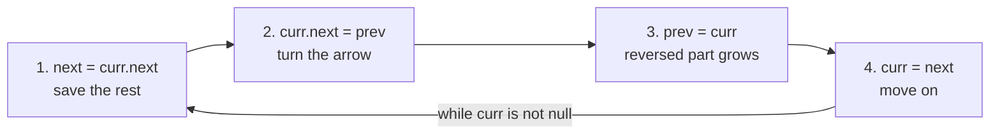
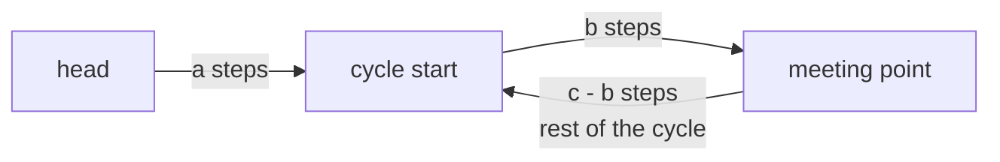
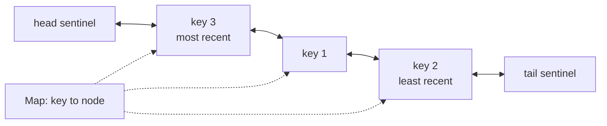
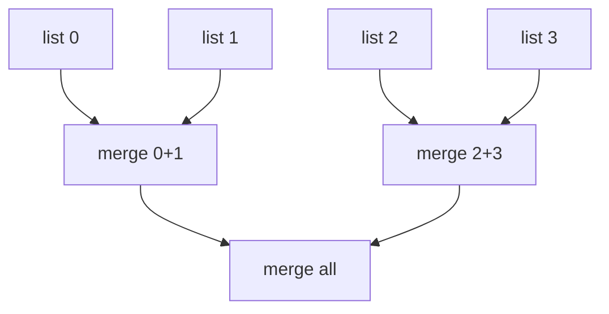

# Linked Lists

> In this document you will learn how to work with linked lists in JavaScript: the node class, test helpers, the dummy head trick, pointer reversal and fast/slow pointers. Then you will solve 13 classic problems, from reversing a list to merging k sorted lists and reversing nodes in groups of k. Linked list problems test whether you can change pointers carefully without losing part of the list — a skill interviewers can check in a few minutes.

**Before this:** [Data structures and Big-O](../01-cs-and-web-fundamentals/02-data-structures-and-big-o.md) · [Two pointers](02-two-pointers.md) · **Interview questions:** [jump to the interview section](#interview-questions)

## Table of contents

1. [The pattern](#the-pattern)
2. [Problems](#problems)
3. [Interview questions](#interview-questions)
4. [Summary](#summary)
5. [References](#references)

---

## The pattern

### What a linked list is (short refresher)

A **linked list** is a chain of **nodes**. Each node holds a value and a reference (a "pointer") to the next node. The first node is the **head**. The last node points to `null`. A **doubly linked list** also has a `prev` pointer in every node.

```text
head
 |
 v
[1 | •]--->[2 | •]--->[3 | •]---> null
```

The costs, compared with arrays, are explained in [Data structures and Big-O](../01-cs-and-web-fundamentals/02-data-structures-and-big-o.md). The short version:

| Operation | Array | Singly linked list |
| --- | --- | --- |
| Read item `i` | O(1) | O(n) — walk from the head |
| Insert or delete at the front | O(n) | O(1) |
| Insert or delete after a node you already hold | O(n) | O(1) |
| Find a value | O(n) | O(n) |

JavaScript has no built-in linked list. In interviews you write a small node class yourself.

**Analogy:** a treasure hunt. Each clue tells you where the next clue is. You cannot jump to clue number 7; you must follow clues 1 to 6 first. Where the analogy breaks: in code you can also **change** where a clue points, and most problems are about doing that safely.

### The node class and test helpers

Every problem in this document uses this code. Learn to write it in one minute: in an online interview you often must test your own code.

```js
class ListNode {
  constructor(val = 0, next = null) {
    this.val = val;
    this.next = next;
  }
}

// Build a list from an array: [1, 2, 3] -> 1 -> 2 -> 3
function fromArray(values) {
  const dummy = new ListNode();
  let tail = dummy;
  for (const value of values) {
    tail.next = new ListNode(value);
    tail = tail.next;
  }
  return dummy.next;
}

// Turn a list back into an array. The limit protects you from an infinite loop on a cycle.
function toArray(head, limit = 100_000) {
  const values = [];
  for (let node = head; node !== null; node = node.next) {
    if (values.length >= limit) throw new Error("List is too long or has a cycle");
    values.push(node.val);
  }
  return values;
}

// Build a list whose last node points back to the node at index `pos` (-1 = no cycle).
function fromArrayWithCycle(values, pos) {
  const head = fromArray(values);
  if (pos < 0 || head === null) return head;
  let tail = head;
  let entry = null;
  for (let i = 0; tail.next !== null; i++) {
    if (i === pos) entry = tail;
    tail = tail.next;
  }
  tail.next = entry ?? tail; // pos can also be the last index
  return head;
}

console.log(toArray(fromArray([1, 2, 3]))); // [ 1, 2, 3 ]
console.log(toArray(fromArray([])));        // []
```

### When to recognize the pattern (signals)

The input *is* a linked list, so the question is which technique to use:

| Signal in the problem | Technique |
| --- | --- |
| "Reverse", "reverse part of", "reverse in groups", "palindrome" | **Pointer reversal** with `prev`, `curr`, `next` |
| "Middle", "cycle", "where the cycle starts", "k-th from the end" | **Fast and slow pointers** (or a gap of k between two pointers) |
| The head itself might be removed or changed; you build a new list | **Dummy head** (a fake node before the real head) |
| "Merge", "sorted lists" | Dummy head + a `tail` pointer that you extend |
| "O(1) get and put", "least recently used" | **Hash map + doubly linked list** |
| "Deep copy" with extra pointers | Hash map from old node to new node (or interleaving) |

### Technique 1: the dummy head

A **dummy head** (also called a **sentinel**) is a fake node placed before the real head. Every real node now has a node before it, so you never need a special case for "the head changes". At the end, return `dummy.next`.

```js
// Remove every node with value `target`.
function removeElements(head, target) {
  const dummy = new ListNode(0, head);
  let prev = dummy;                       // the node before the one we are checking
  while (prev.next !== null) {
    if (prev.next.val === target) prev.next = prev.next.next; // skip it
    else prev = prev.next;
  }
  return dummy.next;                      // the real head may have changed
}

console.log(toArray(removeElements(fromArray([7, 7, 1, 7, 2]), 7))); // [ 1, 2 ]
```

Without the dummy, you would need an extra loop to remove the 7s at the front. With it, the front is just another "next" pointer.

### Technique 2: pointer reversal

To reverse arrows, walk with three pointers: `prev` (the already-reversed part), `curr` (the node you are fixing) and `next` (saved, so you do not lose the rest of the list).



The order matters. If you change `curr.next` before saving it, the rest of the list is lost (there is an example of this bug in the interview questions).

### Technique 3: fast and slow pointers

Two pointers start at the head. `slow` moves 1 step, `fast` moves 2 steps.

- When `fast` reaches the end, `slow` is in the **middle**.
- If there is a **cycle**, `fast` laps `slow` and they meet inside the cycle.
- A variant: move one pointer **k steps ahead** first, then move both by 1. When the front one reaches the end, the back one is **k from the end**.

These are the linked list form of the [two pointers](02-two-pointers.md) pattern.

### Templates

```js
// Template: walk with a dummy and a tail to BUILD a new list
function buildTemplate(values) {
  const dummy = new ListNode();
  let tail = dummy;
  for (const v of values) {
    tail.next = new ListNode(v); // attach
    tail = tail.next;            // move the tail
  }
  return dummy.next;
}

// Template: fast and slow
function middleTemplate(head) {
  let slow = head;
  let fast = head;
  while (fast !== null && fast.next !== null) {
    slow = slow.next;
    fast = fast.next.next;
  }
  return slow; // for even length: the second of the two middle nodes
}

console.log(toArray(buildTemplate([4, 5])));                 // [ 4, 5 ]
console.log(middleTemplate(fromArray([1, 2, 3, 4, 5])).val); // 3
```

### Complexity

- Almost every linked list solution is **O(n) time**: you walk the list a constant number of times.
- The usual goal is **O(1) extra space**: you change pointers instead of copying values into an array. Copying into an array is a valid brute force — say it, then improve it.
- Recursive solutions use **O(n) stack space**, and in JavaScript they can throw `RangeError: Maximum call stack size exceeded` for long lists (often somewhere around 10,000 frames; the exact limit depends on the engine and frame size).

### Common mistakes

- **Losing the rest of the list:** changing `curr.next` before saving it in `next`.
- **Null errors:** reading `fast.next.next` without checking `fast !== null && fast.next !== null`.
- **Forgetting to end the list:** after splitting or reordering, the last node must point to `null`, or you create a cycle (and your printing helper runs forever).
- **Returning the old head** after the head changed. With a dummy, return `dummy.next`.
- **Comparing values instead of nodes.** Two different nodes can hold the same value. To check "same node", compare references: `a === b`.
- **Using recursion on huge lists** in JavaScript (stack overflow).

---

## Problems

The problems go from Easy to Hard. Try each one yourself for 15–20 minutes before you read the solution. All code uses `ListNode`, `fromArray` and `toArray` from [the node class and test helpers](#the-node-class-and-test-helpers).

### P1. Reverse Linked List (Easy)

**Problem:** You get the head of a singly linked list. Reverse the list and return the new head. Similar to: LeetCode 206 Reverse Linked List.

**Examples:**

```text
1 -> 2 -> 3 -> 4 -> 5  ->  5 -> 4 -> 3 -> 2 -> 1
1 -> 2                 ->  2 -> 1
(empty)                ->  (empty)
```

**How to recognize the pattern:** "reverse" means turning every arrow around — pointer reversal.

**Brute force:** copy the values into an array, then write them back in reverse order (or build a new list). O(n) time and **O(n) extra space**. It works, but interviewers want O(1) space.

**Optimal approach (iterative):** walk the list with `prev`, `curr` and `next`. For each node, save `next`, point `curr.next` back to `prev`, then move both pointers forward. At the end, `prev` is the new head.

**Code:**

```js
function reverseList(head) {
  let prev = null;
  let curr = head;
  while (curr !== null) {
    const next = curr.next; // 1. save the rest of the list
    curr.next = prev;       // 2. turn the arrow around
    prev = curr;            // 3. the reversed part now starts at curr
    curr = next;            // 4. continue with the rest
  }
  return prev;              // the old tail is the new head
}

console.log(toArray(reverseList(fromArray([1, 2, 3, 4, 5])))); // [ 5, 4, 3, 2, 1 ]
console.log(toArray(reverseList(fromArray([1, 2]))));          // [ 2, 1 ]
console.log(toArray(reverseList(fromArray([]))));              // []
```

**Recursive version:** reverse everything after `head`, then hang `head` at the end of that reversed part.

```js
function reverseListRecursive(head) {
  if (head === null || head.next === null) return head; // 0 or 1 node: already reversed
  const newHead = reverseListRecursive(head.next);      // reverse the rest
  head.next.next = head; // the node after head is now the tail of the reversed part; attach head
  head.next = null;      // head becomes the new tail
  return newHead;
}

console.log(toArray(reverseListRecursive(fromArray([1, 2, 3])))); // [ 3, 2, 1 ]

const longList = fromArray(Array.from({ length: 100_000 }, (_, i) => i));
try {
  reverseListRecursive(longList);
} catch (error) {
  console.log(error.name); // RangeError
}
```

**Dry run** (iterative) on `1 -> 2 -> 3`:

| step | prev | curr | next | links after the step |
| --- | --- | --- | --- | --- |
| start | null | 1 | — | `1 -> 2 -> 3` |
| 1 | 1 | 2 | 2 | `null <- 1`   `2 -> 3` |
| 2 | 2 | 3 | 3 | `null <- 1 <- 2`   `3` |
| 3 | 3 | null | null | `null <- 1 <- 2 <- 3` |

Return `prev` = 3: the list is `3 -> 2 -> 1`.

**Complexity:** iterative: O(n) time, O(1) space. Recursive: O(n) time, O(n) call stack space.

**Edge cases:** empty list (return `null`); one node; two nodes; very long list (recursive version overflows the stack, as shown above).

**Follow-ups:**

- **Reverse only positions `left` to `right` (LeetCode 92).** Use a dummy, walk to the node before `left`, then reverse `right - left + 1` nodes with the same loop, and reconnect both ends.

```js
function reverseBetween(head, left, right) {
  const dummy = new ListNode(0, head);
  let before = dummy;
  for (let i = 1; i < left; i++) before = before.next; // node just before position left
  let prev = null;
  let curr = before.next;
  for (let i = left; i <= right; i++) {
    const next = curr.next;
    curr.next = prev;
    prev = curr;
    curr = next;
  }
  // before.next is the old first node of the segment; it is now the segment's tail
  before.next.next = curr; // connect the tail of the reversed segment to the rest
  before.next = prev;      // connect the part before the segment to its new first node
  return dummy.next;
}

console.log(toArray(reverseBetween(fromArray([1, 2, 3, 4, 5]), 2, 4))); // [ 1, 4, 3, 2, 5 ]
console.log(toArray(reverseBetween(fromArray([5]), 1, 1)));             // [ 5 ]
```

- **Which version would you write in production JavaScript?** The iterative one: no stack limit and O(1) space.

**How to say it in the interview:**
> "I walk the list once with three pointers. Prev is the part I already reversed, curr is the node I am fixing, and next saves the rest of the list before I break the link. For each node I save next, point curr back to prev, then move prev and curr forward. When curr becomes null, prev is the new head. That is O(n) time and O(1) space. A recursive version is shorter but uses O(n) stack, which can overflow in JavaScript for long lists."

### P2. Merge Two Sorted Lists (Easy)

**Problem:** You get the heads of two sorted linked lists. Merge them into one sorted list by **reusing the nodes** (splicing them together), and return its head. Similar to: LeetCode 21 Merge Two Sorted Lists.

**Examples:**

```text
1 -> 2 -> 4   and   1 -> 3 -> 4   ->  1 -> 1 -> 2 -> 3 -> 4 -> 4
(empty)       and   (empty)       ->  (empty)
(empty)       and   0             ->  0
```

**How to recognize the pattern:** "merge sorted" is the merge step of merge sort. Building a result list from scratch → dummy head + tail.

**Brute force:** put all values in an array, sort it, build a new list. O((m + n) log(m + n)) time and O(m + n) space, and it ignores that the inputs are already sorted.

**Optimal approach:**

1. Create a dummy node and a `tail` pointer at it.
2. While both lists have nodes, attach the smaller head to `tail`, and move that list forward.
3. Attach whatever is left of the non-empty list (it is already sorted).
4. Return `dummy.next`.

**Code:**

```js
function mergeTwoLists(a, b) {
  const dummy = new ListNode();
  let tail = dummy;
  while (a !== null && b !== null) {
    if (a.val <= b.val) {   // <= keeps equal values from `a` first (a stable merge)
      tail.next = a;
      a = a.next;
    } else {
      tail.next = b;
      b = b.next;
    }
    tail = tail.next;
  }
  tail.next = a ?? b;       // attach the rest; at most one list is non-empty
  return dummy.next;
}

console.log(toArray(mergeTwoLists(fromArray([1, 2, 4]), fromArray([1, 3, 4])))); // [ 1, 1, 2, 3, 4, 4 ]
console.log(toArray(mergeTwoLists(fromArray([]), fromArray([]))));               // []
console.log(toArray(mergeTwoLists(fromArray([]), fromArray([0]))));              // [ 0 ]
```

**Dry run** on `a = 1 -> 2 -> 4`, `b = 1 -> 3 -> 4`:

| step | a | b | pick | result so far |
| --- | --- | --- | --- | --- |
| 1 | 1 | 1 | a (1 <= 1) | 1 |
| 2 | 2 | 1 | b | 1 1 |
| 3 | 2 | 3 | a | 1 1 2 |
| 4 | 4 | 3 | b | 1 1 2 3 |
| 5 | 4 | 4 | a | 1 1 2 3 4 |
| end | null | 4 | attach rest | 1 1 2 3 4 4 |

**Complexity:** O(m + n) time, O(1) extra space (we only move pointers).

**Edge cases:** one or both lists empty; all of `a` smaller than all of `b`; equal values.

**Follow-ups:**

- **Recursive version?** `if (a.val <= b.val) { a.next = merge(a.next, b); return a; }` — short, but O(m + n) stack depth.
- **Sort a linked list in O(n log n) (LeetCode 148).** Merge sort: find the middle with fast/slow, cut the list in two, sort each half, merge with this function. Merge sort fits linked lists well because merging needs no extra array.
- **Merge k lists?** See P12.

**How to say it in the interview:**
> "I use a dummy node so I do not need a special case for the first node, and a tail pointer that marks the end of the merged list. While both lists have nodes, I attach the smaller head to the tail and move that list forward. When one list runs out, I attach the rest of the other one, because it is already sorted. It is O(m plus n) time and O(1) extra space, since I reuse the existing nodes."

### P3. Linked List Cycle (Easy)

**Problem:** You get the head of a linked list. Return `true` if some node can be reached again by following `next` pointers (the list has a **cycle**). Similar to: LeetCode 141 Linked List Cycle.

**Examples:**

```text
3 -> 2 -> 0 -> -4 -> (back to 2)  ->  true
1 -> 2 -> (back to 1)             ->  true
1 -> null                         ->  false
```

**How to recognize the pattern:** "cycle" in a linked list is the classic fast/slow pointer signal (**Floyd's cycle detection**, also called "tortoise and hare").

**Brute force:** walk the list and store every visited **node** (not value) in a `Set`. If you see a node again, there is a cycle. O(n) time, **O(n) space**.

```js
function hasCycleWithSet(head) {
  const seen = new Set();
  for (let node = head; node !== null; node = node.next) {
    if (seen.has(node)) return true; // same node object, compared by reference
    seen.add(node);
  }
  return false;
}

console.log(hasCycleWithSet(fromArrayWithCycle([3, 2, 0, -4], 1))); // true
```

**Optimal approach:** `slow` moves 1 step, `fast` moves 2 steps. If `fast` reaches `null`, there is no cycle. If there is a cycle, both pointers end up inside it, and `fast` gains 1 step on `slow` every move, so it must catch `slow`.

**Code:**

```js
function hasCycle(head) {
  let slow = head;
  let fast = head;
  while (fast !== null && fast.next !== null) {
    slow = slow.next;
    fast = fast.next.next;
    if (slow === fast) return true; // compare nodes, not values
  }
  return false;
}

console.log(hasCycle(fromArrayWithCycle([3, 2, 0, -4], 1))); // true
console.log(hasCycle(fromArrayWithCycle([1, 2], 0)));        // true
console.log(hasCycle(fromArray([1])));                       // false
console.log(hasCycle(null));                                 // false
```

**Dry run** on `3 -> 2 -> 0 -> -4 -> (back to 2)`:

| move | slow | fast |
| --- | --- | --- |
| start | 3 | 3 |
| 1 | 2 | 0 |
| 2 | 0 | 2 (0 → -4 → 2) |
| 3 | -4 | -4 (2 → 0 → -4) |

They meet at -4: there is a cycle.

**Complexity:** O(n) time — once `slow` enters the cycle, `fast` catches it within one lap. O(1) space.

**Edge cases:** empty list; one node without a cycle; one node pointing to itself (`fromArrayWithCycle([1], 0)` → `true`); the cycle goes back to the head.

**Follow-ups:**

- **Why can fast not "jump over" slow?** Inside the cycle, the distance between them shrinks by exactly 1 each move. A distance that shrinks by 1 must hit 0. It cannot skip from 1 to -1.
- **Why not move fast 3 steps?** The distance would shrink by 2, and it could skip 0 on odd distances, so they might go around more times before meeting. 2 steps is the simplest choice that always works quickly.
- **Where do cycles appear in real code?** Circular references in object graphs (that is why `JSON.stringify` throws "Converting circular structure to JSON"), and corrupted pointers in hand-written data structures.

**How to say it in the interview:**
> "A simple solution stores visited nodes in a set, but that costs O(n) memory. Instead I use Floyd's algorithm: slow moves one step and fast moves two. If fast reaches the end, there is no cycle. If there is a cycle, both pointers get trapped in it, and fast closes the gap by one node every step, so they must meet. That is O(n) time and O(1) space."

### P4. Middle of the Linked List (Easy)

**Problem:** You get the head of a non-empty linked list. Return the middle node. If there are two middle nodes, return the **second** one. Similar to: LeetCode 876 Middle of the Linked List.

**Examples:**

```text
1 -> 2 -> 3 -> 4 -> 5       ->  node 3
1 -> 2 -> 3 -> 4 -> 5 -> 6  ->  node 4   (second of the two middles)
1                           ->  node 1
```

**How to recognize the pattern:** "middle" without knowing the length → fast and slow pointers.

**Brute force:** count the length `n` in one pass, then walk `Math.floor(n / 2)` steps. Two passes, O(n) time, O(1) space. This is perfectly fine; fast/slow does it in one pass.

**Optimal approach:** move `slow` by 1 and `fast` by 2 while `fast` and `fast.next` exist. When `fast` cannot move anymore, `slow` is at the middle.

**Code:**

```js
function middleNode(head) {
  let slow = head;
  let fast = head;
  while (fast !== null && fast.next !== null) {
    slow = slow.next;
    fast = fast.next.next;
  }
  return slow;
}

// Variant: the FIRST middle for even lengths (useful for splitting a list in two halves)
function firstMiddleNode(head) {
  let slow = head;
  let fast = head;
  while (fast.next !== null && fast.next.next !== null) {
    slow = slow.next;
    fast = fast.next.next;
  }
  return slow;
}

console.log(middleNode(fromArray([1, 2, 3, 4, 5])).val);         // 3
console.log(middleNode(fromArray([1, 2, 3, 4, 5, 6])).val);      // 4
console.log(firstMiddleNode(fromArray([1, 2, 3, 4, 5, 6])).val); // 3
console.log(middleNode(fromArray([1])).val);                     // 1
```

**Dry run** on `1 -> 2 -> 3 -> 4 -> 5 -> 6` with `middleNode`:

| move | slow | fast |
| --- | --- | --- |
| start | 1 | 1 |
| 1 | 2 | 3 |
| 2 | 3 | 5 |
| 3 | 4 | null (5 → 6 → null) |

`fast` is `null`, so stop. The middle is 4.

**Complexity:** O(n) time, O(1) space.

**Edge cases:** one node; two nodes (`middleNode` returns the second, `firstMiddleNode` returns the first).

**Follow-ups:**

- **Which middle do you need?** For "split into two halves" (merge sort, reorder list, palindrome), the **first** middle is usually what you want, so that the first half is not shorter than the second. Say which one you pick and why.
- **Delete the middle node (LeetCode 2095).** Keep a `prev` pointer behind `slow` (or start `fast` one step ahead), then do `prev.next = slow.next`.

**How to say it in the interview:**
> "I use two pointers from the head. Slow moves one node at a time and fast moves two. When fast reaches the end, slow has moved half as far, so it is at the middle. The loop condition, fast and fast dot next not null, decides that for an even length I return the second middle; if I need the first middle I check fast dot next and fast dot next dot next instead. One pass, O(1) space."

### P5. Palindrome Linked List (Easy)

**Problem:** You get the head of a singly linked list. Return `true` if its values read the same forward and backward. Try for O(n) time and O(1) extra space. Similar to: LeetCode 234 Palindrome Linked List.

**Examples:**

```text
1 -> 2 -> 2 -> 1       ->  true
1 -> 2 -> 3 -> 2 -> 1  ->  true
1 -> 2                 ->  false
1                      ->  true
```

**How to recognize the pattern:** you need to compare the first half with the **reversed** second half. That combines two techniques: fast/slow to find the middle, and pointer reversal.

**Brute force:** copy the values into an array and check it with two pointers from both ends. O(n) time, O(n) space. This is a good first answer.

**Optimal approach:**

1. Find the end of the first half with `firstMiddleNode`.
2. Reverse the second half (the part after that node).
3. Compare the first half and the reversed second half, node by node.
4. Reverse the second half back to **restore** the list (good practice: do not leave the caller's data broken).

**Code:**

```js
function isPalindrome(head) {
  if (head === null || head.next === null) return true;

  // 1. find the end of the first half
  let slow = head;
  let fast = head;
  while (fast.next !== null && fast.next.next !== null) {
    slow = slow.next;
    fast = fast.next.next;
  }

  // 2. reverse the second half
  const reverse = (node) => {
    let prev = null;
    while (node !== null) {
      const next = node.next;
      node.next = prev;
      prev = node;
      node = next;
    }
    return prev;
  };
  const secondHalf = reverse(slow.next);

  // 3. compare
  let result = true;
  for (let p = head, q = secondHalf; q !== null; p = p.next, q = q.next) {
    if (p.val !== q.val) {
      result = false;
      break;
    }
  }

  // 4. restore the original list
  slow.next = reverse(secondHalf);
  return result;
}

console.log(isPalindrome(fromArray([1, 2, 2, 1])));    // true
console.log(isPalindrome(fromArray([1, 2, 3, 2, 1]))); // true
console.log(isPalindrome(fromArray([1, 2])));          // false

const list = fromArray([1, 2, 3, 1]);
console.log(isPalindrome(list)); // false
console.log(toArray(list));      // [ 1, 2, 3, 1 ]   (the list is unchanged)
```

**Dry run** on `1 -> 2 -> 3 -> 2 -> 1`:

1. `firstMiddle` loop: slow 1 → 2 → 3; fast 1 → 3 → 5 (then `fast.next` is null). The first half ends at node 3.
2. Reverse the part after 3: `2 -> 1` becomes `1 -> 2`.
3. Compare: `1` vs `1`, `2` vs `2`. The second half ends. All equal → `true`. (The middle node 3 needs no partner.)
4. Reverse `1 -> 2` back to `2 -> 1` and reconnect it after node 3.

**Complexity:** O(n) time (three passes over half the list or less, plus one over all). O(1) extra space.

**Edge cases:** empty list or one node (`true`); two equal nodes; two different nodes; odd and even lengths.

**Follow-ups:**

- **Is it a problem that we change the list while checking?** In a single-threaded JavaScript function, the list is restored before we return, so callers never see the change. But if another part of the code could read the list during the check (for example, in a shared-memory multi-threaded program), you should not modify it. Then use the O(n) array approach.
- **Recursive approach?** Keep a "front" pointer outside the recursion and compare on the way back up. It is clever, but uses O(n) stack.

**How to say it in the interview:**
> "The easy way is to copy the values into an array and use two pointers, which is O(n) space. For O(1) space, I find the end of the first half with fast and slow pointers, reverse the second half in place, and compare the two halves node by node. Then I reverse the second half again to restore the input, because I should not leave the caller's list changed. Overall O(n) time and O(1) space."

### P6. Linked List Cycle II: Find Where the Cycle Starts (Medium)

**Problem:** You get the head of a linked list. If it has a cycle, return the **node where the cycle begins**. Otherwise return `null`. Do not change the list. Use O(1) extra space. Similar to: LeetCode 142 Linked List Cycle II.

**Examples:**

```text
3 -> 2 -> 0 -> -4 -> (back to 2)  ->  node 2
1 -> 2 -> (back to 1)             ->  node 1
1 -> null                         ->  null
```

**How to recognize the pattern:** a cycle question → Floyd. "Where does it start" → Floyd's second phase.

**Brute force:** a `Set` of visited nodes. The first node you see twice is the start of the cycle. O(n) time, O(n) space.

**Optimal approach:**

1. Phase 1: run fast/slow from P3 until they meet. If `fast` hits `null`, return `null`.
2. Phase 2: put one pointer back at the `head`. Leave the other at the meeting point. Move **both one step at a time**. Where they meet is the start of the cycle.

**Why phase 2 works (in plain words):** let `a` = steps from the head to the cycle start, `b` = steps from the cycle start to the meeting point, and `c` = length of the cycle.

- When they meet, slow walked `a + b` steps. Fast walked twice as far: `2(a + b)`.
- Fast also walked `a + b` plus some whole laps: `2(a + b) = a + b + k·c`, so `a + b = k·c`.
- That means `a = k·c − b`. Starting at the meeting point, walking `a` steps is the same as walking `k` full laps minus `b` steps — which lands exactly on the cycle start.
- A pointer starting at the head also reaches the cycle start after `a` steps. So the two pointers meet there.



**Code:**

```js
function detectCycle(head) {
  let slow = head;
  let fast = head;
  while (fast !== null && fast.next !== null) {
    slow = slow.next;
    fast = fast.next.next;
    if (slow === fast) {
      // Phase 2: one pointer from the head, one from the meeting point, same speed
      let finder = head;
      while (finder !== slow) {
        finder = finder.next;
        slow = slow.next;
      }
      return finder; // the cycle start
    }
  }
  return null;
}

console.log(detectCycle(fromArrayWithCycle([3, 2, 0, -4], 1)).val); // 2
console.log(detectCycle(fromArrayWithCycle([1, 2], 0)).val);        // 1
console.log(detectCycle(fromArray([1])));                           // null
```

**Dry run** on `3 -> 2 -> 0 -> -4 -> (back to 2)`. Here `a = 1`, `c = 3`.

- Phase 1 (from P3): they meet at node -4, so `b = 2`. Check: `a + b = 3 = 1 · c`.
- Phase 2: `finder` at 3, `slow` at -4. One step: `finder` → 2, `slow` → 2. They meet at **node 2**, the cycle start.

**Complexity:** O(n) time, O(1) space.

**Edge cases:** no cycle; the cycle starts at the head (`a = 0`: the meeting point walk lands right back on the head); a node pointing to itself; a long tail before a short cycle.

**Follow-ups:**

- **Find the length of the cycle.** After they meet, keep one pointer still and move the other until it comes back, counting steps.
- **Find the duplicate number (LeetCode 287):** an array of n + 1 numbers in `[1, n]` with one duplicate. Treat `i → nums[i]` as a `next` pointer. The duplicate is the start of a cycle, so the same two phases find it in O(n) time and O(1) space, without changing the array.

```js
function findDuplicate(nums) {
  let slow = nums[0];
  let fast = nums[0];
  do {
    slow = nums[slow];
    fast = nums[nums[fast]];
  } while (slow !== fast);
  let finder = nums[0];
  while (finder !== slow) {
    finder = nums[finder];
    slow = nums[slow];
  }
  return finder;
}

console.log(findDuplicate([1, 3, 4, 2, 2])); // 2
console.log(findDuplicate([3, 1, 3, 4, 2])); // 3
```

**How to say it in the interview:**
> "First I use Floyd's fast and slow pointers to detect the cycle and find a meeting point. Then I reset one pointer to the head and move both one step at a time; they meet at the start of the cycle. The reason: if a is the distance to the cycle start and b is the distance from there to the meeting point, the math gives a equals a whole number of laps minus b, so walking a steps from the meeting point lands on the start. O(n) time and O(1) space."

### P7. Remove Nth Node From End of List (Medium)

**Problem:** You get the head of a linked list and a number `n`. Remove the `n`-th node **from the end** and return the head. `n` is always valid (1 ≤ n ≤ length). Try to do it in one pass. Similar to: LeetCode 19 Remove Nth Node From End of List.

**Examples:**

```text
1 -> 2 -> 3 -> 4 -> 5, n = 2  ->  1 -> 2 -> 3 -> 5
1, n = 1                      ->  (empty)
1 -> 2, n = 1                 ->  1
1 -> 2, n = 2                 ->  2
```

**How to recognize the pattern:** "k-th from the end" → two pointers with a **gap**. "The head might be removed" → dummy head.

**Brute force:** count the length `L` in one pass, then walk to node `L − n` (the node before the target) and unlink. Two passes, O(1) space. Fine, but the follow-up asks for one pass.

**Optimal approach:**

1. Create `dummy -> head`. Put `fast` and `slow` at `dummy`.
2. Move `fast` forward `n + 1` steps. Now there are exactly `n` nodes between `slow` and `fast`.
3. Move both one step at a time until `fast` is `null`. Now `slow` is **just before** the node to remove.
4. `slow.next = slow.next.next`. Return `dummy.next`.

**Code:**

```js
function removeNthFromEnd(head, n) {
  const dummy = new ListNode(0, head);
  let fast = dummy;
  let slow = dummy;
  for (let i = 0; i <= n; i++) fast = fast.next; // n + 1 steps: the gap is n nodes
  while (fast !== null) {
    fast = fast.next;
    slow = slow.next;
  }
  slow.next = slow.next.next; // unlink the n-th node from the end
  return dummy.next;
}

console.log(toArray(removeNthFromEnd(fromArray([1, 2, 3, 4, 5]), 2))); // [ 1, 2, 3, 5 ]
console.log(toArray(removeNthFromEnd(fromArray([1]), 1)));             // []
console.log(toArray(removeNthFromEnd(fromArray([1, 2]), 1)));          // [ 1 ]
console.log(toArray(removeNthFromEnd(fromArray([1, 2]), 2)));          // [ 2 ]
```

**Dry run** on `1 -> 2 -> 3 -> 4 -> 5`, `n = 2` (D is the dummy):

| step | slow | fast |
| --- | --- | --- |
| start | D | D |
| after 3 steps of fast | D | 3 |
| move both | 1 | 4 |
| move both | 2 | 5 |
| move both | 3 | null |

`slow` is at 3, so remove `3.next` (node 4). Result: `1 -> 2 -> 3 -> 5`.

**Complexity:** O(L) time, one pass. O(1) space.

**Edge cases:** removing the head (`n` equals the length — the dummy makes this work without a special case); a one-node list; removing the last node (`n = 1`).

**Follow-ups:**

- **What if `n` can be larger than the length?** Then the first loop would read `null.next`. Check `fast === null` inside that loop and return the head unchanged (or throw).
- **Is "one pass" really faster than two passes?** Both are O(L), and the one-pass version still moves two pointers. The real benefit is for streams where you cannot go back to the start; in an interview it shows you know the gap technique.

**How to say it in the interview:**
> "I put a dummy node before the head, because the node to remove might be the head. Then I move a fast pointer n plus one steps ahead, so there are n nodes between slow and fast. I move both together until fast falls off the end. At that point slow is right before the node to remove, so I unlink it. One pass, O(1) space."

### P8. Reorder List (Medium)

**Problem:** You get a list `L0 → L1 → … → Ln-1 → Ln`. Reorder it **in place** to `L0 → Ln → L1 → Ln-1 → L2 → Ln-2 → …`. You must change the nodes' links, not just their values. Similar to: LeetCode 143 Reorder List.

**Examples:**

```text
1 -> 2 -> 3 -> 4       ->  1 -> 4 -> 2 -> 3
1 -> 2 -> 3 -> 4 -> 5  ->  1 -> 5 -> 2 -> 4 -> 3
1                      ->  1
```

**How to recognize the pattern:** you need to take nodes alternately from the front and the **back**. A singly linked list cannot walk backward, so reverse the second half. This is three small techniques in a row: find the middle, reverse, merge.

**Brute force:** put all nodes in an array, then relink them with two indices `i` (front) and `j` (back). O(n) time, O(n) space.

**Optimal approach:**

1. Find the end of the first half (`firstMiddleNode`). Cut the list there: the second half starts at `slow.next`, and `slow.next = null`.
2. Reverse the second half.
3. Merge the two halves by taking one node from each, alternately.

**Code:**

```js
function reorderList(head) {
  if (head === null || head.next === null) return;

  // 1. find the end of the first half, and cut
  let slow = head;
  let fast = head;
  while (fast.next !== null && fast.next.next !== null) {
    slow = slow.next;
    fast = fast.next.next;
  }
  let second = slow.next;
  slow.next = null;

  // 2. reverse the second half
  let prev = null;
  while (second !== null) {
    const next = second.next;
    second.next = prev;
    prev = second;
    second = next;
  }
  second = prev;

  // 3. merge: first, second, first, second, ...
  let first = head;
  while (second !== null) {
    const firstNext = first.next;
    const secondNext = second.next;
    first.next = second;
    second.next = firstNext;
    first = firstNext;
    second = secondNext;
  }
}

const a = fromArray([1, 2, 3, 4]);
reorderList(a);
console.log(toArray(a)); // [ 1, 4, 2, 3 ]

const b = fromArray([1, 2, 3, 4, 5]);
reorderList(b);
console.log(toArray(b)); // [ 1, 5, 2, 4, 3 ]
```

**Dry run** on `1 -> 2 -> 3 -> 4 -> 5`:

1. First half ends at 3. Cut: `1 -> 2 -> 3` and `4 -> 5`.
2. Reverse the second half: `5 -> 4`.
3. Merge, two links per round:

| round | first | second | new links |
| --- | --- | --- | --- |
| 1 | 1 | 5 | `1 -> 5`, `5 -> 2` |
| 2 | 2 | 4 | `2 -> 4`, `4 -> 3` |
| end | 3 | null | stop |

The result is `1 -> 5 -> 2 -> 4 -> 3`. Node 3 already points to `null` because of the cut in step 1.

**Complexity:** O(n) time, O(1) extra space.

**Edge cases:** 0, 1 or 2 nodes (nothing changes for 0–2 nodes: `1 -> 2` stays `1 -> 2`); odd vs even length (with the first middle, the first half has the extra node, which correctly ends the list).

**Follow-ups:**

- **Why is the function `void`?** The problem says "in place" and the head does not change (L0 stays first). Returning nothing makes it clear that the input itself is modified.
- **Why cut the list (`slow.next = null`)?** Without the cut, the end of the first half still points into the second half, and the merge creates a cycle.

**How to say it in the interview:**
> "I need nodes from the back, but I cannot walk backward in a singly linked list, so I reverse the second half. First I find the middle with fast and slow pointers and cut the list in two. Then I reverse the second half. Then I weave the two halves together, taking one node from each in turn. Each step is linear and uses only pointers, so O(n) time and O(1) extra space."

### P9. Add Two Numbers (Medium)

**Problem:** Two non-negative integers are stored as linked lists, one digit per node, in **reverse order** (the ones digit first). Add them and return the sum as a list in the same format. Similar to: LeetCode 2 Add Two Numbers.

**Examples:**

```text
2 -> 4 -> 3  +  5 -> 6 -> 4        ->  7 -> 0 -> 8         (342 + 465 = 807)
0  +  0                            ->  0
9 -> 9 -> 9 -> 9  +  9 -> 9        ->  8 -> 9 -> 0 -> 0 -> 1   (9999 + 99 = 10098)
```

**How to recognize the pattern:** this is grade-school addition, digit by digit, with a carry. Building a new list → dummy head + tail.

**Brute force:** convert both lists to numbers, add, convert back. This **breaks in JavaScript** for long lists: numbers above 2^53 lose precision. `BigInt` would work, but it misses the point of the problem, and the interviewer will ask for the digit-by-digit version.

```js
// ❌ Wrong for long inputs: precision is lost above Number.MAX_SAFE_INTEGER
console.log(9007199254740993);         // 9007199254740992
console.log(Number.MAX_SAFE_INTEGER);  // 9007199254740991
```

**Optimal approach:**

1. Walk both lists at the same time with a `carry` (starting at 0).
2. At each step: `sum = (a?.val ?? 0) + (b?.val ?? 0) + carry`. The new digit is `sum % 10`. The new carry is `Math.floor(sum / 10)`.
3. Continue while either list has nodes **or** `carry` is not 0.

**Code:**

```js
function addTwoNumbers(a, b) {
  const dummy = new ListNode();
  let tail = dummy;
  let carry = 0;
  while (a !== null || b !== null || carry !== 0) {
    const sum = (a?.val ?? 0) + (b?.val ?? 0) + carry;
    carry = Math.floor(sum / 10);
    tail.next = new ListNode(sum % 10);
    tail = tail.next;
    a = a?.next ?? null;
    b = b?.next ?? null;
  }
  return dummy.next;
}

console.log(toArray(addTwoNumbers(fromArray([2, 4, 3]), fromArray([5, 6, 4])))); // [ 7, 0, 8 ]
console.log(toArray(addTwoNumbers(fromArray([0]), fromArray([0]))));             // [ 0 ]
console.log(toArray(addTwoNumbers(fromArray([9, 9, 9, 9]), fromArray([9, 9])))); // [ 8, 9, 0, 0, 1 ]
```

**Dry run** on `9 -> 9 -> 9 -> 9` + `9 -> 9`:

| step | a | b | carry in | sum | digit | carry out |
| --- | --- | --- | --- | --- | --- | --- |
| 1 | 9 | 9 | 0 | 18 | 8 | 1 |
| 2 | 9 | 9 | 1 | 19 | 9 | 1 |
| 3 | 9 | — | 1 | 10 | 0 | 1 |
| 4 | 9 | — | 1 | 10 | 0 | 1 |
| 5 | — | — | 1 | 1 | 1 | 0 |

Result: `8 -> 9 -> 0 -> 0 -> 1`.

**Complexity:** O(max(m, n)) time. O(max(m, n)) space for the new list (that is the output; extra space is O(1)).

**Edge cases:** different lengths; a final carry (`5 + 5 = 10` → `0 -> 1`); both numbers are 0.

**Follow-ups:**

- **The digits are stored in normal order, most significant first (LeetCode 445).** Push both lists' digits onto two stacks, then pop and add (this gives you the ones digit first). Build the result by inserting each new node at the **front**. Or reverse both lists, add, and reverse the result.
- **Why not `BigInt`?** It works (`BigInt("342") + BigInt("465")`), and in real code it is the right tool for big integers. In the interview, the point is to show you can do carry arithmetic on a data structure.

**How to say it in the interview:**
> "Converting to numbers would lose precision in JavaScript beyond two to the fifty-three, so I add digit by digit, like on paper. The lists start with the ones digit, which is exactly the order addition needs. I keep a carry, and at each step I add the two digits, treating a missing node as zero, write the sum mod 10, and carry the rest. I continue while either list or the carry remains. Linear time, and the only memory is the output list."

### P10. Copy List with Random Pointer (Medium)

**Problem:** Each node has a `next` pointer and a `random` pointer. `random` can point to any node in the list, or to `null`. Make a **deep copy**: new nodes with the same values, where the copies' `next` and `random` point to **copies**, never to the original nodes. Similar to: LeetCode 138 Copy List with Random Pointer.

**Examples** (each node written as `[value, index of random node or null]`):

```text
[[7, null], [13, 0], [11, 4], [10, 2], [1, 0]]  ->  the same structure, all new nodes
[[1, 1], [2, 1]]                                 ->  the same structure, all new nodes
[]                                               ->  []
```

**How to recognize the pattern:** a deep copy of a graph-like structure. When you copy a node, its `random` target may not exist yet. A **map from original node to copy** solves that.

**Brute force:** first copy the `next` chain. Then, for each original node, find its random target's **position** by walking from the head, and walk the copy to the same position. O(n²) time.

**Optimal approach (hash map, two passes):**

1. Pass 1: for every original node, create its copy and store `original → copy` in a `Map`.
2. Pass 2: for every original node, set `copy.next = map.get(original.next)` and `copy.random = map.get(original.random)`.
3. Return `map.get(head)`.

Use a `Map`, not a plain object: object keys become strings, so all nodes would turn into the same key `"[object Object]"`.

**Code:**

```js
class RandomNode {
  constructor(val, next = null, random = null) {
    this.val = val;
    this.next = next;
    this.random = random;
  }
}

function copyRandomList(head) {
  const copyOf = new Map([[null, null]]); // so that map.get(null) returns null
  for (let node = head; node !== null; node = node.next) {
    copyOf.set(node, new RandomNode(node.val));
  }
  for (let node = head; node !== null; node = node.next) {
    const copy = copyOf.get(node);
    copy.next = copyOf.get(node.next);
    copy.random = copyOf.get(node.random);
  }
  return copyOf.get(head);
}

// Helpers to build and describe a random list as [[value, randomIndex], ...]
function buildRandomList(pairs) {
  const nodes = pairs.map(([val]) => new RandomNode(val));
  nodes.forEach((node, i) => {
    node.next = nodes[i + 1] ?? null;
    node.random = pairs[i][1] === null ? null : nodes[pairs[i][1]];
  });
  return nodes[0] ?? null;
}
function describeRandomList(head) {
  const nodes = [];
  for (let n = head; n !== null; n = n.next) nodes.push(n);
  return nodes.map((n) => [n.val, n.random === null ? null : nodes.indexOf(n.random)]);
}

const original = buildRandomList([[7, null], [13, 0], [11, 4], [10, 2], [1, 0]]);
const copy = copyRandomList(original);
console.log(describeRandomList(copy)); // [ [ 7, null ], [ 13, 0 ], [ 11, 4 ], [ 10, 2 ], [ 1, 0 ] ]
console.log(copy !== original);        // true
console.log(copy.next.random === original); // false   (points to the copy of node 0, not the original)
console.log(copy.next.random === copy);     // true
```

**Dry run** on `[[1, 1], [2, 1]]` (both random pointers point to node B, the second node):

1. Pass 1: map `A → A'`, `B → B'`.
2. Pass 2, node A: `A'.next = map(B) = B'`, `A'.random = map(B) = B'`.
3. Pass 2, node B: `B'.next = map(null) = null`, `B'.random = map(B) = B'`.

**Complexity:** O(n) time, O(n) extra space for the map.

**Edge cases:** empty list; `random` pointing to itself; all `random` pointers `null`; `random` pointing backward or forward.

**Follow-ups:**

- **O(1) extra space (not counting the output)?** Interleave the copies with the originals: `A -> A' -> B -> B' -> ...`. Then `A'.random = A.random.next` (the copy sits right after its original). Finally, split the two lists apart. (This code reuses `RandomNode`, `buildRandomList` and `describeRandomList` from above.)

```js
function copyRandomListInterleaved(head) {
  if (head === null) return null;
  // 1. insert each copy right after its original
  for (let node = head; node !== null; node = node.next.next) {
    node.next = new RandomNode(node.val, node.next);
  }
  // 2. set random pointers of the copies
  for (let node = head; node !== null; node = node.next.next) {
    node.next.random = node.random === null ? null : node.random.next;
  }
  // 3. separate the two lists (and restore the original)
  const copyHead = head.next;
  for (let node = head; node !== null; node = node.next) {
    const copy = node.next;
    node.next = copy.next;
    copy.next = copy.next === null ? null : copy.next.next;
  }
  return copyHead;
}

const original2 = buildRandomList([[7, null], [13, 0], [11, 4], [10, 2], [1, 0]]);
console.log(describeRandomList(copyRandomListInterleaved(original2))); // [ [ 7, null ], [ 13, 0 ], [ 11, 4 ], [ 10, 2 ], [ 1, 0 ] ]
console.log(describeRandomList(original2));                            // [ [ 7, null ], [ 13, 0 ], [ 11, 4 ], [ 10, 2 ], [ 1, 0 ] ]
```

- **What about `structuredClone`?** In modern JavaScript, `structuredClone(head)` deep-copies objects and keeps shared and circular references correct. It works for plain data like this (but it does not keep class prototypes: the copies are plain objects, not `RandomNode` instances). In an interview, the point is to implement the copy yourself. See [Objects and copying](../02-javascript/07-objects-and-copying.md).
- **Clone a graph (LeetCode 133).** Same "map from original to copy" idea, with BFS or DFS. See [Graphs](10-graphs-bfs-dfs-and-topological-sort.md).

**How to say it in the interview:**
> "The difficulty is that a random pointer can point to a node I have not copied yet. So I do two passes with a map from each original node to its copy. In the first pass I create all copies. In the second pass I set each copy's next and random by looking up the copies of the original's next and random. I use a Map because object keys would become strings. That is O(n) time and space; if space matters, I can interleave copies with the originals to get O(1) extra space."

### P11. LRU Cache (Medium)

**Problem:** Design a **least recently used (LRU)** cache with a fixed capacity. `get(key)` returns the value or `-1`, and marks the key as recently used. `put(key, value)` inserts or updates the key and marks it as recently used. If the cache grows over capacity, it removes the least recently used key. Both operations must be **O(1)** on average. Similar to: LeetCode 146 LRU Cache.

The full design discussion — including the short `Map`-only version that relies on `Map` keeping insertion order — is in [JavaScript polyfills and implementations, LRU cache](../11-coding-interviews/04-javascript-polyfills-and-implementations.md#lru-cache). Here we focus on the linked list part, which is what this problem really tests, and then go further with follow-ups.

**Examples:**

```text
capacity = 2
put(1, 1); put(2, 2)
get(1)    -> 1        (order, most recent first: 1, 2)
put(3, 3)             (over capacity: evict 2, the least recent)
get(2)    -> -1
put(4, 4)             (evict 1)
get(1)    -> -1
get(3)    -> 3
get(4)    -> 4
```

**How to recognize the pattern:** "O(1) lookup" → hash map. "O(1) move to the front and O(1) remove from the back, in recency order" → doubly linked list. Together: the map finds the node, the list keeps the order.

**Brute force:** an array of keys in recency order. Every `get` must find the key and move it to the front: O(n).

**Optimal approach:**

1. A `Map` from key to list node.
2. A doubly linked list ordered from **most recent** (right after `head`) to **least recent** (right before `tail`). `head` and `tail` are **sentinel** nodes, so `unlink` and `addFront` never need `null` checks.
3. `get`: find the node in the map, move it to the front, return its value.
4. `put`: if the key exists, update and move to the front. Otherwise create a node, add it to the front and to the map. If the size is over capacity, remove `tail.prev` from the list and from the map. (This is why each node also stores its **key**: so you can delete it from the map.)



**Code:**

```js
class LRUCache {
  #capacity;
  #nodes = new Map(); // key -> node
  #head = { key: null, value: null, prev: null, next: null }; // sentinel before the most recent node
  #tail = { key: null, value: null, prev: null, next: null }; // sentinel after the least recent node

  constructor(capacity) {
    this.#capacity = capacity;
    this.#head.next = this.#tail;
    this.#tail.prev = this.#head;
  }

  #unlink(node) {
    node.prev.next = node.next;
    node.next.prev = node.prev;
  }

  #addFront(node) {
    node.prev = this.#head;
    node.next = this.#head.next;
    this.#head.next.prev = node;
    this.#head.next = node;
  }

  get(key) {
    const node = this.#nodes.get(key);
    if (node === undefined) return -1;
    this.#unlink(node);   // move to the front: it is now the most recent
    this.#addFront(node);
    return node.value;
  }

  put(key, value) {
    const existing = this.#nodes.get(key);
    if (existing !== undefined) {
      existing.value = value;
      this.#unlink(existing);
      this.#addFront(existing);
      return;
    }
    const node = { key, value, prev: null, next: null };
    this.#nodes.set(key, node);
    this.#addFront(node);
    if (this.#nodes.size > this.#capacity) {
      const leastRecent = this.#tail.prev;
      this.#unlink(leastRecent);
      this.#nodes.delete(leastRecent.key); // the node stores its key for exactly this step
    }
  }
}

const cache = new LRUCache(2);
cache.put(1, 1);
cache.put(2, 2);
console.log(cache.get(1)); // 1
cache.put(3, 3);           // evicts key 2
console.log(cache.get(2)); // -1
cache.put(4, 4);           // evicts key 1
console.log(cache.get(1)); // -1
console.log(cache.get(3)); // 3
console.log(cache.get(4)); // 4
```

**Dry run** (list shown from most recent to least recent):

| operation | list after | evicted |
| --- | --- | --- |
| put(1, 1) | 1 | |
| put(2, 2) | 2, 1 | |
| get(1) → 1 | 1, 2 | |
| put(3, 3) | 3, 1, ~~2~~ → 3, 1 | 2 |
| get(2) → -1 | 3, 1 | |
| put(4, 4) | 4, 3, ~~1~~ → 4, 3 | 1 |
| get(3) → 3 | 3, 4 | |
| get(4) → 4 | 4, 3 | |

**Complexity:** `get` and `put` are O(1) on average (one map operation plus a constant number of pointer changes). Space O(capacity).

**Edge cases:** capacity 1 (every new key evicts the old one); `put` on an existing key (update, do not grow); `get` on a missing key; keys of any type (`Map` handles objects and numbers without converting them to strings).

**Follow-ups:**

- **Why a doubly linked list and not a singly linked one?** To unlink a node in O(1), you need the node **before** it. Only a `prev` pointer gives you that.
- **Why sentinels?** Without them, `unlink` and `addFront` need special cases for an empty list, the first node and the last node. Sentinels remove all of those branches, which removes bugs.
- **Add a time-to-live (TTL).** Store `expiresAt` in each node. In `get`, if `Date.now() > expiresAt`, delete the node and return `-1` (lazy expiry). For memory control, also sweep from the tail occasionally.
- **LFU cache (least *frequently* used, LeetCode 460).** Keep a map from key to node, a map from frequency to a doubly linked list of nodes with that frequency, and the current minimum frequency. On access, move the node from list `f` to list `f + 1`. Evict from the list of the minimum frequency. Still O(1).
- **Real-world use:** in-memory caches in Node.js services (the `lru-cache` npm package), image and thumbnail caches in desktop apps, and database buffer pools. Server-side caching strategy is covered in [Caching in Node.js](../07-nodejs-backend/11-caching.md).

**How to say it in the interview:**
> "I combine a hash map and a doubly linked list. The map gives me the node for a key in O(1). The list keeps the keys in order of use: the most recent right after a head sentinel and the least recent right before a tail sentinel. On get, I move the node to the front. On put, I insert or update at the front, and if I go over capacity I remove the node before the tail and delete its key from the map — that is why each node stores its key. Everything is O(1)."

### P12. Merge k Sorted Lists (Hard)

**Problem:** You get an array of `k` sorted linked lists. Merge them all into one sorted list and return its head. Similar to: LeetCode 23 Merge k Sorted Lists.

**Examples:**

```text
[1 -> 4 -> 5, 1 -> 3 -> 4, 2 -> 6]  ->  1 -> 1 -> 2 -> 3 -> 4 -> 4 -> 5 -> 6
[]                                  ->  (empty)
[(empty)]                           ->  (empty)
```

**How to recognize the pattern:** many sorted sequences → merge them. Either merge them **in pairs** (divide and conquer, like merge sort) or always pick the smallest head with a **min-heap**.

**Brute force options:**

- Collect all N values, sort, build a new list: O(N log N) time, O(N) space.
- Merge the lists one by one into a growing result: the result gets longer each time, so the total is O(N × k). With k = 10,000 lists this is slow.

**Optimal approach (divide and conquer):**

1. Pair up the lists: merge list 0 with 1, 2 with 3, and so on, using `mergeTwoLists` from P2.
2. Now you have about k/2 lists. Repeat until one list is left.
3. Each round touches every node once (O(N)), and there are about log₂ k rounds.



**Code** (uses `mergeTwoLists` from P2):

```js
function mergeKLists(lists) {
  if (lists.length === 0) return null;
  let round = lists;
  while (round.length > 1) {
    const nextRound = [];
    for (let i = 0; i < round.length; i += 2) {
      const pair = i + 1 < round.length ? mergeTwoLists(round[i], round[i + 1]) : round[i];
      nextRound.push(pair);
    }
    round = nextRound; // about half as many lists, each about twice as long
  }
  return round[0];
}

const lists = [fromArray([1, 4, 5]), fromArray([1, 3, 4]), fromArray([2, 6])];
console.log(toArray(mergeKLists(lists)));          // [ 1, 1, 2, 3, 4, 4, 5, 6 ]
console.log(toArray(mergeKLists([])));             // []
console.log(toArray(mergeKLists([fromArray([])]))); // []
```

**Dry run** on `[1 4 5], [1 3 4], [2 6]`:

| round | lists |
| --- | --- |
| 0 | `[1 4 5]`, `[1 3 4]`, `[2 6]` |
| 1 | merge(0, 1) = `[1 1 3 4 4 5]`, `[2 6]` (no partner, carried over) |
| 2 | merge = `[1 1 2 3 4 4 5 6]` |

**Complexity:** O(N log k) time, where N is the total number of nodes — about log₂ k rounds, each O(N). O(1) extra space besides the small array of list heads (O(k)). No recursion, so no stack depth issues.

**Edge cases:** an empty array of lists; lists that are empty (`null`); one list; lists of very different lengths.

**Follow-ups:**

- **Min-heap version.** Put the head of each list in a min-heap keyed by value. Pop the smallest, attach it, and push its `next`. Also O(N log k). JavaScript has no built-in heap, so you write one; the heap and this version are in [Heaps and top-k, P10](09-heaps-and-top-k.md#p10-merge-k-sorted-lists-hard).
- **Which one would you choose?** Divide and conquer needs no extra data structure and is easy to write. The heap version is better when the lists are **streams** that arrive over time (for example, merging sorted log files or paginated API results), because it only needs the current head of each.
- **Why is merging one by one O(N × k)?** If each list has N/k nodes, the growing result has N/k, 2N/k, 3N/k, ... nodes. Summed over k merges that is about N × k / 2.

**How to say it in the interview:**
> "Merging the lists one by one costs O(N times k) because the result keeps growing. Instead I merge them in pairs, like merge sort: list 0 with 1, 2 with 3, and so on, then repeat on the results. Each round processes every node once, and there are log k rounds, so it is O(N log k). A min-heap of the current heads gives the same complexity and works better for streams."

### P13. Reverse Nodes in k-Group (Hard)

**Problem:** You get a linked list and a positive integer `k`. Reverse the nodes **k at a time** and return the new head. If the number of nodes left at the end is less than `k`, leave them as they are. Change the links, not only the values. Use O(1) extra space. Similar to: LeetCode 25 Reverse Nodes in k-Group.

**Examples:**

```text
1 -> 2 -> 3 -> 4 -> 5, k = 2  ->  2 -> 1 -> 4 -> 3 -> 5
1 -> 2 -> 3 -> 4 -> 5, k = 3  ->  3 -> 2 -> 1 -> 4 -> 5
1 -> 2 -> 3, k = 1            ->  1 -> 2 -> 3
```

**How to recognize the pattern:** "reverse" → pointer reversal. "In groups" and "the head changes" → a dummy head, and a pointer to the node **before** each group so you can reconnect it.

**Brute force:** copy the values into an array, reverse each block of k, write them back. O(n) time but O(n) space, and it changes values instead of links (not allowed).

**Optimal approach:**

1. `dummy -> head`. `groupPrev = dummy` (the node before the current group).
2. Find the k-th node after `groupPrev`. If there are fewer than k nodes, stop.
3. Remember `groupNext = kth.next` (the first node after the group).
4. Reverse the group with the P1 loop, but start `prev` at `groupNext`, so the group's old first node ends up pointing to the rest of the list.
5. Reconnect: `groupPrev.next` becomes `kth` (the new first node). The old first node is now the group's last node; it becomes the next `groupPrev`.

**Code:**

```js
function reverseKGroup(head, k) {
  const dummy = new ListNode(0, head);
  let groupPrev = dummy;
  while (true) {
    // 1. find the k-th node of this group
    let kth = groupPrev;
    for (let i = 0; i < k && kth !== null; i++) kth = kth.next;
    if (kth === null) break; // fewer than k nodes left: keep them as they are

    // 2. reverse the group; prev starts at groupNext so the reversed tail links to the rest
    const groupNext = kth.next;
    let prev = groupNext;
    let curr = groupPrev.next;
    while (curr !== groupNext) {
      const next = curr.next;
      curr.next = prev;
      prev = curr;
      curr = next;
    }

    // 3. reconnect the group to the part before it
    const oldFirst = groupPrev.next; // now the last node of the reversed group
    groupPrev.next = kth;            // kth is now the first node of the group
    groupPrev = oldFirst;
  }
  return dummy.next;
}

console.log(toArray(reverseKGroup(fromArray([1, 2, 3, 4, 5]), 2))); // [ 2, 1, 4, 3, 5 ]
console.log(toArray(reverseKGroup(fromArray([1, 2, 3, 4, 5]), 3))); // [ 3, 2, 1, 4, 5 ]
console.log(toArray(reverseKGroup(fromArray([1, 2, 3]), 1)));       // [ 1, 2, 3 ]
console.log(toArray(reverseKGroup(fromArray([1, 2]), 3)));          // [ 1, 2 ]
```

**Dry run** on `1 -> 2 -> 3 -> 4 -> 5`, `k = 2` (D is the dummy):

| group | groupPrev | kth | groupNext | after reversing and reconnecting |
| --- | --- | --- | --- | --- |
| 1 | D | 2 | 3 | `D -> 2 -> 1 -> 3 -> 4 -> 5`, groupPrev = 1 |
| 2 | 1 | 4 | 5 | `D -> 2 -> 1 -> 4 -> 3 -> 5`, groupPrev = 3 |
| 3 | 3 | null (only 5 left) | — | stop |

Result: `2 -> 1 -> 4 -> 3 -> 5`.

**Complexity:** O(n) time — each node is visited a constant number of times (once to find `kth`, once to reverse). O(1) extra space.

**Edge cases:** `k = 1` (nothing changes); `k` equal to the length (the whole list is reversed); `k` bigger than the length (nothing changes); a length that is an exact multiple of k.

**Follow-ups:**

- **Also reverse the last group if it has fewer than k nodes.** Remove the "fewer than k" check: reverse until `curr` is `null` instead of `groupNext`.
- **Swap nodes in pairs (LeetCode 24).** That is exactly `reverseKGroup(head, 2)`.
- **Recursive version?** Reverse the first k nodes, then set the old first node's `next` to `reverseKGroup(rest, k)`. Simple, but the recursion depth is n / k, which can overflow for long lists with small k.

**How to say it in the interview:**
> "I use a dummy node and a pointer to the node just before the current group. For each group, I first check that k nodes exist by walking to the k-th node; if not, I stop. Then I reverse the group with the standard three-pointer loop, but I start prev at the node after the group, so the reversed group is already connected to the rest of the list. Finally I connect the node before the group to the new first node, and the old first node becomes the 'before' pointer for the next group. O(n) time and O(1) space."

---

## Interview questions

### Q1. When would you use a linked list instead of an array in JavaScript?

**What the interviewer is checking:** practical understanding of trade-offs, not only textbook Big-O.

**Short spoken answer (30–60 seconds):**
> "In JavaScript I use arrays almost always, because they are fast, compact in memory and cache-friendly, and push and pop at the end are O(1). I reach for a linked list when I need O(1) insert or remove in the middle at a position I already hold a reference to, or at the front. The classic examples are an LRU cache, where a map points to list nodes, and a queue, because array shift is O(n). The trade-offs are O(n) access by index, more memory per item for the pointers, and worse cache behaviour because nodes are spread around memory."

**Detailed explanation:** Big-O says linked lists win for inserts and deletes, but in practice arrays are often faster even for operations that are O(n), because modern CPUs read contiguous memory very quickly. The real win of a linked list is when you **already have a pointer to the node** (from a map), so you skip the O(n) search.

**Follow-up questions:**

- **How do you make a fast queue in JavaScript without a linked list?** An array with a head index (`items[head++]`), and occasionally compact the array; or a ring buffer with a fixed capacity.
- **Does JavaScript use linked lists internally?** Engines and runtimes use them in places. For example, Node.js keeps timers with the same duration in linked lists inside its timer implementation. You do not see that from your code.

**Common mistakes:** saying "linked lists are faster for insertion" without mentioning that you first need to find the position, which is O(n).

**Where this is used in real projects:** LRU caches, task queues, undo histories with cheap splicing, and React's Fiber tree, which links each fiber to its child, sibling and parent with pointers.

### Q2. What is the dummy head trick, and when do you use it?

**What the interviewer is checking:** whether you can write clean pointer code without many special cases.

**Short spoken answer (30–60 seconds):**
> "A dummy head is a fake node that I put before the real head. Then every real node, including the first one, has a node before it, so inserting or deleting at the head works exactly like anywhere else. At the end I return dummy dot next, which is the real head even if it changed. I use it whenever the head can be removed or replaced — like removing elements, removing the n-th from the end, or reversing in groups — and whenever I build a new list, like merging, where I attach nodes to a tail."

**Code:**

```js
// ❌ Without a dummy: a special case for the head
function removeValueNoDummy(head, target) {
  while (head !== null && head.val === target) head = head.next; // special case
  let node = head;
  while (node !== null && node.next !== null) {
    if (node.next.val === target) node.next = node.next.next;
    else node = node.next;
  }
  return head;
}

// ✅ With a dummy: one rule for every node
function removeValue(head, target) {
  const dummy = new ListNode(0, head);
  for (let node = dummy; node.next !== null; ) {
    if (node.next.val === target) node.next = node.next.next;
    else node = node.next;
  }
  return dummy.next;
}

console.log(toArray(removeValueNoDummy(fromArray([6, 6, 1, 6]), 6))); // [ 1 ]
console.log(toArray(removeValue(fromArray([6, 6, 1, 6]), 6)));        // [ 1 ]
```

**Follow-up questions:**

- **Does the dummy node cost anything?** One extra object, O(1). It is garbage collected after the function returns, because nothing references it.
- **Is a sentinel the same thing?** Yes, a sentinel is the general name. The LRU cache uses two sentinels, one at each end.

**Common mistakes:** returning `head` instead of `dummy.next`; forgetting that the dummy's value is fake and must never appear in the output.

### Q3. Explain Floyd's cycle detection. Why must the pointers meet, and why does the second phase find the cycle start?

**What the interviewer is checking:** depth of understanding behind a memorized trick.

**Short spoken answer (30–60 seconds):**
> "Slow moves one step and fast moves two. If there is no cycle, fast reaches null. If there is a cycle, both pointers eventually enter it, and from then on fast gains exactly one step on slow every move, so the gap shrinks by one each time and must reach zero — they meet within one lap. For the start of the cycle: if a is the distance to the cycle start and b from there to the meeting point, fast walked twice as far as slow, which gives a plus b equal to a whole number of laps. So a equals some laps minus b, which means walking a steps from the meeting point lands on the cycle start — the same place a pointer from the head reaches after a steps. So I move one pointer from the head and one from the meeting point together until they meet."

**Detailed explanation:** see P6 for the full derivation and diagram. The important intuition: the meeting point is exactly `b` steps past the start, and the head is `a` steps before the start, and `a ≡ −b` (modulo the cycle length).

**Follow-up questions:**

- **What is the time complexity, more precisely?** Slow enters the cycle after `a` steps; fast catches it within at most `c` more steps. Phase 2 takes `a` steps. Total O(a + c) = O(n).
- **Can you use the same idea outside linked lists?** Yes: any function `x → f(x)` on a finite set eventually cycles. Examples: "happy number" (LeetCode 202) and "find the duplicate number" (P6 follow-up).

**Common mistakes:** comparing values (`slow.val === fast.val`) instead of nodes; checking `slow === fast` before the first move (they start equal).

**Where this is used in real projects:** detecting loops in linked data (for example, a corrupted parent chain in a tree, or a redirect chain), and in cryptography (Pollard's rho algorithm uses the same idea).

### Q4. Iterative or recursive reversal — which is better in JavaScript?

**Short answer:** iterative. Both are O(n) time, but the recursive version uses O(n) call stack space, and JavaScript engines have a limited stack (often around 10,000 frames; it depends on the engine and on frame size). A list of 100,000 nodes throws `RangeError: Maximum call stack size exceeded`, as shown in P1. JavaScript engines in practice do not do tail-call optimization (only Safari's JavaScriptCore does), so you cannot rely on that. Recursive code is fine to show as an alternative, but say this limitation out loud.

### Q5. What does this code print?

```js
const head = fromArray([1, 2, 3]);
let prev = null;
let curr = head;
while (curr !== null) {
  curr.next = prev; // ❌ Wrong: the rest of the list is lost before we save it
  prev = curr;
  curr = curr.next;
}
console.log(toArray(prev)); // [ 1 ]
```

**Answer:** `[ 1 ]`.

**Step by step:**

1. `curr` is node 1. `curr.next = prev` sets `1.next = null`. The link to node 2 is now gone.
2. `prev = curr` → `prev` is node 1.
3. `curr = curr.next` → `curr` is `1.next`, which is now `null`. The loop ends.
4. `prev` is node 1 with no next: `[1]`. Nodes 2 and 3 are lost (and will be garbage collected).

**The fix:** save `const next = curr.next` **before** changing `curr.next`, and then use `curr = next`.

**What the interviewer is checking:** whether you understand that a pointer change is immediate, and the order of the four reversal steps.

### Q6. How do you test and debug linked list code in an interview?

**What the interviewer is checking:** practical testing habits.

**Short spoken answer (30–60 seconds):**
> "I write two tiny helpers first: one that builds a list from an array and one that turns a list back into an array, with a length limit so a bug that creates a cycle does not hang my program. Then I test the classic small cases: empty, one node, two nodes, odd and even length, and the case where the head changes. When something is wrong, I draw the nodes and arrows on paper for a three-node list and update the arrows line by line. Most bugs are a lost reference, a missing null check, or a missing null at the new end of the list."

**Follow-up questions:**

- **How do you check that a function did not create a cycle?** `toArray` with a limit throws, or run `hasCycle` from P3 on the result.
- **How do you test thoroughly outside the interview?** Compare against an array-based brute force on thousands of random inputs. All solutions in this document were checked that way.

### Q7. You remove a node from a list in JavaScript. Do you need to free its memory?

**Short answer:** no. JavaScript has automatic **garbage collection**. Once nothing references the removed node, the engine frees it later. Two details matter: (1) if something else still holds a reference to the removed node (an iterator, a map entry, a closure), it stays in memory — for example, the LRU cache must also delete the key from its map; (2) the removed node may still point **into** the list through its own `next`, which is harmless for memory, but can confuse code that later uses that node. Setting `removed.next = null` is a good habit for clarity. More on this in [Memory management and garbage collection](../02-javascript/19-memory-management-and-garbage-collection.md).

### Q8. Implement a queue with O(1) enqueue and dequeue for a BFS in JavaScript.

**What the interviewer is checking:** applying linked lists to a real performance problem (`shift()` is O(n)).

**Short spoken answer (30–60 seconds):**
> "Array shift is O(n) because every element moves, so a BFS over a million nodes that uses shift can become very slow. A small singly linked list with head and tail pointers gives O(1) for both operations: enqueue appends after the tail, dequeue removes the head. In practice an array plus a head index is even simpler and faster, but the linked list version shows the idea clearly and never needs compaction."

**Code:**

```js
class LinkedQueue {
  #head = null;
  #tail = null;
  #size = 0;

  enqueue(value) {
    const node = { value, next: null };
    if (this.#tail === null) this.#head = node;
    else this.#tail.next = node;
    this.#tail = node;
    this.#size++;
  }

  dequeue() {
    if (this.#head === null) return undefined;
    const { value } = this.#head;
    this.#head = this.#head.next;
    if (this.#head === null) this.#tail = null; // the queue became empty
    this.#size--;
    return value;
  }

  get size() {
    return this.#size;
  }
}

const queue = new LinkedQueue();
queue.enqueue("a");
queue.enqueue("b");
console.log(queue.dequeue()); // a
queue.enqueue("c");
console.log(queue.dequeue()); // b
console.log(queue.dequeue()); // c
console.log(queue.dequeue()); // undefined
console.log(queue.size);      // 0
```

**Follow-up questions:**

- **What bug is easy to make here?** Forgetting to reset `tail` to `null` when the last item is removed. The next `enqueue` would then attach to a node that is no longer in the queue.
- **Where else is this used?** Job queues in Node.js workers, event buffers, and BFS in graph problems (see [Graphs](10-graphs-bfs-dfs-and-topological-sort.md)).

**Common mistakes:** using `array.shift()` in a hot loop and calling it O(1).

---

## Summary

- **Write the helpers first:** `ListNode`, `fromArray`, `toArray` (with a length limit). Test empty, 1, 2, odd and even lengths, and "head changes".
- **Dummy head** whenever the head can change or you build a new list. Return `dummy.next`.
- **Reversal order:** `next = curr.next; curr.next = prev; prev = curr; curr = next;`. Save before you break.
- **Fast/slow:** middle (`while (fast && fast.next)` → second middle), cycle detection (meet = cycle), cycle start (reset one to head, move both by 1).
- **Gap of n:** move `fast` n + 1 steps from the dummy, then both — `slow` stops before the n-th from the end.
- **Combine techniques:** palindrome and reorder = find middle + reverse second half (+ merge).
- **Merge:** dummy + tail; two lists O(m + n); k lists by pairs or a heap, O(N log k).
- **Hash map + list:** LRU cache (doubly linked list with sentinels, node stores its key); deep copy with random pointers (map from original to copy, or interleave).
- **JavaScript specifics:** compare nodes with `===`, not values; use `Map` (not objects) for node keys; avoid recursion on long lists; numbers lose precision above 2^53 (add digit by digit or use `BigInt`).

## References

- MDN: [Map](https://developer.mozilla.org/en-US/docs/Web/JavaScript/Reference/Global_Objects/Map), [Private class features (#fields)](https://developer.mozilla.org/en-US/docs/Web/JavaScript/Reference/Classes/Private_properties), [Optional chaining (?.)](https://developer.mozilla.org/en-US/docs/Web/JavaScript/Reference/Operators/Optional_chaining), [Nullish coalescing (??)](https://developer.mozilla.org/en-US/docs/Web/JavaScript/Reference/Operators/Nullish_coalescing), [structuredClone()](https://developer.mozilla.org/en-US/docs/Web/API/Window/structuredClone), [Number.MAX_SAFE_INTEGER](https://developer.mozilla.org/en-US/docs/Web/JavaScript/Reference/Global_Objects/Number/MAX_SAFE_INTEGER), [Memory management](https://developer.mozilla.org/en-US/docs/Web/JavaScript/Guide/Memory_management)
- Sedgewick and Wayne, *Algorithms, 4th Edition*, section 1.3 (linked lists, stacks and queues): https://algs4.cs.princeton.edu/13stacks/
- Cormen, Leiserson, Rivest, Stein, *Introduction to Algorithms* (CLRS), chapter on elementary data structures (linked lists, sentinels).
- Knuth, *The Art of Computer Programming, Volume 2*, section 3.1 (the exercises on cycle detection, where the method is credited to Floyd).
- Node.js source, timers implementation (linked lists of timers): https://github.com/nodejs/node/blob/main/lib/internal/timers.js
- LeetCode problems used as references only: 2, 19, 21, 23, 24, 25, 92, 138, 141, 142, 143, 146, 148, 206, 234, 287, 445, 460, 876, 2095 — https://leetcode.com/problemset/
- NeetCode roadmap, "Linked List" section: https://neetcode.io/roadmap
