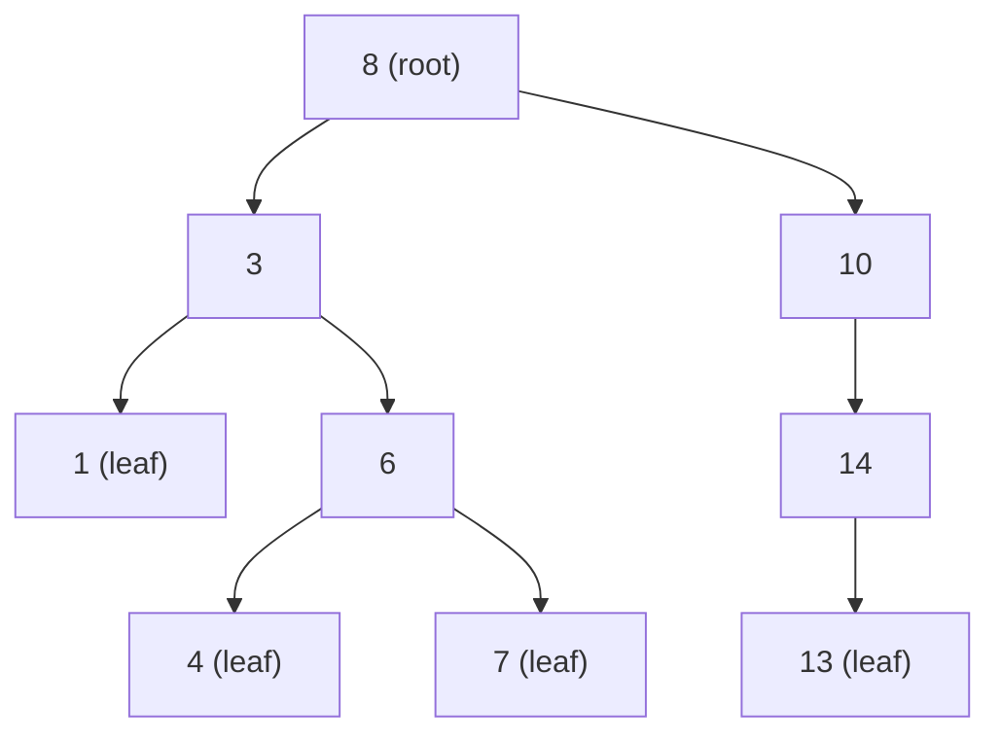
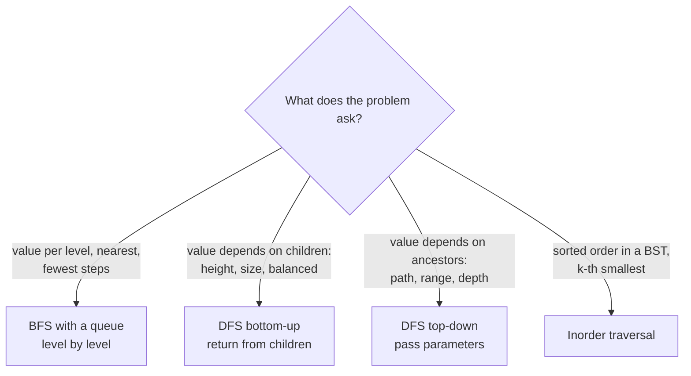
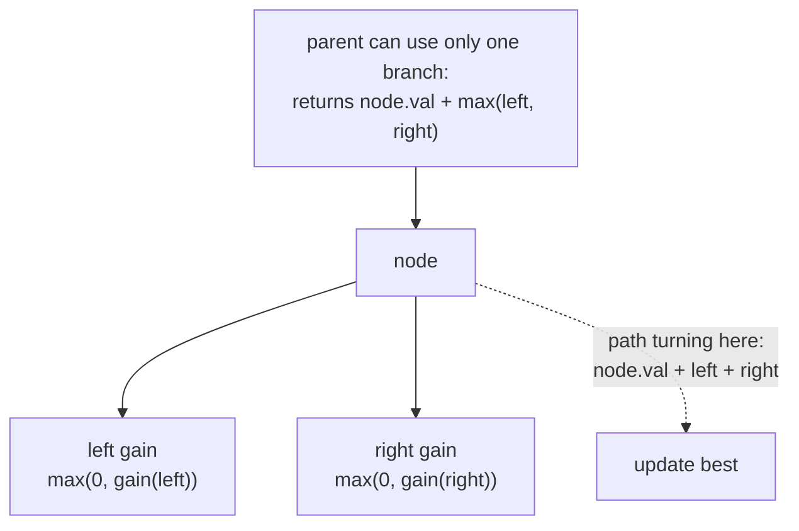

# Trees and Binary Search Trees

> In this document you will learn how to solve binary tree problems in JavaScript: the `TreeNode` class, how to build trees from arrays for testing, depth-first traversals (preorder, inorder, postorder — recursive and iterative) and breadth-first level order. Then you will solve 16 classic problems, from maximum depth and inverting a tree to validating a BST, the lowest common ancestor, building a tree from two traversals, the maximum path sum and serializing a tree. Tree problems are very common in coding rounds because they test recursion, which many candidates find hard to explain.

**Before this:** [Data structures and Big-O](../01-cs-and-web-fundamentals/02-data-structures-and-big-o.md) · [Problem solving and complexity, Pattern 8: DFS and recursion](../11-coding-interviews/02-problem-solving-and-complexity.md#pattern-8-depth-first-search-and-recursion) · [Stacks](05-stacks-and-monotonic-stack.md) · **Interview questions:** [jump to the interview section](#interview-questions)

## Table of contents

1. [The pattern](#the-pattern)
2. [Problems](#problems)
3. [Interview questions](#interview-questions)
4. [Summary](#summary)
5. [References](#references)

---

## The pattern

### What a binary tree is (short refresher)

A **tree** is a set of nodes connected by edges, with one **root** at the top and no cycles. In a **binary tree**, each node has at most two children: `left` and `right`. A node with no children is a **leaf**.

- The **depth** of a node is the number of edges from the root to it.
- The **height** of a tree is the number of nodes (or edges — say which one you use) on the longest path from the root to a leaf. In this document, "max depth" counts **nodes**, like LeetCode does: a single node has depth 1.
- A **binary search tree (BST)** is a binary tree where, for **every** node, all values in the left subtree are smaller and all values in the right subtree are bigger.

More background is in [Data structures and Big-O](../01-cs-and-web-fundamentals/02-data-structures-and-big-o.md).



This tree is a BST: for node 3, the left side `{1}` is smaller and the right side `{6, 4, 7}` is bigger; for the root 8, everything on the left is smaller than 8 and everything on the right is bigger.

**Analogy:** a company org chart. The CEO is the root. Each manager has people below them. "Count the levels of management" is max depth. "Who is the lowest manager above both Alice and Bob?" is the lowest common ancestor. Where the analogy breaks: in a binary tree each node has at most two children, and the difference between `left` and `right` matters.

### The node class and test helpers

LeetCode and most interview platforms describe trees as a **level-order array** with `null` for missing children: `[3, 9, 20, null, null, 15, 7]`. These helpers convert between that format and real nodes, so you can test your code. Every problem in this document uses them.

```js
class TreeNode {
  constructor(val = 0, left = null, right = null) {
    this.val = val;
    this.left = left;
    this.right = right;
  }
}

// [3, 9, 20, null, null, 15, 7] -> tree. Uses a queue with a head index (no shift()).
function fromLevelOrder(values) {
  if (values.length === 0 || values[0] === null) return null;
  const root = new TreeNode(values[0]);
  const queue = [root];
  let head = 0;
  let i = 1;
  while (i < values.length) {
    const node = queue[head++];
    if (values[i] !== null) {
      node.left = new TreeNode(values[i]);
      queue.push(node.left);
    }
    i++;
    if (i < values.length && values[i] !== null) {
      node.right = new TreeNode(values[i]);
      queue.push(node.right);
    }
    i++;
  }
  return root;
}

// tree -> [3, 9, 20, null, null, 15, 7] (trailing nulls removed)
function toLevelOrder(root) {
  const values = [];
  const queue = [root];
  let head = 0;
  while (head < queue.length) {
    const node = queue[head++];
    if (node === null) {
      values.push(null);
      continue;
    }
    values.push(node.val);
    queue.push(node.left, node.right);
  }
  while (values.length > 0 && values.at(-1) === null) values.pop();
  return values;
}

// Find the node with a given value (for tests of problems that take nodes as input)
function findNode(root, val) {
  if (root === null || root.val === val) return root;
  return findNode(root.left, val) ?? findNode(root.right, val);
}

const sample = fromLevelOrder([3, 9, 20, null, null, 15, 7]);
console.log(sample.right.left.val);  // 15
console.log(toLevelOrder(sample));   // [ 3, 9, 20, null, null, 15, 7 ]
console.log(toLevelOrder(null));     // []
```

The tree `[3, 9, 20, null, null, 15, 7]` looks like this:

```text
    3
   / \
  9   20
     /  \
    15   7
```

### Traversals: the four ways to visit every node

A **traversal** visits every node once. There are two families:

- **Depth-first search (DFS):** go as deep as possible down one branch before trying the next. Uses a stack (the call stack in recursion, or your own array).
- **Breadth-first search (BFS):** visit the tree level by level. Uses a queue.

The three DFS orders differ only in **when** you handle the current node:

| Order | Visit | For the tree above | Typical use |
| --- | --- | --- | --- |
| **Preorder** | node, left, right | 3, 9, 20, 15, 7 | copy a tree, serialize, "pass information down" |
| **Inorder** | left, node, right | 9, 3, 15, 20, 7 | a BST gives values in **sorted** order |
| **Postorder** | left, right, node | 9, 15, 7, 20, 3 | compute from children first: height, sizes, delete a tree |
| **Level order** (BFS) | level by level | 3, 9, 20, 15, 7 | shortest path in levels, "per level" answers |

```js
// Recursive DFS: short and clear
function preorder(root, out = []) {
  if (root === null) return out;
  out.push(root.val);
  preorder(root.left, out);
  preorder(root.right, out);
  return out;
}
function inorder(root, out = []) {
  if (root === null) return out;
  inorder(root.left, out);
  out.push(root.val);
  inorder(root.right, out);
  return out;
}
function postorder(root, out = []) {
  if (root === null) return out;
  postorder(root.left, out);
  postorder(root.right, out);
  out.push(root.val);
  return out;
}

// Iterative DFS with an explicit stack: safe for very deep trees
function preorderIterative(root) {
  const out = [];
  const stack = root === null ? [] : [root];
  while (stack.length > 0) {
    const node = stack.pop();
    out.push(node.val);
    if (node.right !== null) stack.push(node.right); // push right first,
    if (node.left !== null) stack.push(node.left);   // so left is popped first
  }
  return out;
}

function inorderIterative(root) {
  const out = [];
  const stack = [];
  let node = root;
  while (node !== null || stack.length > 0) {
    while (node !== null) {   // go as far left as possible
      stack.push(node);
      node = node.left;
    }
    node = stack.pop();       // the leftmost node not yet visited
    out.push(node.val);
    node = node.right;        // then its right subtree
  }
  return out;
}

function postorderIterative(root) {
  // Visit in the order node, right, left, then reverse: gives left, right, node.
  const out = [];
  const stack = root === null ? [] : [root];
  while (stack.length > 0) {
    const node = stack.pop();
    out.push(node.val);
    if (node.left !== null) stack.push(node.left);
    if (node.right !== null) stack.push(node.right);
  }
  return out.reverse();
}

const tree = fromLevelOrder([3, 9, 20, null, null, 15, 7]);
console.log(preorder(tree));           // [ 3, 9, 20, 15, 7 ]
console.log(inorder(tree));            // [ 9, 3, 15, 20, 7 ]
console.log(postorder(tree));          // [ 9, 15, 7, 20, 3 ]
console.log(preorderIterative(tree));  // [ 3, 9, 20, 15, 7 ]
console.log(inorderIterative(tree));   // [ 9, 3, 15, 20, 7 ]
console.log(postorderIterative(tree)); // [ 9, 15, 7, 20, 3 ]
```

### The BFS template (level order)

```js
function levelOrderTemplate(root) {
  const levels = [];
  let current = root === null ? [] : [root];
  while (current.length > 0) {
    levels.push(current.map((node) => node.val)); // handle one full level
    const next = [];
    for (const node of current) {
      if (node.left !== null) next.push(node.left);
      if (node.right !== null) next.push(node.right);
    }
    current = next;
  }
  return levels;
}

console.log(levelOrderTemplate(fromLevelOrder([3, 9, 20, null, null, 15, 7]))); // [ [ 3 ], [ 9, 20 ], [ 15, 7 ] ]
```

Using two arrays (`current` and `next`) is the simplest way to know where each level ends, and it avoids `shift()`, which is O(n).

### Two ways to think recursively

Almost every tree solution is one of these two shapes:

**1. Bottom-up (return a value from the children).** Ask: "If I knew the answer for my left and right subtrees, how would I compute mine?" The function **returns** something. This is a postorder shape.

```js
// Height = 1 + the bigger height of the two children
function height(node) {
  if (node === null) return 0;                         // base case: empty tree
  return 1 + Math.max(height(node.left), height(node.right));
}
console.log(height(fromLevelOrder([3, 9, 20, null, null, 15, 7]))); // 3
```

**2. Top-down (pass information down).** Ask: "What does a child need to know from its parents?" You pass it as a **parameter** (the current depth, the path so far, the allowed value range). This is a preorder shape.

```js
// Print each node with its depth: the depth is passed down
function depths(node, depth = 1, out = []) {
  if (node === null) return out;
  out.push(`${node.val}@${depth}`);
  depths(node.left, depth + 1, out);
  depths(node.right, depth + 1, out);
  return out;
}
console.log(depths(fromLevelOrder([3, 9, 20]))); // [ '3@1', '9@2', '20@2' ]
```

Some problems combine both: they return one thing (for example, a height) and **update a variable outside** with another thing (for example, the best diameter seen so far). Diameter (P5) and maximum path sum (P15) work like that.



### When to recognize the pattern (signals)

- The input is a tree, or something tree-shaped: nested comments, the DOM, a file system, a menu config, an org chart, a JSON object.
- "Depth", "height", "level", "path", "ancestor", "subtree", "leaf".
- For BSTs: "sorted", "k-th smallest", "closest value", "range", "validate". Inorder traversal or the "go left if smaller, right if bigger" walk.

### Complexity

- **Time:** almost always **O(n)**, because each node is visited a constant number of times.
- **Space:** **O(h)** for DFS, where `h` is the height (the depth of the call stack or of your explicit stack). For a balanced tree, `h ≈ log₂ n`. For a **skewed** tree (every node has only one child, like a linked list), `h = n`. BFS uses **O(w)**, where `w` is the maximum width of a level (up to about n / 2 for a complete tree).
- **BST operations** (search, insert, delete) are **O(h)**: O(log n) if balanced, O(n) if skewed.

### Common mistakes

- **Forgetting the base case** `if (node === null)`. This is the most common bug.
- **Confusing "depth counted in nodes" and "in edges".** Say which one you use.
- **Checking only a node and its direct children** when the rule is about the whole subtree (validating a BST, see Q4).
- **Using `queue.shift()` for BFS.** It is O(n) per call. Use two arrays per level or a head index.
- **Deep recursion.** A skewed tree with 100,000 nodes overflows the JavaScript call stack. Use an explicit stack when the tree can be deep.
- **Sharing one array between recursive calls without undoing changes** (in path problems, `push` before the recursive call and `pop` after).
- **Assuming the tree is a BST** when the problem only says "binary tree".

---

## Problems

The problems go from Easy to Hard. Try each one yourself for 15–20 minutes before you read the solution. All code uses `TreeNode`, `fromLevelOrder`, `toLevelOrder` and `findNode` from [the node class and test helpers](#the-node-class-and-test-helpers).

### P1. Maximum Depth of Binary Tree (Easy)

**Problem:** Return the maximum depth of a binary tree: the number of nodes on the longest path from the root down to a leaf. Similar to: LeetCode 104 Maximum Depth of Binary Tree.

This problem is worked step by step in [Problem solving and complexity, Pattern 8](../11-coding-interviews/02-problem-solving-and-complexity.md#pattern-8-depth-first-search-and-recursion), including an iterative version. Here is the short version and a follow-up that often surprises people.

**Examples:**

```text
[3, 9, 20, null, null, 15, 7]  ->  3
[1, null, 2]                   ->  2
[]                             ->  0
```

**How to recognize the pattern:** the depth of a tree depends on the depths of its two subtrees → bottom-up DFS.

**Brute force:** there is no slower sensible method; every node must be visited once.

**Optimal approach:** `depth(node) = 1 + max(depth(left), depth(right))`, and `depth(null) = 0`.

**Code:**

```js
function maxDepth(root) {
  if (root === null) return 0;
  return 1 + Math.max(maxDepth(root.left), maxDepth(root.right));
}

console.log(maxDepth(fromLevelOrder([3, 9, 20, null, null, 15, 7]))); // 3
console.log(maxDepth(fromLevelOrder([1, null, 2])));                  // 2
console.log(maxDepth(fromLevelOrder([])));                            // 0
```

**Dry run** on `[3, 9, 20, null, null, 15, 7]`: `maxDepth(9) = 1 + max(0, 0) = 1`. `maxDepth(15) = 1`, `maxDepth(7) = 1`, so `maxDepth(20) = 2`. `maxDepth(3) = 1 + max(1, 2) = 3`.

**Complexity:** O(n) time, O(h) space for the call stack.

**Edge cases:** empty tree (0); one node (1); a skewed tree (depth n; recursion depth n).

**Follow-ups:**

- **Minimum depth (LeetCode 111): the number of nodes on the shortest path from the root to a leaf.** You cannot just replace `max` with `min`: for `[1, null, 2]`, the root's left child is missing, and `min(0, 1) + 1 = 1` would be wrong, because the root is not a leaf. The answer is 2. BFS is the natural fit: the first leaf you meet is on the shallowest level, so you can stop early.

```js
function minDepth(root) {
  if (root === null) return 0;
  let level = [root];
  let depth = 1;
  while (level.length > 0) {
    const next = [];
    for (const node of level) {
      if (node.left === null && node.right === null) return depth; // first leaf found
      if (node.left !== null) next.push(node.left);
      if (node.right !== null) next.push(node.right);
    }
    level = next;
    depth++;
  }
  return depth;
}

console.log(minDepth(fromLevelOrder([1, null, 2])));                  // 2
console.log(minDepth(fromLevelOrder([3, 9, 20, null, null, 15, 7]))); // 2
```

**How to say it in the interview:**
> "The depth of a tree is one plus the bigger depth of its two subtrees, and an empty tree has depth zero. So I write a recursive function with that base case and that rule. It visits each node once, so it is O(n) time, and the stack uses O(h) space, where h is the height. If the tree can be very deep, I would switch to an iterative BFS that counts levels."

### P2. Invert Binary Tree (Easy)

**Problem:** Mirror a binary tree: swap the left and right children of **every** node. Return the root. Similar to: LeetCode 226 Invert Binary Tree.

**Examples:**

```text
[4, 2, 7, 1, 3, 6, 9]  ->  [4, 7, 2, 9, 6, 3, 1]
[2, 1, 3]              ->  [2, 3, 1]
[]                     ->  []
```

**How to recognize the pattern:** "do something to every node" → any traversal. The order does not matter here, as long as each node is swapped once.

**Brute force:** build a brand-new mirrored tree. O(n) time and O(n) extra space. Fine, but in-place is simpler.

**Optimal approach:** for each node, swap `left` and `right`, then invert both subtrees.

**Code:**

```js
function invertTree(root) {
  if (root === null) return null;
  [root.left, root.right] = [root.right, root.left]; // swap the children
  invertTree(root.left);
  invertTree(root.right);
  return root;
}

// Iterative version (no recursion limit)
function invertTreeIterative(root) {
  const stack = root === null ? [] : [root];
  while (stack.length > 0) {
    const node = stack.pop();
    [node.left, node.right] = [node.right, node.left];
    if (node.left !== null) stack.push(node.left);
    if (node.right !== null) stack.push(node.right);
  }
  return root;
}

console.log(toLevelOrder(invertTree(fromLevelOrder([4, 2, 7, 1, 3, 6, 9]))));          // [ 4, 7, 2, 9, 6, 3, 1 ]
console.log(toLevelOrder(invertTreeIterative(fromLevelOrder([4, 2, 7, 1, 3, 6, 9])))); // [ 4, 7, 2, 9, 6, 3, 1 ]
console.log(toLevelOrder(invertTree(fromLevelOrder([]))));                             // []
```

**Dry run** on `[2, 1, 3]`: at node 2, swap → left is 3, right is 1. Invert node 3 (a leaf: swapping two nulls changes nothing). Invert node 1 (a leaf). Result `[2, 3, 1]`.

**Complexity:** O(n) time, O(h) space.

**Edge cases:** empty tree; one node; a node with only one child (the child moves to the other side).

**Follow-ups:**

- **Check if a tree is symmetric (a mirror of itself, LeetCode 101).** Compare the left subtree with the mirrored right subtree: `mirror(a, b) = a.val === b.val && mirror(a.left, b.right) && mirror(a.right, b.left)`.
- **Real-world use:** flipping a layout tree for right-to-left languages is the same idea applied to UI components.

**How to say it in the interview:**
> "To mirror the tree, every node must swap its left and right children. So I visit every node, swap its two children, and recurse into both subtrees. The order of the traversal does not matter as long as each node is swapped exactly once. It is O(n) time and O(h) space, and I can do the same with an explicit stack if the tree is deep."

### P3. Same Tree (Easy)

**Problem:** You get two binary trees. Return `true` if they have the same structure and the same values in every position. Similar to: LeetCode 100 Same Tree.

**Examples:**

```text
[1, 2, 3]  and  [1, 2, 3]        ->  true
[1, 2]     and  [1, null, 2]     ->  false   (2 is on different sides)
[1, 2, 1]  and  [1, 1, 2]        ->  false
```

**How to recognize the pattern:** two trees are equal if their roots are equal **and** their left subtrees are equal **and** their right subtrees are equal → recursion on both trees at the same time.

**Brute force:** serialize both trees (with `null` markers) and compare the strings. O(n) time and O(n) space. It works, but it is not the clean answer.

**Optimal approach:**

1. Both `null` → `true`.
2. Exactly one `null`, or different values → `false`.
3. Otherwise compare left with left and right with right.

**Code:**

```js
function isSameTree(p, q) {
  if (p === null && q === null) return true;
  if (p === null || q === null || p.val !== q.val) return false;
  return isSameTree(p.left, q.left) && isSameTree(p.right, q.right);
}

console.log(isSameTree(fromLevelOrder([1, 2, 3]), fromLevelOrder([1, 2, 3])));    // true
console.log(isSameTree(fromLevelOrder([1, 2]), fromLevelOrder([1, null, 2])));    // false
console.log(isSameTree(fromLevelOrder([1, 2, 1]), fromLevelOrder([1, 1, 2])));    // false
```

**Dry run** on `[1, 2]` vs `[1, null, 2]`: roots are both 1. Compare left children: `2` vs `null` → exactly one is `null` → `false`. Because of `&&`, the right side is never checked.

**Complexity:** O(min(n, m)) time — it stops at the first difference. O(min(h1, h2)) space.

**Edge cases:** both empty; one empty; same values but different shapes.

**Follow-ups:**

- **Why does a traversal alone not prove equality?** `[1, 2]` and `[1, null, 2]` have the same preorder `1, 2` without null markers. You need the structure too — either by comparing node by node, or by including `null` markers in a serialization.
- **Deep equality of objects in JavaScript** works the same way: compare keys and recurse. See [deep equal](../11-coding-interviews/04-javascript-polyfills-and-implementations.md#deep-equal).

**How to say it in the interview:**
> "Two trees are the same if both are empty, or if both roots have the same value and their left subtrees are the same and their right subtrees are the same. That is directly a recursive function with two base cases: both null is true, and one null or different values is false. It stops at the first difference, so it is linear in the smaller tree."

### P4. Subtree of Another Tree (Easy)

**Problem:** You get two trees, `root` and `subRoot`. Return `true` if `root` contains a node whose whole subtree is exactly the same as `subRoot` (same structure and values, all the way down to the leaves). Similar to: LeetCode 572 Subtree of Another Tree.

**Examples:**

```text
root = [3, 4, 5, 1, 2],                      subRoot = [4, 1, 2]  ->  true
root = [3, 4, 5, 1, 2, null, null, null, null, 0], subRoot = [4, 1, 2]  ->  false
```

In the second example, the node 4 in `root` has an extra grandchild `0`, so its subtree is not exactly `[4, 1, 2]`.

**How to recognize the pattern:** "is this tree equal to one of the subtrees" → reuse `isSameTree` (P3) at every node.

**Brute force (and the standard answer):** for every node in `root`, check `isSameTree(node, subRoot)`. O(m × n) time in the worst case, where m and n are the sizes.

**Optimal approach (for big trees):** serialize both trees in preorder **with null markers and separators**. Then `subRoot` is a subtree of `root` exactly when its string appears inside the string of `root`. With a linear-time string search (KMP or similar) this is O(m + n).

**Code:**

```js
// Standard answer: try every node as a starting point
function isSubtree(root, subRoot) {
  if (root === null) return subRoot === null;
  return isSameTree(root, subRoot) || isSubtree(root.left, subRoot) || isSubtree(root.right, subRoot);
}

// Serialization answer: each value gets a leading comma, and nulls become '#'
function isSubtreeBySerialization(root, subRoot) {
  const serialize = (node, parts) => {
    if (node === null) {
      parts.push("#");
      return parts;
    }
    parts.push(String(node.val));
    serialize(node.left, parts);
    serialize(node.right, parts);
    return parts;
  };
  const big = "," + serialize(root, []).join(",") + ",";
  const small = "," + serialize(subRoot, []).join(",") + ",";
  return big.includes(small);
}

// isSameTree from P3
function isSameTree(p, q) {
  if (p === null && q === null) return true;
  if (p === null || q === null || p.val !== q.val) return false;
  return isSameTree(p.left, q.left) && isSameTree(p.right, q.right);
}

const root = fromLevelOrder([3, 4, 5, 1, 2]);
const rootWithExtra = fromLevelOrder([3, 4, 5, 1, 2, null, null, null, null, 0]);
const sub = fromLevelOrder([4, 1, 2]);
console.log(isSubtree(root, sub));                              // true
console.log(isSubtree(rootWithExtra, sub));                     // false
console.log(isSubtreeBySerialization(root, sub));               // true
console.log(isSubtreeBySerialization(rootWithExtra, sub));      // false
console.log(isSubtreeBySerialization(fromLevelOrder([12]), fromLevelOrder([2]))); // false
```

**Dry run** of the serialization on the first example:

- `root` → `,3,4,1,#,#,2,#,#,5,#,#,`
- `subRoot` → `,4,1,#,#,2,#,#,`
- The second string appears inside the first → `true`.

The separators matter: without the leading comma, the tree `[12]` would serialize to `12,#,#` and `[2]` to `2,#,#`, and `"12,#,#".includes("2,#,#")` is `true` — a wrong match.

**Complexity:** the standard answer is O(m × n) time, O(h) space. The serialization answer is O(m + n) to build the strings; `String.prototype.includes` is fast in practice, but the ECMAScript spec does not promise linear time, so if you need a guarantee, implement KMP.

**Edge cases:** `subRoot` is the whole tree; `subRoot` is a leaf; values with several digits; negative values.

**Follow-ups:**

- **Very large trees and many queries?** Compute a **hash** of every subtree bottom-up (Merkle-style), so equal subtrees have equal hashes. Then compare hashes first, and only run `isSameTree` when the hashes match.
- **Real-world use:** this is the same idea as finding a repeated component subtree in a UI, or detecting duplicate subtrees (LeetCode 652) with serialization keys in a `Map`.

**How to say it in the interview:**
> "For each node in the big tree, I check whether the subtree starting there is the same tree as subRoot, using the same-tree function. That is O(m times n) in the worst case, which is usually fine. For a faster version, I serialize both trees in preorder with null markers and separators, and check whether one string contains the other; with a linear string search that is O(m plus n). The separators and null markers are what make the match exact."

### P5. Diameter of Binary Tree (Easy)

**Problem:** The **diameter** of a binary tree is the number of **edges** on the longest path between any two nodes. The path does **not** have to pass through the root. Return the diameter. Similar to: LeetCode 543 Diameter of Binary Tree.

**Examples:**

```text
[1, 2, 3, 4, 5]  ->  3      (path 4 -> 2 -> 1 -> 3, or 5 -> 2 -> 1 -> 3)
[1, 2]           ->  1
[1]              ->  0
```

**How to recognize the pattern:** every path has one **highest node** (the "turning point"). At that node, the path goes down into the left subtree and down into the right subtree. So for each node: the longest path through it = height(left) + height(right). You need heights from the children → bottom-up DFS, plus a variable outside for the best answer.

**Brute force:** for every node, compute the heights of its two subtrees with a separate function and take the maximum of `left + right`. Each height call is O(n), so O(n²) for a skewed tree.

**Optimal approach:**

1. Write `height(node)` that returns the height in nodes (0 for `null`).
2. Inside it, after you know `left` and `right`, update `best = max(best, left + right)`. `left + right` is the number of **edges** of the longest path that turns at this node.
3. Return `1 + max(left, right)` to the parent.

**Code:**

```js
function diameterOfBinaryTree(root) {
  let best = 0;
  const height = (node) => {
    if (node === null) return 0;
    const left = height(node.left);
    const right = height(node.right);
    best = Math.max(best, left + right); // longest path that turns at this node, in edges
    return 1 + Math.max(left, right);    // what the parent needs: my height
  };
  height(root);
  return best;
}

console.log(diameterOfBinaryTree(fromLevelOrder([1, 2, 3, 4, 5]))); // 3
console.log(diameterOfBinaryTree(fromLevelOrder([1, 2])));          // 1
console.log(diameterOfBinaryTree(fromLevelOrder([1])));             // 0
```

**Dry run** on `[1, 2, 3, 4, 5]`:

| node | left height | right height | left + right | best | returns |
| --- | --- | --- | --- | --- | --- |
| 4 | 0 | 0 | 0 | 0 | 1 |
| 5 | 0 | 0 | 0 | 0 | 1 |
| 2 | 1 | 1 | 2 | 2 | 2 |
| 3 | 0 | 0 | 0 | 2 | 1 |
| 1 | 2 | 1 | **3** | 3 | 3 |

**Complexity:** O(n) time, each node once. O(h) space.

**Edge cases:** an empty tree or one node (0); the longest path does not pass through the root (for example, a root with one long branch that has two deep sub-branches); a skewed tree (diameter n − 1).

**Follow-ups:**

- **Why does the function return one thing but compute another?** The parent needs the **height** (one branch only, because a path cannot split twice). The answer needs **both** branches. This "return one value, update a global best" shape appears again in P15.
- **Diameter of a general tree (any number of children) or a graph tree?** Take the two largest child heights at each node. For an unweighted tree given as a graph, you can also BFS from any node to the farthest node, then BFS again from there; the second distance is the diameter.

**How to say it in the interview:**
> "Every path has a highest node where it turns, and the longest path turning at a node is the height of its left subtree plus the height of its right subtree, counted in edges. So I compute heights bottom-up, and at each node I update a best variable with left plus right, but I return one plus the bigger height to the parent, because the parent can only extend one branch. Each node is visited once, so O(n)."

### P6. Balanced Binary Tree (Easy)

**Problem:** A binary tree is **height-balanced** if, for **every** node, the heights of its left and right subtrees differ by at most 1. Return `true` if the tree is balanced. Similar to: LeetCode 110 Balanced Binary Tree.

**Examples:**

```text
[3, 9, 20, null, null, 15, 7]        ->  true
[1, 2, 2, 3, 3, null, null, 4, 4]    ->  false
[]                                   ->  true
```

**How to recognize the pattern:** you need the heights of both children at every node → bottom-up DFS. The trick is to return the height **and** "already unbalanced" with one number.

**Brute force:** at every node, call a separate `height()` on both children and compare; then recurse. Height is O(n), called for n nodes → O(n²) worst case (O(n log n) for balanced trees).

**Optimal approach:** a single DFS that returns the height, or `-1` to mean "unbalanced somewhere below". As soon as any subtree returns `-1`, pass `-1` up without more work.

**Code:**

```js
function isBalanced(root) {
  const heightOrFail = (node) => {
    if (node === null) return 0;
    const left = heightOrFail(node.left);
    if (left === -1) return -1;                 // stop early
    const right = heightOrFail(node.right);
    if (right === -1) return -1;
    if (Math.abs(left - right) > 1) return -1;  // this node is unbalanced
    return 1 + Math.max(left, right);
  };
  return heightOrFail(root) !== -1;
}

console.log(isBalanced(fromLevelOrder([3, 9, 20, null, null, 15, 7])));     // true
console.log(isBalanced(fromLevelOrder([1, 2, 2, 3, 3, null, null, 4, 4]))); // false
console.log(isBalanced(fromLevelOrder([])));                                // true
```

**Dry run** on `[1, 2, 2, 3, 3, null, null, 4, 4]`: the left node 2 has children 3 (with children 4, 4 → height 2) and 3 (height 1), so node 2 has height 3. The right node 2 is a leaf with height 1. At the root: `|3 − 1| = 2 > 1` → `-1` → `false`.

**Complexity:** O(n) time, O(h) space.

**Edge cases:** empty tree (balanced); a "zigzag" tree where every node only has one child (unbalanced as soon as the depth is 3).

**Follow-ups:**

- **Why do balanced trees matter in practice?** BST operations cost O(h). A balanced tree keeps `h` around log n. Self-balancing trees (AVL, red-black) rotate nodes after inserts to keep this property; many standard libraries use red-black trees for sorted maps (for example, Java's `TreeMap` and C++'s `std::map` in common implementations). JavaScript has no built-in sorted map.
- **Using a sentinel value vs an object `{ balanced, height }`.** The `-1` trick is compact. An object is clearer in production code. Both are fine; explain your choice.

**How to say it in the interview:**
> "Checking height at every node separately would be O(n squared). Instead I do one bottom-up pass that returns the height of each subtree, or minus one if it already found an unbalanced node below. At each node, if either child returned minus one, or their heights differ by more than one, I return minus one. Otherwise I return one plus the bigger height. The tree is balanced if the root does not return minus one. That is O(n)."

### P7. Lowest Common Ancestor of a Binary Search Tree (Medium)

**Problem:** You get a BST and two nodes `p` and `q` that exist in it. Return their **lowest common ancestor (LCA)**: the deepest node that has both `p` and `q` as descendants. A node counts as a descendant of itself. Similar to: LeetCode 235 Lowest Common Ancestor of a Binary Search Tree.

**Examples** (tree `[6, 2, 8, 0, 4, 7, 9, null, null, 3, 5]`):

```text
p = 2, q = 8  ->  6
p = 2, q = 4  ->  2     (a node can be its own ancestor)
p = 3, q = 5  ->  4
```

**How to recognize the pattern:** it is a **BST**, so you know which side each value is on. As long as both values are on the same side, the LCA is on that side. The first node where they **split** (or where you hit one of them) is the LCA.

**Brute force:** the general binary tree solution (P12) works too, O(n). It ignores the BST ordering.

**Optimal approach:** start at the root.

- If both `p.val` and `q.val` are smaller than `node.val`, go left.
- If both are bigger, go right.
- Otherwise, this node is the split point: return it.

**Code:**

```js
function lowestCommonAncestorBST(root, p, q) {
  let node = root;
  while (node !== null) {
    if (p.val < node.val && q.val < node.val) node = node.left;       // both on the left
    else if (p.val > node.val && q.val > node.val) node = node.right; // both on the right
    else return node;                                                 // they split here (or one is here)
  }
  return null;
}

const bst = fromLevelOrder([6, 2, 8, 0, 4, 7, 9, null, null, 3, 5]);
console.log(lowestCommonAncestorBST(bst, findNode(bst, 2), findNode(bst, 8)).val); // 6
console.log(lowestCommonAncestorBST(bst, findNode(bst, 2), findNode(bst, 4)).val); // 2
console.log(lowestCommonAncestorBST(bst, findNode(bst, 3), findNode(bst, 5)).val); // 4
```

**Dry run** for `p = 3`, `q = 5`: at 6, both smaller → left to 2. At 2, both bigger → right to 4. At 4: 3 < 4 < 5, they split → return 4.

**Complexity:** O(h) time — one path from the root down. O(1) space (iterative).

**Edge cases:** `p` is an ancestor of `q` (return `p`); `p === q`; `p` or `q` is the root.

**Follow-ups:**

- **What if `p` or `q` might not be in the tree?** First check that both exist (two BST searches, O(h) each), then run the walk.
- **Why is this O(h) and not O(n)?** Like binary search, each step goes down one level and never comes back. In a balanced BST, h is about log n.

**How to say it in the interview:**
> "Because it is a BST, I can tell from the values which side p and q are on. Starting at the root, if both values are smaller than the current node, the LCA must be in the left subtree, so I go left; if both are bigger, I go right. The first node where they are not on the same side, or where one of them equals the node, is the lowest common ancestor. It is one path down, so O(h) time and O(1) space."

### P8. Binary Tree Level Order Traversal (Medium)

**Problem:** Return the values of a binary tree level by level, from left to right, as an array of arrays. Similar to: LeetCode 102 Binary Tree Level Order Traversal.

This is fully walked through in [Problem solving and complexity, Pattern 7](../11-coding-interviews/02-problem-solving-and-complexity.md#pattern-7-queue-and-breadth-first-search). Here is the short version and the common follow-ups.

**Examples:**

```text
[3, 9, 20, null, null, 15, 7]  ->  [[3], [9, 20], [15, 7]]
[1]                            ->  [[1]]
[]                             ->  []
```

**How to recognize the pattern:** "level by level" → BFS.

**Brute force:** DFS with the depth as a parameter, pushing each value into `levels[depth]`. This is also O(n), and a valid alternative (shown below).

**Optimal approach:** BFS with one array per level: process the current level, collect the next level's nodes, repeat.

**Code:**

```js
function levelOrder(root) {
  const levels = [];
  let level = root === null ? [] : [root];
  while (level.length > 0) {
    levels.push(level.map((node) => node.val));
    const next = [];
    for (const node of level) {
      if (node.left !== null) next.push(node.left);
      if (node.right !== null) next.push(node.right);
    }
    level = next;
  }
  return levels;
}

// DFS alternative: the depth tells you which level a value belongs to
function levelOrderDFS(root) {
  const levels = [];
  const visit = (node, depth) => {
    if (node === null) return;
    (levels[depth] ??= []).push(node.val);
    visit(node.left, depth + 1);
    visit(node.right, depth + 1);
  };
  visit(root, 0);
  return levels;
}

console.log(levelOrder(fromLevelOrder([3, 9, 20, null, null, 15, 7])));    // [ [ 3 ], [ 9, 20 ], [ 15, 7 ] ]
console.log(levelOrderDFS(fromLevelOrder([3, 9, 20, null, null, 15, 7]))); // [ [ 3 ], [ 9, 20 ], [ 15, 7 ] ]
console.log(levelOrder(fromLevelOrder([])));                               // []
```

**Dry run:** level `[3]` → record `[3]`, next `[9, 20]`. Level `[9, 20]` → record, next `[15, 7]`. Level `[15, 7]` → record, next `[]`. Stop.

**Complexity:** O(n) time. O(w) space for BFS (w = the widest level), O(h) for the DFS version plus the output.

**Edge cases:** empty tree; a skewed tree (each level has one node).

**Follow-ups:**

- **Zigzag order (LeetCode 103): left to right, then right to left, alternating.** Same BFS; reverse every second level's values before pushing.

```js
function zigzagLevelOrder(root) {
  return levelOrder(root).map((values, depth) => (depth % 2 === 1 ? values.reverse() : values));
}

console.log(zigzagLevelOrder(fromLevelOrder([3, 9, 20, null, null, 15, 7]))); // [ [ 3 ], [ 20, 9 ], [ 15, 7 ] ]
```

- **Bottom-up order (LeetCode 107):** reverse the final array of levels.
- **Average of each level (LeetCode 637), largest value in each row (LeetCode 515):** same loop, compute a number per level instead of a list.

**How to say it in the interview:**
> "Level by level means BFS. I keep the nodes of the current level in an array, record their values, and build the array of the next level from their children. When the next level is empty, I am done. Every node is handled once, so O(n) time, and the memory is the width of the widest level. I avoid array shift because it is linear in JavaScript."

### P9. Binary Tree Right Side View (Medium)

**Problem:** Imagine standing on the right side of a binary tree. Return the values of the nodes you can see, from top to bottom: the **last** node of every level. Similar to: LeetCode 199 Binary Tree Right Side View.

**Examples:**

```text
[1, 2, 3, null, 5, null, 4]   ->  [1, 3, 4]
[1, 2, 3, 4]                  ->  [1, 3, 4]    (4 is on the left, but nothing hides it on level 3)
[]                            ->  []
```

**How to recognize the pattern:** "one value per level" → BFS and take the last node of each level. Or DFS that visits the **right** child first and records the first node it sees at each depth.

**Brute force:** compute the full level order (P8) and take the last value of each level. That *is* the BFS solution; it is already O(n).

**Optimal approach (DFS, right first):** visit node, then right, then left. The first time you reach a new depth, that node is the rightmost one at that depth.

**Code:**

```js
function rightSideView(root) {
  const view = [];
  const visit = (node, depth) => {
    if (node === null) return;
    if (depth === view.length) view.push(node.val); // first node seen at this depth
    visit(node.right, depth + 1);                   // right first
    visit(node.left, depth + 1);
  };
  visit(root, 0);
  return view;
}

// BFS version: last node of each level
function rightSideViewBFS(root) {
  const view = [];
  let level = root === null ? [] : [root];
  while (level.length > 0) {
    view.push(level.at(-1).val);
    level = level.flatMap((node) => [node.left, node.right].filter((child) => child !== null));
  }
  return view;
}

console.log(rightSideView(fromLevelOrder([1, 2, 3, null, 5, null, 4])));    // [ 1, 3, 4 ]
console.log(rightSideView(fromLevelOrder([1, 2, 3, 4])));                   // [ 1, 3, 4 ]
console.log(rightSideViewBFS(fromLevelOrder([1, 2, 3, null, 5, null, 4]))); // [ 1, 3, 4 ]
console.log(rightSideViewBFS(fromLevelOrder([])));                          // []
```

**Dry run** (DFS) on `[1, 2, 3, 4]`:

| visit | depth | view length | action |
| --- | --- | --- | --- |
| 1 | 0 | 0 | push 1 |
| 3 | 1 | 1 | push 3 |
| 2 | 1 | 2 | skip (depth 1 already has a value) |
| 4 | 2 | 2 | push 4 |

Result: `[1, 3, 4]`.

**Complexity:** O(n) time. O(h) space for DFS, O(w) for BFS.

**Edge cases:** empty tree; a left-only chain (every node is visible); a deep left branch under a short right branch (the second example).

**Follow-ups:**

- **Left side view?** Visit left first in the DFS, or take `level[0]` in the BFS.
- **Common wrong answer:** "just follow the right children from the root". That misses left nodes that stick out below a shorter right side, as in `[1, 2, 3, 4]`.

**How to say it in the interview:**
> "The right side view is the last node of each level. With BFS I take the last node of each level array. With DFS I visit the right child before the left and track the depth; the first node I reach at each new depth is the rightmost one, so I push it when the depth equals the current length of the answer. Both are O(n). Just following right pointers is wrong, because a deeper left branch can be visible."

### P10. Validate Binary Search Tree (Medium)

**Problem:** Return `true` if a binary tree is a valid BST: for every node, **all** values in its left subtree are strictly smaller, and **all** values in its right subtree are strictly bigger. Similar to: LeetCode 98 Validate Binary Search Tree.

**Examples:**

```text
[2, 1, 3]                       ->  true
[5, 1, 4, null, null, 3, 6]     ->  false   (4 is on the right of 5 but smaller than 5)
[5, 4, 6, null, null, 3, 7]     ->  false   (3 is in the right subtree of 5)
[2, 2, 2]                       ->  false   (values must be strictly ordered)
```

**How to recognize the pattern:** the rule is about **whole subtrees**, not only direct children. Each node must fit inside a **range** given by its ancestors → top-down DFS with `(low, high)` parameters. Or: a BST's inorder traversal must be **strictly increasing**.

**Brute force:** for each node, scan its whole left subtree for the maximum and its whole right subtree for the minimum. O(n²) for skewed trees.

**Optimal approach (range DFS):**

1. The root can be anything: range `(-Infinity, Infinity)`.
2. Going left, the current value becomes the new **upper** limit. Going right, it becomes the new **lower** limit.
3. If any node is outside its range (`val <= low` or `val >= high`), return `false`.

**Code:**

```js
function isValidBST(root) {
  const check = (node, low, high) => {
    if (node === null) return true;
    if (node.val <= low || node.val >= high) return false;
    return check(node.left, low, node.val) && check(node.right, node.val, high);
  };
  return check(root, -Infinity, Infinity);
}

// Alternative: inorder must be strictly increasing (iterative, no recursion limit)
function isValidBSTInorder(root) {
  const stack = [];
  let node = root;
  let previous = -Infinity;
  while (node !== null || stack.length > 0) {
    while (node !== null) {
      stack.push(node);
      node = node.left;
    }
    node = stack.pop();
    if (node.val <= previous) return false;
    previous = node.val;
    node = node.right;
  }
  return true;
}

console.log(isValidBST(fromLevelOrder([2, 1, 3])));                          // true
console.log(isValidBST(fromLevelOrder([5, 1, 4, null, null, 3, 6])));        // false
console.log(isValidBST(fromLevelOrder([5, 4, 6, null, null, 3, 7])));        // false
console.log(isValidBST(fromLevelOrder([2, 2, 2])));                          // false
console.log(isValidBSTInorder(fromLevelOrder([5, 4, 6, null, null, 3, 7]))); // false
```

**Dry run** (range DFS) on `[5, 4, 6, null, null, 3, 7]`:

| node | range | inside? |
| --- | --- | --- |
| 5 | (-∞, ∞) | yes |
| 4 | (-∞, 5) | yes |
| 6 | (5, ∞) | yes |
| 3 | (5, 6) | **no** (3 <= 5) → `false` |

Checking only "left child < node < right child" would accept this tree: at node 6, `3 < 6 < 7` looks fine.

**Complexity:** O(n) time, O(h) space.

**Edge cases:** empty tree (valid); duplicates (invalid with the strict rule — ask the interviewer, some definitions allow duplicates on one side); values like `Number.MIN_SAFE_INTEGER` (using `-Infinity` instead of a "very small number" avoids wrong answers at the limits).

**Follow-ups:**

- **Why `-Infinity` and `Infinity`, not `null`?** They make the comparison code uniform. In languages with fixed-size integers, people use `null` or a 64-bit type to avoid edge bugs with the minimum integer. In JavaScript, `Infinity` is a real number value and compares correctly.
- **Recover a BST where two nodes were swapped (LeetCode 99).** Do an inorder traversal and find the two places where the order breaks; swap those nodes' values back.

**How to say it in the interview:**
> "The BST rule applies to whole subtrees, not just children, so I pass down a range. The root can be anything. When I go left, the current value becomes the upper bound; when I go right, it becomes the lower bound. If any node falls outside its range, the tree is invalid. That is O(n) time and O(h) space. Another way is an inorder traversal, which must be strictly increasing for a valid BST."

### P11. Kth Smallest Element in a BST (Medium)

**Problem:** You get the root of a BST and an integer `k` (1-indexed). Return the k-th smallest value. Similar to: LeetCode 230 Kth Smallest Element in a BST.

**Examples:**

```text
[3, 1, 4, null, 2], k = 1              ->  1
[5, 3, 6, 2, 4, null, null, 1], k = 3  ->  3
```

**How to recognize the pattern:** BST + "k-th smallest" → **inorder traversal** gives sorted order. Stop after k nodes.

**Brute force:** collect all values with inorder into an array and return `values[k - 1]`. O(n) time and O(n) space.

**Optimal approach:** iterative inorder with a stack; count nodes as you pop them; return the k-th. This visits only about `h + k` nodes.

**Code:**

```js
function kthSmallest(root, k) {
  const stack = [];
  let node = root;
  while (node !== null || stack.length > 0) {
    while (node !== null) {
      stack.push(node);
      node = node.left;
    }
    node = stack.pop();
    k--;
    if (k === 0) return node.val; // the k-th node in sorted order
    node = node.right;
  }
  return undefined; // k is larger than the number of nodes
}

console.log(kthSmallest(fromLevelOrder([3, 1, 4, null, 2]), 1));             // 1
console.log(kthSmallest(fromLevelOrder([5, 3, 6, 2, 4, null, null, 1]), 3)); // 3
```

**Dry run** on `[5, 3, 6, 2, 4, null, null, 1]`, `k = 3`: push 5, 3, 2, 1 (going left). Pop 1 (k = 2). Pop 2 (k = 1). Pop 3 → k = 0 → return **3**.

**Complexity:** O(h + k) time, O(h) space.

**Edge cases:** `k = 1` (the leftmost node); `k = n` (the rightmost node); a skewed tree.

**Follow-ups:**

- **The BST changes often (inserts and deletes) and you query k-th smallest many times.** Store the **size of each subtree** in each node (an "order statistic tree"). Then at each node: if `k <= size(left)`, go left; if `k === size(left) + 1`, this node is the answer; else go right with `k − size(left) − 1`. O(h) per query, and inserts update sizes on the way down.
- **k-th largest?** Do a reverse inorder (right, node, left).

**How to say it in the interview:**
> "An inorder traversal of a BST visits values in sorted order, so the k-th node it visits is the k-th smallest. I do the inorder iteratively with a stack so I can stop as soon as I have popped k nodes, which makes it O(h plus k) instead of always visiting everything. If the tree changes often and there are many queries, I would store subtree sizes in the nodes to answer in O(h)."

### P12. Lowest Common Ancestor of a Binary Tree (Medium)

**Problem:** Same as P7, but now the tree is a **general binary tree**, not a BST. Both `p` and `q` exist in the tree. Return their lowest common ancestor. Similar to: LeetCode 236 Lowest Common Ancestor of a Binary Tree.

**Examples** (tree `[3, 5, 1, 6, 2, 0, 8, null, null, 7, 4]`):

```text
p = 5, q = 1  ->  3
p = 5, q = 4  ->  5     (5 is an ancestor of 4)
p = 6, q = 4  ->  5
```

**How to recognize the pattern:** without BST ordering you cannot choose a side in advance. You must **search both subtrees** and combine what they report → bottom-up DFS.

**Brute force:** find the path from the root to `p` and the path to `q` (two DFS runs that record the path), then walk both paths together; the last common node is the LCA. O(n) time and O(n) space. A good first answer.

**Optimal approach:** a single DFS that returns:

- `null` if neither `p` nor `q` is in this subtree;
- `p` or `q` if the current node **is** one of them (no need to look deeper: if the other one is below, this node is the LCA anyway);
- otherwise, combine the children's answers: if **both** sides returned a node, the current node is where they split → it is the LCA. If only one side returned something, pass that up.

**Code:**

```js
function lowestCommonAncestor(root, p, q) {
  if (root === null || root === p || root === q) return root;
  const left = lowestCommonAncestor(root.left, p, q);
  const right = lowestCommonAncestor(root.right, p, q);
  if (left !== null && right !== null) return root; // p and q are on different sides
  return left ?? right;                             // pass up whatever was found
}

const tree12 = fromLevelOrder([3, 5, 1, 6, 2, 0, 8, null, null, 7, 4]);
const node = (v) => findNode(tree12, v);
console.log(lowestCommonAncestor(tree12, node(5), node(1)).val); // 3
console.log(lowestCommonAncestor(tree12, node(5), node(4)).val); // 5
console.log(lowestCommonAncestor(tree12, node(6), node(4)).val); // 5
```

**Dry run** for `p = 6`, `q = 4`:

| node | left returns | right returns | returns |
| --- | --- | --- | --- |
| 6 | — | — | 6 (it is p) |
| 7 | null | null | null |
| 4 | — | — | 4 (it is q) |
| 2 | 7 → null | 4 | 4 |
| 5 | 6 | 4 | **5** (both sides found something) |
| 1 | null | null | null |
| 3 | 5 | null | 5 |

**Complexity:** O(n) time, O(h) space.

**Edge cases:** `p` is an ancestor of `q`; `p === q`; `p` or `q` is the root.

**Follow-ups:**

- **What if `p` or `q` may be missing from the tree?** This function would then return the one that exists, which is wrong. Count how many of the two you actually found during the DFS (do not stop early at `p` or `q`), and return `null` unless the count is 2.
- **Each node has a `parent` pointer (LeetCode 1650).** Walk up from `p` and from `q`. This is the same as finding where two linked lists intersect: when a pointer reaches the root's `null`, jump to the other start. They meet at the LCA after at most two passes.
- **Many LCA queries on the same big tree?** Preprocess with "binary lifting" (store the 2^k-th ancestor of each node) for O(log n) per query. This is an advanced topic; mentioning it is enough.

**How to say it in the interview:**
> "Since it is not a BST, I search both sides. My function returns the node itself if it is p or q, null if it reaches an empty subtree, and otherwise combines the two children: if both the left and the right returned something, p and q are on different sides, so the current node is the lowest common ancestor. If only one side returned a node, I pass it up. Every node is visited at most once, so it is O(n) time and O(h) space."

### P13. Construct Binary Tree from Preorder and Inorder Traversal (Medium)

**Problem:** You get two arrays, `preorder` and `inorder`, from the same binary tree. All values are **unique**. Rebuild the tree and return its root. Similar to: LeetCode 105 Construct Binary Tree from Preorder and Inorder Traversal.

**Examples:**

```text
preorder = [3, 9, 20, 15, 7], inorder = [9, 3, 15, 20, 7]  ->  [3, 9, 20, null, null, 15, 7]
preorder = [-1], inorder = [-1]                            ->  [-1]
```

**How to recognize the pattern:** each traversal gives you a different piece of information:

- **Preorder** starts with the **root** (node, left, right).
- **Inorder** has the root **in the middle**: everything to its left is the left subtree, everything to its right is the right subtree.

So you can find the root, split, and recurse.

**Brute force:** take `preorder[0]` as the root, find it in `inorder` with `indexOf` (O(n)), and recurse on **sliced** arrays. Slicing and searching make this O(n²).

**Optimal approach:**

1. Build a `Map` from value to its index in `inorder`, so finding the root's position is O(1).
2. Keep a pointer `next` into `preorder`. Preorder lists roots in exactly the order you build them: root, then the whole left subtree, then the whole right subtree.
3. `build(lo, hi)` builds the subtree whose values are `inorder[lo..hi]`:
   - If `lo > hi`, return `null`.
   - The root value is `preorder[next++]`. Find its index `mid` in `inorder`.
   - Build the **left** subtree from `inorder[lo..mid-1]` **first** (because preorder lists the left subtree next), then the right from `inorder[mid+1..hi]`.

**Code:**

```js
function buildFromPreorderInorder(preorder, inorder) {
  const inorderIndex = new Map(inorder.map((value, i) => [value, i]));
  let next = 0; // index in preorder of the next root to create
  const build = (lo, hi) => {
    if (lo > hi) return null;
    const value = preorder[next++];
    const root = new TreeNode(value);
    const mid = inorderIndex.get(value);
    root.left = build(lo, mid - 1);  // must come first: preorder lists the left subtree next
    root.right = build(mid + 1, hi);
    return root;
  };
  return build(0, inorder.length - 1);
}

console.log(toLevelOrder(buildFromPreorderInorder([3, 9, 20, 15, 7], [9, 3, 15, 20, 7]))); // [ 3, 9, 20, null, null, 15, 7 ]
console.log(toLevelOrder(buildFromPreorderInorder([-1], [-1])));                           // [ -1 ]
console.log(toLevelOrder(buildFromPreorderInorder([], [])));                               // []
```

**Dry run** on `preorder = [3, 9, 20, 15, 7]`, `inorder = [9, 3, 15, 20, 7]`:

| call `build(lo, hi)` | root (preorder[next]) | mid in inorder | left range | right range |
| --- | --- | --- | --- | --- |
| (0, 4) | 3 | 1 | (0, 0) | (2, 4) |
| (0, 0) | 9 | 0 | (0, -1) → null | (1, 0) → null |
| (2, 4) | 20 | 3 | (2, 2) | (4, 4) |
| (2, 2) | 15 | 2 | null | null |
| (4, 4) | 7 | 4 | null | null |

**Complexity:** O(n) time (each node is created once, map lookups are O(1)). O(n) space for the map, plus O(h) recursion.

**Edge cases:** empty arrays; one node; a skewed tree (recursion depth n); duplicate values (then the tree is **not** uniquely defined — this algorithm needs unique values).

**Follow-ups:**

- **Inorder + postorder (LeetCode 106).** Postorder ends with the root. Read `postorder` from the **end**, and build the **right** subtree first.
- **Preorder + postorder?** Not enough in general: a node with a single child could have it on either side. Only for full binary trees (every node has 0 or 2 children) is it unique.
- **A BST from preorder only?** Yes — the BST order replaces the inorder array. See Q9.

**How to say it in the interview:**
> "Preorder tells me the root first, and inorder tells me which values are left and right of that root. So I take the next value from preorder as the root, look up its position in inorder with a hash map, and recursively build the left part and then the right part — left first, because that is the order preorder lists them in. Using a moving index into preorder and index ranges into inorder avoids slicing, so it is O(n) time and O(n) space."

### P14. Path Sum II (Medium)

**Problem:** You get a binary tree and a `targetSum`. Return **all** root-to-leaf paths where the values add up to `targetSum`. Each path is a list of values. Similar to: LeetCode 113 Path Sum II.

**Examples:**

```text
root = [5, 4, 8, 11, null, 13, 4, 7, 2, null, null, 5, 1], targetSum = 22
  ->  [[5, 4, 11, 2], [5, 8, 4, 5]]
root = [1, 2, 3], targetSum = 5  ->  []
root = [1, 2], targetSum = 0     ->  []
```

**How to recognize the pattern:** "all root-to-leaf paths" → top-down DFS that carries the **current path** and the **remaining sum**. Building one path array and undoing changes is **backtracking** (see [Backtracking](11-backtracking.md)).

**Brute force:** generate every root-to-leaf path as a new array (copying at every step), then filter by sum. Correct but wasteful: many copies.

**Optimal approach:**

1. Keep one shared `path` array.
2. At each node: `push` its value and subtract it from `remaining`.
3. If it is a **leaf** and `remaining === 0`, save a **copy** of `path`.
4. Otherwise recurse into both children.
5. `pop` before returning (undo the choice), so the parent's path is correct again.

**Code:**

```js
function pathSum(root, targetSum) {
  const result = [];
  const path = [];
  const dfs = (node, remaining) => {
    if (node === null) return;
    path.push(node.val);
    remaining -= node.val;
    if (node.left === null && node.right === null) {
      if (remaining === 0) result.push([...path]); // copy! path keeps changing
    } else {
      dfs(node.left, remaining);
      dfs(node.right, remaining);
    }
    path.pop(); // undo before going back to the parent
  };
  dfs(root, targetSum);
  return result;
}

const tree14 = fromLevelOrder([5, 4, 8, 11, null, 13, 4, 7, 2, null, null, 5, 1]);
console.log(pathSum(tree14, 22));                      // [ [ 5, 4, 11, 2 ], [ 5, 8, 4, 5 ] ]
console.log(pathSum(fromLevelOrder([1, 2, 3]), 5));    // []
console.log(pathSum(fromLevelOrder([1, 2]), 0));       // []
```

**Dry run** on the first example (only the important steps):

| node | path after push | remaining | action |
| --- | --- | --- | --- |
| 5 | [5] | 17 | recurse |
| 4 | [5, 4] | 13 | recurse |
| 11 | [5, 4, 11] | 2 | recurse |
| 7 | [5, 4, 11, 7] | -5 | leaf, not 0 → pop |
| 2 | [5, 4, 11, 2] | 0 | leaf, 0 → **save** → pop |
| 8 → 13 | [5, 8, 13] | -4 | leaf, not 0 |
| 8 → 4 → 5 | [5, 8, 4, 5] | 0 | leaf, 0 → **save** |
| 8 → 4 → 1 | [5, 8, 4, 1] | 4 | leaf, not 0 |

**Complexity:** O(n × h) time in the worst case: the DFS is O(n), and each saved path costs O(h) to copy (at most about n/2 leaves). O(h) space for the path and the stack, plus the output.

**Edge cases:** empty tree; negative values (you **cannot** stop early when `remaining < 0`, because a negative value later could bring it back); a target reached at an inner node that is not a leaf (does not count).

**Follow-ups:**

- **Forgetting the copy:** `result.push(path)` pushes the **same** array every time. After all the `pop` calls it is empty, so the result looks like `[[], []]`. Always copy with `[...path]`.
- **Path Sum III (LeetCode 437): count paths that go downward but can start and end anywhere.** Use a **prefix sum** map along the current root-to-node path: the number of valid paths ending here is `count[currentSum - target]`. Add the current sum to the map before going down, and remove it after (backtracking). O(n). Prefix sums are covered in [Prefix sums and intervals](04-prefix-sums-and-intervals.md).

```js
function pathSumIII(root, target) {
  const seen = new Map([[0, 1]]); // prefix sum -> how many times it appears on the current path
  let count = 0;
  const dfs = (node, sum) => {
    if (node === null) return;
    sum += node.val;
    count += seen.get(sum - target) ?? 0;
    seen.set(sum, (seen.get(sum) ?? 0) + 1);
    dfs(node.left, sum);
    dfs(node.right, sum);
    seen.set(sum, seen.get(sum) - 1); // undo: this prefix is no longer on the path
  };
  dfs(root, 0);
  return count;
}

console.log(pathSumIII(fromLevelOrder([10, 5, -3, 3, 2, null, 11, 3, -2, null, 1]), 8)); // 3
```

**How to say it in the interview:**
> "I do a depth-first search that carries the remaining sum and one shared path array. At each node I push its value and subtract it. If it is a leaf and the remaining sum is zero, I save a copy of the path. Otherwise I recurse into both children. Before returning I pop the value, so the parent's path is correct again — that is backtracking. The traversal is O(n), plus the cost of copying the paths I save."

### P15. Binary Tree Maximum Path Sum (Hard)

**Problem:** A **path** is any sequence of nodes where each pair of neighbours is connected by an edge, and no node appears twice. It does not need to pass through the root, and it must contain at least one node. Values can be **negative**. Return the maximum sum of any path. Similar to: LeetCode 124 Binary Tree Maximum Path Sum.

**Examples:**

```text
[1, 2, 3]                          ->  6     (2 -> 1 -> 3)
[-10, 9, 20, null, null, 15, 7]    ->  42    (15 -> 20 -> 7)
[-3]                               ->  -3
[2, -1]                            ->  2
```

**How to recognize the pattern:** this is the diameter idea (P5) with sums instead of counts. Every path has a highest node. At that node, the best path is `node.val + bestDownLeft + bestDownRight`. But a parent can only extend **one** branch. So: return one thing, update a global best with another.

**Brute force:** try every node as the highest node, and compute the best downward sums with separate DFS runs. O(n²).

**Optimal approach:**

1. `gain(node)` returns the best sum of a path that **starts at `node` and goes down** one side (or stops at `node`).
2. `left = max(0, gain(node.left))` and `right = max(0, gain(node.right))`. Using `max(0, …)` means "if a branch only makes the sum worse, do not take it".
3. Update `best = max(best, node.val + left + right)`: the best path that turns at this node.
4. Return `node.val + max(left, right)` to the parent.
5. Start `best` at `-Infinity`, not 0, because all values may be negative.



**Code:**

```js
function maxPathSum(root) {
  let best = -Infinity;
  const gain = (node) => {
    if (node === null) return 0;
    const left = Math.max(0, gain(node.left));   // drop a branch that only hurts
    const right = Math.max(0, gain(node.right));
    best = Math.max(best, node.val + left + right); // best path that turns at this node
    return node.val + Math.max(left, right);        // a parent can extend only one side
  };
  gain(root);
  return best;
}

console.log(maxPathSum(fromLevelOrder([1, 2, 3])));                       // 6
console.log(maxPathSum(fromLevelOrder([-10, 9, 20, null, null, 15, 7]))); // 42
console.log(maxPathSum(fromLevelOrder([-3])));                            // -3
console.log(maxPathSum(fromLevelOrder([2, -1])));                         // 2
```

**Dry run** on `[-10, 9, 20, null, null, 15, 7]`:

| node | left gain | right gain | node + left + right | best | returns |
| --- | --- | --- | --- | --- | --- |
| 9 | 0 | 0 | 9 | 9 | 9 |
| 15 | 0 | 0 | 15 | 15 | 15 |
| 7 | 0 | 0 | 7 | 15 | 7 |
| 20 | 15 | 7 | **42** | 42 | 35 |
| -10 | 9 | 35 | 34 | 42 | 25 |

**Complexity:** O(n) time, O(h) space.

**Edge cases:** all negative values (the answer is the largest single value — this is why `best` starts at `-Infinity` and why a node's own value is always included); one node; a path that does not include the root (the example above).

**Follow-ups:**

- **Why `max(0, gain)` and not just `gain`?** A path may stop at any node. If a whole branch has a negative best sum, the best choice is to not take it at all, which adds 0.
- **Return the path itself, not only the sum.** Return `[sum, pathArray]` from `gain` and keep the best full path next to `best`. It costs more memory for copying.
- **Same shape elsewhere:** "longest univalue path" (LeetCode 687) and "diameter" (P5) use exactly this "return one branch, update with two" structure.

**How to say it in the interview:**
> "Every path has a highest node where it turns. For each node I compute the best downward gain from the left and right children, and I take zero instead of a negative gain because a path can just stop. The best path turning at this node is its value plus both gains, so I update a global best with that. But to the parent I return the node's value plus only the bigger gain, because a parent can extend only one branch. I start the best at minus infinity so all-negative trees work. One pass, O(n)."

### P16. Serialize and Deserialize Binary Tree (Hard)

**Problem:** Design two functions. `serialize(root)` turns a binary tree into a **string**. `deserialize(data)` turns that string back into the **same** tree. You may choose any format. Similar to: LeetCode 297 Serialize and Deserialize Binary Tree.

**Examples:**

```text
[1, 2, 3, null, null, 4, 5]  ->  serialize ->  "1,2,#,#,3,4,#,#,5,#,#"  ->  deserialize ->  [1, 2, 3, null, null, 4, 5]
[]                            ->  "#"  ->  []
```

**How to recognize the pattern:** a single traversal is not enough to rebuild a tree (see P3). But a traversal **with null markers** is enough: the markers tell you exactly where each subtree ends.

**Brute force:** serialize both preorder and inorder (P13). It needs unique values and twice the space. The null-marker approach is simpler and works with duplicates.

**Optimal approach (preorder with null markers):**

1. `serialize`: preorder traversal. Write the value for a node and `#` for `null`. Join with commas.
2. `deserialize`: split by commas. Read tokens in the same preorder: a value creates a node, then build its left subtree, then its right subtree; `#` returns `null`. A shared index moves through the tokens.

**Code:**

```js
function serialize(root) {
  const parts = [];
  const write = (node) => {
    if (node === null) {
      parts.push("#");
      return;
    }
    parts.push(String(node.val));
    write(node.left);
    write(node.right);
  };
  write(root);
  return parts.join(",");
}

function deserialize(data) {
  const tokens = data.split(",");
  let i = 0;
  const read = () => {
    const token = tokens[i++];
    if (token === "#") return null;
    const node = new TreeNode(Number(token));
    node.left = read();  // same order as serialize: node, left, right
    node.right = read();
    return node;
  };
  return read();
}

const original16 = fromLevelOrder([1, 2, 3, null, null, 4, 5]);
const encoded = serialize(original16);
console.log(encoded);                            // 1,2,#,#,3,4,#,#,5,#,#
console.log(toLevelOrder(deserialize(encoded))); // [ 1, 2, 3, null, null, 4, 5 ]
console.log(serialize(null));                    // #
console.log(toLevelOrder(deserialize("#")));     // []
```

**Dry run** of `deserialize("1,2,#,#,3,4,#,#,5,#,#")`:

1. Read `1` → node 1. Build its left:
2. Read `2` → node 2. Its left: read `#` → null. Its right: read `#` → null. Node 2 done.
3. Back at node 1, build its right: read `3` → node 3.
4. Node 3's left: read `4` → node 4 with `#`, `#`. Node 3's right: read `5` → node 5 with `#`, `#`.
5. All tokens used. The tree is rebuilt.

**Complexity:** O(n) time for both functions. O(n) space for the string and tokens, plus O(h) recursion.

**Edge cases:** empty tree (`"#"`); negative values and multi-digit values (the comma separator handles them); a very deep skewed tree (the recursion can overflow — see the follow-up).

**Follow-ups:**

- **Iterative version for deep trees?** Use BFS level order with nulls, like the test helpers at the top of this document: `JSON.stringify(toLevelOrder(root))` and `fromLevelOrder(JSON.parse(text))`. Both helpers use a queue, so there is no recursion limit.

```js
const encodeBFS = (root) => JSON.stringify(toLevelOrder(root));
const decodeBFS = (text) => fromLevelOrder(JSON.parse(text));

const roundTrip = decodeBFS(encodeBFS(fromLevelOrder([1, 2, 3, null, null, 4, 5])));
console.log(encodeBFS(roundTrip)); // [1,2,3,null,null,4,5]
```

- **What if values are strings that may contain commas?** Escape them, or use a length prefix (`"5:hello"`), or use JSON as the format.
- **Making it smaller.** For a BST, you do not need null markers at all: preorder alone is enough, because the value order tells you where subtrees end (see Q9). For general trees, binary encodings or compression reduce size.
- **Real-world use:** saving a tree-shaped UI state (an expanded folder tree, a nested comment thread) to `localStorage` or sending it to a server. In most real apps, JSON with nested objects is the format; this problem teaches what such a format must contain.

**How to say it in the interview:**
> "A traversal alone is ambiguous, but a preorder traversal with a marker for every null child is not: the markers tell me where each subtree ends. So serialize writes the value, then the left subtree, then the right subtree, with a hash for null, joined by commas. Deserialize reads the tokens in the same order with a shared index: a value creates a node and recursively reads its left and right children, and a hash returns null. Both are O(n). For very deep trees I would use the level-order version with a queue to avoid the recursion limit."

---

## Interview questions

### Q1. When do you use DFS and when BFS on a tree?

**What the interviewer is checking:** whether you choose a traversal for a reason.

**Short spoken answer (30–60 seconds):**
> "I use BFS when the answer is about levels or about the nearest something: level order, right side view, minimum depth, or shortest number of steps, because BFS reaches shallow nodes first and can stop early. I use DFS when the answer is built from subtrees, like height, balance, diameter or path sums, or when I need to carry information along a path from the root. Memory is different too: DFS uses memory proportional to the height, BFS proportional to the widest level. For a balanced tree, BFS can hold about half the nodes in its last level, while DFS holds only about log n."

**Detailed explanation:**

| | DFS | BFS |
| --- | --- | --- |
| Data structure | stack (call stack or array) | queue (or level arrays) |
| Memory | O(h) | O(w), w = max width |
| Good for | subtree answers, paths, sorted order (inorder) | levels, nearest, minimum depth |
| Risk in JavaScript | recursion depth on skewed trees | memory on very wide trees |

**Follow-up questions:**

- **Which is faster?** Both visit every node once: O(n). The difference is memory and whether you can stop early.
- **Can every DFS be written iteratively?** Yes, with an explicit stack. Postorder is the trickiest; the "reverse of node-right-left" trick from the pattern section is the easiest way.

**Common mistakes:** "BFS is faster"; using `shift()` for the queue.

**Where this is used in real projects:** BFS for "find the closest matching element" in a DOM-like tree; DFS for rendering and for computing sizes in layout trees.

### Q2. How do you design a recursive function for a tree problem?

**What the interviewer is checking:** whether you can think recursively in a structured way and explain it.

**Short spoken answer (30–60 seconds):**
> "I ask three questions. First, what is the base case — usually an empty node, and what should it return? Second, if my function already worked for the left and right subtrees, how do I combine those two answers with the current node? Third, does the parent need the same thing as the final answer? If not, like in diameter or maximum path sum, I return what the parent needs, such as the height of one branch, and keep the real answer in a variable outside. Then I trust the recursion instead of tracing every level in my head."

**How to explain this in an interview:**

1. **Define it:** "My function `f(node)` returns ... for the subtree rooted at `node`."
2. **Why it exists:** the problem's answer for a tree depends on the answers for its subtrees.
3. **How it works:** base case for `null`; combine `f(node.left)` and `f(node.right)` with `node.val`.
4. **Small example:** "For height, `f(null) = 0` and `f(node) = 1 + max(f(left), f(right))`."
5. **Where it is useful:** height, size, balance, diameter, path sums, LCA.
6. **Trade-offs / gotchas:** O(h) stack space; in JavaScript, a skewed tree with tens of thousands of nodes can overflow the stack; return one value and track another when the parent needs something different.

**Follow-up questions:**

- **How do you pass information down instead of up?** Add parameters: depth, path, a value range (as in validate BST).
- **How do you test a recursive function quickly?** Run it on `null`, a single node, and a three-node tree. If those work, the inductive step is usually right.

**Common mistakes:** a missing base case; returning the global answer from the recursive function when the parent needs something else (for example, returning the diameter instead of the height).

### Q3. Your recursive tree code crashes with "Maximum call stack size exceeded" on a large input. What happened and how do you fix it?

**What the interviewer is checking:** knowledge of recursion limits in JavaScript and how to convert recursion to iteration.

**Short spoken answer (30–60 seconds):**
> "The tree is probably very deep, for example skewed like a linked list, and each recursive call adds a stack frame. JavaScript engines have a limited call stack — often around ten thousand frames, depending on the engine and the frame size — so a tree that is 100,000 levels deep overflows. The fix is to use an explicit stack or queue in a loop. For example, max depth becomes a stack of node and depth pairs, or a BFS that counts levels. The explicit array lives on the heap, so it can grow much larger."

**Code:**

```js
function maxDepthIterative(root) {
  let best = 0;
  const stack = root === null ? [] : [[root, 1]];
  while (stack.length > 0) {
    const [node, depth] = stack.pop();
    best = Math.max(best, depth);
    if (node.left !== null) stack.push([node.left, depth + 1]);
    if (node.right !== null) stack.push([node.right, depth + 1]);
  }
  return best;
}

function maxDepthRecursive(root) {
  if (root === null) return 0;
  return 1 + Math.max(maxDepthRecursive(root.left), maxDepthRecursive(root.right));
}

// A skewed tree: 100,000 nodes, each with only a right child
let deepRoot = null;
for (let i = 0; i < 100_000; i++) deepRoot = new TreeNode(i, null, deepRoot);

console.log(maxDepthIterative(deepRoot)); // 100000
try {
  maxDepthRecursive(deepRoot);
} catch (error) {
  console.log(error.name); // RangeError
}
```

**Follow-up questions:**

- **Does tail recursion help?** Not in Node.js or Chrome: V8 built proper tail calls as an experiment but never shipped them. Only Safari's JavaScriptCore has them enabled.
- **When is recursion still fine?** For balanced trees (height about log n, so 20–30 for a million nodes) and for interview problems with small limits. Say the limitation out loud anyway.

**Common mistakes:** increasing the stack size with a Node.js flag as the "fix" — it is fragile and only moves the limit.

**Where this is used in real projects:** walking deeply nested JSON, very deep DOM trees, or generated ASTs (abstract syntax trees) in build tools.

### Q4. Find the bug: this BST validation passes on an invalid tree

```js
function isValidBSTBuggy(node) {
  if (node === null) return true;
  if (node.left !== null && node.left.val >= node.val) return false;  // ❌ Wrong: only checks the direct child
  if (node.right !== null && node.right.val <= node.val) return false;
  return isValidBSTBuggy(node.left) && isValidBSTBuggy(node.right);
}

const notABst = fromLevelOrder([5, 4, 6, null, null, 3, 7]);
console.log(isValidBSTBuggy(notABst)); // true
```

**What the interviewer is checking:** understanding that the BST property is about **all** descendants.

**Short spoken answer:**
> "It only compares each node with its direct children. In this tree, 3 is the left child of 6, which is fine locally, but 3 is also in the right subtree of 5, so it must be bigger than 5. The fix is to pass down a valid range: going left sets the upper bound to the node's value, going right sets the lower bound. Or check that the inorder traversal is strictly increasing."

**Follow-up questions:**

- **Give the smallest counterexample.** `[5, 4, 6, null, null, 3, 7]` as above, or `[10, 5, 15, null, null, 6, 20]`.

### Q5. What does this print?

```js
const t = fromLevelOrder([5, 3, 8, 1, 4]);
console.log(preorder(t).join(" "));          // 5 3 1 4 8
console.log(inorder(t).join(" "));           // 1 3 4 5 8
console.log(postorder(t).join(" "));         // 1 4 3 8 5
console.log(levelOrder(t).flat().join(" ")); // 5 3 8 1 4
```

**Answer:** `5 3 1 4 8`, then `1 3 4 5 8`, then `1 4 3 8 5`, then `5 3 8 1 4`.

**Step by step:** the tree is 5 with children 3 and 8; 3 has children 1 and 4.

1. **Preorder** (node, left, right): 5, then the left subtree (3, 1, 4), then the right (8).
2. **Inorder** (left, node, right): the left subtree of 5 in order (1, 3, 4), then 5, then 8. Because it is a BST, this is sorted.
3. **Postorder** (left, right, node): the left subtree (1, 4, 3), then the right (8), then 5 — the root is always last.
4. **Level order**: level 0 is 5, level 1 is 3 and 8, level 2 is 1 and 4.

**What the interviewer is checking:** that you can run each traversal in your head; and that inorder of a BST is sorted.

### Q6. Implement insert and delete in a binary search tree

**What the interviewer is checking:** practical BST operations, especially the tricky delete case.

**Short spoken answer (30–60 seconds):**
> "Insert walks down like a search — left if smaller, right if bigger — and attaches a new leaf where it finds an empty spot. Delete has three cases. A leaf is just removed. A node with one child is replaced by that child. A node with two children is replaced by its inorder successor, the smallest value in its right subtree: I copy the successor's value into the node and then delete the successor from the right subtree, which is easy because the successor has no left child. All of these are O(h)."

**Code:**

```js
function insertIntoBST(root, val) {
  const newNode = new TreeNode(val);
  if (root === null) return newNode;
  let node = root;
  while (true) {
    if (val < node.val) {
      if (node.left === null) { node.left = newNode; break; }
      node = node.left;
    } else {
      if (node.right === null) { node.right = newNode; break; }
      node = node.right;
    }
  }
  return root;
}

function deleteNode(root, key) {
  if (root === null) return null;
  if (key < root.val) {
    root.left = deleteNode(root.left, key);
  } else if (key > root.val) {
    root.right = deleteNode(root.right, key);
  } else {
    if (root.left === null) return root.right;  // zero or one child
    if (root.right === null) return root.left;
    let successor = root.right;                 // two children: smallest in the right subtree
    while (successor.left !== null) successor = successor.left;
    root.val = successor.val;
    root.right = deleteNode(root.right, successor.val);
  }
  return root;
}

let bst6 = null;
for (const v of [5, 3, 8, 1, 4, 7, 9]) bst6 = insertIntoBST(bst6, v);
console.log(toLevelOrder(bst6));   // [ 5, 3, 8, 1, 4, 7, 9 ]
bst6 = deleteNode(bst6, 5);        // two children: replaced by successor 7
console.log(toLevelOrder(bst6));   // [ 7, 3, 8, 1, 4, null, 9 ]
bst6 = deleteNode(bst6, 3);        // two children: replaced by successor 4
console.log(inorder(bst6));        // [ 1, 4, 7, 8, 9 ]
```

**Follow-up questions:**

- **What happens if you insert sorted values `1, 2, 3, ..., n`?** Every new value goes to the right. The tree becomes a linked list with height n, and every operation becomes O(n). Self-balancing trees (AVL, red-black) fix this with rotations.
- **Could you use the predecessor instead of the successor?** Yes — the largest value in the left subtree. Both keep the BST order.

**Common mistakes:** forgetting to return the (possibly new) root; deleting the successor from the wrong subtree; not handling the "one child" case.

**Where this is used in real projects:** you rarely write a BST by hand in JavaScript apps, but databases (B-trees), in-memory sorted indexes and interval/scheduling libraries use the same ideas.

### Q7. Why are BST operations O(h) and not always O(log n)? What do you use in JavaScript when you need a sorted structure?

**Short answer:** search, insert and delete walk one path from the root, so they cost O(h). `h` is about log n only if the tree is **balanced**. If you insert data that is already sorted into a plain BST, `h` becomes n. Self-balancing trees (AVL, red-black) keep `h = O(log n)` by rotating nodes after changes.

JavaScript has **no built-in** sorted map or balanced tree. In practice you choose between: a **sorted array** with binary search (fast reads, O(n) inserts; see [Binary search](06-binary-search.md)), a **heap** when you only need the min or max ([Heaps and top-k](09-heaps-and-top-k.md)), a library implementation of a balanced tree or skip list, or pushing the work to a database index.

### Q8. Where do tree algorithms appear in real frontend and backend code? Show an example.

**What the interviewer is checking:** whether you can connect DSA to the code you write at work.

**Short spoken answer (30–60 seconds):**
> "Trees are everywhere in UI work. The DOM is a tree, Angular and React component trees are trees, the router configuration is a tree of routes with children, and menus, file explorers and comment threads are nested data. A common task is finding the path to an item — for example, to show breadcrumbs or to expand the parent folders of the selected file. That is a depth-first search with a path that I push and pop, exactly like path sum. These trees usually have any number of children, not just two, but the patterns are the same."

**Code:**

```js
const menu = [
  { id: "home", label: "Home", children: [] },
  {
    id: "settings",
    label: "Settings",
    children: [
      { id: "profile", label: "Profile", children: [] },
      { id: "security", label: "Security", children: [{ id: "2fa", label: "Two-factor", children: [] }] },
    ],
  },
];

// Returns the labels from the top level down to the item, or null if it is not found.
function breadcrumbFor(items, targetId) {
  const path = [];
  const dfs = (nodes) => {
    for (const node of nodes) {
      path.push(node.label);
      if (node.id === targetId || dfs(node.children)) return true;
      path.pop(); // not in this branch: undo
    }
    return false;
  };
  return dfs(items) ? [...path] : null;
}

console.log(breadcrumbFor(menu, "2fa"));     // [ 'Settings', 'Security', 'Two-factor' ]
console.log(breadcrumbFor(menu, "home"));    // [ 'Home' ]
console.log(breadcrumbFor(menu, "missing")); // null
```

**Follow-up questions:**

- **The menu has 50,000 items and you look up breadcrumbs often.** Build a `Map` from id to parent id once (O(n)), then walk up the parents for each lookup (O(depth)).
- **How does the browser find elements for `document.querySelectorAll`?** It walks the DOM tree in document order, which is a preorder DFS.

**Common mistakes:** forgetting to `pop` (the path then contains labels from other branches).

**Where this is used in real projects:** breadcrumbs, "expand to selected file" in an Electron file explorer, permission trees, nested categories in an e-commerce site, and Angular route configs with `children`.

### Q9. Can you serialize a BST more compactly than a general binary tree?

**Short answer:** yes. For a BST you can store only the **preorder** values, with no null markers. When you rebuild, the BST rule tells you where each subtree ends: read values while they fit inside the allowed range `(low, high)`, exactly like validate BST (P10). This is O(n) and also solves LeetCode 1008 (construct BST from preorder).

```js
function bstFromPreorder(preorder) {
  let i = 0;
  const build = (low, high) => {
    if (i === preorder.length) return null;
    const value = preorder[i];
    if (value < low || value > high) return null; // belongs to an ancestor's other side
    i++;
    const node = new TreeNode(value);
    node.left = build(low, value);
    node.right = build(value, high);
    return node;
  };
  return build(-Infinity, Infinity);
}

console.log(toLevelOrder(bstFromPreorder([8, 5, 1, 7, 10, 12]))); // [ 8, 5, 10, 1, 7, null, 12 ]
```

This assumes distinct values. The trade-off: a smaller format, but it only works because the reader knows it is a BST.

---

## Summary

- **Helpers first:** `TreeNode`, `fromLevelOrder` / `toLevelOrder` (LeetCode array format with `null`), `findNode`. Test `null`, one node, and a small three-level tree.
- **Traversals:** preorder (node, L, R) to copy/serialize; inorder (L, node, R) gives a BST in **sorted** order; postorder (L, R, node) when you need children first; level order (BFS) for per-level answers.
- **Bottom-up DFS:** return a value from children (height, balanced, LCA). **Top-down DFS:** pass parameters (depth, range, path, remaining sum).
- **Return one thing, track another:** diameter (`left + right` edges) and maximum path sum (`val + max(0, L) + max(0, R)`; return `val + max(L, R)`; start best at `-Infinity`).
- **BST tricks:** walk left/right by value (LCA in BST, insert, search); validate with a `(low, high)` range, not only children; k-th smallest = inorder and stop at k.
- **Rebuild trees:** preorder + inorder with an index map and a moving pointer (O(n)); serialization = preorder with `#` for null; a BST needs only preorder.
- **Paths:** push before recursing, pop after; copy the path when saving (`[...path]`); negative values mean no early stopping.
- **Complexity:** O(n) time for traversals; O(h) stack for DFS, O(w) for BFS; BST operations are O(h) — O(log n) only if balanced.
- **JavaScript specifics:** avoid `shift()` in BFS; deep (skewed) trees overflow the recursion stack — use an explicit stack; V8 does not ship tail-call optimization; there is no built-in balanced tree.

## References

- MDN: [Array.prototype.flatMap()](https://developer.mozilla.org/en-US/docs/Web/JavaScript/Reference/Global_Objects/Array/flatMap), [Logical nullish assignment (??=)](https://developer.mozilla.org/en-US/docs/Web/JavaScript/Reference/Operators/Nullish_coalescing_assignment), [Map](https://developer.mozilla.org/en-US/docs/Web/JavaScript/Reference/Global_Objects/Map), [String.prototype.includes()](https://developer.mozilla.org/en-US/docs/Web/JavaScript/Reference/Global_Objects/String/includes), [Too much recursion](https://developer.mozilla.org/en-US/docs/Web/JavaScript/Reference/Errors/Too_much_recursion), [Document.querySelectorAll()](https://developer.mozilla.org/en-US/docs/Web/API/Document/querySelectorAll)
- Sedgewick and Wayne, *Algorithms, 4th Edition*, section 3.2 Binary Search Trees and section 3.3 Balanced Search Trees: https://algs4.cs.princeton.edu/32bst/ and https://algs4.cs.princeton.edu/33balanced/
- Cormen, Leiserson, Rivest, Stein, *Introduction to Algorithms* (CLRS), chapters on binary search trees and red-black trees.
- V8 blog, ES2015 proper tail calls status: https://v8.dev/blog/modern-javascript#proper-tail-calls
- LeetCode problems used as references only: 98, 99, 100, 101, 102, 103, 104, 105, 106, 107, 110, 111, 113, 124, 199, 226, 230, 235, 236, 297, 437, 515, 543, 572, 637, 652, 687, 1008, 1650 — https://leetcode.com/problemset/
- NeetCode roadmap, "Trees" section: https://neetcode.io/roadmap
