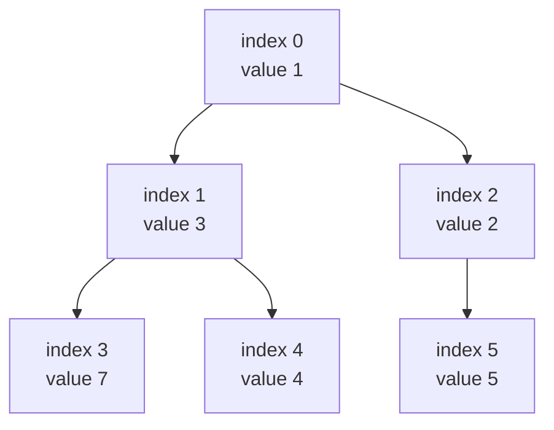
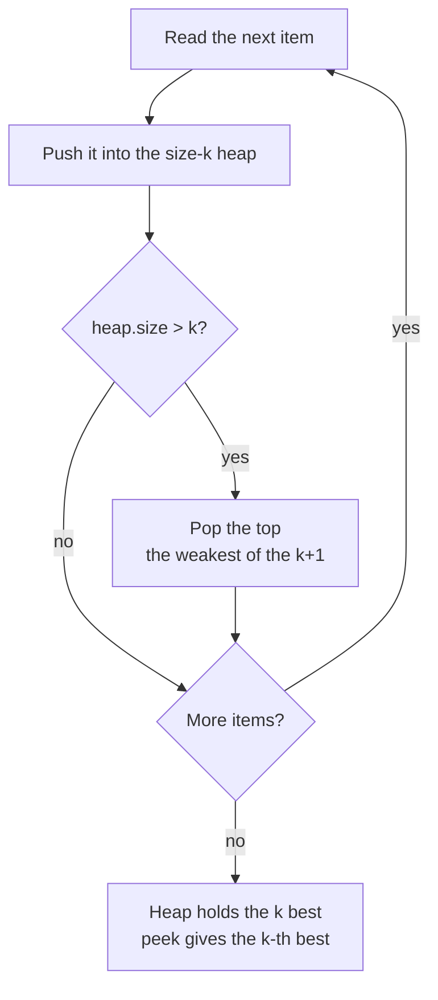
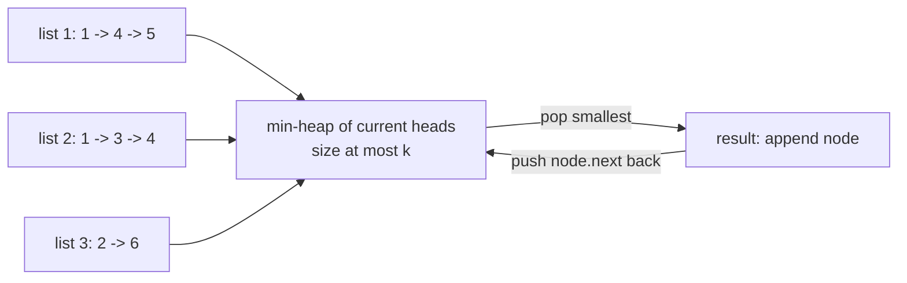
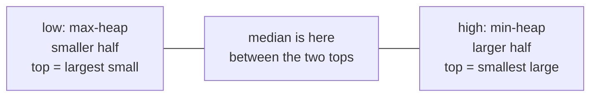

# Heaps and Top-K

> In this document you will build a reusable heap (priority queue) in JavaScript, learn when a problem needs one, and solve 12 classic heap problems: k-th largest, k closest points, top k frequent, task scheduling, merging k sorted lists, the running median and more. Heap questions test whether you can keep "the best item so far" cheaply instead of sorting again and again.

**Before this:** [Data structures and Big-O](../01-cs-and-web-fundamentals/02-data-structures-and-big-o.md) · [Problem solving and complexity, heap pattern](../11-coding-interviews/02-problem-solving-and-complexity.md#pattern-12-heap-and-top-k) · [Trees and binary search trees](08-trees-and-binary-search-trees.md) · **Interview questions:** [jump to the interview section](#interview-questions)

## Table of contents

1. [The pattern](#the-pattern)
2. [Problems](#problems)
3. [Interview questions](#interview-questions)
4. [Summary](#summary)
5. [References](#references)

---

## The pattern

### What a heap is

A **heap** is a data structure that always lets you see the smallest item (a **min-heap**) or the largest item (a **max-heap**) in O(1), and lets you add an item or remove the top item in O(log n).

People also call it a **priority queue**. A normal queue serves items in arrival order. A priority queue serves the item with the highest priority first.

**Analogy:** a hospital emergency room. Patients do not leave in the order they arrived. The most urgent patient is always seen next. When a new patient arrives, the nurse does not re-sort the whole waiting list. They only decide where this one patient fits. Where the analogy breaks: a heap does not keep the *whole* list in order. It only guarantees who is at the top.

### Why it exists

Many problems ask for "the best item" again and again while the data keeps changing:

- "Give me the next smallest number" while new numbers arrive.
- "Keep the 10 most frequent search terms."
- "Which meeting ends first?"

You could sort the array every time something changes. That costs O(n log n) per change. A heap gives you the top item in O(1) and handles each change in O(log n).

| Operation | Sorted array | Unsorted array | Heap |
| --- | --- | --- | --- |
| See the min | O(1) | O(n) | O(1) |
| Add an item | O(n) (shift items) | O(1) | O(log n) |
| Remove the min | O(1) or O(n) | O(n) | O(log n) |
| Build from n items | O(n log n) | O(1) | O(n) |

### How it works inside

A heap is a **complete binary tree** stored in a plain array. "Complete" means every level is full except maybe the last, and the last level is filled from the left. Because the tree has no gaps, you do not need node objects or pointers. The index tells you where the parent and children are:

- Parent of index `i`: `Math.floor((i - 1) / 2)`
- Left child: `2 * i + 1`
- Right child: `2 * i + 2`

The **heap property** (for a min-heap): every parent is smaller than or equal to its children. That is all. Siblings have no order. So the smallest item is always at index 0.



The array for this tree is `[1, 3, 2, 7, 4, 5]`. Notice that it is **not sorted** (3 comes before 2). It only obeys "parent ≤ children".

Two moves keep the heap property:

1. **Bubble up (sift up)** — used by `push`. Put the new item at the end of the array. While it is smaller than its parent, swap it with the parent. The tree height is log n, so this is O(log n).
2. **Sink down (sift down)** — used by `pop`. Remove the root. Move the last item to the root. While it is bigger than its smaller child, swap it with that child. Also O(log n).

Step-by-step walkthrough: `push(0)` into `[1, 3, 2, 7, 4, 5]`.

1. Append: `[1, 3, 2, 7, 4, 5, 0]`. The new item is at index 6.
2. Parent of 6 is index 2 (value 2). 0 < 2, so swap: `[1, 3, 0, 7, 4, 5, 2]`. Now at index 2.
3. Parent of 2 is index 0 (value 1). 0 < 1, so swap: `[0, 3, 1, 7, 4, 5, 2]`. Now at index 0.
4. Index 0 is the root. Stop. The new minimum is at the top.

Step-by-step walkthrough: `pop()` from `[0, 3, 1, 7, 4, 5, 2]`.

1. Save the root (0) to return it.
2. Remove the last item (2) and put it at the root: `[2, 3, 1, 7, 4, 5]`.
3. Children of index 0 are 3 and 1. The smaller is 1 (index 2). 2 > 1, so swap: `[1, 3, 2, 7, 4, 5]`.
4. Children of index 2 would be index 5 (value 5) and index 6 (none). 2 < 5, so stop.
5. Return 0.

### JavaScript has no built-in heap

JavaScript (the ECMAScript language) has `Array`, `Map`, `Set`, but **no priority queue**. Node.js does not add one either. In an interview you have three options:

- Write a small heap class (about 50 lines). This is the safest choice. Practise until you can write it in 5 minutes.
- Ask whether you may assume a helper exists. Some online judges provide a priority queue library, but you cannot count on it.
- Use `sort()` when the input is small, and say clearly what a heap would improve.

### The reusable heap class

This class works as a min-heap or a max-heap. You choose with the **comparator**, the same kind of function you pass to `Array.prototype.sort`: it returns a negative number when `a` should come out first.

```js
class Heap {
  // compare(a, b) < 0 means "a has higher priority and comes out first"
  constructor(compare = (a, b) => a - b, items = []) {
    this.compare = compare;
    this.items = [...items];
    // Heapify: sink every parent, from the last parent up to the root. O(n).
    for (let i = Math.floor(this.items.length / 2) - 1; i >= 0; i--) {
      this.#sinkDown(i);
    }
  }

  get size() {
    return this.items.length;
  }

  isEmpty() {
    return this.items.length === 0;
  }

  peek() {
    return this.items[0]; // undefined when empty
  }

  push(value) {
    this.items.push(value);
    this.#bubbleUp(this.items.length - 1);
    return this;
  }

  pop() {
    const items = this.items;
    if (items.length === 0) return undefined;
    const top = items[0];
    const last = items.pop();
    if (items.length > 0) {
      items[0] = last;
      this.#sinkDown(0);
    }
    return top;
  }

  #bubbleUp(i) {
    const items = this.items;
    while (i > 0) {
      const parent = Math.floor((i - 1) / 2);
      if (this.compare(items[i], items[parent]) >= 0) break;
      [items[i], items[parent]] = [items[parent], items[i]];
      i = parent;
    }
  }

  #sinkDown(i) {
    const items = this.items;
    const n = items.length;
    while (true) {
      const left = 2 * i + 1;
      const right = left + 1;
      let best = i;
      if (left < n && this.compare(items[left], items[best]) < 0) best = left;
      if (right < n && this.compare(items[right], items[best]) < 0) best = right;
      if (best === i) return;
      [items[i], items[best]] = [items[best], items[i]];
      i = best;
    }
  }
}
```

Every problem below uses this `Heap` class. The graph document reuses it for Dijkstra's algorithm ([Network delay time](10-graphs-bfs-dfs-and-topological-sort.md#p10-network-delay-time-medium)).

Using it:

```js
const minHeap = new Heap(); // default comparator: smallest number first
[5, 1, 8, 3].forEach((n) => minHeap.push(n));
console.log(minHeap.peek()); // 1
console.log(minHeap.pop(), minHeap.pop()); // 1 3
console.log(minHeap.size); // 2

const maxHeap = new Heap((a, b) => b - a, [5, 1, 8, 3]); // built in O(n)
console.log(maxHeap.pop()); // 8

// Objects: order tasks by priority, then by id to break ties
const tasks = new Heap((a, b) => a.priority - b.priority || a.id - b.id);
tasks.push({ id: 2, priority: 1 }).push({ id: 1, priority: 1 }).push({ id: 3, priority: 0 });
console.log(tasks.pop().id, tasks.pop().id, tasks.pop().id); // 3 1 2
console.log(tasks.pop()); // undefined
```

The `||` trick in the last comparator: if the priorities are equal, `a.priority - b.priority` is `0`, which is falsy, so JavaScript uses the second comparison. It reads like "sort by priority, then by id".

**Why is building from an array O(n) and not O(n log n)?** Half of the items are leaves and never move. A quarter move at most one level, an eighth at most two levels, and so on. The sum `n/4·1 + n/8·2 + n/16·3 + ...` is less than `n`. So heapify is O(n). Pushing the items one by one is O(n log n).

**Testing the heap.** A heap bug is silent: the code runs but returns the wrong order. So test it against `sort()` with random data. This is the check used for this document:

```js
function testHeap() {
  for (let round = 0; round < 200; round++) {
    const values = Array.from({ length: Math.floor(Math.random() * 50) }, () => Math.floor(Math.random() * 20) - 10);
    const heap = new Heap((a, b) => a - b, values.slice(0, 10)); // heapify part
    values.slice(10).forEach((v) => heap.push(v)); // push the rest
    const out = [];
    while (!heap.isEmpty()) out.push(heap.pop());
    const expected = [...values].sort((a, b) => a - b);
    if (out.join() !== expected.join()) throw new Error("heap order is wrong");
  }
  return "heap ok";
}
console.log(testHeap()); // heap ok
```

### When to recognize the pattern

Think "heap" when you see these signals:

| Signal in the problem | Heap idea |
| --- | --- |
| "k largest", "k smallest", "top k", "k closest", "k most frequent" | Keep a heap of size k |
| "k-th largest" or "k-th smallest" | Top of a size-k heap (or quickselect) |
| "repeatedly take the smallest / largest" | Pop, process, push the result back |
| "merge k sorted lists / arrays / streams" | Heap of the current head of each list |
| "median of a stream", "middle value as data arrives" | Two heaps |
| "schedule", "next free room", "earliest finishing" | Min-heap of end times |
| Input arrives one item at a time and you need the best so far | Heap instead of re-sorting |

A good extra hint: the answer needs only the **top few items**, not a fully sorted list.

### The top-k template

The most common heap trick: to keep the **k largest** items, use a **min-heap of size k**. The top of that heap is the weakest of your current top k. When a new item arrives, compare it with the weakest. If the new item is better, the weakest is removed.

```text
heap = min-heap (for k largest) or max-heap (for k smallest)
for each item:
    push item
    if heap.size > k: pop      // remove the weakest of the k+1
answer = all items in heap     // the k best
k-th best = heap.peek()
```



**Complexity:** n pushes and pops on a heap that never grows past k+1: O(n log k) time, O(k) space. When k is much smaller than n (top 10 of a million), this is much faster than sorting (O(n log n)) and uses far less memory. It also works on a **stream**, where you never have all the data at once.

### Other heap techniques used below

- **Pop, process, push back** — take the best item, change it, put it back (last stone weight, connect sticks, task scheduler).
- **Heap of list heads** — to merge k sorted lists, keep only the current front of each list in the heap (merge k sorted lists).
- **Two heaps** — a max-heap for the smaller half and a min-heap for the larger half. Their tops meet in the middle (median of a stream).
- **Sort plus heap** — sort by one key (start time, capital) and use the heap for another key (end time, profit) (meeting rooms II, IPO).
- **Lazy deletion** — a heap cannot remove an item from the middle quickly. Instead, leave the old item in the heap and skip it when it reaches the top if it is no longer valid. You will see this idea again in Dijkstra's algorithm.

### Complexity cheat sheet

| Operation | Time |
| --- | --- |
| `peek` | O(1) |
| `push`, `pop` | O(log n) |
| Build from n items (heapify) | O(n) |
| Find or remove an arbitrary item | O(n) |
| Pop all items (heap sort) | O(n log n) |

### Common mistakes

```js
// ❌ Wrong: re-sorting the whole array every time you need the max
const queue = [];
function addAndGetMax(value) {
  queue.push(value);
  queue.sort((a, b) => b - a); // O(n log n) on every call
  return queue[0];
}

// ❌ Wrong: default sort compares strings, so 10 comes before 9
[10, 9, 1].sort(); // [1, 10, 9]

// ❌ Wrong: comparator that returns a boolean
new Heap((a, b) => a > b); // false/true become 0/1, never negative: the heap breaks
```

```js
// ✅ Correct: comparators return a number (negative, zero or positive)
const byNumber = new Heap((a, b) => a - b);
const byStringLength = new Heap((a, b) => a.length - b.length);
const byName = new Heap((a, b) => a.name.localeCompare(b.name));
console.log(byNumber.size + byStringLength.size + byName.size); // 0
```

Other common mistakes:

- **Wrong heap direction.** For the k **largest**, use a **min**-heap. For the k **smallest**, use a **max**-heap. Many people get this backwards.
- **Thinking the heap array is sorted.** Only index 0 is guaranteed. If you need a sorted result, pop everything.
- **Using `shift()` on the heap array.** `shift()` is O(n) and destroys the tree shape. Always use `pop()` on the heap.
- **Forgetting to break ties.** When two items have the same priority, the output order may change. If the problem asks for a specific order on ties, put that rule in the comparator.
- **Mutating an object while it is inside the heap.** If you change the priority field of an item that is already in the heap, the heap does not know. Pop it, change it, push it again.

---

## Problems

The problems go from Easy to Hard. All of them use the `Heap` class from [the pattern section](#the-reusable-heap-class).

### P1. Last Stone Weight (Easy)

**Problem:** You have a pile of stones, each with a positive weight. On each turn, take the two heaviest stones and smash them together. If they weigh the same, both are destroyed. If not, the lighter one is destroyed and the heavier one now weighs the difference. Repeat until at most one stone is left. Return its weight, or 0 if no stone is left.

Similar to: LeetCode 1046 Last Stone Weight.

**Examples:**

```text
[2, 7, 4, 1, 8, 1] -> 1
[1]                -> 1
[3, 3]             -> 0
```

**How to recognize the pattern:** "Take the two heaviest, then put something back" is a repeated "get the max" while the data changes. That is a max-heap.

**Brute force:** sort the array on every turn and take the last two. Up to n turns, each O(n log n): O(n² log n) time.

**Optimal approach:**

1. Put all stones into a max-heap (heapify in O(n)).
2. While there are at least two stones, pop the two largest.
3. If they are different, push the difference back.
4. Return the remaining stone, or 0.

**Code:**

```js
function lastStoneWeight(stones) {
  const heap = new Heap((a, b) => b - a, stones); // max-heap
  while (heap.size > 1) {
    const heaviest = heap.pop();
    const second = heap.pop();
    if (heaviest !== second) heap.push(heaviest - second);
  }
  return heap.size === 1 ? heap.peek() : 0;
}

console.log(lastStoneWeight([2, 7, 4, 1, 8, 1])); // 1
console.log(lastStoneWeight([1])); // 1
console.log(lastStoneWeight([3, 3])); // 0
```

**Dry run** on `[2, 7, 4, 1, 8, 1]`:

| Turn | Popped | Pushed back | Heap contents (any order) |
| --- | --- | --- | --- |
| start | | | 8, 7, 4, 2, 1, 1 |
| 1 | 8, 7 | 1 | 4, 2, 1, 1, 1 |
| 2 | 4, 2 | 2 | 2, 1, 1, 1 |
| 3 | 2, 1 | 1 | 1, 1, 1 |
| 4 | 1, 1 | nothing | 1 |

One stone of weight 1 is left.

**Complexity:** O(n log n) time — each turn removes at least one stone, so there are at most n turns, each O(log n). O(n) space for the heap.

**Edge cases:** one stone (return it); stones that cancel out completely (return 0); empty input (return 0).

**Follow-ups:**
- **What if you may choose any two stones and want the smallest possible final weight?** — That is a different problem (Last Stone Weight II). It becomes a subset-sum dynamic programming problem, not a heap problem. See [Dynamic programming](12-dynamic-programming.md).
- **Can you do it without a heap?** — If weights are small integers, a counting array indexed by weight works. The heap is the general answer.

**How to say it in the interview:**
> Each turn needs the two heaviest stones, and the pile changes after each turn, so I use a max-heap. I build it from the array in linear time, then pop two, push the difference if it is not zero, and repeat. Each turn removes at least one stone, so there are at most n turns of log n each, which is O(n log n). Sorting on every turn would be O(n² log n).

---

### P2. Kth Largest Element in a Stream (Easy)

**Problem:** Design a class that receives `k` and a starting list of numbers. Its `add(value)` method adds a number to the stream and returns the k-th largest number seen so far.

Similar to: LeetCode 703 Kth Largest Element in a Stream.

**Examples:**

```text
k = 3, start = [4, 5, 8, 2]
add(3) -> 4    add(5) -> 5    add(10) -> 5    add(9) -> 8    add(4) -> 8
```

**How to recognize the pattern:** "k-th largest" plus "data keeps arriving" is the size-k min-heap template.

**Brute force:** keep all numbers in an array and sort after each `add`: O(n log n) per call and O(n) memory.

**Optimal approach:**

1. Keep a min-heap of at most k numbers. It always holds the k largest numbers seen.
2. On `add`, push the value. If the heap now has k+1 items, pop the smallest.
3. The top of the heap is the k-th largest.

**Code:**

```js
class KthLargest {
  constructor(k, nums) {
    this.k = k;
    this.heap = new Heap(); // min-heap
    for (const n of nums) this.add(n);
  }

  add(value) {
    this.heap.push(value);
    if (this.heap.size > this.k) this.heap.pop(); // drop the weakest
    return this.heap.peek();
  }
}

const scores = new KthLargest(3, [4, 5, 8, 2]);
console.log(scores.add(3), scores.add(5), scores.add(10), scores.add(9), scores.add(4)); // 4 5 5 8 8
```

**Dry run** (k = 3):

| Step | Heap after (smallest first) | Returned |
| --- | --- | --- |
| start with 4, 5, 8, 2 | 4, 5, 8 (2 was popped) | |
| add(3) | 4, 5, 8 (3 was popped) | 4 |
| add(5) | 5, 5, 8 (4 was popped) | 5 |
| add(10) | 5, 8, 10 (5 was popped) | 5 |
| add(9) | 8, 9, 10 (5 was popped) | 8 |
| add(4) | 8, 9, 10 (4 was popped) | 8 |

**Complexity:** O(log k) per `add` and O(n log k) to build. O(k) space, no matter how long the stream is.

**Edge cases:** the start list has fewer than k numbers (the heap is not full yet, so `peek` returns the smallest so far — the problem usually promises at least k numbers when you ask); duplicates (they count as separate numbers); negative numbers.

**Follow-ups:**
- **Small optimization?** — If the heap is full and the new value is not bigger than `peek()`, skip it. It can never be in the top k.
- **What if numbers can also be removed from the stream?** — A heap cannot delete from the middle quickly. Use lazy deletion (a Map of "to delete" counts, skipped when they reach the top) or a balanced search tree, which JavaScript also does not have built in.

**How to say it in the interview:**
> I only need the k largest numbers, so I keep a min-heap of size k. Its top is the weakest of the top k, which is exactly the k-th largest. Each add pushes and, if the heap grows past k, pops the smallest. That is O(log k) per add and O(k) memory, even for an endless stream.

---

### P3. Kth Largest Element in an Array (Medium)

**Problem:** Given an array of numbers and `k`, return the k-th largest value in sorted order (duplicates count, so it is not the k-th *distinct* value).

Similar to: LeetCode 215 Kth Largest Element in an Array.

**Examples:**

```text
[3, 2, 1, 5, 6, 4], k = 2          -> 5
[3, 2, 3, 1, 2, 4, 5, 5, 6], k = 4 -> 4
[7], k = 1                         -> 7
```

**How to recognize the pattern:** "k-th largest" → size-k heap. Because the whole array is available at once, **quickselect** is also an option. This problem is mostly about comparing the two.

**Brute force:** sort descending and return `sorted[k - 1]`: O(n log n) time.

**Approach 1 — heap:** run the top-k template with a min-heap of size k. The answer is `peek()`. O(n log k) time, O(k) space.

**Approach 2 — quickselect:** quicksort's partition step puts the pivot in its final sorted position. If that is the position you want, stop. If not, continue **only on the side that contains the target**. You never sort both halves.

1. In ascending order, the k-th largest is at index `n - k`. Call it `target`.
2. Pick a random pivot. Partition the current range into three parts: `< pivot`, `=== pivot`, `> pivot`.
3. If `target` falls inside the "equal" part, return the pivot. Otherwise continue in the left or the right part.

The three-way partition (the "Dutch national flag" idea from [Two pointers](02-two-pointers.md)) keeps quickselect fast when there are many duplicates.

**Code:**

```js
function findKthLargest(nums, k) {
  const heap = new Heap(); // min-heap of the k largest
  for (const n of nums) {
    heap.push(n);
    if (heap.size > k) heap.pop();
  }
  return heap.peek();
}

function findKthLargestQuickselect(nums, k) {
  const arr = [...nums]; // do not change the caller's array
  const target = arr.length - k; // index in ascending order
  let lo = 0;
  let hi = arr.length - 1;
  while (true) {
    const pivot = arr[lo + Math.floor(Math.random() * (hi - lo + 1))];
    // After the loop: arr[lo..lt-1] < pivot, arr[lt..gt] === pivot, arr[gt+1..hi] > pivot
    let lt = lo;
    let i = lo;
    let gt = hi;
    while (i <= gt) {
      if (arr[i] < pivot) {
        [arr[lt], arr[i]] = [arr[i], arr[lt]];
        lt++;
        i++;
      } else if (arr[i] > pivot) {
        [arr[i], arr[gt]] = [arr[gt], arr[i]];
        gt--;
      } else {
        i++;
      }
    }
    if (target < lt) hi = lt - 1;
    else if (target > gt) lo = gt + 1;
    else return arr[target];
  }
}

console.log(findKthLargest([3, 2, 1, 5, 6, 4], 2)); // 5
console.log(findKthLargestQuickselect([3, 2, 3, 1, 2, 4, 5, 5, 6], 4)); // 4
console.log(findKthLargestQuickselect([7], 1)); // 7
```

**Dry run** (quickselect) on `[3, 2, 1, 5, 6, 4]`, k = 2, so `target = 4`. Suppose the random pivot is 3:

1. Partition the whole array around 3. The result is `[2, 1, 3, 6, 4, 5]`, with `lt = 2` and `gt = 2`.
2. `target = 4` is bigger than `gt`, so continue on indices 3 to 5: `6, 4, 5`.
3. Suppose the next pivot is 5. That range becomes `4, 5, 6`, and now `lt = gt = 4`.
4. `target = 4` is inside `[lt, gt]`. Return `arr[4]`, which is 5.

**Complexity:**

| Approach | Time | Extra space | Notes |
| --- | --- | --- | --- |
| Sort | O(n log n) | O(n) for a copy | Simplest |
| Heap of size k | O(n log k) | O(k) | Works on streams, predictable |
| Quickselect | O(n) average, O(n²) worst | O(n) for the copy (O(1) if done in place) | A random pivot makes the worst case very unlikely |

Quickselect is O(n) on average because each round throws away, on average, a constant fraction of the range: n + n/2 + n/4 + ... < 2n.

**Edge cases:** k = 1 (the maximum); k = n (the minimum); all values equal (the three-way partition finishes in one round); negative numbers.

**Follow-ups:**
- **Which one would you use in production?** — For one query on an array in memory, quickselect or even sort is fine. For a stream, or when k is small and memory matters, the heap. If the worst case must be guaranteed, the heap (O(n log k)), or quickselect with the "median of medians" pivot (O(n) worst case, but slow in practice).
- **Why not `sort()` without a comparator?** — It compares numbers as strings, so `[10, 9].sort()` stays `[10, 9]`. Always pass `(a, b) => a - b`.
- **Does quickselect change the input?** — The in-place version does. Here we copy first. Say this in the interview, because changing the caller's data can cause bugs.

**How to say it in the interview:**
> The simple answer is to sort, which is O(n log n). Better, I keep a min-heap of size k: its top is the k-th largest, and that is O(n log k). Since I have the whole array, quickselect gives O(n) on average: I partition around a random pivot and only continue on the side that contains index n minus k. I use a three-way partition so many duplicates do not slow it down.

---

### P4. K Closest Points to Origin (Medium)

**Problem:** Given a list of points `[x, y]` on a plane and `k`, return the k points closest to `(0, 0)`. Any order is fine.

Similar to: LeetCode 973 K Closest Points to Origin.

**Examples:**

```text
[[1, 3], [-2, 2]], k = 1          -> [[-2, 2]]
[[3, 3], [5, -1], [-2, 4]], k = 2 -> [[3, 3], [-2, 4]]
```

**How to recognize the pattern:** "k closest" means "k smallest distances". That is the top-k template with a **max**-heap.

**Brute force:** sort all points by distance and take the first k: O(n log n).

**Optimal approach:**

1. Compare **squared** distances `x*x + y*y`. The square root does not change the order, so skip it.
2. Keep a max-heap of size k, ordered by distance. Its top is the farthest of the current k closest.
3. Push each point. If the size becomes k+1, pop the farthest.

**Code:**

```js
function kClosest(points, k) {
  const dist = ([x, y]) => x * x + y * y;
  const heap = new Heap((a, b) => dist(b) - dist(a)); // max-heap by distance
  for (const point of points) {
    heap.push(point);
    if (heap.size > k) heap.pop(); // remove the farthest
  }
  return heap.items; // any order is allowed
}

console.log(JSON.stringify(kClosest([[1, 3], [-2, 2]], 1))); // [[-2,2]]
console.log(JSON.stringify(kClosest([[3, 3], [5, -1], [-2, 4]], 2).sort((a, b) => a[0] - b[0]))); // [[-2,4],[3,3]]
```

**Dry run** on `[[3, 3], [5, -1], [-2, 4]]`, k = 2. Squared distances: 18, 26, 20.

| Point | Distance | Heap (largest first) | Popped |
| --- | --- | --- | --- |
| [3, 3] | 18 | 18 | |
| [5, -1] | 26 | 26, 18 | |
| [-2, 4] | 20 | 26, 18, 20 | 26, which is [5, -1] |

Result: `[3, 3]` and `[-2, 4]`.

**Complexity:** O(n log k) time, O(k) space. Quickselect on the distances gives O(n) on average, as in P3.

**Edge cases:** k equals the number of points (return all); several points at the same distance (any of them is accepted); a point exactly at the origin (distance 0).

**Follow-ups:**
- **Why squared distance?** — The square root keeps the order (a bigger squared distance always means a bigger distance). Skipping it is faster and avoids rounding.
- **Can the squares lose precision?** — JavaScript numbers are 64-bit floating point. Integers stay exact up to `Number.MAX_SAFE_INTEGER` (2^53 − 1, about 9·10^15). Coordinates up to about 6·10^7 are safe. For bigger values, use `BigInt`.
- **Points arrive as a stream?** — The max-heap version already works on a stream.

**How to say it in the interview:**
> Closest means smallest distance, so I want the k smallest. I keep a max-heap of size k keyed by squared distance; I skip the square root because it does not change the order. The top of the heap is the farthest point I am keeping, so when a closer point arrives, the top is the one I drop. That is O(n log k) time and O(k) space. Quickselect would give O(n) on average if I need more speed.

---

### P5. Top K Frequent Elements and Top K Frequent Words (Medium)

The basic version (numbers, any order) is solved with a heap in [Problem solving and complexity](../11-coding-interviews/02-problem-solving-and-complexity.md#pattern-12-heap-and-top-k), and with **bucket sort** in O(n) in [Arrays and hashing, P6](01-arrays-and-hashing.md#p6-top-k-frequent-elements-medium). Here we take it one step further: the version where **ties must be broken**. That is where most bugs appear.

**Problem:** Given a list of words and `k`, return the k most frequent words, from most to least frequent. If two words have the same frequency, the one that comes first alphabetically goes first.

Similar to: LeetCode 347 Top K Frequent Elements and LeetCode 692 Top K Frequent Words.

**Examples:**

```text
["i","love","code","i","love","js"], k = 2 -> ["i", "love"]
["the","day","is","sunny","the","the","the","sunny","is","is"], k = 4 -> ["the", "is", "sunny", "day"]
```

**How to recognize the pattern:** "k most frequent" → count with a Map, then top-k with a heap. The tie rule goes into the comparator.

**Brute force:** count, then sort all distinct words by count (descending) and word (ascending), and take k. O(n + u log u) for u distinct words. This is fine in practice and a good first answer.

**Optimal approach:**

1. Count each word with a `Map`. A Map is safer than a plain object here: a word like `"constructor"` or `"__proto__"` would clash with properties every object already has.
2. Keep a min-heap of size k whose top is the **worst** entry: a lower count is worse; with equal counts, the word that is later alphabetically is worse.
3. Pop everything (worst first) and reverse.

**Code:**

```js
function topKFrequentWords(words, k) {
  const counts = new Map();
  for (const word of words) counts.set(word, (counts.get(word) ?? 0) + 1);

  // Negative result = a is "worse" and should sit at the top of the heap
  const worseFirst = ([wordA, countA], [wordB, countB]) => {
    if (countA !== countB) return countA - countB; // lower count is worse
    return wordA > wordB ? -1 : wordA < wordB ? 1 : 0; // later word is worse
  };

  const heap = new Heap(worseFirst);
  for (const entry of counts) {
    heap.push(entry);
    if (heap.size > k) heap.pop();
  }

  const result = [];
  while (!heap.isEmpty()) result.push(heap.pop()[0]);
  return result.reverse(); // best first
}

console.log(topKFrequentWords(["i", "love", "code", "i", "love", "js"], 2)); // [ 'i', 'love' ]
console.log(topKFrequentWords(["the", "day", "is", "sunny", "the", "the", "the", "sunny", "is", "is"], 4)); // [ 'the', 'is', 'sunny', 'day' ]
```

The numbers version has the same shape, with a comparator on the count only:

```js
function topKFrequent(nums, k) {
  const counts = new Map();
  for (const n of nums) counts.set(n, (counts.get(n) ?? 0) + 1);
  const heap = new Heap((a, b) => a[1] - b[1]); // min-heap by count
  for (const entry of counts) {
    heap.push(entry);
    if (heap.size > k) heap.pop();
  }
  return heap.items.map(([value]) => value); // any order
}

console.log(topKFrequent([1, 1, 1, 2, 2, 3], 2).sort((a, b) => a - b)); // [ 1, 2 ]
```

**Dry run** on the first example, k = 2. Counts: `i: 2, love: 2, code: 1, js: 1`.

| Push | Heap after (worst first) | Popped |
| --- | --- | --- |
| i:2 | i:2 | |
| love:2 | love:2, i:2 | |
| code:1 | code:1, love:2, i:2 | code |
| js:1 | js:1, love:2, i:2 | js |

Popping the rest gives `love` first (it is worse than `i` because it is later alphabetically), then `i`. Reversed: `["i", "love"]`.

**Complexity:** O(n) to count, O(u log k) for the heap, O(k log k) to pop. O(u) space for the Map. (Each string comparison also costs up to the word length.)

**Edge cases:** k equals the number of distinct words; all words have the same count (the result is purely alphabetical); an empty list.

**Follow-ups:**
- **Why is the tie rule "reversed" in the comparator?** — The heap keeps the worst item on top so it can be thrown away. For ties, "worse" means "later alphabetically", so the later word must compare as smaller.
- **`localeCompare` or `<`?** — `<` compares UTF-16 code units, which matches "lexicographic order" in most problem statements. `localeCompare` follows human language rules (accents, case). Use the one the problem asks for.
- **O(n) solution?** — Bucket sort by count (counts are between 1 and n), then sort the words inside each bucket for the tie rule.
- **Top search terms of the last hour, at large scale?** — Count per time bucket, merge the counts, keep a heap. For huge streams, approximate structures such as a count-min sketch are used. See [Autocomplete search](../09-system-design/11-case-study-autocomplete-search.md).

**How to say it in the interview:**
> First I count with a Map in one pass. Then I keep a min-heap of size k whose top is the worst entry, so it is the one I throw away. Worst means a lower count, or, for equal counts, the word that comes later alphabetically. At the end I pop everything and reverse to get the best first. It is O(n + u log k). If k is close to u, simply sorting the entries is just as good and simpler.

---

### P6. Minimum Cost to Connect Sticks (Medium)

**Problem:** You have sticks with positive integer lengths. You can join any two sticks of lengths `a` and `b` into one stick of length `a + b`, and that costs `a + b`. Join all sticks into one. Return the minimum total cost.

Similar to: LeetCode 1167 Minimum Cost to Connect Sticks. This is the same idea as building a **Huffman code** (the compression algorithm).

**Examples:**

```text
[2, 4, 3]    -> 14   (2+3=5 costs 5, then 5+4=9 costs 9)
[1, 8, 3, 5] -> 30
[5]          -> 0
```

**How to recognize the pattern:** "Repeatedly combine the two smallest" is the pop-process-push-back technique with a min-heap.

**Brute force:** try every possible order of joins and keep the cheapest. The number of orders grows faster than n!, so this is only for tiny inputs (it is the checker used to test the fast version).

**Optimal approach:**

1. Put all lengths into a min-heap.
2. While more than one stick is left: pop the two shortest, add their sum to the cost, push the sum back.
3. Return the cost.

Why is "always join the two shortest" right? Every stick's length is paid again each time the stick it belongs to is joined. A long stick that is joined early is paid many times. So you want the long sticks to be joined as late as possible, and the short ones early. Joining the two smallest first does exactly that. (The formal proof is the Huffman coding proof, an "exchange argument": swapping a longer stick into an earlier join can never make the cost smaller. See [Greedy algorithms](13-greedy-algorithms.md).)

**Code:**

```js
function connectSticks(sticks) {
  const heap = new Heap((a, b) => a - b, sticks); // min-heap
  let cost = 0;
  while (heap.size > 1) {
    const joined = heap.pop() + heap.pop();
    cost += joined;
    heap.push(joined);
  }
  return cost;
}

console.log(connectSticks([2, 4, 3])); // 14
console.log(connectSticks([1, 8, 3, 5])); // 30
console.log(connectSticks([5])); // 0
```

**Dry run** on `[1, 8, 3, 5]`:

| Step | Two shortest | Joined | Total cost | Heap after |
| --- | --- | --- | --- | --- |
| 1 | 1, 3 | 4 | 4 | 4, 5, 8 |
| 2 | 4, 5 | 9 | 13 | 8, 9 |
| 3 | 8, 9 | 17 | 30 | 17 |

**Complexity:** O(n log n) time (n − 1 joins, each with heap work), O(n) space.

**Edge cases:** one stick or none (cost 0); all sticks the same length.

**Follow-ups:**
- **Can you do it without a heap if the input is already sorted?** — Yes, with two queues: the sorted input and a queue of joined sticks (which come out in increasing order). Always take the smaller front of the two. That is O(n) after sorting.
- **Is "join the two longest" ever better?** — No. It makes the long sticks get paid many times.

**How to say it in the interview:**
> Every join adds the lengths of everything inside the joined stick, so long sticks should be joined as late as possible. That suggests always joining the two shortest sticks, which is the Huffman coding idea. I use a min-heap: pop two, add the sum to the cost, push the sum back, until one stick is left. That is O(n log n).

---

### P7. Task Scheduler (Medium)

**Problem:** A CPU must run a list of tasks, each named by a letter. Each task takes one time unit. Two runs of the **same** task must be at least `n` units apart; in between, the CPU can run other tasks or stay idle. Return the minimum number of time units needed to run all tasks.

Similar to: LeetCode 621 Task Scheduler.

**Examples:**

```text
tasks = A A A B B B, n = 2 -> 8   (A B idle A B idle A B)
tasks = A A A B B B, n = 0 -> 6
tasks = A A A A A A B C D E F G, n = 2 -> 16
```

**How to recognize the pattern:** at each time unit you want to run "the available task with the most copies left" — a repeated max with a cooldown. That is a max-heap plus a waiting queue.

**Brute force:** try every possible order of tasks. Exponential.

**Optimal approach 1 — simulation with a heap:**

1. Count each task. Put the counts into a max-heap.
2. Keep a **cooling queue** of `[countLeft, readyTime]` for tasks that just ran.
3. At every time unit: if the heap has a task, pop the biggest count, run it, and if copies remain, add it to the cooling queue with `readyTime = time + n`.
4. If the front of the cooling queue is ready, move it back into the heap.
5. Stop when both the heap and the queue are empty.

Why the most frequent first? The task with the most copies is the one most likely to force idle time later, so you start it as early and as often as possible.

**Optimal approach 2 — counting formula:** let `maxCount` be the highest count, and `maxTasks` the number of tasks that have that count. Picture `maxCount` "frames". Each frame (except the last) has `n + 1` slots:

```text
A _ _ | A _ _ | A        (n = 2, maxCount = 3)
A B _ | A B _ | A B      (maxTasks = 2: A and B)
```

The minimum length is `(maxCount - 1) * (n + 1) + maxTasks`. If there are so many different tasks that they fill every gap, there is no idle time at all and the answer is simply `tasks.length`. So the answer is the larger of the two.

**Code:**

```js
function leastInterval(tasks, n) {
  const counts = new Map();
  for (const task of tasks) counts.set(task, (counts.get(task) ?? 0) + 1);

  const heap = new Heap((a, b) => b - a, [...counts.values()]); // max-heap of counts
  const cooling = []; // [countLeft, readyTime], in time order
  let head = 0; // read index for the queue (avoids O(n) shift)
  let time = 0;

  while (!heap.isEmpty() || head < cooling.length) {
    time++;
    if (!heap.isEmpty()) {
      const left = heap.pop() - 1; // run the task with the most copies left
      if (left > 0) cooling.push([left, time + n]);
    }
    // a task that finished at time t may run again at t + n + 1
    if (head < cooling.length && cooling[head][1] === time) {
      heap.push(cooling[head][0]);
      head++;
    }
  }
  return time;
}

function leastIntervalFormula(tasks, n) {
  const counts = new Map();
  for (const task of tasks) counts.set(task, (counts.get(task) ?? 0) + 1);
  const maxCount = Math.max(...counts.values());
  let maxTasks = 0;
  for (const c of counts.values()) if (c === maxCount) maxTasks++;
  return Math.max(tasks.length, (maxCount - 1) * (n + 1) + maxTasks);
}

const sample = ["A", "A", "A", "B", "B", "B"];
console.log(leastInterval(sample, 2), leastIntervalFormula(sample, 2)); // 8 8
console.log(leastInterval(sample, 0)); // 6
console.log(leastInterval([..."AAAAAABCDEFG"], 2)); // 16
```

**Dry run** (simulation) on `A A A B B B`, n = 2. The heap holds counts `3, 3`.

| Time | Runs | Heap after | Cooling queue after |
| --- | --- | --- | --- |
| 1 | a task with 3 left (A) | 3 | [2, ready at 3] |
| 2 | B | (empty) | [2, 3], [2, 4] |
| 3 | idle | 2 (A is back) | [2, 4] |
| 4 | A | 2 (B is back) | [1, 6] |
| 5 | B | (empty) | [1, 6], [1, 7] |
| 6 | idle | 1 | [1, 7] |
| 7 | A | 1 | (empty) |
| 8 | B | (empty) | (empty) |

The heap stores only counts, not names: we do not need to know which letter runs, only how many copies are left. Total: 8.

**Complexity:**
- Simulation: O(T log 26) where T is the answer (at most `tasks.length * (n + 1)`). With only 26 letters, the heap is tiny.
- Formula: O(m) for m tasks, O(1) extra space (at most 26 counts).

**Edge cases:** `n = 0` (answer is `tasks.length`); a single task type (`(count - 1) * (n + 1) + 1`); many distinct task types (no idle time).

**Follow-ups:**
- **The tasks must run in the given order?** — Then there is no choice and no heap. Walk the list and keep a Map of "next allowed time" per task.
- **Return the actual schedule?** — Store `[count, name]` in the heap and the queue, and push the name (or "idle") at each time unit.
- **Speed up long idle stretches?** — When the heap is empty, jump `time` straight to the `readyTime` of the queue front instead of stepping one unit at a time.

**How to say it in the interview:**
> At every step I want to run the task with the most copies left, because that is the one that causes idle time if it is delayed. So I keep a max-heap of counts and a cooling queue of tasks waiting out their n units. Each time unit I pop and run the top task, and move a task back from the queue when it is ready. There is also a closed formula: the most frequent task makes maxCount minus one frames of n plus one slots, plus one slot for each task that ties for the max, and the answer is at least the number of tasks.

---

### P8. Reorganize String (Medium)

**Problem:** Rearrange the characters of a string so that no two neighbors are the same. Return any valid result, or `""` if it is impossible.

Similar to: LeetCode 767 Reorganize String.

**Examples:**

```text
"aab"  -> "aba"
"aaab" -> ""
"vvvlo" -> "vovlv" (any valid answer)
```

**How to recognize the pattern:** you keep placing "the most frequent character that is allowed right now". It is the same greedy as the task scheduler with `n = 1`.

**Brute force:** try all permutations and check each one. O(n · n!).

**Optimal approach:**

1. Count each character. If one character appears more than `Math.ceil(length / 2)` times, it is impossible (there are not enough other characters to separate its copies).
2. Put `[char, count]` into a max-heap by count.
3. Repeat: pop the most frequent character and append it. The character used in the **previous** step was held outside the heap so it could not be picked twice in a row; push it back now. Then hold the current character (if copies remain).
4. If the heap is empty but a character is still held, it cannot be placed: return `""`.

**Code:**

```js
function reorganizeString(s) {
  const counts = new Map();
  for (const ch of s) counts.set(ch, (counts.get(ch) ?? 0) + 1);

  const heap = new Heap((a, b) => b[1] - a[1], [...counts.entries()]); // max-heap by count
  const result = [];
  let held = null; // the character used last, waiting one turn

  while (!heap.isEmpty()) {
    const [ch, count] = heap.pop();
    result.push(ch); // build with an array: strings are immutable
    if (held) heap.push(held);
    held = count > 1 ? [ch, count - 1] : null;
  }
  return held ? "" : result.join("");
}

console.log(reorganizeString("aab")); // aba
console.log(JSON.stringify(reorganizeString("aaab"))); // ""
console.log(reorganizeString("vvvlo")); // vovlv
```

**Dry run** on `"vvvlo"`. Counts: v:3, l:1, o:1.

| Step | Popped | Result so far | Pushed back (held before) | Held now |
| --- | --- | --- | --- | --- |
| 1 | v:3 | v | — | v:2 |
| 2 | o:1 | vo | v:2 | — |
| 3 | v:2 | vov | — | v:1 |
| 4 | l:1 | vovl | v:1 | — |
| 5 | v:1 | vovlv | — | — |

In step 2, `o` and `l` both have count 1, so the heap may return either one. Both choices give a valid answer.

**Complexity:** O(n log k) where k is the number of distinct characters (at most 26 for lowercase letters, so effectively O(n)). O(k) space for the heap plus O(n) for the result.

**Edge cases:** a single character (`"a"` → `"a"`); the impossible case; all characters different.

**Follow-ups:**
- **No heap?** — Sort characters by count, then fill the even indexes 0, 2, 4, ... first (starting with the most frequent character), then the odd indexes. This is O(n) for a fixed alphabet.
- **Same characters must be at least k apart?** — Use a cooling queue of length k, exactly like the task scheduler.

**How to say it in the interview:**
> If any character appears more than half the length, rounded up, it is impossible. Otherwise I greedily place the most frequent character that is not the one I just placed. A max-heap gives me the most frequent, and I hold the previous character out of the heap for one step so it cannot repeat. If the heap runs out while I still hold a character, there is no valid placement. It is O(n log k), and k is at most 26.

---

### P9. Meeting Rooms II (Medium)

The sorting-and-sweep solution (two sorted arrays of starts and ends) is in [Prefix sums and intervals, P11](04-prefix-sums-and-intervals.md#p11-meeting-rooms-ii-medium) and [Problem solving and complexity](../11-coding-interviews/02-problem-solving-and-complexity.md#pattern-13-sorting-based-approaches). Here is the heap version, which also tells you *which* room each meeting gets.

**Problem:** Given meeting time intervals `[start, end]`, return the minimum number of rooms needed so no two meetings in the same room overlap. A meeting that ends at time 10 frees its room for a meeting that starts at 10.

Similar to: LeetCode 253 Meeting Rooms II.

**Examples:**

```text
[[0, 30], [5, 10], [15, 20]] -> 2
[[7, 10], [2, 4]]            -> 1
[[1, 5], [5, 10]]            -> 1
```

**How to recognize the pattern:** "which room frees up first?" is a repeated min over end times. Sort by one key (start), use a heap for the other key (end).

**Brute force:** for every meeting, count how many meetings are running at its start time. The maximum is the answer. O(n²).

**Optimal approach:**

1. Sort meetings by start time.
2. Keep a min-heap of end times of the rooms in use.
3. For each meeting: if the earliest end time is `<=` this start, that room is free — pop it. Then push this meeting's end time.
4. The heap size is the number of rooms in use. Its largest size is the answer (with this exact loop, the heap never shrinks, so the final size is the answer).

**Code:**

```js
function minMeetingRooms(intervals) {
  const meetings = [...intervals].sort((a, b) => a[0] - b[0]); // numeric sort!
  const endTimes = new Heap(); // min-heap of end times
  for (const [start, end] of meetings) {
    if (!endTimes.isEmpty() && endTimes.peek() <= start) endTimes.pop(); // reuse a room
    endTimes.push(end);
  }
  return endTimes.size;
}

console.log(minMeetingRooms([[0, 30], [5, 10], [15, 20]])); // 2
console.log(minMeetingRooms([[7, 10], [2, 4]])); // 1
console.log(minMeetingRooms([[1, 5], [5, 10]])); // 1
console.log(minMeetingRooms([])); // 0
```

**Dry run** on `[[0, 30], [5, 10], [15, 20]]` (already sorted):

| Meeting | Earliest end before | Free room? | Heap after |
| --- | --- | --- | --- |
| [0, 30] | — | no | 30 |
| [5, 10] | 30 | no (30 > 5) | 10, 30 |
| [15, 20] | 10 | yes (10 <= 15), pop | 20, 30 |

Two rooms.

**Complexity:** O(n log n) for the sort plus n heap operations. O(n) space.

**Edge cases:** empty list (0 rooms); meetings that touch (`end === start` can share a room, so use `<=`); all meetings overlapping (n rooms); unsorted input.

**Follow-ups:**
- **Return which room each meeting uses?** — Keep two heaps: free room ids (min-heap of numbers) and busy rooms as `[endTime, roomId]`. Before each meeting, move every busy room with `endTime <= start` to the free heap. Take the smallest free id, or create a new room.
- **Rooms have limited count and meetings wait?** — That is LeetCode 2402 Meeting Rooms III: the same two-heap idea, but a delayed meeting keeps its length and starts when the earliest room frees.
- **Heap or sweep?** — Both are O(n log n). The sweep (sorted starts and sorted ends with two pointers) uses simpler code; the heap version is easier to extend to room assignment.

**How to say it in the interview:**
> I sort the meetings by start time and keep a min-heap of end times for the rooms in use. For each meeting, if the earliest-ending room is already free by this start, I reuse it by popping; then I push the new end time. The heap size is the number of rooms I needed. Sorting dominates, so it is O(n log n).

---

### P10. Merge K Sorted Lists (Hard)

**Problem:** You are given k sorted linked lists. Merge them into one sorted linked list and return its head.

Similar to: LeetCode 23 Merge k Sorted Lists. For the two-list merge and the `ListNode` basics, see [Linked lists](07-linked-lists.md). The **divide-and-conquer** version (no heap) is fully worked in [Linked lists, P12](07-linked-lists.md#p12-merge-k-sorted-lists-hard); here we teach the heap version.

**Examples:**

```text
[1->4->5, 1->3->4, 2->6] -> 1->1->2->3->4->4->5->6
[]                       -> empty list
[empty list]             -> empty list
```

**How to recognize the pattern:** "merge k sorted" → keep the current head of each list in a min-heap. The smallest overall item is always one of the heads.

**Brute force:** put all values in an array, sort, rebuild a list: O(N log N) for N total nodes. Or merge the lists one by one into a growing result: O(k · N).

**Optimal approach:**

1. Push the head of every non-empty list into a min-heap ordered by `val`.
2. Pop the smallest node, attach it to the result (use a **dummy head** so you never special-case the first node).
3. If that node has a `next`, push `next` into the heap.
4. Repeat until the heap is empty.

The heap never holds more than k nodes.



**Code:**

```js
class ListNode {
  constructor(val, next = null) {
    this.val = val;
    this.next = next;
  }
}

// Helpers for testing
const toList = (values) => values.reduceRight((next, val) => new ListNode(val, next), null);
const toArray = (head) => {
  const out = [];
  for (let node = head; node; node = node.next) out.push(node.val);
  return out;
};

function mergeKLists(lists) {
  const heap = new Heap((a, b) => a.val - b.val);
  for (const head of lists) if (head) heap.push(head);

  const dummy = new ListNode(0);
  let tail = dummy;
  while (!heap.isEmpty()) {
    const node = heap.pop();
    tail.next = node;
    tail = node;
    if (node.next) heap.push(node.next);
  }
  tail.next = null;
  return dummy.next;
}

console.log(toArray(mergeKLists([toList([1, 4, 5]), toList([1, 3, 4]), toList([2, 6])])).join(" ")); // 1 1 2 3 4 4 5 6
console.log(toArray(mergeKLists([]))); // []
console.log(toArray(mergeKLists([null]))); // []
```

**Dry run** on the first example (heap shown as values; equal values can come out in either order, and the result is the same):

| Step | Pop | Push | Heap after | Result |
| --- | --- | --- | --- | --- |
| start | | 1, 1, 2 | 1, 1, 2 | |
| 1 | 1 (list 1) | 4 | 1, 2, 4 | 1 |
| 2 | 1 (list 2) | 3 | 2, 3, 4 | 1 1 |
| 3 | 2 (list 3) | 6 | 3, 4, 6 | 1 1 2 |
| 4 | 3 | 4 | 4, 4, 6 | 1 1 2 3 |
| 5 | 4 | 5 | 4, 5, 6 | 1 1 2 3 4 |
| 6 | 4 | — | 5, 6 | 1 1 2 3 4 4 |
| 7, 8 | 5, then 6 | — | empty | 1 1 2 3 4 4 5 6 |

**Complexity:** O(N log k) time for N total nodes (each node is pushed and popped once, on a heap of size at most k). O(k) extra space. The result reuses the existing nodes.

**Edge cases:** no lists; lists that are `null`; one list; lists of very different lengths; duplicate values across lists.

**Follow-ups:**
- **Without a heap?** — **Divide and conquer:** merge the lists in pairs (1 with 2, 3 with 4, ...), then merge the results in pairs, and so on. There are log k rounds and each round touches all N nodes: also O(N log k), with O(1) extra space if done iteratively.
- **Merge k sorted arrays?** — Same idea; push `[value, arrayIndex, elementIndex]` into the heap.
- **The lists are huge files on disk?** — This is **external merge sort**: read a buffer from each file, keep the heap of buffer heads, write the output as a stream. Node.js streams fit this well, see [Streams](../07-nodejs-backend/05-streams.md).

**How to say it in the interview:**
> The smallest remaining value is always the head of one of the k lists, so I keep all current heads in a min-heap. I pop the smallest, attach it to the result with a dummy head, and push that node's next. The heap has at most k nodes, so the total is O(N log k) time and O(k) space. Divide-and-conquer pairwise merging gives the same time without a heap.

---

### P11. Find Median from Data Stream (Hard)

**Problem:** Design a class with `addNum(num)` to add a number from a stream, and `findMedian()` to return the median of all numbers so far. The median is the middle value of the sorted numbers, or the average of the two middle values when the count is even.

Similar to: LeetCode 295 Find Median from Data Stream.

**Examples:**

```text
addNum(1), addNum(2), findMedian() -> 1.5
addNum(3), findMedian()            -> 2
```

**How to recognize the pattern:** "middle value" while data keeps arriving. You need the largest of the small half and the smallest of the big half. That is **two heaps**.

**Brute force:** keep a sorted array and insert each number in the right place (binary search to find the place, but the insert still shifts items): O(n) per add, O(1) per median.

**Optimal approach:**

1. `low` is a **max-heap** holding the smaller half. `high` is a **min-heap** holding the larger half.
2. Rules: every number in `low` is ≤ every number in `high`, and `low` has the same size as `high` or one more.
3. `addNum`: push into `low`; move `low`'s top into `high` (this keeps the order rule); if `high` is now bigger than `low`, move `high`'s top back into `low` (this keeps the size rule).
4. `findMedian`: if `low` is bigger, the median is `low.peek()`. Otherwise it is the average of the two tops.



**Code:**

```js
class MedianFinder {
  constructor() {
    this.low = new Heap((a, b) => b - a); // max-heap: smaller half
    this.high = new Heap((a, b) => a - b); // min-heap: larger half
  }

  addNum(num) {
    this.low.push(num);
    this.high.push(this.low.pop()); // the largest of the small half moves up
    if (this.high.size > this.low.size) {
      this.low.push(this.high.pop()); // keep low the same size or one bigger
    }
  }

  findMedian() {
    if (this.low.size > this.high.size) return this.low.peek();
    return (this.low.peek() + this.high.peek()) / 2;
  }
}

const stream = new MedianFinder();
stream.addNum(1);
stream.addNum(2);
console.log(stream.findMedian()); // 1.5
stream.addNum(3);
console.log(stream.findMedian()); // 2
```

**Dry run** adding 5, 15, 1, 3:

| Add | After push to low, move to high | After rebalancing | Median |
| --- | --- | --- | --- |
| 5 | low: — high: 5 | low: 5 high: — | 5 |
| 15 | low: 5 high: 15 | no change | (5 + 15) / 2 = 10 |
| 1 | low: 1 high: 5, 15 | low: 5, 1 high: 15 | 5 |
| 3 | low: 3, 1 high: 5, 15 | no change | (3 + 5) / 2 = 4 |

**Complexity:** `addNum` is O(log n) (a few heap operations). `findMedian` is O(1). O(n) space.

**Edge cases:** `findMedian` before any number (the problem usually guarantees at least one; otherwise return `null` or throw); negative numbers; many duplicates (the rules still hold, because they use ≤).

**Follow-ups:**
- **All numbers are between 0 and 100?** — Keep a count array of 101 buckets. Finding the median walks at most 101 buckets: O(1) for practical purposes.
- **99% of numbers are in 0 to 100?** — Use the buckets plus two counters (or small heaps) for the numbers outside the range.
- **Median of a sliding window (only the last k numbers)?** — Two heaps plus lazy deletion of numbers that left the window (LeetCode 480 Sliding Window Median). See [Sliding window](03-sliding-window.md).
- **Average of two big numbers?** — In JavaScript there is no integer overflow, but precision is lost above 2^53. For normal inputs, `(a + b) / 2` is fine.

**How to say it in the interview:**
> I split the numbers into two halves: a max-heap for the smaller half and a min-heap for the larger half. I keep them balanced so the small half has the same size or one more. Then the median is either the top of the small half, or the average of both tops. Adding is O(log n): push into the small half, move its top across, and move one back if the sizes are off. Finding the median is O(1).

---

### P12. IPO (Hard)

**Problem:** You start with capital `w` and may finish at most `k` projects. Project `i` needs at least `capital[i]` to start and gives a pure profit `profits[i]` when done (your capital grows by the profit; you never pay the capital). Choose projects to maximize your final capital.

Similar to: LeetCode 502 IPO.

**Examples:**

```text
k = 2, w = 0, profits = [1, 2, 3], capital = [0, 1, 1] -> 4
k = 3, w = 0, profits = [1, 2, 3], capital = [0, 1, 2] -> 6
k = 1, w = 0, profits = [5],       capital = [1]       -> 0
```

**How to recognize the pattern:** two keys: "can I afford it?" (capital) and "which is the best?" (profit). Sort by the first key, and use a max-heap for the second.

**Brute force:** in each of the k rounds, scan all projects and pick the most profitable affordable one: O(k · n). Or try every order of projects: exponential.

**Optimal approach:**

1. Sort the projects by required capital (ascending).
2. Keep a max-heap of profits of projects you can **afford now**, and a pointer `i` into the sorted list.
3. Repeat k times:
   - Move every project with `capital <= w` from the sorted list into the heap (advance `i`).
   - If the heap is empty, no project is affordable: stop early.
   - Pop the biggest profit and add it to `w`.

Why is taking the biggest affordable profit always right? Profits only add to capital, never take it away. A bigger profit now makes `w` bigger, which can only unlock **more** projects later. So choosing anything smaller can never lead to a better result.

**Code:**

```js
function findMaximizedCapital(k, w, profits, capital) {
  const projects = capital.map((cap, i) => [cap, profits[i]]).sort((a, b) => a[0] - b[0]);
  const available = new Heap((a, b) => b - a); // max-heap of profits we can afford
  let i = 0;
  for (let round = 0; round < k; round++) {
    while (i < projects.length && projects[i][0] <= w) {
      available.push(projects[i][1]);
      i++;
    }
    if (available.isEmpty()) break; // nothing affordable: stop early
    w += available.pop();
  }
  return w;
}

console.log(findMaximizedCapital(2, 0, [1, 2, 3], [0, 1, 1])); // 4
console.log(findMaximizedCapital(3, 0, [1, 2, 3], [0, 1, 2])); // 6
console.log(findMaximizedCapital(1, 0, [5], [1])); // 0
```

**Dry run** on `k = 2, w = 0, profits = [1, 2, 3], capital = [0, 1, 1]`. Sorted projects: `[0, 1], [1, 2], [1, 3]`.

| Round | w before | Moved into heap | Heap | Popped | w after |
| --- | --- | --- | --- | --- | --- |
| 1 | 0 | profit 1 | 1 | 1 | 1 |
| 2 | 1 | profits 2 and 3 | 3, 2 | 3 | 4 |

**Complexity:** O(n log n) to sort, plus O(n log n) to push each project once and O(k log n) to pop. O(n) space.

**Edge cases:** nothing affordable at the start (return `w`); k bigger than the number of projects (the early stop handles it); projects with capital 0.

**Follow-ups:**
- **Projects cost their capital (you pay it)?** — Then the greedy argument breaks, because a big project could use up money you need. That becomes a knapsack-style problem ([Dynamic programming](12-dynamic-programming.md)).
- **Why not a second heap instead of sorting?** — A min-heap by capital works the same way. Sorting once is simpler because the projects never change.

**How to say it in the interview:**
> Profits only increase my capital, so in each round the best move is the most profitable project I can afford right now; it can only unlock more projects. I sort projects by required capital and keep a pointer. Each round I move every newly affordable project into a max-heap of profits, then take the top. If the heap is empty, I stop early. The total is O(n log n).

---

## Interview questions

### How to explain this in an interview

1. **Define it:** "A heap is a complete binary tree stored in an array, where every parent is smaller than its children for a min-heap. So the minimum is always at index 0."
2. **Why it exists:** "It gives me the smallest or largest item quickly while items keep being added and removed, without re-sorting."
3. **How it works:** "Push appends at the end and bubbles the item up; pop moves the last item to the root and sinks it down. Both follow one path of height log n."
4. **Small example:** "For the k largest numbers, I keep a min-heap of size k. The top is the weakest of my top k, so that is what I throw away when a bigger number arrives."
5. **Where it is useful:** "Top-k queries, merging sorted streams, schedulers, Dijkstra's shortest path, the running median."
6. **Trade-offs / gotchas:** "JavaScript has no built-in heap, so I write one. Only the top is ordered, searching is O(n), and if I need everything sorted, a plain sort may be simpler."

### Q1. What is a heap, and why is it stored in an array?

**What the interviewer is checking:** Whether you know the heap property and the index math, not only "it is a priority queue".

**Short spoken answer (30–60 seconds):**
> A heap is a binary tree with one rule: every parent has a higher priority than its children. In a min-heap, that means the parent is smaller, so the smallest item is always at the root. It is also a complete tree — all levels are full except the last one, which fills from the left. Because there are no gaps, I can store it in a plain array: the children of index i are at 2i plus 1 and 2i plus 2, and the parent is at i minus 1 divided by 2, rounded down. That saves memory, keeps data close together for the CPU cache, and makes the height always log n, which is why push and pop are O(log n).

**Detailed explanation:** A binary search tree orders left and right subtrees, so it supports search. A heap only orders parents above children, which is a weaker rule. The weaker rule is cheaper to maintain: an insert only fixes one path from a leaf to the root. Since the tree is complete, the height is `floor(log2 n)`.

**Follow-up questions:**
- **Is a heap array sorted?** — No. `[1, 3, 2]` is a valid min-heap. Only the root is guaranteed. A sorted array is always a valid heap, but not the other way round.
- **Why not use a binary search tree?** — A balanced BST also gives min/max in O(log n) and supports search and delete of any item. But it is more code, uses node objects, and JavaScript has no built-in one. If you only need the top, a heap is simpler and faster.
- **What is a d-ary heap?** — Each node has d children instead of 2. The tree is shorter, so push is faster, but pop compares more children. Some Dijkstra implementations use it.

**Common mistakes:** Saying a heap is "a sorted array". Confusing the heap data structure with the "heap" memory area where JavaScript stores objects — they share a name and nothing else.

**Where this is used in real projects:** Job queues with priorities, timers (Node.js keeps its timer lists in an internal binary-heap priority queue), scheduling the next event in simulations, the "k most recent errors" in a dashboard.

---

### Q2. To find the k largest items, why do you use a min-heap and not a max-heap?

**What the interviewer is checking:** That you understand *what* the heap top represents in the top-k template, and the space benefit.

**Short spoken answer (30–60 seconds):**
> I keep only k items in the heap, the best k so far. When a new item arrives, the question is: should it replace the weakest of my current top k? The weakest of the k largest is the smallest one, so I need fast access to the smallest — that is a min-heap. I push the new item and, if the size is k plus 1, pop the top. With a max-heap I would have to store all n items and pop k times, which needs O(n) memory and does not work well for a stream. The min-heap version is O(n log k) time and O(k) memory.

**Detailed explanation:** Both work for an array in memory: max-heapify everything in O(n), then pop k times in O(k log n). That is O(n + k log n), which is actually fine and sometimes faster. The size-k min-heap wins when n is huge or unbounded (a stream) because memory stays O(k).

**Follow-up questions:**
- **And the k smallest?** — A max-heap of size k. Its top is the biggest of your k smallest, which is the one to remove.
- **When is plain sorting better?** — When k is close to n, or n is small. Sorting is O(n log n) with very simple code, and `Array.prototype.sort` is highly optimized.

**Common mistakes:** Using a max-heap with all elements and claiming O(n log k). Forgetting the `size > k` check, which makes the heap grow to n.

**Where this is used in real projects:** "Top 10 products by sales" from a large event stream, "5 slowest API endpoints" in monitoring.

---

### Q3. Why is building a heap from an array O(n) and not O(n log n)?

**What the interviewer is checking:** Deeper understanding of heap operations and summing work per level.

**Short spoken answer (30–60 seconds):**
> Heapify does not push items one by one. It starts from the last parent and sinks each parent down, moving towards the root. The trick is that most nodes are near the bottom, and nodes near the bottom can only sink a short distance. Half of the nodes are leaves and do not move at all. A quarter can move one level, an eighth two levels, and so on. If you add that up, n over 4 times 1, plus n over 8 times 2, and so on, the total is less than n. Only the few nodes near the root can sink log n levels. So heapify is linear.

**Detailed explanation:** The sum is `n · Σ h / 2^(h+1)`, and `Σ h / 2^h` converges to 2, so the total is at most `n`. Pushing one by one is different: each new item starts at the bottom and may bubble all the way up, and most items are at the bottom, so that version can be O(n log n).

**Follow-up questions:**
- **Does this make heap sort O(n)?** — No. Building is O(n), but popping n items is still O(n log n). Comparison sorting cannot beat O(n log n).
- **When does this matter in interviews?** — Last stone weight, task scheduler and connect sticks start from a full array, so you can say "I heapify in O(n)".

**Common mistakes:** Claiming heapify is O(log n), or that pushing n items one by one is also O(n).

**Where this is used in real projects:** Building a priority queue from a batch of jobs loaded at startup.

---

### Q4. Heap, quickselect or sorting for the k-th largest element: how do you choose?

**What the interviewer is checking:** Trade-off thinking: average vs worst case, memory, streams, simplicity.

**Short spoken answer (30–60 seconds):**
> Sorting is O(n log n) and the simplest; for a small array I would start there. A min-heap of size k is O(n log k) with O(k) memory, and it works on a stream, so it is my default when k is small or data arrives over time. Quickselect is O(n) on average, because each partition throws away part of the range, but O(n²) in the worst case, and it reorders the array. With a random pivot the worst case is very unlikely. So: stream or small k means heap, one-time query on a big array means quickselect, small data means sort.

**Detailed explanation:** See [P3](#p3-kth-largest-element-in-an-array-medium) for both implementations. Quickselect's O(n) average comes from n + n/2 + n/4 + ... < 2n. Using a three-way partition avoids slowdowns with many equal values.

**Follow-up questions:**
- **How do you avoid the O(n²) worst case?** — Random pivot (makes it extremely unlikely), or median-of-medians (guaranteed O(n) but slower in practice).
- **Can quickselect find the k largest items, not just the k-th?** — Yes. After it finishes, everything to the right of the target index is ≥ the k-th largest, so those positions are the top k (unsorted).

**Common mistakes:** Saying quickselect is "always O(n)". Forgetting that quickselect needs all the data in memory.

**Where this is used in real projects:** Percentiles of response times (p95, p99) on a batch of measurements.

---

### Q5. How would you implement a priority queue in JavaScript during an interview?

**What the interviewer is checking:** Practical coding skill and knowing the language's limits.

**Short spoken answer (30–60 seconds):**
> JavaScript has no built-in priority queue, so I would first ask if I can assume one. If not, I write a small Heap class backed by an array, with a comparator like the one for sort. Push appends and bubbles up while the item beats its parent. Pop saves the root, moves the last item to the root and sinks it down, swapping with the better child. Peek returns index 0. With the comparator, the same class works as a min-heap, a max-heap, or a heap of objects ordered by any field. If time is short and the input is small, I might sort instead and explain what the heap would improve.

**Code:** the full class is in [The reusable heap class](#the-reusable-heap-class).

**Follow-up questions:**
- **How do you update an item's priority?** — A basic heap cannot find an item fast. Either keep a Map from item to index and update it on every swap (an "indexed heap"), or push the item again with the new priority and skip stale entries when they reach the top (lazy deletion).
- **What about stable ordering for ties?** — A heap is not stable. Add an insertion counter to each item and use it as the second key in the comparator.

**Common mistakes:** Off-by-one errors in the child index (`2i` instead of `2i + 1`). Not handling `pop()` on a one-element heap (the last item would be put back at the root). Comparators that return booleans.

**Where this is used in real projects:** Priority-based job queues, rate limiting by next allowed time, UI task schedulers.

---

### Q6. When would you use two heaps?

**What the interviewer is checking:** Recognizing the "split into halves" structure.

**Short spoken answer (30–60 seconds):**
> When I need the boundary between two halves of a changing set — usually the median. I keep a max-heap for the smaller half and a min-heap for the larger half, balanced so their sizes differ by at most one. The two tops are the middle values, so the median is O(1) and each insert is O(log n). The same idea works for any percentile if I keep the sizes in a different ratio, for example 90 to 10 for the 90th percentile.

**Follow-up questions:**
- **How do you remove a number (sliding window median)?** — Lazy deletion: record it in a Map of "to delete", keep a "real size" counter, and drop marked items when they reach a top.
- **Is there another way for bounded values?** — Counting buckets, or a binary indexed tree over the value range.

**Common mistakes:** Not keeping the order rule (every number in the low heap ≤ every number in the high heap), which happens if you push to one heap without moving the top across.

**Where this is used in real projects:** Live median latency in a monitoring dashboard, median price in a stream of trades.

---

### Q7. What is the time complexity of merging k sorted lists with a heap, and why?

**What the interviewer is checking:** Correct use of N and k in complexity, and knowing the alternative.

**Short spoken answer (30–60 seconds):**
> Let N be the total number of nodes. Every node is pushed into the heap once and popped once. The heap only holds one node per list, so its size is at most k, and each operation is O(log k). That gives O(N log k) time and O(k) extra space. The naive way of merging the lists one by one into a growing result is O(k times N), because the early nodes are copied again and again. Pairwise divide and conquer also gives O(N log k).

**Follow-up questions:**
- **What if k is 2?** — Then the heap is pointless; a simple two-pointer merge is O(N).
- **What if the lists are sorted files bigger than memory?** — External merge: stream from each file, keep a heap of the current heads. Memory use is O(k) plus buffers.

**Common mistakes:** Saying O(N log N) — that is the sort-everything approach. Saying O(k log k) and forgetting N.

**Where this is used in real projects:** Merging sorted log files from many servers by timestamp, the merge step in databases and search engines.

---

### Q8. Why is greedy plus a heap correct for problems like connect sticks or IPO, and how would you check it?

**What the interviewer is checking:** Whether you can justify a greedy choice instead of guessing.

**Short spoken answer (30–60 seconds):**
> I ask whether taking the best item now can ever block a better result later. In connect sticks, every join pays the full length again, so joining the two shortest first keeps long sticks from being paid many times; swapping a longer stick into an earlier join can never reduce the cost. In IPO, profits only add to capital, so a bigger profit now only unlocks more projects. When I am not sure, I write a brute force for tiny inputs and compare it with the greedy on random tests. If the greedy fails, it is usually a dynamic programming problem instead.

**Follow-up questions:**
- **A heap greedy that fails?** — Coin change with coins `[1, 3, 4]` and amount 6: always taking the biggest coin gives 4 + 1 + 1 (3 coins), but 3 + 3 (2 coins) is better. See [Greedy algorithms](13-greedy-algorithms.md).

**Common mistakes:** Claiming greedy works because "it seems to work on the example".

**Where this is used in real projects:** Huffman coding in compression formats (such as DEFLATE, used by gzip), choosing which jobs to run first.

---

### Q9. Code review: what is wrong with this "priority queue"?

```js
// ❌ Wrong
class SlowQueue {
  constructor() {
    this.items = [];
  }
  push(item) {
    this.items.push(item);
    this.items.sort((a, b) => a.priority > b.priority);
  }
  pop() {
    return this.items.shift();
  }
}
```

**What the interviewer is checking:** JavaScript sort comparator rules and hidden O(n) operations.

**Short spoken answer (30–60 seconds):**
> There are three problems. First, the comparator returns a boolean. Sort expects a negative, zero or positive number; true and false become 1 and 0, never negative, so the order is not reliable. Second, sorting on every push costs O(n log n) per insert. Third, `shift()` is O(n) because it moves every remaining item one position. I would replace it with a binary heap: O(log n) push and pop with a correct numeric comparator.

**Code:**

```js
// ✅ Correct
const jobs = new Heap((a, b) => a.priority - b.priority);
jobs.push({ name: "email", priority: 2 }).push({ name: "payment", priority: 1 });
console.log(jobs.pop().name); // payment
```

**Follow-up questions:**
- **When is a sorted array acceptable?** — Very few items (tens), or many reads and very few writes.

**Common mistakes:** Only spotting one of the three issues.

**Where this is used in real projects:** This exact pattern appears in hand-written job queues in frontend and Node.js code.

---

## Summary

- **Signals:** "k largest / smallest / closest / most frequent", "k-th", "repeatedly take the best", "merge k sorted", "median of a stream", "next free room" → **heap**.
- JavaScript has **no built-in heap**. Write the array-based `Heap` class with a comparator. Parent `Math.floor((i - 1) / 2)`, children `2i + 1` and `2i + 2`.
- `peek` O(1), `push` and `pop` O(log n), heapify O(n), search O(n).
- **Top-k template:** min-heap of size k for the k largest (max-heap for the k smallest). Push, and pop when the size is k + 1. O(n log k) time, O(k) space, works on streams.
- **k-th largest:** heap O(n log k), quickselect O(n) average, sort O(n log n).
- **Pop, process, push back:** last stone weight, connect sticks (Huffman), task scheduler, reorganize string.
- **Heap of heads:** merge k sorted lists in O(N log k).
- **Two heaps:** running median; max-heap for the low half, min-heap for the high half.
- **Sort by one key, heap by another:** meeting rooms II (start, end), IPO (capital, profit).
- Comparators must return numbers. Use `a - b`, `b - a`, or `||` to chain tie-breakers. Never use `shift()` on a queue in a hot loop.

## References

- MDN — `Array.prototype.sort()` (comparator rules): https://developer.mozilla.org/en-US/docs/Web/JavaScript/Reference/Global_Objects/Array/sort
- MDN — Private class features (`#method`): https://developer.mozilla.org/en-US/docs/Web/JavaScript/Reference/Classes/Private_properties
- MDN — `Number.MAX_SAFE_INTEGER`: https://developer.mozilla.org/en-US/docs/Web/JavaScript/Reference/Global_Objects/Number/MAX_SAFE_INTEGER
- Cormen, Leiserson, Rivest, Stein — *Introduction to Algorithms* (CLRS), chapter "Heapsort" (heaps, heapify, priority queues) and "Medians and Order Statistics" (quickselect).
- Sedgewick and Wayne — *Algorithms, 4th edition*, section 2.4 "Priority Queues": https://algs4.cs.princeton.edu/24pq/
- NeetCode — problem list by pattern, "Heap / Priority Queue" (used as a reference list only): https://neetcode.io/roadmap
- LeetCode problems referenced: 1046, 703, 215, 973, 347, 692, 1167, 621, 767, 253, 23, 295, 502 — https://leetcode.com/problemset/
