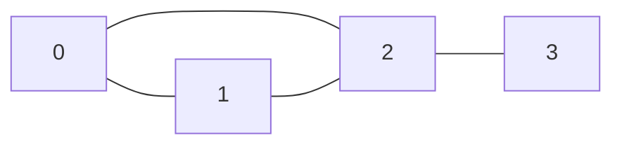
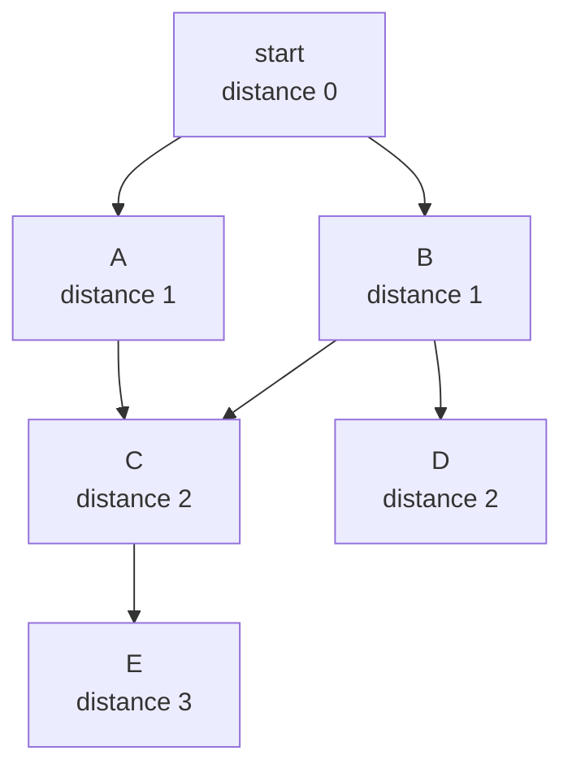
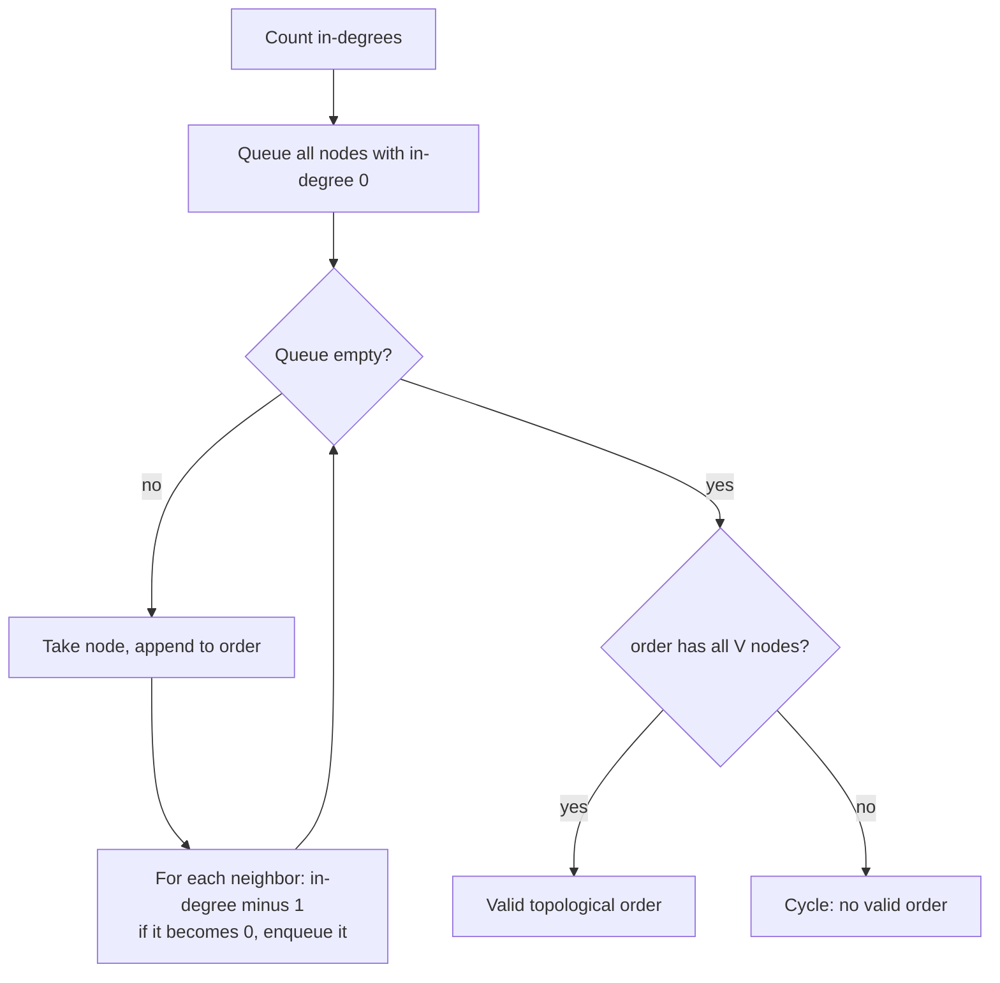
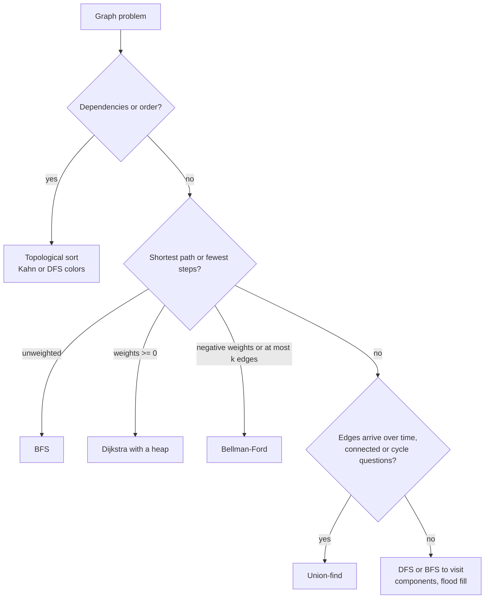
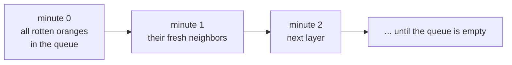
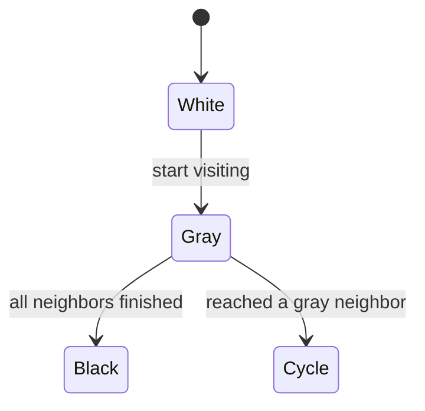
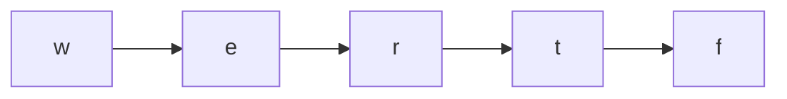

# Graphs: BFS, DFS and Topological Sort

> In this document you will learn how to store a graph in JavaScript, the BFS and DFS templates (written without deep recursion), how to treat a grid as a graph, topological sort, union-find and shortest paths with Dijkstra and Bellman-Ford. Then you will solve 13 classic problems, from flood fill to alien dictionary. Graph questions test whether you can turn a story ("courses", "flights", "oranges", "words") into nodes and edges and pick the right traversal.

**Before this:** [Data structures and Big-O](../01-cs-and-web-fundamentals/02-data-structures-and-big-o.md) · [Problem solving: BFS and DFS patterns](../11-coding-interviews/02-problem-solving-and-complexity.md#pattern-7-queue-and-breadth-first-search) · [Trees and binary search trees](08-trees-and-binary-search-trees.md) · [Heaps and top-k](09-heaps-and-top-k.md) (for Dijkstra) · **Interview questions:** [jump to the interview section](#interview-questions)

## Table of contents

1. [The pattern](#the-pattern)
2. [Problems](#problems)
3. [Interview questions](#interview-questions)
4. [Summary](#summary)
5. [References](#references)

---

## The pattern

### What a graph is

A **graph** is a set of **nodes** (also called vertices) connected by **edges**. A tree is a special graph: connected, with no cycles. A general graph can have cycles, several disconnected parts, and many paths between two nodes.

Words you need:

| Term | Meaning | Example |
| --- | --- | --- |
| **Directed** | An edge goes one way, `a → b` | "Course a must come before course b" |
| **Undirected** | An edge goes both ways | "Alice and Bob are friends" |
| **Weighted** | Each edge has a cost | Flight prices, road distances |
| **Cycle** | A path that comes back to its start | a → b → c → a |
| **Connected component** | A group of nodes that can all reach each other (undirected) | One island in a map |
| **DAG** | Directed acyclic graph: directed, no cycles | Build steps, course prerequisites |
| **In-degree** | Number of edges coming into a node | Number of prerequisites a course has |

**Analogy:** a city map. Places are nodes, roads are edges. One-way streets are directed edges. Travel time is the weight. Where the analogy breaks: many graph problems have no geography at all. Words, tasks and states of a puzzle can all be nodes.

### Representations

There are three common ways to store a graph. In interviews, the **adjacency list** is the default.



The same undirected graph in three forms:

```js
// 1. Edge list: just the pairs. Often how the input arrives.
const edges = [[0, 1], [0, 2], [1, 2], [2, 3]];

// 2. Adjacency list: for each node, the list of its neighbors.
function buildGraph(n, edgeList, directed = false) {
  const graph = Array.from({ length: n }, () => []); // NOT new Array(n).fill([])
  for (const [from, to] of edgeList) {
    graph[from].push(to);
    if (!directed) graph[to].push(from);
  }
  return graph;
}
const graph = buildGraph(4, edges);
console.log(JSON.stringify(graph)); // [[1,2],[0,2],[0,1,3],[2]]

// 3. Adjacency matrix: matrix[a][b] is 1 when there is an edge a-b.
const matrix = Array.from({ length: 4 }, () => new Array(4).fill(0));
for (const [a, b] of edges) matrix[a][b] = matrix[b][a] = 1;
console.log(matrix[2].join(" ")); // 1 1 0 1
```

| Representation | Space | "Is a connected to b?" | "List neighbors of a" | Use when |
| --- | --- | --- | --- | --- |
| Edge list | O(E) | O(E) | O(E) | Input format, Kruskal, Bellman-Ford |
| Adjacency list | O(V + E) | O(degree) | O(degree) | Almost always |
| Adjacency matrix | O(V²) | O(1) | O(V) | Small, dense graphs |

V is the number of nodes, E the number of edges.

When node names are strings (`"JFK"`, `"math101"`), use a `Map` from name to an array of neighbors:

```js
function buildNamedGraph(pairs) {
  const graph = new Map();
  for (const [from, to] of pairs) {
    if (!graph.has(from)) graph.set(from, []);
    if (!graph.has(to)) graph.set(to, []);
    graph.get(from).push(to);
  }
  return graph;
}
const routes = buildNamedGraph([["JFK", "LHR"], ["LHR", "DEL"], ["JFK", "DEL"]]);
console.log(routes.get("JFK")); // [ 'LHR', 'DEL' ]
console.log(routes.get("DEL")); // []
```

A common JavaScript trap: `new Array(n).fill([])` puts **the same array object** in every slot. Pushing a neighbor to node 0 would add it to every node. Always use `Array.from({ length: n }, () => [])`.

### BFS template

**Breadth-first search (BFS)** visits nodes in layers: first the start, then all nodes one edge away, then two edges away, and so on. It uses a **queue** (first in, first out).

Because of the layers, BFS finds the **shortest path in an unweighted graph**: the first time BFS reaches a node, it used the fewest edges possible.



```js
function bfsDistances(graph, start) {
  const dist = new Array(graph.length).fill(-1); // -1 = not visited
  dist[start] = 0;
  const queue = [start];
  for (let head = 0; head < queue.length; head++) { // index instead of shift()
    const node = queue[head];
    for (const next of graph[node]) {
      if (dist[next] === -1) { // mark when you ADD to the queue
        dist[next] = dist[node] + 1;
        queue.push(next);
      }
    }
  }
  return dist;
}

console.log(bfsDistances(graph, 0)); // [ 0, 1, 1, 2 ]
```

Two details matter:

- **Use a head index, not `queue.shift()`.** `shift()` moves every item one position, which is O(n) per call. On a big graph that makes BFS O(V²). With a head index, each dequeue is O(1). (The array keeps the old items in memory; that is fine for interview-sized inputs.)
- **Mark a node as visited when you add it to the queue**, not when you take it out. Otherwise the same node can be added many times by different neighbors.

### DFS template (iterative)

**Depth-first search (DFS)** goes as deep as possible along one path, then backs up and tries another branch. It uses a **stack**: either the call stack (recursion) or your own array.

Recursive DFS is short, but JavaScript engines limit the call stack. In Node.js the default limit is around ten thousand frames (the exact number depends on the frame size and the `--stack-size` flag). A grid of 1000 × 1000 cells can need a million nested calls and crash with `RangeError: Maximum call stack size exceeded`. So for big inputs, write DFS with an explicit stack:

```js
function dfsOrder(graph, start) {
  const visited = new Array(graph.length).fill(false);
  const order = [];
  const stack = [start];
  while (stack.length > 0) {
    const node = stack.pop();
    if (visited[node]) continue; // a node can be pushed more than once
    visited[node] = true;
    order.push(node);
    // push in reverse so the first neighbor is visited first (like recursion)
    for (let i = graph[node].length - 1; i >= 0; i--) {
      if (!visited[graph[node][i]]) stack.push(graph[node][i]);
    }
  }
  return order;
}

console.log(dfsOrder(graph, 0)); // [ 0, 1, 2, 3 ]
```

And the recursive version, which is fine when the depth is small (trees of normal height, graphs with a few thousand nodes):

```js
function dfsRecursive(graph, node, visited = new Set(), order = []) {
  visited.add(node);
  order.push(node);
  for (const next of graph[node]) {
    if (!visited.has(next)) dfsRecursive(graph, next, visited, order);
  }
  return order;
}

console.log(dfsRecursive(graph, 0)); // [ 0, 1, 2, 3 ]
```

**BFS or DFS?**

| Need | Use |
| --- | --- |
| Shortest path, fewest steps, "minimum number of moves" (unweighted) | BFS |
| "Spread" over time (fire, infection, rotting) | BFS, often multi-source |
| Just visit everything (count components, flood fill) | Either; DFS is often shorter to write |
| Detect a cycle in a directed graph, topological order by finishing time | DFS (three colors) |
| Explore all paths or build something along the path | DFS / backtracking ([Backtracking](11-backtracking.md)) |

### Grid as a graph

Many problems give a 2D grid. Each cell is a node. Its neighbors are the cells up, down, left and right (sometimes also the diagonals). You never build an adjacency list; you compute neighbors on the fly.

```js
const DIRECTIONS = [[1, 0], [-1, 0], [0, 1], [0, -1]]; // down, up, right, left

function gridNeighbors(grid, row, col) {
  const result = [];
  for (const [dr, dc] of DIRECTIONS) {
    const r = row + dr;
    const c = col + dc;
    if (r >= 0 && r < grid.length && c >= 0 && c < grid[0].length) result.push([r, c]);
  }
  return result;
}

console.log(JSON.stringify(gridNeighbors([[0, 0], [0, 0]], 0, 0))); // [[1,0],[0,1]]
```

Tips for grids:

- The cell `(r, c)` can be encoded as one number `r * cols + c`. That is cheaper than the string `` `${r},${c}` `` as a Set key.
- To mark a cell visited, you can change the grid itself (for example set `"1"` to `"0"`). Say this to the interviewer, because it changes the caller's data. Copy the grid first if that matters.
- Grid size m × n means V = m·n and E ≈ 4·m·n, so BFS/DFS is O(m·n).

The shortest path in a grid with BFS is worked out in [Problem solving and complexity](../11-coding-interviews/02-problem-solving-and-complexity.md#pattern-7-queue-and-breadth-first-search). The problems below build on it.

### Topological sort

A **topological order** of a DAG lists the nodes so that every edge goes from earlier to later. If `a → b` means "a must come before b", a topological order is a valid schedule. It exists **only if the graph has no cycle**.

**Kahn's algorithm (BFS on in-degrees):**

1. Count the in-degree of every node.
2. Put every node with in-degree 0 (nothing required before it) into a queue.
3. Take a node from the queue and add it to the order. For each of its neighbors, lower the in-degree by 1. If a neighbor reaches 0, add it to the queue.
4. If the order contains all nodes, it is valid. If some nodes never reached in-degree 0, they are stuck in a **cycle**.



**DFS with three colors** is the other way: white = not visited, gray = on the current path, black = finished. Reaching a gray node means you found a cycle. The reverse of the finishing order is a topological order. Both are shown in [P6](#p6-course-schedule-medium).

### Union-find (disjoint set union)

**Union-find** (also called **DSU**, disjoint set union) keeps track of groups of items. It answers two questions very fast:

- `find(x)`: which group is `x` in? (It returns a representative, the group's "root".)
- `union(a, b)`: merge the groups of `a` and `b`.

Each group is stored as a tree where every item points to a parent. The root points to itself. Two tricks make it nearly O(1) per operation:

- **Path compression:** during `find`, point every visited item straight to the root, so the next `find` is short.
- **Union by rank:** attach the shorter tree under the taller one, so trees stay flat.

With both tricks, a sequence of operations costs O(α(n)) each, where α is the inverse Ackermann function. It grows so slowly that it is at most 4 for any input you could store. You can say "practically constant".

```js
class UnionFind {
  constructor(n) {
    this.parent = Array.from({ length: n }, (_, i) => i); // everyone is their own root
    this.rank = new Array(n).fill(0);
    this.groups = n;
  }

  find(x) {
    let root = x;
    while (this.parent[root] !== root) root = this.parent[root];
    while (this.parent[x] !== root) { // path compression, iterative (no recursion limit)
      const next = this.parent[x];
      this.parent[x] = root;
      x = next;
    }
    return root;
  }

  union(a, b) {
    let rootA = this.find(a);
    let rootB = this.find(b);
    if (rootA === rootB) return false; // already in the same group
    if (this.rank[rootA] < this.rank[rootB]) [rootA, rootB] = [rootB, rootA];
    this.parent[rootB] = rootA; // attach the shorter tree under the taller one
    if (this.rank[rootA] === this.rank[rootB]) this.rank[rootA]++;
    this.groups--;
    return true;
  }
}

const friends = new UnionFind(5);
friends.union(0, 1);
friends.union(3, 4);
console.log(friends.find(1) === friends.find(0), friends.find(1) === friends.find(3)); // true false
console.log(friends.groups); // 3
console.log(friends.union(1, 0)); // false
```

Use union-find when edges arrive one by one and you need "are these connected?" or "does this edge create a cycle?" (undirected). It does not support removing edges, and it does not give paths.

### Shortest paths with weights

BFS only works when every edge has the same cost. With weights:

| Algorithm | Works with | Time | Idea |
| --- | --- | --- | --- |
| BFS | All edges cost 1 | O(V + E) | Layers |
| 0-1 BFS | Edge costs 0 or 1 | O(V + E) | Deque: cost-0 edges go to the front |
| **Dijkstra** | Non-negative weights | O((V + E) log V) with a heap | Always expand the closest unfinished node |
| **Bellman-Ford** | Negative weights allowed, no negative cycle | O(V · E) | Relax every edge V − 1 times |
| Floyd-Warshall | All pairs, small V | O(V³) | Try every node as a middle stop |

**Relaxing** an edge `u → v` with weight `w` means: "if going through `u` gives a shorter way to `v`, update `v`'s distance". All shortest-path algorithms are different orders of relaxing edges.

Dijkstra needs a min-heap. JavaScript has none, so we use the `Heap` class from [Heaps and top-k](09-heaps-and-top-k.md#the-reusable-heap-class). See [P10](#p10-network-delay-time-medium) and [P11](#p11-cheapest-flights-within-k-stops-medium).

### Which algorithm? A decision guide



### How to recognize a graph problem

Signals:

- Words like "network", "connected", "path", "route", "dependency", "prerequisite", "neighbors", "friends", "islands", "regions".
- A 2D grid where you move between cells.
- "Minimum number of steps / moves / transformations" — BFS over **states** (each state is a node, each move is an edge). Word ladder and the lock puzzle are like this.
- "Order the tasks so that ..." or "is it possible to finish all ..." — topological sort.
- "Are a and b in the same group?" — union-find or DFS.

### Complexity

| Algorithm | Time | Space |
| --- | --- | --- |
| BFS / DFS on adjacency list | O(V + E) | O(V) |
| BFS / DFS on an m × n grid | O(m · n) | O(m · n) |
| Topological sort (Kahn or DFS) | O(V + E) | O(V + E) |
| Union-find, m operations | O(m · α(n)) | O(n) |
| Dijkstra with binary heap | O((V + E) log V) | O(V + E) |
| Bellman-Ford | O(V · E) | O(V) |

### Common mistakes

```js
// ❌ Wrong: every node shares ONE array
const shared = new Array(3).fill([]);
shared[0].push(1);
console.log(shared); // [ [ 1 ], [ 1 ], [ 1 ] ]

// ❌ Wrong: marking visited when popping, and using shift()
while (queue.length) {
  const node = queue.shift(); // O(n) each time
  visited.add(node); // too late: duplicates are already in the queue
  for (const next of graph[node]) if (!visited.has(next)) queue.push(next);
}
```

Other common mistakes:

- **Forgetting disconnected parts.** If the graph can have several components, loop over every node and start a traversal from each unvisited one.
- **Forgetting that an undirected edge goes both ways** when building the adjacency list.
- **Recursion depth.** Deep recursive DFS on large grids crashes. Use an explicit stack.
- **Using a plain object as a Set of visited coordinates** with keys like `"1,2"`. It works, but a numeric key `r * cols + c` in a `Set` or a boolean array is faster and safer.
- **Running Dijkstra with negative weights.** It can return wrong answers. Use Bellman-Ford.
- **Using a visited set with a cost limit (like "at most k stops").** A node visited first with a high cost but few stops may be blocked later. See [P11](#p11-cheapest-flights-within-k-stops-medium).

---

## Problems

The problems go from Easy to Hard. They use `DIRECTIONS`, `buildGraph` and `UnionFind` from [the pattern section](#the-pattern), and `Heap` from [Heaps and top-k](09-heaps-and-top-k.md#the-reusable-heap-class).

### P1. Flood Fill (Easy)

**Problem:** An image is a 2D grid of color numbers. Given a start cell `(sr, sc)` and a new color, change the start cell and every cell connected to it (up, down, left, right) that has the same original color to the new color. Return the image.

Similar to: LeetCode 733 Flood Fill. This is the "paint bucket" tool in drawing apps.

**Examples:**

```text
image = [[1,1,1],[1,1,0],[1,0,1]], sr = 1, sc = 1, color = 2
-> [[2,2,2],[2,2,0],[2,0,1]]

image = [[0,0,0],[0,0,0]], sr = 0, sc = 0, color = 0 -> unchanged
```

**How to recognize the pattern:** "Connected cells with the same value" is one connected component in a grid graph. Visit it with DFS or BFS.

**Brute force:** repeat "color every cell that touches an already colored cell" until nothing changes. O((m·n)²) in the worst case.

**Optimal approach:**

1. Remember the original color of the start cell. If it already equals the new color, return the image (otherwise you loop forever, since recolored cells still look "original").
2. Push the start cell on a stack. Pop a cell; if it has the original color, paint it and push its four neighbors.
3. Painting a cell is the "visited" mark, so no extra set is needed.

**Code:**

```js
function floodFill(image, sr, sc, color) {
  const original = image[sr][sc];
  if (original === color) return image; // nothing to do, and avoids an endless loop
  const rows = image.length;
  const cols = image[0].length;
  const stack = [[sr, sc]];
  while (stack.length > 0) {
    const [r, c] = stack.pop();
    if (r < 0 || r >= rows || c < 0 || c >= cols || image[r][c] !== original) continue;
    image[r][c] = color; // paint = mark visited
    for (const [dr, dc] of DIRECTIONS) stack.push([r + dr, c + dc]);
  }
  return image;
}

console.log(JSON.stringify(floodFill([[1, 1, 1], [1, 1, 0], [1, 0, 1]], 1, 1, 2))); // [[2,2,2],[2,2,0],[2,0,1]]
console.log(JSON.stringify(floodFill([[0, 0, 0], [0, 0, 0]], 0, 0, 0))); // [[0,0,0],[0,0,0]]
```

**Dry run** on the first example (original color 1):

1. Pop (1,1): it is 1, paint it 2. Push its four neighbors (2,1), (0,1), (1,2), (1,0).
2. Pop (1,0): it is 1, paint it. Push its neighbors. Following them, (0,0) and (2,0) are painted too.
3. Pop (1,2): it is 0, skip. Pop (0,1): paint it; following its neighbors, (0,2) is painted.
4. Pop (2,1): it is 0, skip. Cells that are out of bounds or already painted are skipped too.
5. The cell (2,2) is 1, but its only neighbors (1,2) and (2,1) are 0, so it is not connected and stays 1.

**Complexity:** O(m·n) time — each cell is painted once and pushes 4 neighbors. O(m·n) space for the stack in the worst case.

**Edge cases:** new color equals old color; a 1 × 1 image; the whole image has one color.

**Follow-ups:**
- **Include diagonals?** — Use 8 directions instead of 4.
- **Recursive version?** — Shorter, but a 1000 × 1000 image of one color needs a million nested calls and overflows the stack. The explicit stack avoids that.
- **Do not mutate the input?** — Copy it first: `image.map((row) => [...row])`.

**How to say it in the interview:**
> The cells to repaint form one connected component of the grid, so I traverse it with DFS. I use an explicit stack to avoid recursion limits on large images. Painting a cell doubles as marking it visited. One important edge case: if the new color equals the old one, I return early, otherwise the loop never ends. It is O(m times n) time and space.

---

### P2. Number of Islands (Medium)

**Problem:** A grid contains `"1"` (land) and `"0"` (water). An island is a group of land cells connected up, down, left or right. Count the islands.

Similar to: LeetCode 200 Number of Islands.

**Examples:**

```text
11110
11010
11000
00000   -> 1

11000
11000
00100
00011   -> 3
```

**How to recognize the pattern:** "Count groups of connected cells" = count connected components in a grid graph.

**Brute force:** there is no simpler correct way than visiting the cells; the "brute force" mistake is to count land cells or to start a new traversal from cells already visited.

**Optimal approach:**

1. Scan every cell.
2. When you find land that was not visited yet, you found a new island: add 1, then BFS (or DFS) from it and mark all its land as visited.
3. The count at the end is the number of islands.

**Code:**

```js
function numIslands(grid) {
  const rows = grid.length;
  const cols = rows ? grid[0].length : 0;
  const seen = new Uint8Array(rows * cols); // 1 = visited; key = r * cols + c
  let islands = 0;

  for (let r = 0; r < rows; r++) {
    for (let c = 0; c < cols; c++) {
      if (grid[r][c] !== "1" || seen[r * cols + c]) continue;
      islands++; // new island found: visit all of it with BFS
      seen[r * cols + c] = 1;
      const queue = [[r, c]];
      for (let head = 0; head < queue.length; head++) {
        const [cr, cc] = queue[head];
        for (const [dr, dc] of DIRECTIONS) {
          const nr = cr + dr;
          const nc = cc + dc;
          if (nr < 0 || nr >= rows || nc < 0 || nc >= cols) continue;
          if (grid[nr][nc] !== "1" || seen[nr * cols + nc]) continue;
          seen[nr * cols + nc] = 1;
          queue.push([nr, nc]);
        }
      }
    }
  }
  return islands;
}

const toGrid = (lines) => lines.map((line) => [...line]);
console.log(numIslands(toGrid(["11110", "11010", "11000", "00000"]))); // 1
console.log(numIslands(toGrid(["11000", "11000", "00100", "00011"]))); // 3
console.log(numIslands([])); // 0
```

A `Uint8Array` is a typed array of bytes. It starts filled with zeros and is a compact way to store "visited" flags. This version does not change the input grid.

**Dry run** on the second grid:

| Cell found | New island? | Cells marked by BFS | Count |
| --- | --- | --- | --- |
| (0,0) | yes | (0,0) (1,0) (0,1) (1,1) | 1 |
| (0,1), (1,0), (1,1) | no, already seen | — | 1 |
| (2,2) | yes | (2,2) | 2 |
| (3,3) | yes | (3,3) (3,4) | 3 |

**Complexity:** O(m·n) time (each cell is checked a constant number of times). O(m·n) space for `seen` and the queue.

**Edge cases:** empty grid; all water (0); all land (1); a "snake" island that touches itself only diagonally (diagonal cells are **not** connected, so it may be several islands).

**Follow-ups:**
- **Union-find version?** — Create a set for every land cell, union each land cell with its land neighbors to the right and below, and count the groups that are land. Useful for the next follow-up.
- **Land is added one cell at a time; report the count after each addition?** — That is LeetCode 305 Number of Islands II. Union-find is ideal: each new cell adds one island, and each successful union with a neighbor removes one.
- **Biggest island area?** — Count the cells in each BFS and keep the maximum.

**How to say it in the interview:**
> Islands are connected components of land cells, so I scan the grid and, each time I find unvisited land, I count a new island and flood it with BFS to mark all of its cells. Every cell is processed a constant number of times, so it is O(m times n). I keep visited flags in a separate typed array so I do not change the input; if mutating is allowed, I could set visited land to zero instead.

---

### P3. Clone Graph (Medium)

**Problem:** You get a reference to one node of a connected undirected graph. Each node has a `val` and a list `neighbors`. Return a **deep copy**: new node objects with the same structure, sharing no node with the original.

Similar to: LeetCode 133 Clone Graph.

**Examples:**

```text
adjacency list [[2,4],[1,3],[2,4],[1,3]] (node 1 connects to 2 and 4, ...)
-> a new graph with the same adjacency list
[] (no node) -> null
```

**How to recognize the pattern:** you must visit every node once (traversal) and map each original node to its copy (a hash map). The map also stops you from looping forever on cycles.

**Brute force:** copying neighbors recursively without a map creates infinite copies, because 1 → 2 → 1 → 2 ... never ends.

**Optimal approach:**

1. Keep a `Map` from original node to its clone.
2. Create the clone of the start node and put the start node in a queue.
3. For each node taken from the queue, for each neighbor: if the neighbor has no clone yet, create it and enqueue the neighbor. Then add the neighbor's clone to the current clone's `neighbors`.

**Code:**

```js
class GraphNode {
  constructor(val, neighbors = []) {
    this.val = val;
    this.neighbors = neighbors;
  }
}

function cloneGraph(start) {
  if (!start) return null;
  const clones = new Map([[start, new GraphNode(start.val)]]);
  const queue = [start];
  for (let head = 0; head < queue.length; head++) {
    const node = queue[head];
    for (const neighbor of node.neighbors) {
      if (!clones.has(neighbor)) {
        clones.set(neighbor, new GraphNode(neighbor.val));
        queue.push(neighbor);
      }
      clones.get(node).neighbors.push(clones.get(neighbor));
    }
  }
  return clones.get(start);
}

// Test helpers: build from a 1-indexed adjacency list, and read back
function fromAdjacency(adj) {
  const nodes = adj.map((_, i) => new GraphNode(i + 1));
  adj.forEach((list, i) => (nodes[i].neighbors = list.map((v) => nodes[v - 1])));
  return nodes[0] ?? null;
}
function toAdjacency(start) {
  if (!start) return [];
  const seen = new Map([[start.val, start]]);
  const queue = [start];
  for (let head = 0; head < queue.length; head++) {
    for (const n of queue[head].neighbors) if (!seen.has(n.val)) { seen.set(n.val, n); queue.push(n); }
  }
  return [...seen.keys()].sort((a, b) => a - b).map((v) => seen.get(v).neighbors.map((n) => n.val));
}

const original = fromAdjacency([[2, 4], [1, 3], [2, 4], [1, 3]]);
const copy = cloneGraph(original);
console.log(JSON.stringify(toAdjacency(copy))); // [[2,4],[1,3],[2,4],[1,3]]
console.log(copy !== original, copy.neighbors[0] !== original.neighbors[0]); // true true
console.log(cloneGraph(null)); // null
```

**Dry run** on the 4-node cycle 1–2–3–4–1:

1. Clone 1. Queue: [1].
2. Process 1: neighbor 2 is new → clone 2, enqueue. Link clone1 → clone2. Neighbor 4 is new → clone 4, enqueue. Link clone1 → clone4.
3. Process 2: neighbor 1 has a clone → link clone2 → clone1. Neighbor 3 is new → clone, enqueue, link.
4. Process 4: neighbors 1 and 3 both have clones → link both.
5. Process 3: neighbors 2 and 4 have clones → link both. Done.

**Complexity:** O(V + E) time, O(V) space for the map and queue.

**Edge cases:** `null` input; a single node with no neighbors; a node that is its own neighbor (self-loop) — the map handles it.

**Follow-ups:**
- **DFS instead of BFS?** — Same idea: `clone(node)` returns the existing clone from the map, or creates it, stores it **before** visiting neighbors (to break cycles), then clones each neighbor.
- **The graph is not connected?** — You need a list of all nodes; clone from each one not yet in the map.
- **Real use?** — Deep-copying any object graph with cycles is the same problem: `structuredClone` in browsers and Node.js handles cycles with an internal map like this one.

**How to say it in the interview:**
> I traverse the graph with BFS and keep a Map from each original node to its clone. When I see a neighbor for the first time, I create its clone and enqueue it; then I connect the current clone to the neighbor's clone. The map is what makes cycles safe: a node is cloned only once. It is O(V plus E) time and O(V) space.

---

### P4. Rotting Oranges (Medium)

**Problem:** A grid has `0` (empty), `1` (fresh orange) and `2` (rotten orange). Every minute, each fresh orange next to a rotten one (up, down, left, right) becomes rotten. Return the minutes until no fresh orange is left, or `-1` if that never happens.

Similar to: LeetCode 994 Rotting Oranges.

**Examples:**

```text
[[2,1,1],[1,1,0],[0,1,1]] -> 4
[[2,1,1],[0,1,1],[1,0,1]] -> -1   (the bottom-left orange is never reached)
[[0,2]]                   -> 0
```

**How to recognize the pattern:** "spreads one step per minute from several starting points" is **multi-source BFS**: put all sources in the queue at time 0, and BFS layers are minutes.

**Brute force:** simulate minute by minute: scan the whole grid, rot the fresh neighbors of rotten oranges, repeat. Each minute is O(m·n), and there can be O(m·n) minutes: O((m·n)²).

**Optimal approach:**

1. Put every rotten orange in the queue. Count the fresh oranges.
2. BFS layer by layer. Each layer is one minute. When a fresh orange is reached, mark it rotten, lower the fresh count, enqueue it.
3. When the queue is empty: if fresh oranges remain, return -1. Otherwise return the number of minutes in which something rotted.



**Code:**

```js
function orangesRotting(grid) {
  const g = grid.map((row) => [...row]); // work on a copy
  const rows = g.length;
  const cols = g[0].length;
  let queue = [];
  let fresh = 0;
  for (let r = 0; r < rows; r++) {
    for (let c = 0; c < cols; c++) {
      if (g[r][c] === 2) queue.push([r, c]);
      else if (g[r][c] === 1) fresh++;
    }
  }

  let minutes = 0;
  while (queue.length > 0 && fresh > 0) {
    const nextLayer = [];
    for (const [r, c] of queue) {
      for (const [dr, dc] of DIRECTIONS) {
        const nr = r + dr;
        const nc = c + dc;
        if (nr < 0 || nr >= rows || nc < 0 || nc >= cols || g[nr][nc] !== 1) continue;
        g[nr][nc] = 2;
        fresh--;
        nextLayer.push([nr, nc]);
      }
    }
    queue = nextLayer; // one BFS layer = one minute
    minutes++;
  }
  return fresh === 0 ? minutes : -1;
}

console.log(orangesRotting([[2, 1, 1], [1, 1, 0], [0, 1, 1]])); // 4
console.log(orangesRotting([[2, 1, 1], [0, 1, 1], [1, 0, 1]])); // -1
console.log(orangesRotting([[0, 2]])); // 0
```

Using a fresh array per layer (`nextLayer`) is a clean way to count layers without `shift()`.

**Dry run** on `[[2,1,1],[1,1,0],[0,1,1]]` (fresh = 6):

| Minute | Newly rotten | Fresh left |
| --- | --- | --- |
| 1 | (0,1), (1,0) | 4 |
| 2 | (0,2), (1,1) | 2 |
| 3 | (2,1) | 1 |
| 4 | (2,2) | 0 |

**Complexity:** O(m·n) time and space.

**Edge cases:** no fresh oranges at the start (0, even if there are no rotten ones); fresh oranges but no rotten ones (-1); unreachable fresh oranges (-1).

**Follow-ups:**
- **Why not BFS from each rotten orange separately?** — That is O(k·m·n) for k rotten oranges, and the times would have to be combined. Multi-source BFS processes everything in one pass because all sources start at minute 0.
- **Similar problems?** — "Walls and gates" (distance from every room to the nearest gate) and "01 matrix" (distance to the nearest 0) are the same multi-source BFS.

**How to say it in the interview:**
> Rotting spreads one step per minute from all rotten oranges at once, so I use multi-source BFS: every rotten orange starts in the queue at minute zero, and each BFS layer is one minute. I count fresh oranges first and decrease the count as they rot. When the BFS ends, if any fresh orange is left it was unreachable, so I return minus one. It is O(m times n).

---

### P5. Pacific Atlantic Water Flow (Medium)

**Problem:** A grid of heights is an island. The Pacific ocean touches the top and left edges; the Atlantic touches the bottom and right edges. Rain water flows from a cell to a neighbor (up, down, left, right) if the neighbor's height is **less than or equal**. Return all cells from which water can reach **both** oceans.

Similar to: LeetCode 417 Pacific Atlantic Water Flow.

**Examples:**

```text
heights = [[1,2,2,3,5],
           [3,2,3,4,4],
           [2,4,5,3,1],
           [6,7,1,4,5],
           [5,1,1,2,4]]
-> [[0,4],[1,3],[1,4],[2,2],[3,0],[3,1],[4,0]]

heights = [[1]] -> [[0,0]]
```

**How to recognize the pattern:** "can reach the border" from every cell would repeat a lot of work. Reverse the direction: start from the ocean and walk **uphill**. That is a multi-source traversal, done twice.

**Brute force:** from every cell, run a DFS downhill and check whether it reaches both oceans. O((m·n)²).

**Optimal approach:**

1. Run a BFS from all Pacific border cells at once. Move to a neighbor only if it is **higher or equal** (water could flow from it down to us). Mark every reached cell as "reaches Pacific".
2. Do the same from all Atlantic border cells.
3. Return the cells marked in both.

**Code:**

```js
function pacificAtlantic(heights) {
  const rows = heights.length;
  const cols = heights[0].length;

  function reachable(starts) {
    const seen = new Uint8Array(rows * cols);
    const queue = [];
    for (const [r, c] of starts) {
      if (!seen[r * cols + c]) {
        seen[r * cols + c] = 1;
        queue.push([r, c]);
      }
    }
    for (let head = 0; head < queue.length; head++) {
      const [r, c] = queue[head];
      for (const [dr, dc] of DIRECTIONS) {
        const nr = r + dr;
        const nc = c + dc;
        if (nr < 0 || nr >= rows || nc < 0 || nc >= cols || seen[nr * cols + nc]) continue;
        if (heights[nr][nc] < heights[r][c]) continue; // water cannot flow uphill to us
        seen[nr * cols + nc] = 1;
        queue.push([nr, nc]);
      }
    }
    return seen;
  }

  const pacificStarts = [];
  const atlanticStarts = [];
  for (let r = 0; r < rows; r++) {
    pacificStarts.push([r, 0]);
    atlanticStarts.push([r, cols - 1]);
  }
  for (let c = 0; c < cols; c++) {
    pacificStarts.push([0, c]);
    atlanticStarts.push([rows - 1, c]);
  }

  const pacific = reachable(pacificStarts);
  const atlantic = reachable(atlanticStarts);
  const result = [];
  for (let r = 0; r < rows; r++) {
    for (let c = 0; c < cols; c++) {
      if (pacific[r * cols + c] && atlantic[r * cols + c]) result.push([r, c]);
    }
  }
  return result;
}

const island = [[1, 2, 2, 3, 5], [3, 2, 3, 4, 4], [2, 4, 5, 3, 1], [6, 7, 1, 4, 5], [5, 1, 1, 2, 4]];
console.log(JSON.stringify(pacificAtlantic(island))); // [[0,4],[1,3],[1,4],[2,2],[3,0],[3,1],[4,0]]
console.log(JSON.stringify(pacificAtlantic([[1]]))); // [[0,0]]
```

**Dry run** for one cell, (2,2) with height 5:

1. Pacific side: (0,2) is on the top border with height 2. The BFS climbs (0,2)=2 → (1,2)=3 → (2,2)=5. Each step is higher or equal, so (2,2) can drain into the Pacific.
2. Atlantic side: (2,4) is on the right border with height 1. The BFS climbs (2,4)=1 → (2,3)=3 → (2,2)=5. So (2,2) can also drain into the Atlantic.
3. Marked in both passes, so (2,2) is in the answer.

A cell like (0,0) with height 1 is reached by the Pacific pass (it is on the border) but never by the Atlantic pass, because all its neighbors are higher and water cannot flow uphill out of it.

**Complexity:** O(m·n) time — two traversals, each visits every cell at most once. O(m·n) space.

**Edge cases:** one row or one column (every cell touches both oceans); a flat grid (every cell reaches both); a 1 × 1 grid.

**Follow-ups:**
- **Why reverse the direction?** — Instead of asking "where can water from this cell go?" for m·n cells, we ask once per ocean "which cells can send water here?". Same answer, two traversals instead of m·n.
- **Equal heights?** — The problem says water flows to equal heights, so the reverse walk uses `>=`. Getting `>` vs `>=` wrong is the most common bug.

**How to say it in the interview:**
> Checking every cell separately would be quadratic, so I flip the question. I start from all cells on the Pacific border and walk uphill, to neighbors that are higher or equal, which marks every cell that can drain into the Pacific. I do the same for the Atlantic. The answer is the cells marked twice. That is two BFS passes, O(m times n).

---

### P6. Course Schedule (Medium)

**Problem:** There are `numCourses` courses, numbered from 0. A pair `[a, b]` means you must take course `b` before course `a`. Return `true` if you can finish all courses.

Similar to: LeetCode 207 Course Schedule.

**Examples:**

```text
numCourses = 2, prerequisites = [[1, 0]]          -> true
numCourses = 2, prerequisites = [[1, 0], [0, 1]]  -> false (a cycle)
numCourses = 3, prerequisites = []                -> true
```

**How to recognize the pattern:** "prerequisites", "dependencies", "can you finish" → directed graph; it is possible exactly when there is **no cycle**. Topological sort detects cycles.

**Brute force:** from every course, follow prerequisites with a DFS and see if you return to the start: O(V · (V + E)).

**Approach 1 — Kahn's algorithm:**

1. Build edges `b → a` (b unlocks a) and count in-degrees.
2. Start with all courses with in-degree 0. Take one, "complete" it, lower the in-degree of the courses it unlocks.
3. If you completed all courses, return `true`. Otherwise the rest are in a cycle.

**Approach 2 — DFS with three colors:** 0 = not visited, 1 = on the current path, 2 = done. If DFS reaches a node with color 1, you walked back into your own path: a cycle.



**Code:**

```js
function canFinish(numCourses, prerequisites) {
  const graph = Array.from({ length: numCourses }, () => []);
  const inDegree = new Array(numCourses).fill(0);
  for (const [course, pre] of prerequisites) {
    graph[pre].push(course); // pre unlocks course
    inDegree[course]++;
  }

  const queue = [];
  for (let i = 0; i < numCourses; i++) if (inDegree[i] === 0) queue.push(i);
  let completed = 0;
  for (let head = 0; head < queue.length; head++) {
    completed++;
    for (const next of graph[queue[head]]) {
      inDegree[next]--;
      if (inDegree[next] === 0) queue.push(next);
    }
  }
  return completed === numCourses;
}

function canFinishDfs(numCourses, prerequisites) {
  const graph = Array.from({ length: numCourses }, () => []);
  for (const [course, pre] of prerequisites) graph[pre].push(course);
  const color = new Array(numCourses).fill(0); // 0 white, 1 gray, 2 black

  function hasCycle(node) {
    color[node] = 1; // on the current path
    for (const next of graph[node]) {
      if (color[next] === 1) return true; // back edge: cycle
      if (color[next] === 0 && hasCycle(next)) return true;
    }
    color[node] = 2; // finished, safe
    return false;
  }

  for (let i = 0; i < numCourses; i++) {
    if (color[i] === 0 && hasCycle(i)) return false;
  }
  return true;
}

console.log(canFinish(2, [[1, 0]]), canFinishDfs(2, [[1, 0]])); // true true
console.log(canFinish(2, [[1, 0], [0, 1]]), canFinishDfs(2, [[1, 0], [0, 1]])); // false false
console.log(canFinish(3, [])); // true
```

The DFS version is recursive. A chain of 100,000 courses would overflow the call stack, so for very large inputs prefer Kahn's algorithm (it has no recursion).

**Dry run** (Kahn) on `numCourses = 4, prerequisites = [[1,0],[2,0],[3,1],[3,2]]`:

| Step | Queue | Completed | In-degrees [0,1,2,3] |
| --- | --- | --- | --- |
| start | 0 | 0 | 0, 1, 1, 2 |
| take 0 | 1, 2 | 1 | 0, 0, 0, 2 |
| take 1 | 2 | 2 | 0, 0, 0, 1 |
| take 2 | 3 | 3 | 0, 0, 0, 0 |
| take 3 | — | 4 | done → true |

**Complexity:** O(V + E) time and space for both approaches.

**Edge cases:** no prerequisites; a course that requires itself (`[0, 0]` is a cycle); duplicate pairs (they add to the in-degree twice and are removed twice, so it still works); disconnected groups of courses.

**Follow-ups:**
- **Why does a gray neighbor mean a cycle, but a black one does not?** — Black means "fully explored and safe". Reaching it again just means two paths lead to the same course (a diamond shape), which is fine.
- **Which courses are in the cycle?** — In Kahn's algorithm, every course whose in-degree never reached 0 is in a cycle or depends on one.

**How to say it in the interview:**
> Courses and prerequisites form a directed graph, and I can finish everything exactly when there is no cycle. I use Kahn's algorithm: count in-degrees, start from courses with no prerequisites, and each time I complete a course I lower the in-degree of the courses it unlocks. If I complete all of them, there is no cycle. The alternative is DFS with three colors, where reaching a node on the current path means a cycle. Both are O(V plus E).

---

### P7. Course Schedule II (Medium)

**Problem:** Same input as P6. Return one valid order to take all courses, or an empty array if it is impossible.

Similar to: LeetCode 210 Course Schedule II.

**Examples:**

```text
numCourses = 2, prerequisites = [[1, 0]]                       -> [0, 1]
numCourses = 4, prerequisites = [[1, 0], [2, 0], [3, 1], [3, 2]] -> [0, 1, 2, 3] or [0, 2, 1, 3]
numCourses = 2, prerequisites = [[0, 1], [1, 0]]               -> []
```

**How to recognize the pattern:** "return an order that respects dependencies" is exactly a topological sort.

**Brute force:** try all n! orders and check each one. Only for tiny n.

**Optimal approach:** Kahn's algorithm from P6, but record the order in which courses leave the queue. If the order has fewer than `numCourses` items, return `[]`.

**Code:**

```js
function findOrder(numCourses, prerequisites) {
  const graph = Array.from({ length: numCourses }, () => []);
  const inDegree = new Array(numCourses).fill(0);
  for (const [course, pre] of prerequisites) {
    graph[pre].push(course);
    inDegree[course]++;
  }
  const order = [];
  for (let i = 0; i < numCourses; i++) if (inDegree[i] === 0) order.push(i);
  // "order" doubles as the queue: head walks through it
  for (let head = 0; head < order.length; head++) {
    for (const next of graph[order[head]]) {
      if (--inDegree[next] === 0) order.push(next);
    }
  }
  return order.length === numCourses ? order : [];
}

console.log(findOrder(2, [[1, 0]])); // [ 0, 1 ]
console.log(findOrder(4, [[1, 0], [2, 0], [3, 1], [3, 2]])); // [ 0, 1, 2, 3 ]
console.log(findOrder(2, [[0, 1], [1, 0]])); // []
```

**Dry run:** the same as the table in P6. The courses leave the queue in the order 0, 1, 2, 3, and that is the answer.

**Complexity:** O(V + E) time and space.

**Edge cases:** no prerequisites (any order, here `0, 1, 2, ...`); a cycle (empty array); several valid answers (any is accepted).

**Follow-ups:**
- **DFS version?** — Run the three-color DFS from P6 and push each node to a list when it turns black (all its dependents are finished). Reverse the list at the end.
- **The smallest order alphabetically?** — Replace the queue with a min-heap: always take the smallest available course. O((V + E) log V).
- **Minimum number of semesters if you can take any number of courses at once?** — Process Kahn's algorithm layer by layer. The number of layers is the answer (LeetCode 1136 Parallel Courses).
- **Real use?** — Build tools and bundlers order modules this way, package managers order installs, and spreadsheets order cell recalculation.

**How to say it in the interview:**
> This is a topological sort. I build the graph from prerequisite to course, count in-degrees, and run Kahn's algorithm, recording the order in which courses come out of the queue. If that order contains every course, it is valid; if not, there was a cycle and I return an empty array. It is linear, O(V plus E).

---

### P8. Number of Connected Components in an Undirected Graph (Medium)

**Problem:** There are `n` nodes numbered `0` to `n - 1` and a list of undirected edges. Return the number of connected components.

Similar to: LeetCode 323 Number of Connected Components in an Undirected Graph (and LeetCode 547 Number of Provinces, which gives an adjacency matrix instead).

**Examples:**

```text
n = 5, edges = [[0,1],[1,2],[3,4]]       -> 2
n = 5, edges = [[0,1],[1,2],[2,3],[3,4]] -> 1
n = 3, edges = []                        -> 3
```

**How to recognize the pattern:** "how many groups" in an undirected graph → traverse from every unvisited node, or union-find.

**Brute force:** for every pair of nodes, check whether a path exists: O(V² · (V + E)).

**Approach 1 — traversal:** build an adjacency list. Loop over all nodes; each unvisited node starts a new component, and a DFS marks everything it can reach.

**Approach 2 — union-find:** start with `n` groups. Every edge that joins two different groups reduces the count by one.

**Code:**

```js
function countComponents(n, edges) {
  const graph = buildGraph(n, edges); // undirected
  const visited = new Array(n).fill(false);
  let components = 0;
  for (let start = 0; start < n; start++) {
    if (visited[start]) continue;
    components++;
    visited[start] = true;
    const stack = [start];
    while (stack.length > 0) {
      const node = stack.pop();
      for (const next of graph[node]) {
        if (!visited[next]) {
          visited[next] = true;
          stack.push(next);
        }
      }
    }
  }
  return components;
}

function countComponentsUnionFind(n, edges) {
  const uf = new UnionFind(n);
  for (const [a, b] of edges) uf.union(a, b);
  return uf.groups;
}

console.log(countComponents(5, [[0, 1], [1, 2], [3, 4]]), countComponentsUnionFind(5, [[0, 1], [1, 2], [3, 4]])); // 2 2
console.log(countComponents(5, [[0, 1], [1, 2], [2, 3], [3, 4]])); // 1
console.log(countComponentsUnionFind(3, [])); // 3
```

**Dry run** (union-find) on `n = 5, edges = [[0,1],[1,2],[3,4]]`:

| Edge | Roots before | Union? | Groups |
| --- | --- | --- | --- |
| start | | | 5 |
| 0–1 | 0, 1 | yes | 4 |
| 1–2 | 0, 2 | yes | 3 |
| 3–4 | 3, 4 | yes | 2 |

**Complexity:** traversal O(V + E) time and space. Union-find O(V + E · α(V)) time, O(V) space, and it does not need the adjacency list.

**Edge cases:** no edges (n components); duplicate edges; self-loops `[a, a]` (they change nothing).

**Follow-ups:**
- **Which one do you prefer?** — If the edges arrive over time (a stream) or you also need "are a and b connected?" many times, union-find. If you need the actual members or paths, traversal.
- **Adjacency matrix input (provinces)?** — Same idea; the neighbors of `i` are all `j` where `matrix[i][j] === 1`. O(V²).

**How to say it in the interview:**
> I loop over all nodes, and every time I find a node that was not visited, I count a new component and run an iterative DFS to mark everything connected to it. That is O(V plus E). Alternatively, union-find starts with n groups and every edge that merges two different groups lowers the count by one; that is nearly linear and works well if edges arrive one at a time.

---

### P9. Redundant Connection (Medium)

**Problem:** A graph started as a tree with `n` nodes labeled `1` to `n`, and then **one extra edge** was added. The edges are given in a list. Return an edge that can be removed so the result is a tree again. If there are several answers, return the one that appears **last** in the input.

Similar to: LeetCode 684 Redundant Connection.

**Examples:**

```text
[[1,2],[1,3],[2,3]]             -> [2,3]
[[1,2],[2,3],[3,4],[1,4],[1,5]] -> [1,4]
```

**How to recognize the pattern:** "the edge that creates a cycle" in an undirected graph, processing edges in order → union-find. The first edge whose two ends are **already connected** closes a cycle.

**Brute force:** for each edge from last to first, remove it and check with a DFS whether the rest is a connected tree. O(E · (V + E)).

**Optimal approach:**

1. Create a union-find for nodes 1 to n (size n + 1, index 0 unused).
2. For each edge in order, call `union(a, b)`. If it returns `false`, `a` and `b` were already connected, so this edge closes the cycle. Return it.

Why is this the **last** possible answer? Only edges on the cycle can be removed. The edge we return is the last edge of the cycle to be added, because every earlier cycle edge was accepted by `union` before the cycle was closed.

**Code:**

```js
function findRedundantConnection(edges) {
  const uf = new UnionFind(edges.length + 1); // nodes 1..n, and n === edges.length
  for (const [a, b] of edges) {
    if (!uf.union(a, b)) return [a, b]; // already connected: this edge closes a cycle
  }
  return [];
}

console.log(findRedundantConnection([[1, 2], [1, 3], [2, 3]])); // [ 2, 3 ]
console.log(findRedundantConnection([[1, 2], [2, 3], [3, 4], [1, 4], [1, 5]])); // [ 1, 4 ]
```

**Dry run** on `[[1,2],[2,3],[3,4],[1,4],[1,5]]`:

| Edge | Same group already? | Action |
| --- | --- | --- |
| 1–2 | no | union → {1,2} |
| 2–3 | no | union → {1,2,3} |
| 3–4 | no | union → {1,2,3,4} |
| 1–4 | **yes** | return [1, 4] |

**Complexity:** O(E · α(V)) time, practically linear. O(V) space.

**Edge cases:** the smallest case (3 nodes in a triangle); the extra edge is the very last edge.

**Follow-ups:**
- **Directed version (LeetCode 685)?** — Harder: a node can end up with two parents, or there is a directed cycle, or both. You check for a node with in-degree 2 first, then use union-find to decide which of its two parent edges to drop.
- **Why not DFS?** — DFS works too: before adding each edge, check if `a` can already reach `b`. That is O(V) per edge, O(V · E) total. Union-find is faster.
- **Real use?** — Kruskal's minimum spanning tree algorithm uses exactly this check: sort edges by weight and skip any edge whose ends are already connected.

**How to say it in the interview:**
> The extra edge is the one that closes a cycle. I process the edges in order with union-find. If both ends of an edge already have the same root, they were connected before this edge, so this edge creates the cycle and I return it. Because I return the first such edge in order, it is also the last cycle edge in the input, which is what the problem asks for. It is practically linear thanks to path compression and union by rank.

---

### P10. Network Delay Time (Medium)

**Problem:** There are `n` network nodes labeled `1` to `n`. `times` is a list of directed edges `[u, v, w]`: a signal from `u` reaches `v` after `w` time units. A signal is sent from node `k`. Return the time until **all** nodes have received it, or `-1` if some node never does.

Similar to: LeetCode 743 Network Delay Time.

**Examples:**

```text
times = [[2,1,1],[2,3,1],[3,4,1]], n = 4, k = 2 -> 2
times = [[1,2,1]], n = 2, k = 1                 -> 1
times = [[1,2,1]], n = 2, k = 2                 -> -1
```

**How to recognize the pattern:** shortest time from one source to every node, with **non-negative weights** → Dijkstra. The answer is the largest of those shortest times.

**Brute force:** Bellman-Ford (relax all edges n − 1 times): O(V · E). Correct, but slower.

**Optimal approach (Dijkstra):**

1. Build an adjacency list of `[neighbor, weight]`.
2. `dist[k] = 0`, every other distance `Infinity`. Push `[0, k]` into a min-heap ordered by distance.
3. Pop the closest node. If the popped distance is bigger than `dist[node]`, it is an old, stale entry — skip it (this is **lazy deletion**).
4. Relax every outgoing edge: if `dist[node] + w < dist[next]`, update `dist[next]` and push `[newDist, next]`.
5. The answer is the maximum of `dist[1..n]`, or -1 if any is `Infinity`.

Why does it work? With non-negative weights, the closest unfinished node cannot be improved later: any other path to it would go through a node that is already farther away. So the first time a node is popped with its current distance, that distance is final.

**Code:**

```js
function networkDelayTime(times, n, k) {
  const graph = Array.from({ length: n + 1 }, () => []);
  for (const [u, v, w] of times) graph[u].push([v, w]);

  const dist = new Array(n + 1).fill(Infinity);
  dist[k] = 0;
  const heap = new Heap((a, b) => a[0] - b[0]); // [distance, node], closest first
  heap.push([0, k]);

  while (!heap.isEmpty()) {
    const [d, node] = heap.pop();
    if (d > dist[node]) continue; // stale entry: a shorter path was already found
    for (const [next, w] of graph[node]) {
      const candidate = d + w;
      if (candidate < dist[next]) {
        dist[next] = candidate; // relax the edge
        heap.push([candidate, next]);
      }
    }
  }

  let slowest = 0;
  for (let i = 1; i <= n; i++) slowest = Math.max(slowest, dist[i]);
  return slowest === Infinity ? -1 : slowest;
}

console.log(networkDelayTime([[2, 1, 1], [2, 3, 1], [3, 4, 1]], 4, 2)); // 2
console.log(networkDelayTime([[1, 2, 1]], 2, 1)); // 1
console.log(networkDelayTime([[1, 2, 1]], 2, 2)); // -1
```

**Dry run** on `times = [[1,2,4],[1,3,1],[3,2,2],[2,4,1]], n = 4, k = 1`:

| Pop | Stale? | Relaxed edges | dist [1, 2, 3, 4] | Heap after |
| --- | --- | --- | --- | --- |
| start | | | 0, ∞, ∞, ∞ | [0,1] |
| [0,1] | no | 1→2 = 4, 1→3 = 1 | 0, 4, 1, ∞ | [1,3] [4,2] |
| [1,3] | no | 3→2 = 3 (better than 4) | 0, 3, 1, ∞ | [3,2] [4,2] |
| [3,2] | no | 2→4 = 4 | 0, 3, 1, 4 | [4,2] [4,4] |
| [4,2] | **yes** (4 > 3) | — | (no change) | [4,4] |
| [4,4] | no | — | 0, 3, 1, 4 | empty |

Both remaining entries have distance 4, so the heap may pop them in either order; the result is the same. The slowest node is node 4 at time 4.

**Complexity:** O((V + E) log V) time with a binary heap (each edge can push one entry). O(V + E) space.

**Edge cases:** an unreachable node (-1); only the source (`n = 1`, answer 0); several edges between the same pair (the cheaper one wins naturally).

**Follow-ups:**
- **Negative weights?** — Dijkstra can give wrong answers, because a node can be "finished" before a negative edge would have made it cheaper. Use Bellman-Ford.
- **Why lazy deletion instead of "decrease key"?** — Our heap cannot find an item to update it. Pushing a new entry and skipping old ones is simpler and has the same big-O.
- **Shortest path to one target only?** — Stop as soon as the target is popped.
- **Return the path itself?** — Store `previous[next] = node` when relaxing, then walk back from the target.
- **Real use?** — Routing (map apps, network routing protocols such as OSPF), and finding the cheapest sequence of steps in any weighted state graph.

**How to say it in the interview:**
> I need the shortest time from k to every node with non-negative weights, so I use Dijkstra with a min-heap of distance and node. I pop the closest node, skip it if it is a stale entry, and relax its outgoing edges, pushing improved distances. Once all reachable nodes are final, the answer is the largest distance, or minus one if some node is still infinity. With a binary heap that is O((V plus E) log V).

---

### P11. Cheapest Flights Within K Stops (Medium)

**Problem:** There are `n` cities and a list of flights `[from, to, price]`. Find the cheapest price from `src` to `dst` using **at most `k` stops** (so at most `k + 1` flights). Return -1 if there is no such route.

Similar to: LeetCode 787 Cheapest Flights Within K Stops.

**Examples:**

```text
n = 4, flights = [[0,1,100],[1,2,100],[2,0,100],[1,3,600],[2,3,200]], src = 0, dst = 3, k = 1 -> 700
n = 3, flights = [[0,1,100],[1,2,100],[0,2,500]], src = 0, dst = 2, k = 1 -> 200
n = 3, flights = [[0,1,100],[1,2,100],[0,2,500]], src = 0, dst = 2, k = 0 -> 500
```

**How to recognize the pattern:** shortest path **with a limit on the number of edges**. Plain Dijkstra fails, because the cheapest route may use too many stops. **Bellman-Ford limited to k + 1 rounds** fits perfectly: after round `i`, it knows the cheapest price using at most `i` flights.

**Brute force:** DFS over all routes with at most k + 1 flights. Exponential.

**Optimal approach:**

1. `cost[src] = 0`, everything else `Infinity`.
2. Repeat `k + 1` times: make a **copy** of `cost`. For every flight `[from, to, price]`, if `cost[from] + price` is less than `copy[to]`, update `copy[to]`. Then `cost = copy`.
3. Return `cost[dst]`, or -1.

The copy is the key detail. If you update `cost` in place, one round could use a price that was itself set **in the same round**, which chains two flights in one round and breaks the stop limit.

**Code:**

```js
function findCheapestPrice(n, flights, src, dst, k) {
  let cost = new Array(n).fill(Infinity);
  cost[src] = 0;
  for (let round = 0; round <= k; round++) { // k stops = at most k + 1 flights
    const next = [...cost]; // read from last round only
    for (const [from, to, price] of flights) {
      if (cost[from] === Infinity) continue;
      if (cost[from] + price < next[to]) next[to] = cost[from] + price;
    }
    cost = next;
  }
  return cost[dst] === Infinity ? -1 : cost[dst];
}

const flights = [[0, 1, 100], [1, 2, 100], [2, 0, 100], [1, 3, 600], [2, 3, 200]];
console.log(findCheapestPrice(4, flights, 0, 3, 1)); // 700
console.log(findCheapestPrice(3, [[0, 1, 100], [1, 2, 100], [0, 2, 500]], 0, 2, 1)); // 200
console.log(findCheapestPrice(3, [[0, 1, 100], [1, 2, 100], [0, 2, 500]], 0, 2, 0)); // 500
```

**Dry run** on the first example (k = 1, so 2 rounds):

| Round | cost [0, 1, 2, 3] after the round | Meaning |
| --- | --- | --- |
| start | 0, ∞, ∞, ∞ | |
| 1 | 0, 100, ∞, ∞ | one flight: 0 → 1 |
| 2 | 0, 100, 200, 700 | two flights: 0 → 1 → 2 and 0 → 1 → 3 |

The route 0 → 1 → 2 → 3 costs only 400, but it needs 2 stops, so it is not allowed. The answer is 700.

**Complexity:** O(k · E) time, O(n) space.

**Edge cases:** `src === dst` (cost 0); no route at all (-1); k bigger than n (it still works; the result just stops changing).

**Follow-ups:**
- **Dijkstra version?** — Put `[cost, city, stopsUsed]` in the heap and allow revisiting a city with fewer stops. Track the best stop count per city to prune. It works, but it is easier to get wrong.
- **BFS version?** — BFS layer by layer (each layer = one more flight), with a `cost` array to prune. That is essentially the same as Bellman-Ford rounds.
- **Why does a normal visited set fail here?** — A city reached cheaply with many stops might block a more expensive route with fewer stops that is the only one that reaches `dst` in time.

**How to say it in the interview:**
> This is a shortest path with a limit on the number of edges, so I use Bellman-Ford limited to k plus one rounds. After round i, the cost array holds the cheapest price using at most i flights. In each round I read from the previous round's array and write into a copy, so one round can never chain two flights. It is O(k times E), and it handles the stop limit naturally, which plain Dijkstra does not.

---

### P12. Word Ladder (Hard)

**Problem:** Given a start word, an end word and a word list, find the length of the shortest transformation sequence from start to end. Each step changes exactly **one letter**, and every intermediate word must be in the list. The start word does not need to be in the list. Return the number of words in the sequence (including both ends), or 0 if there is no sequence.

Similar to: LeetCode 127 Word Ladder.

**Examples:**

```text
begin = "hit", end = "cog", list = ["hot","dot","dog","lot","log","cog"] -> 5
(hit -> hot -> dot -> dog -> cog)

begin = "hit", end = "cog", list = ["hot","dot","dog","lot","log"] -> 0
```

**How to recognize the pattern:** "shortest number of transformations" → BFS over an **implicit graph**: each word is a node, and two words are connected if they differ by one letter. You never build the whole graph; you generate neighbors on the fly.

**Brute force:** build the full graph by comparing every pair of words (O(N² · L) for N words of length L), then BFS. Fine for small lists, slow for big ones.

**Optimal approach:**

1. Put the word list in a `Set` for O(1) lookups (well, O(L) to hash the word). If `end` is not in it, return 0.
2. BFS layer by layer from `begin`. For each word in the layer, try changing every position to every letter `a` to `z`. If the new word is in the set, it is a neighbor: remove it from the set (that is the "visited" mark) and add it to the next layer.
3. When you take `end` out of a layer, return the current length.

**Code:**

```js
function ladderLength(beginWord, endWord, wordList) {
  const unvisited = new Set(wordList);
  if (!unvisited.has(endWord)) return 0;
  unvisited.delete(beginWord);
  const letters = "abcdefghijklmnopqrstuvwxyz";

  let layer = [beginWord];
  let length = 1;
  while (layer.length > 0) {
    const nextLayer = [];
    for (const word of layer) {
      if (word === endWord) return length;
      const chars = [...word]; // strings are immutable: edit an array
      for (let i = 0; i < chars.length; i++) {
        const original = chars[i];
        for (const letter of letters) {
          if (letter === original) continue;
          chars[i] = letter;
          const candidate = chars.join("");
          if (unvisited.has(candidate)) {
            unvisited.delete(candidate); // mark visited when added
            nextLayer.push(candidate);
          }
        }
        chars[i] = original;
      }
    }
    layer = nextLayer;
    length++;
  }
  return 0;
}

console.log(ladderLength("hit", "cog", ["hot", "dot", "dog", "lot", "log", "cog"])); // 5
console.log(ladderLength("hit", "cog", ["hot", "dot", "dog", "lot", "log"])); // 0
console.log(ladderLength("a", "c", ["a", "b", "c"])); // 2
```

**Dry run** on the first example:

| Length | Layer | Found next |
| --- | --- | --- |
| 1 | hit | hot |
| 2 | hot | dot, lot |
| 3 | dot, lot | dog, log |
| 4 | dog, log | cog |
| 5 | cog | it is the end word → return 5 |

**Complexity:** O(N · L · 26 · L): N words, each tries L positions × 26 letters, and building/hashing each candidate costs O(L). Space O(N · L).

**Edge cases:** end word not in the list (0); begin equals end (the problem usually says they differ; this code returns 1 in that case if the end word is in the list); words of length 1.

**Follow-ups:**
- **Bidirectional BFS?** — Search from both ends at once and always expand the smaller frontier. When the frontiers meet, you are done. It explores far fewer words in practice.
- **Pattern buckets instead of 26 letters?** — Precompute keys like `h*t`, `*it`, `hi*` and group words by key. Neighbors are the words that share a key. Good when the alphabet is large.
- **Return all shortest sequences (Word Ladder II)?** — BFS to record each word's parents at the shortest distance, then backtrack from the end word to build all paths.

**How to say it in the interview:**
> Each word is a node and words that differ by one letter are connected, so the shortest transformation is a BFS. I do not build the graph; for each word I try every position with every letter and check the dictionary Set. When I find a neighbor I delete it from the Set, which marks it visited. I go layer by layer and return the layer count when I reach the end word. It is O(N times L squared times 26).

---

### P13. Alien Dictionary (Hard)

**Problem:** You get a list of words from an alien language, **sorted** by that language's alphabet order. Find one possible order of the letters. Return `""` if the input is inconsistent (no order can make the list sorted).

Similar to: LeetCode 269 Alien Dictionary.

**Examples:**

```text
["wrt","wrf","er","ett","rftt"] -> "wertf"
["z","x"]                       -> "zx"
["z","x","z"]                   -> ""   (z before x and x before z: a cycle)
["abc","ab"]                    -> ""   (a longer word cannot come before its own prefix)
```

**How to recognize the pattern:** "find an order from pairwise rules" → build a directed graph of letters and topologically sort it.

**Brute force:** try every permutation of the letters and check if the list is sorted. O(u! · total length) for u letters.

**Optimal approach:**

1. Create a node for **every letter** that appears (even letters with no rule must be in the answer).
2. Compare each pair of **neighboring** words. Find the first position where they differ: `a[j]` comes before `b[j]`. Add the edge `a[j] → b[j]`. Only the first difference tells you anything.
3. If there is no difference and the first word is longer (`"abc"` before `"ab"`), the input is invalid: return `""`.
4. Run Kahn's algorithm. If not all letters come out, there is a cycle: return `""`.



The graph built from the first example. Its only topological order is `w e r t f`.

**Code:**

```js
function alienOrder(words) {
  const graph = new Map(); // letter -> Set of letters that come after it
  const inDegree = new Map();
  for (const word of words) {
    for (const ch of word) {
      if (!graph.has(ch)) {
        graph.set(ch, new Set());
        inDegree.set(ch, 0);
      }
    }
  }

  for (let i = 0; i + 1 < words.length; i++) {
    const first = words[i];
    const second = words[i + 1];
    const len = Math.min(first.length, second.length);
    let j = 0;
    while (j < len && first[j] === second[j]) j++;
    if (j === len) {
      if (first.length > second.length) return ""; // "abc" before "ab" is invalid
      continue;
    }
    const before = first[j];
    const after = second[j];
    if (!graph.get(before).has(after)) { // avoid counting the same edge twice
      graph.get(before).add(after);
      inDegree.set(after, inDegree.get(after) + 1);
    }
  }

  const order = [];
  for (const [ch, degree] of inDegree) if (degree === 0) order.push(ch);
  for (let head = 0; head < order.length; head++) {
    for (const next of graph.get(order[head])) {
      inDegree.set(next, inDegree.get(next) - 1);
      if (inDegree.get(next) === 0) order.push(next);
    }
  }
  return order.length === graph.size ? order.join("") : "";
}

console.log(alienOrder(["wrt", "wrf", "er", "ett", "rftt"])); // wertf
console.log(alienOrder(["z", "x"])); // zx
console.log(JSON.stringify(alienOrder(["z", "x", "z"]))); // ""
console.log(JSON.stringify(alienOrder(["abc", "ab"]))); // ""
```

**Dry run** on `["wrt","wrf","er","ett","rftt"]`:

| Pair | First difference | Edge |
| --- | --- | --- |
| wrt, wrf | position 2: t vs f | t → f |
| wrf, er | position 0: w vs e | w → e |
| er, ett | position 1: r vs t | r → t |
| ett, rftt | position 0: e vs r | e → r |

In-degrees: w 0, r 1, t 1, f 1, e 1. Kahn's algorithm takes w, then e, r, t, f: `"wertf"`.

**Complexity:** O(C) time, where C is the total number of characters in all words (building nodes and comparing neighbors), plus O(u + edges) for the sort, with at most u² edges for u distinct letters. Space O(u + edges).

**Edge cases:** a single word (any order of its letters); all words equal; the prefix case (`"abc"` before `"ab"`); letters that appear but have no rules (they still must appear in the output).

**Follow-ups:**
- **Why compare only neighboring words?** — Sorting is transitive. If word 1 ≤ word 2 and word 2 ≤ word 3, the rule between word 1 and word 3 already follows from the other two. Neighbors give all the information.
- **Why only the first difference?** — After the first different letter, the order of the words is already decided. Later letters can be anything.
- **Is the order unique?** — Only if, at every step of Kahn's algorithm, exactly one letter has in-degree 0. You can check that to answer "is there exactly one valid alphabet?".

**How to say it in the interview:**
> The sorted word list gives me rules between letters. For each pair of neighboring words, the first position where they differ tells me one letter comes before the other, so I add a directed edge. If a word is followed by its own prefix, the input is invalid. Then I topologically sort the letters with Kahn's algorithm, including letters that have no rules. If some letters never reach in-degree zero, there is a cycle and I return an empty string. It is linear in the total number of characters.

---

## Interview questions

### How to explain this in an interview

1. **Define it:** "A graph is nodes plus edges. Edges can be directed or undirected, weighted or not. I usually store it as an adjacency list: for each node, an array of neighbors."
2. **Why it exists:** "Many problems are really about connections: dependencies, routes, friendships, grid cells. Seeing them as a graph lets me use standard traversals instead of inventing something."
3. **How it works:** "BFS uses a queue and explores in layers, so it finds the fewest steps. DFS uses a stack and goes deep first, which is good for exploring components and detecting cycles. I always keep a visited set so each node is processed once."
4. **Small example:** "Number of islands: every land cell is a node, neighbors are the four adjacent land cells. I count how many times I start a new traversal."
5. **Where it is useful:** "Course schedules and build order use topological sort, maps use Dijkstra, and social or network groups use union-find."
6. **Trade-offs / gotchas:** "BFS only gives shortest paths when all edges cost the same. Recursive DFS can hit the call stack limit in JavaScript, so on big inputs I use an explicit stack. Dijkstra needs non-negative weights and a heap, which I have to write myself."

### Q1. When do you use BFS and when DFS?

**What the interviewer is checking:** That you know the property each traversal guarantees, not only how to code it.

**Short spoken answer (30–60 seconds):**
> Both visit every reachable node in O(V plus E). The difference is the order. BFS goes in layers using a queue, so the first time it reaches a node, it has used the fewest edges. That makes it the right choice for shortest paths in unweighted graphs, minimum moves, and spreading processes like rotting oranges. DFS goes deep first using a stack or recursion. I use it when I just need to visit everything, like counting components, or when I need the path structure, like detecting cycles with colors, topological order by finishing time, or backtracking. In JavaScript I write DFS with an explicit stack for large inputs because of the recursion limit.

**Detailed explanation:** Memory differs too. BFS keeps a whole layer in the queue, which can be wide (O(V) for a star graph). DFS keeps one path on the stack, which can be long (O(V) for a chain). On a balanced tree, BFS uses O(width) and DFS uses O(height).

**Follow-up questions:**
- **Can DFS find shortest paths?** — Not in general. It finds *a* path, not the shortest. You could explore all paths, but that is exponential.
- **What is iterative deepening?** — Run depth-limited DFS with limits 1, 2, 3, ... It finds the shortest path like BFS but with DFS's small memory. It is used in game-tree search.

**Common mistakes:** Saying "BFS is faster". Using DFS for "minimum steps" problems.

**Where this is used in real projects:** BFS in "degrees of separation" features, web crawlers limited by depth, and finding the nearest available resource; DFS in dependency resolution and walking folder trees or the DOM.

---

### Q2. Why is BFS and DFS O(V + E) and not O(V · E) or O(V²)?

**What the interviewer is checking:** Correct complexity reasoning for graph traversals.

**Short spoken answer (30–60 seconds):**
> Thanks to the visited set, each node is added and processed once, which is O(V). When a node is processed, I loop over its neighbors. Across the whole run, that loop touches each edge once for a directed graph, or twice for an undirected one, because each edge appears in two adjacency lists. So the total work is V plus E. It is not V times E because I do not loop over all edges for each node — only over that node's own neighbors. With an adjacency matrix, listing neighbors costs V per node, so it becomes O(V²).

**Follow-up questions:**
- **And for a grid?** — V = m·n cells and E is at most 4·m·n, so O(m·n).
- **What if I use `queue.shift()`?** — Each `shift` is O(n) because it moves every element, so BFS can degrade to O(V²). Use a head index.

**Common mistakes:** Forgetting the visited set and then claiming O(V + E); without it, cycles cause repeats or infinite loops.

**Where this is used in real projects:** Estimating the cost of walking a dependency graph or a large JSON tree.

---

### Q3. How do you detect a cycle in a directed graph versus an undirected graph?

**What the interviewer is checking:** That you know the methods differ, and why.

**Short spoken answer (30–60 seconds):**
> For a directed graph, I use DFS with three colors: white for not visited, gray for on the current path, black for finished. If I reach a gray node, I found an edge back into my current path, which is a cycle. Reaching a black node is fine; it just means two paths share a node. Kahn's algorithm also works: if some nodes never reach in-degree zero, there is a cycle. For an undirected graph, a simple visited check is not enough because every edge looks like it goes back to the parent. So either I skip the parent during DFS, or I use union-find: if an edge connects two nodes that are already in the same group, it closes a cycle.

**Code:** directed — see [P6](#p6-course-schedule-medium). Undirected — see [P9](#p9-redundant-connection-medium).

**Follow-up questions:**
- **Why does a two-color visited check fail for directed graphs?** — In `a → b, a → c, c → b`, `b` is visited twice through different paths, but there is no cycle. You need to know whether the node is on the *current* path, which is what gray means.
- **Can union-find detect directed cycles?** — No. It ignores edge direction.

**Common mistakes:** Using undirected logic on directed graphs, or forgetting to skip the parent edge in undirected DFS.

**Where this is used in real projects:** Detecting circular imports in a bundler, circular dependencies in a DI container (Angular reports them as an error), deadlock detection in wait-for graphs.

---

### Q4. Explain topological sort and when it applies.

**What the interviewer is checking:** Understanding of DAGs and the two standard algorithms.

**Short spoken answer (30–60 seconds):**
> A topological sort lists the nodes of a directed graph so that every edge goes from earlier to later — like an order to take courses so that prerequisites always come first. It only exists when there is no cycle. Kahn's algorithm counts in-degrees, starts with all nodes that have no incoming edges, and each time it removes a node, it lowers the in-degree of its neighbors and adds any that drop to zero. If not all nodes come out, there is a cycle. The DFS version adds a node to a list after all its descendants are finished, then reverses the list. Both are O(V plus E).

**Follow-up questions:**
- **Is the order unique?** — Not usually. It is unique only if the queue never has more than one node at a time in Kahn's algorithm (which means there is a path through all nodes).
- **Which version do you prefer in JavaScript?** — Kahn's: no recursion, cycle detection for free, and it easily gives "layers" (for parallel scheduling).

**Common mistakes:** Applying it to undirected graphs; forgetting nodes with no edges; reversing the edge direction (`[a, b]` "b before a" vs "a before b").

**Where this is used in real projects:** npm and bundlers ordering modules, task runners and CI pipelines ordering jobs, spreadsheets recalculating cells, database migrations with dependencies.

---

### Q5. How does Dijkstra's algorithm work, and why does it fail with negative weights?

**What the interviewer is checking:** The greedy idea behind Dijkstra and its precondition.

**Short spoken answer (30–60 seconds):**
> Dijkstra keeps the best known distance to each node and a min-heap of candidates. It always takes the closest unfinished node; with non-negative weights, that distance is final, because any other path would go through a node that is already at least as far, and adding non-negative edges cannot make it shorter. Then it relaxes the node's outgoing edges, pushing improved distances. With a binary heap it is O((V plus E) log V). With a negative edge, a node that was already finalized could later be reached more cheaply through that edge, so the greedy assumption breaks. Then I use Bellman-Ford, which relaxes all edges V minus 1 times and can also detect negative cycles.

**Follow-up questions:**
- **How does Bellman-Ford detect a negative cycle?** — Run one more round. If any distance still improves, a negative cycle is reachable.
- **What is A\*?** — Dijkstra plus a heuristic estimate of the remaining distance (for example, straight-line distance on a map). It explores fewer nodes when the heuristic never overestimates.
- **Why skip stale heap entries?** — Our heap cannot update a priority, so we push a new entry instead. An old entry with a bigger distance is useless when popped.

**Common mistakes:** Marking nodes visited when pushing instead of when popping (breaks correctness); using it with negative weights; forgetting the stale check, which still gives correct results but can do much more work.

**Where this is used in real projects:** Map routing, network routing (link-state protocols such as OSPF), cheapest-path features in logistics.

---

### Q6. What is union-find, and what do path compression and union by rank do?

**What the interviewer is checking:** Whether you understand why DSU is nearly O(1) and when to choose it.

**Short spoken answer (30–60 seconds):**
> Union-find keeps items in groups, each stored as a tree where every item points to a parent and the root represents the group. Find walks up to the root; union links one root under the other. Without tricks, the trees can become long chains and find becomes O(n). Path compression makes every node on a find path point directly to the root, so later finds are short. Union by rank attaches the shorter tree under the taller one, so trees stay shallow. Together, each operation costs inverse Ackermann of n, which is at most 4 for any realistic input — practically constant. I use it for connectivity questions when edges arrive over time, and for Kruskal's minimum spanning tree.

**Follow-up questions:**
- **What can union-find not do?** — Delete edges, return the path between two nodes, or handle directed connectivity.
- **Union by size instead of rank?** — Also fine: attach the smaller group under the bigger one. It gives the same guarantees and the size is often useful (for example "largest group").

**Common mistakes:** Comparing `parent[a] === parent[b]` instead of `find(a) === find(b)`. Writing a recursive `find` and hitting recursion limits on huge inputs before compression kicks in.

**Where this is used in real projects:** Grouping duplicate accounts (accounts merge), image segmentation (connected pixel regions), network connectivity checks.

---

### Q7. Your BFS on a 1000 × 1000 grid is very slow, or your DFS crashes. What do you check?

**What the interviewer is checking:** Practical JavaScript performance debugging for graph code.

**Short spoken answer (30–60 seconds):**
> For the crash, the likely cause is recursive DFS: a million cells can mean a million nested calls, and the JavaScript call stack allows only around ten thousand frames by default, so I would switch to an explicit stack or BFS. For slowness, I check three things. First, `queue.shift()`, which is O(n) per call; I replace it with a head index. Second, when I mark visited: it should be when I push, otherwise the same cell enters the queue many times. Third, the visited structure: string keys like "r,c" in a Set create millions of strings, so I use a typed array indexed by r times cols plus c.

**Follow-up questions:**
- **Can you just raise the stack size?** — Node.js has a `--stack-size` flag, but it is fragile, can crash the process if set beyond what the OS thread allows, and is not available in a browser or most online judges. Fix the algorithm instead.
- **Memory of the head-index queue?** — It keeps processed items in the array. For huge searches, use a ring buffer or swap to a new array per layer.

**Common mistakes:** Blaming JavaScript itself instead of the O(n) `shift()`.

**Where this is used in real projects:** Flood fill in canvas editors, pathfinding on game maps, processing large dependency graphs in build tools.

---

### Q8. How would you model a problem as a graph when no graph is given?

**What the interviewer is checking:** Problem modeling skills, which matter more than memorized templates.

**Short spoken answer (30–60 seconds):**
> I ask two questions: what is a "state", and what is a "move". Each state becomes a node and each move becomes an edge. In word ladder, a state is a word and a move is changing one letter. In an open-the-lock puzzle, a state is a 4-digit combination and a move is turning one wheel. Then I look at what is asked: fewest moves means BFS; cheapest moves with different costs means Dijkstra; an order from rules means topological sort. I usually do not build the whole graph; I generate neighbors on the fly and keep a visited set of states.

**Follow-up questions:**
- **How do you store a complex state in a visited set?** — Encode it as a string or a number (for example a board as a string, or bitmask of flags). Make sure equal states give equal keys.
- **When is the state space too big?** — Count it: 10⁴ lock combinations is fine; 26^10 strings is not. Then you need pruning, bidirectional search, or a different approach.

**Common mistakes:** Building all edges up front (often O(N²)) when generating neighbors lazily is cheaper.

**Where this is used in real projects:** Workflow engines (states and transitions), UI navigation flows, puzzle solvers, finding the shortest series of migrations between versions.

---

## Summary

- **Store graphs as adjacency lists:** `Array.from({ length: n }, () => [])`, or a `Map` for string names. Never `new Array(n).fill([])`.
- **BFS** (queue with a head index, mark when pushing) → shortest path when all edges cost the same, minimum moves, spreading. **Multi-source BFS** → start with all sources in the queue.
- **DFS** (explicit stack in JavaScript for big inputs) → visit components, flood fill, cycle detection with three colors.
- **Grid = graph:** cells are nodes, 4 directions are edges, encode a cell as `r * cols + c`, O(m·n).
- **Reverse the search** when many starts share one target (pacific atlantic: start from the oceans).
- **Topological sort** (Kahn: in-degrees + queue) → dependencies, schedules, alien dictionary; fewer than V nodes out = cycle.
- **Union-find** with path compression and union by rank → "connected?", "does this edge make a cycle?" (undirected), counting groups; practically O(1) per operation.
- **Dijkstra** (min-heap, skip stale entries) → weighted shortest paths with non-negative weights, O((V + E) log V).
- **Bellman-Ford** → negative weights, or "at most k edges" (copy the array every round), O(k · E).
- **Implicit graphs** (word ladder): states are nodes, moves are edges, generate neighbors on the fly.

## References

- MDN — `Array.from()`: https://developer.mozilla.org/en-US/docs/Web/JavaScript/Reference/Global_Objects/Array/from
- MDN — `Array.prototype.shift()`: https://developer.mozilla.org/en-US/docs/Web/JavaScript/Reference/Global_Objects/Array/shift
- MDN — `Uint8Array` (typed arrays): https://developer.mozilla.org/en-US/docs/Web/JavaScript/Reference/Global_Objects/Uint8Array
- MDN — "Too much recursion" / `RangeError` for call stack limits: https://developer.mozilla.org/en-US/docs/Web/JavaScript/Reference/Errors/Too_much_recursion
- Cormen, Leiserson, Rivest, Stein — *Introduction to Algorithms* (CLRS), chapters "Elementary Graph Algorithms" (BFS, DFS, topological sort), "Data Structures for Disjoint Sets" and "Single-Source Shortest Paths" (Bellman-Ford, Dijkstra).
- Sedgewick and Wayne — *Algorithms, 4th edition*, chapter 4 "Graphs": https://algs4.cs.princeton.edu/40graphs/ and section 1.5 "Union-Find": https://algs4.cs.princeton.edu/15uf/
- NeetCode — problem list by pattern, "Graphs" and "Advanced Graphs" (used as a reference list only): https://neetcode.io/roadmap
- LeetCode problems referenced: 733, 200, 133, 994, 417, 207, 210, 323, 547, 684, 685, 743, 787, 127, 269 — https://leetcode.com/problemset/
