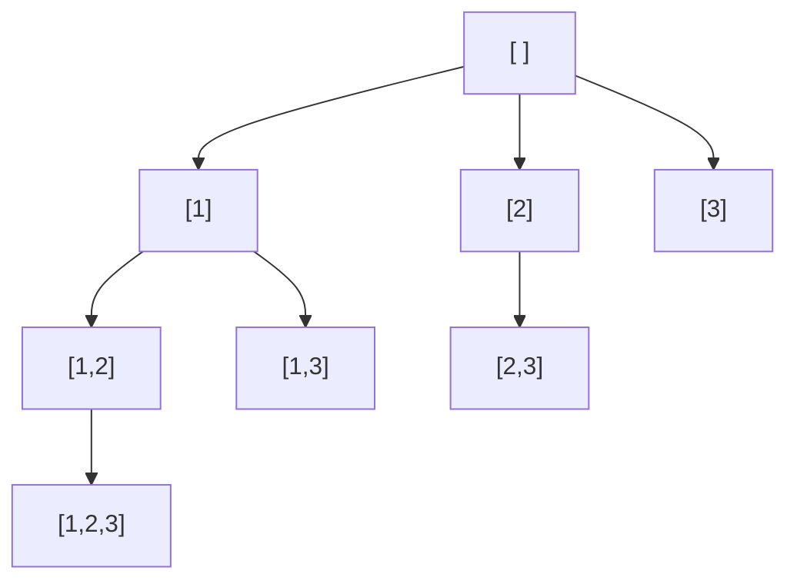
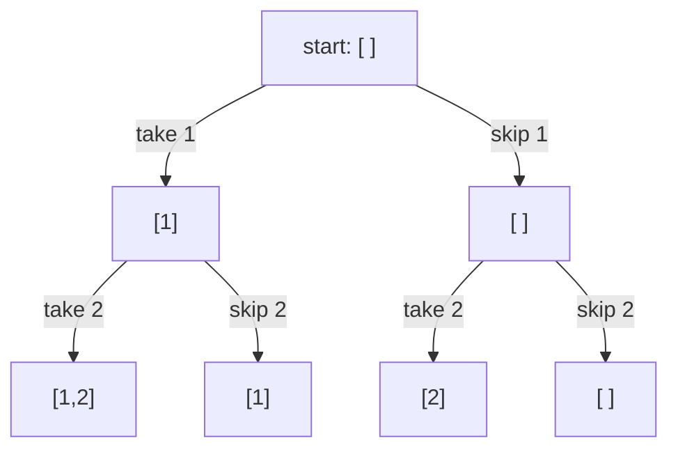
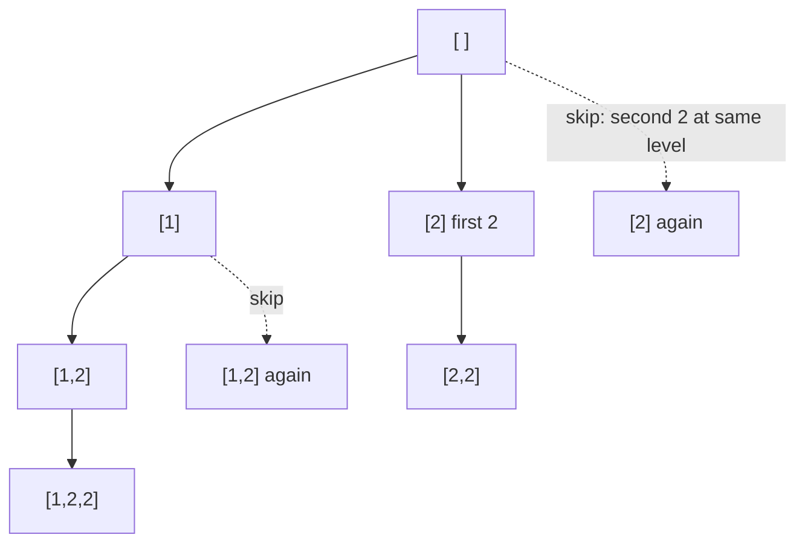

# Backtracking

> In this document you will learn the choose → explore → un-choose template, how to draw the decision tree, how to prune branches, and how to handle duplicates. Then you will solve 13 classic problems: subsets, permutations, combinations, combination sums, phone letters, parentheses, palindrome partitioning, word search, N-Queens and Sudoku. Backtracking questions test whether you can generate every valid answer systematically, without missing any and without repeating any.

**Before this:** [Problem solving and complexity, backtracking pattern](../11-coding-interviews/02-problem-solving-and-complexity.md#pattern-9-backtracking) · [Graphs: BFS, DFS and topological sort](10-graphs-bfs-dfs-and-topological-sort.md) (DFS) · **Interview questions:** [jump to the interview section](#interview-questions)

## Table of contents

1. [The pattern](#the-pattern)
2. [Problems](#problems)
3. [Interview questions](#interview-questions)
4. [Summary](#summary)
5. [References](#references)

---

## The pattern

### What backtracking is

**Backtracking** builds an answer one step at a time. At each step it makes a **choice**, goes deeper to make the next choices, and when it comes back, it **undoes** the choice so it can try the next option. It is a depth-first search over the tree of all possible choices.

**Analogy:** walking through a maze with a piece of chalk. At each junction you pick a path and mark it. If you reach a dead end, you walk back to the last junction, rub out the mark, and try the next path. Where the analogy breaks: in a maze you usually stop at the first exit. In many backtracking problems you want **every** exit (all subsets, all permutations).

### Why it exists

Some problems ask you to **list all** answers: all subsets, all orderings, all ways to place queens. The number of answers itself is exponential (2ⁿ subsets, n! permutations), so no algorithm can be fast in general. Backtracking is the clean, systematic way to walk through all candidates. **Pruning** (stopping a branch early when it cannot lead to a valid answer) is what makes it practical.

### The decision tree

Every backtracking solution is a walk over a **decision tree**. Each level is one decision. Each path from the root to a leaf is one candidate answer. Drawing the tree for a tiny input is the best way to design the solution.

The tree for "all subsets of `[1, 2, 3]`" with the **start index** approach (each node is the current subset; you may only add numbers to the right of the last one you added):



Every node in this tree is a subset, so you record the current state at **every** node. In permutation problems you record only at the **leaves** (when the arrangement is full).

### The template

```text
function backtrack(state):
    if state is a complete answer:
        record a COPY of state
        return                      (skip this return if every node is an answer)
    for each choice available from this state:
        if the choice is not valid: continue      (pruning)
        make the choice              (push, mark used)
        backtrack(next state)
        undo the choice              (pop, unmark)
```

In JavaScript it usually looks like this:

```js
function allSubsets(items) {
  const result = [];
  const current = []; // the path from the root to this node

  function backtrack(start) {
    result.push([...current]); // record a copy: current keeps changing
    for (let i = start; i < items.length; i++) {
      current.push(items[i]); // choose
      backtrack(i + 1); // explore
      current.pop(); // un-choose
    }
  }

  backtrack(0);
  return result;
}

console.log(JSON.stringify(allSubsets(["a", "b"]))); // [[],["a"],["a","b"],["b"]]
```

Three questions decide every backtracking solution:

1. **What is the state?** Usually the partial answer (`current`) plus an index (`start`) or a `used` array.
2. **What are the choices at each step?** "Any number after `start`" (subsets, combinations), "any unused number" (permutations), "any letter for this digit" (phone letters).
3. **When is the state complete?** Every node (subsets), a fixed length (permutations, combinations), a target sum reached (combination sum), the end of the string (partitioning).

### Pruning

**Pruning** means stopping a branch as soon as you know it cannot produce a valid answer. Examples:

- Combination sum: the numbers are sorted and the next number is bigger than the remaining target → **break** (all later numbers are even bigger).
- Combinations of size k: not enough numbers are left to reach size k → stop the loop early.
- Generate parentheses: never add `)` when it would close more than you opened.
- N-Queens: skip any column or diagonal that is already attacked.

Pruning does not usually change the worst-case big-O, but it can make the real running time thousands of times faster.

### Handling duplicates

If the input has duplicates (like `[1, 2, 2]`), the plain template produces duplicate answers. The standard fix:

1. **Sort** the input so equal values are next to each other.
2. At the **same level** of the tree (inside the same `for` loop), skip a value equal to the previous one: `if (i > start && nums[i] === nums[i - 1]) continue;`.

This means "at this position, I already tried the value 2; trying the second 2 here would build the same answers again". Going **deeper** with the second 2 is still allowed, which is how `[2, 2]` is produced. See [P8](#p8-subsets-ii-medium).

### Complexity

Backtracking complexity is "number of nodes in the tree × work per node". Common shapes:

| Problem shape | Number of answers | Typical time |
| --- | --- | --- |
| Subsets of n items | 2ⁿ | O(n · 2ⁿ) (copying each subset costs O(n)) |
| Permutations of n items | n! | O(n · n!) |
| Combinations: choose k of n | C(n, k) | O(k · C(n, k)) |
| Strings of length n over an alphabet of size a | aⁿ | O(n · aⁿ) |

Space is O(n) for the recursion depth and `current`, **plus the output**, which is often the biggest part.

Recursion depth here equals the length of one answer (n), not the number of answers. So the JavaScript call stack limit (around ten thousand frames in Node.js by default) is never the problem in backtracking; the exponential time is.

### When to recognize the pattern

| Signal | Example |
| --- | --- |
| "Return **all** ..." (subsets, combinations, permutations, partitions, paths) | All subsets, all valid IP addresses |
| "Generate every valid ..." | Valid parentheses, N-Queens boards |
| A constraint puzzle: place items so that no rule is broken | Sudoku, N-Queens, crossword fill |
| "Does any arrangement exist?" with a small input (n ≤ about 20) | Word search, partition into k equal subsets |
| Small constraints like `n ≤ 10` or `n ≤ 15` | Exponential is acceptable |

If the problem asks only for **how many** or the **best** answer, and the subproblems repeat, it is often **dynamic programming** instead ([Dynamic programming](12-dynamic-programming.md)). If it asks for the **shortest** sequence of moves, it is usually **BFS** ([Graphs](10-graphs-bfs-dfs-and-topological-sort.md)).

### Common mistakes

```js
// ❌ Wrong: pushes the SAME array object every time
function brokenSubsets(items) {
  const result = [];
  const current = [];
  (function backtrack(start) {
    result.push(current); // every entry points to one array, which ends up empty
    for (let i = start; i < items.length; i++) {
      current.push(items[i]);
      backtrack(i + 1);
      current.pop();
    }
  })(0);
  return result;
}
console.log(JSON.stringify(brokenSubsets([1, 2]))); // [[],[],[],[]]

// ❌ Wrong: forgetting to undo the choice
function brokenPermutations(items) {
  const result = [];
  const used = new Array(items.length).fill(false);
  const current = [];
  (function backtrack() {
    if (current.length === items.length) return result.push([...current]);
    for (let i = 0; i < items.length; i++) {
      if (used[i]) continue;
      used[i] = true;
      current.push(items[i]);
      backtrack();
      current.pop(); // used[i] = false is missing: later branches think i is still taken
    }
  })();
  return result;
}
console.log(JSON.stringify(brokenPermutations([1, 2, 3]))); // [[1,2,3]]
```

Other common mistakes:

- **Using `i` instead of `i + 1`** (or the opposite). `backtrack(i + 1)` means "each item at most once". `backtrack(i)` means "the same item may be reused" (combination sum).
- **Building strings with `+=` in a loop inside the recursion.** It works, but every concatenation creates a new string. Using an array of characters and `join("")` at the leaves is clearer and avoids repeated copies of long strings.
- **Deduplicating with a Set of `JSON.stringify(answer)`.** It gives the right output, but it still explores every duplicate branch. Sort and skip instead.
- **Pruning with `continue` when `break` is correct** (or the opposite). `break` is only right when the input is sorted and every later choice is also invalid.

---

## Problems

Most classic backtracking problems are labeled Medium; the order below goes from the simplest tree shapes to the hardest puzzles.

### P1. Subsets (Medium)

The basic "start index" solution is worked out in [Problem solving and complexity](../11-coding-interviews/02-problem-solving-and-complexity.md#pattern-9-backtracking) and in [the template above](#the-template). Here we look at two other ways to think about the same problem, because interviewers often ask "can you do it differently?".

**Problem:** Given an array of **distinct** numbers, return all possible subsets (the power set). Any order.

Similar to: LeetCode 78 Subsets.

**Examples:**

```text
[1, 2, 3] -> [], [1], [2], [3], [1,2], [1,3], [2,3], [1,2,3]
[0]       -> [], [0]
```

**How to recognize the pattern:** "return all subsets" → 2ⁿ answers → backtracking (or bitmasks).

**Brute force:** there is no shortcut: the output itself has 2ⁿ subsets, so any solution is at least O(2ⁿ).

**Approach 1 — include or exclude:** for each number, make a binary decision: take it, or skip it. The tree has exactly n levels and 2ⁿ leaves; each leaf is one subset.



(Shown for `[1, 2]`. Each bottom node is one answer.)

**Approach 2 — bitmask:** number the subsets from `0` to `2ⁿ - 1`. Bit `i` of the number says whether `nums[i]` is in the subset. No recursion at all.

**Code:**

```js
function subsetsIncludeExclude(nums) {
  const result = [];
  const current = [];
  function decide(i) {
    if (i === nums.length) {
      result.push([...current]); // a leaf: one complete subset
      return;
    }
    current.push(nums[i]); // take nums[i]
    decide(i + 1);
    current.pop(); // skip nums[i]
    decide(i + 1);
  }
  decide(0);
  return result;
}

function subsetsBitmask(nums) {
  const result = [];
  for (let mask = 0; mask < 1 << nums.length; mask++) {
    const subset = [];
    for (let i = 0; i < nums.length; i++) {
      if (mask & (1 << i)) subset.push(nums[i]); // bit i set = take nums[i]
    }
    result.push(subset);
  }
  return result;
}

console.log(JSON.stringify(subsetsIncludeExclude([1, 2, 3]))); // [[1,2,3],[1,2],[1,3],[1],[2,3],[2],[3],[]]
console.log(JSON.stringify(subsetsBitmask([1, 2, 3]))); // [[],[1],[2],[1,2],[3],[1,3],[2,3],[1,2,3]]
console.log(JSON.stringify(subsetsBitmask([]))); // [[]]
```

**Dry run** (bitmask) for `[1, 2, 3]`:

| mask | binary (bit 2, 1, 0) | subset |
| --- | --- | --- |
| 0 | 000 | [] |
| 1 | 001 | [1] |
| 2 | 010 | [2] |
| 3 | 011 | [1, 2] |
| 5 | 101 | [1, 3] |
| 7 | 111 | [1, 2, 3] |

**Complexity:** O(n · 2ⁿ) time for all three versions (2ⁿ subsets, up to n work to build each). O(n) extra space besides the output.

**Edge cases:** empty array (one subset: `[]`); one element.

**Follow-ups:**
- **Limit of the bitmask version?** — JavaScript bit operators work on **32-bit signed integers**, so `1 << 31` is negative and `1 << 32` is `1` again. The bitmask version works only for n ≤ 30. That is fine, since 2³⁰ subsets would be far too many anyway.
- **Iterative version without bits?** — Start with `[[]]`. For each number, copy every existing subset and add the number to the copy: `result = [...result, ...result.map((s) => [...s, n])]`.
- **Which version do you write in an interview?** — The start-index version (it extends naturally to combinations and duplicates). Mention the others as alternatives.

**How to say it in the interview:**
> Every number is either in the subset or not, so there are 2 to the n subsets and I cannot do better than that. I use backtracking: at each index I take the number, recurse, remove it, and recurse again without it. Each leaf is one subset, and I push a copy. The total is O(n times 2 to the n). Another option is a bitmask from 0 to 2 to the n minus 1, where bit i says whether to take element i.

---

### P2. Combinations (Medium)

**Problem:** Given `n` and `k`, return all combinations of `k` numbers chosen from `1` to `n`. Order inside a combination does not matter (`[1, 2]` and `[2, 1]` are the same).

Similar to: LeetCode 77 Combinations.

**Examples:**

```text
n = 4, k = 2 -> [1,2], [1,3], [1,4], [2,3], [2,4], [3,4]
n = 1, k = 1 -> [1]
```

**How to recognize the pattern:** "all ways to choose k items" → subsets tree, but only record at depth k.

**Brute force:** generate all 2ⁿ subsets and keep those with size k. Correct but explores many useless branches.

**Optimal approach:**

1. Use the start-index template. Record only when `current.length === k`, then return.
2. **Prune:** if there are not enough numbers left to fill the combination, stop. With `need = k - current.length` numbers still needed, the loop variable `i` can go only up to `n - need + 1`.

**Code:**

```js
function combine(n, k) {
  const result = [];
  const current = [];
  function backtrack(start) {
    if (current.length === k) {
      result.push([...current]);
      return;
    }
    const need = k - current.length;
    for (let i = start; i <= n - need + 1; i++) { // pruning: leave room for the rest
      current.push(i);
      backtrack(i + 1);
      current.pop();
    }
  }
  backtrack(1);
  return result;
}

console.log(JSON.stringify(combine(4, 2))); // [[1,2],[1,3],[1,4],[2,3],[2,4],[3,4]]
console.log(JSON.stringify(combine(1, 1))); // [[1]]
console.log(combine(10, 3).length); // 120
```

**Dry run** for `n = 4, k = 2`:

1. `start = 1`, need 2 → `i` goes 1 to 3. Choose 1.
2. `start = 2`, need 1 → `i` goes 2 to 4. Record [1,2], [1,3], [1,4].
3. Back at the top: choose 2, then record [2,3], [2,4]. Choose 3, then record [3,4].
4. `i = 4` at the top is never tried: with only one number left, no pair can start there. That is the pruning.

**Complexity:** O(k · C(n, k)) time — C(n, k) answers, each copied in O(k). O(k) extra space.

**Edge cases:** `k = 0` (one empty combination); `k = n` (one combination with everything).

**Follow-ups:**
- **How many combinations?** — C(n, k) = n! / (k! · (n − k)!). For n = 10, k = 3 that is 120.
- **Without the pruning, is it still correct?** — Yes, the extra branches simply record nothing. Pruning only saves time.

**How to say it in the interview:**
> It is the subsets tree, but I only record a combination when it has exactly k numbers. I use a start index so each combination is built in increasing order, which avoids duplicates like 1,2 and 2,1. I also prune: if fewer numbers remain than I still need, I stop the loop. It is O(k times C of n and k).

---

### P3. Permutations (Medium)

The "used array" solution is in [Problem solving and complexity](../11-coding-interviews/02-problem-solving-and-complexity.md#pattern-9-backtracking). Here is the **swap** version, which needs no extra `used` array, and a comparison of the two.

**Problem:** Given an array of **distinct** numbers, return all orderings.

Similar to: LeetCode 46 Permutations.

**Examples:**

```text
[1, 2, 3] -> [1,2,3], [1,3,2], [2,1,3], [2,3,1], [3,2,1], [3,1,2]  (any order)
[0, 1]    -> [0,1], [1,0]
```

**How to recognize the pattern:** "all orderings" → n! answers → backtracking where every unused item is a choice at every level.

**Brute force:** there is no faster way: the output has n! items.

**Optimal approach (swap):**

1. Positions `0 .. start - 1` are already fixed.
2. For position `start`, try every element from `start` to the end: swap it into position `start`, recurse with `start + 1`, then swap it back (un-choose).
3. When `start` reaches the end, the array is one full permutation: record a copy.

**Code:**

```js
function permute(nums) {
  const arr = [...nums];
  const result = [];
  function backtrack(start) {
    if (start === arr.length) {
      result.push([...arr]);
      return;
    }
    for (let i = start; i < arr.length; i++) {
      [arr[start], arr[i]] = [arr[i], arr[start]]; // choose arr[i] for this position
      backtrack(start + 1);
      [arr[start], arr[i]] = [arr[i], arr[start]]; // undo
    }
  }
  backtrack(0);
  return result;
}

console.log(JSON.stringify(permute([1, 2, 3]))); // [[1,2,3],[1,3,2],[2,1,3],[2,3,1],[3,2,1],[3,1,2]]
console.log(permute([1, 2, 3, 4, 5]).length); // 120
```

**Dry run** for `[1, 2, 3]` (first branches):

| start | swap | array after swap | next |
| --- | --- | --- | --- |
| 0 | 0↔0 | 1 2 3 | fix 1 |
| 1 | 1↔1 | 1 2 3 | fix 2 → record [1,2,3] |
| 1 | 1↔2 | 1 3 2 | record [1,3,2], then swap back to 1 2 3 |
| 0 | 0↔1 | 2 1 3 | fix 2, then record [2,1,3] and [2,3,1] |
| 0 | 0↔2 | 3 2 1 | fix 3, then record [3,2,1] and [3,1,2] |

**Complexity:** O(n · n!) time, O(n) extra space (recursion depth).

**Edge cases:** one element (one permutation); empty array (one empty permutation).

**Follow-ups:**
- **Swap or used-array?** — Both are O(n · n!). The swap version needs no extra array, but it does not produce permutations in lexicographic order, and it is harder to adapt to duplicates. The used-array version keeps the input order and extends easily to [Permutations II](#p9-permutations-ii-medium).
- **Only the next permutation in lexicographic order?** — That is a different, O(n) algorithm (LeetCode 31): find the rightmost `i` with `a[i] < a[i + 1]`, swap `a[i]` with the rightmost bigger element, reverse the suffix.
- **The k-th permutation?** — Use the factorial number system: choose each digit by dividing k by (n − 1)!, without generating the others.

**How to say it in the interview:**
> A permutation fixes one position at a time. For the current position, I try each remaining element by swapping it into place, recurse on the next position, and swap back afterwards. When all positions are fixed I record a copy. There are n factorial permutations, so it is O(n times n factorial), and the extra space is just the recursion depth.

---

### P4. Letter Combinations of a Phone Number (Medium)

**Problem:** Given a string of digits from `2` to `9`, return all letter strings it could represent on a phone keypad (2 = abc, 3 = def, 4 = ghi, 5 = jkl, 6 = mno, 7 = pqrs, 8 = tuv, 9 = wxyz). An empty input gives an empty list.

Similar to: LeetCode 17 Letter Combinations of a Phone Number.

**Examples:**

```text
"23" -> ad, ae, af, bd, be, bf, cd, ce, cf
""   -> []
"7"  -> p, q, r, s
```

**How to recognize the pattern:** one decision per digit, and the choices are that digit's letters → a fixed-depth decision tree.

**Brute force:** nested loops, one per digit — impossible to write when the number of digits is not known. Backtracking is the "nested loops of any depth" tool.

**Optimal approach:**

1. Depth `i` chooses a letter for `digits[i]`.
2. When `i === digits.length`, join the chosen letters and record the string.

**Code:**

```js
const KEYPAD = { 2: "abc", 3: "def", 4: "ghi", 5: "jkl", 6: "mno", 7: "pqrs", 8: "tuv", 9: "wxyz" };

function letterCombinations(digits) {
  if (digits.length === 0) return [];
  const result = [];
  const path = []; // letters chosen so far
  function backtrack(i) {
    if (i === digits.length) {
      result.push(path.join(""));
      return;
    }
    for (const letter of KEYPAD[digits[i]]) {
      path.push(letter);
      backtrack(i + 1);
      path.pop();
    }
  }
  backtrack(0);
  return result;
}

console.log(letterCombinations("23").join(" ")); // ad ae af bd be bf cd ce cf
console.log(letterCombinations("")); // []
console.log(letterCombinations("7").join(" ")); // p q r s
```

**Dry run** for `"23"`: depth 0 chooses `a`; depth 1 chooses `d`, `e`, `f` → records `ad`, `ae`, `af`. Back to depth 0, choose `b` → `bd`, `be`, `bf`. Then `c` → `cd`, `ce`, `cf`.

**Complexity:** O(n · 4ⁿ) time in the worst case (digits 7 and 9 have 4 letters; each string costs O(n) to join). O(n) extra space.

**Edge cases:** empty string (empty list, not `[""]`); digits with 4 letters.

**Follow-ups:**
- **Iterative version?** — Start with `[""]`. For each digit, replace the list with every existing string plus every letter of that digit. It is a BFS over the same tree.
- **Only words in a dictionary (T9 predictive text)?** — Walk a trie of dictionary words at the same time and prune when no word has the current prefix. See [Tries, bit manipulation and math](14-tries-bit-manipulation-and-math.md).

**How to say it in the interview:**
> Each digit is one level of the decision tree, and its letters are the choices. I recurse with an index into the digits, push a letter, go to the next digit, and pop it after. When the index reaches the end, I join the letters and record the string. There are up to 4 to the n strings, each of length n, so it is O(n times 4 to the n).

---

### P5. Generate Parentheses (Medium)

**Problem:** Given `n`, return all strings of `n` pairs of parentheses that are well-formed (every `(` is closed by a later `)`).

Similar to: LeetCode 22 Generate Parentheses.

**Examples:**

```text
n = 3 -> ((())), (()()), (())(), ()(()), ()()()
n = 1 -> ()
```

**How to recognize the pattern:** "generate all valid strings" → build character by character, and use the rules to prune.

**Brute force:** generate all 2²ⁿ strings of `(` and `)` and keep the valid ones. O(n · 2²ⁿ).

**Optimal approach:** track how many `(` and `)` you have used.

1. You may add `(` if `open < n`.
2. You may add `)` only if `close < open` (there is an unmatched `(` to close).
3. When the length is `2n`, the string is valid: record it.

These two rules mean you never build an invalid prefix, so every leaf is an answer.

**Code:**

```js
function generateParenthesis(n) {
  const result = [];
  const path = [];
  function backtrack(open, close) {
    if (path.length === 2 * n) {
      result.push(path.join(""));
      return;
    }
    if (open < n) {
      path.push("(");
      backtrack(open + 1, close);
      path.pop();
    }
    if (close < open) {
      path.push(")");
      backtrack(open, close + 1);
      path.pop();
    }
  }
  backtrack(0, 0);
  return result;
}

console.log(generateParenthesis(3).join(" ")); // ((())) (()()) (())() ()(()) ()()()
console.log(generateParenthesis(1).join(" ")); // ()
console.log(generateParenthesis(5).length); // 42
```

**Dry run** for `n = 2`:

| Path | open | close | Allowed next |
| --- | --- | --- | --- |
| ( | 1 | 0 | ( or ) |
| (( | 2 | 0 | ) only |
| (() | 2 | 1 | ) only |
| (()) | 2 | 2 | record |
| () | 1 | 1 | ( only |
| ()( | 2 | 1 | ) only |
| ()() | 2 | 2 | record |

**Complexity:** the number of answers is the n-th **Catalan number**, about 4ⁿ / (n^1.5 · √π). Time is O(n · Catalan(n)) because every leaf is an answer and costs O(n) to join. O(n) extra space.

**Edge cases:** `n = 0` (one empty string `""`); `n = 1`.

**Follow-ups:**
- **Check whether one given string is valid?** — Keep a counter (or a stack for several bracket types). See [Stacks and monotonic stack](05-stacks-and-monotonic-stack.md).
- **Why is every leaf valid?** — The `close < open` rule means no prefix ever has more `)` than `(`, and the length rule plus `open < n` means both counts end at n.

**How to say it in the interview:**
> I build the string one character at a time and only make valid moves. I can add an opening bracket while I have used fewer than n, and a closing bracket only while there are unmatched openings. Because no invalid prefix is ever built, every string of length 2n is an answer. The count is the Catalan number, so the time is O(n times Catalan of n).

---

### P6. Combination Sum (Medium)

**Problem:** Given an array of **distinct** positive numbers and a target, return all unique combinations whose sum is the target. Each number may be used **any number of times**. Order inside a combination does not matter.

Similar to: LeetCode 39 Combination Sum.

**Examples:**

```text
candidates = [2, 3, 6, 7], target = 7 -> [2,2,3], [7]
candidates = [2, 3, 5], target = 8    -> [2,2,2,2], [2,3,3], [3,5]
candidates = [2], target = 1          -> []
```

**How to recognize the pattern:** "all combinations that reach a target" → backtracking with a running remainder and pruning.

**Brute force:** generate every multiset of candidates up to the target and check the sum. Same tree, no pruning.

**Optimal approach:**

1. Sort the candidates (needed for the `break` pruning).
2. Backtrack with `(start, remaining)`. If `remaining === 0`, record.
3. Loop `i` from `start`. If `candidates[i] > remaining`, **break** — every later candidate is bigger too.
4. Choose `candidates[i]` and recurse with **`i`** (not `i + 1`), because the same number can be reused. Using `start` (not 0) avoids the same combination in another order.

**Code:**

```js
function combinationSum(candidates, target) {
  const nums = [...candidates].sort((a, b) => a - b); // numeric sort
  const result = [];
  const current = [];
  function backtrack(start, remaining) {
    if (remaining === 0) {
      result.push([...current]);
      return;
    }
    for (let i = start; i < nums.length; i++) {
      if (nums[i] > remaining) break; // sorted: nothing after this fits either
      current.push(nums[i]);
      backtrack(i, remaining - nums[i]); // i, not i + 1: reuse allowed
      current.pop();
    }
  }
  backtrack(0, target);
  return result;
}

console.log(JSON.stringify(combinationSum([2, 3, 6, 7], 7))); // [[2,2,3],[7]]
console.log(JSON.stringify(combinationSum([2, 3, 5], 8))); // [[2,2,2,2],[2,3,3],[3,5]]
console.log(JSON.stringify(combinationSum([2], 1))); // []
```

**Dry run** for `[2, 3, 6, 7]`, target 7 (remaining in brackets):

1. 2 (5) → 2 (3) → 2 (1): next 2 > 1, break. Back: 3 (0) → record [2, 2, 3].
2. 2 (5) → 3 (2): 3 > 2, break. → 6 > 5, break.
3. 3 (4) → 3 (1): break. → 6 > 4, break.
4. 6 (1): break. 7 (0) → record [7].

**Complexity:** hard to state exactly. A common bound is O(n^(T/m + 1)) where T is the target and m the smallest candidate (the tree depth is at most T/m, and each node has at most n children). Extra space O(T/m) for the recursion.

**Edge cases:** no combination (empty list); the target equals a candidate; a candidate larger than the target (pruned immediately).

**Follow-ups:**
- **Only the number of combinations?** — That is the coin change "number of ways" DP: O(n · T) instead of exponential. See [Dynamic programming](12-dynamic-programming.md).
- **Each number used at most once and duplicates in the input?** — That is [Combination Sum II](#p10-combination-sum-ii-medium).
- **Why does `start` prevent duplicates like [3, 2, 2]?** — Combinations are built in non-decreasing index order, so each multiset has only one possible build order.

**How to say it in the interview:**
> I sort the candidates and backtrack with a start index and the remaining target. At each level I try candidates from the start index; I recurse with the same index because a number can be reused, and the start index keeps each combination in one order so there are no duplicates. Because the array is sorted, as soon as a candidate is bigger than the remaining target, I break out of the loop. When the remainder hits zero, I record a copy.

---

### P7. Word Search (Medium)

**Problem:** Given a grid of letters and a word, return `true` if the word can be built from letters of neighboring cells (up, down, left, right). A cell may be used **only once** in the word.

Similar to: LeetCode 79 Word Search.

**Examples:**

```text
board = A B C E
        S F C S
        A D E E
"ABCCED" -> true
"SEE"    -> true
"ABCB"   -> false (the B cell would be used twice)
```

**How to recognize the pattern:** a path search in a grid where you must not reuse cells **on the current path**, but other paths may use them → DFS with backtracking (mark on the way in, unmark on the way out).

**Brute force:** the backtracking below already is the systematic search; the difference between slow and fast versions is pruning.

**Optimal approach:**

1. Try every cell as the starting point.
2. `dfs(r, c, i)`: if the cell is outside the grid or its letter is not `word[i]`, return `false`. If `i` is the last index, return `true`.
3. Mark the cell as used (replace its letter with `"#"`), try the four neighbors with `i + 1`, then **restore the letter**. The restore is the "un-choose" step.

Note the difference from flood fill in [Graphs](10-graphs-bfs-dfs-and-topological-sort.md#p1-flood-fill-easy): there, a visited cell stays visited forever. Here, a cell is blocked only while it is on the current path.

**Code:**

```js
function exist(board, word) {
  const rows = board.length;
  const cols = board[0].length;

  function dfs(r, c, i) {
    if (r < 0 || r >= rows || c < 0 || c >= cols || board[r][c] !== word[i]) return false;
    if (i === word.length - 1) return true;
    const saved = board[r][c];
    board[r][c] = "#"; // choose: block this cell for the current path
    const found = dfs(r + 1, c, i + 1) || dfs(r - 1, c, i + 1) || dfs(r, c + 1, i + 1) || dfs(r, c - 1, i + 1);
    board[r][c] = saved; // un-choose: free the cell again
    return found;
  }

  for (let r = 0; r < rows; r++) {
    for (let c = 0; c < cols; c++) {
      if (dfs(r, c, 0)) return true;
    }
  }
  return false;
}

const letters = [["A", "B", "C", "E"], ["S", "F", "C", "S"], ["A", "D", "E", "E"]];
console.log(exist(letters, "ABCCED"), exist(letters, "SEE"), exist(letters, "ABCB")); // true true false
```

The board is restored after every call, so it ends unchanged (the `||` stops early when a path is found, but every cell that was marked is still restored on the way back).

**Dry run** for `"ABCB"`: start at (0,0) `A` → (0,1) `B` → (0,2) `C` → the next letter must be `B`. The neighbors of (0,2) are (1,2) `C`, (0,3) `E`, and (0,1), which is now `#`. No match, so this path fails; every other start fails at the first letter. Result: `false`.

**Complexity:** O(m · n · 3^L) time for word length L: m·n starting cells, and after the first step each cell has at most 3 new directions (it cannot go back). O(L) space for the recursion.

**Edge cases:** a one-letter word; a word longer than the number of cells (it can return `false` at once); a board where every letter is the same (worst case for time).

**Follow-ups:**
- **Speed-ups?** — If the word has a letter that the board does not contain enough times, return `false` before searching. If the last letter is rarer in the board than the first, search the reversed word.
- **Many words (Word Search II)?** — Put all words in a trie and run one DFS that follows the trie. See [Tries, bit manipulation and math](14-tries-bit-manipulation-and-math.md).
- **Why not a global visited set?** — A cell that failed for one path may be needed by another path. Only the current path must be blocked.

**How to say it in the interview:**
> I try every cell as a start and run a DFS that matches the word letter by letter. To stop a cell from being used twice in the same path, I temporarily overwrite it with a marker, explore the four neighbors, and then restore the letter — that restore is the backtracking step. I return as soon as one path matches. The time is about m times n times 3 to the L, and the recursion depth is only the word length.

---

### P8. Subsets II (Medium)

**Problem:** Given an array of numbers that **may contain duplicates**, return all subsets without duplicate subsets.

Similar to: LeetCode 90 Subsets II.

**Examples:**

```text
[1, 2, 2] -> [], [1], [1,2], [1,2,2], [2], [2,2]
[0]       -> [], [0]
```

**How to recognize the pattern:** subsets + duplicates in the input → sort, then skip equal values at the same tree level.

**Brute force:** generate all 2ⁿ subsets, sort each, and deduplicate with a Set of strings. Correct, but slower and wasteful.

**Optimal approach:**

1. Sort the input.
2. Use the start-index template. Inside the loop, `if (i > start && nums[i] === nums[i - 1]) continue;`.

Why `i > start`? At the first position of this level (`i === start`), the value is always allowed. Only a **second** equal value at the **same** level is skipped, because it would start exactly the same branches as the first one.



**Code:**

```js
function subsetsWithDup(input) {
  const nums = [...input].sort((a, b) => a - b);
  const result = [];
  const current = [];
  function backtrack(start) {
    result.push([...current]);
    for (let i = start; i < nums.length; i++) {
      if (i > start && nums[i] === nums[i - 1]) continue; // same value, same level: skip
      current.push(nums[i]);
      backtrack(i + 1);
      current.pop();
    }
  }
  backtrack(0);
  return result;
}

console.log(JSON.stringify(subsetsWithDup([1, 2, 2]))); // [[],[1],[1,2],[1,2,2],[2],[2,2]]
console.log(JSON.stringify(subsetsWithDup([2, 1, 2, 1]))); // [[],[1],[1,1],[1,1,2],[1,1,2,2],[1,2],[1,2,2],[2],[2,2]]
```

**Dry run** for sorted `[1, 2, 2]`:

1. Record []. Level 0: i = 0 (1) → record [1]. Level 1 from [1]: i = 1 (2) → record [1,2] → level 2: i = 2 (2), `i === start`, allowed → record [1,2,2]. Back at level 1: i = 2 is a duplicate at the same level → skip.
2. Level 0: i = 1 (2) → record [2] → level from index 2: i = 2 allowed → record [2,2].
3. Level 0: i = 2 is a duplicate of i = 1 at the same level → skip.

**Complexity:** O(n · 2ⁿ) in the worst case (all distinct). O(n) extra space.

**Edge cases:** all values equal (`[2, 2, 2]` → `[]`, `[2]`, `[2,2]`, `[2,2,2]`); no duplicates (same as Subsets).

**Follow-ups:**
- **Why must the input be sorted?** — The skip rule only compares neighbors. Without sorting, equal values may be far apart and the rule would miss them.
- **Count distinct subsets only?** — Multiply `(count + 1)` over each distinct value: each value can appear 0 to `count` times.

**How to say it in the interview:**
> I sort the numbers so duplicates sit together, then use the normal start-index subsets template. Inside the loop, if a number equals the previous one and it is not the first choice at this level, I skip it, because that branch would produce exactly the same subsets. Going deeper with the duplicate is still allowed, which is how subsets like 2,2 appear. It stays O(n times 2 to the n).

---

### P9. Permutations II (Medium)

**Problem:** Given numbers that **may contain duplicates**, return all **unique** permutations.

Similar to: LeetCode 47 Permutations II.

**Examples:**

```text
[1, 1, 2] -> [1,1,2], [1,2,1], [2,1,1]
[1, 2, 3] -> all 6 permutations
```

**How to recognize the pattern:** permutations + duplicates → used-array template + sort + skip rule.

**Brute force:** generate all n! permutations and deduplicate with a Set of strings. Explores n! branches even when there are few unique answers.

**Optimal approach:**

1. Sort the input. Keep a `used` array.
2. At each level, try every unused index `i`. **Skip** `i` if `nums[i] === nums[i - 1]` and `used[i - 1]` is `false`.

The skip rule means: "equal values must be used in their original left-to-right order". If the earlier copy is not used yet, using the later copy first would create a permutation we will also create (or already created) the other way round.

**Code:**

```js
function permuteUnique(input) {
  const nums = [...input].sort((a, b) => a - b);
  const used = new Array(nums.length).fill(false);
  const result = [];
  const current = [];
  function backtrack() {
    if (current.length === nums.length) {
      result.push([...current]);
      return;
    }
    for (let i = 0; i < nums.length; i++) {
      if (used[i]) continue;
      if (i > 0 && nums[i] === nums[i - 1] && !used[i - 1]) continue; // use equal values in order
      used[i] = true;
      current.push(nums[i]);
      backtrack();
      current.pop();
      used[i] = false;
    }
  }
  backtrack();
  return result;
}

console.log(JSON.stringify(permuteUnique([1, 1, 2]))); // [[1,1,2],[1,2,1],[2,1,1]]
console.log(permuteUnique([1, 2, 3]).length, permuteUnique([1, 1, 2, 2]).length); // 6 6
```

**Dry run** for sorted `[1a, 1b, 2]` (a and b mark the two copies of 1):

| First pick | Allowed? | Results |
| --- | --- | --- |
| 1a | yes | then 1b, 2 → [1,1,2]; or 2, 1b → [1,2,1] |
| 1b | no: equal to 1a and 1a is unused | skipped |
| 2 | yes | then 1a, 1b → [2,1,1] (1b before 1a is skipped) |

**Complexity:** O(n · n!) in the worst case (all distinct). With duplicates, the tree has only as many leaves as unique permutations: n! / (c₁! · c₂! · ...) for value counts cᵢ.

**Edge cases:** all values equal (exactly one permutation); no duplicates (same as P3).

**Follow-ups:**
- **Does `used[i - 1]` (instead of `!used[i - 1]`) also work?** — Yes, it forces equal values to be used in **reverse** order. It is also correct but prunes later in the tree, so it explores more nodes. Use `!used[i - 1]`.
- **Alternative without sorting?** — Count each value in a `Map` and backtrack over distinct values, decreasing the count. Each level tries each distinct value once, so no duplicates appear.

**How to say it in the interview:**
> I sort the numbers and use the normal used-array permutation template. To avoid duplicates, I make equal values come out in their original order: if a number equals the previous one and the previous one is not used yet on this path, I skip it. That way each unique permutation is built exactly once, and I never need a Set to deduplicate.

---

### P10. Combination Sum II (Medium)

**Problem:** Given candidates that **may contain duplicates** and a target, return all unique combinations that sum to the target. Each candidate (each **position**) may be used **at most once**.

Similar to: LeetCode 40 Combination Sum II.

**Examples:**

```text
candidates = [10, 1, 2, 7, 6, 1, 5], target = 8 -> [1,1,6], [1,2,5], [1,7], [2,6]
candidates = [2, 5, 2, 1, 2], target = 5        -> [1,2,2], [5]
```

**How to recognize the pattern:** combination sum + each used once + duplicates → P6 (pruning) + P8 (skip rule) together.

**Brute force:** all 2ⁿ subsets, keep those with the right sum, deduplicate. O(n · 2ⁿ).

**Optimal approach:**

1. Sort.
2. Backtrack with `(start, remaining)`. Record when `remaining === 0`.
3. In the loop: skip duplicates at the same level (`i > start && nums[i] === nums[i - 1]`), break if `nums[i] > remaining`, and recurse with `i + 1` (each position once).

**Code:**

```js
function combinationSum2(candidates, target) {
  const nums = [...candidates].sort((a, b) => a - b);
  const result = [];
  const current = [];
  function backtrack(start, remaining) {
    if (remaining === 0) {
      result.push([...current]);
      return;
    }
    for (let i = start; i < nums.length; i++) {
      if (i > start && nums[i] === nums[i - 1]) continue; // duplicate at this level
      if (nums[i] > remaining) break; // sorted: the rest are too big
      current.push(nums[i]);
      backtrack(i + 1, remaining - nums[i]); // i + 1: each position once
      current.pop();
    }
  }
  backtrack(0, target);
  return result;
}

console.log(JSON.stringify(combinationSum2([10, 1, 2, 7, 6, 1, 5], 8))); // [[1,1,6],[1,2,5],[1,7],[2,6]]
console.log(JSON.stringify(combinationSum2([2, 5, 2, 1, 2], 5))); // [[1,2,2],[5]]
```

**Dry run** on sorted `[1, 1, 2, 5, 6, 7, 10]`, target 8 (remaining in brackets):

1. Take the first 1 (7). At the next level, the second 1 is the **first** choice of that level (`i === start`), so it is allowed: take it (6).
2. From (6): 2 (4) → 5 > 4, break. 5 (1) → 6 > 1, break. 6 (0) → record [1, 1, 6]. 7 > 6, break.
3. Back to (7) with one 1: 2 (5) → 5 (0) → record [1, 2, 5]. 5 (2) and 6 (1) lead nowhere. 7 (0) → record [1, 7]. 10 > 7, break.
4. Top level: index 1 (the second 1) equals index 0 **at the same level** → skip.
5. Top level: 2 (6) → 5 (1) leads nowhere, 6 (0) → record [2, 6]. Then 5, 6 and 7 at the top find nothing, and 10 > 8 breaks the loop.

**Complexity:** O(n · 2ⁿ) worst case; pruning makes it much faster in practice. O(n) extra space.

**Edge cases:** no solution; the target equals one candidate; many equal candidates (`[1, 1, 1, 1]`, target 2 → only `[1, 1]` once).

**Follow-ups:**
- **Difference from P6 in one sentence?** — P6 recurses with `i` (reuse) and has no duplicates; P10 recurses with `i + 1` (no reuse) and needs the skip rule.
- **Only "does any combination exist"?** — Return a boolean and stop at the first success, or use subset-sum DP in O(n · target).

**How to say it in the interview:**
> This combines two ideas. Like combination sum, I sort and break when a candidate is bigger than what remains. Like subsets II, I skip a value that equals the previous one at the same level, so I never build the same combination twice. And because each candidate can be used once, I recurse with i plus one. The worst case is exponential, but the pruning cuts most branches.

---

### P11. Palindrome Partitioning (Medium)

**Problem:** Split a string into pieces so that every piece is a palindrome (reads the same backwards). Return all possible splits.

Similar to: LeetCode 131 Palindrome Partitioning.

**Examples:**

```text
"aab" -> ["a","a","b"], ["aa","b"]
"a"   -> ["a"]
"racecar" -> 4 partitions: ["r","a","c","e","c","a","r"], ["r","a","cec","a","r"], ["r","aceca","r"], ["racecar"]
```

**How to recognize the pattern:** "all ways to cut a string" → at each position, the choice is "where does the next piece end?".

**Brute force:** a string of length n has n − 1 gaps, and each gap is cut or not: 2ⁿ⁻¹ ways. Check every piece of every way. O(n · 2ⁿ).

**Optimal approach:**

1. `backtrack(start)`: the pieces before `start` are already chosen.
2. For every `end` from `start` to `n - 1`: if `s.slice(start, end + 1)` is a palindrome, choose it as the next piece and recurse with `end + 1`.
3. When `start === n`, the whole string is cut into palindromes: record the pieces.
4. **Optimization:** precompute `isPal[i][j]` with a small DP so each palindrome check is O(1): `s[i] === s[j]` and the inside `isPal[i + 1][j - 1]` is a palindrome (or the piece has length ≤ 2).

**Code:**

```js
function partition(s) {
  const n = s.length;
  // isPal[i][j] is true when s[i..j] is a palindrome
  const isPal = Array.from({ length: n }, () => new Array(n).fill(false));
  for (let i = n - 1; i >= 0; i--) {
    for (let j = i; j < n; j++) {
      isPal[i][j] = s[i] === s[j] && (j - i < 2 || isPal[i + 1][j - 1]);
    }
  }

  const result = [];
  const pieces = [];
  function backtrack(start) {
    if (start === n) {
      result.push([...pieces]);
      return;
    }
    for (let end = start; end < n; end++) {
      if (!isPal[start][end]) continue; // prune: this piece is not a palindrome
      pieces.push(s.slice(start, end + 1));
      backtrack(end + 1);
      pieces.pop();
    }
  }
  backtrack(0);
  return result;
}

console.log(JSON.stringify(partition("aab"))); // [["a","a","b"],["aa","b"]]
console.log(JSON.stringify(partition("a"))); // [["a"]]
console.log(partition("racecar").length); // 4
```

**Dry run** for `"aab"`:

| start | Pieces tried | Palindrome? | Action |
| --- | --- | --- | --- |
| 0 | "a" | yes | go to start 1 |
| 1 | "a" | yes | go to start 2 |
| 2 | "b" | yes | start 3 = end → record [a, a, b] |
| 1 | "ab" | no | skip |
| 0 | "aa" | yes | go to start 2 → "b" → record [aa, b] |
| 0 | "aab" | no | skip |

**Complexity:** O(n · 2ⁿ) time in the worst case (`"aaaa..."`, where every cut is valid), O(n²) for the table. Space O(n²) for the table plus O(n) recursion.

**Edge cases:** one character; all characters the same (2ⁿ⁻¹ partitions); no repeated characters (only one partition: single letters).

**Follow-ups:**
- **Minimum number of cuts only (Palindrome Partitioning II)?** — That is DP: `cuts[i]` = minimum cuts for the prefix ending at `i`, using the same `isPal` table. O(n²).
- **Why precompute?** — Without the table, each check is O(n), and the same substrings are checked many times in different branches.

**How to say it in the interview:**
> At each position I decide where the next piece ends. If that piece is a palindrome, I take it and recurse from the next position; when I reach the end of the string, I record the pieces. To make each palindrome check O(1), I precompute a table where i to j is a palindrome if the end characters match and the inside is a palindrome. The worst case is still exponential, because a string like "aaaa" has 2 to the n minus 1 valid partitions.

---

### P12. N-Queens (Hard)

**Problem:** Place `n` queens on an `n × n` chessboard so that no two queens attack each other (same row, column or diagonal). Return all solutions, each as a list of strings where `Q` is a queen and `.` is empty.

Similar to: LeetCode 51 N-Queens (and LeetCode 52 N-Queens II, which asks only for the count).

**Examples:**

```text
n = 4 -> [".Q..","...Q","Q...","..Q."], ["..Q.","Q...","...Q",".Q.."]
n = 1 -> ["Q"]
n = 2 or 3 -> no solution
```

**How to recognize the pattern:** a constraint puzzle where you place items one by one and must check rules → backtracking with fast conflict checks.

**Brute force:** choose n cells out of n² and check: C(n², n) — for n = 8 that is about 4.4 billion. Even "one queen per row, any column" is nⁿ = 16.7 million for n = 8.

**Optimal approach:**

1. Place exactly one queen per **row**, row by row. That removes row conflicts automatically.
2. For each row, try each column. Skip it if the column, the diagonal or the anti-diagonal is already used.
3. Cells on the same **diagonal** (top-left to bottom-right) have the same `row - col`. Cells on the same **anti-diagonal** have the same `row + col`. So three Sets (or boolean arrays) give O(1) checks.
4. When all n rows have a queen, build the board strings and record them.

**Code:**

```js
function solveNQueens(n) {
  const result = [];
  const queenCol = []; // queenCol[row] = column of the queen in that row
  const cols = new Set();
  const diagonals = new Set(); // row - col
  const antiDiagonals = new Set(); // row + col

  function backtrack(row) {
    if (row === n) {
      result.push(queenCol.map((c) => ".".repeat(c) + "Q" + ".".repeat(n - c - 1)));
      return;
    }
    for (let col = 0; col < n; col++) {
      if (cols.has(col) || diagonals.has(row - col) || antiDiagonals.has(row + col)) continue;
      queenCol.push(col);
      cols.add(col);
      diagonals.add(row - col);
      antiDiagonals.add(row + col);
      backtrack(row + 1);
      queenCol.pop();
      cols.delete(col);
      diagonals.delete(row - col);
      antiDiagonals.delete(row + col);
    }
  }

  backtrack(0);
  return result;
}

console.log(JSON.stringify(solveNQueens(4))); // [[".Q..","...Q","Q...","..Q."],["..Q.","Q...","...Q",".Q.."]]
console.log(solveNQueens(1)); // [ [ 'Q' ] ]
console.log(solveNQueens(3).length, solveNQueens(8).length); // 0 92
```

**Dry run** for `n = 4` (first solution):

| Row | Columns tried | Placed | Why others fail |
| --- | --- | --- | --- |
| 0 | 0 | col 0 | — |
| 1 | 0, 1, 2 | col 2 | 0 same column, 1 same diagonal |
| 2 | 0..3 | none | all attacked → backtrack, row 1 tries col 3 |
| 1 | 3 | col 3 | |
| 2 | 0, 1 | col 1 | 0 same column |
| 3 | 0..3 | none | all attacked → backtrack ... row 0 moves to col 1 |
| 0 → 3 | | cols 1, 3, 0, 2 | first solution `.Q.. / ...Q / Q... / ..Q.` |

**Complexity:** O(n!) time as an upper bound (row 0 has n choices, row 1 at most n − 1, and so on), and pruning makes it much smaller. O(n) space for the sets and recursion, plus the output.

**Edge cases:** `n = 1` (one solution); `n = 2` and `n = 3` (no solutions).

**Follow-ups:**
- **Only the count?** — Same code, increase a counter instead of building strings. For speed, use **bitmasks** for columns and diagonals: `available = ~(cols | diag | anti) & ((1 << n) - 1)`, and pick the lowest set bit with `available & -available`. This is safe in 32-bit JavaScript bit operators for n up to 30.
- **How many solutions?** — For n = 1 to 8: 1, 0, 0, 2, 10, 4, 40, 92.
- **Why not check the whole board for conflicts?** — That is O(n) or O(n²) per placement. The three sets make each check O(1).

**How to say it in the interview:**
> I place one queen per row, so rows never conflict. For each row I try every column, and I skip columns that are already used or on a used diagonal. Cells on the same diagonal share row minus column, and on the same anti-diagonal they share row plus column, so three sets give constant-time checks. After placing a queen I recurse to the next row, and then remove it from the sets. When all rows are filled, I build the board strings. The upper bound is n factorial, but pruning cuts most of it.

---

### P13. Sudoku Solver (Hard)

**Problem:** Fill a 9 × 9 Sudoku board (empty cells are `"."`) so every row, every column and every 3 × 3 box contains the digits 1 to 9 exactly once. The puzzle has exactly one solution. Change the board in place.

Similar to: LeetCode 37 Sudoku Solver.

**Examples:**

```text
row 0 before: 5 3 . . 7 . . . .   ->  after: 5 3 4 6 7 8 9 1 2
row 8 before: . . . . 8 . . 7 9   ->  after: 3 4 5 2 8 6 1 7 9
```

**How to recognize the pattern:** a constraint puzzle → backtracking: fill one empty cell, check the rules, recurse, undo on failure.

**Brute force:** try all 9 digits in every empty cell and check the board only at the end: 9^(empty cells), about 9⁵¹ for this puzzle. Checking each digit **as you place it** is what makes backtracking fast.

**Approach (brief):**

1. Keep three tables of used digits: per row, per column, per box. The box index of `(r, c)` is `Math.floor(r / 3) * 3 + Math.floor(c / 3)`.
2. Collect the empty cells. `solve(k)` fills the k-th empty cell: try each digit that is not used in its row, column or box; place it, mark it, recurse; on failure, unmark and try the next digit.
3. When all empty cells are filled, return `true` all the way up (stop searching).

**Code:**

```js
function solveSudoku(board) {
  const rowUsed = Array.from({ length: 9 }, () => new Array(10).fill(false));
  const colUsed = Array.from({ length: 9 }, () => new Array(10).fill(false));
  const boxUsed = Array.from({ length: 9 }, () => new Array(10).fill(false));
  const empty = [];
  const boxOf = (r, c) => Math.floor(r / 3) * 3 + Math.floor(c / 3);

  for (let r = 0; r < 9; r++) {
    for (let c = 0; c < 9; c++) {
      if (board[r][c] === ".") {
        empty.push([r, c]);
      } else {
        const d = Number(board[r][c]);
        rowUsed[r][d] = colUsed[c][d] = boxUsed[boxOf(r, c)][d] = true;
      }
    }
  }

  function solve(k) {
    if (k === empty.length) return true; // every empty cell is filled
    const [r, c] = empty[k];
    const b = boxOf(r, c);
    for (let d = 1; d <= 9; d++) {
      if (rowUsed[r][d] || colUsed[c][d] || boxUsed[b][d]) continue;
      board[r][c] = String(d);
      rowUsed[r][d] = colUsed[c][d] = boxUsed[b][d] = true;
      if (solve(k + 1)) return true; // solved: stop, keep the digits
      rowUsed[r][d] = colUsed[c][d] = boxUsed[b][d] = false;
      board[r][c] = ".";
    }
    return false; // no digit fits: the caller must change its choice
  }

  return solve(0);
}

const puzzle = [
  "53..7....", "6..195...", ".98....6.",
  "8...6...3", "4..8.3..1", "7...2...6",
  ".6....28.", "...419..5", "....8..79",
].map((row) => [...row]);
console.log(solveSudoku(puzzle)); // true
console.log(puzzle[0].join("")); // 534678912
console.log(puzzle[8].join("")); // 345286179
```

**Dry run** (first steps on the puzzle above): the first empty cell is (0, 2). Row 0 has 5, 3, 7; column 2 has 8; the top-left box has 5, 3, 6, 9, 8. Digits 1, 2 and 4 are free, so the solver places 1 and moves to (0, 3). Deeper down, some cell runs out of digits, so the solver undoes choices back up to (0, 2) and later tries other digits. The final board has 4 at (0, 2).

**Edge cases:** a board that is already full (`solve(0)` returns `true` at once); a board with no solution (returns `false` and leaves the board as it was, because every choice is undone); digits stored as strings, so convert with `Number` and back with `String`.

**Complexity:** in the worst case exponential in the number of empty cells (up to 9 choices each), but the constraints prune almost everything. For a fixed 9 × 9 board, people often say "bounded by a constant", which hides how large that constant is. Space O(81).

**Follow-ups:**
- **Make it much faster?** — Always fill the empty cell with the **fewest** possible digits next (the "minimum remaining values" heuristic). Store the used digits as 9-bit masks, so the candidates of a cell are `~(row | col | box) & 0x1ff`.
- **Check whether a filled board is valid (Valid Sudoku)?** — No backtracking needed: one pass with the same three tables. See [Arrays and hashing](01-arrays-and-hashing.md).
- **Detect a puzzle with more than one solution?** — Do not stop at the first solution; count solutions and stop when the count reaches 2.

**How to say it in the interview:**
> I keep which digits are used in each row, column and box, and I list the empty cells. Then I backtrack over the empty cells: for the current cell, I try each digit that is free in its row, column and box, mark it, and recurse. If the recursion fails, I unmark it and try the next digit; if no digit fits, I return false so the previous cell changes its choice. The search stops at the first full solution. To speed it up, I would fill the most constrained cell first.

---

## Interview questions

### How to explain this in an interview

1. **Define it:** "Backtracking builds a solution step by step. At each step I make a choice, recurse to make the next choices, and then undo the choice to try the next option."
2. **Why it exists:** "When a problem asks for all subsets, permutations or valid arrangements, I need a systematic way to try every candidate without missing or repeating any."
3. **How it works:** "It is a depth-first search over a decision tree. The state is the partial answer; the choices are the options at the current level; when the state is complete, I record a copy."
4. **Small example:** "For subsets of 1, 2, 3, I loop from a start index, push a number, recurse with the next index, and pop. Every node of the tree is one subset."
5. **Where it is useful:** "Generating test combinations, solving puzzles like Sudoku, search with constraints, and many 'find all' interview problems."
6. **Trade-offs / gotchas:** "It is exponential by nature, so pruning matters. I must push copies, undo every change, and sort plus skip to avoid duplicates. If the question only asks for a count or the best value, dynamic programming is usually better."

### Q1. What is the difference between backtracking, DFS and brute force?

**What the interviewer is checking:** Whether you understand backtracking as a technique, not just a word.

**Short spoken answer (30–60 seconds):**
> Brute force means trying every candidate, often by generating complete candidates first and checking them afterwards. Backtracking is a smarter brute force: it builds candidates step by step and abandons a partial candidate as soon as it breaks a rule, so whole subtrees of bad candidates are never generated. Technically, backtracking is a depth-first search over the tree of choices. The difference from a normal graph DFS is that the "graph" is implicit — it is the decision tree — and I undo my changes when I return, so the shared state is clean for the next branch.

**Detailed explanation:** In graph DFS, a visited node usually stays visited. In backtracking, the "visited" mark belongs only to the current path, so it is removed on the way back ([Word Search](#p7-word-search-medium) shows this clearly).

**Follow-up questions:**
- **Is backtracking always exponential?** — In the worst case, usually yes, because the output or the search space is exponential. Good pruning can make typical inputs fast.
- **Can backtracking be iterative?** — Yes, with an explicit stack of states, but the recursive form is much easier to read, and the depth is small.

**Common mistakes:** Saying backtracking is "a kind of dynamic programming". DP reuses answers to repeated subproblems; backtracking explores branches.

**Where this is used in real projects:** Constraint solvers (scheduling, timetables), regular expression engines with backtracking, configuration tools that list valid option combinations.

---

### Q2. Why do you push a copy (`[...current]`) instead of `current`?

**What the interviewer is checking:** Understanding of references in JavaScript.

**Short spoken answer (30–60 seconds):**
> Arrays are objects, and variables hold references to them. The backtracking code uses one `current` array for the whole search and keeps pushing and popping it. If I push `current` itself into the result, every entry points to the same array, and at the end that array is empty after all the pops. So the result would be a list of empty arrays. Pushing `[...current]` stores a snapshot of the array at that moment. For strings, this is not a problem because strings are immutable, so `path.join("")` already creates a new value.

**Code:** see the broken example in [Common mistakes](#common-mistakes).

**Follow-up questions:**
- **Is the copy expensive?** — It costs O(length of the answer), which is why subsets are O(n · 2ⁿ) and not O(2ⁿ). It is unavoidable when you must return all answers.
- **Could you avoid sharing by passing a new array to each call (`backtrack([...current, x])`)?** — Yes. It is simpler and needs no undo step, but it copies at every node instead of only at recorded answers.

**Common mistakes:** Using `result.push(current.slice)` (forgetting the call) or copying only at the end.

**Where this is used in real projects:** The same reference bug appears with React state or NgRx reducers when an array is mutated instead of copied.

---

### Q3. How do you avoid duplicate answers when the input has duplicates?

**What the interviewer is checking:** The sort-and-skip technique and why it is correct.

**Short spoken answer (30–60 seconds):**
> I sort the input so equal values are neighbors. Then, inside the loop of one recursion level, I skip a value that is equal to the previous one, unless it is the first choice at that level: `if (i > start && nums[i] === nums[i - 1]) continue`. The reason is that picking the second copy at the same position would start the same set of branches as the first copy, so it can only produce answers I already have. Going deeper with the second copy is still allowed, which is how answers like 2, 2 are built. For permutations, the rule becomes "skip if the previous equal value is not used yet", which forces equal values to be used in order.

**Follow-up questions:**
- **Why not just use a Set of `JSON.stringify(answer)`?** — It gives the right output but still explores all the duplicate branches, which can be exponentially more work, and it costs memory for the keys.
- **What if you cannot sort (for example, the order of the input matters)?** — Use a Set of values tried **at this level** (created inside each call), and skip a value already in it.

**Common mistakes:** Using `i > 0` instead of `i > start` in subsets/combinations, which wrongly blocks `[2, 2]`.

**Where this is used in real projects:** Generating unique test cases from inputs with repeated values; listing unique product bundles.

---

### Q4. How do you estimate the time complexity of a backtracking solution?

**What the interviewer is checking:** Ability to analyze exponential algorithms instead of saying "it is exponential".

**Short spoken answer (30–60 seconds):**
> I estimate the number of nodes in the decision tree and multiply by the work per node. For subsets, there are 2 to the n nodes and copying an answer costs up to n, so O(n times 2 to the n). For permutations, the leaves are n factorial and each copy is n, so O(n times n factorial). In general, if the tree has depth d and each node has at most b children, it has at most b to the d nodes. Then I mention that pruning reduces the real number of nodes, but usually not the worst-case bound. Space is the recursion depth plus the output.

**Follow-up questions:**
- **Combination sum?** — Depth is at most target / smallest candidate, branching at most n, so O(n^(T/m + 1)) as a loose bound.
- **What input size is acceptable?** — Roughly n ≤ 20 for 2ⁿ, n ≤ 10 for n!, because 2²⁰ ≈ 10⁶ and 10! ≈ 3.6 · 10⁶.

**Common mistakes:** Forgetting the cost of copying answers; giving only the space of the recursion and not of the output.

**Where this is used in real projects:** Deciding whether an "enumerate all options" feature can run in the browser or must be limited.

---

### Q5. What is pruning? Give an example where `break` is correct and one where only `continue` is correct.

**What the interviewer is checking:** Precise reasoning about when you can stop a loop early.

**Short spoken answer (30–60 seconds):**
> Pruning means not exploring a branch that cannot lead to a valid answer. In combination sum, I sort the candidates first. If the current candidate is already bigger than the remaining target, every later candidate is even bigger, so I can `break` out of the whole loop. In N-Queens, if a column is attacked, the next column might not be, so I can only `continue` to the next column. The rule is: `break` is only safe when the input order guarantees that all remaining choices fail too; otherwise use `continue`.

**Code:**

```js
// break: sorted input, all later candidates are too big
const sortedCandidates = [2, 3, 6, 7];
const remaining = 5;
const tried = [];
for (const c of sortedCandidates) {
  if (c > remaining) break;
  tried.push(c);
}
console.log(tried); // [ 2, 3 ]
```

**Follow-up questions:**
- **Another kind of pruning?** — Bounding: in an optimization search, if the best possible result of this branch cannot beat the best answer found so far, stop (this is called branch and bound).

**Common mistakes:** Using `break` on unsorted input, which silently skips valid answers.

**Where this is used in real projects:** Search features with limits ("stop exploring options that already exceed the budget").

---

### Q6. When is a problem backtracking and when is it dynamic programming?

**What the interviewer is checking:** Recognizing the boundary between the two patterns.

**Short spoken answer (30–60 seconds):**
> If I must return all the actual answers — every subset, every path, every board — it is backtracking, because the output is exponential anyway. If I only need a count, a yes or no, or the best value, and the same subproblem appears in many branches, it is dynamic programming. For example, "list all combinations that sum to the target" is backtracking, but "how many combinations sum to the target" is the coin change DP, which is O(n times target). Often I start from the backtracking solution and add memoization when I notice the recursion only depends on a few parameters like the index and the remaining sum.

**Follow-up questions:**
- **Example where memoization does not help?** — Permutations: the state includes the whole set of used items, so there are about 2ⁿ states and each must still list its answers.
- **Example where it helps a lot?** — Word break: "can the string be split into dictionary words?" depends only on the start index, so memoizing gives O(n²) instead of exponential.

**Common mistakes:** Returning all combinations when only the count was asked, which turns an O(n · T) problem into an exponential one.

**Where this is used in real projects:** Choosing between "list all valid configurations" (backtracking) and "how many configurations exist" (DP) in configurator tools.

---

### Q7. Find the bug: this combination sum returns duplicates like [2, 3, 2].

```js
// ❌ Wrong
function combinationSumBuggy(nums, target) {
  const result = [];
  const current = [];
  (function backtrack(remaining) {
    if (remaining === 0) return result.push([...current]);
    for (let i = 0; i < nums.length; i++) {
      if (nums[i] > remaining) continue;
      current.push(nums[i]);
      backtrack(remaining - nums[i]);
      current.pop();
    }
  })(target);
  return result;
}
```

**What the interviewer is checking:** Understanding of how the start index removes order-based duplicates.

**Short spoken answer (30–60 seconds):**
> The loop always starts at index 0, so the same multiset can be built in different orders — 2, 2, 3 and 2, 3, 2 and 3, 2, 2. Those are permutations of one combination. The fix is to pass a start index and loop from it, recursing with `i` because reuse is allowed. Then each combination is built in non-decreasing index order, which has only one possible order. Also, if I sort the numbers first, I can change the `continue` to `break` for better pruning.

**Code:** the corrected version is [P6](#p6-combination-sum-medium).

**Follow-up questions:**
- **When would the start-at-0 loop be correct?** — When order matters, for example "how many ordered sequences sum to the target" (Combination Sum IV), which is usually solved with DP.

**Common mistakes:** "Fixing" it with a Set of sorted answers instead of fixing the search.

**Where this is used in real projects:** Any generator of option bundles where order does not matter.

---

### Q8. The recursion depth in backtracking: is it a risk in JavaScript?

**What the interviewer is checking:** Awareness of call stack limits and why backtracking is usually safe.

**Short spoken answer (30–60 seconds):**
> The depth of backtracking equals the length of one answer, not the number of answers. For subsets of 20 numbers it is 20; for N-Queens it is n; for word search it is the word length. JavaScript engines allow around ten thousand frames by default, so depth is almost never the problem — the exponential number of nodes is. The exception is when a backtracking-style recursion walks over a long input one step at a time, for example a DFS over a 10,000-long path; then I would use an explicit stack.

**Follow-up questions:**
- **How do you convert to an explicit stack?** — Push states like `{ index, current }` and copy `current` for each child, or store the choice index per level. It is more code and harder to read, so only do it when needed.

**Common mistakes:** Rewriting simple backtracking iteratively "for performance" without a reason.

**Where this is used in real projects:** Deep recursion over user-provided trees (JSON, file systems) is the real risk, not small puzzle searches.

---

## Summary

- **Signals:** "return all", "generate every valid", constraint puzzles, small n (≤ 20 for 2ⁿ, ≤ 10 for n!) → **backtracking**.
- **Template:** if complete → record a **copy**; for each choice → skip invalid (prune) → choose → recurse → **un-choose**.
- **Subsets / combinations:** start index, recurse with `i + 1`; subsets record at every node, combinations at size k (prune when not enough items are left).
- **Reuse allowed (combination sum):** recurse with `i`; sort and `break` when a candidate exceeds the remainder.
- **Permutations:** `used` array (or swaps), record at full length; O(n · n!).
- **Duplicates:** sort, then `if (i > start && nums[i] === nums[i - 1]) continue;` (permutations: `!used[i - 1]`).
- **Strings:** build with an array of characters and `join("")` at the leaves (phone letters, parentheses, partitioning).
- **Grids (word search):** mark the cell on the way in, restore it on the way out; only the current path is blocked.
- **Constraint puzzles:** O(1) conflict checks with sets or arrays (N-Queens: `row - col`, `row + col`; Sudoku: row, column, box tables).
- **Count or best value only, with repeated subproblems →** dynamic programming instead.

## References

- MDN — Spread syntax (`[...array]` copies): https://developer.mozilla.org/en-US/docs/Web/JavaScript/Reference/Operators/Spread_syntax
- MDN — Bitwise operators work on 32-bit integers (`<<`, `&`): https://developer.mozilla.org/en-US/docs/Web/JavaScript/Reference/Operators/Left_shift
- MDN — `Array.prototype.join()`: https://developer.mozilla.org/en-US/docs/Web/JavaScript/Reference/Global_Objects/Array/join
- Skiena — *The Algorithm Design Manual*, chapter "Combinatorial Search" (backtracking, pruning, Sudoku).
- Knuth — *The Art of Computer Programming, Volume 4B*, section 7.2.2 "Backtrack programming".
- OEIS A000170 — number of N-Queens solutions (1, 0, 0, 2, 10, 4, 40, 92, ...): https://oeis.org/A000170
- OEIS A000108 — Catalan numbers (count of valid parentheses strings): https://oeis.org/A000108
- NeetCode — problem list by pattern, "Backtracking" (used as a reference list only): https://neetcode.io/roadmap
- LeetCode problems referenced: 78, 77, 46, 31, 17, 22, 39, 79, 90, 47, 40, 131, 51, 52, 37 — https://leetcode.com/problemset/
