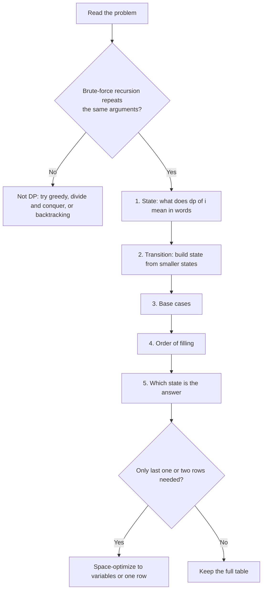
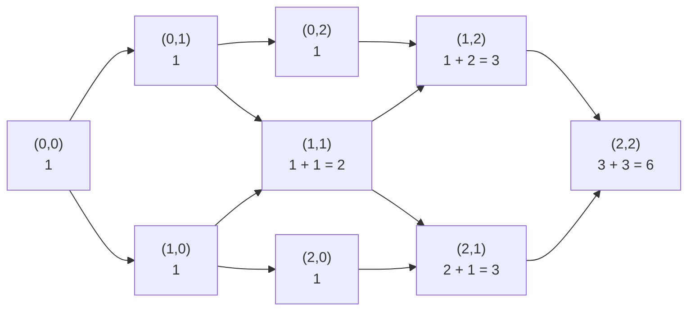
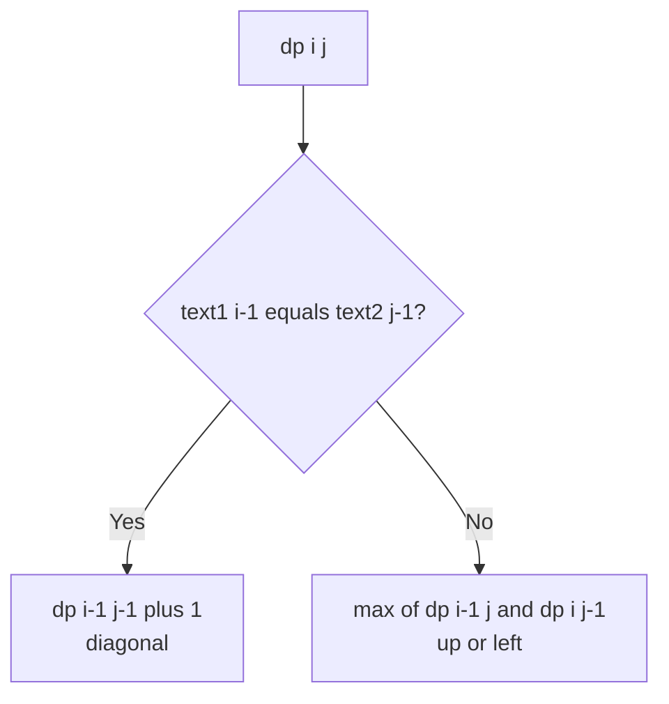
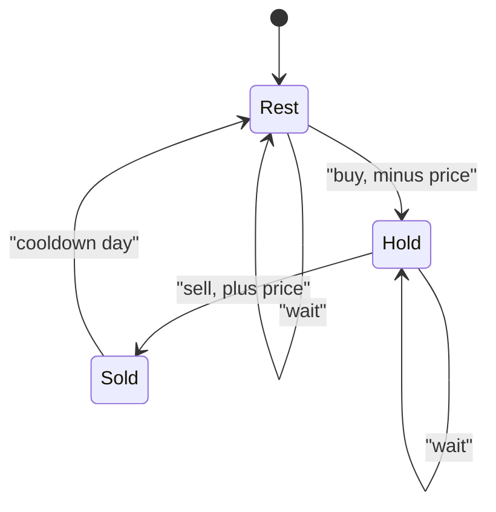
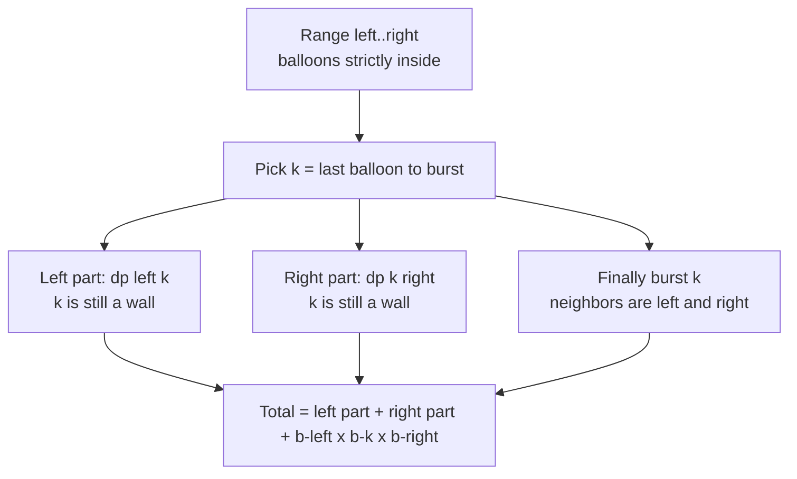

# Dynamic Programming

> In this document you will learn how to spot a dynamic programming (DP) problem, how to build a solution with a fixed 5-step method, and how to turn slow recursion into fast code. DP is the topic many candidates fear most, but most interview DP problems follow a small number of shapes. Once you know the shapes, you can solve them calmly and explain them clearly.

**Before this:** [Data structures and Big-O](../01-cs-and-web-fundamentals/02-data-structures-and-big-o.md) · [Problem solving and complexity (Pattern 11 shows climbing stairs four ways)](../11-coding-interviews/02-problem-solving-and-complexity.md#pattern-11-dynamic-programming) · [Backtracking](11-backtracking.md) · **Interview questions:** [jump to the interview section](#interview-questions)

## Table of contents

1. [The pattern](#the-pattern)
2. [Problems](#problems)
3. [Interview questions](#interview-questions)
4. [Summary](#summary)
5. [References](#references)

## The pattern

### What dynamic programming is

**Dynamic programming** is a way to solve a big problem by solving smaller versions of the same problem, saving each small answer, and reusing it instead of computing it again.

That is all it is. There is no magic. DP is "recursion plus a notebook".

- The **recursion** part: you describe the answer for size `n` using answers for smaller sizes.
- The **notebook** part: you write down every small answer the first time you compute it. Next time you need it, you just read it.

**Analogy.** Someone asks you "what is 1 + 1 + 1 + 1 + 1 + 1?". You count and say "6". Then they add "+ 1" at the end and ask again. You do not count from the start. You say "7", because you remember the old answer. That memory is DP. The analogy breaks down a little because real DP problems often have *many* smaller answers that combine (not only one), but the core idea of "remember and reuse" is the same.

### When DP applies: two properties

A problem is a good fit for DP when it has both of these properties:

1. **Overlapping subproblems.** When you write the plain recursive solution, the same smaller question is asked again and again. For example, to count ways to climb 5 stairs, you need the answer for 4 and 3. To get 4 you need 3 and 2. The question "how many ways for 3?" shows up twice. In bigger inputs it shows up millions of times.
2. **Optimal substructure.** The best answer for the big problem can be built from the best answers of smaller problems. For example, the cheapest way to reach step 10 must use the cheapest way to reach step 9 or step 8. You never need a "worse than best" answer for a smaller step.

If subproblems do *not* overlap (like merge sort, where each half is different), you have plain **divide and conquer**, not DP. Saving answers would not help, because you never ask the same question twice.

### Signal words and constraints

Think "DP" when you see these signals:

| Signal in the problem | Example |
| --- | --- |
| "How many ways..." | Ways to climb stairs, ways to decode a message |
| "Minimum / maximum cost, length, profit..." | Fewest coins, longest subsequence, max profit |
| "Is it possible to..." where choices build on each other | Can the string be split into words? Can the array be split into two equal halves? |
| You make a choice at each step and the choice affects later steps | Rob this house or skip it; take this item or leave it |
| Two strings or two arrays compared position by position | Longest common subsequence, edit distance |
| Input size around 100 to 5,000 and the brute force is exponential | O(n²) DP is fine for n ≤ 5,000 |

A quick mental test: "If I write the brute-force recursion, does it call itself with the *same arguments* more than once?" If yes, DP will help.

DP versus other patterns:

- **Greedy** makes one locally best choice and never looks back. DP tries all choices but remembers results. If a greedy choice can be proven safe, greedy is simpler. If not, use DP. Coin change is the classic case where greedy fails. See [Greedy algorithms](13-greedy-algorithms.md#when-greedy-fails).
- **Backtracking** lists *all* solutions (all subsets, all paths). DP *counts* or *optimizes* over them without listing them. If the question asks you to *print every* solution, you usually need backtracking. See [Backtracking](11-backtracking.md).

### The 5-step method

Use the same five steps for every DP problem. Say them out loud in the interview. It shows structure, and it keeps you from getting lost.

1. **State.** Decide what one subproblem is, and what it means in words. Example: "`dp[i]` is the minimum cost to stand on step `i`." Write this sentence down. Most DP bugs come from a fuzzy state.
2. **Transition.** Write how one state is built from smaller states. Example: "`dp[i] = min(dp[i-1] + cost[i-1], dp[i-2] + cost[i-2])`." This is the recurrence.
3. **Base case.** Decide the smallest states whose answers you know without computing. Example: "`dp[0] = 0` and `dp[1] = 0`, because you can start on step 0 or step 1 for free."
4. **Order.** Decide in which order to fill states so that every state you read is already computed. Example: "`i` goes from 2 up to `n`." In 2D problems this is "row by row, left to right" or "by interval length".
5. **Answer.** Say which state holds the final answer. Example: "`dp[n]`." Sometimes the answer is the max over all states, not the last one.



### Memoization vs tabulation vs space optimization

There are three ways to write the same DP. You should be able to write all three, and to say when you would pick each one.

| Style | How it works | Good | Bad |
| --- | --- | --- | --- |
| **Memoization** (top-down) | Plain recursion plus a cache. You only compute states you actually need. | Easiest to write from the recurrence. Skips unused states. | Recursion has a call-stack limit in JavaScript (roughly 10,000 frames). Function calls have overhead. |
| **Tabulation** (bottom-up) | A loop fills a table from the base cases upward. | No recursion limit. Usually faster. Easy to see the space you can save. | You must think about the fill order. Computes every state, even unused ones. |
| **Space optimization** | Tabulation, but keep only the rows or values the transition reads. | Lowest memory, often O(1) or O(n). | Harder to read. You lose the table, so you cannot rebuild the chosen path. |

The **recursion depth** point matters in JavaScript. Node.js and browsers limit the call stack. The exact size depends on the engine and on how big each frame is. It is often around 10,000 frames for simple functions. Our test of a one-line recursive function with depth 1,000,000 threw `RangeError: Maximum call stack size exceeded`. So if `n` can be 10⁵, write tabulation.

### One problem shown all three ways

We use **Min Cost Climbing Stairs** (similar to LeetCode 746). Climbing stairs itself is already shown four ways in [Problem solving and complexity](../11-coding-interviews/02-problem-solving-and-complexity.md#pattern-11-dynamic-programming), so here we take a slightly richer version.

**Problem.** `cost[i]` is the price you pay when you step *off* stair `i`. You may start on stair 0 or stair 1 for free. Each move goes up 1 or 2 stairs. The top is just past the last stair (index `n`). Return the minimum total cost to reach the top.

**Examples.**

- `[10, 15, 20]` → `15` (start on stair 1, pay 15, jump 2 to the top).
- `[1, 100, 1, 1, 1, 100, 1, 1, 100, 1]` → `6`.

**The 5 steps.**

1. **State:** `best(i)` = minimum cost to *stand on* position `i` (where `n` is the top).
2. **Transition:** you arrived from `i - 1` (paying `cost[i-1]`) or from `i - 2` (paying `cost[i-2]`). `best(i) = min(best(i-1) + cost[i-1], best(i-2) + cost[i-2])`.
3. **Base cases:** `best(0) = 0`, `best(1) = 0` (free start).
4. **Order:** `i` from 2 up to `n`.
5. **Answer:** `best(n)`.

**Version 1 — memoization (top-down).**

```js
function minCostMemo(cost) {
  const memo = new Map();

  function best(i) {
    if (i <= 1) return 0;                 // base cases: free start
    if (memo.has(i)) return memo.get(i);  // already in the notebook
    const result = Math.min(
      best(i - 1) + cost[i - 1],
      best(i - 2) + cost[i - 2],
    );
    memo.set(i, result);                  // write it in the notebook
    return result;
  }

  return best(cost.length);
}

console.log(minCostMemo([10, 15, 20])); // 15
```

**Version 2 — tabulation (bottom-up).**

```js
function minCostTab(cost) {
  const n = cost.length;
  const dp = new Array(n + 1).fill(0); // dp[0] = dp[1] = 0
  for (let i = 2; i <= n; i++) {
    dp[i] = Math.min(dp[i - 1] + cost[i - 1], dp[i - 2] + cost[i - 2]);
  }
  return dp[n];
}

console.log(minCostTab([1, 100, 1, 1, 1, 100, 1, 1, 100, 1])); // 6
```

**Version 3 — space-optimized.** The transition reads only the last two values. So keep two variables instead of a whole array.

```js
function minCost(cost) {
  let twoBack = 0; // best(i - 2)
  let oneBack = 0; // best(i - 1)
  for (let i = 2; i <= cost.length; i++) {
    const current = Math.min(oneBack + cost[i - 1], twoBack + cost[i - 2]);
    twoBack = oneBack;
    oneBack = current;
  }
  return oneBack;
}

console.log(minCost([10, 15, 20])); // 15
```

**Dry run of version 2 on `[10, 15, 20]`:**

| i | dp[i - 1] + cost[i - 1] | dp[i - 2] + cost[i - 2] | dp[i] |
| --- | --- | --- | --- |
| 0 | base | base | 0 |
| 1 | base | base | 0 |
| 2 | 0 + 15 = 15 | 0 + 10 = 10 | 10 |
| 3 | 10 + 20 = 30 | 0 + 15 = 15 | 15 |

Answer: `dp[3] = 15`.

**Complexity.** All three are O(n) time, because each state is computed once with O(1) work. Memoization and tabulation use O(n) space (the cache or table, plus the call stack for memoization). The space-optimized version uses O(1) space.

**How to pick in an interview.** Start with the recurrence in words. If the recurrence is clear, write tabulation directly. If you are unsure about the fill order (for example, in tree-shaped or interval problems), write memoization first, get it correct, and then offer to convert it. Mention space optimization at the end as a follow-up.

### A reusable template

Most 1D DP problems fit this shape:

```js
function solve1D(input) {
  const n = input.length;
  const dp = new Array(n + 1).fill(INITIAL); // INITIAL: 0, Infinity, -Infinity or false

  // 3. base cases
  dp[0] = BASE_VALUE;

  // 4. order: small to large
  for (let i = 1; i <= n; i++) {
    // 2. transition: look at a few earlier states
    for (const choice of choicesAt(i)) {
      const previous = i - choice.size;
      if (previous >= 0) {
        dp[i] = combine(dp[i], dp[previous], choice);
      }
    }
  }

  // 5. answer
  return dp[n];
}
```

Most 2D DP problems on two strings fit this shape:

```js
function solve2D(a, b) {
  const m = a.length;
  const n = b.length;
  // dp[i][j] = answer for the first i chars of a and the first j chars of b
  const dp = Array.from({ length: m + 1 }, () => new Array(n + 1).fill(0));

  // base cases: row 0 and column 0 (empty prefix)
  for (let i = 0; i <= m; i++) dp[i][0] = BASE_FOR_EMPTY_B(i);
  for (let j = 0; j <= n; j++) dp[0][j] = BASE_FOR_EMPTY_A(j);

  for (let i = 1; i <= m; i++) {
    for (let j = 1; j <= n; j++) {
      if (a[i - 1] === b[j - 1]) {
        dp[i][j] = WHEN_EQUAL(dp[i - 1][j - 1]);
      } else {
        dp[i][j] = WHEN_DIFFERENT(dp[i - 1][j], dp[i][j - 1], dp[i - 1][j - 1]);
      }
    }
  }
  return dp[m][n];
}
```

Note the `Array.from({ length: m + 1 }, () => new Array(n + 1).fill(0))` line. It creates a *new* row for each index.

```js
// ❌ Wrong: every row is the SAME array object
const badGrid = new Array(3).fill(new Array(3).fill(0));
badGrid[0][0] = 7;
console.log(badGrid[1][0]); // 7  (all rows changed)

// ✅ Correct: a fresh array per row
const goodGrid = Array.from({ length: 3 }, () => new Array(3).fill(0));
goodGrid[0][0] = 7;
console.log(goodGrid[1][0]); // 0
```

### The families of DP problems

Interview DP problems fall into a few families. Recognizing the family tells you the state shape.

| Family | State | Typical problems in this document |
| --- | --- | --- |
| Linear (1D) | `dp[i]` = answer for the prefix ending at or before `i` | Climbing stairs, house robber, decode ways, word break |
| Unbounded choices | `dp[amount]` = best answer for this amount, any item reusable | Coin change |
| Subsequence | `dp[i]` = best answer ending exactly at `i` | Longest increasing subsequence |
| Grid | `dp[r][c]` = answer for reaching cell `(r, c)` | Unique paths |
| Two sequences | `dp[i][j]` = answer for prefixes `a[0..i)` and `b[0..j)` | LCS, edit distance |
| 0/1 knapsack | `dp[capacity]` = best value with items so far, each used once | Knapsack, partition equal subset sum |
| State machine | a few variables, one per "mode" you can be in | Stock with cooldown, max product subarray |
| Interval | `dp[l][r]` = answer for the range `l..r` | Longest palindromic substring, burst balloons |

### Complexity of a DP solution

There is a simple rule:

**Time = (number of states) × (work per state).**

- Climbing stairs: n states × O(1) work = O(n).
- LCS: (m + 1)(n + 1) states × O(1) = O(m·n).
- LIS (simple version): n states × O(n) work to look back = O(n²).
- Burst balloons: O(n²) intervals × O(n) choices of last balloon = O(n³).

**Space = number of states you keep.** You can often cut one dimension if the transition only reads the previous row.

### Common mistakes

- **Fuzzy state.** "dp[i] is about step i" is not enough. Say exactly: "minimum cost to *stand on* step i" versus "minimum cost *after leaving* step i". These give different code.
- **Wrong base case.** For counting problems, the empty case is usually `1` (one way to do nothing), not `0`.
- **Off-by-one with a padded table.** When you use `dp` of size `n + 1`, `dp[i]` usually refers to the first `i` items, so the current item is `input[i - 1]`. Mixing `input[i]` and `input[i - 1]` is the most common bug.
- **Wrong fill order.** Reading `dp[i + 1]` while filling `i` from left to right gives you an unfilled value.
- **Wrong loop direction in 0/1 knapsack.** When you compress to one row, loop capacity *downward*. Looping upward lets one item be used twice (that is the unbounded version).
- **Using `Infinity` and forgetting to convert.** If `dp[amount]` is still `Infinity`, return `-1` (or whatever the problem asks).
- **Deep recursion.** Memoization with n = 10⁵ can throw `RangeError` in JavaScript. Use tabulation for large inputs.
- **Using an object as a memo with array keys.** `memo[[1, 2]]` turns the key into the string `"1,2"`. It works, but it is slow and easy to get wrong. Prefer `Map` with a string key like `` `${i},${j}` ``, or better, a 2D array.

## Problems

The problems go from Easy to Hard. The first eight are 1D DP. The rest are 2D, knapsack, state machine and interval DP.

### P1. Climbing Stairs (Easy)

**Problem.** You are at the bottom of a staircase with `n` steps. Each move climbs 1 or 2 steps. Count how many different sequences of moves reach the top. Similar to: LeetCode 70 Climbing Stairs.

**Examples.**

- `n = 2` → `2` (1+1, 2)
- `n = 3` → `3` (1+1+1, 1+2, 2+1)
- `n = 5` → `8`

**How to recognize the pattern.** "How many ways" plus "each move depends on where you were before" is a counting DP.

**Brute force.** Recursion `ways(n) = ways(n - 1) + ways(n - 2)` with no cache. It repeats the same calls and takes O(2ⁿ) time. The full four-version walk-through (plain recursion, memoization, tabulation, two variables) is in [Problem solving and complexity](../11-coding-interviews/02-problem-solving-and-complexity.md#pattern-11-dynamic-programming). Here we go one step further.

**Optimal approach.**

1. The last move into step `i` was either a 1-step (from `i - 1`) or a 2-step (from `i - 2`).
2. So `ways(i) = ways(i - 1) + ways(i - 2)`. This is the Fibonacci recurrence.
3. Keep only the last two values.

**Code.**

```js
function climbStairs(n) {
  if (n <= 2) return n;
  let twoBack = 1; // ways(1)
  let oneBack = 2; // ways(2)
  for (let i = 3; i <= n; i++) {
    const current = oneBack + twoBack;
    twoBack = oneBack;
    oneBack = current;
  }
  return oneBack;
}

console.log(climbStairs(3));  // 3
console.log(climbStairs(5));  // 8
console.log(climbStairs(45)); // 1836311903
```

**Taking it further: any set of step sizes.** If the allowed moves are `steps = [1, 2, 3]`, the same idea gives `ways(i) = sum of ways(i - s)` for each step size `s`. The base case is `ways(0) = 1`: there is exactly one way to climb zero steps (do nothing).

```js
function climbWithSteps(n, steps) {
  const dp = new Array(n + 1).fill(0);
  dp[0] = 1; // one way to stand still
  for (let i = 1; i <= n; i++) {
    for (const s of steps) {
      if (i - s >= 0) dp[i] += dp[i - s];
    }
  }
  return dp[n];
}

console.log(climbWithSteps(4, [1, 2, 3])); // 7
console.log(climbWithSteps(5, [1, 2]));    // 8  (same as climbStairs(5))
```

**Dry run** of `climbStairs(5)`:

| i | twoBack | oneBack | current |
| --- | --- | --- | --- |
| start | 1 | 2 | — |
| 3 | 2 | 3 | 3 |
| 4 | 3 | 5 | 5 |
| 5 | 5 | 8 | 8 |

**Complexity.** O(n) time, one pass. O(1) space, two variables. The general version is O(n·k) time for k step sizes and O(n) space.

**Edge cases.** `n = 1` → 1. `n = 0` → by the "do nothing" convention 1 (the problem usually says n ≥ 1). Large `n`: the answer grows like Fibonacci and passes `Number.MAX_SAFE_INTEGER` (2⁵³ − 1) around n = 78. After that you need `BigInt` or a modulo.

**Follow-ups.**

- **What if the answer must be returned modulo 1,000,000,007?** Apply `% MOD` after every addition. A sum of two values below the modulus stays far below 2⁵³, so plain numbers are safe.
- **What if some steps are broken?** Set `dp[i] = 0` for a broken step before you move on. Nothing can stand there.
- **Can you do better than O(n)?** Yes, with fast matrix exponentiation in O(log n). It is rarely needed in interviews.

**How to say it in the interview.**
> "The last move into step i was either one step from i minus 1 or two steps from i minus 2. These two cases do not overlap, so the number of ways is the sum of the two smaller answers. That is the Fibonacci recurrence. I fill it from the bottom and keep only the last two values, so it is O(n) time and O(1) space."

### P2. House Robber (Medium)

**Problem.** Houses stand in a row. `nums[i]` is the money in house `i`. You cannot take money from two neighboring houses (the alarm goes off). Return the most money you can take. Similar to: LeetCode 198 House Robber.

**Examples.**

- `[1, 2, 3, 1]` → `4` (houses 0 and 2: 1 + 3)
- `[2, 7, 9, 3, 1]` → `12` (houses 0, 2, 4: 2 + 9 + 1)
- `[2, 1, 1, 2]` → `4` (houses 0 and 3)

**How to recognize the pattern.** At every house you make a yes/no choice, and the choice limits the next choice. You want a maximum. That is linear DP with a "take or skip" transition.

**Brute force.** Try every subset of houses with no two neighbors. The number of such subsets grows like the Fibonacci numbers (about 1.6ⁿ). Far too slow for n = 100.

**Optimal approach.**

1. **State:** `best(i)` = most money from the first `i` houses.
2. **Transition:** for house `i - 1` you either skip it (`best(i - 1)`) or take it (`best(i - 2) + nums[i - 1]`). Take the larger.
3. **Base:** `best(0) = 0`. Starting both variables at 0 handles the first house automatically.
4. **Order:** left to right.
5. **Answer:** `best(n)`.

**Code.**

```js
function rob(nums) {
  let prev2 = 0; // best(i - 2)
  let prev1 = 0; // best(i - 1)
  for (const money of nums) {
    const current = Math.max(prev1, prev2 + money); // skip vs take
    prev2 = prev1;
    prev1 = current;
  }
  return prev1;
}

console.log(rob([1, 2, 3, 1]));    // 4
console.log(rob([2, 7, 9, 3, 1])); // 12
console.log(rob([]));              // 0
```

**Dry run** on `[2, 7, 9, 3, 1]`:

| money | skip = prev1 | take = prev2 + money | current |
| --- | --- | --- | --- |
| 2 | 0 | 0 + 2 = 2 | 2 |
| 7 | 2 | 0 + 7 = 7 | 7 |
| 9 | 7 | 2 + 9 = 11 | 11 |
| 3 | 11 | 7 + 3 = 10 | 11 |
| 1 | 11 | 11 + 1 = 12 | 12 |

**Complexity.** O(n) time, one pass. O(1) space, two variables.

**Edge cases.** Empty array → 0. One house → its value. All zeros → 0. Big houses at both ends with small ones in between (`[2, 1, 1, 2]`) → 4. This last case breaks the wrong idea "just take every other house".

**Follow-ups.**

- **Return which houses were robbed.** Keep the full `dp` array. Walk backward from `n`: if `dp[i] === dp[i - 1]`, house `i - 1` was skipped; otherwise it was taken and you jump to `i - 2`.
- **Houses are in a circle.** See P3.
- **Houses are nodes in a binary tree (LeetCode 337).** Do a post-order DFS that returns two numbers per node: the best total with this node taken, and with it skipped.

**How to say it in the interview.**
> "At every house I either skip it and keep the best answer so far, or I take it and add its money to the best answer from two houses back. I take the max of those two. The answer only depends on the last two values, so I keep two variables. One pass, O(n) time, O(1) space."

### P3. House Robber II (Medium)

**Problem.** Same as P2, but the houses form a circle. The first and last houses are neighbors. Similar to: LeetCode 213 House Robber II.

**Examples.**

- `[2, 3, 2]` → `3` (you cannot take both 2s, they are neighbors now)
- `[1, 2, 3, 1]` → `4`
- `[1, 2, 3]` → `3`

**How to recognize the pattern.** It is P2 with one extra rule. The trick is to *reduce* the circle to lines you already know how to solve.

**Brute force.** Try all valid subsets on the circle. Exponential.

**Optimal approach.**

1. In any valid plan, the first house and the last house are not both taken.
2. So the plan either never takes the last house, or never takes the first house.
3. Solve the line `nums[0 .. n-2]` (drop the last) and the line `nums[1 .. n-1]` (drop the first) with P2. Return the bigger answer.
4. Special case: with one house there is no neighbor, so return `nums[0]`.

**Code.**

```js
function robCircle(nums) {
  const n = nums.length;
  if (n === 1) return nums[0];

  const robLine = (start, endExclusive) => {
    let prev2 = 0;
    let prev1 = 0;
    for (let i = start; i < endExclusive; i++) {
      const current = Math.max(prev1, prev2 + nums[i]);
      prev2 = prev1;
      prev1 = current;
    }
    return prev1;
  };

  return Math.max(robLine(0, n - 1), robLine(1, n));
}

console.log(robCircle([2, 3, 2]));    // 3
console.log(robCircle([1, 2, 3, 1])); // 4
console.log(robCircle([7]));          // 7
```

**Dry run** on `[1, 2, 3, 1]`:

- Line without the last house: `[1, 2, 3]` → 1 + 3 = 4.
- Line without the first house: `[2, 3, 1]` → max(2 + 1, 3) = 3.
- Answer: max(4, 3) = 4.

**Complexity.** O(n) time, two linear passes. O(1) space. We pass indexes instead of slicing, so we do not copy the array.

**Edge cases.** One house (must return it, not 0 — without the special case both lines would be empty). Two houses → the larger one.

**Follow-ups.**

- **Why not run P2 once and then fix the ends?** Because the best line answer might use both ends, and "drop the smaller end" is not always optimal. Splitting into two clean subproblems is simple and provably correct.
- **Can you do it in one loop?** Yes, by running both line DPs side by side. Two calls are clearer and have the same complexity.

**How to say it in the interview.**
> "The circle only adds one rule: the first and last houses cannot both be taken. So any good plan skips at least one of them. I run the normal house robber on the array without the last house and on the array without the first house, and return the larger result. One house is a special case. It is still O(n) time and O(1) space."

### P4. Coin Change (Medium)

**Problem.** You have coin values `coins` and an unlimited supply of each. Return the smallest number of coins that add up to `amount`, or `-1` if it is impossible. Similar to: LeetCode 322 Coin Change.

**Examples.**

- `coins = [1, 2, 5], amount = 11` → `3` (5 + 5 + 1)
- `coins = [2], amount = 3` → `-1`
- `coins = [1], amount = 0` → `0`
- `coins = [1, 3, 4], amount = 6` → `2` (3 + 3). Greedy would pick 4 + 1 + 1 = 3 coins. This is why we need DP.

**How to recognize the pattern.** "Minimum number of items to reach a total", and items can repeat. This is the **unbounded knapsack** family. The state is the amount.

**Brute force.** Recursion: `fewest(a) = 1 + min over coins of fewest(a - coin)`. The same amounts repeat many times. Exponential time.

**Optimal approach.**

1. **State:** `dp[a]` = fewest coins that make amount `a`.
2. **Transition:** the last coin used was some `coin`. So `dp[a] = min(dp[a - coin] + 1)` over all coins with `coin <= a`.
3. **Base:** `dp[0] = 0`. Every other value starts as `Infinity` (meaning "not possible yet").
4. **Order:** `a` from 1 up to `amount`.
5. **Answer:** `dp[amount]`, or `-1` if it is still `Infinity`.

**Code.**

```js
function coinChange(coins, amount) {
  const dp = new Array(amount + 1).fill(Infinity);
  dp[0] = 0;
  for (let a = 1; a <= amount; a++) {
    for (const coin of coins) {
      if (coin <= a && dp[a - coin] + 1 < dp[a]) {
        dp[a] = dp[a - coin] + 1;
      }
    }
  }
  return dp[amount] === Infinity ? -1 : dp[amount];
}

console.log(coinChange([1, 2, 5], 11)); // 3
console.log(coinChange([2], 3));        // -1
console.log(coinChange([1, 3, 4], 6));  // 2
```

**Dry run** on `coins = [1, 3, 4], amount = 6`:

| a | from coin 1 | from coin 3 | from coin 4 | dp[a] |
| --- | --- | --- | --- | --- |
| 0 | — | — | — | 0 |
| 1 | dp[0]+1 = 1 | — | — | 1 |
| 2 | dp[1]+1 = 2 | — | — | 2 |
| 3 | dp[2]+1 = 3 | dp[0]+1 = 1 | — | 1 |
| 4 | dp[3]+1 = 2 | dp[1]+1 = 2 | dp[0]+1 = 1 | 1 |
| 5 | dp[4]+1 = 2 | dp[2]+1 = 3 | dp[1]+1 = 2 | 2 |
| 6 | dp[5]+1 = 3 | dp[3]+1 = 2 | dp[2]+1 = 3 | 2 |

**Complexity.** O(amount × number of coins) time, because each amount tries every coin. O(amount) space for the table.

**Edge cases.** `amount = 0` → 0. No coin fits → -1. A coin bigger than the amount is simply skipped. `Infinity + 1` is still `Infinity`, so impossible states never look better than real ones.

**Follow-ups.**

- **Count the number of ways instead (LeetCode 518 Coin Change II).** Use `dp[0] = 1` and `dp[a] += dp[a - coin]`. Loop **coins in the outer loop** so that each combination is counted once (1+2 and 2+1 are the same combination). If amounts are in the outer loop, you count ordered sequences instead.

  ```js
  function countWays(coins, amount) {
    const dp = new Array(amount + 1).fill(0);
    dp[0] = 1;
    for (const coin of coins) {            // coins outside → combinations
      for (let a = coin; a <= amount; a++) {
        dp[a] += dp[a - coin];
      }
    }
    return dp[amount];
  }
  console.log(countWays([1, 2, 5], 5)); // 4
  ```

- **Return the actual coins.** Keep a `lastCoin[a]` array. Each time you improve `dp[a]`, store the coin. Then walk back from `amount`.
- **Is BFS an option?** Yes. Treat each amount as a node and each coin as an edge. BFS from 0 finds the fewest coins. The worst case is the same.

**How to say it in the interview.**
> "Greedy does not work here. With coins 1, 3 and 4 and amount 6, greedy takes 4 plus two 1s, but 3 plus 3 is better. So I use DP over the amount. dp of a is the fewest coins for amount a. The last coin could be any coin, so dp of a is one plus the min of dp of a minus coin. dp of 0 is 0 and everything else starts at Infinity. That is O(amount times coins) time and O(amount) space."

### P5. Longest Increasing Subsequence (Medium)

**Problem.** Return the length of the longest **strictly increasing subsequence** of `nums`. A subsequence keeps the original order but may skip elements. Similar to: LeetCode 300 Longest Increasing Subsequence.

**Examples.**

- `[10, 9, 2, 5, 3, 7, 101, 18]` → `4` (for example 2, 3, 7, 18)
- `[0, 1, 0, 3, 2, 3]` → `4` (0, 1, 2, 3)
- `[7, 7, 7, 7]` → `1` (strictly increasing, so equal values do not count)

**How to recognize the pattern.** "Longest subsequence with a property", where each element can extend some earlier ones. That is the subsequence DP family: `dp[i]` = best answer that **ends exactly at** `i`.

**Brute force.** Try all 2ⁿ subsequences and check each one. O(2ⁿ · n).

**Approach 1: O(n²) DP.**

1. **State:** `dp[i]` = length of the longest increasing subsequence that ends with `nums[i]`.
2. **Transition:** look at every earlier `j < i`. If `nums[j] < nums[i]`, then `nums[i]` can extend it: `dp[i] = max(dp[i], dp[j] + 1)`.
3. **Base:** every `dp[i]` starts at 1 (the element alone).
4. **Order:** `i` from left to right.
5. **Answer:** the max over all `dp[i]` (the best subsequence can end anywhere).

```js
function lengthOfLISQuadratic(nums) {
  const n = nums.length;
  if (n === 0) return 0;
  const dp = new Array(n).fill(1);
  for (let i = 1; i < n; i++) {
    for (let j = 0; j < i; j++) {
      if (nums[j] < nums[i]) dp[i] = Math.max(dp[i], dp[j] + 1);
    }
  }
  return Math.max(...dp);
}

console.log(lengthOfLISQuadratic([10, 9, 2, 5, 3, 7, 101, 18])); // 4
```

One JavaScript detail: `Math.max(...dp)` spreads the array into function arguments. For arrays with hundreds of thousands of items this can throw a `RangeError`. For big inputs, track the max in the loop instead.

**Approach 2: O(n log n) with "tails" and binary search.**

Keep an array `tails`. `tails[k]` is the **smallest possible last value** of an increasing subsequence of length `k + 1` seen so far. A smaller tail is always better, because it leaves more room for future numbers.

For each number `x`:

1. Find the first position in `tails` whose value is `>= x` (a lower bound, see [Binary search](06-binary-search.md)).
2. If no such position exists, `x` extends the longest subsequence: push it.
3. Otherwise, replace that value with `x` (same length, smaller tail).

The length of `tails` is the answer. Important: `tails` itself is **not** a real subsequence. Only its length is meaningful.

```js
function lengthOfLIS(nums) {
  const tails = [];
  for (const x of nums) {
    let lo = 0;
    let hi = tails.length;
    while (lo < hi) {               // lower bound: first tail >= x
      const mid = (lo + hi) >> 1;
      if (tails[mid] < x) lo = mid + 1;
      else hi = mid;
    }
    tails[lo] = x;                  // push if lo === tails.length, else replace
  }
  return tails.length;
}

console.log(lengthOfLIS([10, 9, 2, 5, 3, 7, 101, 18])); // 4
console.log(lengthOfLIS([0, 1, 0, 3, 2, 3]));           // 4
console.log(lengthOfLIS([7, 7, 7, 7]));                 // 1
```

**Dry run** of approach 2 on `[10, 9, 2, 5, 3, 7, 101, 18]`:

| x | lower bound position | tails after |
| --- | --- | --- |
| 10 | 0 (empty, push) | [10] |
| 9 | 0 | [9] |
| 2 | 0 | [2] |
| 5 | 1 (push) | [2, 5] |
| 3 | 1 | [2, 3] |
| 7 | 2 (push) | [2, 3, 7] |
| 101 | 3 (push) | [2, 3, 7, 101] |
| 18 | 3 | [2, 3, 7, 18] |

Length 4.

**Complexity.** Approach 1: O(n²) time, O(n) space. Approach 2: O(n log n) time (one binary search per element), O(n) space.

**Edge cases.** Empty array → 0. All equal → 1. Strictly decreasing → 1. Already sorted → n. Negative numbers work the same.

**Follow-ups.**

- **Non-decreasing (allow equal values)?** Use an *upper bound* (first tail `> x`) instead of a lower bound.
- **Return the actual subsequence.** With approach 1, keep a `parent[i]` index for the `j` that gave the best `dp[i]`, then walk back from the best end. With approach 2, store the index of each tail and a parent array.
- **Count how many longest subsequences there are (LeetCode 673).** Use approach 1 with a second array `count[i]`.
- **Russian doll envelopes (LeetCode 354).** Sort by width ascending and, for equal widths, height descending. Then run LIS on heights.

**How to say it in the interview.**
> "The simple DP says dp of i is the longest increasing subsequence that ends at i. For each i, I look back at every smaller earlier value and extend it. That is O(n squared). To get O(n log n), I keep an array of the smallest tail for each length. For each number I binary search for the first tail that is greater than or equal to it, and replace it, or push if there is none. The length of that array is the answer. The array itself is not the real subsequence."

### P6. Word Break (Medium)

**Problem.** Given a string `s` and a list of dictionary words, return `true` if `s` can be split into a sequence of one or more dictionary words. Words may be reused. Similar to: LeetCode 139 Word Break.

**Examples.**

- `s = "leetcode", words = ["leet", "code"]` → `true`
- `s = "applepenapple", words = ["apple", "pen"]` → `true` (apple is reused)
- `s = "catsandog", words = ["cats", "dog", "sand", "and", "cat"]` → `false`

**How to recognize the pattern.** "Can the string be split" is a yes/no question where each cut depends on whether the prefix before it was splittable. Prefix-based boolean DP.

**Brute force.** Recursion: try every dictionary word that matches the start, then recurse on the rest. A string like `"aaaa...ab"` with words `["a", "aa", "aaa"]` makes this exponential, because the same suffix is checked again and again.

**Optimal approach.**

1. Put the words in a `Set` for O(1) average lookups.
2. **State:** `dp[i]` = `true` if the first `i` characters `s.slice(0, i)` can be split.
3. **Transition:** `dp[i]` is true if there is a cut `j < i` with `dp[j]` true and `s.slice(j, i)` in the set.
4. **Base:** `dp[0] = true` (the empty prefix needs no words).
5. **Answer:** `dp[s.length]`.
6. Speed-up: a word is at most `maxLen` long, so only try `j >= i - maxLen`.

**Code.**

```js
function wordBreak(s, wordDict) {
  const words = new Set(wordDict);
  let maxLen = 0;
  for (const w of words) maxLen = Math.max(maxLen, w.length);

  const dp = new Array(s.length + 1).fill(false);
  dp[0] = true;
  for (let i = 1; i <= s.length; i++) {
    for (let j = Math.max(0, i - maxLen); j < i; j++) {
      if (dp[j] && words.has(s.slice(j, i))) {
        dp[i] = true;
        break; // one valid cut is enough
      }
    }
  }
  return dp[s.length];
}

console.log(wordBreak('leetcode', ['leet', 'code']));                       // true
console.log(wordBreak('applepenapple', ['apple', 'pen']));                  // true
console.log(wordBreak('catsandog', ['cats', 'dog', 'sand', 'and', 'cat'])); // false
```

**Dry run** on `"leetcode"` with `["leet", "code"]` (maxLen 4). Only the `true` entries matter:

1. `dp[0] = true`.
2. `i = 4`: `j = 0`, `dp[0]` is true and `"leet"` is a word → `dp[4] = true`.
3. `i = 8`: `j = 4`, `dp[4]` is true and `"code"` is a word → `dp[8] = true`.
4. Answer `dp[8] = true`.

For `"catsandog"`: `dp[3]` ("cat") and `dp[4]` ("cats") become true, then `dp[7]` ("cat"+"sand" or "cats"+"and"). But `"og"`, `"dog"` needs a cut at 6, and `dp[6]` is false. So `dp[9]` stays false.

**Complexity.** O(n · L²) time, where n is the string length and L is `maxLen`. There are n positions, up to L cuts per position, and each `slice` plus hash costs O(L). Without the `maxLen` limit it is O(n³) in the worst case. Space is O(n) for the table plus the set.

**Edge cases.** Empty string → true by the base case (check what the problem says). Empty dictionary → false for any non-empty string. Words longer than the string are never used.

**Follow-ups.**

- **Return all possible sentences (LeetCode 140 Word Break II).** That asks you to list every split, so it is backtracking with memoization on the start index. The output itself can be exponential.
- **Huge dictionary?** Use a trie, so one walk from position `j` finds every word that starts there. See [Implement a trie](14-tries-bit-manipulation-and-math.md#p16-implement-a-trie-medium).

**How to say it in the interview.**
> "dp of i means the first i characters can be split into words. dp of 0 is true. For each i, I look for a cut j where dp of j is true and the piece from j to i is in the dictionary set. I only look back as far as the longest word. The answer is dp of n. It is about O(n times L squared) time and O(n) extra space."

### P7. Decode Ways (Medium)

**Problem.** A message of letters was encoded as numbers: A → 1, B → 2, ..., Z → 26. Given a string of digits, count how many ways it can be decoded. Similar to: LeetCode 91 Decode Ways.

**Examples.**

- `"12"` → `2` ("AB" from 1,2 or "L" from 12)
- `"226"` → `3` (2,2,6 / 22,6 / 2,26)
- `"06"` → `0` (a code cannot start with 0, and "06" is not 6)
- `"10"` → `1` (only "J")
- `"2101"` → `1` (2,10,1)

**How to recognize the pattern.** "How many ways", and each step takes one or two characters. It is climbing stairs with rules about which steps are allowed.

**Brute force.** Recursion on the start index: take one digit if it is not '0', take two digits if they form 10–26. Exponential without a cache.

**Optimal approach.**

1. **State:** `ways(i)` = number of ways to decode the first `i` characters.
2. **Transition:**
   - If the single digit `s[i - 1]` is not `'0'`, add `ways(i - 1)`.
   - If the two digits `s[i - 2..i - 1]` form a number from 10 to 26, add `ways(i - 2)`.
3. **Base:** `ways(0) = 1` (empty prefix: one way). `ways(1) = 1` if `s[0] !== '0'`, else `0`.
4. **Order:** left to right. Keep two variables.
5. **Answer:** `ways(n)`.

**Code.**

```js
function numDecodings(s) {
  if (s.length === 0) return 0;
  let prev2 = 1;                       // ways(0)
  let prev1 = s[0] === '0' ? 0 : 1;    // ways(1)
  for (let i = 2; i <= s.length; i++) {
    let current = 0;
    if (s[i - 1] !== '0') current += prev1;              // one-digit code
    const two = Number(s.slice(i - 2, i));
    if (s[i - 2] !== '0' && two >= 10 && two <= 26) {    // two-digit code
      current += prev2;
    }
    prev2 = prev1;
    prev1 = current;
  }
  return prev1;
}

console.log(numDecodings('226'));  // 3
console.log(numDecodings('06'));   // 0
console.log(numDecodings('2101')); // 1
```

**Dry run** on `"226"`:

| i | one digit | two digits | current | prev2, prev1 after |
| --- | --- | --- | --- | --- |
| start | — | — | — | 1, 1 |
| 2 | '2' ok → +1 | "22" ok → +1 | 2 | 1, 2 |
| 3 | '6' ok → +2 | "26" ok → +1 | 3 | 2, 3 |

**Complexity.** O(n) time, one pass. O(1) space.

**Edge cases.** Leading `'0'` → 0. `"100"` → 0 (the last 0 cannot attach to anything). `"27"` → 1 (27 is too big). `"0"` → 0.

**Follow-ups.**

- **With a `'*'` wildcard meaning 1–9 (LeetCode 639).** Same states, but each case adds a count. For example `'*'` alone adds `9 × ways(i - 1)`. Take the result modulo 10⁹ + 7.
- **Why does the `s[i - 2] !== '0'` check matter?** Because `Number("06")` is `6`, which looks valid. The leading-zero check rejects it.

**How to say it in the interview.**
> "This is climbing stairs with rules. To decode the first i characters, the last piece is either one digit or two digits. One digit is allowed if it is not zero. Two digits are allowed if they form a number from 10 to 26 without a leading zero. I add the matching counts from one and two steps back. One pass, O(n) time, O(1) space."

### P8. Maximum Product Subarray (Medium)

**Problem.** Return the largest product of a non-empty contiguous subarray. Similar to: LeetCode 152 Maximum Product Subarray.

**Examples.**

- `[2, 3, -2, 4]` → `6` (2 × 3)
- `[-2, 0, -1]` → `0`
- `[-2, 3, -4]` → `24` (the whole array: two negatives make a positive)

**How to recognize the pattern.** It looks like maximum subarray sum (Kadane, see [Maximum subarray](13-greedy-algorithms.md#p4-maximum-subarray-medium)). But a negative number can turn the *smallest* product into the *largest* one. So you track two states at once: the max and the min product ending here. This is a small **state machine** DP.

**Brute force.** Try every start and end, multiply as you go. O(n²) time.

**Optimal approach.**

1. **State:** `curMax` and `curMin` = the largest and smallest product of a subarray that **ends at** the current index.
2. **Transition:** for the new number `x`, the new best ending here is one of: `x` alone, `curMax * x`, or `curMin * x`. Same for the new worst.
3. **Base:** both start as `nums[0]`.
4. **Answer:** the best `curMax` seen.

**Code.**

```js
function maxProduct(nums) {
  let best = nums[0];
  let curMax = nums[0];
  let curMin = nums[0];
  for (let i = 1; i < nums.length; i++) {
    const x = nums[i];
    const candidates = [x, curMax * x, curMin * x];
    curMax = Math.max(...candidates);
    curMin = Math.min(...candidates);
    best = Math.max(best, curMax);
  }
  return best;
}

console.log(maxProduct([2, 3, -2, 4])); // 6
console.log(maxProduct([-2, 0, -1]));   // 0
console.log(maxProduct([-2, 3, -4]));   // 24
```

We compute both new values from the *old* `curMax` and `curMin`. The `candidates` array makes sure we do not overwrite `curMax` before we use it for `curMin`.

```js
// ❌ Wrong: curMax is already changed when curMin is computed
curMax = Math.max(x, curMax * x, curMin * x);
curMin = Math.min(x, curMax * x, curMin * x);

// ✅ Correct: compute from the old values first
const candidates = [x, curMax * x, curMin * x];
curMax = Math.max(...candidates);
curMin = Math.min(...candidates);
```

**Dry run** on `[-2, 3, -4]`:

| x | candidates | curMax | curMin | best |
| --- | --- | --- | --- | --- |
| -2 | start | -2 | -2 | -2 |
| 3 | 3, -6, -6 | 3 | -6 | 3 |
| -4 | -4, -12, 24 | 24 | -12 | 24 |

**Complexity.** O(n) time, one pass. O(1) space (the `candidates` array always has 3 items).

**Edge cases.** Single element, even a negative one → that element. Zeros reset both values (the product with 0 is 0, so `x` alone wins on the next step). An odd count of negatives: the best answer drops one end.

**Follow-ups.**

- **Why not only track the max?** Because `-6 × -4 = 24`. The previous minimum (-6) becomes the new maximum after a negative number.
- **Big products?** JavaScript numbers do not overflow like 32-bit integers. They lose exact precision past 2⁵³ and become `Infinity` past about 1.8 × 10³⁰⁸. LeetCode guarantees the answer fits in 32 bits.

**How to say it in the interview.**
> "This is like Kadane's algorithm, but a negative number flips the sign, so the smallest product can become the largest. I keep both the max and the min product of a subarray ending at the current index. For each new number, the new max and min come from three candidates: the number alone, the old max times it, and the old min times it. I track the best max. O(n) time and O(1) space."

### P9. Unique Paths (Medium)

**Problem.** A robot stands in the top-left cell of an `m × n` grid. It can only move right or down. Count the paths to the bottom-right cell. Similar to: LeetCode 62 Unique Paths.

**Examples.**

- `m = 3, n = 7` → `28`
- `m = 3, n = 2` → `3` (right-down-down, down-right-down, down-down-right)
- `m = 1, n = 1` → `1`

**How to recognize the pattern.** Grid, moves only right/down, "count paths". Each cell is reached from the cell above or the cell to the left. Grid DP.

**Brute force.** Recursion from the target: `paths(r, c) = paths(r - 1, c) + paths(r, c - 1)`. The same cells are visited many times. Exponential time.

**Optimal approach.**

1. **State:** `dp[r][c]` = number of paths from the start to cell `(r, c)`.
2. **Transition:** `dp[r][c] = dp[r - 1][c] + dp[r][c - 1]`.
3. **Base:** the first row and first column are all 1 (only one straight path).
4. **Order:** row by row, left to right.
5. **Answer:** `dp[m - 1][n - 1]`.
6. **Space trick:** a row only needs the row above it. Keep one row: `row[c] += row[c - 1]`. Before the update, `row[c]` still holds the value from the row above. `row[c - 1]` already holds the new value from the left.

**Code.**

```js
function uniquePaths(m, n) {
  const row = new Array(n).fill(1); // first row: all 1
  for (let r = 1; r < m; r++) {
    for (let c = 1; c < n; c++) {
      row[c] += row[c - 1]; // above (old row[c]) + left (new row[c - 1])
    }
  }
  return row[n - 1];
}

console.log(uniquePaths(3, 7)); // 28
console.log(uniquePaths(3, 2)); // 3
```

**Dry run** for `m = 3, n = 3`:

| after row | row |
| --- | --- |
| 0 | [1, 1, 1] |
| 1 | [1, 2, 3] |
| 2 | [1, 3, 6] |

Answer 6.



Each cell's number is the sum of the arrows coming into it.

**Complexity.** O(m · n) time, every cell once. O(n) space for one row.

**Edge cases.** One row or one column → 1. A 1 × 1 grid → 1.

**Follow-ups.**

- **Obstacles (LeetCode 63 Unique Paths II).** A blocked cell has 0 paths. Start `row = [1, 0, 0, ...]` and process every row, including the first:

  ```js
  function uniquePathsWithObstacles(grid) {
    const n = grid[0].length;
    const row = new Array(n).fill(0);
    row[0] = 1;
    for (const line of grid) {
      for (let c = 0; c < n; c++) {
        if (line[c] === 1) row[c] = 0;        // blocked
        else if (c > 0) row[c] += row[c - 1];
      }
    }
    return row[n - 1];
  }
  console.log(uniquePathsWithObstacles([[0, 0, 0], [0, 1, 0], [0, 0, 0]])); // 2
  ```

- **Is there a formula?** Yes. Every path has `m - 1` down moves and `n - 1` right moves in some order. So the answer is the binomial coefficient C(m + n − 2, m − 1). Compute it with a loop of multiplications and divisions, or with `BigInt` for big grids.
- **Minimum path sum (LeetCode 64).** Same grid DP, but `dp[r][c] = grid[r][c] + min(above, left)`.

**How to say it in the interview.**
> "The robot reaches a cell either from above or from the left, so the number of paths to a cell is the sum of those two. The first row and column are all ones. I fill row by row. Because a row only needs the row above, I keep one array and do row of c plus equals row of c minus 1. That is O(m times n) time and O(n) space. There is also a combinatorics formula."

### P10. Longest Common Subsequence (Medium)

**Problem.** Return the length of the longest subsequence that appears in both strings. Similar to: LeetCode 1143 Longest Common Subsequence.

**Examples.**

- `"abcde", "ace"` → `3` ("ace")
- `"abc", "abc"` → `3`
- `"abc", "def"` → `0`

**How to recognize the pattern.** Two strings compared character by character, "longest common". This is the **two-sequence** DP family. The state is a pair of prefix lengths.

**Brute force.** List all 2ᵐ subsequences of the first string and check each against the second. Exponential.

**Optimal approach.**

1. **State:** `dp[i][j]` = LCS length of the first `i` characters of `text1` and the first `j` characters of `text2`.
2. **Transition:**
   - If `text1[i - 1] === text2[j - 1]`, the last characters match and both can be part of the LCS: `dp[i][j] = dp[i - 1][j - 1] + 1`.
   - Otherwise, drop the last character of one string: `dp[i][j] = max(dp[i - 1][j], dp[i][j - 1])`.
3. **Base:** row 0 and column 0 are 0 (an empty string has no common subsequence).
4. **Order:** row by row, left to right.
5. **Answer:** `dp[m][n]`.

**Code.**

```js
function longestCommonSubsequence(text1, text2) {
  const m = text1.length;
  const n = text2.length;
  const dp = Array.from({ length: m + 1 }, () => new Array(n + 1).fill(0));
  for (let i = 1; i <= m; i++) {
    for (let j = 1; j <= n; j++) {
      if (text1[i - 1] === text2[j - 1]) {
        dp[i][j] = dp[i - 1][j - 1] + 1;
      } else {
        dp[i][j] = Math.max(dp[i - 1][j], dp[i][j - 1]);
      }
    }
  }
  return dp[m][n];
}

console.log(longestCommonSubsequence('abcde', 'ace')); // 3
console.log(longestCommonSubsequence('abc', 'def'));   // 0
```

**Dry run** for `"abcde"` (rows) and `"ace"` (columns):

| | "" | a | c | e |
| --- | --- | --- | --- | --- |
| "" | 0 | 0 | 0 | 0 |
| a | 0 | **1** | 1 | 1 |
| b | 0 | 1 | 1 | 1 |
| c | 0 | 1 | **2** | 2 |
| d | 0 | 1 | 2 | 2 |
| e | 0 | 1 | 2 | **3** |

The bold cells are the matches. Each match is the diagonal value plus 1.



**Complexity.** O(m · n) time, every cell once with O(1) work. O(m · n) space for the table. You can reduce space to O(min(m, n)) with two rows, because each row only reads the row above.

```js
function lcsTwoRows(a, b) {
  let prev = new Array(b.length + 1).fill(0);
  for (let i = 1; i <= a.length; i++) {
    const cur = new Array(b.length + 1).fill(0);
    for (let j = 1; j <= b.length; j++) {
      cur[j] = a[i - 1] === b[j - 1] ? prev[j - 1] + 1 : Math.max(prev[j], cur[j - 1]);
    }
    prev = cur;
  }
  return prev[b.length];
}
console.log(lcsTwoRows('abcde', 'ace')); // 3
```

**Edge cases.** One empty string → 0. Identical strings → their length. No common characters → 0.

**Follow-ups.**

- **Return the LCS string.** Keep the full table. Start at `(m, n)`. If the characters match, add the character and go diagonally. Otherwise move toward the larger neighbor (up or left). Reverse the collected characters at the end.
- **Where is this used for real?** The `diff` tool and Git's line-based diffs are built on the same idea (longest common subsequence of lines, with faster algorithms such as Myers' diff).
- **Longest common substring (contiguous)?** If characters match, `dp[i][j] = dp[i - 1][j - 1] + 1`, otherwise `0`. The answer is the max over the table.

**How to say it in the interview.**
> "dp of i, j is the LCS of the first i characters of one string and the first j of the other. If the last characters match, I take the diagonal plus one. If not, I drop one last character from either string and take the better result, so the max of up and left. The empty-prefix row and column are zero. It is O(m times n) time, and I can cut space to two rows."

### P11. Edit Distance (Medium)

**Problem.** Return the minimum number of single-character operations (insert, delete, replace) that turn `word1` into `word2`. This is also called the **Levenshtein distance**. Similar to: LeetCode 72 Edit Distance.

**Examples.**

- `"horse", "ros"` → `3` (horse → rorse → rose → ros)
- `"intention", "execution"` → `5`
- `"", "abc"` → `3` (three inserts)

**How to recognize the pattern.** Two strings, a minimum number of operations. Two-sequence DP, very close to LCS.

**Brute force.** At each mismatch, try all three operations recursively. O(3^(m+n)).

**Optimal approach.**

1. **State:** `dp[i][j]` = edit distance between the first `i` characters of `word1` and the first `j` characters of `word2`.
2. **Transition:**
   - If the last characters match: `dp[i][j] = dp[i - 1][j - 1]` (no cost).
   - Otherwise, one of three operations happened last:
     - **Delete** `word1[i - 1]`: `dp[i - 1][j] + 1`.
     - **Insert** `word2[j - 1]` at the end of `word1`: `dp[i][j - 1] + 1`.
     - **Replace** `word1[i - 1]` with `word2[j - 1]`: `dp[i - 1][j - 1] + 1`.
3. **Base:** `dp[i][0] = i` (delete everything), `dp[0][j] = j` (insert everything).
4. **Order:** row by row.
5. **Answer:** `dp[m][n]`.

**Code.**

```js
function minDistance(word1, word2) {
  const m = word1.length;
  const n = word2.length;
  const dp = Array.from({ length: m + 1 }, () => new Array(n + 1).fill(0));
  for (let i = 0; i <= m; i++) dp[i][0] = i;
  for (let j = 0; j <= n; j++) dp[0][j] = j;
  for (let i = 1; i <= m; i++) {
    for (let j = 1; j <= n; j++) {
      if (word1[i - 1] === word2[j - 1]) {
        dp[i][j] = dp[i - 1][j - 1];
      } else {
        dp[i][j] = 1 + Math.min(
          dp[i - 1][j],     // delete from word1
          dp[i][j - 1],     // insert into word1
          dp[i - 1][j - 1], // replace
        );
      }
    }
  }
  return dp[m][n];
}

console.log(minDistance('horse', 'ros'));           // 3
console.log(minDistance('intention', 'execution')); // 5
```

**Dry run** for `"horse"` (rows) and `"ros"` (columns):

| | "" | r | o | s |
| --- | --- | --- | --- | --- |
| "" | 0 | 1 | 2 | 3 |
| h | 1 | 1 | 2 | 3 |
| o | 2 | 2 | 1 | 2 |
| r | 3 | 2 | 2 | 2 |
| s | 4 | 3 | 3 | 2 |
| e | 5 | 4 | 4 | 3 |

For example, cell (o, o) = 1: the letters match, so it copies the diagonal (h, r) = 1. The answer in the corner is 3.

**Complexity.** O(m · n) time, O(m · n) space. Like LCS, it can be reduced to O(n) space with two rows (you also need the old diagonal value).

**Edge cases.** Either string empty → the length of the other. Equal strings → 0.

**Follow-ups.**

- **Different costs per operation?** Replace each `+ 1` with the cost of that operation. The structure does not change.
- **Only inserts and deletes allowed?** Then the answer is `m + n - 2 × LCS(word1, word2)`.
- **Real-world use?** Spell checkers ("did you mean"), fuzzy search, DNA comparison.

**How to say it in the interview.**
> "dp of i, j is the edit distance between the first i characters of word1 and the first j of word2. Deleting everything costs i and inserting everything costs j, so those are the base row and column. If the last characters match, I copy the diagonal. Otherwise I take one plus the min of delete, which is up, insert, which is left, and replace, which is the diagonal. O(m times n) time and space, or O(n) space with two rows."

### P12. 0/1 Knapsack and Partition Equal Subset Sum (Medium)

**Problem A — 0/1 knapsack.** You have items with `weights[i]` and `values[i]`. Each item can be taken **at most once**. Return the highest total value with total weight `<= capacity`. This is the classic textbook problem behind many interview questions.

**Problem B — Partition Equal Subset Sum.** Return `true` if the array can be split into two groups with equal sums. Similar to: LeetCode 416 Partition Equal Subset Sum.

**Examples.**

- Knapsack: `weights = [1, 3, 4, 5], values = [1, 4, 5, 7], capacity = 7` → `9` (items with weight 3 and 4)
- Partition: `[1, 5, 11, 5]` → `true` (`[1, 5, 5]` and `[11]`)
- Partition: `[1, 2, 3, 5]` → `false` (sum 11 is odd)

**How to recognize the pattern.** "Choose a subset of items, each used once, under a limit" (weight, sum or budget). Partition is a knapsack in disguise: "can I pick numbers that add up to exactly `total / 2`?"

**Brute force.** Try all 2ⁿ subsets. O(2ⁿ · n).

**Optimal approach (knapsack).**

1. **State:** `dp[i][c]` = best value using the first `i` items with capacity `c`.
2. **Transition:** for item `i - 1` either skip it (`dp[i - 1][c]`) or take it if it fits (`dp[i - 1][c - w] + v`).
3. **Base:** `dp[0][c] = 0` (no items, no value).
4. **Compress to one row:** `dp[c]` for the current item. Loop `c` **from high to low**. Then `dp[c - w]` still holds the value from *before* this item, so each item is used at most once.
5. **Answer:** `dp[capacity]`.

**Code.**

```js
function knapsack(weights, values, capacity) {
  const dp = new Array(capacity + 1).fill(0);
  for (let i = 0; i < weights.length; i++) {
    for (let c = capacity; c >= weights[i]; c--) { // downward: each item once
      dp[c] = Math.max(dp[c], dp[c - weights[i]] + values[i]);
    }
  }
  return dp[capacity];
}

console.log(knapsack([1, 3, 4, 5], [1, 4, 5, 7], 7)); // 9

function canPartition(nums) {
  const total = nums.reduce((sum, x) => sum + x, 0);
  if (total % 2 !== 0) return false;     // odd total can never split evenly
  const target = total / 2;
  const dp = new Array(target + 1).fill(false); // dp[s]: some subset sums to s
  dp[0] = true;
  for (const x of nums) {
    for (let s = target; s >= x; s--) {
      if (dp[s - x]) dp[s] = true;
    }
  }
  return dp[target];
}

console.log(canPartition([1, 5, 11, 5])); // true
console.log(canPartition([1, 2, 3, 5]));  // false
```

**Why the loop goes downward.** Watch what happens with one item of weight 1 and value 1, capacity 3:

```js
// ❌ Wrong: upward loop reuses the same item
const up = [0, 0, 0, 0];
for (let c = 1; c <= 3; c++) up[c] = Math.max(up[c], up[c - 1] + 1);
console.log(up); // [ 0, 1, 2, 3 ]  ← the single item was taken 3 times

// ✅ Correct: downward loop uses the item once
const down = [0, 0, 0, 0];
for (let c = 3; c >= 1; c--) down[c] = Math.max(down[c], down[c - 1] + 1);
console.log(down); // [ 0, 1, 1, 1 ]
```

The upward version is exactly the **unbounded** knapsack (like coin change). Remember: **downward = each item once, upward = unlimited copies.**

**Dry run** of `canPartition([1, 5, 11, 5])`, target 11. The set of reachable sums after each number:

| after x | reachable sums (dp[s] is true) |
| --- | --- |
| start | 0 |
| 1 | 0, 1 |
| 5 | 0, 1, 5, 6 |
| 11 | 0, 1, 5, 6, 11 |
| 5 | 0, 1, 5, 6, 10, 11 |

`dp[11]` is true → `true`.

**Complexity.** Knapsack: O(n · capacity) time, O(capacity) space. Partition: O(n · total / 2) time, O(total / 2) space. This is called **pseudo-polynomial**: it depends on the *value* of the capacity, not on the input length. With capacity 10⁹ it is too slow.

**Edge cases.** Items heavier than the capacity are skipped by the loop bound. Odd total → false immediately. One number → false (unless it is 0).

**Follow-ups.**

- **Return the chosen items.** Keep the full 2D table and walk back: if `dp[i][c] !== dp[i - 1][c]`, item `i - 1` was taken.
- **Target Sum (LeetCode 494), Last Stone Weight II (LeetCode 1049).** Both reduce to "which subset sums are reachable".
- **Faster bitset trick in JavaScript?** For sums up to a few thousand you can use a `BigInt` as a bitset: `bits |= bits << BigInt(x)`. It is clever but harder to explain, so mention it only if asked.

**How to say it in the interview.**
> "Each item is either taken once or skipped. dp of c is the best value with capacity c using the items so far. For each item I loop capacity from high to low and set dp of c to the max of skipping or taking it. Going downward is important: it makes sure dp of c minus w still means 'before this item', so an item is not reused. Partition is the same idea with booleans and target total over two. O(n times capacity) time, O(capacity) space."

### P13. Longest Palindromic Substring (Medium)

**Problem.** Return the longest contiguous substring of `s` that reads the same forward and backward. Similar to: LeetCode 5 Longest Palindromic Substring.

**Examples.**

- `"babad"` → `"bab"` (`"aba"` is also correct)
- `"cbbd"` → `"bb"`
- `"a"` → `"a"`

**How to recognize the pattern.** A property of a range `i..j` that depends on the smaller range `i+1..j-1`: `s[i..j]` is a palindrome if `s[i] === s[j]` and the inside is a palindrome. That is **interval DP**. There is also a simpler O(1)-space method, "expand around center", that uses the same fact.

**Brute force.** Check every substring (O(n²) substrings) and test each in O(n). O(n³).

**Approach 1: interval DP table.**

1. **State:** `isPal[i][j]` = `true` if `s.slice(i, j + 1)` is a palindrome.
2. **Transition:** `isPal[i][j] = s[i] === s[j] && (j - i < 2 || isPal[i + 1][j - 1])`.
3. **Order:** `isPal[i][j]` reads `isPal[i + 1][...]`, so fill `i` from the **bottom up** (`n - 1` down to 0).
4. **Answer:** track the longest `true` range.

```js
function longestPalindromeDP(s) {
  const n = s.length;
  if (n < 2) return s;
  const isPal = Array.from({ length: n }, () => new Array(n).fill(false));
  let bestStart = 0;
  let bestLen = 1;
  for (let i = n - 1; i >= 0; i--) {
    for (let j = i; j < n; j++) {
      if (s[i] === s[j] && (j - i < 2 || isPal[i + 1][j - 1])) {
        isPal[i][j] = true;
        if (j - i + 1 > bestLen) {
          bestLen = j - i + 1;
          bestStart = i;
        }
      }
    }
  }
  return s.slice(bestStart, bestStart + bestLen);
}

console.log(longestPalindromeDP('cbbd')); // bb
```

**Approach 2: expand around center (preferred in interviews).** Every palindrome has a center. It is either one character (odd length, like "aba") or the gap between two characters (even length, like "abba"). There are `2n - 1` centers. From each center, grow outward while the two ends match.

```js
function longestPalindrome(s) {
  if (s.length < 2) return s;
  let bestStart = 0;
  let bestLen = 1;

  const expand = (left, right) => {
    while (left >= 0 && right < s.length && s[left] === s[right]) {
      left--;
      right++;
    }
    const len = right - left - 1; // the loop stopped one step too far on each side
    if (len > bestLen) {
      bestLen = len;
      bestStart = left + 1;
    }
  };

  for (let center = 0; center < s.length; center++) {
    expand(center, center);     // odd length
    expand(center, center + 1); // even length
  }
  return s.slice(bestStart, bestStart + bestLen);
}

console.log(longestPalindrome('babad')); // bab
console.log(longestPalindrome('cbbd'));  // bb
```

**Dry run** of approach 2 on `"babad"`:

| center | odd expand result | even expand result | best so far |
| --- | --- | --- | --- |
| 0 'b' | "b" | "" (b ≠ a) | "b" |
| 1 'a' | "bab" | "" | "bab" |
| 2 'b' | "aba" (same length, not replaced) | "" | "bab" |
| 3 'a' | "a" (s[2] = 'b' and s[4] = 'd' differ) | "" | "bab" |
| 4 'd' | "d" | — | "bab" |

The answer is `"bab"`. The first longest palindrome found wins, because we only replace on a strictly longer one.

**Complexity.** DP table: O(n²) time and O(n²) space. Expand around center: O(n²) time in the worst case (like `"aaaa..."`), O(1) extra space. There is also **Manacher's algorithm** in O(n), but it is rarely expected.

**Edge cases.** Empty string → `""`. One character → itself. All same characters → the whole string. No repeated letters → the first character.

**Follow-ups.**

- **Count all palindromic substrings (LeetCode 647).** Same expand loop, but add 1 for every successful expansion step.
- **Longest palindromic *subsequence* (LeetCode 516).** Not contiguous, so it is interval DP: `dp[i][j] = dp[i + 1][j - 1] + 2` if the ends match, else `max(dp[i + 1][j], dp[i][j - 1])`. It equals `LCS(s, reverse(s))`.
- **Why do we need the even case?** Without it, `"abba"` would return only one character.

**How to say it in the interview.**
> "A palindrome mirrors around its center, and the center is either a character or the gap between two characters. So I try all 2n minus 1 centers and expand outward while the characters match, keeping the longest. That is O(n squared) time and O(1) space. The DP version stores whether each range i to j is a palindrome, using the inner range i plus 1 to j minus 1, but it needs O(n squared) memory."

### P14. Best Time to Buy and Sell Stock with Cooldown (Medium)

**Problem.** `prices[i]` is a stock price on day `i`. You may do as many buy/sell pairs as you like, but you can hold at most one share. After you sell, you must wait one day (cooldown) before you buy again. Return the maximum profit. Similar to: LeetCode 309 Best Time to Buy and Sell Stock with Cooldown.

**Examples.**

- `[1, 2, 3, 0, 2]` → `3` (buy 1, sell 2, cooldown, buy 0, sell 2)
- `[1]` → `0`
- `[5, 4, 3]` → `0` (never buy)

**How to recognize the pattern.** Every day you are in one of a few **modes** (holding a share, just sold, resting with no share), and the rules say which mode can follow which. That is a **state machine DP**: one variable per mode.

**Brute force.** Recursion over days with a "holding or not" flag, trying buy/sell/wait each day. Exponential without a cache.

**Optimal approach.**

There are three states at the end of each day:

- `hold`: best profit while holding a share.
- `sold`: best profit if you sold **today** (so tomorrow is a cooldown).
- `rest`: best profit with no share and not in cooldown (free to buy tomorrow).



Transitions for each new price:

- `newHold = max(hold, rest - price)` — keep holding, or buy today (only allowed from `rest`).
- `newSold = hold + price` — sell the share you held.
- `newRest = max(rest, sold)` — keep resting, or finish the cooldown.

Base: `hold = -Infinity` (you cannot hold before day 0), `sold = 0`, `rest = 0`. Answer: `max(sold, rest)` at the end (never end while holding).

**Code.**

```js
function maxProfitCooldown(prices) {
  let hold = -Infinity;
  let sold = 0;
  let rest = 0;
  for (const price of prices) {
    const prevSold = sold;
    sold = hold + price;               // sell today
    hold = Math.max(hold, rest - price); // keep or buy (rest is still yesterday's)
    rest = Math.max(rest, prevSold);   // stay out or end cooldown
  }
  return Math.max(sold, rest);
}

console.log(maxProfitCooldown([1, 2, 3, 0, 2])); // 3
console.log(maxProfitCooldown([5, 4, 3]));       // 0
```

The update order matters. `sold` uses yesterday's `hold`, so it is computed before `hold` changes. `hold` uses yesterday's `rest`, so `rest` changes last. `rest` uses yesterday's `sold`, so we saved it in `prevSold`.

**Dry run** on `[1, 2, 3, 0, 2]`:

| day | price | hold | sold | rest |
| --- | --- | --- | --- | --- |
| start | — | -∞ | 0 | 0 |
| 0 | 1 | -1 | -∞ | 0 |
| 1 | 2 | -1 | 1 | 0 |
| 2 | 3 | -1 | 2 | 1 |
| 3 | 0 | 1 | -1 | 2 |
| 4 | 2 | 1 | 3 | 2 |

Answer: max(3, 2) = 3.

**Complexity.** O(n) time, one pass. O(1) space, three variables.

**Edge cases.** Empty or one price → 0. Falling prices → 0. Rising prices → `last - first` (one long trade is as good as many small ones).

**Follow-ups.**

- **With a transaction fee instead of a cooldown (LeetCode 714).** Two states: `hold = max(hold, cash - price)`, `cash = max(cash, hold + price - fee)`.
- **At most k transactions (LeetCode 188).** Keep `hold[t]` and `cash[t]` for each transaction count `t`.
- **No restrictions at all (LeetCode 122).** That is greedy: add every positive day-to-day difference. See [Greedy P3](13-greedy-algorithms.md#p3-best-time-to-buy-and-sell-stock-ii-medium).

**How to say it in the interview.**
> "I model each day as one of three states: holding a share, just sold, or resting and free to buy. Hold is the max of keeping the share or buying from rest. Sold is yesterday's hold plus today's price. Rest is the max of resting or coming out of the cooldown. I update them in the right order using yesterday's values. One pass, O(n) time and O(1) space."

### P15. Burst Balloons (Hard)

**Problem.** Balloons stand in a row with numbers `nums[i]`. When you burst balloon `i`, you earn `left × nums[i] × right` coins, where `left` and `right` are the numbers of its **current** neighbors (use 1 if a side has no balloon). After a burst, its neighbors become adjacent. Return the most coins you can earn by bursting all balloons. Similar to: LeetCode 312 Burst Balloons.

**Examples.**

- `[3, 1, 5, 8]` → `167` (burst 1, 5, 3, 8: 3·1·5 + 3·5·8 + 1·3·8 + 1·8·1 = 15 + 120 + 24 + 8)
- `[1, 5]` → `10`
- `[7]` → `7`

**How to recognize the pattern.** The order of choices changes the neighbors, and the input is a row. "Best result on a range" with a split point inside the range → **interval DP**. The hard part is choosing the right split.

**Brute force.** Try every order of bursting: n! orders. Far too slow.

**The key insight: think about the *last* balloon, not the first.** If you choose which balloon bursts *first*, the two sides are still connected, and the subproblems are messy. If you choose which balloon `k` bursts **last** inside a range, then while the rest of the range is bursting, `k` is still standing. It separates the left part from the right part. Those two parts are independent. When `k` finally bursts, its neighbors are the range's outer walls.

**Optimal approach.**

1. Add a `1` at both ends: `balloons = [1, ...nums, 1]`. Now every real balloon has two neighbors.
2. **State:** `dp[left][right]` = most coins from bursting every balloon strictly **between** `left` and `right` (the walls themselves stay).
3. **Transition:** try every `k` between them as the last to burst: `dp[left][right] = max(dp[left][k] + balloons[left] × balloons[k] × balloons[right] + dp[k][right])`.
4. **Base:** if there is nothing between `left` and `right` (`right = left + 1`), the value is 0.
5. **Order:** by range size (`gap = right - left`) from small to large, so smaller ranges are ready.
6. **Answer:** `dp[0][n - 1]` with the padded array.

**Code.**

```js
function maxCoins(nums) {
  const balloons = [1, ...nums, 1];
  const n = balloons.length;
  const dp = Array.from({ length: n }, () => new Array(n).fill(0));
  for (let gap = 2; gap < n; gap++) {
    for (let left = 0; left + gap < n; left++) {
      const right = left + gap;
      for (let k = left + 1; k < right; k++) {
        const coins = balloons[left] * balloons[k] * balloons[right];
        dp[left][right] = Math.max(dp[left][right], dp[left][k] + coins + dp[k][right]);
      }
    }
  }
  return dp[0][n - 1];
}

console.log(maxCoins([3, 1, 5, 8])); // 167
console.log(maxCoins([1, 5]));       // 10
```



**Dry run** on `[1, 5]` (padded `[1, 1, 5, 1]`, indexes 0–3):

1. `gap = 2`: `dp[0][2]`: only `k = 1` → 1·1·5 = 5. `dp[1][3]`: only `k = 2` → 1·5·1 = 5.
2. `gap = 3`: `dp[0][3]`:
   - `k = 1` last: `dp[0][1] + 1·1·1 + dp[1][3] = 0 + 1 + 5 = 6`.
   - `k = 2` last: `dp[0][2] + 1·5·1 + dp[2][3] = 5 + 5 + 0 = 10`.
   - Best 10.

Answer 10: burst the 1 first (1·1·5 = 5), then the 5 (1·5·1 = 5).

**Complexity.** O(n³) time: O(n²) ranges, each with O(n) choices of `k`. O(n²) space for the table. For n up to 300 (the LeetCode limit), that is about 4.5 million inner steps, which is fast.

**Edge cases.** Empty array → 0. One balloon → its value (1 × x × 1). Zeros earn nothing but still change neighbors.

**Follow-ups.**

- **Why not "first balloon" as the split?** Because after you burst it first, its two neighbors touch, so the left and right parts are not independent. "Last" keeps them separated.
- **Other problems with the same shape.** Matrix chain multiplication, Minimum Cost to Cut a Stick (LeetCode 1547), Minimum Score Triangulation of Polygon (LeetCode 1039). All use "pick the split point k inside l..r".
- **Memoized version?** Write `best(left, right)` recursively with a 2D cache. The recursion depth is at most n, so it is safe for n = 300.

**How to say it in the interview.**
> "Choosing the first balloon makes the subproblems depend on each other, so I flip it and choose the last balloon k in a range. While everything else in the range bursts, k stays, so the left and right sides are independent. When k bursts last, its neighbors are the range boundaries. I pad the array with ones, and dp of left, right is the best inside that open range. I fill by range length, trying every k. That is O(n cubed) time and O(n squared) space."

## Interview questions

### Q1. How do you know a problem needs dynamic programming?

**What the interviewer is checking:** that you can name the two properties and connect them to the brute-force recursion, not just say "it looks like DP".

**Short spoken answer (30–60 seconds):**
> "I look for two things. First, overlapping subproblems: when I write the natural recursion, it calls itself with the same arguments many times. Second, optimal substructure: the best answer for the whole problem is built from best answers of smaller pieces. Signals are 'how many ways', 'minimum or maximum', or 'is it possible', where each choice affects later choices. If the subproblems never repeat, like in merge sort, it is just divide and conquer. If a single local choice is provably safe, greedy is simpler."

**Detailed explanation:** The fastest practical test is to write the brute-force recursion signature, for example `best(i, capacity)`, and ask how many different argument combinations exist. If that number is small (n × capacity), but the recursion tree is exponential, the same states must repeat, so caching will collapse the tree. The number of distinct states is also your future time complexity.

**Follow-up questions:**
- **Is every recursive problem a DP problem?** — No. Generating all permutations is recursive, but every call has a different state, and you must output all results anyway. That is backtracking.
- **Can greedy ever beat DP?** — When a greedy choice is provably safe, greedy is usually O(n) or O(n log n) and uses less memory. Jump Game is an example: a DP works, but the greedy "farthest reach" solution is O(n) and O(1).

**Common mistakes:** saying "DP is when you use an array"; not mentioning overlapping subproblems; confusing DP with memoization only.

**Where this is used in real projects:** diff tools (LCS), spell checkers (edit distance), text layout and line breaking (minimum "badness" per line), route and resource planning.

### Q2. What is the difference between memoization and tabulation? Which do you prefer?

**What the interviewer is checking:** that you know both styles, their trade-offs, and the JavaScript-specific recursion limit.

**Short spoken answer (30–60 seconds):**
> "Memoization is top-down: I write the recursion and add a cache, so each state is computed once, and only the states I actually reach. Tabulation is bottom-up: I fill a table in a loop from the base cases, in an order where everything I read is ready. Both have the same Big-O. I usually start with the recurrence in words. If the fill order is obvious, I write tabulation, because in JavaScript deep recursion can hit the call-stack limit at around ten thousand frames, and loops are a bit faster. If the order is tricky, I write memoization first."

**Detailed explanation:** Memoization can be faster when only a small part of the state space is reachable. Tabulation makes the dependency order explicit, which is also what lets you compress space to one row or a few variables. Memoization keys should be cheap: a 2D array or a number like `i * (n + 1) + j` is faster than a string key in a `Map`.

**Code:**

```js
// Memoized LCS with a numeric-index cache instead of string keys
function lcsMemo(a, b) {
  const memo = Array.from({ length: a.length + 1 }, () => new Array(b.length + 1).fill(-1));
  const go = (i, j) => {
    if (i === a.length || j === b.length) return 0;
    if (memo[i][j] !== -1) return memo[i][j];
    memo[i][j] = a[i] === b[j] ? 1 + go(i + 1, j + 1) : Math.max(go(i + 1, j), go(i, j + 1));
    return memo[i][j];
  };
  return go(0, 0);
}
console.log(lcsMemo('abcde', 'ace')); // 3
```

**Follow-up questions:**
- **What happens with memoization and n = 100,000 in Node.js?** — The recursion depth reaches about 100,000 and you get `RangeError: Maximum call stack size exceeded`. Convert to tabulation or an explicit stack.
- **Can you always convert one into the other?** — Yes, in theory. In practice, tabulation needs a valid topological order of states. For interval DP, fill by length. For trees, use post-order.

**Common mistakes:** claiming memoization is slower in Big-O; forgetting that the memo itself uses the same space as a table; using an object with array keys.

**Where this is used in real projects:** memoization is what `useMemo`, Angular pure pipes and memoized selectors (for example in NgRx) do for UI computations — caching a result by its inputs.

### Q3. Walk me through your 5-step method on a new DP problem.

**What the interviewer is checking:** structured thinking that you can apply to a problem you have not seen.

**Short spoken answer (30–60 seconds):**
> "First I define the state in words, like 'dp of i is the fewest coins for amount i'. Second, the transition: how one state comes from smaller ones, usually by looking at the last choice made. Third, base cases, the tiny states I know without computing. Fourth, the order of filling, so every state I read is already done. Fifth, which state holds the answer — sometimes the last one, sometimes the max over all. Then I check complexity as number of states times work per state, and see if I can drop a dimension."

**Detailed explanation:** The "last choice" trick is the most useful way to find the transition. Ask: "In an optimal solution, what was the last decision?" — the last coin, the last character pair, the last balloon burst, the last move into a cell. Each possible last decision leaves a smaller subproblem.

**Follow-up questions:**
- **How do you choose between `dp[i]` meaning 'ending at i' or 'using the first i'?** — Use "ending at i" when the answer must be contiguous or must connect to the next element (LIS, max product). Use "first i" when elements can be skipped freely (house robber, word break, knapsack).

**Common mistakes:** jumping into code without a state sentence; mixing two meanings of `dp[i]` in the same code.

**Where this is used in real projects:** the same method designs caches for any expensive recursive computation, such as pricing rules or layout calculations.

### Q4. How do you reduce space in a DP solution?

**What the interviewer is checking:** that you understand which states the transition reads, and the downward-loop rule for 0/1 knapsack.

**Short spoken answer (30–60 seconds):**
> "I look at what the transition reads. If dp of i only reads i minus 1 and i minus 2, I keep two variables, like in house robber. If a 2D table only reads the previous row, I keep one or two rows, like LCS or unique paths. In knapsack with one row, I loop capacity downward so that I still read the old row's values and do not reuse an item. The trade-off is that I lose the full table, so I cannot reconstruct the chosen items anymore."

**Follow-up questions:**
- **What changes if you loop capacity upward in the one-row knapsack?** — Each item can be used many times. That becomes the unbounded knapsack, which is correct for coin change but wrong for 0/1 knapsack.
- **Edit distance needs the diagonal. How do you keep it with one row?** — Save the old `row[j]` in a variable `prevDiagonal` before you overwrite it, and use it for the next column.

**Common mistakes:** compressing too early before the solution is correct; updating variables in the wrong order (see the stock with cooldown update order).

**Where this is used in real projects:** comparing long texts or DNA sequences, where an m × n table would not fit in memory.

### Q5. Why is greedy wrong for coin change but DP right?

**What the interviewer is checking:** you can give a counter-example and explain why DP considers all choices.

**Short spoken answer (30–60 seconds):**
> "Greedy picks the biggest coin first and never reconsiders. With coins 1, 3 and 4 and amount 6, it picks 4, then 1 and 1, which is three coins, but 3 plus 3 is two coins. The biggest coin was not part of any optimal answer. DP does not commit early: dp of 6 compares 'last coin 1', 'last coin 3' and 'last coin 4', each with the optimal answer for the remainder. Greedy does happen to work for standard currency systems like 1, 5, 10, 25, but that is a property of those coins, not of the problem."

**Follow-up questions:**
- **How would you check whether greedy is safe for a given coin set?** — Run both on all amounts up to a bound (the sum of the two largest coins is a known sufficient bound for checking) and compare. In an interview, just say you would use DP unless the coin system is known to be canonical.

**Common mistakes:** saying "greedy is never correct"; not giving a concrete counter-example.

**Where this is used in real projects:** cash-register change, packing and batching problems where the "biggest first" rule looks right but is not.

### Q6. What is the time complexity of a DP solution, and how do you compute it?

**What the interviewer is checking:** the "states × work per state" rule, and knowing what pseudo-polynomial means.

**Short spoken answer (30–60 seconds):**
> "Time is the number of distinct states times the work to compute one state. For LCS that is m times n states with constant work, so O(m n). For simple LIS it is n states with O(n) look-back, so O(n squared). For burst balloons it is n squared ranges with n choices each, so O(n cubed). Space is the number of states I keep. For knapsack the time is O(n times capacity), which is pseudo-polynomial, because it depends on the numeric value of the capacity, not the input length."

**Follow-up questions:**
- **Is knapsack O(n · W) a polynomial algorithm?** — Not in the strict sense. The input stores W in about log W bits, so n · W is exponential in the input size. That is why 0/1 knapsack is NP-hard in general but fast for small W.

**Common mistakes:** counting only the loops in the code and forgetting the hidden cost of `slice`, `Math.max(...arr)` or string keys.

**Where this is used in real projects:** deciding whether a DP fits a time budget, for example in a request handler versus a background job.

### Q7. Your memoized solution throws "Maximum call stack size exceeded" in Node.js. What do you do?

**What the interviewer is checking:** practical JavaScript knowledge and debugging under pressure.

**Short spoken answer (30–60 seconds):**
> "That is a stack overflow from deep recursion. JavaScript engines limit the call stack, often around ten thousand frames for simple functions, and memoization with a large n recurses that deep. The fix is to convert to bottom-up tabulation, filling the table in a loop in dependency order. If the order is hard, I can simulate the recursion with an explicit stack array. I would not rely on raising the stack size with a Node flag, because that is fragile and does not exist in the browser."

**Code:**

```js
function depth(n) { return n === 0 ? 0 : 1 + depth(n - 1); }
try {
  depth(1e6);
} catch (error) {
  console.log(error instanceof RangeError); // true
}
```

**Follow-up questions:**
- **Does tail-call optimization help?** — The ES2015 spec defines proper tail calls, but V8 (Node.js and Chrome) does not implement them. Safari's engine does. So do not depend on it.

**Common mistakes:** blaming the cache; increasing limits instead of changing the algorithm.

**Where this is used in real projects:** recursive tree walks over deep JSON, file trees or long linked structures in Node.js services.

### Q8. How do you reconstruct the actual solution, not only its value?

**What the interviewer is checking:** that DP can return a plan, and the cost of doing it.

**Short spoken answer (30–60 seconds):**
> "I keep the full table, or a parent array, and walk backward from the answer state. At each state I check which transition produced its value. For LCS, if the characters match, I take the character and go diagonal, otherwise I move to the bigger neighbor. For coin change, I store which coin improved each amount. The trade-off is memory: I cannot use the space-optimized version, because I need the history."

**Follow-up questions:**
- **What if there are several optimal answers?** — The walk-back finds one. To list all of them, you branch at ties, which is backtracking on top of the table.

**Common mistakes:** trying to rebuild the path from a one-row compressed table.

**Where this is used in real projects:** showing the actual diff lines, the actual coins, or the actual chosen items to a user.

### Q9. Explain interval DP. When do you fill by length instead of by index?

**What the interviewer is checking:** that you know a second fill-order pattern beyond left-to-right.

**Short spoken answer (30–60 seconds):**
> "In interval DP, the state is a range, dp of l and r, and it depends on smaller ranges inside it. Because the dependencies are smaller ranges, not smaller indexes, I fill by range length: all length-2 ranges, then length 3, and so on. Burst balloons, matrix chain multiplication and palindrome problems work this way. The transition usually tries a split point k inside the range. That gives O(n squared) states with O(n) work each, so O(n cubed)."

**Follow-up questions:**
- **Can you fill by index instead?** — Yes, if you go `i` from right to left and `j` from left to right, like the palindrome table. Then `dp[i + 1][...]` is ready before `dp[i][...]`. Both orders are valid.

**Common mistakes:** filling `i` from left to right and reading `dp[i + 1][j - 1]` before it is computed.

**Where this is used in real projects:** parsing (the CYK algorithm), optimal ordering of matrix multiplications in numeric code.

## Summary

- **DP = recursion + a notebook.** Use it when the brute-force recursion repeats the same arguments (overlapping subproblems) and the best answer is built from best sub-answers (optimal substructure).
- **Signals:** "how many ways", "minimum / maximum", "is it possible", choices that affect later choices, two strings compared position by position.
- **5 steps:** state (in words) → transition (from the last choice) → base cases → fill order → answer.
- **Complexity = states × work per state.** Space = states kept.
- **Memoization** is easy to write but can overflow the JavaScript call stack around 10⁴ frames. **Tabulation** has no recursion limit and shows how to compress space.
- **Linear DP** (`dp[i]` from `dp[i-1]`, `dp[i-2]`): climbing stairs, house robber, decode ways → keep two variables.
- **Unbounded choice** (coin change): loop amounts upward, `dp[a] = min(dp[a - coin] + 1)`. For counting combinations, put coins in the outer loop.
- **0/1 knapsack:** one row, loop capacity **downward**. Partition equal subset sum is knapsack with booleans and target total / 2.
- **Subsequence DP** (`dp[i]` ends at i): LIS in O(n²), or O(n log n) with tails + lower bound.
- **Two sequences** (`dp[i][j]` on prefixes): LCS (match → diagonal + 1, else max of up/left), edit distance (match → diagonal, else 1 + min of three).
- **State machine:** a few variables for modes (hold / sold / rest; max and min product). Update in the right order using old values.
- **Interval DP:** `dp[l][r]`, fill by length, try a split k. Burst balloons: choose the **last** balloon. Palindromes: expand around center for O(1) space.

## References

- Cormen, Leiserson, Rivest, Stein, *Introduction to Algorithms* (CLRS), 4th edition, Chapter 14 "Dynamic Programming" — rod cutting, matrix-chain multiplication, longest common subsequence, and the elements of DP (optimal substructure, overlapping subproblems).
- Sedgewick and Wayne, *Algorithms*, 4th edition — background on recursion, sorting-based subproblems and the knapsack problem. https://algs4.cs.princeton.edu/
- Kleinberg and Tardos, *Algorithm Design*, Chapter 6 "Dynamic Programming" — weighted interval scheduling, subset sum and knapsack, sequence alignment.
- MDN — `Array.from()`: https://developer.mozilla.org/en-US/docs/Web/JavaScript/Reference/Global_Objects/Array/from
- MDN — `Array.prototype.fill()` (shared-reference pitfall with objects): https://developer.mozilla.org/en-US/docs/Web/JavaScript/Reference/Global_Objects/Array/fill
- MDN — `RangeError` and "too much recursion": https://developer.mozilla.org/en-US/docs/Web/JavaScript/Reference/Errors/Too_much_recursion
- MDN — `Number.MAX_SAFE_INTEGER`: https://developer.mozilla.org/en-US/docs/Web/JavaScript/Reference/Global_Objects/Number/MAX_SAFE_INTEGER
- LeetCode problem list (problem numbers referenced above, for practice only): https://leetcode.com/problemset/
- NeetCode roadmap, "1-D Dynamic Programming" and "2-D Dynamic Programming" (pattern list used as a reference for coverage): https://neetcode.io/roadmap
