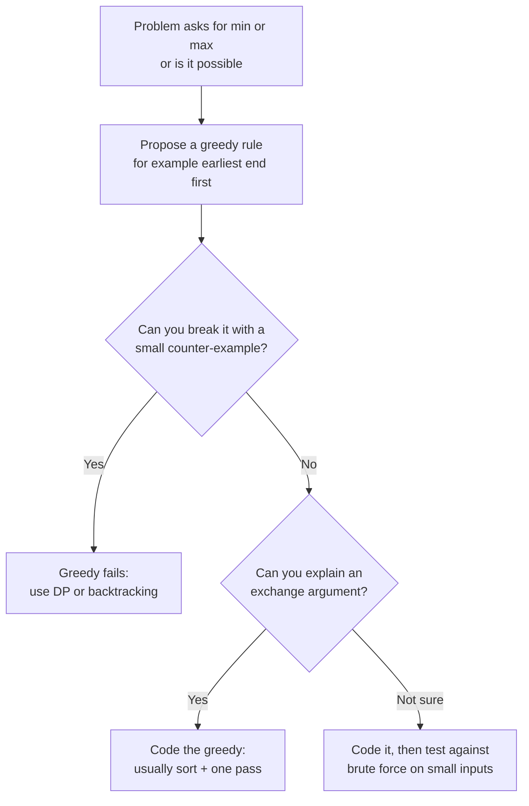
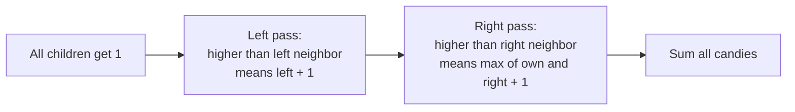

# Greedy Algorithms

> In this document you will learn the greedy pattern: make the best-looking choice now, never undo it, and still get the best overall answer. You will learn how to argue that a greedy choice is safe, how to spot when it is not, and how to solve 14 classic greedy problems in JavaScript. Interviewers like greedy problems because the code is short but the reasoning must be sharp.

**Before this:** [Problem solving and complexity (Pattern 10: Greedy)](../11-coding-interviews/02-problem-solving-and-complexity.md#pattern-10-greedy) · [Prefix sums and intervals](04-prefix-sums-and-intervals.md) · [Dynamic programming](12-dynamic-programming.md) · **Interview questions:** [jump to the interview section](#interview-questions)

## Table of contents

1. [The pattern](#the-pattern)
2. [Problems](#problems)
3. [Interview questions](#interview-questions)
4. [Summary](#summary)
5. [References](#references)

## The pattern

### What a greedy algorithm is

A **greedy algorithm** builds the answer step by step. At each step it takes the choice that looks best *right now* (the **greedy choice**). It never goes back to change an earlier choice.

**Analogy.** You climb a hill in fog. At every step you walk in the direction that goes up the most. On a simple hill, this takes you to the top. On a landscape with many hills, it can leave you on a small hill while the big mountain is somewhere else. Greedy is like that: perfect on some problems, wrong on others. Your job is to tell which kind of problem you have.

Compare greedy with the patterns around it:

| Pattern | What it does | Cost |
| --- | --- | --- |
| Brute force / backtracking | Tries every combination of choices | Exponential |
| Dynamic programming | Tries every choice, but remembers sub-answers | Usually polynomial (O(n²), O(n·W)...) |
| Greedy | Takes one choice per step and never looks back | Usually O(n) or O(n log n) for the sort |

So greedy is the fastest and simplest, *when it is correct*.

### When greedy works: the exchange argument in plain words

A greedy algorithm is correct when two things hold:

1. **Greedy choice property.** There is always some optimal answer that starts with the greedy choice.
2. **Optimal substructure.** After you make the greedy choice, what remains is a smaller problem of the same kind.

The usual way to show property 1 is the **exchange argument**:

> "Take any optimal answer. If it does not use my greedy choice, I can swap one of its choices for my greedy choice, and the answer does not get worse. So there is an optimal answer that uses my greedy choice."

**Example: maximum number of meetings in one room.** Each meeting has a start and end time. You want to attend as many meetings as possible, with no overlap. The greedy rule is: **always pick the meeting that ends first**.

Exchange argument in plain words:

- Take any optimal schedule. Look at its first meeting, call it `X`.
- Our greedy meeting `G` ends no later than `X` (because `G` ends first of all meetings).
- Replace `X` with `G`. `G` ends earlier, so it cannot overlap with the rest of the schedule.
- The schedule still has the same number of meetings, so it is still optimal, and it now starts with `G`.
- Repeat the argument on the remaining meetings.

```js
function maxMeetings(meetings) {
  const sorted = [...meetings].sort((a, b) => a[1] - b[1]); // by end time
  let count = 0;
  let lastEnd = -Infinity;
  for (const [start, end] of sorted) {
    if (start >= lastEnd) { // fits after the last chosen meeting
      count++;
      lastEnd = end;
    }
  }
  return count;
}

console.log(maxMeetings([[1, 4], [2, 3], [3, 5], [7, 8]])); // 3  ([2,3], [3,5], [7,8])
```

Note that "pick the *shortest* meeting" or "pick the meeting that *starts* first" are both wrong rules. A short meeting can sit in the middle and block two others. An early-starting meeting can be very long. Choosing the right greedy rule is the whole problem.

### When greedy fails

Greedy fails when an early "best-looking" choice blocks a better overall answer.

**Classic counter-example: coin change.** Coins `[1, 3, 4]`, amount `6`.

```js
function greedyCoins(coins, amount) {
  const sorted = [...coins].sort((a, b) => b - a); // biggest first
  let count = 0;
  for (const coin of sorted) {
    while (amount >= coin) {
      amount -= coin;
      count++;
    }
  }
  return amount === 0 ? count : -1;
}

console.log(greedyCoins([1, 3, 4], 6));       // 3  (4 + 1 + 1) ❌ not optimal
console.log(greedyCoins([1, 5, 10, 25], 63)); // 6  (25 + 25 + 10 + 1 + 1 + 1) ✅ optimal here
```

The best answer for 6 is `3 + 3` = 2 coins. Greedy took the 4 first, and nothing it did later could fix that. The exchange argument breaks: you cannot swap the 3 in the optimal answer for a 4 without making the rest worse. For US coins (1, 5, 10, 25), greedy happens to be optimal, but that is a property of those specific coins. For general coins, use DP. See [Coin change](12-dynamic-programming.md#p4-coin-change-medium).

**How to protect yourself in an interview:**

1. Before you code, try to break your greedy rule with a small example (2 to 4 items). Try ties, very long or very short items, and negative numbers.
2. If you find a counter-example, switch to DP or search.
3. If you cannot break it, explain the exchange argument out loud in two or three sentences.
4. If you have time after coding, compare against a brute force on random small inputs. (Every solution in this document was checked this way.)



### Signals that suggest greedy

| Signal | Typical greedy rule |
| --- | --- |
| Intervals: schedule, merge, cover, remove overlaps | Sort by end (or start) and sweep |
| "Minimum number of X to cover / reach Y" | Extend as far as possible each step |
| Pair small with large (boats, cookies) | Sort, then two pointers |
| A running total that must not go negative | Reset when it goes negative (Kadane, gas station) |
| "Last occurrence" of each character | Track the farthest boundary |
| Constraints from both sides (candy) | Two passes: left to right, then right to left |
| Large input (n up to 10⁵ or 10⁶) and a min/max question | O(n log n) is the target, so DP over pairs is too slow |

### The greedy template

Most greedy solutions have the same shape: **sort by the key that makes the greedy choice obvious, then make one pass and keep a small amount of state.**

```js
function greedyTemplate(items) {
  // 1. Sort by the key that makes the greedy choice come first.
  //    Always pass a comparator for numbers.
  const sorted = [...items].sort((a, b) => keyOf(a) - keyOf(b));

  // 2. Keep a small state (count, last end, farthest reach, running sum...).
  let state = INITIAL_STATE;
  let answer = 0;

  // 3. One pass: for each item, take it if it fits the greedy rule.
  for (const item of sorted) {
    if (fits(item, state)) {
      state = update(state, item);
      answer++;
    }
  }
  return answer;
}
```

### Complexity

- If you sort: **O(n log n)** time. `Array.prototype.sort` in V8 uses TimSort, which is O(n log n) and stable.
- If there is no sort (Kadane, jump game, gas station): **O(n)** time.
- Space is usually **O(1)** extra, or O(n) if you copy the array before sorting (to avoid changing the caller's input).

### Common mistakes

- **Sorting numbers without a comparator.** `[10, 9, 1].sort()` returns `[1, 10, 9]`, because the default sort compares strings. Always write `.sort((a, b) => a - b)`.
- **Choosing the wrong sort key.** For "most non-overlapping intervals", sort by **end**, not start or length.
- **Not testing a counter-example.** A greedy rule that "obviously works" is the most common wrong answer in interviews.
- **Overflow in comparators.** `a - b` is safe in JavaScript for normal numbers. In languages with 32-bit integers, `a - b` can overflow (for example with `-2³¹`), so people use `a < b ? -1 : 1`. Mention this if the interviewer asks about other languages.
- **Mutating the input.** `sort` sorts in place. Copy first with `[...arr]`, or use `toSorted()` (ES2023, Node.js 20+).

## Problems

The problems go from Easy to Hard.

### P1. Assign Cookies (Easy)

**Problem.** Each child `i` has a greed factor `greed[i]`: the smallest cookie size that makes them happy. Each cookie `j` has a size `sizes[j]`. Each child gets at most one cookie. Return the largest number of happy children. Similar to: LeetCode 455 Assign Cookies.

**Examples.**

- `greed = [1, 2, 3], sizes = [1, 1]` → `1`
- `greed = [1, 2], sizes = [1, 2, 3]` → `2`

**How to recognize the pattern.** Matching small to small: you want to give every child the *smallest* cookie that is big enough, so bigger cookies are saved for greedier children.

**Brute force.** Try every assignment of cookies to children. Exponential.

**Optimal approach.**

1. Sort both arrays ascending.
2. Walk through cookies from smallest to largest, with a pointer `child` at the least greedy unhappy child.
3. If the current cookie satisfies that child, the child is happy: move `child` forward.
4. Otherwise this cookie is too small for every remaining child, so skip it.

**Why it is safe (exchange argument).** If an optimal answer gives the least greedy child a bigger cookie, swap it for the smallest cookie that fits. The bigger cookie is now free for someone else, so the answer is not worse.

**Code.**

```js
function findContentChildren(greed, sizes) {
  const g = [...greed].sort((a, b) => a - b);
  const s = [...sizes].sort((a, b) => a - b);
  let child = 0;
  for (let cookie = 0; cookie < s.length && child < g.length; cookie++) {
    if (s[cookie] >= g[child]) child++; // this cookie makes this child happy
  }
  return child;
}

console.log(findContentChildren([1, 2, 3], [1, 1]));    // 1
console.log(findContentChildren([1, 2], [1, 2, 3]));    // 2
```

**Dry run** on `greed = [1, 2], sizes = [1, 2, 3]`:

| cookie size | child greed | happy? | child pointer after |
| --- | --- | --- | --- |
| 1 | 1 | yes | 1 |
| 2 | 2 | yes | 2 |
| 3 | — | loop ends (all children happy) | 2 |

**Complexity.** O(n log n + m log m) time for the two sorts, then O(n + m) for the pass. O(n + m) space for the copies (O(1) if you may sort in place).

**Edge cases.** No cookies or no children → 0. All cookies too small → 0.

**Follow-ups.**

- **What if each child can take several cookies until their greed is reached?** Then it becomes a bin-packing style problem, and simple greedy no longer guarantees the best answer.

**How to say it in the interview.**
> "I sort children by greed and cookies by size. I walk through the cookies from small to large and give each cookie to the least greedy child still waiting, if it is big enough. Giving the smallest cookie that fits never hurts, because bigger cookies stay available for greedier children. It is O(n log n) for the sorts and a linear pass."

### P2. Lemonade Change (Easy)

**Problem.** Lemonade costs $5. Customers come in order and pay with a $5, $10 or $20 bill. You start with no money. Return `true` if you can give every customer correct change. Similar to: LeetCode 860 Lemonade Change.

**Examples.**

- `[5, 5, 5, 10, 20]` → `true`
- `[5, 5, 10, 10, 20]` → `false`
- `[10]` → `false`

**How to recognize the pattern.** A sequence of decisions where one choice keeps more options open. For $20, you can give change as $10 + $5 or as $5 + $5 + $5. Fives are more useful (they are needed for $10 bills too), so you should spend the $10 first.

**Brute force.** At each $20, try both ways of giving change, recursively. Exponential in the number of $20 bills.

**Optimal approach.**

1. Count `fives` and `tens`. (Twenties are never given as change, so ignore them.)
2. $5: keep it.
3. $10: give one $5 back. If there is none, fail.
4. $20: prefer $10 + $5. Else use three $5. Else fail.

**Code.**

```js
function lemonadeChange(bills) {
  let fives = 0;
  let tens = 0;
  for (const bill of bills) {
    if (bill === 5) {
      fives++;
    } else if (bill === 10) {
      if (fives === 0) return false;
      fives--;
      tens++;
    } else {
      if (tens > 0 && fives > 0) {   // keep fives: they are more flexible
        tens--;
        fives--;
      } else if (fives >= 3) {
        fives -= 3;
      } else {
        return false;
      }
    }
  }
  return true;
}

console.log(lemonadeChange([5, 5, 5, 10, 20])); // true
console.log(lemonadeChange([5, 5, 10, 10, 20])); // false
```

**Dry run** on `[5, 5, 10, 10, 20]`:

| bill | action | fives | tens |
| --- | --- | --- | --- |
| 5 | keep | 1 | 0 |
| 5 | keep | 2 | 0 |
| 10 | give 5 | 1 | 1 |
| 10 | give 5 | 0 | 2 |
| 20 | need 10 + 5 or 5+5+5, have no 5 | fail | |

**Complexity.** O(n) time, one pass. O(1) space.

**Edge cases.** Empty list → `true`. First customer pays $10 or $20 → `false`.

**Follow-ups.**

- **Why is preferring $10 + $5 safe?** A $10 bill can only ever be used as change for a $20. A $5 can be used for both $10 and $20. So spending the less flexible bill first never makes a future customer fail when the other choice would have worked.

**How to say it in the interview.**
> "I only track fives and tens. For a ten I must give a five. For a twenty I prefer to give a ten and a five, because fives are more flexible — they work for both tens and twenties. Only if I have no ten do I give three fives. One pass, O(n) time, O(1) space."

### P3. Best Time to Buy and Sell Stock II (Medium)

**Problem.** `prices[i]` is a stock price on day `i`. You may buy and sell as many times as you want, but you can hold at most one share at a time. Return the maximum profit. Similar to: LeetCode 122 Best Time to Buy and Sell Stock II.

**Examples.**

- `[7, 1, 5, 3, 6, 4]` → `7` (buy 1 sell 5, buy 3 sell 6)
- `[1, 2, 3, 4, 5]` → `4`
- `[7, 6, 4, 3, 1]` → `0`

**How to recognize the pattern.** No limit on trades and no fee: every upward move can be captured. The total profit of a long trade equals the sum of the daily increases inside it.

**Brute force.** Try every buy/sell plan recursively. Exponential.

**Optimal approach.** Add every positive difference `prices[i] - prices[i - 1]`.

Why this is correct: a trade from day `a` to day `b` earns `prices[b] - prices[a]`, which equals the sum of the daily differences between `a` and `b`. Taking only the positive differences is at least as good as any plan, and it is a real plan (buy before each rise, sell after it).

**Code.**

```js
function maxProfit(prices) {
  let profit = 0;
  for (let i = 1; i < prices.length; i++) {
    if (prices[i] > prices[i - 1]) profit += prices[i] - prices[i - 1];
  }
  return profit;
}

console.log(maxProfit([7, 1, 5, 3, 6, 4])); // 7
console.log(maxProfit([1, 2, 3, 4, 5]));    // 4
```

**Dry run** on `[7, 1, 5, 3, 6, 4]`: differences are `-6, +4, -2, +3, -2`. Positive ones: `4 + 3 = 7`.

**Complexity.** O(n) time, one pass. O(1) space.

**Edge cases.** Empty or one price → 0. Prices only fall → 0. Flat prices → 0.

**Follow-ups.**

- **Only one trade allowed (LeetCode 121)?** Track the minimum price so far and the best `price - min`. See [Sliding window](03-sliding-window.md).
- **Cooldown or fee?** Greedy no longer works directly. Use the state-machine DP in [Stock with cooldown](12-dynamic-programming.md#p14-best-time-to-buy-and-sell-stock-with-cooldown-medium).

**How to say it in the interview.**
> "Any trade's profit equals the sum of the daily changes inside it. With unlimited trades and no fees, I can collect every positive daily change and skip every negative one. So I sum all positive differences between consecutive days. That is O(n) time and O(1) space."

### P4. Maximum Subarray (Medium)

**Problem.** Return the largest sum of a non-empty contiguous subarray. Similar to: LeetCode 53 Maximum Subarray.

**Examples.**

- `[-2, 1, -3, 4, -1, 2, 1, -5, 4]` → `6` (`[4, -1, 2, 1]`)
- `[1]` → `1`
- `[5, 4, -1, 7, 8]` → `23`
- `[-3, -1, -2]` → `-1` (must take at least one element)

**How to recognize the pattern.** "Best contiguous sum". A running sum that has become negative can only hurt whatever comes after it. This is **Kadane's algorithm**. You can see it as greedy ("drop a negative prefix") or as a tiny DP ("best sum ending here").

**Brute force.** Try every start and every end, keeping a running sum. O(n²).

**Optimal approach.**

1. `current` = best sum of a subarray that **ends at** the current index.
2. For each new number `x`: either extend the previous subarray (`current + x`) or start fresh at `x`. Take the larger: `current = max(x, current + x)`.
3. Track the best `current` seen.

**Code.**

```js
function maxSubArray(nums) {
  let current = nums[0];
  let best = nums[0];
  for (let i = 1; i < nums.length; i++) {
    current = Math.max(nums[i], current + nums[i]); // extend or restart
    best = Math.max(best, current);
  }
  return best;
}

console.log(maxSubArray([-2, 1, -3, 4, -1, 2, 1, -5, 4])); // 6
console.log(maxSubArray([-3, -1, -2]));                    // -1
```

**Dry run** on `[-2, 1, -3, 4, -1, 2, 1, -5, 4]`:

| x | current = max(x, current + x) | best |
| --- | --- | --- |
| -2 | -2 | -2 |
| 1 | max(1, -1) = 1 | 1 |
| -3 | max(-3, -2) = -2 | 1 |
| 4 | max(4, 2) = 4 | 4 |
| -1 | 3 | 4 |
| 2 | 5 | 5 |
| 1 | 6 | 6 |
| -5 | 1 | 6 |
| 4 | 5 | 6 |

**Complexity.** O(n) time, one pass. O(1) space.

**Edge cases.** All negative → the largest single element (that is why we start from `nums[0]`, not 0). One element → itself.

```js
// ❌ Wrong: starting at 0 returns 0 for an all-negative array
let best = 0;
// ✅ Correct: start from the first element
let bestFixed = nums[0];
```

**Follow-ups.**

- **Return the start and end indexes.** Remember where the current run started, and save it when `best` improves.

  ```js
  function maxSubArrayWithRange(nums) {
    let current = nums[0];
    let currentStart = 0;
    let best = nums[0];
    let bestStart = 0;
    let bestEnd = 0;
    for (let i = 1; i < nums.length; i++) {
      if (current < 0) {        // a negative prefix only hurts: restart here
        current = nums[i];
        currentStart = i;
      } else {
        current += nums[i];
      }
      if (current > best) {
        best = current;
        bestStart = currentStart;
        bestEnd = i;
      }
    }
    return { sum: best, start: bestStart, end: bestEnd };
  }
  console.log(maxSubArrayWithRange([-2, 1, -3, 4, -1, 2, 1, -5, 4])); // { sum: 6, start: 3, end: 6 }
  ```

- **Circular array (LeetCode 918).** The answer is either the normal Kadane result, or `total - (minimum subarray sum)`. If all numbers are negative, return the normal result.
- **Divide and conquer version?** It exists in O(n log n), but Kadane is simpler and faster.

**How to say it in the interview.**
> "I walk through the array and keep the best sum of a subarray that ends at the current position. For each number, I either extend the previous subarray or start fresh at this number, whichever is bigger. Starting fresh means the previous running sum was negative, and a negative prefix can only make things worse. I track the maximum seen. O(n) time, O(1) space, and it handles all-negative arrays because I start from the first element."

### P5. Jump Game (Medium)

**Problem.** You start at index 0. `nums[i]` is the maximum jump length from index `i`. Return `true` if you can reach the last index. Similar to: LeetCode 55 Jump Game.

**Examples.**

- `[2, 3, 1, 1, 4]` → `true`
- `[3, 2, 1, 0, 4]` → `false` (every path lands on the 0 at index 3)
- `[0]` → `true` (already at the end)

**How to recognize the pattern.** "Can you reach" and each position gives a range. You do not need to know the exact path, only the **farthest index reachable so far**.

**Brute force.** DFS or DP: `canReach[i]` is true if some `j` within reach of `i` is good. O(n²).

**Optimal approach.**

1. Keep `farthest` = the farthest index reachable using positions seen so far.
2. Walk `i` from left to right. If `i > farthest`, index `i` cannot be reached, so return `false`.
3. Otherwise update `farthest = max(farthest, i + nums[i])`.
4. If the loop ends, the last index was reachable.

**Code.**

```js
function canJump(nums) {
  let farthest = 0;
  for (let i = 0; i < nums.length; i++) {
    if (i > farthest) return false;        // a gap we can never cross
    farthest = Math.max(farthest, i + nums[i]);
  }
  return true;
}

console.log(canJump([2, 3, 1, 1, 4])); // true
console.log(canJump([3, 2, 1, 0, 4])); // false
```

**Dry run** on `[3, 2, 1, 0, 4]`:

| i | nums[i] | farthest before | farthest after |
| --- | --- | --- | --- |
| 0 | 3 | 0 | 3 |
| 1 | 2 | 3 | 3 |
| 2 | 1 | 3 | 3 |
| 3 | 0 | 3 | 3 |
| 4 | — | 3 | 4 > 3 → `false` |

**Complexity.** O(n) time, one pass. O(1) space.

**Edge cases.** One element → `true`. `[0, 1]` → `false`. Large first jump → `true` quickly (you can add `if (farthest >= n - 1) return true` to stop early).

**Follow-ups.**

- **Minimum number of jumps?** See P6.
- **Why does "farthest" capture everything?** Every index up to `farthest` is reachable, because you can always jump *shorter* than the maximum. So reachable positions always form a prefix `[0, farthest]`.

**How to say it in the interview.**
> "Because you can always jump shorter than the max, the reachable positions are always a prefix of the array. So I only track the farthest reachable index. I scan left to right. If the current index is beyond the farthest, I am stuck and return false. Otherwise I extend the farthest with i plus nums of i. O(n) time, O(1) space."

### P6. Jump Game II (Medium)

**Problem.** Same jumps as P5. The last index is always reachable. Return the **minimum number of jumps** to reach it. Similar to: LeetCode 45 Jump Game II.

**Examples.**

- `[2, 3, 1, 1, 4]` → `2` (0 → 1 → 4)
- `[2, 3, 0, 1, 4]` → `2`
- `[0]` → `0`

**How to recognize the pattern.** "Minimum number of steps" over ranges is BFS, where each "level" is the range of indexes reachable with `k` jumps. Because these ranges are contiguous, you can do the BFS with two numbers instead of a queue.

**Brute force.** DP: `minJumps[j] = min(minJumps[i] + 1)` for each `i` that can reach `j`. O(n²).

**Optimal approach.**

1. `currentEnd` = the last index reachable with the current number of jumps.
2. `farthest` = the farthest index reachable with one more jump.
3. Walk `i` from 0 to `n - 2` and update `farthest`.
4. When `i` reaches `currentEnd`, the current level is finished. You must jump: `jumps++`, `currentEnd = farthest`.

**Code.**

```js
function jump(nums) {
  let jumps = 0;
  let currentEnd = 0;
  let farthest = 0;
  for (let i = 0; i < nums.length - 1; i++) { // stop before the last index
    farthest = Math.max(farthest, i + nums[i]);
    if (i === currentEnd) {                    // end of this BFS level
      jumps++;
      currentEnd = farthest;
    }
  }
  return jumps;
}

console.log(jump([2, 3, 1, 1, 4])); // 2
console.log(jump([0]));             // 0
```

**Dry run** on `[2, 3, 1, 1, 4]`:

| i | farthest | i === currentEnd? | jumps | currentEnd |
| --- | --- | --- | --- | --- |
| 0 | 2 | yes | 1 | 2 |
| 1 | 4 | no | 1 | 2 |
| 2 | 4 | yes | 2 | 4 |
| 3 | 4 | no | 2 | 4 |

The loop stops before index 4. Answer 2.

**Complexity.** O(n) time, one pass. O(1) space.

**Edge cases.** One element → 0 (the loop does not run). Why stop at `n - 2`? If you also processed the last index, you might count one extra jump when `currentEnd` lands exactly on it.

**Follow-ups.**

- **What if the end may be unreachable?** Inside the loop, if `i === currentEnd` and `farthest === currentEnd`, you cannot move forward: return `-1`.
- **Return the path.** Remember which index gave the new `farthest` at each level.

**How to say it in the interview.**
> "This is a BFS where each level is a contiguous range of indexes reachable with the same number of jumps. I keep the end of the current level and the farthest index I can reach from it. When my scan reaches the end of the current level, I must take another jump, so I increase the count and move the level end to farthest. One pass, O(n) time, O(1) space."

### P7. Gas Station (Medium)

**Problem.** Gas stations are in a circle. At station `i` you can fill `gas[i]` units, and driving to station `i + 1` costs `cost[i]` units. Your tank starts empty. Return the start index from which you can drive the full circle, or `-1`. If an answer exists, it is unique. Similar to: LeetCode 134 Gas Station.

**Examples.**

- `gas = [1, 2, 3, 4, 5], cost = [3, 4, 5, 1, 2]` → `3`
- `gas = [2, 3, 4], cost = [3, 4, 3]` → `-1`

**How to recognize the pattern.** A running total that must never go negative. When it goes negative, every start inside the failed stretch is also bad, so jump past it.

**Brute force.** Try each start and simulate the full circle. O(n²).

**Optimal approach.**

1. If `sum(gas) < sum(cost)`, no start works: return `-1`.
2. Otherwise scan once with a `tank` value starting at 0 and candidate `start = 0`.
3. Add `gas[i] - cost[i]` to `tank`. If `tank < 0`, you cannot reach `i + 1` from `start`. Set `start = i + 1` and `tank = 0`.
4. Return `start`.

**Why skipping is safe.** Say you start at `s` and fail at `i`. Any station `k` between `s` and `i` was reached with tank `>= 0`. Starting at `k` with an empty tank is never better than arriving there with a non-negative tank. So every `k` in `s..i` also fails before `i + 1`.

**Why the total check is enough.** If the total gain is non-negative, the start found by the scan can cover the stations after it, and the surplus carried around covers the deficit of the stations before it.

**Code.**

```js
function canCompleteCircuit(gas, cost) {
  let total = 0;
  let tank = 0;
  let start = 0;
  for (let i = 0; i < gas.length; i++) {
    const gain = gas[i] - cost[i];
    total += gain;
    tank += gain;
    if (tank < 0) {   // cannot reach i + 1 from start: every start up to i fails
      start = i + 1;
      tank = 0;
    }
  }
  return total >= 0 ? start : -1;
}

console.log(canCompleteCircuit([1, 2, 3, 4, 5], [3, 4, 5, 1, 2])); // 3
console.log(canCompleteCircuit([2, 3, 4], [3, 4, 3]));             // -1
```

**Dry run** on the first example (gains `-2, -2, -2, 3, 3`):

| i | gain | tank | start |
| --- | --- | --- | --- |
| 0 | -2 | -2 → reset 0 | 1 |
| 1 | -2 | -2 → reset 0 | 2 |
| 2 | -2 | -2 → reset 0 | 3 |
| 3 | 3 | 3 | 3 |
| 4 | 3 | 6 | 3 |

Total = 0 ≥ 0 → answer 3.

**Complexity.** O(n) time, one pass. O(1) space.

**Edge cases.** One station → `0` if `gas[0] >= cost[0]`, else `-1`. All gains zero → start 0.

**Follow-ups.**

- **What if several starts were possible?** This scan returns the one found after the last reset. With the "unique answer" guarantee, it does not matter.

**How to say it in the interview.**
> "First, if total gas is less than total cost, there is no answer. Otherwise I scan once with a running tank. If the tank goes negative at station i, then no station from my current start up to i can be a valid start, because each of them would arrive at i with even less gas. So I move the start to i plus 1 and reset the tank. The total check guarantees that the final start works. O(n) time, O(1) space."

### P8. Hand of Straights (Medium)

**Problem.** You have cards with numbers `hand`. Return `true` if you can split all cards into groups of size `groupSize`, where each group is `groupSize` consecutive numbers (like 4, 5, 6). Similar to: LeetCode 846 Hand of Straights (same as LeetCode 1296).

**Examples.**

- `hand = [1, 2, 3, 6, 2, 3, 4, 7, 8], groupSize = 3` → `true` (`[1,2,3]`, `[2,3,4]`, `[6,7,8]`)
- `hand = [1, 2, 3, 4, 5], groupSize = 4` → `false` (5 cards do not split into groups of 4)

**How to recognize the pattern.** The **smallest** card left must start a group, because no smaller card exists to come before it. That fixed choice is the greedy step.

**Brute force.** Backtracking: try every possible group for each card. Exponential.

**Optimal approach.**

1. If `hand.length % groupSize !== 0`, return `false`.
2. Count each card in a `Map`.
3. Visit distinct card values in ascending order. For the value `start` with count `need > 0`, you must start `need` groups at `start`.
4. For each value `start, start + 1, ..., start + groupSize - 1`, subtract `need`. If any count is too small, return `false`.

**Code.**

```js
function isNStraightHand(hand, groupSize) {
  if (hand.length % groupSize !== 0) return false;
  const count = new Map();
  for (const card of hand) count.set(card, (count.get(card) ?? 0) + 1);

  const values = [...count.keys()].sort((a, b) => a - b);
  for (const start of values) {
    const need = count.get(start); // groups that must start here
    if (need === 0) continue;
    for (let card = start; card < start + groupSize; card++) {
      const have = count.get(card) ?? 0;
      if (have < need) return false;
      count.set(card, have - need);
    }
  }
  return true;
}

console.log(isNStraightHand([1, 2, 3, 6, 2, 3, 4, 7, 8], 3)); // true
console.log(isNStraightHand([1, 2, 3, 4, 5], 4));             // false
```

**Dry run** on the first example. Counts: `1:1, 2:2, 3:2, 4:1, 6:1, 7:1, 8:1`.

| start | need | after subtracting from start..start+2 |
| --- | --- | --- |
| 1 | 1 | 1:0, 2:1, 3:1 |
| 2 | 1 | 2:0, 3:0, 4:0 |
| 3 | 0 | skip |
| 4 | 0 | skip |
| 6 | 1 | 6:0, 7:0, 8:0 |

All groups formed → `true`.

**Complexity.** O(n log n) time: counting is O(n), sorting the distinct values is O(k log k), and the subtraction loop is O(k · groupSize) but each card count is reduced to zero only once in total. O(n) space for the map.

**Edge cases.** `groupSize = 1` → always `true`. Duplicates are handled by subtracting `need` at once. Missing middle value (like `[1, 3]` with size 2) → `false`.

**Follow-ups.**

- **Why process `need` groups at once instead of one at a time?** It avoids looping once per card. Both are correct, but the batch version is faster when there are many duplicates.
- **What if values are huge or the stream is online?** Use a sorted structure (a min-heap of values) and process the smallest each time.

**How to say it in the interview.**
> "The smallest card left can only be the first card of a group, because nothing smaller exists. So I count the cards, sort the distinct values, and for each value with a remaining count, I start that many groups there and subtract the same amount from the next groupSize minus 1 values. If any value runs out, it is impossible. O(n log n) for the sort, O(n) space for the counts."

### P9. Merge Triplets to Form Target Triplet (Medium)

**Problem.** You have triplets `[a, b, c]`. A merge of two triplets takes the maximum in each position: `[max(a1, a2), max(b1, b2), max(c1, c2)]`. You can merge any of them any number of times. Return `true` if you can produce exactly `target`. Similar to: LeetCode 1899 Merge Triplets to Form Target Triplet.

**Examples.**

- `triplets = [[2, 5, 3], [1, 8, 4], [1, 7, 5]], target = [2, 7, 5]` → `true` (merge the first and third)
- `triplets = [[3, 4, 5], [4, 5, 6]], target = [3, 2, 5]` → `false`

**How to recognize the pattern.** Merging with `max` can only make values bigger. So any triplet with a value **above** the target in any position is poison: using it ruins that position forever. Every other triplet is safe to merge.

**Brute force.** Try every subset of triplets and merge it. O(2ⁿ).

**Optimal approach.**

1. Ignore every triplet where some position is larger than the target's position.
2. Merge all the remaining "safe" triplets. Merging more safe triplets never hurts, because each value stays `<=` the target.
3. You need each of the three target values to appear in at least one safe triplet. Track three booleans.

**Code.**

```js
function mergeTriplets(triplets, target) {
  const found = [false, false, false];
  for (const t of triplets) {
    if (t[0] > target[0] || t[1] > target[1] || t[2] > target[2]) continue; // poison
    for (let i = 0; i < 3; i++) {
      if (t[i] === target[i]) found[i] = true;
    }
  }
  return found[0] && found[1] && found[2];
}

console.log(mergeTriplets([[2, 5, 3], [1, 8, 4], [1, 7, 5]], [2, 7, 5])); // true
console.log(mergeTriplets([[3, 4, 5], [4, 5, 6]], [3, 2, 5]));            // false
```

**Dry run** on the first example:

- `[2, 5, 3]`: safe. Position 0 equals 2 → `found[0] = true`.
- `[1, 8, 4]`: 8 > 7 → poison, skip.
- `[1, 7, 5]`: safe. Position 1 equals 7, position 2 equals 5 → `found[1] = found[2] = true`.
- All found → `true`.

**Complexity.** O(n) time, one pass. O(1) space.

**Edge cases.** A single triplet equal to the target → `true`. No safe triplet → `false`.

**Follow-ups.**

- **What if triplets had k positions?** Same idea with a `found` array of length k: O(n · k).

**How to say it in the interview.**
> "Merging takes the max, so values can only grow. Any triplet with a value bigger than the target in some position can never be used. All other triplets are safe, and merging all of them keeps every position at or below the target. So I only need to check that, among the safe triplets, each target value appears in its position at least once. One pass, O(n) time, O(1) space."

### P10. Partition Labels (Medium)

**Problem.** Split string `s` into as many parts as possible so that each letter appears in at most one part. Return the sizes of the parts. Similar to: LeetCode 763 Partition Labels.

**Examples.**

- `"ababcbacadefegdehijhklij"` → `[9, 7, 8]` (`"ababcbaca"`, `"defegde"`, `"hijhklij"`)
- `"eccbbbbdec"` → `[10]`
- `"abc"` → `[1, 1, 1]`

**How to recognize the pattern.** Each letter's first and last positions form an interval. A part must cover the full interval of every letter in it. This is interval merging in disguise, solved with the **last occurrence** of each character.

**Brute force.** For each possible cut point, check whether any letter appears on both sides. O(n²) or worse.

**Optimal approach.**

1. Record the last index of each character.
2. Scan with `start` (beginning of the current part) and `end` (the farthest last-index of any letter seen in this part).
3. For each `i`, update `end = max(end, last[s[i]])`.
4. When `i === end`, every letter in `s[start..i]` ends here. Close the part: push `end - start + 1`, then `start = i + 1`.

Cutting as early as possible is safe: it gives the most parts, and the remaining string is a smaller version of the same problem.

**Code.**

```js
function partitionLabels(s) {
  const last = new Map();
  for (let i = 0; i < s.length; i++) last.set(s[i], i);

  const sizes = [];
  let start = 0;
  let end = 0;
  for (let i = 0; i < s.length; i++) {
    end = Math.max(end, last.get(s[i]));
    if (i === end) {               // nothing in this part appears later
      sizes.push(end - start + 1);
      start = i + 1;
    }
  }
  return sizes;
}

console.log(partitionLabels('ababcbacadefegdehijhklij')); // [ 9, 7, 8 ]
console.log(partitionLabels('eccbbbbdec'));               // [ 10 ]
```

**Dry run** on the short string `"abacd"`. Last indexes: `a:2, b:1, c:3, d:4`.

| i | char | end | i === end? | sizes |
| --- | --- | --- | --- | --- |
| 0 | a | 2 | no | [] |
| 1 | b | 2 | no | [] |
| 2 | a | 2 | yes | [3] |
| 3 | c | 3 | yes | [3, 1] |
| 4 | d | 4 | yes | [3, 1, 1] |

**Complexity.** O(n) time, two passes. O(1) extra space if the alphabet is fixed (at most 26 keys in the map), otherwise O(alphabet).

**Edge cases.** Empty string → `[]`. One repeated letter → `[n]`. All distinct letters → all ones.

**Follow-ups.**

- **Return the parts instead of sizes?** Push `s.slice(start, i + 1)` instead.
- **How is this related to merge intervals?** Each letter is an interval `[first, last]`. Merging overlapping intervals gives exactly these parts. See [Merge intervals](04-prefix-sums-and-intervals.md).

**How to say it in the interview.**
> "A part has to contain every occurrence of each letter in it. So I first store the last index of each letter. Then I scan and keep the farthest last index of the letters in the current part. When my index reaches that farthest point, nothing in the part appears later, so I cut there. Cutting as early as possible gives the maximum number of parts. O(n) time and constant extra space for a fixed alphabet."

### P11. Valid Parenthesis String (Medium)

**Problem.** A string has `'('`, `')'` and `'*'`. Each `'*'` can be `'('`, `')'` or an empty string. Return `true` if some choice makes the string a valid parentheses string. Similar to: LeetCode 678 Valid Parenthesis String.

**Examples.**

- `"()"` → `true`
- `"(*)"` → `true`
- `"(*))"` → `true` (`*` becomes `(`)
- `")("` → `false`
- `"(((*)"` → `false`

**How to recognize the pattern.** Without `*`, you would track one number: the count of open brackets. With `*`, that count becomes a **range** of possible values. You only need the smallest and largest possible counts.

**Brute force.** Try all 3^k choices for k stars. Exponential. A DP over (index, open count) is O(n²).

**Optimal approach.**

1. Keep `low` = the smallest possible number of open brackets, and `high` = the largest.
2. `'('`: both go up by 1.
3. `')'`: both go down by 1.
4. `'*'`: `low` goes down (treat as `')'`), `high` goes up (treat as `'('`).
5. If `high < 0`, even the most generous choice has too many `')'`: return `false`.
6. If `low < 0`, clamp it to 0. A negative count is not a valid state, so we just ignore choices that would make it negative.
7. At the end, the string is valid if `low === 0` (zero open brackets is possible).

**Code.**

```js
function checkValidString(s) {
  let low = 0;
  let high = 0;
  for (const ch of s) {
    if (ch === '(') {
      low++;
      high++;
    } else if (ch === ')') {
      low--;
      high--;
    } else {          // '*'
      low--;          // as ')'
      high++;         // as '('
    }
    if (high < 0) return false; // too many ')' whatever the stars are
    if (low < 0) low = 0;       // drop impossible negative states
  }
  return low === 0;
}

console.log(checkValidString('(*))'));  // true
console.log(checkValidString(')('));    // false
console.log(checkValidString('(((*)')); // false
```

**Dry run** on `"(*))"`:

| ch | low | high |
| --- | --- | --- |
| ( | 1 | 1 |
| * | 0 | 2 |
| ) | 0 (from -1, clamped) | 1 |
| ) | 0 (from -1, clamped) | 0 |

End: `low === 0` → `true`.

**Complexity.** O(n) time, one pass. O(1) space.

**Edge cases.** Empty string → `true`. Only stars → `true`. `"*("` → `false` (`low` ends at 1).

**Follow-ups.**

- **Why is clamping `low` correct?** The set of reachable open counts is always a contiguous range. Clamping removes only the impossible negative values. Every value from `low` to `high` is still reachable by some choice of stars.
- **Two-stack alternative.** Keep a stack of `'('` indexes and a stack of `'*'` indexes. Match each `')'` with an `'('` first, then a `'*'`. At the end, match leftover `'('` with later `'*'`. Also O(n) time but O(n) space.

**How to say it in the interview.**
> "Without stars, I would track the number of open brackets. With stars, the open count can be a range of values, so I track the smallest and largest possible counts. A star lowers the low and raises the high. If high goes negative, there are too many closing brackets no matter what, so I return false. If low goes negative, I clamp it to zero, since negative counts are not valid. At the end, the string is valid if zero is possible, which means low is zero. O(n) time, O(1) space."

### P12. Minimum Number of Arrows to Burst Balloons (Medium)

**Problem.** Balloons are horizontal intervals `[start, end]` on a number line. An arrow shot straight up at `x` bursts every balloon with `start <= x <= end`. Return the minimum number of arrows to burst all balloons. Similar to: LeetCode 452 Minimum Number of Arrows to Burst Balloons.

**Examples.**

- `[[10, 16], [2, 8], [1, 6], [7, 12]]` → `2` (arrows at 6 and 12)
- `[[1, 2], [3, 4], [5, 6], [7, 8]]` → `4`
- `[[1, 2], [2, 3], [3, 4], [4, 5]]` → `2` (touching ends count as overlap: arrows at 2 and 4)

**How to recognize the pattern.** Cover intervals with the fewest points. This is the "interval scheduling" family: **sort by end**.

**Brute force.** Try sets of candidate points (all end values) of increasing size. Exponential.

**Optimal approach.**

1. Sort balloons by `end`.
2. Shoot the first arrow at the end of the first balloon. This is as far right as possible while still hitting it, so it hits the most other balloons too.
3. For each next balloon: if `start > arrowAt`, the current arrow misses it. Shoot a new arrow at its `end`.

**Why it is safe (exchange argument).** Any solution needs an arrow inside the balloon that ends first. Moving that arrow right to that balloon's end keeps it inside that balloon. Every other balloon it hit starts before that point and ends at or after it (because we sorted by end), so it still gets hit.

**Code.**

```js
function findMinArrowShots(points) {
  if (points.length === 0) return 0;
  const sorted = [...points].sort((a, b) => a[1] - b[1]); // by end
  let arrows = 1;
  let arrowAt = sorted[0][1];
  for (const [start, end] of sorted) {
    if (start > arrowAt) {   // this balloon is not hit by the current arrow
      arrows++;
      arrowAt = end;
    }
  }
  return arrows;
}

console.log(findMinArrowShots([[10, 16], [2, 8], [1, 6], [7, 12]])); // 2
console.log(findMinArrowShots([[1, 2], [2, 3], [3, 4], [4, 5]]));    // 2
```

**Dry run** on the first example. Sorted by end: `[1,6], [2,8], [7,12], [10,16]`.

| balloon | arrowAt before | hit? | arrows | arrowAt after |
| --- | --- | --- | --- | --- |
| [1, 6] | 6 | yes (first) | 1 | 6 |
| [2, 8] | 6 | yes (2 ≤ 6) | 1 | 6 |
| [7, 12] | 6 | no (7 > 6) | 2 | 12 |
| [10, 16] | 12 | yes | 2 | 12 |

**Complexity.** O(n log n) time for the sort. O(n) space for the sorted copy.

**Edge cases.** Empty list → 0. Touching intervals share an arrow because the check is `start > arrowAt`, not `>=`. Very large or small coordinates like `-2³¹` are fine with `a[1] - b[1]` in JavaScript (no 32-bit overflow).

**Follow-ups.**

- **How is this different from Non-overlapping Intervals (LeetCode 435)?** It is the same sort-by-end sweep. There, the answer is `n - (number of arrows)` when touching ends do *not* overlap. See [Prefix sums and intervals](04-prefix-sums-and-intervals.md).
- **Why not sort by start?** Sorting by start also works if you shrink `arrowAt = min(arrowAt, end)` as you go. Sorting by end is simpler to prove.

**How to say it in the interview.**
> "I sort the balloons by their end. The first arrow goes at the end of the balloon that ends first, because that is the rightmost point that still hits it, so it hits as many others as possible. Then I sweep: if a balloon starts after the current arrow, I need a new arrow at its end. The sort is O(n log n) and the sweep is linear."

### P13. Boats to Save People (Medium)

**Problem.** `people[i]` is a person's weight. Each boat carries at most two people with total weight `<= limit`. Every person weighs at most `limit`. Return the minimum number of boats. Similar to: LeetCode 881 Boats to Save People.

**Examples.**

- `people = [1, 2], limit = 3` → `1`
- `people = [3, 2, 2, 1], limit = 3` → `3` (`[1, 2]`, `[2]`, `[3]`)
- `people = [3, 5, 3, 4], limit = 5` → `4`

**How to recognize the pattern.** Pairing the heaviest with the lightest. Sort, then **two pointers** (see [Two pointers](02-two-pointers.md)).

**Brute force.** Try all pairings. Exponential (or a bitmask DP for small n).

**Optimal approach.**

1. Sort weights ascending.
2. `light` points at the lightest person, `heavy` at the heaviest.
3. The heaviest person always takes a boat now. If the lightest person fits with them, they go together (`light++`).
4. `heavy--`, `boats++`. Repeat while `light <= heavy`.

**Why it is safe.** The heaviest person must ride with someone or alone. If anyone can ride with them, the lightest person can. Pairing the lightest with the heaviest never blocks a better pairing, because any other partner would be heavier and leave a harder problem.

**Code.**

```js
function numRescueBoats(people, limit) {
  const sorted = [...people].sort((a, b) => a - b);
  let light = 0;
  let heavy = sorted.length - 1;
  let boats = 0;
  while (light <= heavy) {
    if (sorted[light] + sorted[heavy] <= limit) light++; // lightest joins
    heavy--;                                             // heaviest always goes
    boats++;
  }
  return boats;
}

console.log(numRescueBoats([3, 2, 2, 1], 3)); // 3
console.log(numRescueBoats([3, 5, 3, 4], 5)); // 4
```

**Dry run** on `[3, 2, 2, 1]`, limit 3. Sorted: `[1, 2, 2, 3]`.

| light | heavy | pair sum | together? | boats |
| --- | --- | --- | --- | --- |
| 0 (1) | 3 (3) | 4 | no | 1 |
| 0 (1) | 2 (2) | 3 | yes | 2 |
| 1 (2) | 1 (2) | same person | alone | 3 |

When `light === heavy`, only one person is left. The check adds that person's weight twice, which looks odd, but it is harmless: whatever the check says, `heavy--` runs, the loop ends, and exactly one boat is added for that person.

**Complexity.** O(n log n) for the sort, then O(n). O(n) space for the sorted copy.

**Edge cases.** One person → 1. Everyone weighs exactly `limit` → n boats. Everyone light enough to pair → `ceil(n / 2)`.

**Follow-ups.**

- **Boats with capacity for more than two people?** Then it is a bin-packing problem, which is NP-hard. Greedy heuristics (first-fit decreasing) are good but not always optimal.
- **Weights are small integers?** Use counting sort to make it O(n + limit).

**How to say it in the interview.**
> "I sort the weights and use two pointers. The heaviest person always needs a boat now. If the lightest person fits with them, they share it. Otherwise the heaviest goes alone. If anyone can pair with the heaviest, the lightest can, so this never wastes a better pairing. O(n log n) for the sort and a linear sweep."

### P14. Candy (Hard)

**Problem.** Children stand in a row with `ratings`. Give each child at least one candy. A child with a higher rating than a neighbor must get more candies than that neighbor. Return the minimum total candies. Similar to: LeetCode 135 Candy.

**Examples.**

- `[1, 0, 2]` → `5` (candies `[2, 1, 2]`)
- `[1, 2, 2]` → `4` (candies `[1, 2, 1]` — equal neighbors have no rule)
- `[1, 3, 4, 5, 2]` → `11` (candies `[1, 2, 3, 4, 1]`)

**How to recognize the pattern.** Each child has constraints from the **left** neighbor and the **right** neighbor. Handle each side in its own pass, then combine with `max`.

**Brute force.** Start everyone at 1 and keep fixing violations until nothing changes. Correct, but can take O(n²) rounds of fixes.

**Optimal approach.**

1. Give everyone 1 candy.
2. **Left to right:** if `ratings[i] > ratings[i - 1]`, set `candies[i] = candies[i - 1] + 1`. Now every left-neighbor rule holds.
3. **Right to left:** if `ratings[i] > ratings[i + 1]`, set `candies[i] = max(candies[i], candies[i + 1] + 1)`. The `max` keeps the left rule satisfied while fixing the right rule.
4. Sum the array.

Each pass gives each child the **smallest** count that satisfies that side. Taking the max of the two smallest values is the smallest count that satisfies both sides.

**Code.**

```js
function candy(ratings) {
  const n = ratings.length;
  const candies = new Array(n).fill(1);
  for (let i = 1; i < n; i++) {            // left neighbor rule
    if (ratings[i] > ratings[i - 1]) candies[i] = candies[i - 1] + 1;
  }
  for (let i = n - 2; i >= 0; i--) {       // right neighbor rule
    if (ratings[i] > ratings[i + 1]) candies[i] = Math.max(candies[i], candies[i + 1] + 1);
  }
  return candies.reduce((sum, c) => sum + c, 0);
}

console.log(candy([1, 0, 2]));       // 5
console.log(candy([1, 2, 2]));       // 4
console.log(candy([1, 3, 4, 5, 2])); // 11
```

**Dry run** on `[1, 3, 4, 5, 2]`:

| step | candies |
| --- | --- |
| start | [1, 1, 1, 1, 1] |
| after left pass | [1, 2, 3, 4, 1] |
| right pass i = 3 (5 > 2) | max(4, 1 + 1) = 4 → [1, 2, 3, 4, 1] |
| i = 2, 1, 0 | no change (each is smaller than its right neighbor) |

Sum = 11.

Without the `max` in the right pass, child 3 would drop from 4 to 2 and break the rule with child 2 (rating 5 > 4 needs more than 3 candies).



**Complexity.** O(n) time, two passes. O(n) space for the `candies` array. (There is an O(1)-space version that counts the lengths of rising and falling runs, but it is much harder to explain.)

**Edge cases.** Empty → 0. One child → 1. All equal → n. Strictly decreasing → `n (n + 1) / 2`.

**Follow-ups.**

- **Children sit in a circle?** The first and last are neighbors. The two-pass trick no longer works directly. Start the passes from a position with a local minimum rating, which breaks the circle into a line.
- **Why is this greedy?** Each pass makes the locally smallest valid choice and never reduces a value. The combined result is minimal for every child, so the sum is minimal.

**How to say it in the interview.**
> "Each child has a rule with the left neighbor and with the right neighbor. I handle them separately. First everyone gets one. In a left-to-right pass, if a child's rating is higher than the left neighbor, they get the left neighbor's count plus one. In a right-to-left pass, if the rating is higher than the right neighbor, they get the max of their current count and the right neighbor's count plus one. The max keeps the first rule true. Two passes, O(n) time and O(n) space."

## Interview questions

### Q1. What is a greedy algorithm, and how do you know it is correct?

**What the interviewer is checking:** that you can define greedy and justify it, not just say "it worked on the examples".

**Short spoken answer (30–60 seconds):**
> "A greedy algorithm builds the answer one step at a time, always taking the choice that looks best right now, and never undoing it. It is correct when there is always an optimal answer that starts with the greedy choice, and the rest is a smaller version of the same problem. I usually show that with an exchange argument: take any optimal answer, swap its first choice for my greedy choice, and show it does not get worse. Before I trust it, I also try to break it with a small counter-example."

**Detailed explanation:** The two formal properties are the **greedy choice property** and **optimal substructure**. The exchange argument proves the first. Optimal substructure is usually obvious once you see the remaining problem (for example, "the remaining meetings that start after the chosen one ends").

**Follow-up questions:**
- **Give an example where greedy fails.** — Coin change with coins 1, 3 and 4 and amount 6. Greedy takes 4 + 1 + 1 (3 coins), but 3 + 3 is 2 coins.
- **Give an example where a natural greedy rule fails but a different one works.** — Interval scheduling. "Pick the shortest meeting" fails (a short meeting can block two others). "Pick the earliest ending meeting" works.

**Common mistakes:** "Greedy works if it passes the sample tests"; not knowing any counter-example; confusing greedy with DP.

**Where this is used in real projects:** scheduling jobs on a machine, Huffman coding in compression (gzip/DEFLATE), Dijkstra's shortest path, Kruskal's and Prim's minimum spanning trees, rate-limit token allocation.

### Q2. Greedy or dynamic programming — how do you decide?

**What the interviewer is checking:** that you compare by correctness first and cost second.

**Short spoken answer (30–60 seconds):**
> "I first ask whether one local choice can be proven safe. If I can explain an exchange argument and I cannot break it with small cases, I use greedy because it is simpler and usually O(n) or O(n log n). If a choice now can block a better choice later, like in coin change or 0/1 knapsack, I need DP to compare all options. A good sign for DP is that the problem has weights or values that interact, like 'capacity' or 'cost'. If I am unsure, I write the DP, because it is always correct, and mention greedy as an optimization."

**Detailed explanation:** Some problems have both solutions. Jump Game has an O(n²) DP and an O(n) greedy. Fractional knapsack (you can take parts of items) is greedy by value per weight. 0/1 knapsack (whole items only) needs DP. That pair is a good example to mention.

**Follow-up questions:**
- **Why does fractional knapsack work greedily but 0/1 does not?** — In the fractional version, you can always fill leftover capacity with part of the next-best item, so taking the best ratio first never wastes space. In 0/1, a high-ratio item can leave a gap that nothing fits into.

**Common mistakes:** picking greedy because it is faster without checking correctness.

**Where this is used in real projects:** choosing between a quick heuristic (greedy) and an exact optimizer (DP or a solver) in planning features such as delivery batching or ad budget allocation.

### Q3. Why do so many greedy interval problems sort by end time?

**What the interviewer is checking:** understanding of the most common greedy family.

**Short spoken answer (30–60 seconds):**
> "Ending early leaves the most room for everything after. If I pick the interval that ends first, then any optimal solution's first interval can be swapped for mine without causing a conflict, because mine ends no later. That works for 'maximum non-overlapping intervals', 'minimum arrows to burst balloons' and 'minimum intervals to remove'. Sorting by start is better for merging intervals, because I want to process them in the order they open."

**Follow-up questions:**
- **When does sorting by start work for these problems?** — For "minimum arrows" it works if you shrink the current arrow position to `min(arrowAt, end)` as you go. It is correct but the proof is less direct.
- **What about minimum meeting rooms?** — That needs a different idea: sort starts and ends separately, or use a min-heap of end times. See [Heaps and top-k](09-heaps-and-top-k.md).

**Common mistakes:** sorting by length; forgetting the comparator (`(a, b) => a[1] - b[1]`).

**Where this is used in real projects:** calendar features (fitting the most bookings in a room), ad slot scheduling, picking non-conflicting maintenance windows.

### Q4. Explain Kadane's algorithm. Is it greedy or DP?

**What the interviewer is checking:** you understand why the restart rule is correct and can relate both views.

**Short spoken answer (30–60 seconds):**
> "Kadane keeps the best sum of a subarray that ends at the current index. For each new number, it either extends the previous subarray or starts fresh at this number. It starts fresh exactly when the previous running sum is negative, because a negative prefix can only reduce any sum that follows. You can call it DP, since 'best ending here' is a state built from the previous state, or greedy, since we throw away a negative prefix and never reconsider. Either way it is O(n) time and O(1) space."

**Follow-up questions:**
- **What if all numbers are negative?** — Start from `nums[0]`, not 0, so the answer is the largest single element.
- **Maximum product instead of sum?** — Track both max and min products, because a negative number swaps them. See [Maximum product subarray](12-dynamic-programming.md#p8-maximum-product-subarray-medium).

**Common mistakes:** initializing `best = 0`; resetting when the current *element* is negative instead of when the running *sum* is negative.

**Where this is used in real projects:** finding the best time window in a series of daily gains and losses (for example, the most profitable stretch in a metrics dashboard).

### Q5. In Gas Station, why can you skip all starts between the old start and the failure point?

**What the interviewer is checking:** that you can explain *why* an O(n) greedy is correct, which is where weak answers fall apart.

**Short spoken answer (30–60 seconds):**
> "Say I start at s and the tank first goes negative at station i. For any station k between s and i, I arrived at k with a tank of zero or more, because the tank did not go negative before i. If I started at k instead, I would arrive with exactly zero, which is never better. So starting at k also fails by station i. That means I can jump the start to i plus 1. Then, if the total gas is at least the total cost, the last start I pick has enough surplus to finish the loop."

**Follow-up questions:**
- **Why is the total check enough to guarantee the found start works?** — Split the circle at the found start. The part after it never goes negative (that is how we found it). The part before it has a total deficit, but the full-circle total is non-negative, so the surplus from the part after it covers that deficit.

**Common mistakes:** saying "it just works"; returning `start` without checking the total.

**Where this is used in real projects:** the same "reset on negative running balance" idea is used to find where a circular buffer or a looping schedule can safely begin.

### Q6. How would you test a greedy solution you are not 100% sure about?

**What the interviewer is checking:** engineering discipline.

**Short spoken answer (30–60 seconds):**
> "I write a brute force that tries all possibilities on small inputs, like all subsets or all orders, which is obviously correct. Then I generate many random small inputs, run both, and compare. If they ever differ, I print the input — it is a counter-example to my greedy rule. In an interview I would describe this, and at minimum hand-test edge cases: ties, all equal values, one element, and a case designed to trick the greedy rule."

**Code:**

```js
// Randomized check: Kadane vs. brute force
function kadane(nums) {
  let current = nums[0];
  let best = nums[0];
  for (let i = 1; i < nums.length; i++) {
    current = Math.max(nums[i], current + nums[i]);
    best = Math.max(best, current);
  }
  return best;
}
function bruteMaxSubarray(nums) {
  let best = -Infinity;
  for (let i = 0; i < nums.length; i++) {
    let sum = 0;
    for (let j = i; j < nums.length; j++) {
      sum += nums[j];
      best = Math.max(best, sum);
    }
  }
  return best;
}
for (let t = 0; t < 1000; t++) {
  const nums = Array.from({ length: 1 + Math.floor(Math.random() * 10) }, () => Math.floor(Math.random() * 21) - 10);
  if (kadane(nums) !== bruteMaxSubarray(nums)) {
    console.log('Mismatch', nums);
    break;
  }
}
console.log('done'); // done
```

**Follow-up questions:**
- **What is this technique called?** — Stress testing, or differential testing. Property-based testing libraries (such as fast-check for JavaScript) automate the random input generation and also shrink a failing input to a minimal one.

**Common mistakes:** testing only the examples from the problem statement.

**Where this is used in real projects:** checking an optimized function against a simple reference implementation, for example a fast pricing calculation against a slow, obviously correct one.

### Q7. What is the time complexity of most greedy solutions, and what dominates it?

**What the interviewer is checking:** realistic complexity analysis, including the sort.

**Short spoken answer (30–60 seconds):**
> "Most greedy solutions are a sort followed by one linear pass, so O(n log n), and the sort dominates. Problems where the input order already matters, like Kadane, Jump Game or Gas Station, have no sort and are O(n). Space is usually O(1) extra, plus O(n) if I copy the array before sorting so I do not change the caller's data. In JavaScript, I always pass a numeric comparator, because the default sort compares strings."

**Follow-up questions:**
- **Can you avoid the O(n log n)?** — Sometimes. If values are small integers, counting sort gives O(n + range). If you only need the next smallest item each time, a heap gives O(n log k).

**Common mistakes:** forgetting the sort in the complexity; claiming O(n) for a solution that sorts.

**Where this is used in real projects:** estimating cost before running a greedy scheduler over a large batch of jobs.

## Summary

- **Greedy** = take the best-looking choice now and never undo it. Fast (O(n) or O(n log n)) and short, but only correct when the greedy choice is provably safe.
- **Prove it with an exchange argument:** swap the first choice of any optimal answer for your greedy choice and show it is not worse.
- **Break it before you trust it:** try small counter-examples (ties, long vs short items, negatives). Coin change with `[1, 3, 4]` and 6 is the classic failure → use DP.
- **Template:** sort by the right key (with a numeric comparator) → one pass with a small state.
- **Intervals:** sort by end for "max non-overlapping" and "min arrows"; sort by start for merging.
- **Running sums:** reset when the running value goes negative (Kadane, Gas Station).
- **Reach problems:** track the farthest index (Jump Game); BFS levels with two numbers (Jump Game II).
- **Pairing:** sort + two pointers, heaviest with lightest (boats), smallest fitting item (cookies).
- **Boundaries:** last occurrence of each character gives the cut points (Partition Labels).
- **Ranges of possibilities:** track min and max (Valid Parenthesis String).
- **Two-sided constraints:** two passes and combine with `max` (Candy).
- **Test with a brute force** on random small inputs when unsure.

## References

- Cormen, Leiserson, Rivest, Stein, *Introduction to Algorithms* (CLRS), 4th edition, Chapter 15 "Greedy Algorithms" — activity selection, elements of the greedy strategy, Huffman codes.
- Kleinberg and Tardos, *Algorithm Design*, Chapter 4 "Greedy Algorithms" — "greedy stays ahead" and exchange arguments, interval scheduling.
- Sedgewick and Wayne, *Algorithms*, 4th edition — minimum spanning trees and shortest paths as greedy algorithms: https://algs4.cs.princeton.edu/
- MDN — `Array.prototype.sort()` (default string comparison and comparators): https://developer.mozilla.org/en-US/docs/Web/JavaScript/Reference/Global_Objects/Array/sort
- MDN — `Array.prototype.toSorted()`: https://developer.mozilla.org/en-US/docs/Web/JavaScript/Reference/Global_Objects/Array/toSorted
- V8 blog — "Getting things sorted in V8" (TimSort in V8): https://v8.dev/blog/array-sort
- LeetCode problem list (problem numbers referenced above, for practice only): https://leetcode.com/problemset/
- NeetCode roadmap, "Greedy" and "Intervals" (pattern list used as a reference for coverage): https://neetcode.io/roadmap
