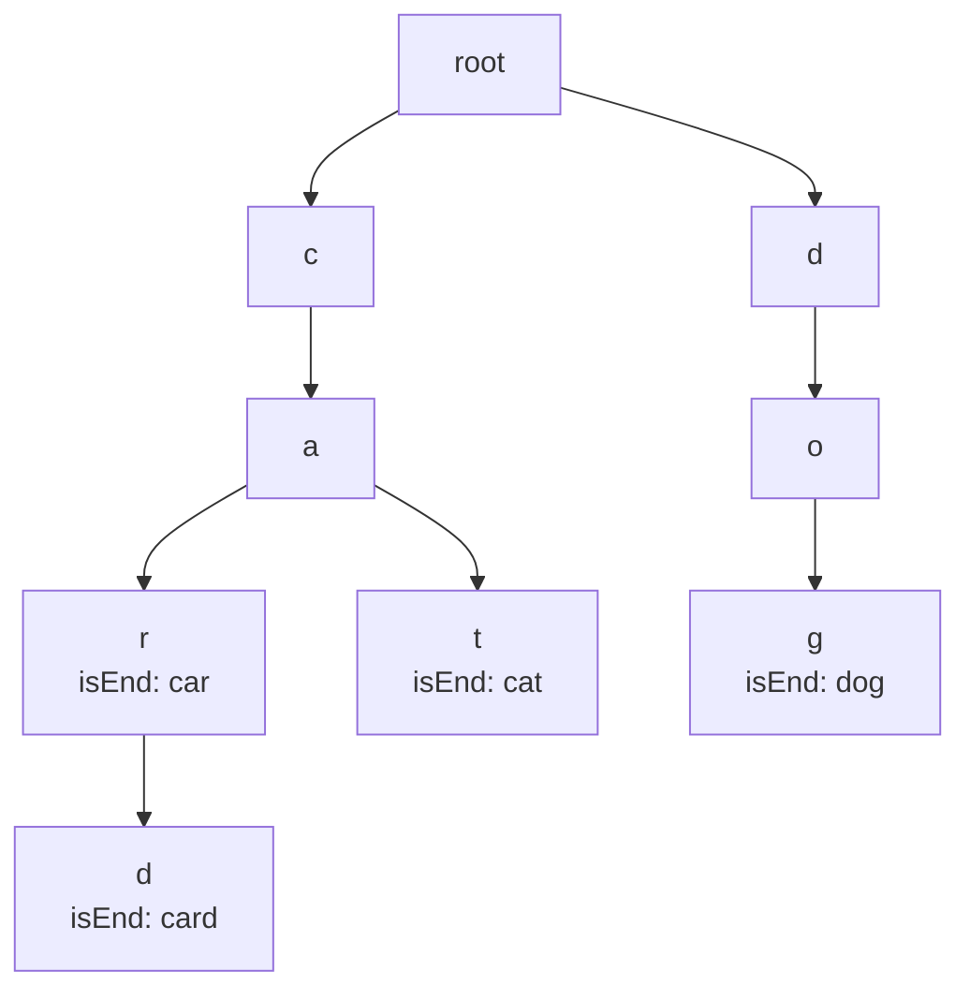
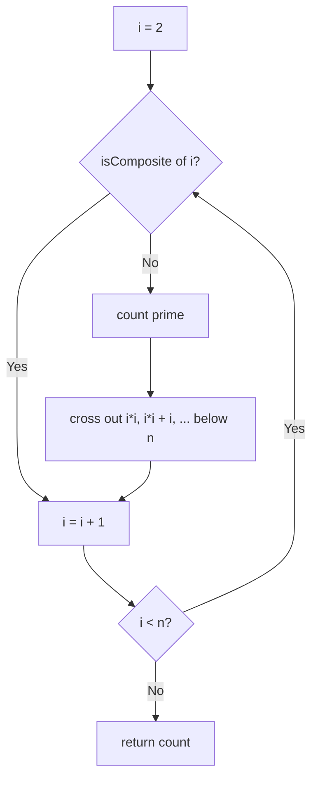
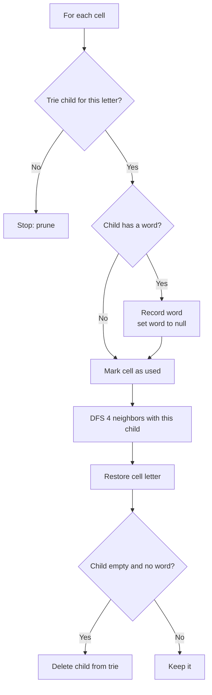

# Tries, Bit Manipulation and Math

> In this document you will learn three small toolkits that show up again and again in coding rounds: the **trie** (a tree for prefixes), **bit manipulation** (and how JavaScript's 32-bit bitwise operators really behave), and a set of **math and matrix** tricks (GCD, primes, fast power, integer bounds, in-place matrix work). Each one is short to code, but easy to get wrong in JavaScript if you do not know the language details.

**Before this:** [Data structures and Big-O](../01-cs-and-web-fundamentals/02-data-structures-and-big-o.md) · [Trees and binary search trees](08-trees-and-binary-search-trees.md) · [Backtracking](11-backtracking.md) · [Basics: variables, types, operators](../02-javascript/01-basics-variables-types-operators.md) · **Interview questions:** [jump to the interview section](#interview-questions)

## Table of contents

1. [The pattern](#the-pattern)
2. [Problems](#problems)
3. [Interview questions](#interview-questions)
4. [Summary](#summary)
5. [References](#references)

## The pattern

This document covers three related toolkits. Each has its own signals and template.

### Part A: Tries

#### What a trie is

A **trie** (say "try", from re*trie*val) is a tree that stores strings by their characters. Each edge is one character. A path from the root spells a prefix. A node has a flag `isEnd` that says "a whole word ends here".

**Analogy.** A trie is like the index tabs of a paper dictionary, but at every letter. To find "car", you open the "c" section, then the "ca" part inside it, then "car". All words that start with "ca" live in the same part. The analogy breaks a little because a paper dictionary is a flat sorted list; a trie really branches, so each prefix is stored only once.



This trie stores "car", "card", "cat" and "dog". The prefix "ca" is stored once and shared by three words.

#### Why tries exist

A `Set` of words answers "is this exact word present?" in O(L) average time (L = word length, for hashing). But it cannot answer "which words start with `ca`?" without checking every word. A trie answers both in O(L), and it can list all words with a prefix by walking one subtree.

| Question | `Set` of words | Sorted array + binary search | Trie |
| --- | --- | --- | --- |
| Exact word exists? | O(L) average | O(L log n) | O(L) |
| Any word starts with prefix? | O(n · L) | O(L log n) | O(L) |
| List all words with prefix | O(n · L) | O(L log n + output) | O(L + output) |
| Memory | Low | Low | Higher (one node per character) |

#### Signals for a trie

- "Prefix", "starts with", "autocomplete", "type-ahead".
- Many words searched in a grid or a long text at once (Word Search II).
- Wildcard search on a word list (`"b.d"`).
- Longest common prefix of many strings.

#### Trie template

```js
class TrieNode {
  constructor() {
    this.children = new Map(); // char -> TrieNode
    this.isEnd = false;
  }
}

function insertWord(root, word) {
  let node = root;
  for (const ch of word) {
    if (!node.children.has(ch)) node.children.set(ch, new TrieNode());
    node = node.children.get(ch);
  }
  node.isEnd = true;
}

function findNode(root, text) {
  let node = root;
  for (const ch of text) {
    node = node.children.get(ch);
    if (!node) return null; // path breaks: no word has this prefix
  }
  return node;
}
```

**`Map` or fixed array for children?** A `Map` works for any alphabet (Unicode, digits, spaces). A fixed array of 26 (`new Array(26)` indexed by `ch.charCodeAt(0) - 97`) is a bit faster for lowercase-only input, but wastes memory on sparse nodes. In interviews, `Map` is clear and correct. Plain objects also work, but watch out for keys like `"__proto__"` or `"constructor"`; `Object.create(null)` or `Map` avoids that.

**Complexity.** Insert and search are O(L) time. Memory is O(total characters inserted) nodes in the worst case.

### Part B: Bit manipulation in JavaScript

#### The operators

| Operator | Name | Example | Result |
| --- | --- | --- | --- |
| `&` | AND (1 if both bits are 1) | `5 & 3` (101 & 011) | `1` |
| `\|` | OR (1 if either bit is 1) | `5 \| 3` | `7` |
| `^` | XOR (1 if bits differ) | `5 ^ 3` | `6` |
| `~` | NOT (flip every bit) | `~5` | `-6` |
| `<<` | left shift (multiply by 2ᵏ) | `1 << 4` | `16` |
| `>>` | signed right shift (keeps the sign) | `-8 >> 1` | `-4` |
| `>>>` | unsigned right shift (fills with 0) | `-8 >>> 1` | `2147483644` |

#### How JavaScript really does it: 32-bit signed integers

JavaScript numbers are 64-bit floating-point values. But **every bitwise operator first converts its operands to 32-bit signed integers** (two's complement), does the operation, and returns a 32-bit signed result. The only exception is `>>>`, whose result is read as a 32-bit **unsigned** integer.

This has real consequences:

```js
console.log(1 << 31);            // -2147483648  (bit 31 is the sign bit)
console.log((1 << 31) >>> 0);    // 2147483648   (>>> 0 reads it as unsigned)
console.log(2 ** 32 | 0);        // 0            (bits above 31 are dropped)
console.log((2 ** 32 + 5) | 0);  // 5
console.log(1 << 32);            // 1            (shift count is taken modulo 32)
console.log(3.7 | 0);            // 3            (fractions are cut off)
console.log((-5 >>> 0).toString(2)); // 11111111111111111111111111111011
```

**Key rules to remember:**

1. Bitwise results are always in the range −2³¹ to 2³¹ − 1 (or 0 to 2³² − 1 for `>>>`).
2. `x >>> 0` converts to an unsigned 32-bit value. Use it when a problem says "unsigned".
3. Shift counts use only their lowest 5 bits, so `x << 32` is `x << 0`.
4. Numbers bigger than 32 bits lose their high bits. For larger values, use **`BigInt`**.

#### BigInt for more than 32 bits

`BigInt` values (written with an `n`, like `10n`) are arbitrary-precision integers. They support `&`, `|`, `^`, `~`, `<<` and `>>` with no 32-bit limit. They do **not** support `>>>` (there is no "unsigned" for an unlimited integer), and you cannot mix them with normal numbers.

```js
console.log(2n ** 64n);       // 18446744073709551616n
console.log(1n << 40n);       // 1099511627776n
console.log(BigInt.asUintN(64, -1n)); // 18446744073709551615n  (wrap to 64 bits)
// 8n >>> 1n  → TypeError: BigInts have no unsigned right shift
// 1n + 1     → TypeError: Cannot mix BigInt and other types
```

Also remember the **precision** limit of normal numbers: integers are exact only up to `Number.MAX_SAFE_INTEGER` (2⁵³ − 1 = 9007199254740991). `2 ** 53 + 1` prints `9007199254740992`. JavaScript does not overflow like C, but it silently loses precision.

#### Bit tricks you should know

| Trick | Meaning | Example |
| --- | --- | --- |
| `x & 1` | Is `x` odd? (works for negatives too) | `-7 & 1` → `1` (but `-7 % 2` → `-1`) |
| `x & (x - 1)` | Clears the lowest set bit | `12 & 11` → `8` (1100 → 1000) |
| `x & -x` | Keeps only the lowest set bit | `12 & -12` → `4` |
| `x ^ x` | Is 0 | Pairs cancel out |
| `x ^ 0` | Is `x` | XOR with 0 changes nothing |
| `(x >> k) & 1` | Reads bit `k` | `(5 >> 2) & 1` → `1` |
| `x \| (1 << k)` | Sets bit `k` | |
| `x & ~(1 << k)` | Clears bit `k` | |
| `x ^ (1 << k)` | Flips bit `k` | |
| `n.toString(2)`, `parseInt(s, 2)` | Convert to and from binary text | `(5).toString(2)` → `"101"` |

#### Signals for bit manipulation

- "Without using `+`, `*`, extra memory..."
- "Every element appears twice except one."
- "Count the 1 bits", "power of two", "reverse the bits".
- Subsets of a small set (n ≤ 20): a number from 0 to 2ⁿ − 1 can represent a subset (bitmask).
- "32-bit unsigned integer" in the problem statement.

### Part C: Math and matrix tricks

Math problems in interviews are not about advanced math. They test whether you know a few classic algorithms and whether you handle **edge cases and number limits** carefully.

| Tool | Idea | Cost |
| --- | --- | --- |
| Euclid's GCD | `gcd(a, b) = gcd(b, a % b)` | O(log min(a, b)) |
| LCM | `a / gcd(a, b) * b` (divide first to keep numbers small) | Same as GCD |
| Sieve of Eratosthenes | Cross out multiples of each prime | O(n log log n) |
| Fast power | Square the base, halve the exponent | O(log n) |
| Digit loops | `x % 10` and `Math.trunc(x / 10)` | O(number of digits) |
| Cycle detection | Floyd's slow/fast pointers on a sequence | O(cycle length) |
| Matrix in place | Transpose + reverse, boundary pointers, use first row/column as markers | O(rows · cols) |

**JavaScript number details that matter here:**

- `%` is a **remainder**, not a mathematical modulo. `-7 % 3` is `-1`. For a non-negative result use `((a % m) + m) % m`.
- Integer division needs `Math.trunc(a / b)` (rounds toward zero) or `Math.floor(a / b)` (rounds down). They differ for negatives: `Math.trunc(-7 / 2)` is `-3`, `Math.floor(-7 / 2)` is `-4`.
- For modular arithmetic with big products (like `a * b % 1_000_000_007`), the product can pass 2⁵³ and lose precision. Use `BigInt`, or split the multiplication.

## Problems

The problems go from Easy to Hard. Bits come first, then math and matrix problems, then tries.

### P1. Single Number (Easy)

**Problem.** Every number in the array appears exactly twice, except one number that appears once. Return that number. Use O(1) extra space. Similar to: LeetCode 136 Single Number.

**Examples.**

- `[2, 2, 1]` → `1`
- `[4, 1, 2, 1, 2]` → `4`
- `[1]` → `1`

**How to recognize the pattern.** "Pairs plus one odd one out" and "O(1) space" point to XOR: `x ^ x = 0` and `x ^ 0 = x`, and XOR does not care about order.

**Brute force.** Count with a `Map` and find the count of 1. O(n) time but O(n) space. Or sort and scan: O(n log n).

**Optimal approach.** XOR all numbers. Every pair cancels to 0. What is left is the single number.

**Code.**

```js
const singleNumber = (nums) => nums.reduce((acc, x) => acc ^ x, 0);

console.log(singleNumber([2, 2, 1]));       // 1
console.log(singleNumber([4, 1, 2, 1, 2])); // 4
```

**Dry run** on `[4, 1, 2, 1, 2]`: `0 ^ 4 = 4` → `4 ^ 1 = 5` → `5 ^ 2 = 7` → `7 ^ 1 = 6` → `6 ^ 2 = 4`. Answer 4.

**Complexity.** O(n) time, one pass. O(1) space.

**Edge cases.** One element → itself. Negative numbers work (two's complement XOR still cancels). Numbers outside 32-bit range would be truncated, but the problem limits them to 32-bit.

**Follow-ups.**

- **Every number appears three times except one (LeetCode 137).** Count how many numbers have each bit set. Each bit count modulo 3 gives the single number's bit.
- **Two numbers appear once (LeetCode 260).** XOR everything to get `a ^ b`. Take its lowest set bit (`x & -x`). Split the numbers into two groups by that bit and XOR each group.

**How to say it in the interview.**
> "XOR of a number with itself is zero, XOR with zero gives the number back, and XOR is order-independent. So if I XOR every element, all the pairs cancel and only the single number is left. That is one pass, O(n) time and O(1) space."

### P2. Number of 1 Bits (Easy)

**Problem.** Given a 32-bit unsigned integer `n`, return how many bits are 1 (the **Hamming weight**, or popcount). Similar to: LeetCode 191 Number of 1 Bits.

**Examples.**

- `11` (binary `1011`) → `3`
- `128` (binary `10000000`) → `1`
- `4294967293` (binary 31 ones and one 0) → `31`

**How to recognize the pattern.** Counting bits. The trick `n & (n - 1)` removes exactly one 1 bit per step.

**Brute force.** Check all 32 bits with `(n >>> i) & 1`. O(32) — fine, but the trick below only loops once per 1 bit.

**Optimal approach (Brian Kernighan's trick).**

1. `n - 1` flips the lowest 1 bit to 0 and all the 0s below it to 1.
2. So `n & (n - 1)` clears exactly the lowest 1 bit.
3. Repeat until `n` is 0. Count the steps.

**Code.**

```js
function hammingWeight(n) {
  let count = 0;
  while (n !== 0) {
    n &= n - 1; // clear the lowest set bit
    count++;
  }
  return count;
}

console.log(hammingWeight(11));         // 3
console.log(hammingWeight(4294967293)); // 31
```

**Why it works in JavaScript for values above 2³¹.** `4294967293` is not a valid 32-bit *signed* number, but `&` converts it to `-3`, which has the same 32 bits. The loop then works on the signed value until it becomes 0. So the count is correct for any 32-bit pattern.

**Dry run** on `11` (`1011`):

| n (binary) | n - 1 | n & (n - 1) | count |
| --- | --- | --- | --- |
| 1011 | 1010 | 1010 | 1 |
| 1010 | 1001 | 1000 | 2 |
| 1000 | 0111 | 0000 | 3 |

**Complexity.** O(k) time, where k is the number of 1 bits (at most 32). O(1) space.

**Edge cases.** `0` → 0. `2147483648` (only bit 31 set) → 1. `4294967295` (all ones) → 32.

**Follow-ups.**

- **Is there a built-in?** Not a popcount, but `Math.clz32(x)` counts leading zero bits of the 32-bit value, which is useful for "highest set bit" questions.
- **Called millions of times?** Use a lookup table for 8 or 16 bits and add four or two table lookups.

**How to say it in the interview.**
> "n and n minus 1 clears the lowest set bit, because subtracting one turns that bit into zero and the zeros below it into ones. So I keep doing n and-equals n minus 1 and count how many times until n is zero. That loops once per set bit, at most 32 times. In JavaScript the bitwise operators work on 32-bit values, so this works even for unsigned inputs above 2 to the 31."

### P3. Counting Bits (Easy)

**Problem.** For every `i` from 0 to `n`, return the number of 1 bits in `i`, as an array. Aim for O(n). Similar to: LeetCode 338 Counting Bits.

**Examples.**

- `n = 2` → `[0, 1, 1]`
- `n = 5` → `[0, 1, 1, 2, 1, 2]`

**How to recognize the pattern.** Bits of `i` are the bits of `i >> 1` plus the last bit. That is a tiny DP over numbers (see [Dynamic programming](12-dynamic-programming.md)).

**Brute force.** Run `hammingWeight` (P2) for each `i`. O(n log n) in the worst case.

**Optimal approach.** `bits[i] = bits[i >> 1] + (i & 1)`. Shifting right by one removes the last bit, and `i >> 1` is smaller than `i`, so it is already computed.

**Code.**

```js
function countBits(n) {
  const bits = new Array(n + 1).fill(0);
  for (let i = 1; i <= n; i++) {
    bits[i] = bits[i >> 1] + (i & 1);
  }
  return bits;
}

console.log(countBits(5)); // [ 0, 1, 1, 2, 1, 2 ]
```

**Dry run** for `i = 5` (`101`): `5 >> 1 = 2` (`10`), `bits[2] = 1`, last bit `5 & 1 = 1` → `bits[5] = 2`.

**Complexity.** O(n) time. O(n) space for the output (no extra space beyond it).

**Edge cases.** `n = 0` → `[0]`.

**Follow-ups.**

- **Another recurrence?** `bits[i] = bits[i & (i - 1)] + 1` (remove the lowest set bit, add one). Also O(n).

**How to say it in the interview.**
> "The bits of i are the bits of i shifted right by one, plus its last bit. Since i shifted right is smaller, I already have its count. So bits of i equals bits of i shifted right plus i and 1. One pass, O(n) time, and only the output array."

### P4. Reverse Bits (Easy)

**Problem.** Reverse the 32 bits of an unsigned integer and return the result as an unsigned integer. Similar to: LeetCode 190 Reverse Bits.

**Examples.**

- `43261596` (`00000010100101000001111010011100`) → `964176192` (`00111001011110000010100101000000`)
- `4294967293` (`11111111111111111111111111111101`) → `3221225471` (`10111111111111111111111111111111`)
- `1` → `2147483648`

**How to recognize the pattern.** "Unsigned 32-bit" means you will need `>>>` and `>>> 0` in JavaScript.

**Brute force.** Convert to a 32-character binary string with `padStart`, reverse it, and parse it. Correct and readable, but slower and creates strings.

**Optimal approach.**

1. Repeat 32 times: shift `result` left by one, and put the lowest bit of `n` into it.
2. Shift `n` right with `>>>` (so the sign bit does not spread).
3. At the end, `result` may look negative (bit 31 set). Return `result >>> 0` to read it as unsigned.

**Code.**

```js
function reverseBits(n) {
  let result = 0;
  for (let i = 0; i < 32; i++) {
    result = (result << 1) | (n & 1); // append n's lowest bit
    n >>>= 1;                         // unsigned shift
  }
  return result >>> 0;                // read as unsigned 32-bit
}

console.log(reverseBits(43261596)); // 964176192
console.log(reverseBits(1));        // 2147483648
```

```js
// ❌ Wrong: forgets >>> 0, so a set top bit prints as a negative number
// reverseBits(1) would return -2147483648
// ✅ Correct: return result >>> 0
```

**Dry run** on a 4-bit version with `n = 0b0011` (to keep it short):

| step | n & 1 | result (binary) | n after |
| --- | --- | --- | --- |
| 1 | 1 | 1 | 0001 |
| 2 | 1 | 11 | 0000 |
| 3 | 0 | 110 | 0000 |
| 4 | 0 | 1100 | 0000 |

`0011` reversed is `1100`.

**Complexity.** O(32) = O(1) time. O(1) space.

**Edge cases.** `0` → `0`. All ones → all ones (`4294967295`).

**Follow-ups.**

- **Called many times?** Reverse each byte with a 256-entry lookup table and combine four bytes.
- **Divide and conquer version?** Swap halves, then quarters, and so on with masks, like `n = ((n >>> 16) | (n << 16)) >>> 0`. Five steps for 32 bits.

**How to say it in the interview.**
> "I loop 32 times. Each time I shift the result left and append n's lowest bit, then shift n right with the unsigned shift. In JavaScript bitwise results are signed 32-bit, so if the top bit is set the result looks negative. I return result triple-right-shift zero to read it as unsigned. It is constant time and space."

### P5. Missing Number (Easy)

**Problem.** The array has `n` distinct numbers taken from `0, 1, ..., n`. Exactly one is missing. Return it. Similar to: LeetCode 268 Missing Number.

**Examples.**

- `[3, 0, 1]` → `2`
- `[0, 1]` → `2`
- `[9, 6, 4, 2, 3, 5, 7, 0, 1]` → `8`

**How to recognize the pattern.** "Numbers 0 to n with one missing" is a pairing problem: every index pairs with its value, except one. XOR (or a sum formula) finds the odd one out.

**Brute force.** Put all values in a `Set` and check 0 to n. O(n) time, O(n) space. Or sort: O(n log n).

**Optimal approach (XOR).** XOR all indexes `0..n` and all values. Every present number appears twice and cancels. The missing number appears once.

**Code.**

```js
function missingNumber(nums) {
  let xor = nums.length; // start with n, the index that has no slot
  for (let i = 0; i < nums.length; i++) {
    xor ^= i ^ nums[i];
  }
  return xor;
}

console.log(missingNumber([3, 0, 1]));                   // 2
console.log(missingNumber([9, 6, 4, 2, 3, 5, 7, 0, 1])); // 8
```

**Alternative (sum).** `n (n + 1) / 2 - sum(nums)`. Also O(n) and O(1). In JavaScript it is safe as long as the sum stays below 2⁵³, which is true for any realistic array.

**Dry run** on `[3, 0, 1]`: start `xor = 3`. `i = 0`: `3 ^ 0 ^ 3 = 0`. `i = 1`: `0 ^ 1 ^ 0 = 1`. `i = 2`: `1 ^ 2 ^ 1 = 2`. Answer 2.

**Complexity.** O(n) time, O(1) space.

**Edge cases.** Missing `0` (like `[1]`) → 0. Missing `n` (like `[0]`) → 1.

**Follow-ups.**

- **Which is better, sum or XOR?** In languages with fixed-size integers, the sum can overflow, and XOR cannot. In JavaScript both are fine for normal sizes.

**How to say it in the interview.**
> "Every number from 0 to n should appear once as an index and once as a value. If I XOR all indexes, n, and all values together, each present number cancels with itself, and only the missing number remains. O(n) time and O(1) space. The sum formula works too, but XOR avoids overflow in other languages."

### P6. Power of Two (Easy)

**Problem.** Return `true` if `n` is a power of two (1, 2, 4, 8, ...). Similar to: LeetCode 231 Power of Two.

**Examples.**

- `1` → `true`
- `16` → `true`
- `3` → `false`
- `0` → `false`, `-16` → `false`

**How to recognize the pattern.** A power of two has exactly one 1 bit. `n & (n - 1)` clears it and leaves 0.

**Brute force.** Divide by 2 while even; check you reach 1. O(log n).

**Optimal approach.** `n > 0 && (n & (n - 1)) === 0`.

**Code.**

```js
const isPowerOfTwo = (n) => n > 0 && (n & (n - 1)) === 0;

console.log(isPowerOfTwo(16)); // true
console.log(isPowerOfTwo(3));  // false
console.log(isPowerOfTwo(0));  // false
```

**Dry run.** `16 = 10000`, `15 = 01111`, `16 & 15 = 0` → `true`. `12 = 1100`, `11 = 1011`, `12 & 11 = 1000` → `false`.

**Complexity.** O(1) time and space.

**Edge cases.** `0` and negatives → `false` (that is why `n > 0` comes first). The **JavaScript trap:** the trick only sees the low 32 bits.

```js
// ❌ Wrong for values above 32 bits: the high bits are dropped
console.log(isPowerOfTwo(2 ** 32 + 2 ** 31)); // true  (wrong!)

// ✅ Correct for large integers: use BigInt
const isPowerOfTwoBig = (n) => {
  const b = BigInt(n);
  return b > 0n && (b & (b - 1n)) === 0n;
};
console.log(isPowerOfTwoBig(2 ** 32 + 2 ** 31)); // false
console.log(isPowerOfTwoBig(2 ** 40));           // true
```

The LeetCode version limits `n` to 32-bit signed integers, so the simple version is fine there. Mention the trap anyway.

**Follow-ups.**

- **Power of four?** A power of two whose single 1 bit is in an even position: `n > 0 && (n & (n - 1)) === 0 && (n & 0x55555555) !== 0`.
- **Power of three?** No bit trick. Loop dividing by 3, or check that `1162261467 % n === 0` (3¹⁹, the largest power of 3 in 32-bit signed range).

**How to say it in the interview.**
> "A power of two has exactly one bit set. n and n minus 1 clears the lowest set bit, so for a power of two the result is zero. I also check n is positive, because zero and negatives are not powers of two. One caveat in JavaScript: bitwise operators use 32 bits, so for bigger numbers I would use BigInt."

### P7. GCD and LCM (Easy)

**Problem.** Write `gcd(a, b)` (greatest common divisor: the biggest number that divides both) and `lcm(a, b)` (least common multiple: the smallest positive number both divide). Related to: LeetCode 1979 Find Greatest Common Divisor of Array, LeetCode 1071 Greatest Common Divisor of Strings.

**Examples.**

- `gcd(48, 18)` → `6`, `gcd(17, 5)` → `1`, `gcd(0, 7)` → `7`
- `lcm(4, 6)` → `12`, `lcm(21, 6)` → `42`

**How to recognize the pattern.** Fractions, ratios, "split into equal groups", repeating cycles that line up ("when do two timers fire together?" is an LCM).

**Brute force.** Try every divisor from `min(a, b)` down to 1. O(min(a, b)).

**Optimal approach (Euclid's algorithm).** Any number that divides `a` and `b` also divides `a % b`. So `gcd(a, b) = gcd(b, a % b)`, and `gcd(a, 0) = a`. The numbers shrink fast.

For LCM, use `lcm(a, b) = a / gcd(a, b) * b`. Divide **first** so the intermediate value stays small.

**Code.**

```js
function gcd(a, b) {
  a = Math.abs(a);
  b = Math.abs(b);
  while (b !== 0) {
    [a, b] = [b, a % b];
  }
  return a;
}

function lcm(a, b) {
  if (a === 0 || b === 0) return 0;
  return Math.abs((a / gcd(a, b)) * b);
}

console.log(gcd(48, 18));             // 6
console.log(lcm(4, 6));               // 12
console.log([12, 18, 30].reduce(gcd)); // 6  (GCD of an array)
```

**Dry run** of `gcd(48, 18)`:

| a | b | a % b |
| --- | --- | --- |
| 48 | 18 | 12 |
| 18 | 12 | 6 |
| 12 | 6 | 0 |
| 6 | 0 | stop → 6 |

**Complexity.** O(log min(a, b)) time. (Lamé's theorem: the worst case is consecutive Fibonacci numbers.) O(1) space for the loop version.

**Edge cases.** `gcd(0, 0)` → 0 by convention. Negative inputs → use absolute values. LCM of numbers above 2⁵³ loses precision; use the `BigInt` version.

```js
function gcdBig(a, b) {
  while (b !== 0n) [a, b] = [b, a % b];
  return a;
}
console.log(gcdBig(2n ** 70n, 6n ** 20n)); // 1048576n  (2^20)
```

**Follow-ups.**

- **GCD of strings (LeetCode 1071).** If `s + t !== t + s`, there is no common divisor string. Otherwise the answer is the prefix of length `gcd(s.length, t.length)`.
- **Simplify a fraction.** Divide numerator and denominator by their GCD.

**How to say it in the interview.**
> "I use Euclid's algorithm: the GCD of a and b equals the GCD of b and a mod b, and the GCD of a and zero is a. The numbers shrink quickly, so it is O(log) time. For LCM I divide a by the GCD first and then multiply by b, which keeps the numbers small. For values beyond 2 to the 53, I would switch to BigInt."

### P8. Happy Number (Easy)

**Problem.** Start with a positive integer. Replace it with the sum of the squares of its digits. Repeat. If you reach 1, the number is **happy**. If you loop forever without reaching 1, it is not. Similar to: LeetCode 202 Happy Number.

**Examples.**

- `19` → `true` (1² + 9² = 82 → 68 → 100 → 1)
- `2` → `false` (it enters the cycle 4 → 16 → 37 → 58 → 89 → 145 → 42 → 20 → 4)
- `7` → `true`

**How to recognize the pattern.** A sequence where each value comes from the previous one, which either ends or loops. That is **cycle detection**, the same as a linked list cycle (see [Linked lists](07-linked-lists.md)).

**Brute force (also fine).** Store each value in a `Set`. Stop when you see 1 or a repeat. O(cycle length) time and space.

**Optimal approach (Floyd, O(1) space).** Move `slow` one step and `fast` two steps. If there is a cycle, they meet. If `fast` reaches 1, the number is happy.

**Code.**

```js
function isHappy(n) {
  const next = (x) => {
    let sum = 0;
    while (x > 0) {
      const digit = x % 10;
      sum += digit * digit;
      x = Math.floor(x / 10);
    }
    return sum;
  };
  let slow = n;
  let fast = next(n);
  while (fast !== 1 && slow !== fast) {
    slow = next(slow);
    fast = next(next(fast));
  }
  return fast === 1;
}

console.log(isHappy(19)); // true
console.log(isHappy(2));  // false
```

**Dry run** on `19`:

| step | slow | fast |
| --- | --- | --- |
| start | 19 | 82 |
| 1 | 82 | next(next(82)) = next(68) = 100 |
| 2 | 68 | next(next(100)) = next(1) = 1 → stop |

`fast === 1` → `true`.

**Complexity.** Each `next` is O(number of digits) = O(log n). Values quickly drop below a few hundred (a 3-digit number maps to at most 243), so the total work is O(log n). O(1) space with Floyd.

**Edge cases.** `1` → `true` immediately. Large inputs shrink after the first step.

**Follow-ups.**

- **Why must it end or cycle?** After the first step, values stay below a fixed bound, so there are only finitely many values. A sequence over a finite set must eventually repeat.

**How to say it in the interview.**
> "The digit-square sum always drops to a small range, so the sequence either reaches 1 or repeats in a cycle. Detecting a cycle in a sequence is the same as in a linked list. I use Floyd's slow and fast pointers: slow moves one step, fast moves two. If fast hits 1 it is happy; if they meet first, there is a cycle. That is O(log n) time and O(1) space. A Set of seen values also works with more memory."

### P9. Sum of Two Integers (Medium)

**Problem.** Return `a + b` without using the `+` or `-` operators. Inputs are 32-bit signed integers. Similar to: LeetCode 371 Sum of Two Integers.

**Examples.**

- `1, 2` → `3`
- `-2, 3` → `1`
- `-5, -7` → `-12`

**How to recognize the pattern.** "Without `+`" means you must build addition from bits: XOR is addition without carry, and AND finds where carries happen.

**Brute force.** None really. You could add 1 bit at a time with a loop over 32 positions, which is the same idea in a longer form.

**Optimal approach.**

1. `a ^ b` adds each bit position **without** carry (1 + 1 gives 0).
2. `(a & b) << 1` is the carry: positions where both bits are 1, moved one place left.
3. Set `a` to the partial sum and `b` to the carry. Repeat until there is no carry.

**Code.**

```js
function getSum(a, b) {
  while (b !== 0) {
    const carry = (a & b) << 1; // where both bits are 1, shifted left
    a = a ^ b;                  // sum without carry
    b = carry;
  }
  return a;
}

console.log(getSum(1, 2));   // 3
console.log(getSum(-2, 3));  // 1
console.log(getSum(-5, -7)); // -12
```

**Why it ends for negative numbers in JavaScript.** In some languages with unlimited integers (like Python), the carry can grow forever for negative inputs, and you must mask to 32 bits. In JavaScript, `<<` always works on 32 bits, so the carry is pushed out of bit 31 after at most 32 rounds and becomes 0. The 32-bit two's complement result is the correct signed answer.

**Dry run** on `a = 2 (10), b = 3 (11)`:

| a | b | carry = (a & b) << 1 | a ^ b |
| --- | --- | --- | --- |
| 10 | 11 | 100 | 01 |
| 01 | 100 | 000 | 101 |
| 101 | 0 | stop | |

Answer `101` = 5.

**Complexity.** O(32) = O(1) time (at most one loop per bit). O(1) space.

**Edge cases.** One or both zero. Opposite signs (`-1 + 1` = 0). Results outside 32 bits wrap around, which matches the problem's 32-bit assumption.

**Follow-ups.**

- **Subtraction without `-`?** `a - b = a + (~b + 1)`, since `~b + 1` is `-b` in two's complement. Use `getSum(a, getSum(~b, 1))`.
- **Why would anyone do this?** It is how hardware adders work (a full adder chain). In real code, just use `+`.

**How to say it in the interview.**
> "XOR adds two numbers bit by bit without carrying, and AND shifted left by one gives exactly the carry bits. So I loop: carry is a and b shifted left, a becomes a XOR b, b becomes the carry, until there is no carry. JavaScript's bitwise operators are 32-bit, so for negative numbers the carry falls off the top after at most 32 rounds, and the loop always ends."

### P10. Count Primes with the Sieve of Eratosthenes (Medium)

**Problem.** Return how many prime numbers are **strictly less than** `n`. Similar to: LeetCode 204 Count Primes.

**Examples.**

- `10` → `4` (2, 3, 5, 7)
- `0` → `0`, `1` → `0`, `2` → `0`
- `100` → `25`

**How to recognize the pattern.** "All primes up to n" or "many prime checks up to n". Checking each number alone is slow; crossing out multiples once is fast.

**Brute force.** For each `k < n`, test divisors up to `√k`. O(n √n).

**Optimal approach.**

1. Make an array `isComposite` of size `n`, all 0.
2. For each `i` from 2: if `i` is not crossed out, it is prime. Count it and cross out `i*i, i*i + i, i*i + 2i, ...`.
3. Why start at `i * i`? Smaller multiples like `2i, 3i` were already crossed out by the smaller primes 2, 3, ...

**Code.**

```js
function countPrimes(n) {
  if (n < 3) return 0;
  const isComposite = new Uint8Array(n); // compact: 1 byte per number, all 0
  let count = 0;
  for (let i = 2; i < n; i++) {
    if (isComposite[i]) continue;
    count++; // i is prime
    for (let multiple = i * i; multiple < n; multiple += i) {
      isComposite[multiple] = 1;
    }
  }
  return count;
}

console.log(countPrimes(10));      // 4
console.log(countPrimes(100));     // 25
console.log(countPrimes(5000000)); // 348513
```

`Uint8Array` is a **typed array**: a fixed-size block of bytes, filled with zeros. It uses much less memory than a normal array of booleans and is fast to scan.

**Dry run** for `n = 20`:

| prime i | crossed out (from i²) |
| --- | --- |
| 2 | 4, 6, 8, 10, 12, 14, 16, 18 |
| 3 | 9, 15 (12 and 18 already crossed) |
| 5 | 25 ≥ 20 → nothing |
| 7, 11, 13, 17, 19 | nothing (i² ≥ 20) |

Primes below 20: 2, 3, 5, 7, 11, 13, 17, 19 → 8.



**Complexity.** O(n log log n) time (the sum of n/p over primes p grows like n log log n). O(n) space (n bytes).

**Edge cases.** `n <= 2` → 0. "Less than n" vs "up to n" — read carefully.

**Follow-ups.**

- **Only loop `i` up to `√n` for crossing out?** Yes, you can stop crossing at `i * i >= n`, but you still need to count the primes above `√n`. The version above counts in the same loop, so it keeps going.
- **n is 10⁹?** The array is too big. Use a **segmented sieve** (process blocks of size about √n) or a different method.
- **Prime factorization of many numbers?** Store the smallest prime factor for each number in the sieve, then divide repeatedly.

**How to say it in the interview.**
> "Instead of testing each number, I cross out multiples. I keep a byte array. Going up from 2, any number not crossed out is prime, so I count it and cross out its multiples, starting from its square, because smaller multiples were already crossed out by smaller primes. That is O(n log log n) time and O(n) memory, and a typed array keeps the memory small."

### P11. Pow(x, n) with Fast Power (Medium)

**Problem.** Compute `x` to the power `n`, where `n` is a 32-bit integer (possibly negative). Do not use `**` or `Math.pow`. Similar to: LeetCode 50 Pow(x, n).

**Examples.**

- `2, 10` → `1024`
- `2.1, 3` → `9.261000000000001` (floating-point result; `9.261` within normal precision)
- `2, -2` → `0.25`

**How to recognize the pattern.** Large exponent and "O(log n)": **binary exponentiation**. `x¹³ = x⁸ · x⁴ · x¹`, because 13 is `1101` in binary.

**Brute force.** Multiply `x` by itself `|n|` times. O(n). With `n = 2³¹`, that is about two billion multiplications — too slow.

**Optimal approach.**

1. If `n < 0`, use `1 / x` and `-n`.
2. Keep `result = 1` and `base = x`.
3. While `n > 0`: if the lowest bit of `n` is 1, multiply `result` by `base`. Square `base`. Halve `n`.

**Code.**

```js
function myPow(x, n) {
  if (n < 0) {
    x = 1 / x;
    n = -n; // safe in JavaScript: -(-2147483648) is 2147483648, no overflow
  }
  let result = 1;
  let base = x;
  while (n > 0) {
    if (n % 2 === 1) result *= base; // this bit of n is set
    base *= base;                    // x, x^2, x^4, x^8, ...
    n = Math.floor(n / 2);
  }
  return result;
}

console.log(myPow(2, 10));  // 1024
console.log(myPow(2, -2));  // 0.25
console.log(myPow(2.1, 3)); // 9.261000000000001
```

We use `n % 2` and `Math.floor(n / 2)` instead of `n & 1` and `n >>= 1`, because `n = 2³¹` (from negating `-2³¹`) does not fit in a signed 32-bit integer.

**Dry run** of `myPow(2, 10)` (10 = `1010`):

| n | bit | result | base after |
| --- | --- | --- | --- |
| 10 | 0 | 1 | 4 |
| 5 | 1 | 4 | 16 |
| 2 | 0 | 4 | 256 |
| 1 | 1 | 1024 | 65536 |

**Complexity.** O(log n) time, one loop per bit of n. O(1) space.

**Edge cases.** `n = 0` → 1. `x = 0` with negative n → `Infinity` (division by zero in JS gives `Infinity`). `n = -2³¹` → handled because JS numbers do not overflow at 32 bits. `x = 1` or `-1` → no precision problems.

**Follow-ups.**

- **Modular power for huge numbers (`a^b mod m`)?** Same loop, but take `% m` after each multiply, and use `BigInt` so products do not lose precision:

  ```js
  function modPow(base, exp, mod) {
    let result = 1n;
    base %= mod;
    while (exp > 0n) {
      if (exp & 1n) result = (result * base) % mod;
      base = (base * base) % mod;
      exp >>= 1n;
    }
    return result;
  }
  console.log(modPow(2n, 10n, 1000n)); // 24n
  ```

- **Recursive version?** `pow(x, n) = pow(x * x, n / 2)` for even n, times `x` for odd n. Recursion depth is only O(log n), so it is safe.
- **Where is this used?** RSA encryption, hashing, and matrix exponentiation (for Fibonacci in O(log n)).

**How to say it in the interview.**
> "I use binary exponentiation. I look at the exponent bit by bit. The base goes x, x squared, x to the fourth and so on, by squaring each step, and I multiply it into the result whenever the current bit is one. That needs only log n multiplications. For a negative exponent I invert x first. In JavaScript I halve with Math.floor instead of shifts, because 2 to the 31 does not fit a signed 32-bit int."

### P12. Reverse Integer with 32-bit Bounds (Medium)

**Problem.** Reverse the digits of a 32-bit signed integer `x`. If the result is outside the signed 32-bit range [−2³¹, 2³¹ − 1], return 0. Assume the environment cannot store 64-bit integers. Similar to: LeetCode 7 Reverse Integer.

**Examples.**

- `123` → `321`
- `-123` → `-321`
- `120` → `21`
- `1534236469` → `0` (9646324351 is too big)

**How to recognize the pattern.** Digit manipulation with `% 10` and integer division, plus an **overflow check before the operation**.

**Brute force.** Convert to a string, reverse it, convert back, and compare to the bounds. In JavaScript this works because numbers can hold 9646324351 exactly. But it ignores the "no 64-bit" rule, and interviewers want to see the check.

**Optimal approach.**

1. Pop the last digit: `digit = x % 10` (negative for negative x in JavaScript), `x = Math.trunc(x / 10)`.
2. Before pushing it (`result * 10 + digit`), check that it will not leave the range:
   - If `result > MAX / 10` (truncated), or `result === trunc(MAX / 10)` and `digit > 7` → overflow (MAX ends in 7).
   - If `result < MIN / 10` (truncated), or `result === trunc(MIN / 10)` and `digit < -8` → overflow (MIN ends in 8).
3. Push: `result = result * 10 + digit`.

**Code.**

```js
function reverse(x) {
  const MAX = 2 ** 31 - 1; //  2147483647
  const MIN = -(2 ** 31);  // -2147483648
  let result = 0;
  while (x !== 0) {
    const digit = x % 10;       // keeps the sign: -123 % 10 is -3
    x = Math.trunc(x / 10);     // toward zero, works for negatives
    if (result > Math.trunc(MAX / 10) || (result === Math.trunc(MAX / 10) && digit > 7)) return 0;
    if (result < Math.trunc(MIN / 10) || (result === Math.trunc(MIN / 10) && digit < -8)) return 0;
    result = result * 10 + digit;
  }
  return result;
}

console.log(reverse(123));        // 321
console.log(reverse(-123));       // -321
console.log(reverse(120));        // 21
console.log(reverse(1534236469)); // 0
```

**Dry run** on `-123`:

| x before | digit | x after | result |
| --- | --- | --- | --- |
| -123 | -3 | -12 | -3 |
| -12 | -2 | -1 | -32 |
| -1 | -1 | 0 | -321 |

**Complexity.** O(number of digits) = O(log |x|) time, at most 10 loops. O(1) space.

**Edge cases.** `0` → 0. Trailing zeros vanish (`120` → `21`). `-2147483648` → reversed is too small → 0. `1463847412` → `2147483641` (just fits).

**Follow-ups.**

- **Why `Math.trunc` and not `Math.floor`?** `Math.floor(-12 / 10)` is `-2`, which breaks the digit loop for negative numbers. `Math.trunc` rounds toward zero, like integer division in C or Java.
- **Why not `x | 0` to truncate?** It works for 32-bit values, but it silently breaks for larger numbers, so `Math.trunc` is safer and clearer.
- **Palindrome number (LeetCode 9)?** Reverse half of the digits and compare with the other half. No string needed.

**How to say it in the interview.**
> "I pop digits with mod 10 and integer division using Math.trunc, so negatives work, and push them onto the result with times 10 plus digit. The problem says I cannot hold 64-bit values, so before each push I check that result times 10 plus digit stays inside the 32-bit range by comparing result to the max divided by 10 and the last digit. If it would overflow, I return 0. It is O(number of digits), so constant time."

### P13. Rotate Image (Medium)

**Problem.** Rotate an `n × n` matrix 90 degrees clockwise **in place** (no second matrix). Similar to: LeetCode 48 Rotate Image.

**Examples.**

```text
1 2 3      7 4 1
4 5 6  →   8 5 2
7 8 9      9 6 3
```

**How to recognize the pattern.** In-place matrix transformation. A rotation can be built from two simple operations you can do in place: **transpose** and **reverse each row**.

**Brute force.** Make a new matrix where `result[c][n - 1 - r] = matrix[r][c]`. O(n²) time but O(n²) extra space, which the problem forbids.

**Optimal approach.**

1. **Transpose:** swap `matrix[r][c]` with `matrix[c][r]` for `c > r` (mirror over the main diagonal).
2. **Reverse each row** (mirror left-right).

Clockwise rotation = transpose, then reverse rows. (Counter-clockwise = transpose, then reverse columns, or reverse rows first, then transpose.)

**Code.**

```js
function rotate(matrix) {
  const n = matrix.length;
  for (let r = 0; r < n; r++) {
    for (let c = r + 1; c < n; c++) { // only above the diagonal, or you swap twice
      [matrix[r][c], matrix[c][r]] = [matrix[c][r], matrix[r][c]];
    }
  }
  for (const row of matrix) row.reverse();
}

const image = [[1, 2, 3], [4, 5, 6], [7, 8, 9]];
rotate(image);
console.log(image); // [ [ 7, 4, 1 ], [ 8, 5, 2 ], [ 9, 6, 3 ] ]
```

**Dry run.**

```text
start        transpose     reverse rows
1 2 3        1 4 7         7 4 1
4 5 6   →    2 5 8    →    8 5 2
7 8 9        3 6 9         9 6 3
```

**Complexity.** O(n²) time, each cell moved a constant number of times. O(1) extra space.

**Edge cases.** `1 × 1` → unchanged. Starting the inner loop at `c = 0` instead of `c = r + 1` swaps every pair twice and leaves the matrix unchanged — a classic bug.

**Follow-ups.**

- **Rotate layer by layer instead?** For each ring, move four cells at a time: top ← left ← bottom ← right ← top. Same complexity, one pass, but index math is error-prone.
- **Non-square matrix?** In-place rotation is not possible (the shape changes from m × n to n × m). Build a new matrix.

**How to say it in the interview.**
> "A 90-degree clockwise rotation equals a transpose followed by reversing each row, and both can be done in place. For the transpose I swap only cells above the diagonal, otherwise each pair is swapped twice. Then I reverse each row. That is O(n squared) time and O(1) extra space."

### P14. Spiral Matrix (Medium)

**Problem.** Return all elements of an `m × n` matrix in spiral order: left to right along the top, down the right side, right to left along the bottom, up the left side, then repeat inward. Similar to: LeetCode 54 Spiral Matrix.

**Examples.**

- `[[1, 2, 3], [4, 5, 6], [7, 8, 9]]` → `[1, 2, 3, 6, 9, 8, 7, 4, 5]`
- `[[1, 2, 3, 4], [5, 6, 7, 8], [9, 10, 11, 12]]` → `[1, 2, 3, 4, 8, 12, 11, 10, 9, 5, 6, 7]`

**How to recognize the pattern.** Matrix traversal by **layers**. Keep four boundaries (`top`, `bottom`, `left`, `right`) and shrink them after each side.

**Brute force / alternative.** Simulate walking with a direction vector and a `visited` matrix, turning right when blocked. O(m · n) time, but O(m · n) extra space.

**Optimal approach.**

1. Walk the top row from `left` to `right`, then `top++`.
2. Walk the right column from `top` to `bottom`, then `right--`.
3. If `top <= bottom`, walk the bottom row from `right` to `left`, then `bottom--`.
4. If `left <= right`, walk the left column from `bottom` to `top`, then `left++`.
5. Repeat while `top <= bottom && left <= right`.

The two `if` checks matter for a single remaining row or column. Without them, you would walk it twice.

**Code.**

```js
function spiralOrder(matrix) {
  const result = [];
  if (matrix.length === 0) return result;
  let top = 0;
  let bottom = matrix.length - 1;
  let left = 0;
  let right = matrix[0].length - 1;

  while (top <= bottom && left <= right) {
    for (let c = left; c <= right; c++) result.push(matrix[top][c]);
    top++;
    for (let r = top; r <= bottom; r++) result.push(matrix[r][right]);
    right--;
    if (top <= bottom) {
      for (let c = right; c >= left; c--) result.push(matrix[bottom][c]);
      bottom--;
    }
    if (left <= right) {
      for (let r = bottom; r >= top; r--) result.push(matrix[r][left]);
      left++;
    }
  }
  return result;
}

console.log(spiralOrder([[1, 2, 3], [4, 5, 6], [7, 8, 9]]));
// [ 1, 2, 3, 6, 9, 8, 7, 4, 5 ]
```

**Dry run** on the 3 × 3 example:

| side | cells | boundaries after |
| --- | --- | --- |
| top row | 1, 2, 3 | top = 1 |
| right column | 6, 9 | right = 1 |
| bottom row | 8, 7 | bottom = 1 |
| left column | 4 | left = 1 |
| top row (inner) | 5 | top = 2, loop ends |

**Complexity.** O(m · n) time, each cell once. O(1) extra space besides the output.

**Edge cases.** Empty matrix → `[]`. One row → that row. One column → that column (this is where the `if` checks save you).

**Follow-ups.**

- **Spiral Matrix II (LeetCode 59): fill an n × n matrix with 1..n² in spiral order.** Same boundaries, write instead of read.
- **Diagonal traversal?** A different pattern: cells with the same `r + c` are on the same anti-diagonal.

**How to say it in the interview.**
> "I keep four boundaries: top, bottom, left, right. I walk the top row and move top down, walk the right column and move right in, then, only if rows remain, walk the bottom row backward, and only if columns remain, walk the left column upward. I repeat until the boundaries cross. The extra checks stop me from walking a single remaining row or column twice. O(m times n) time and O(1) extra space."

### P15. Set Matrix Zeroes (Medium)

**Problem.** If a cell is 0, set its entire row and column to 0. Do it in place. Aim for O(1) extra space. Similar to: LeetCode 73 Set Matrix Zeroes.

**Examples.**

```text
1 1 1      1 0 1
1 0 1  →   0 0 0
1 1 1      1 0 1

0 1 2 0      0 0 0 0
3 4 5 2  →   0 4 5 0
1 3 1 5      0 3 1 0
```

**How to recognize the pattern.** You need to "remember" which rows and columns to clear, but you may not use extra memory. Use the matrix's **own first row and first column** as the memory.

**Brute force.** Copy the matrix, or zero cells as you scan — but that is wrong, because new zeros spread and wipe everything. With two sets `zeroRows` and `zeroCols`, it is correct in O(m + n) extra space.

**Optimal approach (O(1) space).**

1. Remember whether the first row and the first column themselves contain a 0 (two booleans).
2. For every other cell `(r, c)` that is 0, mark `matrix[r][0] = 0` and `matrix[0][c] = 0`.
3. For every other cell, if its row marker or column marker is 0, set it to 0.
4. Finally, clear the first row and/or first column if the booleans say so.

The order matters: you clear the first row and column **last**, because they hold the markers.

**Code.**

```js
function setZeroes(matrix) {
  const rows = matrix.length;
  const cols = matrix[0].length;
  const firstRowHasZero = matrix[0].includes(0);
  const firstColHasZero = matrix.some((row) => row[0] === 0);

  for (let r = 1; r < rows; r++) {          // 1. record markers
    for (let c = 1; c < cols; c++) {
      if (matrix[r][c] === 0) {
        matrix[r][0] = 0;
        matrix[0][c] = 0;
      }
    }
  }
  for (let r = 1; r < rows; r++) {          // 2. apply markers to the inner cells
    for (let c = 1; c < cols; c++) {
      if (matrix[r][0] === 0 || matrix[0][c] === 0) matrix[r][c] = 0;
    }
  }
  if (firstRowHasZero) matrix[0].fill(0);   // 3. first row and column last
  if (firstColHasZero) {
    for (let r = 0; r < rows; r++) matrix[r][0] = 0;
  }
}

const grid = [[0, 1, 2, 0], [3, 4, 5, 2], [1, 3, 1, 5]];
setZeroes(grid);
console.log(grid); // [ [ 0, 0, 0, 0 ], [ 0, 4, 5, 0 ], [ 0, 3, 1, 0 ] ]
```

**Dry run** on the first example:

1. First row `[1, 1, 1]` has no 0; first column `[1, 1, 1]` has no 0.
2. Cell (1, 1) is 0 → mark `matrix[1][0] = 0`, `matrix[0][1] = 0`. Matrix is now `[[1,0,1],[0,0,1],[1,1,1]]`.
3. Apply: (1, 2) → row marker 0 → 0. (2, 1) → column marker 0 → 0.
4. No first-row or first-column clearing. Result `[[1,0,1],[0,0,0],[1,0,1]]`.

**Complexity.** O(m · n) time, a few passes. O(1) extra space (two booleans).

**Edge cases.** One row or one column. A zero in the top-left corner (it is both a row marker and a column marker — that is why we use separate booleans for the first row and the first column).

**Follow-ups.**

- **Is the two-set version acceptable?** Yes, start with it. It is O(m + n) space and much easier to explain. Then offer the O(1) version.
- **Game of Life (LeetCode 289)?** Similar "in-place with encoded states" idea: store old and new state in the same cell using extra values or bits.

**How to say it in the interview.**
> "Zeroing as I scan would spread new zeros, so I first record which rows and columns to clear. To avoid extra memory, I use the first row and first column as marker arrays. Because those also hold real data, I first save two booleans for whether they contain a zero. Then I mark, then clear the inner cells using the markers, and clear the first row and column last. O(m times n) time and O(1) extra space."

### P16. Implement a Trie (Medium)

**Problem.** Build a class `Trie` with `insert(word)`, `search(word)` (is this exact word stored?) and `startsWith(prefix)` (is any stored word starting with this prefix?). Similar to: LeetCode 208 Implement Trie (Prefix Tree).

**Examples.**

```text
insert("apple")
search("apple")   → true
search("app")     → false   (only a prefix, not a stored word)
startsWith("app") → true
insert("app")
search("app")     → true
```

**How to recognize the pattern.** Exact-match plus prefix queries on the same word list. This is the trie's job.

**Brute force.** Store words in an array and check each one with `===` or `startsWith`. O(n · L) per query.

**Optimal approach.**

1. Each node has `children` (a `Map` from character to node) and `isEnd`.
2. `insert`: walk from the root, creating missing nodes, and mark the last node `isEnd = true`.
3. A shared private helper `#walk(text)` follows the path and returns the last node, or `null` if the path breaks.
4. `search(word)`: the node exists **and** `isEnd` is true.
5. `startsWith(prefix)`: the node exists.

**Code.**

```js
class TrieNode {
  constructor() {
    this.children = new Map();
    this.isEnd = false;
  }
}

class Trie {
  constructor() {
    this.root = new TrieNode();
  }

  insert(word) {
    let node = this.root;
    for (const ch of word) {
      if (!node.children.has(ch)) node.children.set(ch, new TrieNode());
      node = node.children.get(ch);
    }
    node.isEnd = true;
  }

  #walk(text) {               // private method (ES2022)
    let node = this.root;
    for (const ch of text) {
      node = node.children.get(ch);
      if (!node) return null;
    }
    return node;
  }

  search(word) {
    const node = this.#walk(word);
    return node !== null && node.isEnd;
  }

  startsWith(prefix) {
    return this.#walk(prefix) !== null;
  }
}

const trie = new Trie();
trie.insert('apple');
console.log(trie.search('apple'));   // true
console.log(trie.search('app'));     // false
console.log(trie.startsWith('app')); // true
trie.insert('app');
console.log(trie.search('app'));     // true
```

**Dry run** of `insert("app")` after `"apple"` is stored: the walk follows existing nodes `a → p → p`, creates nothing, and sets `isEnd = true` on the second `p`. Now `search("app")` finds that node with `isEnd` true.

**Complexity.** `insert`, `search` and `startsWith` are all O(L) time for a word of length L. Space is O(total characters inserted) in the worst case (no shared prefixes).

**Edge cases.** `startsWith("")` → `true` (the root always exists). `search("")` → `false` unless you insert the empty string. Inserting the same word twice is harmless.

**Follow-ups.**

- **Delete a word.** Walk down, set `isEnd = false`, then on the way back up remove nodes that have no children and are not the end of another word (recursion or a stack of visited nodes).
- **Count words with a prefix.** Store a `count` in each node and increase it on every insert along the path.
- **Memory too high?** A **radix tree** (compressed trie) merges chains of single-child nodes into one edge with a string label.

**How to say it in the interview.**
> "Each node has a map from character to child and a flag that says a word ends there. Insert walks down the characters and creates missing children, then sets the flag on the last node. Search and startsWith share one walk helper. startsWith only needs the path to exist; search also needs the end flag. Every operation is O(length of the word)."

### P17. Design Add and Search Words with Wildcards (Medium)

**Problem.** Build a `WordDictionary` with `addWord(word)` and `search(pattern)`. The pattern may contain `'.'`, which matches any single letter. Similar to: LeetCode 211 Design Add and Search Words Data Structure.

**Examples.**

```text
addWord("bad"), addWord("dad"), addWord("mad")
search("pad") → false
search("bad") → true
search(".ad") → true
search("b..") → true
```

**How to recognize the pattern.** A trie, but a `'.'` means "try every child". That is a DFS over the trie (backtracking with no state to undo).

**Brute force.** Compare the pattern with every stored word of the same length. O(n · L) per search.

**Optimal approach.**

1. `addWord` is a normal trie insert.
2. `search` runs `dfs(node, i)`:
   - If `i === pattern.length`, return `node.isEnd`.
   - If `pattern[i]` is `'.'`, try `dfs(child, i + 1)` for every child; return `true` if any succeeds.
   - Otherwise follow the one matching child, or return `false`.

**Code.**

```js
class WordDictionary {
  constructor() {
    this.root = new TrieNode(); // TrieNode from P16
  }

  addWord(word) {
    let node = this.root;
    for (const ch of word) {
      if (!node.children.has(ch)) node.children.set(ch, new TrieNode());
      node = node.children.get(ch);
    }
    node.isEnd = true;
  }

  search(word) {
    const dfs = (node, i) => {
      if (i === word.length) return node.isEnd;
      const ch = word[i];
      if (ch === '.') {
        for (const child of node.children.values()) {
          if (dfs(child, i + 1)) return true; // stop at the first match
        }
        return false;
      }
      const next = node.children.get(ch);
      return next !== undefined && dfs(next, i + 1);
    };
    return dfs(this.root, 0);
  }
}

const dictionary = new WordDictionary();
['bad', 'dad', 'mad'].forEach((w) => dictionary.addWord(w));
console.log(dictionary.search('pad')); // false
console.log(dictionary.search('.ad')); // true
console.log(dictionary.search('b..')); // true
```

**Dry run** of `search(".ad")`: at the root, `'.'` tries children `b`, `d`, `m`. Under `b`: `'a'` matches, `'d'` matches, end of pattern and `isEnd` is true → return `true` without trying `d` and `m`.

**Complexity.** `addWord` is O(L). `search` is O(L) with no dots. With dots it is O(26^d · L) in the worst case for d dots (each dot can branch to every child), but tries usually prune a lot. Space: O(total characters) for the trie, plus O(L) recursion depth.

**Edge cases.** Pattern of only dots → any word of that exact length. Pattern longer than every word → `false`.

**Follow-ups.**

- **Many searches with dots in the first position?** Keep separate tries by word length, or index words by length first, to prune early.
- **Support `'*'` (any sequence)?** Then it is wildcard matching (LeetCode 44), usually solved with DP, not a trie alone.

**How to say it in the interview.**
> "I store the words in a trie. Search is a DFS: for a normal letter I follow that one child, and for a dot I try every child and return true as soon as one path works. At the end of the pattern I check the end-of-word flag. Without dots it is O(length); with dots the worst case branches, but the trie prunes paths that do not exist."

### P18. Autocomplete: Top-k Suggestions for a Prefix (Medium)

**Problem.** Build an autocomplete index. `add(term, times)` records that a search term was used `times` times. `suggest(prefix, k)` returns the `k` most frequent terms that start with `prefix`, with ties broken alphabetically. Related to: LeetCode 642 Design Search Autocomplete System and LeetCode 1268 Search Suggestions System. The full product design (debouncing, caching, ranking pipeline) is in [Case study: autocomplete search](../09-system-design/11-case-study-autocomplete-search.md#option-a-a-trie-with-top-k-at-each-node).

**Examples.**

```text
add("iphone", 50), add("ipad", 30), add("iphone case", 80), add("imac", 10), add("ipod", 30)
suggest("ip", 3) → ["iphone case", "iphone", "ipad"]   (ipad and ipod tie at 30; "ipad" < "ipod")
suggest("i", 2)  → ["iphone case", "iphone"]
suggest("x", 3)  → []
```

**How to recognize the pattern.** "Prefix" plus "top k" → walk the trie to the prefix node, collect the terms in its subtree, and pick the best k (sorting, or a heap — see [Heaps and top-k](09-heaps-and-top-k.md)).

**Brute force.** Scan every term, keep those that start with the prefix, sort by count. O(N · L) per query for N terms.

**Optimal approach.**

1. Each trie node stores `count` (how often the term ending here was used; 0 if no term ends here).
2. `add` walks the term and adds `times` to the last node's `count`.
3. `suggest` walks to the prefix node. If the path breaks, return `[]`.
4. DFS the subtree with an explicit stack (no recursion limit), collecting `{ term, count }` for nodes with `count > 0`.
5. Sort by count descending, then alphabetically, and return the first `k` terms.

**Code.**

```js
class AutocompleteTrie {
  constructor() {
    this.root = { children: new Map(), count: 0 };
  }

  add(term, times = 1) {
    let node = this.root;
    for (const ch of term) {
      if (!node.children.has(ch)) node.children.set(ch, { children: new Map(), count: 0 });
      node = node.children.get(ch);
    }
    node.count += times;
  }

  suggest(prefix, k) {
    let node = this.root;
    for (const ch of prefix) {
      node = node.children.get(ch);
      if (!node) return [];
    }
    const matches = [];
    const stack = [[node, prefix]];
    while (stack.length > 0) {
      const [current, text] = stack.pop();
      if (current.count > 0) matches.push({ term: text, count: current.count });
      for (const [ch, child] of current.children) stack.push([child, text + ch]);
    }
    matches.sort((a, b) => b.count - a.count || (a.term < b.term ? -1 : a.term > b.term ? 1 : 0));
    return matches.slice(0, k).map((m) => m.term);
  }
}

const index = new AutocompleteTrie();
index.add('iphone', 50);
index.add('ipad', 30);
index.add('iphone case', 80);
index.add('imac', 10);
index.add('ipod', 30);
console.log(index.suggest('ip', 3)); // [ 'iphone case', 'iphone', 'ipad' ]
console.log(index.suggest('x', 3));  // []
```

We compare terms with `<` and `>` rather than `localeCompare`, so the order is plain code-unit order and does not depend on the user's locale. For user-facing sorting, `localeCompare` or `Intl.Collator` is usually better.

**Dry run** of `suggest("ip", 3)`: walk `i → p`. The subtree holds `iphone (50)`, `iphone case (80)`, `ipad (30)`, `ipod (30)`. Sorted: `iphone case 80`, `iphone 50`, `ipad 30`, `ipod 30`. First three → `["iphone case", "iphone", "ipad"]`.

**Complexity.** `add` is O(L). `suggest` is O(P + S + M log M), where P is the prefix length, S is the number of nodes in the subtree, and M is the number of matching terms. Space: O(total characters) for the trie and O(M) for the matches.

**Edge cases.** Empty prefix → all terms. `k` larger than the number of matches → return all matches. Adding the same term again increases its count.

**Follow-ups.**

- **Short prefixes like "a" match millions of terms.** Precompute the top k at every node: on `add`, walk the path and update each node's small sorted list of at most k terms. Then `suggest` is O(P + k). The cost is more memory and slower writes. This is the design described in the [autocomplete case study](../09-system-design/11-case-study-autocomplete-search.md#option-a-a-trie-with-top-k-at-each-node).
- **Use a heap instead of a full sort?** Keep a min-heap of size k while collecting: O(M log k) instead of O(M log M).
- **Typos?** Combine the trie with edit distance (see [Edit distance](12-dynamic-programming.md#p11-edit-distance-medium)) or a search engine with fuzzy matching.

**How to say it in the interview.**
> "I store terms in a trie, with a usage count on the node where each term ends. To suggest, I walk to the prefix node, then do an iterative DFS of its subtree to collect every term and count. I sort by count descending, then alphabetically, and take k. If prefixes are short and the data is large, I would precompute and store the top k at every node, which makes reads O(prefix plus k) at the cost of memory and slower updates."

### P19. Word Search II (Hard)

**Problem.** Given a grid of letters and a list of words, return all words that can be formed by a path of **adjacent** cells (up, down, left, right). A cell may not be used twice in the same word. Similar to: LeetCode 212 Word Search II.

**Examples.**

```text
board:
o a a n
e t a e
i h k r
i f l v

words: ["oath", "pea", "eat", "rain"]  →  ["oath", "eat"]  (any order)
```

**How to recognize the pattern.** Many words searched on the same grid. Searching each word separately repeats the same paths. A **trie of all words** lets one DFS from each cell check all words at once, and stop as soon as no word has the current prefix. This is trie + backtracking (see [Backtracking](11-backtracking.md)).

**Brute force.** Run the single-word search (LeetCode 79) for every word. O(W · m · n · 4^L) for W words.

**Optimal approach.**

1. Build a trie of all words. At the node where a word ends, store the word itself (`node.word`).
2. For every cell, start a DFS with the root as the parent node.
3. In the DFS at `(r, c)`: look up the child for `board[r][c]`. If there is none, stop — no word continues this way (**pruning**).
4. If that child has a `word`, record it and set `node.word = null` so it is not found twice.
5. Mark the cell as used (`'#'`), explore the four neighbors, then restore the letter (**un-choose**).
6. **Extra pruning:** after exploring, if the child has no children and no word left, delete it from its parent. Later searches skip dead branches.

**Code.**

```js
function findWords(board, words) {
  const root = { children: new Map(), word: null };
  for (const w of words) {
    let node = root;
    for (const ch of w) {
      if (!node.children.has(ch)) node.children.set(ch, { children: new Map(), word: null });
      node = node.children.get(ch);
    }
    node.word = w;
  }

  const rows = board.length;
  const cols = board[0].length;
  const found = [];

  const dfs = (r, c, parent) => {
    const ch = board[r][c];
    const node = parent.children.get(ch);
    if (!node) return;                     // no word continues with this letter

    if (node.word !== null) {
      found.push(node.word);
      node.word = null;                    // avoid duplicates
    }

    board[r][c] = '#';                     // choose: mark as used
    if (r > 0) dfs(r - 1, c, node);
    if (r < rows - 1) dfs(r + 1, c, node);
    if (c > 0) dfs(r, c - 1, node);
    if (c < cols - 1) dfs(r, c + 1, node);
    board[r][c] = ch;                      // un-choose: restore

    if (node.children.size === 0 && node.word === null) {
      parent.children.delete(ch);          // prune a finished branch
    }
  };

  for (let r = 0; r < rows; r++) {
    for (let c = 0; c < cols; c++) {
      dfs(r, c, root);
    }
  }
  return found;
}

const board = [
  ['o', 'a', 'a', 'n'],
  ['e', 't', 'a', 'e'],
  ['i', 'h', 'k', 'r'],
  ['i', 'f', 'l', 'v'],
];
console.log(findWords(board, ['oath', 'pea', 'eat', 'rain'])); // [ 'oath', 'eat' ]
```

The `'#'` marker works because `'#'` is never a key in the trie, so `parent.children.get('#')` returns `undefined` and the DFS stops there.

**Dry run** for `"oath"`:

1. Cell (0, 0) is `'o'`. The root has child `o` → continue. Mark (0, 0).
2. Neighbor (0, 1) `'a'`: `o → a` exists → continue.
3. Neighbor (1, 1) `'t'`: `o → a → t` exists → continue.
4. Neighbor (2, 1) `'h'`: `o → a → t → h` exists and has `word = "oath"` → record it, set `word = null`.
5. Backtrack, restore the letters. The `h` node now has no children and no word → it is deleted from `t`. Then `t`, `a` and `o` become empty one by one and are deleted too.



**Complexity.** Building the trie is O(total characters in words). The search is O(m · n · 4 · 3^(L − 1)) in the worst case, where L is the longest word: from each cell, the first step has 4 directions and later steps have at most 3 (you cannot go back). In practice, trie pruning makes it far faster. Space: O(total characters) for the trie plus O(L) recursion depth (L is small, so recursion is safe).

**Edge cases.** Duplicate words in the list → reported once (we clear `node.word`). A word longer than `m · n` → never found. Single-cell board. The board must be restored after the search; the code puts every letter back.

**Follow-ups.**

- **Why is the trie better than running Word Search for each word?** Words that share a prefix share the same DFS work, and a path stops as soon as no word has that prefix. With thousands of words, that is a huge saving.
- **Why delete finished branches?** Once all words below a node are found, searching that branch again is wasted work. Removing it makes later DFS calls stop earlier.
- **Avoid mutating the board?** Use a separate `visited` boolean grid. Same complexity, O(m · n) extra space.

**How to say it in the interview.**
> "Running the single-word search for every word repeats a lot of work, so I put all the words in a trie and run one DFS from each cell, walking the trie at the same time. If the current letter has no child in the trie, no word continues that way, so I stop. When I reach a node with a word, I record it and clear it to avoid duplicates. I mark cells as used during the DFS and restore them after. I also delete trie branches that are finished, so later searches stop earlier. The worst case is exponential in word length, but the pruning makes it fast in practice."

## Interview questions

### Q1. What is a trie, and when would you use it instead of a hash set?

**What the interviewer is checking:** that you know what a trie is good at, and its cost.

**Short spoken answer (30–60 seconds):**
> "A trie is a tree where each edge is a character, so each path from the root is a prefix, and a flag marks where whole words end. A hash set is great for exact lookups, but it cannot answer 'which words start with this prefix' without scanning everything. A trie answers prefix questions in time proportional to the prefix length, and it can list all matches by walking one subtree. So I use it for autocomplete, prefix counting, wildcard search and searching many words in a grid. The trade-off is memory: one node per character, plus a map in each node."

**Detailed explanation:** For exact lookups only, a `Set` is simpler and usually faster in JavaScript, because hashing a short string is very cheap. A sorted array with binary search can also answer "any word with this prefix" in O(L log n), with much less memory. A trie wins when you need many prefix operations, or walk the prefix character by character (like in Word Search II or a type-ahead box).

**Follow-up questions:**
- **How do you reduce a trie's memory?** — Compress single-child chains into one edge (radix tree / Patricia trie), use arrays instead of maps for small fixed alphabets, or use a succinct structure such as a DAWG for static dictionaries.
- **Is lookup really O(L)?** — Yes, it follows one edge per character. With a `Map` per node, each step is average O(1).

**Common mistakes:** saying a trie is "faster than a hash map" for everything; forgetting the `isEnd` flag so "app" looks like a stored word after inserting "apple".

**Where this is used in real projects:** search boxes and type-ahead, router path matching (many HTTP routers use radix trees), spell checkers, IP routing tables (longest prefix match).

### Q2. How do bitwise operators work on JavaScript numbers?

**What the interviewer is checking:** the 32-bit conversion and its practical traps.

**Short spoken answer (30–60 seconds):**
> "JavaScript numbers are 64-bit floats, but the bitwise operators first convert both operands to 32-bit signed integers in two's complement, do the operation, and return a signed 32-bit result. The exception is the unsigned right shift, triple greater-than, which returns an unsigned 32-bit value. So 1 shifted left by 31 gives a negative number, bits above 31 are dropped, fractions are cut off, and shift counts are taken modulo 32. For unsigned results I use '>>> 0', and for more than 32 bits I use BigInt."

**Code:**

```js
console.log(1 << 31);         // -2147483648
console.log((1 << 31) >>> 0); // 2147483648
console.log(2 ** 32 | 0);     // 0
console.log(1 << 32);         // 1
console.log(-8 >> 1, -8 >>> 1); // -4 2147483644
```

**Follow-up questions:**
- **Why does `~~x` or `x | 0` truncate a number?** — Both force the ToInt32 conversion, which cuts off the fraction. But they also wrap values outside the 32-bit range, so `Math.trunc` is safer.
- **Can BigInt use `>>>`?** — No. It throws a `TypeError`, because BigInts have no fixed width, so "unsigned shift" has no meaning. Use `>>`, and `BigInt.asUintN(bits, x)` to wrap to a fixed width.

**Common mistakes:** expecting 64-bit behavior; forgetting `>>> 0` when a problem says "unsigned"; mixing `BigInt` and `Number` in one expression.

**Where this is used in real projects:** flags and permission masks, hashing functions (like FNV or MurmurHash in JavaScript), binary protocols with `DataView` and typed arrays, color packing (`0xRRGGBB`).

### Q3. Explain the trick `x & (x - 1)`. What can you build with it?

**What the interviewer is checking:** that you understand why bit tricks work, not just memorize them.

**Short spoken answer (30–60 seconds):**
> "Subtracting one from x flips the lowest set bit to zero and turns all the zeros below it into ones. The bits above stay the same. So x AND x minus 1 keeps the upper bits and clears exactly the lowest set bit. With that I can count set bits by clearing one at a time, which is Brian Kernighan's method, and I can test for a power of two, because a power of two has exactly one set bit, so the result is zero. A related trick, x AND minus x, keeps only the lowest set bit."

**Follow-up questions:**
- **Why does `x & -x` isolate the lowest set bit?** — In two's complement, `-x` is `~x + 1`. That flips every bit and then carries through the trailing ones, so only the lowest set bit is shared between `x` and `-x`.
- **Where is `x & -x` used?** — Fenwick trees (binary indexed trees) use it to jump between ranges.

**Common mistakes:** forgetting `n > 0` in the power-of-two check (0 passes the AND test).

**Where this is used in real projects:** iterating over set flags in a bitmask, capacity checks for power-of-two buffer sizes (ring buffers often require them so `index & (size - 1)` can replace `%`).

### Q4. How do you handle numbers that do not fit in 32 bits or beyond 2⁵³ in JavaScript?

**What the interviewer is checking:** knowledge of number limits and BigInt in interviews and production.

**Short spoken answer (30–60 seconds):**
> "Normal numbers are exact integers only up to Number.MAX_SAFE_INTEGER, which is 2 to the 53 minus 1. Above that they silently lose precision. They do not overflow like C integers, they just round. Bitwise operators are worse, they only see 32 bits. When I need exact big integers, like modular arithmetic with large products, 64-bit IDs, or big factorials, I use BigInt with the n suffix. BigInt cannot be mixed with normal numbers, it is slower, and it has no unsigned right shift. For 32-bit problems, like reverse integer, I check bounds explicitly."

**Code:**

```js
console.log(2 ** 53 + 1);                        // 9007199254740992 (precision lost)
console.log(Number.isSafeInteger(2 ** 53));      // false
console.log(2n ** 64n);                          // 18446744073709551616n
console.log((123456789n * 987654321n) % 1000000007n); // 259106859n (exact modular product)
```

**Follow-up questions:**
- **How do you send 64-bit IDs from a backend to a browser?** — As strings in JSON. `JSON.parse` turns large numbers into imprecise doubles. (Twitter/X is a well-known example that added string versions of IDs for this reason.)
- **What about `a * b % m` with `m = 10⁹ + 7`?** — `a * b` can reach about 10¹⁸, which is beyond 2⁵³. Use `BigInt`, or split one factor into high and low parts.

**Common mistakes:** saying "JavaScript integers overflow at 2³¹"; using `Number` for 64-bit IDs.

**Where this is used in real projects:** database IDs (Snowflake IDs), financial amounts in minor units, cryptography, file sizes above 9 PB (rare, but the limit exists).

### Q5. Why is the sieve of Eratosthenes O(n log log n), and when would you not use it?

**What the interviewer is checking:** complexity reasoning and practical limits.

**Short spoken answer (30–60 seconds):**
> "For each prime p, the sieve crosses out about n over p numbers. Adding n over p for all primes up to n gives n times the sum of 1 over p, and that sum grows like log log n. So the total is O(n log log n), which is almost linear. I would not use it for a single primality test of a big number — trial division up to the square root is simpler, or a probabilistic test like Miller–Rabin for very large numbers. I also would not use it for n around 10 to the 9 because the array would not fit in memory; a segmented sieve fixes that."

**Follow-up questions:**
- **Why start crossing at `p * p`?** — Every smaller multiple `k · p` with `k < p` has a smaller prime factor, so it was already crossed out.
- **How much memory for n = 10⁷?** — With a `Uint8Array`, about 10 MB. With a bitset, about 1.25 MB.

**Common mistakes:** starting the inner loop at `2 * p` and calling it the same complexity (it is still correct, just slower in constant factor); using a normal array of booleans for big n.

**Where this is used in real projects:** precomputing primes for hashing (choosing table sizes), number-theory utilities, test data generation.

### Q6. How do you approach in-place matrix problems like rotate, spiral and set zeroes?

**What the interviewer is checking:** a systematic method instead of index guessing.

**Short spoken answer (30–60 seconds):**
> "First I find a decomposition into simple steps. A clockwise rotation is a transpose plus reversing each row. For traversal I keep four boundaries and shrink them after each side, with checks for a single leftover row or column. When I need extra memory but am not allowed it, I look for space inside the input, like using the first row and column of the matrix as markers in set matrix zeroes, and I save their own state in two booleans first. Then I dry-run on 1 by 1, 1 by n, and a 3 by 3 or 3 by 4 case, because most bugs are on those edges."

**Follow-up questions:**
- **What is the difference between `matrix.length` and `matrix[0].length`?** — Rows versus columns. Mixing them only fails on non-square inputs, so always test with a rectangular matrix.
- **How do you copy a 2D array safely?** — `matrix.map((row) => [...row])` or `structuredClone(matrix)`. `[...matrix]` only copies the outer array, so the rows are shared.

**Common mistakes:** swapping every pair twice in a transpose; walking a single row twice in the spiral; clearing the first row before using it as a marker.

**Where this is used in real projects:** image processing (rotating a bitmap or canvas pixel data), spreadsheet and grid components, game boards.

### Q7. Why does `Sum of Two Integers` terminate in JavaScript but loop forever in Python without a mask?

**What the interviewer is checking:** deep understanding of number representation across languages.

**Short spoken answer (30–60 seconds):**
> "The loop moves the carry one bit left each round. In JavaScript, the left shift works on 32-bit values, so after at most 32 rounds the carry falls off the top and becomes zero, and the result is the correct 32-bit two's complement sum. Python integers have unlimited size, so for negative numbers the carry can keep moving left forever. That is why Python solutions mask with 0xFFFFFFFF and convert back. In Java or C the fixed width does the same job JavaScript's 32-bit conversion does."

**Follow-up questions:**
- **What happens if the true sum is outside 32 bits?** — It wraps around, like integer overflow in Java. The problem's constraints keep the sum inside the range.

**Common mistakes:** assuming JavaScript has unlimited integers like Python, or that it has 64-bit bitwise operators.

**Where this is used in real projects:** understanding hash functions and checksums ported between languages, where the 32-bit wraparound must match exactly.

### Q8. When would you choose Floyd's cycle detection over a Set?

**What the interviewer is checking:** space trade-offs and knowing the technique applies beyond linked lists.

**Short spoken answer (30–60 seconds):**
> "Both detect a cycle in a sequence where each value determines the next one. A Set stores every value seen, so it is simple but uses memory proportional to the path length. Floyd uses two pointers, one moving one step and one moving two; if there is a cycle they must meet, and it uses constant memory. I pick the Set when memory is not a concern and clarity matters, and Floyd when the interviewer asks for O(1) space, or the sequence can be very long. Happy number and linked-list cycle are the classic examples, and Find the Duplicate Number uses the same idea on array indexes."

**Follow-up questions:**
- **How do you find where the cycle starts?** — After the meeting, move one pointer back to the start and move both one step at a time; they meet at the cycle start. See [Linked lists](07-linked-lists.md).

**Common mistakes:** thinking Floyd only works on linked lists.

**Where this is used in real projects:** detecting loops in pseudo-random number generators, iterated function sequences, and redirect or reference chains where storing every visited item is expensive.

## Summary

- **Trie:** nodes with `children` (a `Map`) and `isEnd`. Insert, search and startsWith are O(L). Use it for prefixes, autocomplete, wildcard search and many-words-in-a-grid.
- **Wildcard search:** DFS over the trie, branching on `'.'`. **Word Search II:** trie + backtracking, store the word at its end node, clear it when found, prune empty branches.
- **Autocomplete:** walk to the prefix node, collect the subtree, sort by count then text, take k. Precompute top k per node for fast reads.
- **Bitwise operators in JavaScript work on 32-bit signed integers.** `>>>` gives unsigned. Use `x >>> 0` for unsigned results and `BigInt` for more than 32 bits (no `>>>` on BigInt).
- **Precision:** integers are exact only up to 2⁵³ − 1. JavaScript loses precision instead of overflowing.
- **Bit tricks:** `x ^ x = 0` (Single Number, Missing Number), `x & (x - 1)` clears the lowest set bit (popcount, power of two), `x & -x` isolates it, `bits[i] = bits[i >> 1] + (i & 1)` (Counting Bits).
- **Addition without `+`:** XOR is the sum without carry, `(a & b) << 1` is the carry; repeat until the carry is 0.
- **GCD:** Euclid, O(log). **LCM:** `a / gcd * b`. **Sieve:** cross out from `p * p`, O(n log log n), use `Uint8Array`.
- **Fast power:** square the base, halve the exponent, O(log n). Use `BigInt` for modular power.
- **32-bit bounds:** check before `result * 10 + digit`. Use `Math.trunc` for integer division with negatives.
- **Cycle in a sequence:** Floyd's slow/fast pointers (Happy Number).
- **Matrices in place:** rotate = transpose + reverse rows; spiral = four shrinking boundaries; set zeroes = first row/column as markers, cleared last.

## References

- MDN — Bitwise AND (`&`) and the 32-bit conversion: https://developer.mozilla.org/en-US/docs/Web/JavaScript/Reference/Operators/Bitwise_AND
- MDN — Unsigned right shift (`>>>`): https://developer.mozilla.org/en-US/docs/Web/JavaScript/Reference/Operators/Unsigned_right_shift
- MDN — Left shift (`<<`) and shift count masking: https://developer.mozilla.org/en-US/docs/Web/JavaScript/Reference/Operators/Left_shift
- MDN — `BigInt`: https://developer.mozilla.org/en-US/docs/Web/JavaScript/Reference/Global_Objects/BigInt
- MDN — `BigInt.asUintN()`: https://developer.mozilla.org/en-US/docs/Web/JavaScript/Reference/Global_Objects/BigInt/asUintN
- MDN — `Number.MAX_SAFE_INTEGER`: https://developer.mozilla.org/en-US/docs/Web/JavaScript/Reference/Global_Objects/Number/MAX_SAFE_INTEGER
- MDN — `Math.trunc()` and `Math.clz32()`: https://developer.mozilla.org/en-US/docs/Web/JavaScript/Reference/Global_Objects/Math/trunc and https://developer.mozilla.org/en-US/docs/Web/JavaScript/Reference/Global_Objects/Math/clz32
- MDN — `Uint8Array` (typed arrays): https://developer.mozilla.org/en-US/docs/Web/JavaScript/Reference/Global_Objects/Uint8Array
- MDN — Private class methods (`#walk`): https://developer.mozilla.org/en-US/docs/Web/JavaScript/Reference/Classes/Private_properties
- ECMAScript specification — ToInt32 and ToUint32 abstract operations: https://tc39.es/ecma262/#sec-toint32
- Cormen, Leiserson, Rivest, Stein, *Introduction to Algorithms* (CLRS), 4th edition — Chapter 31 "Number-Theoretic Algorithms" (Euclid's algorithm, modular exponentiation).
- Sedgewick and Wayne, *Algorithms*, 4th edition, Section 5.2 "Tries": https://algs4.cs.princeton.edu/52trie/
- Henry S. Warren Jr., *Hacker's Delight*, 2nd edition — bit manipulation tricks (popcount, lowest set bit, bit reversal).
- LeetCode problem list (problem numbers referenced above, for practice only): https://leetcode.com/problemset/
- NeetCode roadmap, "Tries", "Bit Manipulation" and "Math & Geometry" (pattern list used as a reference for coverage): https://neetcode.io/roadmap
