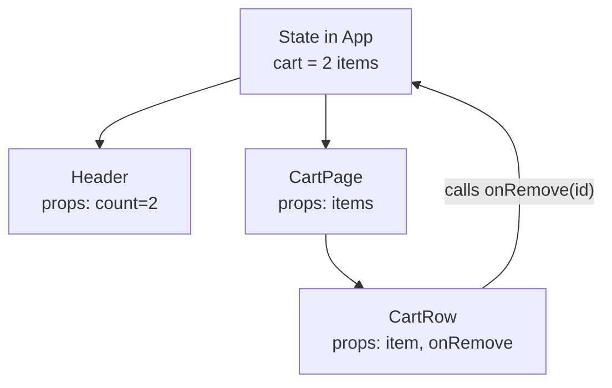
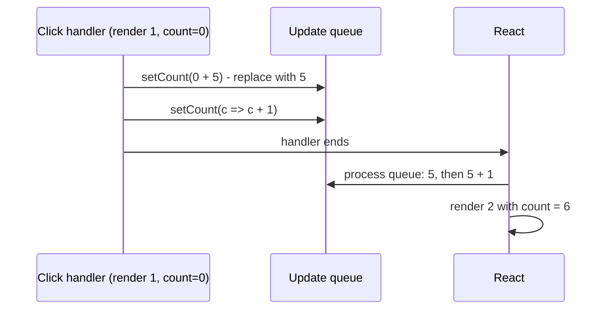
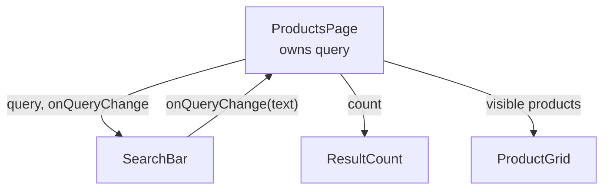

# React Fundamentals: JSX, Components, Props and State

> In this document you will learn the base of every React interview: what React is and why it exists, what JSX really compiles to, how components, props and state work, why state is a "snapshot", how events and conditional rendering work, and the small traps that output questions are built on (`setCount(count + 1)` three times, `0 &&`, mutating state). The concepts part is short. Most of the document is interview questions with spoken answers and follow-ups.

**Before this:** [React essentials](../05-frontend-engineering/08-react-essentials.md) (the short overview) · [Closures](../02-javascript/05-closures.md) · [Components and state management](../05-frontend-engineering/06-components-and-state-management.md) · **Interview questions:** [jump to the interview section](#interview-questions)

## Table of contents

1. [Concepts](#concepts)
   - [What React is and why it exists](#what-react-is-and-why-it-exists)
   - [Library vs framework](#library-vs-framework)
   - [JSX and what it compiles to](#jsx-and-what-it-compiles-to)
   - [JSX rules](#jsx-rules)
   - [JSX escaping and XSS](#jsx-escaping-and-xss)
   - [Components and pure rendering](#components-and-pure-rendering)
   - [Props](#props)
   - [State with useState](#state-with-usestate)
   - [State is a snapshot](#state-is-a-snapshot)
   - [Updating objects and arrays immutably](#updating-objects-and-arrays-immutably)
   - [Events](#events)
   - [Conditional rendering](#conditional-rendering)
   - [Lists and keys introduction](#lists-and-keys-introduction)
   - [Controlled and uncontrolled inputs introduction](#controlled-and-uncontrolled-inputs-introduction)
   - [Lifting state up](#lifting-state-up)
   - [Composition vs inheritance](#composition-vs-inheritance)
   - [StrictMode](#strictmode)
2. [Interview questions](#interview-questions)
3. [Quick revision](#quick-revision)
4. [Summary](#summary)
5. [References](#references)

> **Versions and verification.** Main target: **React 19** (19.0 released December 2024, 19.2 in October 2025, 19.3 in September 2026). React 18 differences are marked. All "what renders / what logs" answers in this document were checked by running the code with **React 19.3.1**, `react-dom/client`, `react-dom/server` and jsdom in Node.js 22 (development build). React 18 behavior was checked with React 18.3.1.

---

## Concepts

### What React is and why it exists

**React** is a JavaScript library for building user interfaces out of **components**. A component is a function that takes inputs (**props**) and returns a description of the UI (**JSX**).

The problem React solves: in a big app, many pieces of data change and many parts of the screen depend on them. If you update the DOM by hand, you must remember every place to change. You get bugs like "the cart badge says 3 but the cart page says 2".

React's answer has three ideas:

1. **Declarative UI.** You describe *what* the screen should look like for the current data. React works out *how* to change the DOM. The mental model is **UI = f(state)**.
2. **Components.** You split the UI into small, reusable pieces with a clear API (props in, events out).
3. **One-way data flow.** Data flows down from parent to child through props. Children ask parents to change data by calling functions the parent passed down. So for every piece of data there is one owner, and it is easy to find who changed it.



The arrow back up is not data. It is a **function call** (an event). The owner (`App`) updates its state, and the new data flows down again.

**Analogy.** A spreadsheet: you write the formula once (`=A1*B1`), and when a cell changes, every dependent cell updates by itself. You never "go and update C1". React components are formulas for the UI.

> **If you know Angular…** Angular is also component-based with one-way data flow (`@Input()` down, `@Output()` up). The big difference is *how change is detected*: Angular (v16, with Zone.js) checks template bindings after async events; React re-runs your component function when you call a state setter.

### Library vs framework

React itself handles only **rendering components and managing their state**. It does not include a router, an HTTP client, a forms library or a global store. You pick those (React Router, TanStack Query, axios, React Hook Form, Redux Toolkit), or you use a **framework built on React** such as Next.js or React Router in framework mode.

| | React (library) | Angular (framework) |
| --- | --- | --- |
| Scope | UI rendering + component state | Router, forms, HTTP, DI, testing, CLI included |
| Who controls the structure | You (or a React framework) | The framework |
| Components | Functions + hooks | Classes with decorators |
| Templates | JSX (JavaScript) | HTML templates with Angular syntax |
| Logic reuse | Custom hooks | Services + dependency injection |

"Library vs framework" in one sentence: **you call a library; a framework calls you.** React sits in the middle: it calls your components (inversion of control for rendering), but it does not decide your app structure. Since 2025 the React team recommends starting new apps with a framework (Next.js, React Router framework mode, Expo) or a build tool like Vite; Create React App was deprecated in February 2025.

### JSX and what it compiles to

**JSX** is a syntax extension: HTML-like tags inside JavaScript. Browsers cannot run it. A compiler (Babel, SWC, esbuild, TypeScript) converts it into normal function calls.

```jsx
const el = <h1 className="title">Hello, {name}</h1>;
```

With the **modern automatic JSX runtime** (React 17+, and required by React 19), this becomes:

```js
import { jsx as _jsx } from 'react/jsx-runtime';
const el = _jsx('h1', { className: 'title', children: ['Hello, ', name] });
```

With the **classic runtime** (old projects, needed `import React from 'react'` in every file):

```js
const el = React.createElement('h1', { className: 'title' }, 'Hello, ', name);
```

Both calls return a **React element**: a plain, small JavaScript object. Running it in React 19.3 gives:

```js
console.log(el.$$typeof); // Symbol(react.transitional.element)   (React 18: Symbol(react.element))
console.log(el.type);     // 'h1'
console.log(el.props);    // { className: 'title', children: [...] }
console.log(el.key);      // null
```

Important facts that come from "JSX is just objects":

- An element is a **description**, not a DOM node. Creating it does nothing on the screen.
- Elements are **immutable** (in development the props object is frozen; verified: `Object.isFrozen(el.props)` is `true`).
- `key` is **not** a prop. It is taken out and stored on the element (`el.key`).
- In React 19, `ref` **is** a normal prop for function components (`'ref' in el.props` is `true`). In React 18 it was taken out like `key`.
- `<Card />` with a capital letter compiles to `_jsx(Card, {})` (a variable). `<card />` compiles to `_jsx('card', {})` (a string, an HTML tag). That is why components must start with a capital letter.

### JSX rules

| Rule | Example | Why |
| --- | --- | --- |
| Return one root (or a Fragment) | `<>...</>`, `<Fragment key={id}>` | A function returns one value: one `jsx()` call |
| Close every tag | ``, `<br />`, `<Input />` | JSX is stricter than HTML |
| `className`, `htmlFor` | `<label htmlFor="email" className="lbl">` | `class` and `for` are reserved words in JavaScript; JSX uses DOM property names |
| camelCase attributes | `onClick`, `tabIndex`, `strokeWidth` | DOM property style; `aria-*` and `data-*` stay with dashes |
| `{}` for JavaScript expressions | `{user.name}`, `{total * 1.2}`, `{fmt(date)}` | Only **expressions**, not statements (`if`, `for`) |
| Strings without braces | `title="Save"` vs `count={3}` | `count="3"` passes the string `"3"`, not a number |
| `style` takes an object | `style={{ marginTop: 8 }}` | Outer braces = expression, inner braces = object |
| Comments | `{/* comment */}` | Inside JSX you are in "markup mode" |

What renders and what does not (checked with `renderToString`):

| Value in `{}` | Shown on screen? |
| --- | --- |
| `'text'`, `42`, `0`, `NaN` | Yes, as text (`0` and `NaN` too!) |
| `true`, `false`, `null`, `undefined` | Nothing |
| `''` (empty string) | Nothing visible |
| An array of elements | Each element (needs keys) |
| A plain object `{ a: 1 }` | **Error:** "Objects are not valid as a React child" |

### JSX escaping and XSS

Text inside `{}` is **escaped**. React inserts it as a text node, never as HTML. Verified output:

```jsx
renderToString(<p>{''}</p>);
// <p>&lt;img src=x onerror=&quot;alert(1)&quot;&gt;</p>   -> shown as text, no script runs
```

The escape hatch is `dangerouslySetInnerHTML`. The long name is on purpose: you are turning off the protection.

```jsx
// Only with HTML you trust or have sanitized (for example with DOMPurify)
<div dangerouslySetInnerHTML={{ __html: DOMPurify.sanitize(articleHtml) }} />
```

Two more holes that escaping does not close:

- **`javascript:` URLs** in `href`. React 19 blocks them: the verified server output replaces `href="javascript:alert(1)"` with code that throws "React has blocked a javascript: URL as a security precaution." React 18 only printed a warning. Still validate user URLs yourself (allow only `http:`/`https:`).
- Spreading untrusted objects into props (`<div {...userData} />`) can add `dangerouslySetInnerHTML` or event handlers. Never spread user input.

General XSS theory is in [Web security basics](../01-cs-and-web-fundamentals/08-browser-storage-and-web-security-basics.md).

### Components and pure rendering

A **function component** is a function that returns JSX. React calls it; you never call it yourself like `Card()`.

```jsx
function PriceTag({ amount, currency = 'EUR' }) {
  const formatted = new Intl.NumberFormat('en', { style: 'currency', currency }).format(amount);
  return <span className="price">{formatted}</span>;
}
```

**Rendering must be pure:**

- Same props + state + context → same JSX.
- No side effects during render: no API calls, no `localStorage` writes, no changing variables outside the component, no DOM changes.

Why? React may call your component **more than once** for one screen update (Strict Mode calls it twice in development; concurrent rendering may start a render and throw it away). A side effect in render would run an unknown number of times.

Where side effects go: **event handlers** (first choice: "user clicked Save → send request") or **effects** (`useEffect`, to synchronize with an outside system). Effects are covered in [Hooks in depth](03-hooks-in-depth.md).

**Class components** still exist in old code (`class Card extends React.Component { render() {...} }`). New code uses functions and hooks. The only thing that still *needs* a class is an **error boundary** (or a library like `react-error-boundary` that wraps one).

### Props

**Props** are the inputs of a component: an object React passes as the first argument.

```jsx
function UserCard({ user, size = 48, onSelect, children }) {
  return (
    <article onClick={() => onSelect(user.id)}>
      
      <h3>{user.name}</h3>
      {children}
    </article>
  );
}

<UserCard user={u} onSelect={openProfile}>
  <Badge>Admin</Badge>
</UserCard>
```

Rules and facts:

- **Props are read-only.** Never do `props.user.name = 'x'`. That mutates the parent's data behind its back.
- **Any value** can be a prop: strings, numbers, objects, functions, JSX.
- **`children`** is the content between the tags. It can be text, elements, an array, or even a function.
- **Default values:** use JavaScript default parameters (`size = 48`). In React 19, `defaultProps` on **function** components is ignored (verified: `B.defaultProps = { label: 'default' }` renders `undefined`, with no warning). Class components still support `static defaultProps`.
- **`propTypes`** checks are removed in React 19 (silently ignored). Use TypeScript.
- **Prop drilling** is passing a prop through many components that do not use it, only to reach a deep child. Fixes: composition (pass JSX as `children`), context, or a store. See [State management](05-state-management-context-redux-toolkit-and-zustand.md).

### State with useState

**State** is a component's memory: data that survives between renders and that, when changed with its setter, makes React render again.

```jsx
import { useState } from 'react';

function LikeButton() {
  const [likes, setLikes] = useState(0);      // [current value, setter]
  return <button onClick={() => setLikes(likes + 1)}>Likes: {likes}</button>;
}
```

Why not `let likes = 0`? Two reasons: a local variable is recreated (reset) on every render, and changing it does not tell React to render again.

State is **local and private** to each instance. Two `<LikeButton />` on the page have two separate counters.

### State is a snapshot

This is the most important idea in this document.

When React calls your component, it gives you the state **for that render**. Inside that render, `likes` is a **constant**. Calling the setter does not change the variable. It asks React to render again later with a new value.

```jsx
function handleClick() {
  setCount(count + 1);   // "next render: count = 0 + 1"
  setCount(count + 1);   // "next render: count = 0 + 1"
  setCount(count + 1);   // "next render: count = 0 + 1"
  console.log(count);    // 0  - still this render's snapshot
}
// After one click the screen shows 1 (verified)
```

React keeps a **queue** of updates for the next render:

- A **value** (`setCount(5)`) means "replace with 5".
- A **function** (`setCount(c => c + 1)`) is an **updater**: "take the latest queued value and compute the next one".

```jsx
setCount(c => c + 1); setCount(c => c + 1); setCount(c => c + 1); // 3 (verified)
setCount(count + 5); setCount(c => c + 1);                        // 6 (verified)
setCount(count + 5); setCount(c => c + 1); setCount(42);          // 42 (verified)
setCount(c => c + 1); setCount(count + 10);                       // 10 (verified)
```



The snapshot also explains closures in async code: a `setTimeout` created in render 1 sees render 1's values forever (verified: after a click, the timeout logged `0` while the screen showed `1`). This is the root of **stale closures**, covered deeply in [Hooks in depth](03-hooks-in-depth.md).

### Updating objects and arrays immutably

React decides "did state change?" with `Object.is(oldValue, newValue)`. For objects, that compares **references**. If you mutate the object and pass the same object back, React sees "same value" and skips the render.

Verified behavior:

```jsx
const [cart, setCart] = useState({ items: [] });

cart.items.push(item);  // mutation
setCart(cart);          // same reference -> React bails out: no re-render, screen still shows 0

setCart({ ...cart, items: [...cart.items, item] }); // new object -> re-render
```

Common immutable patterns:

```jsx
// Add
setTodos(prev => [...prev, newTodo]);
// Remove
setTodos(prev => prev.filter(t => t.id !== id));
// Update one item
setTodos(prev => prev.map(t => (t.id === id ? { ...t, done: !t.done } : t)));
// Update a nested field
setUser(prev => ({ ...prev, address: { ...prev.address, city: 'Pune' } }));
// Sort without mutating (ES2023)
const sorted = todos.toSorted((a, b) => a.title.localeCompare(b.title));
```

`useState` does **not merge** objects like the old class `this.setState` did. `setForm({ name: 'B' })` *replaces* the whole object (verified: `email` disappears). Spread the old value: `setForm(prev => ({ ...prev, name: 'B' }))`.

For deep nesting, libraries like **Immer** let you write "mutating" code that produces a new object (Redux Toolkit uses Immer inside).

### Events

```jsx
function SearchForm({ onSearch }) {
  function handleSubmit(e) {
    e.preventDefault();                      // stop the browser's full page reload
    onSearch(new FormData(e.currentTarget).get('q'));
  }
  return (
    <form onSubmit={handleSubmit}>
      <input name="q" aria-label="Search" />
      <button type="submit">Search</button>
    </form>
  );
}
```

Facts:

- Handlers are **camelCase props** that take a **function**: `onClick={handleClick}`, not `onClick={handleClick()}` (that calls it during render; verified: the function ran once during render, before any click).
- To pass arguments, wrap in an arrow function: `onClick={() => remove(item.id)}`.
- React passes a **SyntheticEvent** (verified class name: `SyntheticBaseEvent`): a cross-browser wrapper with the usual `preventDefault()`, `stopPropagation()`, `target`, `currentTarget`, and `nativeEvent` for the original event.
- **Event delegation:** React 17+ attaches one listener per event type on the **root container**, not on each element, and dispatches to your handlers. (React 16 attached to `document`.)
- **Event pooling is gone** (since React 17). `e.persist()` still exists but does nothing; you can read the event in async code.
- Events **bubble** through the React tree, even through portals (a click inside a modal portal bubbles to the React parent, not the DOM parent).

### Conditional rendering

```jsx
function OrdersPanel({ status, orders }) {
  if (status === 'loading') return <Spinner />;           // 1. early return
  return (
    <section>
      {orders.length === 0 ? <EmptyState /> : <OrderTable orders={orders} />} {/* 2. ternary */}
      {orders.length > 0 && <ExportButton />}                                 {/* 3. && with a boolean */}
    </section>
  );
}
```

The famous trap, verified with `renderToString`:

```jsx
<div>{items.length && <p>list</p>}</div>   // items = []  ->  <div>0</div>
```

`0 && x` evaluates to `0`, and React renders numbers. `NaN && x` renders `NaN` too. Use a real boolean: `items.length > 0 &&`, `!!items.length &&`, or a ternary.

A component can return `null` to render nothing. Note that **hiding** a component (`{show && <Panel />}`) **unmounts** it and its state is lost; showing it again starts fresh (verified: a counter at 2 came back as 0). If you need to keep state while hidden, use CSS, or React 19.2's `<Activity mode="hidden">` (see [React 18 and 19 features](04-react-18-and-19-concurrent-features-and-server-components.md)).

### Lists and keys introduction

```jsx
<ul>
  {todos.map(todo => <TodoItem key={todo.id} todo={todo} />)}
</ul>
```

A **key** tells React which item is which between renders, so each item keeps its own state and DOM node when the list changes. Use a stable unique id from the data. Index keys break when items are inserted, removed or reordered (verified: a note typed next to "Buy milk" jumped to "Call mom" after inserting at the top). Keys need to be unique only among siblings. The full story (reconciliation, why, key to reset state) is in [Rendering, reconciliation and keys](02-rendering-reconciliation-and-keys.md).

### Controlled and uncontrolled inputs introduction

- **Controlled:** React state is the source of truth: `value={email}` + `onChange`. You can validate or transform on every keystroke (verified: `onChange={e => setV(e.target.value.toUpperCase())}` makes the input show `ABC` when the user types `abc`).
- **Uncontrolled:** the DOM keeps the value: `defaultValue`, read it with a ref or `FormData` on submit. File inputs are always uncontrolled.

Two warnings you will see (both verified in React 19.3):

- `value` without `onChange` → "You provided a `value` prop to a form field without an `onChange` handler. This will render a read-only field."
- `value` going from `undefined` to a string → "A component is changing an uncontrolled input to be controlled." Fix: initialize with `''`, not `undefined`.

Forms in depth (React Hook Form, Zod, form Actions) are in [Routing and forms](07-routing-and-forms.md).

### Lifting state up

When two components need the same data, move the state to their **closest common parent** and pass it down as props, with callbacks to change it.

```jsx
function Accordion() {
  const [openId, setOpenId] = useState('shipping');   // the parent owns "which panel is open"
  return (
    <>
      <Panel title="Shipping" isOpen={openId === 'shipping'} onOpen={() => setOpenId('shipping')} />
      <Panel title="Returns"  isOpen={openId === 'returns'}  onOpen={() => setOpenId('returns')} />
    </>
  );
}

function Panel({ title, isOpen, onOpen, children }) {
  return (
    <section>
      <h3><button aria-expanded={isOpen} onClick={onOpen}>{title}</button></h3>
      {isOpen && <div>{children}</div>}
    </section>
  );
}
```

`Panel` is now **controlled** by its parent: it has no state of its own. This is the same "data down, events up" rule. The general theory is in [Components and state management](../05-frontend-engineering/06-components-and-state-management.md#state-ownership-and-lifting-state-up).

### Composition vs inheritance

React components are reused by **composition** (putting components inside components), not by class inheritance. The old React documentation said that, across thousands of components at Facebook, the team found no case where it would recommend component inheritance hierarchies.

Three composition tools:

```jsx
// 1. children: a generic container
function Card({ children }) { return <div className="card">{children}</div>; }

// 2. "slots": several JSX props
function Layout({ header, sidebar, children }) {
  return <div className="layout"><header>{header}</header><aside>{sidebar}</aside><main>{children}</main></div>;
}
<Layout header={<NavBar />} sidebar={<Filters />}><ProductGrid /></Layout>

// 3. specialization: a specific component renders a generic one with fixed props
function DangerButton(props) { return <Button variant="danger" {...props} />; }
```

Composition also fixes **prop drilling** without context: instead of passing `user` through `Layout` to reach `Avatar`, pass `<Avatar user={user} />` as a slot. `Layout` never needs to know about `user`.

> **If you know Angular…** `children` is like content projection (`<ng-content>`), and named JSX props are like `<ng-content select="[header]">` slots.

### StrictMode

```jsx
import { StrictMode } from 'react';
import { createRoot } from 'react-dom/client';

createRoot(document.getElementById('root')).render(
  <StrictMode>
    <App />
  </StrictMode>,
);
```

`<StrictMode>` is a **development-only** checker. It has no effect in production. In development it:

1. **Renders components twice** (and calls state initializers, `useMemo` functions and reducers twice) to find impure render code. Verified: one mount = 2 calls to the component function.
2. **Runs effects setup → cleanup → setup** once on mount to find missing cleanups (also ref callbacks in React 19).
3. Warns about deprecated APIs.

If your app breaks under Strict Mode, it has a real bug (a missing cleanup, or a side effect in render). Details in [Rendering, reconciliation and keys](02-rendering-reconciliation-and-keys.md) and [Hooks in depth](03-hooks-in-depth.md).

---

## Interview questions

How to use this section: read the question, say your answer out loud first, then compare with **What to say**. Answers are written to be spoken in 30–60 seconds. For the general method (define → why → how → example → trade-off), see [How to explain technical answers](../11-coding-interviews/01-how-to-explain-technical-answers.md).

### Q1. What is React, and why would you use it?

**What the interviewer is checking:** That you can explain the core idea (declarative, component-based UI) in your own words, not recite marketing.

**What to say (30–60 seconds):**
> "React is a JavaScript library for building user interfaces from components. A component is a function that takes props and returns JSX, which describes what the UI should look like for the current data. The key idea is that UI is a function of state: I don't update the DOM by hand; I change state, React calls my components again, compares the new description with the old one and updates only what changed in the DOM. I'd use it because it makes complex, frequently changing UIs predictable: data flows one way from parent to child, each piece of state has one owner, and components are easy to reuse and test. It also has a huge ecosystem and React Native for mobile."

**Deeper explanation:** Compare imperative and declarative code for the same feature, a cart badge:

```js
// Imperative: you must remember every place that depends on the count
function addToCart(item) {
  cart.push(item);
  document.querySelector('#badge').textContent = cart.length;
  document.querySelector('#total').textContent = sum(cart);
  if (cart.length === 1) document.querySelector('#empty').remove();
}
```

```jsx
// Declarative: describe the UI for any state; React keeps the DOM in sync
function CartSummary({ items }) {
  return (
    <>
      <span className="badge">{items.length}</span>
      {items.length === 0 ? <p>Your cart is empty</p> : <p>Total: {sum(items)}</p>}
    </>
  );
}
```

In the declarative version there is no "update" code at all. You only describe the result.

**Follow-up questions and how to answer them:**
- **"Is React fast because of the virtual DOM?"** — Not exactly. Hand-written DOM updates can be faster. React's value is a simple programming model with good-enough performance, plus the ability to schedule work (concurrent rendering). The virtual DOM is the mechanism that makes declarative code practical.
- **"What does 'one-way data flow' mean?"** — Data goes down through props. A child cannot change the parent's data directly; it calls a function the parent gave it, and the parent updates its own state. This makes it easy to find who changed what.
- **"When would you not use React?"** — A mostly static content site (plain HTML, or a static site generator with little JavaScript), or a tiny widget where a framework adds more weight than value.

**Common mistakes / weak answers:** "React is a framework made by Facebook" (it is a library, and the history is not the point). "Virtual DOM makes it faster than everything." Not mentioning state or components.

**Real-project example:** A dashboard where filters, a table, a chart and a summary all depend on the same data: in React, each is a component reading the same state, and they can never get out of sync.

### Q2. Is React a library or a framework? How does it compare to Angular?

**What the interviewer is checking:** That you understand React's scope and can compare tools fairly (common for candidates with Angular experience).

**What to say (30–60 seconds):**
> "React itself is a library: it does rendering and component state. It doesn't ship a router, HTTP client, forms or a global store, so I choose those, for example React Router, TanStack Query, React Hook Form and Redux Toolkit, or I use a framework built on React like Next.js. Angular is a full framework: router, forms, HttpClient, dependency injection and testing tools are built in, with TypeScript and class components. The biggest technical difference is change detection: React re-renders a component when I call a state setter and diffs the result, while Angular 16 uses Zone.js to run change detection after async events and checks template bindings. React gives flexibility and a big ecosystem; Angular gives one consistent structure, which big teams like."

**Deeper explanation:** Mapping concepts helps when you know both:

| Angular | React |
| --- | --- |
| `@Input()` | props |
| `@Output()` + `EventEmitter` | callback props (`onSave`) |
| `<ng-content>` | `children` |
| `*ngIf`, `*ngFor` / `@if`, `@for` | `&&`, ternary, `.map()` |
| Service + DI | Custom hook, context |
| `ngOnInit` / `ngOnDestroy` | `useEffect` setup / cleanup |
| NgRx | Redux Toolkit |

**Follow-up questions and how to answer them:**
- **"Is Next.js a library or a framework?"** — A framework. It decides routing (file-based), rendering (server components, SSR, static), data fetching and the build. React is the UI layer inside it.
- **"Which would you choose for a new enterprise app?"** — It depends on team skills and needs. If the team knows Angular and wants everything built in, Angular. If they want flexibility, server rendering with Next.js, or React Native for mobile, React. I'd mention that the choice of supporting libraries is a real cost in React: someone must decide and maintain the stack.

**Common mistakes / weak answers:** Saying one is simply "better". Claiming React has no structure at all (frameworks like Next.js give it structure).

**Real-project example:** Teams moving from Angular to React often first build a "stack decision" document: router, data layer, forms, state, testing, because React does not decide these for you.

### Q3. What is JSX, and what does it compile to?

**What the interviewer is checking:** That you know JSX is syntax sugar for function calls that create plain objects, and the consequences.

**What to say (30–60 seconds):**
> "JSX is a syntax extension that lets me write HTML-like markup inside JavaScript. Browsers can't run it, so a compiler like Babel, SWC or esbuild turns each tag into a function call. With the modern automatic runtime, `<h1 className="title">Hi</h1>` becomes `jsx('h1', { className: 'title', children: 'Hi' })`, imported from `react/jsx-runtime`; in the old classic runtime it was `React.createElement`. These calls return React elements, which are plain immutable objects with a type, props and key. They're only a description of the UI; React later turns them into DOM. Because JSX is JavaScript, I use curly braces for expressions, `className` instead of `class`, and `map` instead of loops."

**Deeper explanation:**

```jsx
const ui = (
  <ul className="list">
    <li key="a">Apple</li>
  </ul>
);
```

```js
// Automatic runtime output (simplified)
import { jsx as _jsx } from 'react/jsx-runtime';
const ui = _jsx('ul', {
  className: 'list',
  children: _jsx('li', { children: 'Apple' }, 'a'), // key is a separate argument
});
// ui is an object like:
// { $$typeof: Symbol(react.transitional.element), type: 'ul', key: null, props: { className: 'list', children: {...} } }
```

Verified with React 19.3: `$$typeof` is `Symbol(react.transitional.element)` (React 18 used `Symbol(react.element)`); the dev props object is frozen; `key` is not in `props`.

Why the `$$typeof` symbol? Security. JSON cannot contain symbols, so if an attacker stores a fake "element" object in your database and your server sends it as JSON, React will refuse to render it as an element.

**Follow-up questions and how to answer them:**
- **"Why did old code need `import React from 'react'` in every file?"** — The classic runtime compiled JSX to `React.createElement`, so `React` had to be in scope. The automatic runtime (React 17+) imports `jsx` by itself. React 19 requires the modern JSX transform.
- **"Can you use React without JSX?"** — Yes, call `createElement` directly. JSX is only for readability.
- **"Why `className` and not `class`?"** — JSX is JavaScript, and `class` is a reserved word. JSX follows DOM property names (`element.className`, `htmlFor`).
- **"What is a Fragment?"** — A wrapper that renders no DOM element, `<>...</>`. Use `<Fragment key={id}>` when you need a key, for example in a list of pairs like `<dt>`/`<dd>`.

**Common mistakes / weak answers:** "JSX is HTML in JavaScript" (it is not HTML; it is function calls). "JSX creates DOM nodes" (it creates objects). Not knowing about the new runtime.

**Real-project example:** Understanding that elements are just objects explains why you can store JSX in variables, pass it as props (`icon={<SearchIcon />}`) and return it from functions.

### Q4. Why must component names start with a capital letter?

**Short answer:** Because of how JSX compiles. A lowercase tag becomes a **string** (`<button />` → `jsx('button')`), which React treats as an HTML element. A capitalized tag becomes a **variable reference** (`<Button />` → `jsx(Button)`), which React calls as a component. If you name a component `button`, React will render a plain `<button>` and ignore your function. You can also use dot notation for namespaced components: `<Menu.Item />`.

### Q5. What is the difference between a component, an element and an instance?

**What the interviewer is checking:** Precise vocabulary; it reveals whether you understand how React works inside.

**What to say (30–60 seconds):**
> "A component is the function or class I write, like `function Card(props)`. An element is the plain object returned by JSX, like `<Card title="x" />`; it just says 'I want a Card with these props here'. Elements are cheap and immutable, and a new set is created on every render. An instance is what React keeps internally for a component placed in the tree: its state, its hooks, its refs. For function components, React stores this in an internal object called a fiber. So the component is the blueprint, the element is the order form, and the instance is the actual thing React keeps alive between renders."

**Deeper explanation:**

```jsx
function Card({ title }) { return <h2>{title}</h2>; }  // component (the blueprint)

const el = <Card title="Hello" />;                     // element: { type: Card, props: { title: 'Hello' } }

// Rendering <Card /> twice in a tree creates two instances, each with its own state:
<>
  <Card title="A" />
  <Card title="B" />
</>
```

State belongs to the **instance at a position in the tree**, not to the component function and not to the element. That is why the same component at the same position keeps its state, and a different position (or a different key) gets fresh state. See [Rendering, reconciliation and keys](02-rendering-reconciliation-and-keys.md).

**Follow-up questions and how to answer them:**
- **"Can you call a component as a function, like `{Card({ title: 'x' })}`?"** — It returns JSX, so it "works", but React does not see it as a component: its hooks become part of the parent's hooks, so the rules of hooks break if it is called conditionally, and it gets no own instance, key or DevTools entry. Always render it as `<Card />`.
- **"Where does React store hook state?"** — On the fiber (the instance), as a linked list in call order. That is why hooks must be called in the same order every render. See [Hooks in depth](03-hooks-in-depth.md).

**Common mistakes / weak answers:** Using "component" and "element" as the same word. Saying "state lives in the function".

**Real-project example:** Explaining why two `<Counter />` components on a page do not share a count, even though they are the same function.

### Q6. Why can't you write an `if` statement inside JSX?

**Short answer:** JSX attributes and children compile to function **arguments**, and an argument must be an **expression**. `if`, `for` and `switch` are **statements**. Use expressions instead: a ternary (`a ? <A /> : <B />`), `&&` with a real boolean, `.map()` for loops, or compute a variable *before* the `return` with a normal `if`. Early returns (`if (loading) return <Spinner />;`) are also fine because they are outside JSX.

### Q7. How does React protect against XSS? When is that protection not enough?

**What the interviewer is checking:** Security awareness; senior candidates must know the escape hatches.

**What to say (30–60 seconds):**
> "React escapes every value I put in curly braces: it inserts it as text, not HTML, so a string like an `` tag is shown literally and nothing runs. The protection stops in a few places. First, `dangerouslySetInnerHTML`, which inserts raw HTML; I only use it with trusted or sanitized HTML, for example through DOMPurify. Second, URLs: an `href` with a `javascript:` URL could run code; React 19 blocks those, but I still validate user URLs and allow only http and https. Third, spreading untrusted objects into props. And of course server-side issues like injecting data into a script tag during SSR are outside React's protection."

**Deeper explanation:** Verified with `react-dom/server` in React 19.3:

```jsx
renderToString(<p>{''}</p>);
// <p>&lt;img src=x onerror=&quot;alert(1)&quot;&gt;</p>

renderToString(<a href={'javascript:alert(1)'}>x</a>);
// <a href="javascript:throw new Error('React has blocked a javascript: URL as a security precaution.')">x</a>
```

A safe link helper:

```jsx
function SafeLink({ href, children }) {
  let safe = '#';
  try {
    const url = new URL(href, window.location.origin);
    if (url.protocol === 'http:' || url.protocol === 'https:') safe = url.href;
  } catch { /* invalid URL: keep '#' */ }
  return <a href={safe} rel="noopener noreferrer">{children}</a>;
}
```

**Follow-up questions and how to answer them:**
- **"We receive HTML from a CMS. How do you render it?"** — Sanitize it with a well-tested library like DOMPurify (ideally on the server too), then use `dangerouslySetInnerHTML`. Add a Content Security Policy as a second line of defense. React 19.3 also supports Trusted Types, so a strict CSP with `require-trusted-types-for 'script'` works with React.
- **"Is `<div {...props} />` dangerous?"** — If `props` can come from users, yes: they could pass `dangerouslySetInnerHTML` or `style` values. Pick the props you need explicitly.

**Common mistakes / weak answers:** "React makes XSS impossible." Not knowing about `javascript:` URLs.

**Real-project example:** A comments feature rendering Markdown: convert to HTML, sanitize, then render, never insert raw user HTML.

### Q8. What is the difference between props and state?

**What the interviewer is checking:** The basic data model, and whether you understand ownership.

**What to say (30–60 seconds):**
> "Props are inputs a component receives from its parent; they're read-only for the component. State is data the component owns and remembers between renders; it changes through the setter, and each change triggers a re-render. A simple rule: if the parent decides the value, it's a prop; if the component itself decides and changes it over time, it's state. Often one component's state becomes another component's props: the parent stores `selectedId` in state and passes it to children as a prop. Both cause re-renders when they change, but only the owner can change state."

**Deeper explanation:**

| | Props | State |
| --- | --- | --- |
| Who owns it | The parent | The component itself |
| Can the component change it? | No (read-only) | Yes, with the setter |
| How it changes | Parent re-renders with new props | `setX(...)` |
| Initial value | Whatever the parent passes | `useState(initial)` |
| Typical content | Configuration, data to show, callbacks | UI state: open/closed, input text, selected tab |

Also know the third category: values you can **compute** from props or state are neither. Compute them during render.

```jsx
function ProductList({ products }) {                  // props
  const [query, setQuery] = useState('');            // state
  const visible = products.filter(p => p.name.includes(query)); // derived: not state
  return <>{/* ... */}</>;
}
```

**Follow-up questions and how to answer them:**
- **"Can you initialize state from a prop?"** — Yes, `useState(props.initialColor)`, but only the **first** value is used; later prop changes are ignored. Name the prop `initialX` or `defaultX` to make that clear. If you need it to follow the prop, do not copy it into state at all; use the prop directly.
- **"How do you reset state when a prop changes?"** — Give the component a `key` based on that prop (`<Form key={userId} />`), so React creates a fresh instance.

**Common mistakes / weak answers:** "Props are for functional components, state is for class components" (outdated). Copying props into state "to be safe".

**Real-project example:** A `<DatePicker value onChange />` receives the selected date as a prop (the form owns it), but keeps "is the calendar popup open" as its own state.

### Q9. Why are props read-only? What if a child needs to change data?

**What the interviewer is checking:** One-way data flow and purity.

**What to say (30–60 seconds):**
> "Props belong to the parent. If a child mutated them, it would change the parent's data without the parent knowing: React wouldn't re-render, other children using the same object would show inconsistent data, and debugging would be very hard. React components must behave like pure functions with respect to their props. When a child needs to change data, the owner passes down a callback, like `onChange` or `onRemove`, and the child calls it. The owner updates its own state immutably and the new value flows down. That's 'data down, events up'."

**Deeper explanation:**

```jsx
// Find the bug
function QuantityInput({ item }) {
  return <button onClick={() => { item.qty += 1; }}>{item.qty}</button>;  // mutates the parent's object, no re-render
}

// Fix: the owner provides an event
function CartRow({ item, onQtyChange }) {
  return <button onClick={() => onQtyChange(item.id, item.qty + 1)}>{item.qty}</button>;
}

function Cart() {
  const [items, setItems] = useState(initialItems);
  const handleQtyChange = (id, qty) =>
    setItems(prev => prev.map(i => (i.id === id ? { ...i, qty } : i)));
  return items.map(i => <CartRow key={i.id} item={i} onQtyChange={handleQtyChange} />);
}
```

**Follow-up questions and how to answer them:**
- **"Does React stop me from mutating props?"** — Partly. In development the top-level props object of an element is frozen, so `props.x = 1` throws in strict mode. Nested objects are **not** frozen, so `props.item.qty++` silently works and causes bugs.
- **"What is the naming convention for callbacks?"** — Props are `onSomething` (`onSave`), handlers inside the component are `handleSomething` (`handleSave`).

**Common mistakes / weak answers:** "You can change props but it's bad practice" without explaining why. Not mentioning callbacks.

**Real-project example:** A table row with an "edit" button calls `onEdit(row.id)`; the page that owns the data opens the edit dialog.

### Q10. What is the `children` prop? How do you use composition?

**What the interviewer is checking:** Whether you design flexible components or build "god components" with many flags.

**What to say (30–60 seconds):**
> "`children` is whatever I put between a component's opening and closing tags. It lets a component be a container that doesn't know what's inside, like a `Card`, `Modal` or `Layout`. For more than one slot, I pass JSX through named props, like `header` and `footer`. This is composition: building bigger components by nesting smaller ones instead of adding boolean flags or using inheritance. It also helps with prop drilling, because the parent can create the deep child directly and pass it in, so the middle layers don't need to forward its props. And it helps performance: elements passed as children don't re-render when the wrapper's own state changes."

**Deeper explanation:**

```jsx
function Modal({ title, footer, children, onClose }) {
  return (
    <div role="dialog" aria-modal="true" aria-labelledby="modal-title">
      <h2 id="modal-title">{title}</h2>
      <div className="modal-body">{children}</div>
      <footer>{footer ?? <button onClick={onClose}>Close</button>}</footer>
    </div>
  );
}

<Modal title="Delete order?" onClose={close} footer={<DangerButton onClick={confirm}>Delete</DangerButton>}>
  <p>This cannot be undone.</p>
</Modal>
```

The performance part, verified by counting renders: a `Wrapper` with its own counter state re-rendered, but the `<Expensive />` passed as `children` rendered **0 times**, because the element was created by the parent, which did not re-render.

**Follow-up questions and how to answer them:**
- **"What types can `children` be?"** — Anything renderable: a string, an element, an array, `null`, or even a function (the "render prop" pattern: `children(data)`). Do not assume it is a single element; use `Children` utilities rarely and prefer explicit props.
- **"Children vs render props vs custom hooks?"** — `children` for layout and containers; render props when the parent must give data back to the content (older pattern); custom hooks for reusing logic without changing the tree. See [Patterns, architecture and TypeScript](09-patterns-architecture-and-typescript.md).

**Common mistakes / weak answers:** A `Card` with ten props like `showHeader`, `headerText`, `showIcon`, `iconName` instead of slots.

**Real-project example:** A design system's `Dialog`, `Card` and `PageLayout` components all accept `children` and slot props, so product teams can put any content in them.

### Q11. How do you set default prop values in React 19?

**Short answer:** Use **JavaScript default parameters** in destructuring: `function Button({ variant = 'primary', size = 'md' })`. In React 19, `defaultProps` on function components was **removed** (verified: it is silently ignored, the prop is `undefined`). React 18.3 printed a deprecation warning. Class components still support `static defaultProps`. Note that a default parameter applies only when the prop is `undefined`, not when it is `null`.

### Q12. Output question: what does this log, and what does the button show after one click?

```jsx
function Counter() {
  const [count, setCount] = useState(0);
  function handleClick() {
    setCount(count + 1);
    setCount(count + 1);
    setCount(count + 1);
    console.log(count);
  }
  return <button onClick={handleClick}>{count}</button>;
}
```

**What the interviewer is checking:** The state snapshot model and the update queue.

**What to say (30–60 seconds):**
> "It logs `0`, and the button shows `1`. Inside this render, `count` is a constant: it's 0 for the whole event handler. Each `setCount(count + 1)` is really `setCount(0 + 1)`, so I queue 'replace with 1' three times. The setter doesn't change the variable immediately, so the log prints the old snapshot, 0. React batches the three updates into one re-render, and in that render `count` is 1. If I wanted 3, I'd use the updater form, `setCount(c => c + 1)`, because each updater receives the result of the previous one."

**Deeper explanation:** Verified by running in React 19.3: first click logs `0` and shows `1`; second click logs `1` and shows `2`.

The queue model, step by step:

1. Render 1: `count = 0`.
2. Click: the queue becomes `[1, 1, 1]` (three "replace with 1").
3. `console.log(count)` → `0`.
4. React processes the queue: `1`, then `1`, then `1`. Result: `1`.
5. Render 2: `count = 1`. One render, not three (batching).

**Follow-up questions and how to answer them:**
- **"How many times does the component re-render after the click?"** — Once. React batches all updates from the same event into one render (and since React 18 also in timeouts and promises). Details and verified counts: [Automatic batching and flushSync](02-rendering-reconciliation-and-keys.md#automatic-batching-and-flushsync).
- **"Why does React work this way instead of updating immediately?"** — If every setter re-rendered immediately, a handler with three updates would render three times with half-updated data. Snapshots make each render consistent, and batching makes it fast.
- **"How do I get the new value right after setting it?"** — You do not read it back; you compute it: `const next = count + 1; setCount(next); doSomething(next);`. If you need the DOM updated right now, `flushSync` exists, but it is rarely needed.

**Common mistakes / weak answers:** Saying "3" or "it logs 1". Saying "setState is async" without explaining snapshots; the real reason is that `count` is a constant in this render's closure.

**Real-project example:** A "+1" quantity button that is clicked quickly works only with the updater form when several updates happen in one event.

### Q13. Output question: four variants of queued updates

Starting from `count = 0`, what is `count` after one click for each handler?

```jsx
// a
setCount(c => c + 1); setCount(c => c + 1); setCount(c => c + 1);
// b
setCount(count + 5); setCount(c => c + 1);
// c
setCount(count + 5); setCount(c => c + 1); setCount(42);
// d
setCount(c => c + 1); setCount(count + 10);
```

**Short answer (all verified by running):** **a = 3**, **b = 6**, **c = 42**, **d = 10**.

Rule: React processes the queue in order. A **value** replaces the current result. A **function** receives the current result. In (d), the updater gives 1, then "replace with `0 + 10`" gives 10, because `count` in the handler is still the snapshot 0.

### Q14. Why do we say state is a "snapshot"? What does this alert show?

```jsx
function Messenger() {
  const [to, setTo] = useState('Alice');
  function handleSend() {
    setTimeout(() => alert(`Sent to ${to}`), 3000);
  }
  return (
    <>
      <select value={to} onChange={e => setTo(e.target.value)}>
        <option>Alice</option><option>Bob</option>
      </select>
      <button onClick={handleSend}>Send</button>
    </>
  );
}
```

The user clicks Send while "Alice" is selected, then switches to "Bob" within 3 seconds.

**What the interviewer is checking:** Closures plus the snapshot model.

**What to say (30–60 seconds):**
> "The alert says 'Sent to Alice'. Every render has its own props, state and event handlers. The `handleSend` that was clicked was created in the render where `to` was 'Alice', and the timeout callback closes over that variable. Changing the select causes a new render with a new `to` and new functions, but it doesn't change the old closure. This is actually the behavior you want for a 'send' action: it sends what the user saw when they clicked. If I really needed the latest value later, I'd read it from a ref that I keep updated."

**Deeper explanation:** Verified in a similar test: after one click on a counter, a `setTimeout` created in that handler logged `0` while the screen showed `1`.

Think of each render as a photo. Event handlers are part of the photo. Later state changes produce a **new** photo; they do not edit the old one. The JavaScript mechanism is closures: see [Closures](../02-javascript/05-closures.md).

```jsx
// If you need "latest value" behavior:
const toRef = useRef(to);
toRef.current = to;           // better: update it in an effect or in the change handler
setTimeout(() => alert(`Sent to ${toRef.current}`), 3000);
```

**Follow-up questions and how to answer them:**
- **"Is this a bug or a feature?"** — Usually a feature (consistent behavior). It becomes a bug in long-lived callbacks such as intervals and subscriptions created once in an effect: those are **stale closures**. See [Hooks in depth](03-hooks-in-depth.md).
- **"How did class components behave here?"** — `this.state.to` would be read at alert time, so it would say "Bob". That looked convenient but caused bugs, because `this` is mutable.

**Common mistakes / weak answers:** "Bob, because state updated." Saying "React is async" without mentioning closures.

**Real-project example:** A "Send" or "Pay" button should use the values the user confirmed at click time, not values changed afterwards.

### Q15. Find the bug: the list does not update when I add an item.

```jsx
function TodoApp() {
  const [todos, setTodos] = useState([]);
  function addTodo(title) {
    todos.push({ id: crypto.randomUUID(), title });
    setTodos(todos);
  }
  // ...
}
```

**What the interviewer is checking:** Immutability and how React detects changes.

**What to say (30–60 seconds):**
> "The code mutates the existing array and then passes the same array back to the setter. React compares the old and new state with `Object.is`, and since it's the same reference, it decides nothing changed and skips the re-render. So the item is in the array, but the screen doesn't update until something else causes a render. The fix is to create a new array: `setTodos(prev => [...prev, newTodo])`. Immutable updates also matter beyond this bug: `React.memo`, `useMemo` dependencies and selectors all rely on 'new reference means changed'."

**Deeper explanation:** Verified: after the mutating click, the component rendered **0** extra times and still showed 0 items. After a later immutable update, it rendered and showed 2 items (the hidden mutation and the new item), which is exactly the kind of confusing bug mutation creates.

```jsx
function addTodo(title) {
  setTodos(prev => [...prev, { id: crypto.randomUUID(), title }]);   // create the id in the handler, not in render
}
```

Array methods cheat sheet:

| Mutates (avoid on state) | Returns a new array (use) |
| --- | --- |
| `push`, `unshift` | `[...arr, x]`, `[x, ...arr]` |
| `splice` | `filter`, `slice`, `toSpliced` |
| `sort`, `reverse` | `toSorted`, `toReversed` |
| `arr[i] = x` | `map`, `with(i, x)` |

**Follow-up questions and how to answer them:**
- **"Is `[...prev]` a deep copy?"** — No, shallow. The items are the same objects. That is fine as long as you also replace any item you change (`{ ...item, done: true }`) instead of mutating it.
- **"How does Immer help?"** — You write `draft.push(x)` inside `produce` (or a Redux Toolkit reducer); Immer records the changes on a proxy and builds a new immutable object for you, with structural sharing.

**Common mistakes / weak answers:** "Call `forceUpdate`." "Use `JSON.parse(JSON.stringify())` to copy" (slow, loses dates and functions, and copies more than needed).

**Real-project example:** Updating one row in a large table: `rows.map(r => r.id === id ? { ...r, status } : r)` keeps all other rows as the same objects, so memoized rows skip rendering.

### Q16. Find the bug: after saving the name, the email field disappears.

```jsx
const [form, setForm] = useState({ name: '', email: '' });
<input value={form.name} onChange={e => setForm({ name: e.target.value })} />
```

**Short answer:** `useState` setters **replace** state; they do not merge like class `this.setState` did. Verified: after the update, the state was `{"name":"B"}` and `email` was gone (and the email input switches from controlled to uncontrolled with a warning). Fix: `setForm(prev => ({ ...prev, name: e.target.value }))`. Alternatives: separate `useState` calls for unrelated values, or `useReducer` for complex forms, or a form library.

### Q17. What are synthetic events, and how does React handle events?

**What the interviewer is checking:** Event system internals: delegation, the wrapper object, differences from the DOM.

**What to say (30–60 seconds):**
> "React doesn't attach a listener to every element. Since React 17 it attaches one listener per event type on the root container and, when a native event bubbles up, it figures out which components should get it and calls their handlers. That's event delegation. The handler receives a SyntheticEvent, a cross-browser wrapper around the native event with the same interface: `preventDefault`, `stopPropagation`, `target`, `currentTarget`, and `nativeEvent` for the original. Event pooling was removed in React 17, so I can safely use the event in async code. Events bubble through the React component tree, which matters for portals: a click in a modal portal bubbles to its React parent."

**Deeper explanation:** Verified in React 19.3: the event object in `onClick` is a `SyntheticBaseEvent`, `e.nativeEvent` is the real `MouseEvent`, `e.persist` still exists as a no-op, and after the button handler the parent `div`'s `onClick` also ran (bubbling).

```jsx
function Row({ onOpen, onDelete }) {
  return (
    <tr onClick={onOpen}>
      <td>Order #12</td>
      <td>
        <button
          onClick={(e) => {
            e.stopPropagation();   // don't also open the row
            onDelete();
          }}
        >
          Delete
        </button>
      </td>
    </tr>
  );
}
```

Capture phase: add `Capture` to the name, `onClickCapture`. Some events, like `onScroll`, do not bubble in React (since React 17), matching the browser.

**Follow-up questions and how to answer them:**
- **"Why did React 17 move listeners from `document` to the root?"** — So that several React versions (or React and non-React code) can live on one page; `e.stopPropagation()` in React no longer breaks listeners elsewhere on `document` in unexpected ways, and gradual upgrades became possible.
- **"Does `return false` prevent default like in old jQuery handlers?"** — No. Call `e.preventDefault()` explicitly.
- **"How do you listen to `window` resize or a key press anywhere?"** — Not with JSX props: add a native listener in `useEffect` and remove it in the cleanup.

**Common mistakes / weak answers:** "React attaches listeners to every element." "The event is null after the handler" (pooling is gone).

**Real-project example:** Clickable table rows with action buttons inside them need `stopPropagation` so a delete click does not also navigate.

### Q18. Find the bug: the alert appears on page load, not on click.

```jsx
<button onClick={handleDelete(item.id)}>Delete</button>
```

**Short answer:** `handleDelete(item.id)` is **called during render**, and its return value (probably `undefined`) becomes the handler. Verified: the function ran once during render, before any click. Pass a function instead: `onClick={() => handleDelete(item.id)}`, or `onClick={handleDelete}` if it needs no arguments. Creating an arrow function per render is fine; it only matters when the child is memoized (then use `useCallback`, see [Hooks in depth](03-hooks-in-depth.md)).

### Q19. Output question: what does this show when the cart is empty?

```jsx
function CartBadge({ items }) {
  return <div>{items.length && <span className="badge">{items.length}</span>}</div>;
}
<CartBadge items={[]} />
```

**What the interviewer is checking:** JavaScript `&&` semantics plus what React renders.

**What to say (30–60 seconds):**
> "It shows a `0` inside the div. The `&&` operator returns the first falsy value, so `0 && <span>` evaluates to the number 0, not to `false`. React doesn't render `false`, `null` or `undefined`, but it does render numbers, so a stray 0 appears. The fix is to make the condition a real boolean, like `items.length > 0 &&`, or to use a ternary that returns `null`. The same happens with `NaN`. In React Native it's even worse: rendering a bare number outside a Text component crashes."

**Deeper explanation:** Verified with `renderToString`: `<div>{[].length && <p>list</p>}</div>` produced `<div>0</div>`; `NaN && ...` produced `NaN`; `'' && ...`, `false`, `null`, `undefined` and `true` produced nothing.

```jsx
{items.length > 0 && <Badge count={items.length} />}       // ✅
{items.length ? <Badge count={items.length} /> : null}      // ✅
{Boolean(items.length) && <Badge count={items.length} />}   // ✅
```

**Follow-up questions and how to answer them:**
- **"Why does React render `0` but not `false`?"** — Numbers are valid content (a count of 0 is real data). Booleans, `null` and `undefined` are treated as "nothing" so that conditional patterns work.
- **"Can a linter catch this?"** — Yes, for example the `react/jsx-no-leaked-render` rule in `eslint-plugin-react`, and TypeScript helps if you keep conditions boolean.

**Common mistakes / weak answers:** "Nothing renders." Fixing it with `!!` without being able to explain why.

**Real-project example:** Notification badges, "N results found" headers and shopping carts showing a mysterious "0" are all real bugs from this pattern.

### Q20. What are the ways to render conditionally, and what happens to state when a component is hidden?

**What the interviewer is checking:** Patterns plus the deeper consequence: unmounting destroys state.

**What to say (30–60 seconds):**
> "I use early returns for whole-component states like loading or error, a ternary when I choose between two pieces of UI, `&&` with a real boolean when it's show or nothing, and returning `null` to render nothing. For more than two cases I compute the element in a variable or use an object map. The important part is what happens underneath: when `{show && <Panel />}` becomes false, React unmounts `Panel`, so its state and effects are gone, and showing it again starts fresh. If I need to keep state, I either lift the state up, hide with CSS, or in React 19.2 use `<Activity mode='hidden'>`, which keeps the state but hides the UI."

**Deeper explanation:** Verified: a counter clicked to 2, hidden with `{show && <Counter />}` and shown again, displayed `0`.

```jsx
// Object map instead of nested ternaries
const views = {
  loading: <Spinner />,
  error: <ErrorMessage />,
  empty: <EmptyState />,
};
return views[status] ?? <OrderTable orders={orders} />;
```

A subtle trap: `{isAdmin ? <Settings mode="admin" /> : <Settings mode="user" />}` **keeps** the state when switching, because it is the same type at the same position; give the two branches different `key`s to reset it (verified with two `Counter`s with different labels: the count carried over). See [Rendering, reconciliation and keys](02-rendering-reconciliation-and-keys.md).

**Follow-up questions and how to answer them:**
- **"CSS hiding vs unmounting: trade-offs?"** — CSS hiding keeps state and DOM (fast to show again, but effects keep running and memory is used). Unmounting frees everything but loses state. `<Activity>` hides with `display: none` (verified in React 19.3) and also cleans up its effects while hidden, a middle ground.
- **"Is returning `null` the same as not rendering the component?"** — The component still runs and keeps its state and effects; only its output is empty. Not rendering it (`{show && ...}`) unmounts it.

**Common mistakes / weak answers:** Deeply nested ternaries. Not knowing that hiding destroys state.

**Real-project example:** Tabs: users expect a half-filled form on tab 1 to still be there after visiting tab 2. Unmounting tabs loses it; keep the state in the parent, or keep tabs mounted.

### Q21. Why do lists need keys?

**Short answer:** Keys let React match list items between renders. With a stable id, React keeps each item's state and DOM node and only moves, adds or removes what changed. Without keys React warns and uses the index, so inserting, deleting or sorting attaches state to the wrong item (verified: a note typed next to "Buy milk" appeared next to "Call mom" after inserting at the top with index keys; with id keys it stayed with "Buy milk"). Keys must be unique among siblings and stable; never `Math.random()` in render. Full depth: [Rendering, reconciliation and keys](02-rendering-reconciliation-and-keys.md).

### Q22. Controlled vs uncontrolled inputs: which do you use and when?

**Short answer:** A **controlled** input gets its value from React state (`value` + `onChange`), so React is the single source of truth — use it when the UI must react to every keystroke (live validation, formatting, counters). It re-renders the component on each keystroke. An **uncontrolled** input keeps its value in the DOM: you give it a `defaultValue` and read it on submit with a ref or `FormData` — simpler, and file inputs are always uncontrolled. React Hook Form and React 19 form Actions both build on uncontrolled inputs. Never switch one input between the two: `value` must start as `''`, not `undefined`.

```jsx
// Controlled: transform as the user types (verified: typing "abc" shows "ABC")
function CouponInput() {
  const [code, setCode] = useState('');
  return <input value={code} onChange={e => setCode(e.target.value.toUpperCase())} aria-label="Coupon code" />;
}

// Uncontrolled: read on submit
function NewsletterForm({ onSubscribe }) {
  return (
    <form onSubmit={e => { e.preventDefault(); onSubscribe(new FormData(e.currentTarget).get('email')); }}>
      <input name="email" type="email" defaultValue="" aria-label="Email" />
      <button type="submit">Subscribe</button>
    </form>
  );
}
```

The full spoken answer, verified render counts (controlled vs React Hook Form) and follow-ups (the controlled/uncontrolled warning, read-only inputs, resetting a form) are in [Routing and forms Q15](07-routing-and-forms.md#q15-controlled-vs-uncontrolled-inputs-which-do-you-use-and-when).

**Real-project example:** A search box with live suggestions is controlled; a long registration form uses React Hook Form (uncontrolled) to avoid re-rendering on every keystroke.

### Q23. Scenario: two sibling components need the same data. How do you share it?

**What the interviewer is checking:** Lifting state up, and knowing when to go beyond it.

**What to say (30–60 seconds):**
> "I lift the state up to their closest common parent. The parent owns the state and passes the value down as props, plus a callback so the child that changes it can tell the parent. For example, a search bar and a results list: the parent holds `query`, the search bar receives `query` and `onQueryChange`, and the list receives the filtered results. If the common parent is far away and many layers would need to forward the props, I first try composition, then context for things like theme or the current user, and a store or a server-cache library for big shared data. And I keep state as low as possible: only as high as the components that need it."

**Deeper explanation:**

```jsx
function ProductsPage({ products }) {
  const [query, setQuery] = useState('');
  const visible = products.filter(p => p.name.toLowerCase().includes(query.toLowerCase()));
  return (
    <>
      <SearchBar query={query} onQueryChange={setQuery} />
      <ResultCount count={visible.length} />
      <ProductGrid products={visible} />
    </>
  );
}
```



**Follow-up questions and how to answer them:**
- **"Doesn't lifting state make everything re-render?"** — Yes: all children of the owner re-render on each change. For most UIs that is cheap. If it is slow, measure, then move state down again where possible, memoize the expensive children, or pass content as `children`. See [Performance optimization](08-performance-optimization.md).
- **"Could the filter state live in the URL instead?"** — Often it should: `?q=shoes` makes the view shareable and survives reloads. URL state is covered in [Routing and forms](07-routing-and-forms.md).

**Common mistakes / weak answers:** Duplicating state in both siblings and syncing them with effects. Reaching for Redux for two siblings.

**Real-project example:** A filter panel and a results table on a page; a master-detail view where the list and the details panel share `selectedId`.

### Q24. What is prop drilling, and how do you avoid it?

**What the interviewer is checking:** That you know several fixes and choose the lightest one.

**What to say (30–60 seconds):**
> "Prop drilling is passing a prop through several components that don't use it, only to reach a deep child. A bit of it is fine and even good, because data flow stays explicit. It becomes a problem when many layers forward many props, so every change touches many files. My options, from lightest: first, composition, where the top component creates the deep child and passes it in as `children` or a slot, so the middle layers don't need the data. Second, context for values many components need, like theme, locale or the current user. Third, a state library like Zustand or Redux Toolkit for frequently changing shared client state, and TanStack Query for server data, so components read it directly."

**Deeper explanation:**

```jsx
// Drilling: Page -> Layout -> Header -> UserMenu all forward `user`
<Layout user={user}><Feed /></Layout>

// Composition: Layout doesn't know about `user` at all
<Layout header={<Header menu={<UserMenu user={user} />} />}>
  <Feed />
</Layout>

// Context: any component under the provider can read it
const UserContext = createContext(null);
<UserContext value={user}><App /></UserContext>      // React 19 syntax (Context.Provider in 18)
function UserMenu() { const user = useContext(UserContext); /* ... */ }
```

**Follow-up questions and how to answer them:**
- **"What is the downside of context?"** — Every consumer re-renders when the value changes, and components become less reusable because they depend on a provider being present. Do not put rapidly changing data in one large context. Covered in [State management](05-state-management-context-redux-toolkit-and-zustand.md).
- **"When is drilling acceptable?"** — Two or three levels, or when the middle components are tightly related anyway. Explicit props are easy to trace.

**Common mistakes / weak answers:** "Always use Redux." "Use context for everything."

**Real-project example:** A design-system theme or the logged-in user goes in context; the product list data goes through TanStack Query; a modal's content is passed as `children`.

### Q25. Composition vs inheritance in React?

**Short answer:** React reuses components through **composition**: `children`, slot props (`header`, `footer`), and specialized components that render generic ones with fixed props (`<DangerButton>` renders `<Button variant="danger">`). Logic is reused through **custom hooks**, not base classes. Inheritance creates tight coupling and fragile hierarchies; composition keeps each piece independent and replaceable. The only class you normally extend is `React.Component` (for error boundaries).

### Q26. Function components vs class components: what is the difference today?

**What the interviewer is checking:** History, and whether you can still read old code.

**What to say (30–60 seconds):**
> "Since hooks arrived in React 16.8, function components can do everything class components did, with less code: state with `useState`, side effects with `useEffect`, refs with `useRef`, and logic reuse with custom hooks instead of higher-order components. Classes use `this.state`, `this.setState`, which merges objects, and lifecycle methods like `componentDidMount`. A real difference is that function components capture props and state per render, while `this.props` in a class always points to the latest, which caused subtle bugs. The one thing that still needs a class is an error boundary. New code uses functions; I can maintain class code when needed."

**Deeper explanation:** Rough lifecycle mapping:

| Class | Function component |
| --- | --- |
| `constructor` / state init | `useState(initial)` / lazy initializer |
| `componentDidMount` | `useEffect(() => {...}, [])` |
| `componentDidUpdate` (on `id` change) | `useEffect(() => {...}, [id])` |
| `componentWillUnmount` | cleanup returned from `useEffect` |
| `shouldComponentUpdate` / `PureComponent` | `React.memo` |
| `getDerivedStateFromError` / `componentDidCatch` | no hook equivalent: still a class |

The mapping is only a bridge. Effects are not lifecycle methods: think "synchronize with X while these values are current", not "run on mount". See [Hooks in depth](03-hooks-in-depth.md).

> **If you know Angular…** `ngOnInit` ≈ effect with `[]`, `ngOnChanges` ≈ effect with dependencies, `ngOnDestroy` ≈ the cleanup. Same warning: the mapping is approximate. See [Angular lifecycle hooks](../06-angular-16/04-lifecycle-hooks.md).

**Follow-up questions and how to answer them:**
- **"Why did React move to hooks?"** — Classes made logic reuse hard (HOC and render-prop "wrapper hell"), split related logic across lifecycle methods (subscribe in `didMount`, unsubscribe in `willUnmount`), and `this` confused people. Hooks group logic by feature and reuse it through custom hooks.
- **"Are classes deprecated?"** — No. They still work in React 19, but some old class APIs were removed (string refs, legacy context). New features (hooks, Server Components) are function-only.

**Common mistakes / weak answers:** "Function components can't have state." "Classes are faster/slower" (no meaningful difference).

**Real-project example:** Migrating an old class component: move `this.state` fields to `useState`, `didMount`/`willUnmount` pairs into one effect with cleanup, and keep the error boundary as a class.

### Q27. What does StrictMode do? Why does my component log twice?

**What the interviewer is checking:** Understanding of purity and effect cleanup, not just "it's a dev thing".

**What to say (30–60 seconds):**
> "StrictMode is a development-only tool. It renders each component twice, and calls state initializers, `useMemo` callbacks and reducers twice, to find impure rendering code: if the two results differ or something happens twice, my render has side effects. It also runs every effect setup, then cleanup, then setup again when a component mounts, to find effects without proper cleanup, and it warns about deprecated APIs. None of this happens in production. So if I see two logs or two requests in development, it's usually StrictMode, and the right response is to make rendering pure and add cleanups, not to remove StrictMode."

**Deeper explanation:** Verified in React 19.3 (development build): one mount under `<StrictMode>` called the component 2 times (1 without); the effect log was `render | render | setup | cleanup | setup`. React 19 shows the second render's console logs dimmed in the browser DevTools; React 18 hid them by default.

Typical bug StrictMode finds:

```jsx
let nextId = 0;                 // module variable
function Item() {
  const id = nextId++;          // ❌ side effect in render: ids skip numbers in StrictMode
  return <li id={`item-${id}`} />;
}
// ✅ use useId() for ids, or create ids in event handlers / data
```

**Follow-up questions and how to answer them:**
- **"My API is called twice in development. Is that a problem?"** — It is the StrictMode mount → unmount → mount. In production it runs once. The effect should handle it correctly: abort or ignore the first request in the cleanup. A data library (TanStack Query) also dedupes it.
- **"Can I enable StrictMode for only part of the app?"** — Yes, wrap any subtree. Useful when adopting it gradually in a legacy app.

**Common mistakes / weak answers:** "StrictMode is buggy, I removed it." "It makes the production app slower."

**Real-project example:** A chat component that opened two WebSocket connections in development revealed a missing `disconnect()` in the effect cleanup, which would also have leaked connections in production when users switched rooms.

### Q28. Find the bug: why must rendering be pure?

```jsx
const seen = [];
function Product({ product }) {
  seen.push(product.id);                                  // 1
  document.title = product.name;                          // 2
  const discount = Math.random() > 0.5 ? 10 : 0;          // 3
  return <p>{product.name}: {product.price - discount}</p>;
}
```

**What the interviewer is checking:** Purity rules and where side effects belong.

**What to say (30–60 seconds):**
> "All three lines break the rule that rendering must be pure. React may call a component more than once for one screen update, in StrictMode or in concurrent rendering, where a render can be thrown away, so side effects in render run an unpredictable number of times. Pushing to a module array is a mutation of outside data; it fills up twice in development. Setting `document.title` is a DOM side effect; that belongs in an effect, or in React 19 I can render a `<title>` element. And `Math.random` makes the output different on every render and causes hydration mismatches with SSR; the discount should be decided once, in state or by the server."

**Deeper explanation:**

```jsx
function Product({ product, discount }) {           // discount decided by data, not by render
  return (
    <>
      <title>{product.name}</title>                  {/* React 19 hoists it to <head> */}
      <p>{product.name}: {product.price - discount}</p>
    </>
  );
}
```

Pure means: given the same inputs, return the same JSX and change nothing outside. Local mutation is fine (creating an array inside render and pushing to it). Reading `Date.now()` or `Math.random()` is impure too, because the output changes without inputs changing.

**Follow-up questions and how to answer them:**
- **"Where do side effects go then?"** — In event handlers first (they run once per user action). Only if a side effect is caused by *rendering itself* (synchronizing with something), in `useEffect`.
- **"How does the React Compiler relate to purity?"** — The compiler memoizes components automatically, assuming they follow the Rules of React. Impure components can break when compiled; its ESLint rules (like `purity` and `globals`) flag them.

**Common mistakes / weak answers:** "It's fine because it works." Fixing only one of the three lines.

**Real-project example:** An analytics call inside render reported page views 2–3 times; moving it to an effect (or the router's navigation event) fixed the numbers.

### Q29. Code review: what would you change in this component?

```jsx
function UserList(props) {
  const [users, setUsers] = useState(props.users);
  const [count, setCount] = useState(props.users.length);
  return (
    <div>
      {users.length && <h2>{count} users</h2>}
      {users.map((u, i) => (
        <div key={i} class="user" onClick={props.onSelect(u)}>
          <span dangerouslySetInnerHTML={{ __html: u.bio }} />
        </div>
      ))}
    </div>
  );
}
```

**What the interviewer is checking:** Your ability to review React code systematically, the way you would in a team.

**What to say (30–60 seconds):**
> "I'd raise six things. First, copying `props.users` into state means the list ignores later prop updates; just use the prop. Second, `count` is derived state, so it can go out of sync; compute `users.length` during render. Third, `users.length &&` renders a 0 when the list is empty. Fourth, the index key breaks if the list is sorted or filtered; use `u.id`. Fifth, `class` should be `className`, and `onClick={props.onSelect(u)}` calls the handler during render; it must be an arrow function. And a clickable div isn't accessible, so I'd use a button. Sixth, `dangerouslySetInnerHTML` with a user bio is an XSS risk; render it as text or sanitize it."

**Deeper explanation:**

```jsx
function UserList({ users, onSelect }) {
  return (
    <section>
      {users.length > 0 && <h2>{users.length} users</h2>}
      <ul>
        {users.map(u => (
          <li key={u.id}>
            <button type="button" className="user" onClick={() => onSelect(u)}>
              {u.name}
            </button>
            <p>{u.bio}</p>
          </li>
        ))}
      </ul>
    </section>
  );
}
```

**Follow-up questions and how to answer them:**
- **"How do you give review feedback like this without annoying people?"** — Group by severity (bugs and security first, style last), explain *why* each matters, suggest code, and accept that some are follow-ups. See [Debugging and code review](../11-coding-interviews/06-debugging-and-code-review.md).
- **"Which of these would a linter catch?"** — `class` vs `className` (React warns), missing keys (warns), some leaked renders (`react/jsx-no-leaked-render`), `onClick` called in render (TypeScript catches it when the handler returns nothing). Derived state and XSS need human review.

**Common mistakes / weak answers:** Finding one or two issues only. Commenting only on style.

**Real-project example:** This is exactly the kind of component found in legacy codebases; reviewing it this way is a common live-coding round.

### Q30. Scenario: should `fullName` or `filteredProducts` be stored in state?

**What the interviewer is checking:** Derived state, a top source of React bugs.

**What to say (30–60 seconds):**
> "No. If a value can be computed from existing props or state, I compute it during render instead of storing it. Storing it means two sources of truth: I need an effect or extra code to keep them in sync, I get an extra render, and sooner or later they disagree. So `const fullName = first + ' ' + last` lives in the render body. If the computation is expensive, like filtering a big list, I wrap it in `useMemo` with the inputs as dependencies, after measuring. State should be the minimal set of data that can't be derived: the user's input, the selected id, data from the server."

**Deeper explanation:**

```jsx
// ❌ Derived state synced with an effect: extra render, can be stale for one frame, more code
const [filtered, setFiltered] = useState([]);
useEffect(() => { setFiltered(products.filter(p => p.price < max)); }, [products, max]);

// ✅ Compute during render
const filtered = products.filter(p => p.price < max);

// ✅ If measured as slow
const filtered = useMemo(() => products.filter(p => p.price < max), [products, max]);
```

A related pattern: store the **id** of the selected item, not a copy of the item. `const selected = items.find(i => i.id === selectedId)` stays correct when the item is edited.

**Follow-up questions and how to answer them:**
- **"What if I need to reset some state when a prop changes?"** — First choice: a `key` on the component. Second: adjust state during render with a "previous value" check (React docs pattern; verified: it costs one immediate extra render of that component, before children render, and no effect). Avoid an effect for this.
- **"How do you decide the minimal state?"** — Ask: does it change over time? Is it passed from a parent? Can I compute it? Only "changes, not passed, not computable" is state.

**Common mistakes / weak answers:** "I store it in state so it's cached." Using `useEffect` to copy props into state.

**Real-project example:** A cart that stores `items` and `total` separately: an update path forgot to update `total`. Computing `total` from `items` removed the bug class entirely.

### Q31. One state object or several `useState` calls?

**Short answer:** Group values that **always change together** (for example `{ x, y }` of a pointer, or a form object handled by one function). Keep **unrelated** values in separate `useState` calls, so updating one does not require spreading the others. Avoid contradictions: instead of `isLoading`, `isError` and `isSuccess` booleans that can all be true, use one `status: 'idle' | 'loading' | 'error' | 'success'`. Avoid duplication and deep nesting (flatten or normalize by id). When transitions between states have rules, use `useReducer` (see [Hooks in depth](03-hooks-in-depth.md)).

### Q32. Scenario: you are asked to build a small counter app live. What do you show?

**What the interviewer is checking:** Fluency plus good habits under time pressure (common warm-up in machine-coding rounds).

**What to say (30–60 seconds):**
> "I'd keep it small but show good habits: a `useState` for the count, updater functions in the handlers so fast clicks work, buttons with `type='button'` and clear labels, a min and max limit enforced in the handler, and a reset. If they ask for a step input, I'd make it a controlled number input and convert the string to a number. I'd talk while coding: 'I'm using the updater form because the next value depends on the previous one'."

**Deeper explanation:**

```jsx
function Counter({ min = 0, max = 10 }) {
  const [count, setCount] = useState(min);
  const [step, setStep] = useState(1);

  const change = (delta) => setCount(c => Math.min(max, Math.max(min, c + delta)));

  return (
    <div>
      <p aria-live="polite">Count: {count}</p>
      <button type="button" onClick={() => change(-step)} disabled={count <= min}>Decrease</button>
      <button type="button" onClick={() => change(step)} disabled={count >= max}>Increase</button>
      <button type="button" onClick={() => setCount(min)}>Reset</button>
      <label>
        Step
        <input type="number" min={1} value={step} onChange={e => setStep(Number(e.target.value) || 1)} />
      </label>
    </div>
  );
}
```

**Follow-up questions and how to answer them:**
- **"How would you persist the count across reloads?"** — Lazy initial state reading `localStorage` plus an effect writing it, or a `useLocalStorage` custom hook (see [Hooks in depth](03-hooks-in-depth.md)).
- **"How would you test it?"** — With React Testing Library: render, click "Increase" by its accessible name, assert the text. See [Testing React applications](10-testing-react-applications.md).

**Common mistakes / weak answers:** Writing silent code. Forgetting that `e.target.value` is a string.

**Real-project example:** Quantity selectors in shopping carts are exactly this component, with limits from stock data. More practice: [Machine coding round](../11-coding-interviews/05-machine-coding-round.md).

---

## Quick revision

1. **What is React?** A library for building UIs from components; UI = f(state); declarative; one-way data flow.
2. **What does JSX compile to?** `jsx()` calls from `react/jsx-runtime` (old: `React.createElement`) that return plain element objects.
3. **Why capital letters?** Lowercase tags compile to strings (HTML), capitalized to variables (components).
4. **Is `key` a prop?** No, it is stored on the element. In React 19 `ref` *is* a prop.
5. **How is XSS prevented?** Values in `{}` are escaped. Holes: `dangerouslySetInnerHTML`, user URLs, spreading user objects.
6. **Props vs state?** Props: from the parent, read-only. State: owned, changed with a setter, triggers a re-render.
7. **`setCount(count + 1)` ×3?** Result 1, logs the old value. Updater form ×3 gives 3.
8. **`setCount(count + 5); setCount(c => c + 1)`?** 6.
9. **Why is state a snapshot?** Each render has constant state and its own closures; setters schedule the next render.
10. **Mutate then set the same object?** React bails out (`Object.is`), no re-render.
11. **Does `useState` merge objects?** No, it replaces. Spread the previous value.
12. **`{items.length && <List />}` with an empty array?** Renders `0`.
13. **`onClick={fn()}`?** Calls `fn` during render. Use `onClick={() => fn(x)}`.
14. **Synthetic events?** A cross-browser wrapper; one listener per event type on the root (React 17+); no pooling.
15. **Hidden with `&&`, state kept?** No, unmounting destroys state. Use lifted state, CSS, or `<Activity>`.
16. **Default props in React 19?** Default parameters; `defaultProps` is ignored on function components.
17. **Derived values?** Compute during render (`useMemo` if expensive), never sync with an effect.
18. **StrictMode?** Dev only: double render, effect setup→cleanup→setup, warnings.
19. **Composition vs inheritance?** Composition: `children`, slots, specialization; hooks for logic.
20. **What still needs a class component?** Error boundaries.

## Summary

- React is a **UI library**: components are functions of props and state that return JSX; React updates the DOM to match. Frameworks (Next.js, React Router) add routing, data loading and server rendering.
- **JSX** compiles to `jsx()` / `createElement` calls that produce **immutable element objects**. Values are **escaped**; `dangerouslySetInnerHTML` and user URLs need care (React 19 blocks `javascript:` URLs).
- **Rendering must be pure.** Side effects go into event handlers or effects. StrictMode double-calls render code in development to catch impurity.
- **Props** are read-only inputs; use callbacks to ask the owner to change data. Use default parameters for defaults (React 19 removed function `defaultProps` and `propTypes`).
- **State is a snapshot** per render. Setters queue updates; values replace, updater functions compute from the latest queued value. Updates are batched into one render.
- Update objects and arrays **immutably**; `useState` replaces, it does not merge.
- Watch the classic traps: `0 &&`, `onClick={fn()}`, index keys, derived state stored in state, controlled/uncontrolled switches.
- **Lift state** to the closest common parent; avoid prop drilling with **composition** first, then context or a store.

## References

- React — Describing the UI: https://react.dev/learn/describing-the-ui
- React — Writing Markup with JSX: https://react.dev/learn/writing-markup-with-jsx
- React — Keeping Components Pure: https://react.dev/learn/keeping-components-pure
- React — State as a Snapshot: https://react.dev/learn/state-as-a-snapshot
- React — Queueing a Series of State Updates: https://react.dev/learn/queueing-a-series-of-state-updates
- React — Updating Objects in State / Updating Arrays in State: https://react.dev/learn/updating-objects-in-state, https://react.dev/learn/updating-arrays-in-state
- React — Responding to Events: https://react.dev/learn/responding-to-events
- React — Conditional Rendering: https://react.dev/learn/conditional-rendering
- React — Sharing State Between Components: https://react.dev/learn/sharing-state-between-components
- React — Choosing the State Structure: https://react.dev/learn/choosing-the-state-structure
- React — `<StrictMode>`: https://react.dev/reference/react/StrictMode
- React — `<input>` (controlled inputs): https://react.dev/reference/react-dom/components/input
- React — React 19 Upgrade Guide (removed `propTypes`, `defaultProps` for functions): https://react.dev/blog/2024/04/25/react-19-upgrade-guide
- React — Introducing the new JSX transform (React 17): https://legacy.reactjs.org/blog/2020/09/22/introducing-the-new-jsx-transform.html
- React — React v17 release notes (event delegation changes): https://legacy.reactjs.org/blog/2020/10/20/react-v17.html
- React — React 19.3 release post: https://react.dev/blog/2026/09/09/react-19-3
