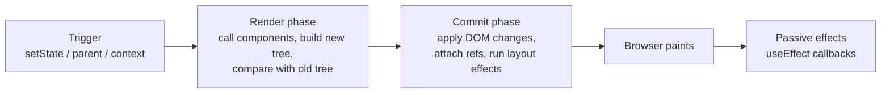
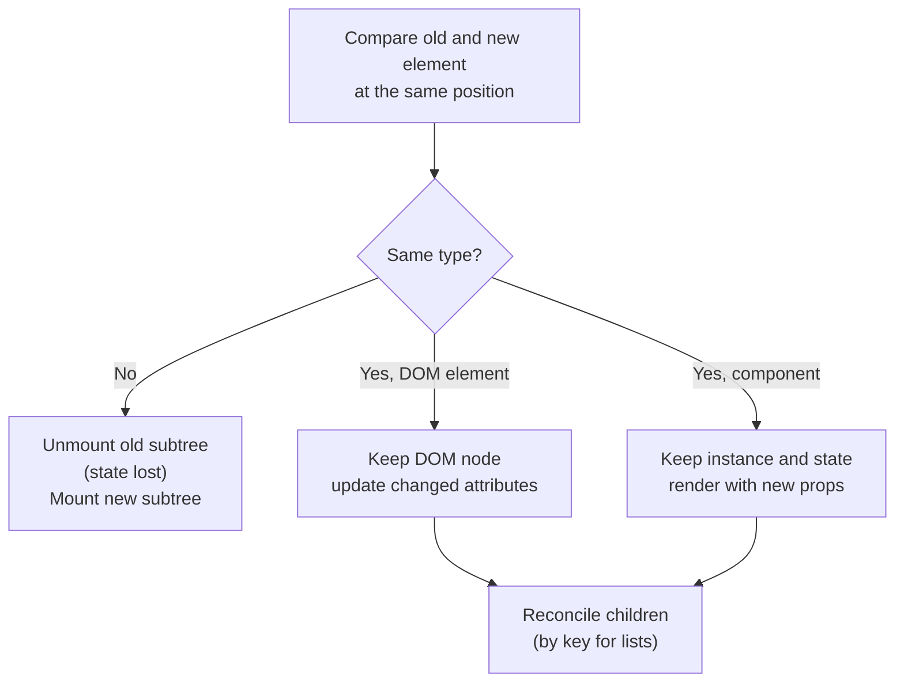
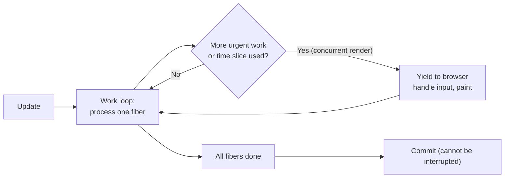

# Rendering, Reconciliation and Keys

> In this document you will learn what really happens when React "renders": what triggers a render, the render and commit phases, how React compares trees (reconciliation), what Fiber is, why keys matter so much, how batching works, and why Strict Mode renders twice. This is where "how many times does this render?" questions come from. Every render count in this document was checked by running the code.

**Before this:** [React fundamentals](01-react-fundamentals-jsx-components-props-and-state.md) · [React essentials: rendering rules](../05-frontend-engineering/08-react-essentials.md#rendering-and-re-rendering-rules) · [Event loop](../02-javascript/16-event-loop.md) · **Interview questions:** [jump to the interview section](#interview-questions)

## Table of contents

1. [Concepts](#concepts)
   - [What triggers a render](#what-triggers-a-render)
   - [Render phase and commit phase](#render-phase-and-commit-phase)
   - [A re-render is not a DOM update](#a-re-render-is-not-a-dom-update)
   - [The virtual DOM and reconciliation](#the-virtual-dom-and-reconciliation)
   - [State is tied to a position in the tree](#state-is-tied-to-a-position-in-the-tree)
   - [Keys in depth](#keys-in-depth)
   - [When children re-render and how to stop it](#when-children-re-render-and-how-to-stop-it)
   - [The same-value bail-out](#the-same-value-bail-out)
   - [Fiber in simple words](#fiber-in-simple-words)
   - [Automatic batching and flushSync](#automatic-batching-and-flushsync)
   - [Strict Mode double rendering](#strict-mode-double-rendering)
   - [Order of renders and effects](#order-of-renders-and-effects)
2. [Interview questions](#interview-questions)
3. [Quick revision](#quick-revision)
4. [Summary](#summary)
5. [References](#references)

> **Versions and verification.** React 19 (19.3.1 used for all tests) with React 18 notes. Render counts, effect orders and DOM results were measured in Node.js 22 with jsdom, `react-dom/client` and `act()` in the development build. React 18 legacy-root batching was measured with React 18.3.1. When a count says "verified", it is what the code printed.

---

## Concepts

### What triggers a render

"Rendering" means **React calls your component function** to find out what the UI should look like. It happens for four reasons:

1. **Initial render:** `root.render(<App />)` for the first time.
2. **The component's own state changed:** a `useState` setter or `useReducer` dispatch with a new value.
3. **Its parent rendered:** by default, when a component renders, **all its children render too**, whether their props changed or not.
4. **A context it reads changed:** every component that calls `useContext(Ctx)` (or `use(Ctx)`) re-renders when the provider's value changes.

That is the full list. Props changing is not a separate trigger: props only change because the parent rendered (reason 3).

Verified render counts after one `setState` in `App`:

```jsx
function Leaf() { return <i>leaf</i>; }
function Child() { return <Leaf />; }
const MemoChild = memo(function MemoChild({ label }) { return <b>{label}</b>; });

function App() {
  const [n, setN] = useState(0);
  return (
    <>
      <button onClick={() => setN(n + 1)}>{n}</button>
      <Child />
      <MemoChild label="hi" />
    </>
  );
}
// After one click: App 1, Child 1, Leaf 1, MemoChild 0
```

`Child` and `Leaf` have no props at all, and they still re-rendered. `MemoChild` skipped because `memo` compared its props (`label="hi"` both times) and found them equal.

### Render phase and commit phase

Every update goes through three steps:



**Render phase** (pure calculation):

- React calls your components and gets new elements.
- It compares them with the previous ones (reconciliation) and makes a list of changes.
- **Nothing touches the DOM yet.** This phase can be paused, restarted or thrown away (in concurrent rendering), and Strict Mode runs it twice in development. That is why render must be pure.

**Commit phase** (side effects allowed, always synchronous):

- React applies the changes to the DOM in one go.
- It sets refs (`ref.current`).
- It runs `useLayoutEffect` callbacks (before the browser paints).

**After paint:** React runs `useEffect` callbacks (usually after the browser paints; they never block painting for normal updates).

> **If you know Angular…** Angular's change detection checks bindings and updates the DOM in one pass. React splits the "calculate" step (render) from the "apply" step (commit). The split is what lets React pause rendering work in concurrent mode.

### A re-render is not a DOM update

If a component renders and returns the same output as before, React's comparison finds no differences, and **the commit changes nothing in the DOM**.

Verified with a `MutationObserver` on the container: clicking a button that re-renders a component whose JSX does not change produced **0 DOM mutations**.

So "this component re-renders 10 times" is not automatically a problem. A render costs JavaScript time (calling functions, creating objects, comparing). It becomes a problem only when the tree is large, the component is expensive, or it happens on every keystroke. Measure before optimizing (see [Performance optimization](08-performance-optimization.md)).

### The virtual DOM and reconciliation

The **virtual DOM** is the tree of React elements (plain objects) that your components return. **Reconciliation** is the algorithm that compares the new tree with the previous one to decide what to change.

A perfect tree diff is very expensive (the best general algorithms are about O(n³)). React uses **two heuristics** that make it about O(n):

1. **Different type → replace.** If the element at a position changes type (`<div>` → `<section>`, or `<ProfileCard>` → `<ProfileRow>`), React destroys the old subtree, **including all state inside it**, and builds a new one.
2. **Same type → update.** If the type is the same, React keeps the DOM node (or component instance) and its state, and only updates the props that changed. Then it recurses into the children.
3. **Lists → match by key.** For a list of children, React matches old and new children by `key`. Same key = same item (maybe moved). New key = create. Missing key = remove.



Verified example: toggling `{flag ? <div><Counter /></div> : <section><Counter /></section>}` reset the counter from 2 to **0**, even though `Counter` itself did not change. The wrapper type changed, so the whole subtree was replaced.

### State is tied to a position in the tree

React does not store state "inside" the component function. It stores it on the **instance at a position in the tree**. This explains many surprising results:

- **Same type at the same position keeps state.** Verified: `{flag ? <Counter label="A" /> : <Counter label="B" />}` kept the count (`A:2` became `B:2`). For React this is "the same Counter with a new label prop".
- **A different key resets state.** Verified: `<Counter key={flag ? 'x' : 'y'} />` went from `K:2` to `K:0`.
- **Removing a component destroys its state.** Verified: `{show && <Counter />}` hidden and shown again started at 0.
- **A component defined inside another component** gets a new function identity on every parent render, so its "type" changes every time and its state is lost (verified: typed text "hello" was reset to the initial value, and the input DOM node was replaced, so focus is lost too).

```jsx
function Parent() {
  const [n, setN] = useState(0);
  function Inner() {                       // ❌ new component type on every Parent render
    const [text, setText] = useState('');
    return <input value={text} onChange={e => setText(e.target.value)} />;
  }
  return <><button onClick={() => setN(n + 1)}>{n}</button><Inner /></>;
}
// ✅ Define Inner at the top level of the module and pass data as props
```

### Keys in depth

A **key** gives a child a stable identity among its siblings. React uses it in two ways:

1. **Lists:** to match items between renders, so state, DOM nodes and focus stay with the right item.
2. **Anywhere:** to say "this is a different thing now" and reset state on purpose.

**The index-key bug, step by step** (verified):

```jsx
function Row({ text }) {
  return <li>{text} <input defaultValue="" /></li>;   // the input has its own DOM state
}
// items: [Buy milk, Pay rent]; the user types "NOTE" in the first row's input.
// Then "Call mom" is inserted at the top.
```

| Key | Result after inserting at the top |
| --- | --- |
| `key={index}` | `Call mom=NOTE`, `Buy milk=`, `Pay rent=` ❌ |
| `key={item.id}` | `Call mom=`, `Buy milk=NOTE`, `Pay rent=` ✅ |

With index keys: key 0 existed before (Buy milk) and still exists (now Call mom). React thinks "the item with key 0 got new text", keeps that row's DOM and state, and changes only the text. The typed note stays in row 0. Then key 2 is new, so React creates a new row at the end.

With id keys: React sees a new key `c` at the top and creates it; `a` and `b` are moved, with their state.

**Key rules:**

- Unique **among siblings** (not globally).
- **Stable:** the same item gets the same key on every render. Use ids from the data (database id, slug). If the data has no id, create one **when the data is created** (`crypto.randomUUID()` in the event handler that adds the item), never during render.
- **Not `Math.random()` or `crypto.randomUUID()` in render:** a new key each render means every item is unmounted and mounted again: slow, loses state and focus.
- Index keys are acceptable only for **static** lists that never reorder, insert or filter, and whose items have no state.
- `key` is not passed to the component as a prop. If the child needs the id, pass it separately: `<Row key={u.id} id={u.id} />`.
- Fragments in lists need keys too: `<Fragment key={term.id}><dt>…</dt><dd>…</dd></Fragment>`.

**Key to reset state** (no list involved):

```jsx
// When the selected contact changes, the form must start fresh
<EditContactForm key={contact.id} contact={contact} />
```

Without the key, React reuses the same form instance (same type, same position), so the half-typed values of the previous contact stay. With the key, a new contact means a new instance.

### When children re-render and how to stop it

By default **a render cascades down the whole subtree**. Why doesn't React compare props automatically for every component? Because comparing props also costs time, most components are cheap to render, and props are often new objects anyway. React makes it opt-in.

Ways to avoid unnecessary child renders, from simplest:

1. **Move state down.** If only one small part needs the state, put the state in that part. Fewer components are under the owner.
2. **Lift content up (children as props).** Pass expensive parts as `children` from above. Verified: a `Wrapper` with its own counter re-rendered once, and its `children` (`<Expensive />`) rendered **0** times. The element object was created by the parent, which did not re-render; React sees the **same element reference** and skips it.
3. **`React.memo`.** Skips a render when props are shallowly equal (`Object.is` per prop). It fails when you pass new objects or functions each render. Verified: a `memo` row with `style={{ color: 'red' }}` and `onSelect={() => {}}` rendered on **every** parent render (2 of 2).
4. **Stable props:** `useMemo` for objects/arrays, `useCallback` for functions, constants moved outside the component. Or let the **React Compiler** do this automatically.

**Context goes through `memo`.** Verified: a `memo` component with no props did not render (0), but the context consumer inside it **did** render (1) and showed the new value. `memo` only stops renders caused by the parent; it never stops renders caused by the component's own state or a context it reads.

Performance techniques in depth are in [Performance optimization](08-performance-optimization.md).

### The same-value bail-out

If you set state to the **same value** (by `Object.is`), React can skip the render. Verified with `useState(0)`:

| Action | Total renders after it |
| --- | --- |
| `setN(0)` while `n` is 0 | 0 (skipped completely) |
| `setN(1)` | 1 |
| `setN(1)` again | 2 (!) |
| `setN(1)` a third time | 2 |

The second `setN(1)` caused one more call of the component function. This is documented behavior: React sometimes needs to render the component once to be sure, then it **bails out before rendering the children and before committing**. So: setting the same value is cheap, but "my component is never called" is not guaranteed. Never rely on render counts for correctness.

`useReducer` behaves similarly. Verified: a reducer that returns the same state object made the component function run, but its child rendered **0** times.

### Fiber in simple words

**Fiber** is the name of React's internal engine (since React 16) and of the object it uses for each component instance.

- Each element in the tree has a **fiber**: a JavaScript object holding the type, props, state (the hooks list), the DOM node, and links to its parent, first child and next sibling.
- Rendering is split into **small units of work**, one fiber at a time. Between units, React can check: "is there something more urgent, like a key press?" and **pause**, continue later, or throw the unfinished work away.
- React keeps two trees: the **current** tree (what is on screen) and the **work-in-progress** tree (being built). On commit, the work-in-progress becomes current (a pointer swap). This is called double buffering.
- Updates have **priorities** (internally called "lanes"): a click or typing is urgent; a transition is not.

Before Fiber (the "stack reconciler"), rendering was one long recursive call that could not stop. A big update froze the page. Fiber is what makes **concurrent features** possible: transitions, `useDeferredValue`, Suspense. See [React 18 and 19 features](04-react-18-and-19-concurrent-features-and-server-components.md).



Important: only the **render phase** can be interrupted, and only for concurrent updates (transitions). The commit phase always runs to the end in one go, so the user never sees a half-updated UI.

### Automatic batching and flushSync

**Batching** means React groups several state updates into **one render**.

- **React 18+ with `createRoot`:** batching happens **everywhere**: event handlers, `setTimeout`, promises, native event listeners.
- **React 17 and React 18 with the legacy `ReactDOM.render`:** batching happened only inside React event handlers.

Verified render counts (two setters, `setA(1); setB(1)`):

| Where the setters are called | React 19 / React 18 `createRoot` | React 18 legacy `ReactDOM.render` |
| --- | --- | --- |
| React click handler | 1 | 1 |
| Inside `setTimeout` | 1 | **2** |
| After `await` | 1 | 2 (same rule as timeout) |
| `flushSync(() => setA(1)); setB(1);` | **2** | — |

`ReactDOM.render` was removed in React 19 (verified: `ReactDOM.render` is `undefined`), so React 19 always batches.

**`flushSync`** (from `react-dom`) forces React to apply the updates inside it **immediately and synchronously**, including the DOM commit. Verified: right after `setItems([1, 2])` the DOM still had 1 `<li>`; right after `flushSync(() => setItems([1, 2, 3]))` it had 3.

```jsx
import { flushSync } from 'react-dom';

function handleAdd(message) {
  flushSync(() => {
    setMessages(prev => [...prev, message]);
  });
  listRef.current.lastElementChild.scrollIntoView();   // the new message is already in the DOM
}
```

Use it rarely: it gives up batching and can hurt performance. Typical uses are scrolling or focusing a just-added element, or integrating with non-React code that needs the DOM updated now.

### Strict Mode double rendering

In development, `<StrictMode>`:

- calls each component function **twice** per render (verified: 2 calls for one mount), plus state initializers, `useMemo` functions and reducers twice;
- on mount, runs effects **setup → cleanup → setup** (verified log: `render | render | setup | cleanup | setup`), and does the same for ref callbacks in React 19;
- uses the result of one render and throws the other away, so pure components look exactly the same.

It does nothing in production. It exists because concurrent rendering and features like `<Activity>` and Fast Refresh really can render or mount a component more than once; Strict Mode surfaces those bugs early. Since React 19.3, effects are also double-invoked during **hydration** in Strict Mode, matching client-rendered roots.

### Order of renders and effects

Verified log for a `Parent` with children `A` and `B`, each with a layout effect and an effect:

```text
render Parent | render A | render B |
layout A | layout B | layout Parent |
effect A | effect B | effect Parent
```

Rules:

- **Rendering goes top-down:** parent first, then children in order.
- **Effects run bottom-up:** children's effects run before the parent's. The parent's effect can therefore trust that its children's DOM and effects are ready.
- **All layout effects run before any passive effect.**
- **On update, cleanups run before setups:** first all cleanups of the effects that will re-run, then the new setups (verified: `child cleanup 1 | parent cleanup 1 | child setup 2 | parent setup 2`).
- **On unmount, parent cleanup runs before child cleanup** (verified: `parent cleanup 2 | child cleanup 2`).

Effect details are in [Hooks in depth](03-hooks-in-depth.md).

---

## Interview questions

Render-count questions: say the number first, then explain the rule. Interviewers care more about the rule than the number.

### Q1. What causes a React component to re-render?

**What the interviewer is checking:** The exact rules, especially that parent renders cascade to children regardless of props.

**What to say (30–60 seconds):**
> "There are three causes after the first render: the component's own state changes through a setter or dispatch, its parent re-renders, or a context it reads gets a new value. The parent case is the one people miss: by default, when a component renders, all its children render too, even if their props are the same. Props 'changing' isn't really a separate cause; props change because the parent rendered. I can opt out for a child with `React.memo`, which skips the render if props are shallowly equal, but memo never blocks the component's own state or context updates. And a render doesn't mean the DOM changes; React only commits differences."

**Deeper explanation:** Verified counts after one click in `App`: `App 1, Child 1, Leaf 1, MemoChild 0` (see [What triggers a render](#what-triggers-a-render)). `Child` and `Leaf` have no props, and they still rendered.

**Follow-up questions and how to answer them:**
- **"Does changing a ref or a normal variable re-render?"** — No. Only state setters, a parent render, or context. Changing `ref.current` or a module variable is invisible to React (verified in [Hooks in depth](03-hooks-in-depth.md): three ref changes, 0 renders).
- **"Does a component re-render if its props object is the same but it isn't memoized?"** — Yes. Without `memo`, React does not look at props to decide; the parent rendered, so the child renders.
- **"What about `key` changes?"** — A key change is not a re-render; it is an unmount of the old instance and a mount of a new one (state reset).

**Common mistakes / weak answers:** "A component re-renders when its props change" (the incomplete textbook answer). "Every re-render updates the DOM."

**Real-project example:** A typing lag in a big form came from the form state living in the page component: each keystroke re-rendered the whole page. Moving the state into the form component fixed it.

### Q2. Explain the render phase and the commit phase.

**What the interviewer is checking:** Internals at the level needed to reason about purity, effects and concurrent rendering.

**What to say (30–60 seconds):**
> "In the render phase React calls my components, gets the new element tree and compares it with the previous one to work out what changed. This phase is pure calculation, it doesn't touch the DOM, and it can be interrupted, restarted or thrown away, which is why render code must be pure. In the commit phase React applies the changes to the DOM in one synchronous step, sets refs and runs layout effects; the commit can't be interrupted, so users never see half an update. Then the browser paints, and after that React runs the `useEffect` callbacks."

**Deeper explanation:** See the diagram in [Render phase and commit phase](#render-phase-and-commit-phase). What belongs where:

| Phase | What happens | Your code that runs |
| --- | --- | --- |
| Render | Call components, reconcile | Component body, `useMemo`, `useState` initializers, reducers |
| Commit | DOM mutations, refs | `ref` callbacks, `useLayoutEffect` (before paint), `useInsertionEffect` (before layout effects, for CSS-in-JS) |
| After paint | Passive effects | `useEffect` |

**Follow-up questions and how to answer them:**
- **"Can a `useEffect` run before paint?"** — Yes, in one case: if the update was caused by a discrete user event like a click, React may flush the passive effects synchronously before paint so the result is consistent. Do not rely on either timing; use `useLayoutEffect` when you must measure before paint.
- **"What happens if you set state in `useLayoutEffect`?"** — React re-renders synchronously before the browser paints, so the user sees only the final result. Verified log: `render h=0 | layout effect set h | effect h=0 | render h=42 | effect h=42`. Good for measuring, expensive if overused.

**Common mistakes / weak answers:** Mixing up "render" with "paint". Saying effects run during render.

**Real-project example:** A tooltip that measures its own size must do it in `useLayoutEffect` (after commit, before paint), otherwise it flickers in the wrong position for one frame.

### Q3. Does a re-render always update the DOM?

**What the interviewer is checking:** That you don't panic about render counts.

**What to say (30–60 seconds):**
> "No. Rendering means calling the component and building a new element tree. React then compares it with the previous one, and if nothing changed, the commit phase doesn't touch the DOM at all. I actually measured this with a MutationObserver: a component that re-rendered with identical output produced zero DOM mutations. So renders cost JavaScript time, not DOM work, and many renders are fine. I only optimize when the profiler shows renders are expensive, for example a big list re-rendering on every keystroke."

**Deeper explanation:** Verified: [A re-render is not a DOM update](#a-re-render-is-not-a-dom-update). DOM writes are expensive mainly because they can trigger style recalculation and layout; React avoids those when nothing changed. See [Browser rendering](../01-cs-and-web-fundamentals/07-browser-architecture-and-rendering.md).

**Follow-up questions and how to answer them:**
- **"Then why optimize renders at all?"** — Because the render phase itself can be slow: thousands of components, expensive calculations in render, or long lists. That blocks the main thread and hurts INP (responsiveness).
- **"How do you see unnecessary renders?"** — React DevTools Profiler (which components rendered, how long, and "why did this render"), and the "Highlight updates when components render" option.

**Common mistakes / weak answers:** "Re-render means React repaints the whole page."

**Real-project example:** In a code review, someone added `React.memo` everywhere "to stop re-renders". The profiler showed renders took under 1 ms; the memo calls were removed.

### Q4. What is the virtual DOM, and is it really faster?

**What the interviewer is checking:** A balanced, accurate view instead of marketing.

**What to say (30–60 seconds):**
> "The virtual DOM is the tree of plain JavaScript objects, React elements, that my components return. On each update React builds a new tree, compares it with the previous one and applies only the differences to the real DOM. It's not faster than carefully written manual DOM code; that's a common myth. What it gives is a declarative model, where I describe the UI for any state, with good enough performance because DOM changes are minimal and batched. It also decouples rendering from the DOM, which is why React can render to the server, to native mobile views, and why Fiber can split and schedule the work."

**Deeper explanation:** Other frameworks chose different trade-offs: Svelte compiles components to direct DOM updates, and Solid, Vue's Vapor mode and Angular signals use **fine-grained reactivity** (each piece of state knows exactly which DOM node depends on it). React re-runs component functions and diffs. The React Compiler narrows the gap by memoizing automatically.

**Follow-up questions and how to answer them:**
- **"Then why didn't React switch to signals?"** — The React team prefers the simple mental model "UI = f(state)" with plain values, and pure components that can be rendered anywhere (server, concurrent). They invest in the compiler to remove the cost instead of changing the model. It is a trade-off, not a right/wrong answer.
- **"Is the virtual DOM the same as the shadow DOM?"** — No. The shadow DOM is a browser feature for encapsulating Web Component DOM and styles. The virtual DOM is a React-internal data structure.

**Common mistakes / weak answers:** "The virtual DOM is faster than the real DOM." "React copies the whole DOM in memory."

**Real-project example:** React Native uses the same reconciliation but commits to native views instead of DOM nodes, which only works because the virtual tree is separate from the platform.

### Q5. How does React's diffing algorithm work? Why is it O(n)?

**What the interviewer is checking:** The two heuristics and their consequences for state.

**What to say (30–60 seconds):**
> "A general tree diff is about O(n³), far too slow for UI. React makes two assumptions that bring it to roughly O(n). First, elements of different types produce different trees: if the type at a position changes, like a `div` to a `section` or one component to another, React throws away the old subtree with all its state and builds a new one, without comparing deeper. Second, for lists, the developer marks which children are the same with keys, so React can match them even if they moved. If the type is the same, React keeps the DOM node or instance and only updates changed props, then continues with the children. The consequence I care about in practice: changing the wrapper type or the key resets state."

**Deeper explanation:** Verified: `<div><Counter /></div>` ↔ `<section><Counter /></section>` reset the counter from 2 to 0, while `<Counter label="A" />` ↔ `<Counter label="B" />` kept it at 2. React compares level by level and never tries to detect that a subtree "moved" to a different parent; moving a component to another parent always remounts it.

**Follow-up questions and how to answer them:**
- **"What happens to the DOM when an element's type stays the same?"** — React keeps the node and updates only changed attributes and styles. For `style`, it updates only changed properties.
- **"What happens when a component is conditionally wrapped, like `{isLink ? <a><Card /></a> : <Card />}`?"** — The `Card` changes position in the tree (its parent changed), so it remounts and loses state. Keep the structure stable or lift the state.

**Common mistakes / weak answers:** "React compares every node with every other node." Not mentioning keys.

**Real-project example:** A loading wrapper that switched between `<div className="loading">` and `<form>` around the same fields reset all the user's input every time a save started.

### Q6. What is React Fiber?

**What the interviewer is checking:** Big-picture knowledge of React's architecture, explained simply.

**What to say (30–60 seconds):**
> "Fiber is React's reconciliation engine since React 16, and also the name of the internal object React keeps for each component instance. Each fiber holds the component type, props, state, the hooks list and links to its parent, child and sibling. The key change from the old engine is that rendering is broken into small units of work, one fiber at a time, so React can pause between units, handle something more urgent like a key press, and continue later or throw the work away. Updates have priorities. This is what makes concurrent features like transitions, `useDeferredValue` and Suspense possible. Only the render phase is interruptible; the commit is always synchronous."

**Deeper explanation:** See [Fiber in simple words](#fiber-in-simple-words). React keeps a "current" tree and a "work-in-progress" tree; when the work-in-progress is complete, the commit swaps them.

**Follow-up questions and how to answer them:**
- **"Does React 18+ always render concurrently?"** — No. Normal updates (like a click handler's `setState`) still render synchronously in one go. Only updates marked as transitions (and `useDeferredValue`, Suspense retries) use the interruptible, time-sliced mode.
- **"Why does this matter to me as a developer?"** — Because a render can be started and discarded, render code must be pure, and you must not rely on render counts or on render-phase side effects.

**Common mistakes / weak answers:** "Fiber makes React multi-threaded" (it is still single-threaded; it just yields). "Fiber is the virtual DOM."

**Real-project example:** Using `startTransition` for filtering a 5,000-row table keeps typing responsive because Fiber can interrupt the table render for each key press.

### Q7. Render count: how many times does each component render after one click?

```jsx
function Leaf() { return <i>leaf</i>; }
function Child() { return <Leaf />; }
const MemoChild = memo(function MemoChild({ label }) { return <b>{label}</b>; });

function App() {
  const [n, setN] = useState(0);
  return (
    <>
      <button onClick={() => setN(n + 1)}>{n}</button>
      <Child />
      <MemoChild label="hi" />
    </>
  );
}
```

**What the interviewer is checking:** The cascade rule and what `memo` does.

**What to say (30–60 seconds):**
> "After one click: `App` renders once, because its state changed. `Child` renders once even though it has no props, because its parent rendered. `Leaf` renders once for the same reason. `MemoChild` renders zero times: it's wrapped in `memo` and its only prop, the string 'hi', is equal to last time. So App 1, Child 1, Leaf 1, MemoChild 0."

**Deeper explanation:** Verified output: `{ App: 1, Child: 1, MemoChild: 0, Leaf: 1 }` (development build, without Strict Mode; with Strict Mode each number would double because of the dev-only double render).

**Follow-up questions and how to answer them:**
- **"What if `MemoChild` received `onClick={() => {}}`?"** — Then it would render every time: a new arrow function each render fails the `Object.is` comparison. See Q8.
- **"How would you stop `Child` from rendering without `memo`?"** — Move the state into a smaller component (for example a `CounterButton` that owns `n`), so `App` no longer renders on click.

**Common mistakes / weak answers:** Saying `Child` renders 0 times "because its props didn't change".

**Real-project example:** Same pattern as a page with a header counter: everything under the page re-renders on each update unless state is moved down.

### Q8. Render count: why does this memoized row still render every time?

```jsx
const Row = memo(function Row({ style, onSelect }) {
  return <p style={style} onClick={onSelect}>row</p>;
});

function Table() {
  const [n, setN] = useState(0);
  return (
    <>
      <button onClick={() => setN(n + 1)}>refresh</button>
      <Row style={{ color: 'red' }} onSelect={() => console.log('selected')} />
    </>
  );
}
```

**What the interviewer is checking:** Referential equality and why `memo` alone often does nothing.

**What to say (30–60 seconds):**
> "Because both props are new on every render. `{{ color: 'red' }}` creates a new object and the arrow function creates a new function each time Table renders. `memo` compares each prop with `Object.is`, and two different objects are never equal, even with the same content. So after two clicks the row rendered twice. Fixes: move the constant style object outside the component, wrap the handler in `useCallback`, or, if the project uses the React Compiler, it does this memoization automatically."

**Deeper explanation:** Verified: 2 renders of `Row` after 2 clicks.

```jsx
const redText = { color: 'red' };                    // created once, at module level

function Table() {
  const [n, setN] = useState(0);
  const handleSelect = useCallback(() => console.log('selected'), []);
  return (
    <>
      <button onClick={() => setN(n + 1)}>refresh</button>
      <Row style={redText} onSelect={handleSelect} />   {/* now Row renders 0 times on refresh */}
    </>
  );
}
```

**Follow-up questions and how to answer them:**
- **"Can I give `memo` a custom comparison?"** — Yes, `memo(Component, arePropsEqual)`. Use it rarely: a wrong comparison causes stale UI, and deep comparisons can cost more than rendering.
- **"What about `children` passed to a memo component?"** — JSX children are new element objects every render, so they also break `memo`. Memoizing a component that takes `children` usually does nothing.

**Common mistakes / weak answers:** "memo does a deep comparison." "Just wrap everything in useCallback" without connecting it to `memo`.

**Real-project example:** A virtualized grid of 200 visible memoized cells was re-rendering fully on each scroll because each cell got `style={{ ... }}` from an inline object; stable styles fixed it.

### Q9. Render count: does `Expensive` re-render when the counter changes?

```jsx
function Expensive() { /* slow */ return <p>expensive</p>; }

function Wrapper({ children }) {
  const [n, setN] = useState(0);
  return <div><button onClick={() => setN(n + 1)}>{n}</button>{children}</div>;
}

function App() {
  return <Wrapper><Expensive /></Wrapper>;
}
```

**What the interviewer is checking:** The "lift content up" (children as props) optimization and *why* it works.

**What to say (30–60 seconds):**
> "No, `Expensive` doesn't re-render: Wrapper renders once and Expensive zero times. The `<Expensive />` element was created by `App`, not by `Wrapper`. When Wrapper's state changes, only Wrapper runs again; `App` doesn't, so the `children` prop is the exact same element object as before. React sees the same element reference at that position and skips it. This is a nice optimization without `memo`: keep the state in a small wrapper and pass the expensive content in from above."

**Deeper explanation:** Verified: `{ Wrapper: 1, Expensive: 0 }`. If you moved `<Expensive />` inside `Wrapper`'s JSX, it would render every time, because `Wrapper` would create a new element object on each render.

Typical uses: a scroll-tracking or theme wrapper, a modal that owns its open state, a layout with a resizable sidebar.

**Follow-up questions and how to answer them:**
- **"What if `App` re-renders?"** — Then `App` creates a new `<Expensive />` element, and it renders. The trick only isolates *Wrapper's* state changes.
- **"Is this related to `useMemo` on JSX?"** — Yes, same mechanism: `const chart = useMemo(() => <Chart data={data} />, [data])` returns the same element object until `data` changes, so React skips it.

**Common mistakes / weak answers:** "It re-renders because its parent `div` re-rendered." The DOM parent does not matter; what matters is who created the element.

**Real-project example:** A `<StickyHeader>` that tracks scroll position in state wraps the whole page content as `children`; scrolling updates the header without re-rendering the page.

### Q10. Render count: context and `memo`

```jsx
const Ctx = createContext(0);
function Consumer() { return <span>{useContext(Ctx)}</span>; }
const Middle = memo(function Middle() { return <Consumer />; });

function App() {
  const [n, setN] = useState(0);
  return (
    <Ctx value={n}>
      <button onClick={() => setN(n + 1)}>+</button>
      <Middle />
    </Ctx>
  );
}
```

**What the interviewer is checking:** That context updates bypass `memo`.

**What to say (30–60 seconds):**
> "After a click, `Middle` renders zero times, because it's memoized and has no props. But `Consumer` renders once and shows the new value, because it reads the context, and a context change re-renders every consumer directly, no matter what `memo` does above it. So memo only stops renders coming from the parent; it can't stop state or context updates of the component itself. That's also why one large, frequently changing context can be expensive: every consumer re-renders."

**Deeper explanation:** Verified: `{ Consumer: 1, Middle: 0 }`, and the span showed `1`. `<Ctx value>` is the React 19 provider syntax; in React 18 write `<Ctx.Provider value>`.

**Follow-up questions and how to answer them:**
- **"How do you reduce context re-renders?"** — Split contexts by how often they change (state context vs dispatch context), memoize the provider value object, keep context values small, or use a store with selectors (Zustand, Redux, `useSyncExternalStore`). Details: [State management](05-state-management-context-redux-toolkit-and-zustand.md).
- **"Can a component read only part of a context?"** — Not natively. Every consumer re-renders on any change of the value. Selector-like behavior needs a store library or splitting.

**Common mistakes / weak answers:** "Middle is memoized, so nothing below it renders."

**Real-project example:** Putting `{ user, theme, cart, notifications }` in one `AppContext` made the whole app re-render when a notification arrived.

### Q11. Render count: what happens when you set the same state value?

```jsx
function C() {
  const [n, setN] = useState(0);
  return (
    <>
      <button onClick={() => setN(0)}>same</button>
      <button onClick={() => setN(1)}>one</button>
    </>
  );
}
// Clicks: "same", then "one", "one", "one"
```

**What the interviewer is checking:** The `Object.is` bail-out and its documented caveat.

**What to say (30–60 seconds):**
> "Clicking 'same' while n is 0 causes no render: React compares with `Object.is` and bails out. The first 'one' renders once. The second 'one' is interesting: I measured that React may call the component one more time before it bails out, but it skips the children and doesn't commit anything. The third 'one' causes nothing. So the totals are 0, 1, 2, 2. The lesson is that setting the same value is cheap, but I should never write code that depends on how many times a component function is called."

**Deeper explanation:** Verified sequence: `0, 1, 2, 2`. The React docs say: "React may still need to call your component before skipping the children." Internally, React can only bail out *eagerly* (without rendering) when the fiber has no other pending work; otherwise it renders and then compares.

**Follow-up questions and how to answer them:**
- **"Does this apply to objects?"** — `Object.is` compares references, so `setUser({ ...user })` is always "different" and always renders, while `setUser(user)` with a mutated object is "same" and is skipped (the mutation bug from [React fundamentals](01-react-fundamentals-jsx-components-props-and-state.md)).
- **"And for `useReducer`?"** — Returning the same state object from the reducer bails out the same way. Verified: the component function ran but its child rendered 0 times.

**Common mistakes / weak answers:** "Setting the same value always re-renders." Or the opposite: "the component is guaranteed not to run".

**Real-project example:** A `setIsOpen(true)` called on every mouse move inside an already open menu is harmless thanks to the bail-out.

### Q12. Why are keys important? Walk me through the index-key bug.

**What the interviewer is checking:** That you can explain the bug step by step, not just "React needs keys".

**What to say (30–60 seconds):**
> "Keys tell React which child is which between renders. React matches old and new children by key: same key means same item, so it keeps the component state and DOM node, even if the item moved. With index keys, identity follows the position, not the data. Example: two todos, and the user types a note into the first row's input. Then I insert a new todo at the top. The new todo now has index 0, so React thinks the row with key 0 just got new text: it keeps that row's DOM, including the typed note, and gives it the new todo's text. The note now appears next to the wrong todo. With the todo's id as key, React sees a new key at the top, creates one row, and moves the others with their state."

**Deeper explanation:** Verified results: index keys → `Call mom=NOTE, Buy milk=, Pay rent=`; id keys → `Call mom=, Buy milk=NOTE, Pay rent=`. Full walkthrough in [Keys in depth](#keys-in-depth).

Bugs from bad keys usually involve **state that lives in the item**: uncontrolled inputs, checkboxes, focus, "is expanded" flags, animations, or component state like a local edit mode. If items are pure display with no state, index keys only cost performance.

**Follow-up questions and how to answer them:**
- **"What if items have no id?"** — Generate one when the item is created (in the code that loads or adds data), store it with the item, and use it. Combining fields (`${name}-${date}`) works only if the combination is truly unique and stable.
- **"What does React do without any key?"** — It warns ("Each child in a list should have a unique key prop") and falls back to the index.
- **"Do keys have to be strings?"** — Strings or numbers; numbers are converted to strings.

**Common mistakes / weak answers:** "Keys improve performance" as the whole answer. Saying keys must be globally unique.

**Real-project example:** A sortable table with inline checkboxes: after sorting with index keys, the wrong rows appeared checked, and a bulk delete removed the wrong records.

### Q13. Is `key={Math.random()}` or `key={crypto.randomUUID()}` a good fix?

**Short answer:** No. A key generated **during render** is different on every render, so React thinks every item is new: it unmounts all old items and mounts new ones each time. This is slow, loses all item state (typed text, focus, scroll) and re-runs mount effects. Keys must be **stable**. If data has no id, generate it once when the data is created or loaded (for example in the handler that adds an item), never in the JSX.

### Q14. Scenario: an edit form still shows the previous user's data after selecting another user. How do you fix it?

```jsx
function EditUser({ user }) {
  const [name, setName] = useState(user.name);   // initial value only
  return <input value={name} onChange={e => setName(e.target.value)} />;
}
// <EditUser user={selectedUser} />
```

**What the interviewer is checking:** That you know state is tied to position, and the idiomatic fix (key) vs the anti-pattern (effect syncing).

**What to say (30–60 seconds):**
> "`useState(user.name)` only uses its argument on the first render. When `selectedUser` changes, React sees the same component type at the same position, so it keeps the existing instance and its state, the old name. The clean fix is a key: `<EditUser key={selectedUser.id} user={selectedUser} />`. A different key means a different instance, so React unmounts the old form and mounts a fresh one with the new initial value. I'd avoid a `useEffect` that copies the prop into state: it renders once with stale data and adds sync code that's easy to get wrong."

**Deeper explanation:** Verified: changing a component's key reset its counter from 2 to 0.

```jsx
// ✅ Reset all state of the form when the user changes
<EditUser key={selectedUser.id} user={selectedUser} />

// ❌ Effect sync: an extra render with old data, and other state in the form is not reset
useEffect(() => { setName(user.name); }, [user.name]);
```

If you need to reset **only part** of the state, the React docs suggest adjusting it during render with a "previous value" check:

```jsx
const [prevId, setPrevId] = useState(user.id);
if (user.id !== prevId) {      // runs during render; React re-renders this component immediately
  setPrevId(user.id);
  setName(user.name);
}
```

Verified: this costs 2 calls of the component function for the prop change (the first is discarded before children render), and no effect.

**Follow-up questions and how to answer them:**
- **"Is remounting expensive?"** — It costs a fresh mount of that subtree (effects re-run, DOM recreated). For a form this is negligible and makes the behavior obviously correct.
- **"Where else is the key trick useful?"** — Restarting an animation, resetting a chat input per conversation, resetting scroll position of a panel, or forcing a third-party widget to reinitialize.

**Common mistakes / weak answers:** "Add `user` to a useEffect and setState." "Make the input uncontrolled" (it has the same problem with `defaultValue`).

**Real-project example:** Master-detail screens (list of customers on the left, edit form on the right) almost always need `key={customer.id}` on the form.

### Q15. Output question: which counters keep their state when `flag` toggles?

```jsx
function Counter({ label }) {
  const [n, setN] = useState(0);
  return <button onClick={() => setN(n + 1)}>{label}:{n}</button>;
}

function App() {
  const [flag, setFlag] = useState(true);
  return (
    <>
      <button onClick={() => setFlag(!flag)}>toggle</button>
      {flag ? <Counter label="A" /> : <Counter label="B" />}
      <div><Counter key={flag ? 'x' : 'y'} label="K" /></div>
      <div>{flag ? <div><Counter label="W" /></div> : <section><Counter label="W" /></section>}</div>
    </>
  );
}
// Each counter is clicked twice, then "toggle" is clicked.
```

**What the interviewer is checking:** Position, type and key rules applied together.

**What to say (30–60 seconds):**
> "Before the toggle: A:2, K:2, W:2. After it: the first one shows B:2, because it's the same `Counter` type at the same position; only the label prop changed, so the state survives. The second shows K:0, because the key changed from x to y, so React treats it as a new component and resets it. The third shows W:0: the Counter itself didn't change, but its parent element changed from `div` to `section`, and a type change replaces the whole subtree."

**Deeper explanation:** Verified output: `before [A:2, K:2, W:2]`, `after toggle [B:2, K:0, W:0]`.

The first case surprises people the most: React does not care that the two branches of the ternary are "different lines in my code". It only sees "position 1 has a `Counter` before and after".

**Follow-up questions and how to answer them:**
- **"How would you make A and B independent?"** — Give them different keys (`key="A"`, `key="B"`), or render them at different positions: `{flag && <Counter label="A" />}{!flag && <Counter label="B" />}` (two separate positions; each one unmounts when hidden).
- **"Does `{flag && <X />}` change the position of the siblings after it?"** — No. `false` still occupies its slot in the children array, so later siblings keep their positions. That is why conditional rendering does not reset neighbors.

**Common mistakes / weak answers:** Saying A's state resets "because it's a different element in the code".

**Real-project example:** A "Player 1 / Player 2" score panel rendered with a ternary showed player 1's score for player 2 until keys were added.

### Q16. Find the bug: the input loses focus and its text after every keystroke.

```jsx
function SearchPage() {
  const [results, setResults] = useState([]);

  function SearchBox() {
    const [q, setQ] = useState('');
    return <input value={q} onChange={e => { setQ(e.target.value); setResults(search(e.target.value)); }} />;
  }

  return <><SearchBox /><ResultList results={results} /></>;
}
```

**What the interviewer is checking:** Component identity; a very common real bug.

**What to say (30–60 seconds):**
> "`SearchBox` is defined inside `SearchPage`, so every time SearchPage renders, a brand-new `SearchBox` function is created. For React, the element type changed, because it's a different function from last time, so it unmounts the old SearchBox and mounts a new one: the input DOM node is replaced, focus is lost, and its state resets. Here typing calls `setResults`, which re-renders the page, so it breaks on every keystroke. The fix is to move `SearchBox` to the top level of the module and pass `onSearch` as a prop. Components should never be declared inside other components."

**Deeper explanation:** Verified: after a parent render, the input's typed value `hello` was back to the initial value, and `before === after` for the DOM node was `false` (a new node).

```jsx
function SearchBox({ onSearch }) {
  const [q, setQ] = useState('');
  return <input value={q} onChange={e => { setQ(e.target.value); onSearch(e.target.value); }} aria-label="Search" />;
}

function SearchPage() {
  const [results, setResults] = useState([]);
  return <><SearchBox onSearch={q => setResults(search(q))} /><ResultList results={results} /></>;
}
```

**Follow-up questions and how to answer them:**
- **"Does the same happen with `useCallback` or `useMemo` around the inner component?"** — Memoizing the inner component's definition hides the bug only while dependencies stay the same. Do not do it; define components at the top level.
- **"Can a linter catch it?"** — Yes. The React Compiler-powered rule `static-components` in `eslint-plugin-react-hooks` (and `react/no-unstable-nested-components` in `eslint-plugin-react`) flags components created during render.

**Common mistakes / weak answers:** Blaming controlled inputs, or adding `autoFocus` as a "fix".

**Real-project example:** Table cell renderers defined inline (`const Cell = () => ...` inside the table component) caused every cell to remount on each update, killing performance and input focus in editable grids.

### Q17. Output question: how many renders do these handlers cause in React 18+ vs React 17?

```jsx
function C() {
  const [a, setA] = useState(0);
  const [b, setB] = useState(0);
  // handler 1
  const h1 = () => { setA(1); setB(1); };
  // handler 2
  const h2 = () => { setTimeout(() => { setA(1); setB(1); }, 0); };
  // handler 3
  const h3 = async () => { await fetchSomething(); setA(1); setB(1); };
  // ...
}
```

**What the interviewer is checking:** Automatic batching (React 18) and why it was a change.

**What to say (30–60 seconds):**
> "With React 18 or 19 and `createRoot`, all three cause one render, because React batches updates everywhere: in event handlers, timeouts, promises and native listeners. In React 17, or in React 18 when the legacy `ReactDOM.render` was still used, only the first one was batched; the timeout and the code after `await` caused one render per setter, so two renders. React 19 removed `ReactDOM.render`, so automatic batching is always on. If I ever need an update applied immediately, I use `flushSync`."

**Deeper explanation:** Verified table in [Automatic batching and flushSync](#automatic-batching-and-flushsync): React 19 → 1, 1, 1; React 18.3.1 legacy root → 1, 2, 2; React 18.3.1 `createRoot` → 1.

How batching works in simple words: a setter does not render. It adds an update to a queue and **schedules** a render (for a click, React flushes it in a microtask at the end of the event; for other updates, in a scheduler task soon after). All setters that run before that scheduled render end up in the same render. The [event loop](../02-javascript/16-event-loop.md) explains why code after `await` runs in a later microtask: it is a separate batch from code before the `await`.

**Follow-up questions and how to answer them:**
- **"Is batching across `await` one batch for the whole async function?"** — No. Code before the `await` and code after it are separate batches (separate tasks). Setters after the same `await` are batched together.
- **"Can batching break anything?"** — Code that read the DOM right after a setter, expecting it updated, breaks. Such code was already fragile; use `flushSync` or move it into a layout effect.

**Common mistakes / weak answers:** "setState is async so it batches" (vague). Not knowing React 17 behaved differently.

**Real-project example:** Upgrading a React 17 app to 18 reduced renders after API calls (loading, data and error setters now render once), but one test that counted renders had to be updated.

### Q18. What is `flushSync`, and when would you use it?

**What the interviewer is checking:** Knowing the escape hatch and its cost.

**What to say (30–60 seconds):**
> "`flushSync` from `react-dom` forces React to process the updates inside its callback synchronously, render and commit them to the DOM before the next line runs. Normally updates are batched and applied later. I'd use it rarely, when I must read or act on the updated DOM immediately: for example scrolling to a just-added chat message, moving focus to a newly rendered input, or when a browser API needs the DOM updated inside the same event, like `beforeprint`. It opts out of batching and can hurt performance, so it's not a general tool."

**Deeper explanation:** Verified: after `setItems([1, 2])` the DOM still had 1 item; after `flushSync(() => setItems([1, 2, 3]))` it had 3 (the pending `[1, 2]` update was flushed along with it). Verified render count: `flushSync(() => setA(1)); setB(1);` gives 2 renders instead of 1.

Alternatives that are often better: do the DOM work in a `useLayoutEffect` that depends on the new state, or use a ref callback on the new element.

**Follow-up questions and how to answer them:**
- **"Can you call `flushSync` inside render or an effect?"** — React warns ("flushSync was called from inside a lifecycle method. React cannot flush when React is already rendering"); verified for both `useLayoutEffect` and `useEffect`. Call it from event handlers or external callbacks.

**Common mistakes / weak answers:** Using `flushSync` to "fix" stale state reads (the real issue is the snapshot model, not timing).

**Real-project example:** A chat app adds a message and scrolls the list to the bottom; with `flushSync` the new message exists in the DOM before `scrollIntoView`.

### Q19. Output question: what does this log under StrictMode in development?

```jsx
function C() {
  console.log('render');
  useEffect(() => {
    console.log('setup');
    return () => console.log('cleanup');
  }, []);
  return null;
}
root.render(<StrictMode><C /></StrictMode>);
```

**What the interviewer is checking:** Strict Mode behavior and the reason behind it.

**What to say (30–60 seconds):**
> "In development it logs render, render, setup, cleanup, setup. Strict Mode calls the component function twice to detect impure rendering, and then it simulates an unmount and remount right after mounting, so the effect runs setup, cleanup and setup again. In production it's just render and setup. The double mount exists to prove that my cleanup really undoes the setup; if the app works after setup, cleanup, setup, it will also survive real remounts, like Fast Refresh, `<Activity>` being hidden and shown, or a route being revisited."

**Deeper explanation:** Verified log: `render | render | setup | cleanup | setup`. Note the double render happens before the commit; only one of the two results is used.

What Strict Mode double-calls in development:

| Double-called | Why |
| --- | --- |
| Component body | Find side effects in render |
| `useState` / `useReducer` initializers, `useMemo` callbacks | Same |
| Reducers and state updater functions | Same |
| Effects (setup → cleanup → setup on mount) | Find missing cleanups |
| Ref callbacks (React 19) | Find missing ref cleanups |

**Follow-up questions and how to answer them:**
- **"How do you stop a POST request from being sent twice?"** — Do not send it from an effect at all if it is a user action: send it in the event handler. For an effect that must fetch, abort or ignore the first request in the cleanup. For "send once on page view" analytics, the double call only happens in development; it is acceptable, or deduplicate it.
- **"Does Strict Mode double-invoke event handlers?"** — No. Only render-phase code and the mount effects.

**Common mistakes / weak answers:** "It's a React bug." "Use a ref flag to skip the second effect run" (this hides the real problem: a missing cleanup).

**Real-project example:** A `setInterval` without `clearInterval` ticked twice as fast in development; the double mount made the missing cleanup visible.

### Q20. Output question: in what order do renders and effects run for a parent and two children?

```jsx
function Child({ name }) {
  console.log('render ' + name);
  useLayoutEffect(() => console.log('layout ' + name));
  useEffect(() => console.log('effect ' + name));
  return null;
}
function Parent() {
  console.log('render Parent');
  useLayoutEffect(() => console.log('layout Parent'));
  useEffect(() => console.log('effect Parent'));
  return <><Child name="A" /><Child name="B" /></>;
}
```

**What the interviewer is checking:** Tree traversal order; whether a parent effect can rely on child DOM.

**What to say (30–60 seconds):**
> "Renders go top-down: Parent, A, B. Effects go bottom-up, children first: layout A, layout B, layout Parent, and then, after all layout effects, effect A, effect B, effect Parent. React commits the whole tree, then runs effects in the order fibers complete, which is children before parents. That's useful: when the parent's effect runs, the children's DOM and their effects are already set up, so the parent can measure or focus a child."

**Deeper explanation:** Verified output:

```text
render Parent | render A | render B | layout A | layout B | layout Parent | effect A | effect B | effect Parent
```

On an update that changes dependencies, all affected cleanups run before the new setups (verified: `child cleanup 1 | parent cleanup 1 | child setup 2 | parent setup 2`). On unmount, verified: `parent cleanup | child cleanup`.

**Follow-up questions and how to answer them:**
- **"Two effects in the same component: which runs first?"** — In the order they are written. On update: all cleanups first (A cleanup, B cleanup), then all setups (A setup, B setup). Verified.
- **"Why would you care about this order?"** — For things like a parent that registers children (a form registering fields, a tabs component measuring tab widths) and for debugging double-subscription bugs.

**Common mistakes / weak answers:** "Parent effect first because the parent renders first."

**Real-project example:** A modal's parent effect calls `inputRef.current.focus()` on a child input; it works because the child's DOM is committed before the parent's effects run.

### Q21. Why does React re-render all children by default instead of checking props?

**What the interviewer is checking:** Design reasoning, a senior-level question.

**What to say (30–60 seconds):**
> "Because checking costs something too, and most of the time it wouldn't help. Comparing props on every component on every render takes time and memory, and in typical code many props are new objects or functions each render, so the comparison would fail anyway. Rendering a simple component is usually very cheap, and React only touches the DOM when output changes. So React makes memoization opt-in with `memo`, `useMemo` and `useCallback`, where it's worth it. The other reason is correctness: a component might read something that isn't a prop, like a mutable object, and always rendering keeps it correct. The React Compiler now changes the default by adding memoization automatically at build time."

**Deeper explanation:** The cost of `memo` is: storing previous props, a shallow comparison per prop, and code noise. For a cheap component, that can be more than the render itself. That is why "wrap everything in memo" is not the default, and why the compiler, which can memoize at a finer level (individual JSX elements and values inside a component), is a better general answer.

**Follow-up questions and how to answer them:**
- **"What does the React Compiler do exactly?"** — It analyzes components at build time and inserts caching for values, callbacks and JSX that only change when their inputs change, as if you wrote `useMemo`/`useCallback`/`memo` precisely. It assumes the Rules of React (pure components, immutable props and state). See [React 18 and 19 features](04-react-18-and-19-concurrent-features-and-server-components.md).
- **"How does Angular's OnPush compare?"** — `OnPush` is Angular's opt-in "only check this component if its inputs changed by reference or an event happened inside", similar in spirit to `React.memo`.

**Common mistakes / weak answers:** "Because React is inefficient." "Because the virtual DOM is cheap" (partly true, but misses the trade-off).

**Real-project example:** In a large admin app, the team enabled the React Compiler and removed hundreds of manual `useCallback` calls while keeping render counts low.

### Q22. Scenario: "The page re-renders too often." What do you do, step by step?

**What the interviewer is checking:** A methodical, measurement-first approach.

**What to say (30–60 seconds):**
> "First I'd measure, not guess: React DevTools Profiler to record the interaction, see which components render, how long each takes, and 'why did this render'. If renders are cheap, I stop there. If they're expensive, I look at the cause. If a high-level state change re-renders a big tree, I move the state down to where it's used, or lift the expensive content up as children. If a context changes too often, I split it or memoize its value. If memoized children re-render because of new objects or functions, I stabilize props with `useMemo` and `useCallback`, or rely on the React Compiler. If a single component is slow, I memoize the expensive calculation or virtualize the long list. For typing lag specifically, `useDeferredValue` or a transition. Then I measure again."

**Deeper explanation:** The general "page is slow" process (measure, find the cause, fix, measure again) is answered in full in [Performance Q1](08-performance-optimization.md#q1-a-react-page-is-slow-how-do-you-approach-the-problem). Here is the rendering-specific checklist that maps symptoms to fixes:

| Symptom in the profiler | Likely cause | Fix |
| --- | --- | --- |
| Whole page renders on each keystroke | Input state too high | Move state down / colocate |
| Many components render "because context changed" | Big or unstable context value | Split context, memoize value, use a store with selectors |
| Memo component renders "because props changed" with the same data | New object/function props | Stable references (`useMemo`, `useCallback`, module constants), compiler |
| One component takes 50 ms | Expensive calculation or huge list | `useMemo`, virtualization, pagination |
| Input lags while a list updates | Urgent and non-urgent work mixed | `useTransition` / `useDeferredValue` |

Details and code: [Performance optimization](08-performance-optimization.md). Core Web Vitals (INP) context: [Web performance](../05-frontend-engineering/05-web-performance-and-core-web-vitals.md).

**Follow-up questions and how to answer them:**
- **"What does 'why did this render' show?"** — In the DevTools Profiler settings you can enable "Record why each component rendered": it reports hooks changed, props changed (which ones), parent rendered, or context changed.
- **"Should you test in development or production?"** — Profile with a production build (or the profiling build) for real numbers; development builds are slower and Strict Mode doubles renders.

**Common mistakes / weak answers:** "Add `React.memo` to every component." Jumping to Redux or a rewrite without measuring.

**Real-project example:** A dashboard where a 1-second clock in the header lived in the root state re-rendered every chart each second. Moving the clock state into a `<Clock />` component fixed it.

### Q23. What do "move state down" and "lift content up" mean? Show code.

**Short answer:** Both reduce how much of the tree renders on a state change **just by restructuring**, with no memoization. **Move state down:** keep state in the smallest component that needs it — if only a color picker uses `color`, the state lives in the picker, so typing re-renders only the picker and not the expensive tree next to it. **Lift content up:** when a wrapper must own the state but wraps expensive content, pass that content as `children`; the parent created those elements, so when the wrapper's state changes they are the **same element objects** and React skips them (verified in [Q9](#q9-render-count-does-expensive-re-render-when-the-counter-changes): wrapper 1 render, child 0 renders). It is the same rule as lifting state up, seen from the other side: state lives in the **lowest common owner**.

```jsx
function ColorBackground({ children }) {
  const [color, setColor] = useState('red');
  return (
    <div style={{ background: color }}>
      <input value={color} onChange={e => setColor(e.target.value)} />
      {children}                       {/* same element objects each time: skipped */}
    </div>
  );
}
// <ColorBackground><ExpensiveTree /></ColorBackground>
```

Full answers with before/after code and follow-ups: [Performance Q11 — state colocation](08-performance-optimization.md#q11-what-is-state-colocation-show-how-it-improves-performance) and [Performance Q12 — children as props](08-performance-optimization.md#q12-explain-the-children-as-props-lift-content-up-pattern).

**Real-project example:** A search page where the search input's text lived in the page component; moving it into the `SearchBar` (and only lifting the *submitted* query) removed lag.

### Q24. Can you use keys outside of lists? What about Fragments?

**Short answer:** Yes. A key on any element tells React "this is a specific instance"; changing it remounts the element and resets its state (for example `<Chat key={roomId} />`, or `` to restart a fade-in animation). Fragments need a key when they are list items: use `<Fragment key={item.id}>` (the short `<>` syntax cannot take a key). In React 19.3, fragments can also take a `ref` (Fragment refs) to work with their DOM children as a group.

### Q25. Is calling `setState` during render allowed?

**What the interviewer is checking:** Knowing the one legitimate pattern and the infinite-loop risk.

**What to say (30–60 seconds):**
> "Unconditionally, no: setting state during render triggers another render, which sets state again, and React stops it with 'Too many re-renders'. But React supports one specific pattern: updating the same component's state during render, guarded by a condition, to adjust state when a prop changes. For example, I store the previous value of a prop in state, and if the prop is different from it, I update both. React then throws away the current output and immediately re-renders the component before rendering the children, so it's cheaper than an effect, which would commit a stale screen first. Still, I'd first try a key or computing the value during render. Setting another component's state during render is never allowed."

**Deeper explanation:** Verified: with the guarded pattern, a prop change caused 2 calls of the component function and the correct final output (`null` selection), with no effect.

```jsx
function List({ items }) {
  const [selection, setSelection] = useState(null);
  const [prevItems, setPrevItems] = useState(items);
  if (items !== prevItems) {        // the guard: only when the prop changed
    setPrevItems(items);
    setSelection(null);
  }
  // ...
}
// Usually better: store selectedId and derive "is it still in items?" during render
```

**Follow-up questions and how to answer them:**
- **"What error do you get for an unconditional setter in render?"** — "Too many re-renders. React limits the number of renders to prevent an infinite loop." A frequent cause is `onClick={setOpen(true)}` (calls the setter during render).
- **"Why is setting a parent's state during render forbidden?"** — It would update a component that has already rendered in this pass, breaking the top-down flow. React warns "Cannot update a component while rendering a different component".

**Common mistakes / weak answers:** "Never, it always loops." Or using the pattern everywhere instead of deriving values.

**Real-project example:** Resetting a "current page" to 1 when a filter prop changes, without an extra visible frame on the old page.

### Q26. What happens to state, effects and DOM when a component unmounts?

**Short answer:** React runs all its effect cleanups (and ref cleanups in React 19), removes its DOM nodes, and **throws away its state**. If the same component is rendered again later, it is a new instance with initial state (verified: a counter at 2, hidden with `{show && <Counter />}` and shown again, displayed 0). To keep state across hide/show: lift the state up, store it outside React (store, URL, `localStorage`), keep it mounted and hide it with CSS, or use `<Activity mode="hidden">` (React 19.2), which keeps state but cleans up effects while hidden. Setting state on an unmounted component is a no-op; React 18 removed the old "can't perform a state update on an unmounted component" warning.

### Q27. How does React decide between updating a DOM node and recreating it?

**Short answer:** By the **element type at that position** (and the key). Same tag (`<input>` → `<input>`) means React keeps the node and patches only changed attributes, so focus, selection, scroll and typed text survive. Different tag (`<input>` → `<textarea>`, `<div>` → `<section>`) or different key means the old node and its whole subtree are removed and new ones created (verified: a `div` → `section` wrapper change reset a nested counter). Changing `type` on an input (`<input type="text">` → `<input type="password">`) is a prop update, not a new node. For component types, "same type" means the same function reference, which is why components must not be defined inside other components.

### Q28. Design question: why does React use virtual DOM diffing instead of fine-grained signals like Angular or Solid?

**What the interviewer is checking:** Seniority: understanding trade-offs between rendering models.

**What to say (30–60 seconds):**
> "It's a trade-off. With signals, each piece of state tracks exactly which DOM nodes depend on it, so updates are surgical and there's no diffing; the cost is a more complex mental model: you must use reactive primitives, think about what's tracked, and components often run only once. React chose plain values and re-running pure functions: UI is a function of state, which is easy to reason about, works the same on the server and in concurrent rendering, and lets React pause and restart work. The cost is extra renders, which React addresses with memoization and now the React Compiler, which gives much of the benefit without changing the model. For most apps both are fast enough; the bigger difference is developer experience and ecosystem."

**Deeper explanation:**

| | React (re-render + diff) | Signals (Angular signals, Solid, Vue) |
| --- | --- | --- |
| Unit of update | Component function | Individual binding / effect |
| State | Plain values, immutable updates | Reactive containers (`signal()`, `ref()`) |
| Extra work | Renders + diff (reduced by memo/compiler) | Dependency tracking overhead |
| Concurrent rendering | Natural (pure functions can be re-run) | Harder |
| Mental model | "Snapshot per render" | "Subscriptions" |

> **If you know Angular…** Angular 16 introduced signals (developer preview) to move away from Zone.js-driven checking of the whole tree. See [Change detection and signals](../06-angular-16/10-change-detection-and-signals.md).

**Follow-up questions and how to answer them:**
- **"Is one clearly faster?"** — In micro-benchmarks, fine-grained frameworks usually win. In real apps, network, bundle size, and avoiding unnecessary work matter more than the rendering model.
- **"Does React have anything like signals?"** — Not as a primitive. External stores connect through `useSyncExternalStore` with selectors, which gives similar "only re-render what reads this slice" behavior.

**Common mistakes / weak answers:** Claiming one model is "wrong". Not knowing what signals are.

**Real-project example:** Teams choosing between Angular 17+ with signals and React often discuss exactly this; the decision usually comes down to team skills and ecosystem, not raw speed.

---

## Quick revision

1. **Four render triggers?** Initial render, own state change, parent render, context change.
2. **Do children re-render when the parent renders?** Yes, by default, even with the same props.
3. **Render phase vs commit phase?** Render: call components and diff (pure, interruptible). Commit: DOM changes, refs, layout effects (synchronous).
4. **Does a re-render always touch the DOM?** No; identical output means 0 DOM mutations.
5. **Diffing heuristics?** Different type → replace subtree; same type → update; lists → match by key. About O(n).
6. **What is Fiber?** React's engine since 16: per-instance work units that can be paused and prioritized.
7. **Index-key bug?** State stays at the position, so it attaches to the wrong item after insert/sort.
8. **Random keys?** Remount everything on every render. Keys must be stable.
9. **Reset a component's state?** Change its `key`.
10. **Same type at same position in a ternary?** State is kept.
11. **Wrapper changes from `div` to `section`?** Whole subtree remounts.
12. **Component defined inside a component?** New type each render: state and focus lost.
13. **Does `memo` stop context updates?** No.
14. **Children-as-props trick?** Same element reference → skipped.
15. **Set the same state value?** Bail-out; React may still call the component once more, but skips children.
16. **Batching in `setTimeout` in React 18+?** Yes, one render (legacy root: one per setter).
17. **`flushSync`?** Apply updates and commit immediately; rarely needed.
18. **Strict Mode logs?** `render, render, setup, cleanup, setup` (dev only).
19. **Effect order?** Children before parents; all layout effects before passive effects.

## Summary

- A component renders because of its own state, its parent rendering, or a context it reads. **Renders cascade down** unless `memo`, children-as-props or state colocation stop them.
- **Render** (pure, can be interrupted or repeated) is separate from **commit** (synchronous DOM update). A render with identical output does not touch the DOM.
- **Reconciliation** compares element types and keys. A type or key change destroys the subtree and its state; the same type at the same position keeps state.
- **Keys** must be stable and unique among siblings. Index keys break item state on insert, delete and sort; random keys remount everything. Keys can also reset state on purpose.
- Never define components inside components.
- **Fiber** splits rendering into units with priorities, enabling concurrent features. Only the render phase is interruptible.
- **Automatic batching** (React 18+ with `createRoot`, always in 19) gives one render for many setters anywhere. `flushSync` opts out.
- **Strict Mode** double-invokes render code and mount effects in development only, to expose impurity and missing cleanups.
- Effects run **children first**; all layout effects run before passive effects; cleanups run before new setups.

## References

- React — Render and Commit: https://react.dev/learn/render-and-commit
- React — Preserving and Resetting State: https://react.dev/learn/preserving-and-resetting-state
- React — Rendering Lists (keys): https://react.dev/learn/rendering-lists
- React — `memo`: https://react.dev/reference/react/memo
- React — `useState` (bail-out caveat): https://react.dev/reference/react/useState
- React — `flushSync`: https://react.dev/reference/react-dom/flushSync
- React — `<StrictMode>`: https://react.dev/reference/react/StrictMode
- React — You Might Not Need an Effect (adjusting state when a prop changes): https://react.dev/learn/you-might-not-need-an-effect
- React — React v18.0 (automatic batching): https://react.dev/blog/2022/03/29/react-v18
- React — React 19 Upgrade Guide (removed `ReactDOM.render`): https://react.dev/blog/2024/04/25/react-19-upgrade-guide
- React — React 19.3 (Fragment refs, Strict Mode effects during hydration): https://react.dev/blog/2026/09/09/react-19-3
- React (legacy docs) — Reconciliation: https://legacy.reactjs.org/docs/reconciliation.html
- React DevTools Profiler: https://react.dev/learn/react-developer-tools
- Andrew Clark — React Fiber Architecture (overview): https://github.com/acdlite/react-fiber-architecture
- Dan Abramov — Before You memo(): https://overreacted.io/before-you-memo/
