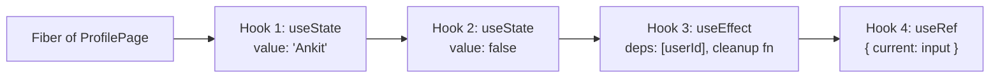
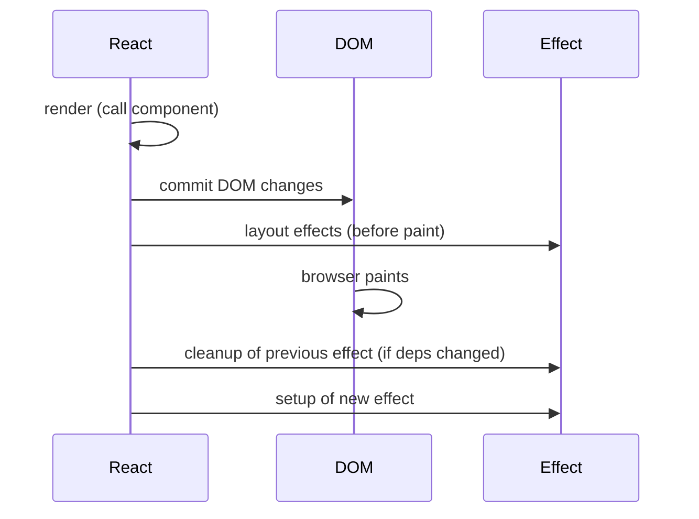
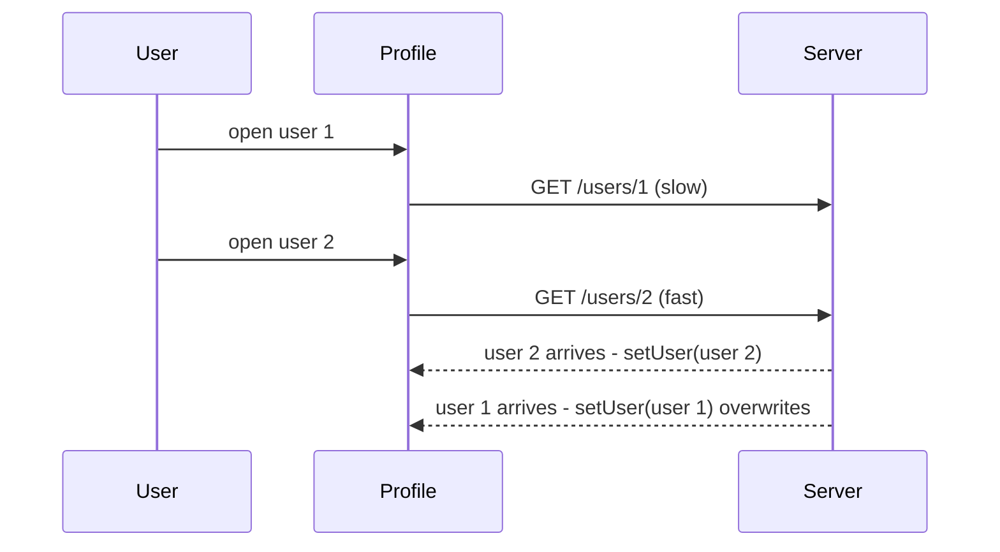

# Hooks in Depth

> In this document you will learn every built-in hook that interviews ask about, how hooks work inside React, and the bugs they cause: effects that run too often, race conditions, infinite loops, stale closures and broken custom hooks. You will also write the classic custom hooks (`useDebounce`, `useFetch`, `useLocalStorage`, `usePrevious`) and learn the traps in each. Hooks are the most-asked React topic, so this is the deepest document of the subject. Every "what logs, in what order" answer was checked by running the code.

**Before this:** [React fundamentals](01-react-fundamentals-jsx-components-props-and-state.md) · [Rendering, reconciliation and keys](02-rendering-reconciliation-and-keys.md) · [Closures](../02-javascript/05-closures.md) · [Event loop](../02-javascript/16-event-loop.md) · **Interview questions:** [jump to the interview section](#interview-questions)

## Table of contents

1. [Concepts](#concepts)
   - [How hooks work inside](#how-hooks-work-inside)
   - [The rules of hooks](#the-rules-of-hooks)
   - [useState in depth](#usestate-in-depth)
   - [useEffect: the mental model](#useeffect-the-mental-model)
   - [Dependencies and cleanup](#dependencies-and-cleanup)
   - [Race conditions and AbortController](#race-conditions-and-abortcontroller)
   - [You might not need an effect](#you-might-not-need-an-effect)
   - [useLayoutEffect and useInsertionEffect](#uselayouteffect-and-useinsertioneffect)
   - [useRef](#useref)
   - [Refs to components: forwardRef, ref as a prop, useImperativeHandle](#refs-to-components-forwardref-ref-as-a-prop-useimperativehandle)
   - [useMemo and useCallback](#usememo-and-usecallback)
   - [useContext](#usecontext)
   - [useReducer](#usereducer)
   - [useId](#useid)
   - [useSyncExternalStore](#usesyncexternalstore)
   - [Stale closures](#stale-closures)
   - [useEffectEvent](#useeffectevent)
   - [Custom hooks](#custom-hooks)
   - [The exhaustive-deps lint rule](#the-exhaustive-deps-lint-rule)
2. [Interview questions](#interview-questions)
3. [Quick revision](#quick-revision)
4. [Summary](#summary)
5. [References](#references)

> **Versions and verification.** React 19 (19.3.1 used for all tests); `useEffectEvent` is stable since React 19.2. React 18 differences are marked. Logs and render counts were produced by running the code with `react-dom/client`, jsdom and `act()` in Node.js 22, development build. Timer-based results (intervals) were also checked with real timers outside `act()`.

> **If you know Angular…** Hooks replace two Angular tools at once: lifecycle hooks (`ngOnInit`, `ngOnDestroy`) become effects with cleanups, and services become custom hooks. The biggest mental shift: an Angular component is a class instance that lives on; a React function component **runs again on every render**, and hooks are how it remembers things between runs.

---

## Concepts

### How hooks work inside

A function component is called again on every render, and all its local variables are recreated. So where does `useState` keep the value? On the component's **fiber** (its instance object inside React; see [Fiber](02-rendering-reconciliation-and-keys.md#fiber-in-simple-words)).

Each fiber keeps a **linked list of hook slots**, in the order the hooks were called:



During a render, React keeps a pointer to "the current hook". Each hook call moves the pointer one step:

- First call to a hook → read slot 1.
- Second call → read slot 2.
- And so on.

React does **not** know hooks by name or by variable. It knows them only by **call order**. A tiny model in plain JavaScript (run with Node.js):

```js
let slots = [];
let index = 0;

function useState(initial) {
  const i = index++;                       // which slot is this call?
  if (slots.length <= i) slots[i] = initial;
  const setState = (v) => { slots[i] = typeof v === 'function' ? v(slots[i]) : v; };
  return [slots[i], setState];
}

function render(Component) { index = 0; return Component(); }

function Profile() {
  const [name, setName] = useState('Ankit');
  const [open, setOpen] = useState(false);
  return { name, open, setName, setOpen };
}

let ui = render(Profile);
ui.setOpen(true);
ui = render(Profile);
console.log(ui.name, ui.open); // Ankit true
```

If one render calls three hooks and the next calls two, every hook after the missing one reads the **wrong slot**. That is the whole reason for the rules of hooks.

### The rules of hooks

1. **Only call hooks at the top level** of a component or a custom hook: not inside conditions, loops, nested functions, `try/catch`, or after an early `return`.
2. **Only call hooks from React functions:** function components and custom hooks (names starting with `use`). Not from normal functions, class components or event handlers.

Verified: a component that called `useState` inside an `if` only on the second render produced the warning "React has detected a change in the order of Hooks called by Bad", then threw "Rendered more hooks than during the previous render."

```jsx
// ❌ Hook after an early return
function Profile({ user }) {
  if (!user) return null;
  const [tab, setTab] = useState('posts');   // called only sometimes
}

// ✅ Hooks first, conditions after (or move the hook into a child component)
function Profile({ user }) {
  const [tab, setTab] = useState('posts');
  if (!user) return null;
  // ...
}
```

**The exception:** React 19's `use()` API (for promises and context) **can** be called inside conditions and loops. It is not a classic hook with a slot in the same way. It still must be called inside a component or hook, not in an event handler.

The `eslint-plugin-react-hooks` rule `rules-of-hooks` enforces these rules.

### useState in depth

```jsx
const [value, setValue] = useState(initialValue);
```

Five things to know beyond the basics from [React fundamentals](01-react-fundamentals-jsx-components-props-and-state.md#state-with-usestate):

**1. Lazy initial state.** The argument is evaluated on every render (it is just a function argument), even though React uses it only the first time. If it is expensive, pass a **function**:

```jsx
const [rows, setRows] = useState(buildBigTable());        // ❌ buildBigTable runs on every render
const [rows, setRows] = useState(() => buildBigTable());  // ✅ runs once (twice in Strict Mode dev)
```

Verified: after a mount and two clicks, the eager version was called **3** times, the lazy version **1** time.

**2. The updater function** (`setN(n => n + 1)`) reads the latest queued value. Use it whenever the next state depends on the previous one, especially in intervals, subscriptions and async callbacks, where the render's `n` may be stale.

**3. Storing a function in state** needs a wrapper, because both `useState(fn)` and `setState(fn)` treat a function specially:

```jsx
const [fn, setFn] = useState(() => () => 'I am a function'); // initializer returns the function
setFn(() => () => 'new fn');                                 // updater returns the function
```

Verified: the button showed `function:new fn`.

**4. No merging.** `setForm({ name: 'B' })` replaces the whole object (verified: `{"name":"B"}`).

**5. Bail-out.** Setting a value that is `Object.is`-equal to the current one usually skips the render (see [the same-value bail-out](02-rendering-reconciliation-and-keys.md#the-same-value-bail-out)).

### useEffect: the mental model

`useEffect` connects your component to **something outside React**: a network request, a WebSocket, a timer, a browser API, a third-party widget.

The right mental model is **synchronization**, not lifecycle:

> "While this component is on screen with `roomId = X`, stay connected to room X."

React then does whatever is needed: connect when the component appears, disconnect and reconnect when `roomId` changes, disconnect when it disappears.

```jsx
function ChatRoom({ roomId, serverUrl }) {
  useEffect(() => {
    const connection = createConnection(serverUrl, roomId);   // start syncing
    connection.connect();
    return () => connection.disconnect();                     // stop syncing
  }, [serverUrl, roomId]);                                    // re-sync when these change
  return <h1>Welcome to {roomId}</h1>;
}
```

When effects run (verified order for one component with a layout effect and an effect, `v` changing from 1 to 2):

```text
render 1
layout setup 1
effect setup 1
--update to v=2
render 2
layout cleanup 1
layout setup 2
effect cleanup 1
effect setup 2
--re-render with the same v=2
render 2              (no effects: dependencies unchanged)
--unmount
layout cleanup 2
effect cleanup 2
```



**An effect is not `componentDidMount`.** Each render has its own effect, which sees that render's props and state (a closure). An effect "runs on mount" only as a special case of "runs when its dependencies change".

> **If you know Angular…** `ngOnInit` + `ngOnDestroy` map roughly to an effect with `[]` and its cleanup, and `ngOnChanges` to an effect with dependencies. But in React one effect usually handles all three moments for one concern, instead of splitting a subscription across two lifecycle methods. See [Angular lifecycle hooks](../06-angular-16/04-lifecycle-hooks.md).

### Dependencies and cleanup

| Second argument | Effect runs after |
| --- | --- |
| none | every commit |
| `[]` | the first commit only (plus the Strict Mode re-run in dev) |
| `[a, b]` | the first commit, and every commit where `a` or `b` changed by `Object.is` |

**What must be in the array:** every **reactive value** the effect reads: props, state, context, and any variable or function declared in the component body. Values that never change (module constants, imports, `setState` functions, `dispatch`, `ref` objects) do not need to be listed (the setter and ref are guaranteed stable; listing them is harmless).

**You do not choose dependencies.** The code chooses them. If you want the effect to run less often, change the code so it reads fewer reactive values (move the object inside the effect, use an updater function, move a function out of the component, or use `useEffectEvent`).

**Cleanup** runs:

1. before the effect runs again (with the **old** values, because the cleanup is from the old render's closure), and
2. when the component unmounts.

Order across components (verified): on an update, all cleanups run before all new setups (`child cleanup 1 | parent cleanup 1 | child setup 2 | parent setup 2`). Children's effects run before the parent's.

Every effect that starts something must stop it: unsubscribe, `clearInterval`, `removeEventListener`, `controller.abort()`, `widget.destroy()`.

### Race conditions and AbortController

Fetching in an effect has a classic bug: responses can arrive **out of order**.

```jsx
function Profile({ id }) {
  const [data, setData] = useState('loading');
  useEffect(() => {
    fetchUser(id).then(setData);            // ❌ no cleanup
  }, [id]);
  return <p>{data}</p>;
}
```

The user opens profile 1 (slow response, 50 ms) then quickly profile 2 (fast, 10 ms). Response 2 arrives, then response 1 arrives and **overwrites** it. Verified: the screen ended with `data 1` while `id` was 2.

Two fixes, both verified to end with `data 2`:

```jsx
// Fix 1: ignore flag. The old effect's cleanup marks its response as outdated.
useEffect(() => {
  let ignore = false;
  fetchUser(id).then(d => { if (!ignore) setData(d); });
  return () => { ignore = true; };
}, [id]);

// Fix 2: AbortController. Also cancels the network request itself.
useEffect(() => {
  const controller = new AbortController();
  fetch(`/api/users/${id}`, { signal: controller.signal })
    .then(res => res.json())
    .then(setData)
    .catch(err => { if (err.name !== 'AbortError') setError(err); });
  return () => controller.abort();
}, [id]);
```

In Strict Mode development, the first request is aborted immediately by the extra mount/unmount (verified log: `start 1 | aborted 1 | start 1`). That is expected.

Even with these fixes, effect-based fetching has no cache, no deduplication, no retries, and causes waterfalls. Real apps use TanStack Query, RTK Query, SWR, or framework loaders. See [Data fetching](06-data-fetching-axios-and-tanstack-query.md) and [API integration](../05-frontend-engineering/07-api-integration-and-data-fetching.md).

### You might not need an effect

Effects are an **escape hatch** to step outside React. Many effects in real code are unnecessary and cause extra renders and bugs. The React docs list these cases:

| You want to… | Instead of an effect… |
| --- | --- |
| Compute a value from props/state | Compute it during render (`useMemo` if expensive) |
| Reset all state when a prop changes | Pass a `key` |
| Adjust some state when a prop changes | Compute during render, or the guarded "set state during render" pattern |
| Run logic because the **user did something** | Put it in the **event handler** |
| Notify a parent about a state change | Call the parent's callback in the same event handler |
| Pass data to a parent | Lift the state up or fetch in the parent |
| Subscribe to an external store | `useSyncExternalStore` |
| Initialize the app once | Module-level code or a top-level guard, not an effect |

**Effect vs event handler: the key question is *why* the code runs.**

- Because the user **clicked Buy** → event handler. ("Send the order" is caused by an interaction.)
- Because the component **is visible** → effect. ("Stay connected to the chat while the chat is on screen" is caused by rendering.)

```jsx
// ❌ An effect that watches state to react to a user action
useEffect(() => {
  if (submitted) { post('/api/register', form); showToast('Done'); }
}, [submitted]);

// ✅ The action belongs in the handler
async function handleSubmit(e) {
  e.preventDefault();
  await post('/api/register', form);
  showToast('Done');
}
```

### useLayoutEffect and useInsertionEffect

- **`useEffect`**: runs after the browser paints (usually). Does not block the screen. Use it for almost everything.
- **`useLayoutEffect`**: runs after React updates the DOM but **before the browser paints**. If you set state inside it, React re-renders **synchronously before paint**, so the user never sees the intermediate result. Use it to **measure layout** (size, position) and adjust (tooltips, popovers, auto-scroll).
- **`useInsertionEffect`**: runs before layout effects; only for CSS-in-JS libraries to inject `<style>` tags. App code does not use it.

Verified order when a layout effect sets state:

```text
render h=0 | layout effect set h | effect h=0 | render h=42 | effect h=42
```

The user never sees `h=0` on screen: the second render happens before paint. With `useEffect` instead, the first paint would show `0` for a frame (a flicker).

```jsx
function Tooltip({ targetRect, children }) {
  const ref = useRef(null);
  const [height, setHeight] = useState(0);
  useLayoutEffect(() => {
    setHeight(ref.current.getBoundingClientRect().height);   // measure before paint
  }, []);
  const top = targetRect.top - height > 0 ? targetRect.top - height : targetRect.bottom;
  return <div ref={ref} style={{ position: 'absolute', top }}>{children}</div>;
}
```

Costs: it blocks painting, and it does not run on the server (in SSR, React uses the server HTML; the layout effect runs after hydration).

### useRef

```jsx
const ref = useRef(initialValue);  // returns the same { current } object on every render
```

A ref is a box that **survives renders** and that you can **change without causing a render**.

Verified: three clicks that did `ref.current++` caused **0** renders, and the screen still showed `0`. After a state change forced one render, the screen showed `3`. The value was there; React just did not know it changed.

Two uses:

**1. DOM access.** Pass the ref to an element; React sets `ref.current` to the DOM node during commit and back to `null` on unmount.

```jsx
function SearchBox() {
  const inputRef = useRef(null);
  return (
    <>
      <input ref={inputRef} aria-label="Search" />
      <button onClick={() => inputRef.current.focus()}>Focus</button>
    </>
  );
}
```

Verified timing: during the first render `ref.current` is `null`; in `useLayoutEffect` and `useEffect` it is the `INPUT` element.

**2. Instance variables** that are not shown on screen: a timer id, an `AbortController`, the previous value, a "latest callback", a third-party instance.

**Rules:**

- Do not read or write `ref.current` **during render** (except lazy initialization: `if (ref.current === null) ref.current = new Thing()`). It makes render impure; the React Compiler's `refs` lint rule flags it.
- If the value is shown in the UI, it should be state, not a ref.

**Callback refs** are functions that React calls with the DOM node. In React 19 they can **return a cleanup function** (verified: `attach DIV`, then `cleanup` on unmount). In React 18, React called them with `null` on unmount instead.

```jsx
<div ref={(node) => {
  const observer = new ResizeObserver(() => console.log(node.offsetWidth));
  observer.observe(node);
  return () => observer.disconnect();    // React 19
}} />
```

| | `useState` | `useRef` |
| --- | --- | --- |
| Survives renders | Yes | Yes |
| Changing it renders | Yes | No |
| Read during render | Yes (snapshot) | No (impure) |
| Updates | Next render | Immediately (mutable) |

### Refs to components: forwardRef, ref as a prop, useImperativeHandle

**React 19:** a function component receives `ref` as a **normal prop**. Verified: `function MyInput({ ref, ...rest }) { return <input ref={ref} {...rest} />; }` worked, and the parent could set `r.current.value`.

**React 18:** `ref` was not a prop (verified with 18.3.1: `ref.current` stayed `null` and React warned "`ref` is not a prop"). You needed `forwardRef`:

```jsx
// React 18 (still works in 19; will be deprecated in a future version)
const MyInput = forwardRef(function MyInput(props, ref) {
  return <input ref={ref} {...props} />;
});
```

**`useImperativeHandle`** lets a component expose a **custom, limited object** instead of the raw DOM node:

```jsx
function VideoPlayer({ src, ref }) {
  const videoRef = useRef(null);
  useImperativeHandle(ref, () => ({
    play: () => videoRef.current.play(),
    pause: () => videoRef.current.pause(),
  }), []);
  return <video ref={videoRef} src={src} />;
}

function Page() {
  const player = useRef(null);
  return <><VideoPlayer ref={player} src="/intro.mp4" /><button onClick={() => player.current.play()}>Play</button></>;
}
```

Verified: the parent's ref held only `{ play }` (keys: `['play']`). Use it sparingly, for imperative things that props cannot express well: focus, scroll, play, open a dialog. If you can express it as a prop (`isOpen`), do that instead.

### useMemo and useCallback

```jsx
const visible = useMemo(() => filterProducts(products, query), [products, query]);  // caches a value
const handleSelect = useCallback((id) => setSelectedId(id), []);                   // caches a function
// useCallback(fn, deps) is the same as useMemo(() => fn, deps)
```

How they work: React stores the value (or function) and the dependency array in the hook's slot. On the next render it compares each dependency with `Object.is`. If all are equal, it returns the stored value; if not, it runs the function again and stores the new result. Verified: with `useMemo` on `[q]`, two unrelated re-renders did **not** recompute (computes stayed 1), and a `useCallback` with `[q]` kept **one** function identity; after `q` changed, both updated (computes 2, distinct callbacks 2).

Hook facts to remember:

- They are a **performance hint**, not a guarantee. React may drop the cache (in development, on file edits, or if a component suspends during mount). Code must be correct without them.
- In Strict Mode the `useMemo` function is called twice (verified), so it must be pure.
- `useCallback` does not stop the function from being **created**. The inline function is still created every render; React just gives you back the old one when the dependencies are equal.

**When they help and when they are useless** (expensive calculations, referential stability for `memo` children, effect dependencies and context values; the React Compiler) is a performance topic. The full answer is in [Performance — useMemo and useCallback used correctly](08-performance-optimization.md#usememo-and-usecallback-used-correctly).

### useContext

```jsx
const ThemeContext = createContext('light');                // default value

function Button() {
  const theme = useContext(ThemeContext);                   // nearest provider above, or the default
  return <button className={`btn-${theme}`}>OK</button>;
}

<ThemeContext value="dark">                                  {/* React 19; <ThemeContext.Provider> in 18 */}
  <Button />
</ThemeContext>
```

Verified: a consumer outside any provider got the default `'light'`; inside nested providers it got the **nearest** one (`'dark'`, then `'blue'` inside an inner provider).

Facts interviewers ask:

- The **default value** is used only when there is **no provider** above. It is not used when a provider passes `undefined`.
- Every consumer re-renders when the provider's value changes (`Object.is`), and `memo` does not stop it. Memoize object values: `const value = useMemo(() => ({ user, logout }), [user])`.
- Context is **dependency injection**, not state management: it transports a value; the state still lives in a `useState`/`useReducer` above it.
- React 19's `use(ThemeContext)` can read context conditionally.

> **If you know Angular…** Context is React's version of hierarchical dependency injection: a provider in the tree, and the nearest one wins, like `providers` on a component. See [Angular dependency injection](../06-angular-16/05-dependency-injection.md). Context pitfalls and store alternatives: [State management](05-state-management-context-redux-toolkit-and-zustand.md).

### useReducer

```jsx
function cartReducer(state, action) {
  switch (action.type) {
    case 'added':
      return { ...state, items: [...state.items, { ...action.item, qty: 1 }] };
    case 'qtyChanged':
      return { ...state, items: state.items.map(i => (i.id === action.id ? { ...i, qty: action.qty } : i)) };
    case 'removed':
      return { ...state, items: state.items.filter(i => i.id !== action.id) };
    default:
      throw new Error(`Unknown action: ${action.type}`);
  }
}

function Cart() {
  const [state, dispatch] = useReducer(cartReducer, { items: [] });
  // dispatch({ type: 'added', item })
}
```

- The reducer is a **pure function** `(state, action) => newState`. No side effects, no mutation. Strict Mode calls it twice in development to check.
- `dispatch` is **stable** (same function every render), so it is safe to pass down or omit from dependencies.
- Dispatches are queued like setters. Verified: two `inc` dispatches in one click gave `n = 2` with **1** render.
- **Lazy init:** `useReducer(reducer, initialArg, init)` calls `init(initialArg)` once (verified: `init(5)` returned `{ n: 50 }`, called once).
- Returning the same state bails out of rendering the children (verified: 0 child renders), though the component function itself may run.

When to choose it over `useState`: several values that change together, next state depending on rules, many event handlers updating the same state, or wanting to test the logic as a plain function. Combined with context, it gives a small Redux-like pattern (see [State management](05-state-management-context-redux-toolkit-and-zustand.md)).

### useId

```jsx
function EmailField() {
  const id = useId();
  return (
    <>
      <label htmlFor={id}>Email</label>
      <input id={id} type="email" aria-describedby={`${id}-hint`} />
      <p id={`${id}-hint`}>We never share your email.</p>
    </>
  );
}
```

`useId` generates a unique id that is **the same on the server and on the client**, so hydration does not break. Two `EmailField`s get different ids. Do **not** use it for list keys (keys must come from data).

Why not `Math.random()` or a global counter? Random values differ between server and client (hydration mismatch); a global counter depends on render order and breaks with Strict Mode, Suspense and concurrent rendering.

The format is an internal detail and has changed between versions (React 18: `:R0:`; verified in 19.3: `_r_0_` on the client and `_R_1_` on the server). Never parse it. The newer format is valid in CSS selectors; the old one with colons needed escaping.

### useSyncExternalStore

For subscribing to a store **outside React** (a Redux store, browser APIs, a custom store) safely with concurrent rendering:

```jsx
const value = useSyncExternalStore(subscribe, getSnapshot, getServerSnapshot?);
```

```jsx
function subscribe(callback) {
  window.addEventListener('online', callback);
  window.addEventListener('offline', callback);
  return () => {
    window.removeEventListener('online', callback);
    window.removeEventListener('offline', callback);
  };
}

function useOnlineStatus() {
  return useSyncExternalStore(subscribe, () => navigator.onLine, () => true);
}
```

- `subscribe` must return an unsubscribe function. Define it outside the component (or memoize it), or React resubscribes every render.
- `getSnapshot` must return the **same value** if the store did not change. Returning a new object each time causes an infinite loop. Verified: React warned "The result of getSnapshot should be cached to avoid an infinite loop" and then threw "Maximum update depth exceeded".
- Selecting a primitive avoids extra renders. Verified: replacing the store object with a new object whose `online` field was unchanged caused **0** extra renders.

Why not `useEffect` + `useState`? With concurrent rendering, different components could read the store at different moments and show inconsistent values ("tearing"). `useSyncExternalStore` prevents that. Redux (React-Redux 8+), Zustand and others use it inside.

### Stale closures

Every render creates new functions that close over **that render's** values. A **stale closure** is an old function that keeps running and keeps seeing old values.

```jsx
function Timer() {
  const [s, setS] = useState(0);
  useEffect(() => {
    const id = setInterval(() => setS(s + 1), 1000);   // ❌ s is 0 forever in this closure
    return () => clearInterval(id);
  }, []);
  return <p>{s}</p>;
}
```

Verified with real timers: the stale version showed **1** after about 230 ms of 20 ms ticks; the updater version kept counting.

Step by step:

1. Render 1: `s = 0`. The effect creates the interval callback, which closes over `s = 0`.
2. Tick: `setS(0 + 1)` → render 2 with `s = 1`. The effect does not re-run (`[]`), so the same old callback stays.
3. Tick: `setS(0 + 1)` again. `s` stays 1 forever.

Same problem with event listeners added once: verified, after two clicks the screen showed `2`, but a `keydown` listener registered with `[]` saw `0`.

**Fixes, in order of preference:**

| Fix | Code | When |
| --- | --- | --- |
| Updater function | `setS(x => x + 1)` | The callback only needs to compute the next state |
| Correct dependencies | `useEffect(..., [s])` | Re-creating the subscription is cheap |
| `useEffectEvent` (19.2) | `const onTick = useEffectEvent(() => ...)` | The callback needs latest props/state but should not re-subscribe |
| Ref with the latest value | `latestRef.current = value` | React 18, or outside effects (debounced callbacks) |
| `useReducer` | `dispatch({ type: 'tick' })` | The logic needs several state values |

### useEffectEvent

Sometimes an effect needs to **read** a value but should **not re-run** when it changes. Example: connect to a room (re-run when `roomId` changes), and show a notification using the current `theme` (do not reconnect when `theme` changes).

```jsx
import { useEffect, useEffectEvent } from 'react';

function ChatRoom({ roomId, theme }) {
  const onConnected = useEffectEvent(() => {
    showNotification(`Connected to ${roomId}`, theme);   // always sees the latest theme
  });

  useEffect(() => {
    const connection = createConnection(roomId);
    connection.on('connected', () => onConnected());
    connection.connect();
    return () => connection.disconnect();
  }, [roomId]);                                          // theme is not a dependency
}
```

Verified: rendering with `theme` changing from `light` to `dark` did **not** reconnect; changing `roomId` from `a` to `b` did, and the new connection saw `theme=dark`. Log: `connected a theme=light | disconnect a | connected b theme=dark`.

Rules: call the returned function **only from inside effects** (not during render, not passed to other components or hooks as a normal callback). It is stable in version 19.2+; in React 18 you use the ref pattern instead. React 19.3 fixed a bug where it did not read the latest values inside `memo` and `forwardRef` components.

### Custom hooks

A **custom hook** is a function whose name starts with `use` and that calls other hooks. It shares **stateful logic**, not state: each component that calls it gets its own copy (verified: component A's counter at 1, component B's at 0, both using the same `useCounter`).

Good custom hooks:

- have a clear name and job (`useOnlineStatus`, `useDebouncedValue`, `useOrders`),
- hide effects and subscriptions behind a simple API,
- return values in a stable shape (an object for many values, a tuple for `[value, setValue]`),
- list dependencies correctly and clean up,
- do not call themselves `use…` if they call no hooks (then it is a normal function).

The interview classics (`useDebounce`, `useFetch`, `useLocalStorage`, `usePrevious`) are in the questions below with full, verified code.

> **If you know Angular…** A custom hook is the closest thing to a component-scoped Angular service: logic with its own state, reused across components. The difference: it is created per component call, not injected as a singleton. For singleton-like shared state, combine a hook with context or a store.

### The exhaustive-deps lint rule

`react-hooks/exhaustive-deps` (in `eslint-plugin-react-hooks`) checks that every reactive value used inside `useEffect`, `useLayoutEffect`, `useMemo`, `useCallback` and `useImperativeHandle` is in the dependency array.

- **Do not disable it** with `// eslint-disable-next-line`. A missing dependency is a stale-closure bug waiting to happen. If adding the dependency makes the effect run too often, the code needs restructuring (see the table in [Stale closures](#stale-closures)).
- It also warns about dependencies that change every render (objects and functions created in the component).
- The current plugin (v7) includes, in its `recommended` preset, rules powered by the React Compiler (`purity`, `refs`, `set-state-in-effect`, `set-state-in-render`, `static-components`, `immutability` and more), even if your app does not use the compiler.

---

## Interview questions

Hooks questions come in three kinds: "explain X", "what logs / how many renders", and "write a custom hook". For output questions, answer with the exact order first, then the rule.

### Q1. How do hooks work internally? Why do the rules of hooks exist?

**What the interviewer is checking:** Whether you understand hooks as more than magic, a strong signal for mid/senior roles.

**What to say (30–60 seconds):**
> "React stores the hook state for each component instance on its fiber, as a list of slots in call order. React doesn't know my hooks by name; on every render it walks the list: the first `useState` call gets slot one, the second gets slot two, the effect gets slot three, and so on. That's why the rules exist: hooks must be called at the top level, in the same order on every render, never inside conditions, loops or after an early return. If one render skips a hook, every hook after it reads the wrong slot, and React throws 'Rendered more hooks than during the previous render' or similar. The second rule, only call hooks from components or custom hooks, exists because outside a render there's no current fiber to attach the slots to."

**Deeper explanation:** See [How hooks work inside](#how-hooks-work-inside) for a runnable model of the slot list. Verified in React 19.3: conditionally adding a `useState` on the second render printed "React has detected a change in the order of Hooks" and then threw "Rendered more hooks than during the previous render."

**Follow-up questions and how to answer them:**
- **"Why didn't React use names or keys for hooks, like `useState('count', 0)`?"** — Names would clash when two custom hooks use the same name inside one component, and they make composition awkward. Call order composes naturally: a custom hook's hooks are just inserted into the caller's list. Dan Abramov's "Why Do Hooks Rely on Call Order?" explains the alternatives that were rejected.
- **"How do I use a hook conditionally then?"** — Put the condition inside the hook (inside the effect body), pass a flag to the hook (`useQuery({ enabled: !!id })`), or render a child component conditionally that calls the hook.
- **"Is `use()` an exception?"** — Yes. React 19's `use` can be called in conditions and loops, because it does not rely on a fixed slot in the same way. It still must be called during render of a component or hook.

**Common mistakes / weak answers:** "Hooks are stored in closures." "The rules are just style conventions."

**Real-project example:** A refactor that added `if (!user) return <Login />;` above some hooks crashed only for logged-out users; the lint rule `rules-of-hooks` would have caught it.

### Q2. Find the bug: this component crashes when `user` becomes available.

```jsx
function Profile({ user }) {
  const [tab, setTab] = useState('posts');
  if (!user) return <Spinner />;
  const [draft, setDraft] = useState('');
  useEffect(() => { document.title = user.name; }, [user.name]);
  return <ProfileView user={user} tab={tab} draft={draft} />;
}
```

**Short answer:** The second `useState` and the `useEffect` come **after an early return**, so the first render (no user) calls 1 hook and the next render calls 3. React throws "Rendered more hooks than during the previous render." Move all hooks above the `return`, and guard inside the effect: `useEffect(() => { if (user) document.title = user.name; }, [user])`. Alternatively split the content into `<ProfileContent user={user} />` that is rendered only when `user` exists, and put the hooks there.

### Q3. Output question: how many times are `readEager` and `readLazy` called?

```jsx
function C() {
  const [a, setA] = useState(readEager());
  const [b] = useState(() => readLazy());
  return <button onClick={() => setA(a + 1)}>{a}</button>;
}
// mount, then two clicks (no Strict Mode)
```

**What the interviewer is checking:** Lazy initialization and the fact that the component body runs on every render.

**What to say (30–60 seconds):**
> "`readEager` is called three times, once per render: the mount and two re-renders, because `readEager()` is a normal function call in the component body, evaluated every render, and React just ignores the result after the first time. `readLazy` is called once, because I passed a function and React only calls the initializer on the first render. So for anything expensive, like parsing localStorage or building a big structure, I pass the function, not the call. In Strict Mode development, the lazy initializer is called twice on mount to check it's pure."

**Deeper explanation:** Verified: `eager calls 3, lazy calls 1`. Also verified under Strict Mode: the initializer log showed `initializer | initializer` on mount.

Common mistake: `useState(readLazy)` (without calling it) is also correct, because you pass the function itself. `useState(readLazy())` is the eager version.

**Follow-up questions and how to answer them:**
- **"Can the initializer take arguments?"** — No, React calls it with none. Use a closure: `useState(() => parse(props.initialJson))`.
- **"What about `useRef(new Thing())`?"** — Same problem: `new Thing()` runs every render. Use `const ref = useRef(null); if (ref.current === null) ref.current = new Thing();` (the one allowed ref write during render).

**Common mistakes / weak answers:** "The value is cached, so it only runs once."

**Real-project example:** `useState(JSON.parse(localStorage.getItem('cart')))` ran a sync storage read and parse on every keystroke in a checkout form; the lazy form fixed the lag.

### Q4. Explain `useEffect`: when does it run, and what is the dependency array?

**What the interviewer is checking:** The synchronization model, timing and dependency rules.

**What to say (30–60 seconds):**
> "`useEffect` synchronizes a component with an external system: a subscription, a timer, a browser API, a network request. It runs after React commits the render, usually after the browser has painted, so it doesn't block the screen. The dependency array tells React when to re-synchronize: with no array it runs after every commit, with an empty array only after the first, and with values it re-runs when any value changed by `Object.is`. Before re-running, and on unmount, React calls the cleanup function I returned, so I can unsubscribe, clear timers or abort requests. The array isn't something I choose freely: it must list every reactive value the effect reads, and the lint rule checks that. If it runs too often, I change the code, not the array."

**Deeper explanation:** Verified order (see [useEffect: the mental model](#useeffect-the-mental-model)): mount → `layout setup 1 | effect setup 1`; update → `layout cleanup 1 | layout setup 2 | effect cleanup 1 | effect setup 2`; same deps → no effect; unmount → `layout cleanup 2 | effect cleanup 2`.

The cleanup sees the **old** values. In `ChatRoom`, when `roomId` changes from `general` to `travel`, the cleanup disconnects from `general` (its own closure), then the new setup connects to `travel`.

**Follow-up questions and how to answer them:**
- **"Is `useEffect` the same as `componentDidMount`?"** — Only roughly. Think "keep in sync with these values", not "run on mount". Strict Mode even runs it twice on mount in development to make sure it is written that way.
- **"Can an effect be `async`?"** — Not directly: an `async` function returns a promise, but React expects a cleanup function or nothing. Define an async function inside and call it, and handle cancellation.
- **"Does it run on the server?"** — No. Effects only run in the browser after hydration. Server rendering produces the initial HTML only.

**Common mistakes / weak answers:** "The empty array means 'run once' so I put `[]` everywhere." "Effects run before render."

**Real-project example:** Syncing a map widget's center with a `center` prop: `useEffect(() => { map.setCenter(center); }, [center])`, with the map created in another effect and destroyed in its cleanup.

### Q5. Output question: in what order are these logs printed on mount, update and unmount?

```jsx
function C({ v }) {
  console.log(`render ${v}`);
  useLayoutEffect(() => {
    console.log(`layout setup ${v}`);
    return () => console.log(`layout cleanup ${v}`);
  }, [v]);
  useEffect(() => {
    console.log(`effect setup ${v}`);
    return () => console.log(`effect cleanup ${v}`);
  }, [v]);
  return <p>{v}</p>;
}
// <C v={1} />, then <C v={2} />, then <C v={2} /> again, then unmount
```

**What the interviewer is checking:** Precise effect timing, and that cleanups use old values.

**What to say (30–60 seconds):**
> "Mount: render 1, layout setup 1, effect setup 1. Update to 2: render 2, then layout cleanup 1, layout setup 2, then effect cleanup 1, effect setup 2. Layout effects are handled synchronously during commit, passive effects after. Notice the cleanups print 1, because each cleanup belongs to the render that created it. Re-render with the same 2: only render 2, no effects, because the dependencies didn't change. Unmount: layout cleanup 2, then effect cleanup 2."

**Deeper explanation:** This is exactly the verified output in [useEffect: the mental model](#useeffect-the-mental-model) (development build, no Strict Mode). With `<StrictMode>`, the mount part becomes `render 1 | render 1 | layout setup 1 | effect setup 1 | layout cleanup 1 | effect cleanup 1 | layout setup 1 | effect setup 1` (verified pattern: `render | render | ... | layout setup | effect setup | layout cleanup | ref cleanup | effect cleanup | ref attach | layout setup | effect setup`).

**Follow-up questions and how to answer them:**
- **"With two children, whose effects run first?"** — Children before parents; all layout effects before all passive effects. See [Order of renders and effects](02-rendering-reconciliation-and-keys.md#order-of-renders-and-effects).
- **"Where do ref callbacks fit?"** — In the commit, before layout effects: verified `ref attach` printed before `layout setup`.

**Common mistakes / weak answers:** Printing `effect cleanup 2` on the update (the cleanup uses the old render's value). Running the cleanup before the render.

**Real-project example:** Debugging "why does my subscription receive messages for the old room?" requires knowing the cleanup runs with the old `roomId`.

### Q6. Why does my effect run twice in development? How should I handle it?

**What the interviewer is checking:** Strict Mode understanding and correct cleanup, not workarounds.

**What to say (30–60 seconds):**
> "That's Strict Mode in development: React mounts the component, immediately runs the effect's cleanup as if it unmounted, and then runs the setup again. It does this to check that my effect can be stopped and restarted cleanly, because in real life that happens with remounts, Fast Refresh, or `<Activity>`. It never happens in production. The fix is not to block the second run with a ref flag, but to make the cleanup undo the setup: unsubscribe, clear the interval, abort the fetch. Then setup, cleanup, setup behaves exactly like one setup. For fetches, the first request is aborted or ignored, and a library like TanStack Query also deduplicates it."

**Deeper explanation:** Verified with an `AbortController` in Strict Mode: `start 1 | aborted 1 | start 1`.

```jsx
// ❌ Hides the bug
const didRun = useRef(false);
useEffect(() => {
  if (didRun.current) return;
  didRun.current = true;
  connection.connect();              // never disconnected
}, []);

// ✅ Correct
useEffect(() => {
  const connection = createConnection(roomId);
  connection.connect();
  return () => connection.disconnect();
}, [roomId]);
```

Some effects are not about the component at all ("run once when the app starts": init analytics, read a token). Put them at module level or behind a module-level flag, not in a component effect.

**Follow-up questions and how to answer them:**
- **"What about a POST in an effect that creates a record twice?"** — It probably should not be in an effect. Creating a record is caused by a user action, so it belongs in the event handler. If it truly runs on page view (for example "mark notification as read"), make the server endpoint idempotent.
- **"Is it OK to remove `<StrictMode>`?"** — Technically, but you lose the checks. The bugs it reveals are real bugs.

**Common mistakes / weak answers:** "It's a React bug." "Use `useRef` to run once."

**Real-project example:** Two WebSocket connections per chat screen in development pointed to a missing `socket.close()` in cleanup, which in production leaked a connection on every room change.

### Q7. Find the bug: the profile sometimes shows the wrong user.

```jsx
function Profile({ userId }) {
  const [user, setUser] = useState(null);
  useEffect(() => {
    fetch(`/api/users/${userId}`).then(r => r.json()).then(setUser);
  }, [userId]);
  return user ? <h1>{user.name}</h1> : <Spinner />;
}
```

**What the interviewer is checking:** Race conditions in async effects.

**What to say (30–60 seconds):**
> "It's a race condition. If the user switches from user 1 to user 2 quickly and the response for user 1 is slower, it arrives last and overwrites user 2's data, so the page shows user 1 while the URL says user 2. The effect has no cleanup, so old requests are never cancelled or ignored. The fix is to cancel in the cleanup: create an `AbortController`, pass its signal to fetch and abort in the cleanup, ignoring `AbortError`; or use an `ignore` flag that the cleanup sets to true. I'd also reset the state or show loading when the id changes, and handle non-2xx responses. In a real app I'd use TanStack Query, where the query key includes `userId`, so this can't happen."

**Deeper explanation:** Verified with a fake fetch (user 1: 50 ms, user 2: 10 ms): without a guard the screen ended with `data 1`; with the ignore flag it ended with `data 2`. Code for both fixes: [Race conditions and AbortController](#race-conditions-and-abortcontroller).



**Follow-up questions and how to answer them:**
- **"Ignore flag or AbortController?"** — Both prevent the wrong state. `AbortController` also stops the network request and frees the connection; the flag works for any promise (including libraries without abort support). You can combine them.
- **"How does axios cancel?"** — Pass `signal: controller.signal` to the request. The old `CancelToken` API is deprecated. See [Data fetching](06-data-fetching-axios-and-tanstack-query.md).
- **"Where else do races happen?"** — Search-as-you-type, autocomplete, paginated tables, any effect whose dependencies can change before the async work finishes.

**Common mistakes / weak answers:** "Use async/await and it's fine." "Check `isMounted`" (fixes the unmount warning case but not the out-of-order case).

**Real-project example:** An autocomplete that showed results for "rea" after the user typed "react", because the shorter query was slower on the server.

### Q8. Find the bug: this effect runs in an infinite loop.

```jsx
function Products({ category }) {
  const [products, setProducts] = useState([]);
  const options = { category, limit: 20 };
  useEffect(() => {
    fetchProducts(options).then(setProducts);
  }, [options]);
  // ...
}
```

**What the interviewer is checking:** Referential equality of dependencies.

**What to say (30–60 seconds):**
> "`options` is a new object on every render. Dependencies are compared with `Object.is`, so a new object is always 'changed', and the effect runs after every render. The effect sets state, which causes a render, which creates a new `options`, which runs the effect again: an infinite loop of requests. The fix is to depend on primitive values: create the object inside the effect and list `category`. If the object must be shared, I'd memoize it with `useMemo` on `category`. Same problem with functions declared in the component: move them inside the effect, outside the component, or wrap them in `useCallback`."

**Deeper explanation:** Verified: the effect ran on every render (capped at 5 runs in the test).

```jsx
useEffect(() => {
  fetchProducts({ category, limit: 20 }).then(setProducts);   // object created inside
}, [category]);                                              // primitive dependency
```

Other loop causes: `useEffect(() => setCount(count + 1))` with no array; `setItems([...items])` in an effect that depends on `items`; a parent passing `onChange={() => ...}` that a child's effect depends on.

**Follow-up questions and how to answer them:**
- **"What if the object comes from props?"** — Then the parent creates it each render. Either the parent memoizes it, or the child depends on its fields (`options.category`), or the child uses `useEffectEvent` for the non-reactive parts.
- **"Would removing `options` from the array fix it?"** — It stops the loop but creates a stale bug: changing the category would not refetch. Never fix loops by lying about dependencies.

**Common mistakes / weak answers:** "Use `JSON.stringify(options)` as the dependency" (works for simple data but hides the design problem and costs time on every render).

**Real-project example:** A dashboard that hammered the API with hundreds of requests per second because `filters={{ ...defaults, ...userFilters }}` was passed to a component whose effect depended on `filters`.

### Q9. "You might not need an effect": give examples of effects you would remove.

**What the interviewer is checking:** Modern React thinking; seniors are expected to avoid unnecessary effects.

**What to say (30–60 seconds):**
> "Effects are for synchronizing with external systems. If there's no external system, I usually don't need one. Common examples I remove: computing derived data, like a filtered list or a full name, which I just calculate during render, with `useMemo` if it's expensive. Resetting state when a prop changes, which I do with a `key`. Reacting to a user action, like sending a request after a form submit, which belongs in the event handler. Notifying a parent after my state changes, which I do by calling the parent's callback in the same handler. And chains of effects that set state to trigger other effects, which I replace with computing everything in one event handler. Each removed effect means fewer renders and fewer sync bugs."

**Deeper explanation:**

```jsx
// ❌ Notifying the parent in an effect: runs after render, one frame late, extra render in the parent
function Toggle({ onChange }) {
  const [on, setOn] = useState(false);
  useEffect(() => { onChange(on); }, [on, onChange]);
  return <button onClick={() => setOn(!on)}>{on ? 'On' : 'Off'}</button>;
}

// ✅ Update both in the same event
function Toggle({ onChange }) {
  const [on, setOn] = useState(false);
  function handleClick() {
    const next = !on;
    setOn(next);
    onChange(next);
  }
  return <button onClick={handleClick}>{on ? 'On' : 'Off'}</button>;
}
// ✅✅ Even better: make it fully controlled by the parent (value + onChange props)
```

Full table: [You might not need an effect](#you-might-not-need-an-effect).

**Follow-up questions and how to answer them:**
- **"How do you fetch data then?"** — Fetching *is* synchronization with an external system, so an effect is valid, but in practice a data library or framework loader is better.
- **"What about 'the app should do X when it loads'?"** — Code that should run once per app load goes at module level (or in a framework's entry), not in a component effect that may run twice in development or re-run on remount.

**Common mistakes / weak answers:** "Effects are how you respond to state changes" (the old "watcher" mindset).

**Real-project example:** A checkout page had six chained effects (`country` → `states` → `shipping` → `total`...). Moving the logic into the change handlers and computing totals during render removed flicker and a double-charge bug.

### Q10. Scenario: when should code go in an event handler and when in an effect?

**What the interviewer is checking:** The key design rule for side effects.

**What to say (30–60 seconds):**
> "I ask why the code runs. If it runs because the user did something specific, like clicking Buy, submitting a form or dragging an item, it goes in the event handler: it should run once per interaction. If it runs because the component is on screen with certain values, like staying connected to a chat room, keeping a map in sync with props, or logging a page view when the page is shown, it's an effect. Effects re-run when their dependencies change; handlers run only when the event happens. A typical mistake is setting a flag in a handler and then doing the real work in an effect that watches the flag."

**Deeper explanation:**

| Code | Caused by | Place |
| --- | --- | --- |
| `POST /orders` | Click "Place order" | Handler |
| Show a toast after saving | Save finished (in the handler's flow) | Handler |
| Connect to `roomId` | Component visible with `roomId` | Effect |
| `document.title = title` | Rendering with `title` | Effect (or React 19 `<title>`) |
| Analytics "page viewed" | Page shown | Effect (or router event) |
| Analytics "button clicked" | Click | Handler |

**Follow-up questions and how to answer them:**
- **"An effect needs to read some value but shouldn't re-run when it changes. What then?"** — That part is event-like; extract it with `useEffectEvent` (React 19.2). See Q27.

**Common mistakes / weak answers:** Putting all logic in effects because "effects react to changes".

**Real-project example:** A form that sent a request whenever `submitted` became true sent it again when the user navigated back to the page (state restored, effect re-ran). Moving the request to `onSubmit` fixed it.

### Q11. Why shouldn't you disable the `exhaustive-deps` lint rule?

**What the interviewer is checking:** Discipline with dependencies; senior candidates must explain the alternatives.

**What to say (30–60 seconds):**
> "Because the rule is almost always right: if the effect reads a value that isn't in the array, the effect keeps using the value from the render when it last ran. That's a stale closure, and it shows up later as 'it uses old filters' bugs. When people disable it, it's usually because adding the dependency makes the effect run too often. The fix is to change the code so it doesn't need that value: use an updater function instead of reading state, move an object or function inside the effect, move a helper outside the component, use `useReducer` so the effect only needs `dispatch`, or extract non-reactive logic with `useEffectEvent`. Then the dependency list is honest and minimal."

**Deeper explanation:**

```jsx
// Problem: the effect reads `count` only to compute the next value
useEffect(() => {
  const id = setInterval(() => setCount(count + 1), 1000);
  return () => clearInterval(id);
}, [count]);       // honest, but resets the interval every second

// Fix: the effect no longer reads `count`
useEffect(() => {
  const id = setInterval(() => setCount(c => c + 1), 1000);
  return () => clearInterval(id);
}, []);            // honest AND stable
```

**Follow-up questions and how to answer them:**
- **"Why is `setCount` not needed in the array?"** — React guarantees setters and `dispatch` are stable across renders. The rule knows that.
- **"And refs?"** — The ref object is stable, so it is not needed. But reading `ref.current` in a cleanup can be surprising (it may have changed by then); copy it to a variable inside the effect.

**Common mistakes / weak answers:** "The lint rule is too strict, everyone disables it."

**Real-project example:** A search page with `// eslint-disable-next-line` on an effect kept fetching with the initial sort order after the user changed it; the "fix" had been hiding the bug for months.

### Q12. How do you run an effect only on updates, not on the first render?

**What the interviewer is checking:** Whether you question the requirement, and whether you know the Strict Mode trap.

**What to say (30–60 seconds):**
> "First I'd ask why. Usually 'run when X changes but not at first' really means 'run when the user changes X', and that belongs in the event handler that changes X. If I really need it in an effect, the common pattern is a ref that marks the first run, but it has a trap: in Strict Mode, React re-runs the effect on mount, and the ref keeps its value, so the 'skip' is consumed by the first run and the second run executes anyway. I tested this: the skip-first effect logged on mount under Strict Mode. A more robust approach is to compare with the previous value stored in a ref, or restructure the logic."

**Deeper explanation:** Verified under `<StrictMode>`: the log was `['update 1', 'update 2']`; the mount was not skipped.

```jsx
// Fragile under Strict Mode
const isFirst = useRef(true);
useEffect(() => {
  if (isFirst.current) { isFirst.current = false; return; }
  save(value);
}, [value]);

// More robust: compare with the previous value
const prevValue = useRef(value);
useEffect(() => {
  if (prevValue.current === value) return;   // the Strict Mode re-run sees the same value: skipped
  prevValue.current = value;
  save(value);
}, [value]);

// Usually best: no effect at all
function handleChange(next) { setValue(next); save(next); }
```

**Follow-up questions and how to answer them:**
- **"Why does the ref keep its value across the Strict Mode re-run?"** — React 19 Strict Mode reuses the same component instance (state and refs survive) when it simulates the unmount/remount of effects. Only effects are re-run.

**Common mistakes / weak answers:** Giving the ref pattern without mentioning Strict Mode.

**Real-project example:** An auto-save that should not fire on page load: the cleanest fix was to call `save` from the form's change handler with a debounce.

### Q13. `useLayoutEffect` vs `useEffect`: what is the difference, and when do you use each?

**What the interviewer is checking:** Timing relative to paint, and the cost.

**What to say (30–60 seconds):**
> "Both run after React has updated the DOM. `useEffect` runs after the browser paints, so it doesn't block the screen; it's the default for subscriptions, fetching and most side effects. `useLayoutEffect` runs synchronously after the DOM update but before paint. If I set state in it, React re-renders before the browser paints, so the user never sees the intermediate state. I use it only when I must measure layout and adjust, like positioning a tooltip or keeping a scroll position, to avoid a visible flicker. It blocks painting, so heavy work there hurts performance, and it doesn't run on the server."

**Deeper explanation:** Verified: `render h=0 | layout effect set h | effect h=0 | render h=42 | effect h=42`. Both renders happen before the browser paints, so only `42` is ever visible.

```jsx
// Keep a chat scrolled to the bottom without a visible jump
useLayoutEffect(() => {
  const list = listRef.current;
  list.scrollTop = list.scrollHeight;
}, [messages.length]);
```

**Follow-up questions and how to answer them:**
- **"What happens with `useLayoutEffect` in SSR?"** — It does not run on the server. React 18 used to warn about it; React 19 removed that warning. The server HTML is shown as-is until hydration, then the layout effect runs.
- **"What is `useInsertionEffect`?"** — It runs before layout effects and is meant only for CSS-in-JS libraries to insert styles before anything reads layout. App code should not use it.

**Common mistakes / weak answers:** "useLayoutEffect runs before render." "It's faster."

**Real-project example:** A dropdown that flips upward when there is no space below: measured in `useLayoutEffect`, so it never flashes in the wrong position.

### Q14. `useRef` vs `useState`: what does this show after three clicks on "ref" and one on "force"?

```jsx
function C() {
  const r = useRef(0);
  const [, force] = useState(0);
  return (
    <>
      <button onClick={() => { r.current++; }}>ref</button>
      <button onClick={() => force(x => x + 1)}>force</button>
      <span>{r.current}</span>
    </>
  );
}
```

**What the interviewer is checking:** That refs are mutable and invisible to React.

**What to say (30–60 seconds):**
> "After three clicks on 'ref', the span still shows 0, and the component didn't re-render at all, because changing `ref.current` doesn't tell React anything. The value is 3 inside the ref, though. After clicking 'force', which changes state, the component re-renders, reads `r.current` during that render and shows 3. That's why data shown on screen belongs in state; refs are for values React doesn't need to render: DOM nodes, timer ids, controllers, previous values. Also, reading a ref during render, like this example does, is discouraged because it makes rendering depend on hidden mutable data."

**Deeper explanation:** Verified: `renders after 3 ref clicks 0, span 0` and `after force: 1 render, span 3`. Comparison table in [useRef](#useref).

**Follow-up questions and how to answer them:**
- **"When is `ref.current` set for a DOM element?"** — During the commit, before layout effects. It is `null` during the first render (verified: `render null | layout INPUT | effect INPUT`).
- **"Why does `useRef` return the same object every render?"** — React stores it in the hook slot and returns it each time; only `current` changes. It is like `useState(() => ({ current: initial }))[0]` without a setter.

**Common mistakes / weak answers:** "Refs re-render when changed." Using a ref to "fix" a stale closure for values that should be state.

**Real-project example:** A stopwatch stores the interval id in a ref (needed to stop it, not shown) and the elapsed seconds in state (shown).

### Q15. Why should you not read or write `ref.current` during render?

**Short answer:** Render must be pure and predictable. A ref is mutable and React does not track it, so a render that reads `ref.current` can show values that differ from what React thinks the state is, and writes during render run an unknown number of times (Strict Mode, interrupted concurrent renders). React's docs and the compiler-based `refs` lint rule forbid it. Exceptions: lazy initialization (`if (ref.current === null) ref.current = create()`). Read and write refs in event handlers and effects. If you need to show it, use state.

### Q16. React 18 `forwardRef` vs React 19 ref as a prop: what changed?

**Short answer:** In React 18, `ref` was a special attribute like `key`: it was **not** passed to function components, so you wrapped the component in `forwardRef` and got the ref as a second argument. In React 19, `ref` is a **normal prop** for function components — destructure it (`function Input({ ref, ...props })`) and put it on the DOM element. `forwardRef` still works but is not needed and will be deprecated later; a codemod migrates it. Class components still treat `ref` specially (it points to the instance). React 19 ref callbacks may also return a cleanup function. Verified: in React 19.3 `r.current` was the input; in React 18.3.1 the same code left `null` and warned "`ref` is not a prop". Reading `element.ref` on a JSX element now warns; use `element.props.ref`.

The full spoken answer, code, TypeScript typing and follow-ups are in [Patterns Q15](09-patterns-architecture-and-typescript.md#q15-forwardref-vs-ref-as-a-prop-what-changed-in-react-19).

**Real-project example:** A design system's `<TextField>` exposes its inner `<input>` ref so forms (React Hook Form's `register`) can focus fields with errors.

### Q17. When would you use `useImperativeHandle`?

**Short answer:** When a parent needs to call **imperative methods** on a child (`focus()`, `scrollToRow(i)`, `play()`, `open()`), and you want to expose **only those methods** instead of the whole DOM node. Verified: the parent's ref contained only the keys you return (`['play']`). Prefer props when the behavior can be described as state (`isOpen`, `selectedIndex`); imperative handles are an escape hatch. In React 19 the child receives `ref` as a prop and passes it as the first argument: `useImperativeHandle(ref, () => ({ focus }), [])`. A full example with follow-ups is in [Patterns Q16](09-patterns-architecture-and-typescript.md#q16-when-would-you-use-useimperativehandle).

### Q18. When do `useMemo` and `useCallback` actually help?

**Short answer:** They help in two situations: (1) a calculation that is **measurably** expensive (around 1 ms or more), and (2) **referential stability** — when an object or function goes to a `memo` child, into a dependency array, or into a context value. They do not help for cheap work or for functions passed to DOM elements or non-memo children. They are only a hint (React can drop the cache), and the React Compiler now does most of this automatically. The full spoken answer, follow-ups and examples are in [Performance Q8](08-performance-optimization.md#q8-when-should-you-use-usememo-and-usecallback-and-when-are-they-useless); the hook mechanics are in [useMemo and useCallback](#usememo-and-usecallback) above.

**Real-project example:** A context provider `value={{ user, logout }}` re-rendered 200 consumers on every provider render; `useMemo` on the value fixed it.

### Q19. Is `useCallback` useless if the child is not wrapped in `memo`?

**Short answer:** For preventing renders, yes, it is useless: a non-memoized child re-renders whenever the parent renders, whatever the props are. `useCallback` still matters if the function is a **dependency** of a hook (the child's `useEffect([onChange])`, or a custom hook that subscribes with it), because a new function would re-run that effect. So the questions to ask are: "Is the receiver `memo`?" and "Is it used in a dependency array?" If neither, skip it.

### Q20. `useReducer` vs `useState`: when do you choose which? What does this render?

```jsx
function reducer(state, action) {
  switch (action.type) {
    case 'inc': return { ...state, n: state.n + 1 };
    case 'noop': return state;
    default: throw new Error('Unknown action: ' + action.type);
  }
}
function C() {
  const [state, dispatch] = useReducer(reducer, { n: 0 });
  return <button onClick={() => { dispatch({ type: 'inc' }); dispatch({ type: 'inc' }); }}>{state.n}</button>;
}
```

**What the interviewer is checking:** Reducer semantics and the design choice.

**What to say (30–60 seconds):**
> "After one click it shows 2, with one render: dispatches are queued like updater functions, each action is applied to the result of the previous one, and both are batched. I choose `useReducer` when state has several parts that change together, when the next state follows rules, like a state machine for a wizard or a form, or when many handlers update the same state: the logic moves into one pure, testable function and the component just dispatches what happened. `useState` is better for simple independent values. A nice side effect is that `dispatch` is stable, so passing it down or using it in effects doesn't cause re-renders or dependency issues."

**Deeper explanation:** Verified: `two dispatches in one click → renders 1, n 2`; a `noop` action that returns the same state did not render the children (0 child renders) although the component function ran.

A reducer as a small state machine, which prevents impossible states:

```jsx
function fetchReducer(state, action) {
  switch (action.type) {
    case 'start':   return { status: 'loading', data: state.data, error: null };
    case 'success': return { status: 'success', data: action.data, error: null };
    case 'failure': return { status: 'error', data: state.data, error: action.error };
    default: throw new Error(`Unknown action: ${action.type}`);
  }
}
```

**Follow-up questions and how to answer them:**
- **"How is this related to Redux?"** — Same idea (pure reducer, actions), but local to one component and without middleware or DevTools. `useReducer` + context gives a small app-wide store; for larger apps use Redux Toolkit. See [State management](05-state-management-context-redux-toolkit-and-zustand.md).
- **"Can a reducer call an API?"** — No. Reducers must be pure (Strict Mode calls them twice in development). Do async work in handlers or effects, then dispatch the results.
- **"What is the third argument?"** — A lazy init function: `useReducer(reducer, arg, init)` calls `init(arg)` once (verified: `init(5)` → `{ n: 50 }`, one call).

**Common mistakes / weak answers:** "useReducer is for global state." Mutating `state` inside the reducer.

**Real-project example:** A multi-step checkout (address → shipping → payment → review) modeled as a reducer with explicit transitions, unit-tested without rendering anything.

### Q21. How does `useContext` work? What does each bold element show?

```jsx
const Theme = createContext('light');
function B() { return <b>{useContext(Theme)}</b>; }

<>
  <B />
  <Theme value="dark">
    <B />
    <Theme value="blue"><B /></Theme>
  </Theme>
</>
```

**What the interviewer is checking:** Provider lookup, defaults, re-render behavior.

**What to say (30–60 seconds):**
> "It shows light, dark, blue. `useContext` finds the nearest provider above the component in the tree and returns its value. The first `B` has no provider above it, so it gets the default value passed to `createContext`. The second is inside the dark provider. The third is inside the inner blue provider, which overrides the outer one for its subtree. Whenever a provider's value changes, every component that reads that context re-renders, even through `memo`. So I memoize object values and split contexts that change at different rates."

**Deeper explanation:** Verified output: `['light', 'dark', 'blue']`. The default is used **only** when no provider exists; `<Theme value={undefined}>` gives `undefined`, not the default.

A safe pattern for required contexts:

```jsx
const AuthContext = createContext(null);
export function useAuth() {
  const ctx = useContext(AuthContext);
  if (ctx === null) throw new Error('useAuth must be used inside <AuthProvider>');
  return ctx;
}
```

**Follow-up questions and how to answer them:**
- **"`useContext` vs `use(Context)`?"** — Same result, but `use` (React 19) can be called inside conditions and loops.
- **"Can a component update context?"** — Not directly. Put state in the provider component and pass a setter (or `dispatch`) through the context value.
- **"Context vs prop drilling vs store?"** — Context for low-frequency, widely needed values (theme, locale, auth); a store with selectors for high-frequency shared state. See [State management](05-state-management-context-redux-toolkit-and-zustand.md).

**Common mistakes / weak answers:** "It reads the closest provider in the file." "The default is used when the value is undefined."

**Real-project example:** A white-label app nests a `BrandTheme` provider inside a page section to restyle only that section.

### Q22. What is `useId` for? Why not `Math.random()` or a counter?

**Short answer:** `useId` returns a unique id per component instance that is **identical on the server and the client**, for accessibility attributes (`htmlFor`/`id`, `aria-describedby`, `aria-labelledby`). `Math.random()` gives different values on server and client (hydration mismatch) and a new value every render; a module counter depends on render order and breaks with Strict Mode, Suspense and concurrent rendering. It is not for list keys. The id format is internal and changed between versions (React 18 `:R0:`, React 19.3 client `_r_0_`, server `_R_1_`, verified), so never parse it. Use one `useId` and derive several ids with suffixes: `` `${id}-hint` ``.

### Q23. What is `useSyncExternalStore`, and why does it exist?

**What the interviewer is checking:** Concurrent-safe subscriptions; library-author knowledge (senior).

**What to say (30–60 seconds):**
> "It's the hook for subscribing to data that lives outside React, like a Redux store, a custom store, or browser APIs such as online status or media queries. I give it a `subscribe` function that returns an unsubscribe, a `getSnapshot` function that returns the current value, and optionally a server snapshot for SSR. It exists because of concurrent rendering: if components read a mutable store with `useEffect` plus `useState`, different components could render with different versions of the store in the same update, which is called tearing. `useSyncExternalStore` guarantees a consistent value. The main rule: `getSnapshot` must return the same value if nothing changed, otherwise it loops forever."

**Deeper explanation:** Verified: changing the store re-rendered once and showed `offline`; replacing the store object with an equal `online` field caused 0 extra renders (primitive snapshot); a `getSnapshot` that returned `{ ...store.get() }` warned "The result of getSnapshot should be cached to avoid an infinite loop" and threw "Maximum update depth exceeded".

A tiny store, which is basically how Zustand works:

```jsx
function createStore(initial) {
  let state = initial;
  const listeners = new Set();
  return {
    getState: () => state,
    setState: (updater) => { state = updater(state); listeners.forEach(l => l()); },
    subscribe: (l) => { listeners.add(l); return () => listeners.delete(l); },
  };
}
const cartStore = createStore({ items: [] });

function useCartCount() {
  return useSyncExternalStore(cartStore.subscribe, () => cartStore.getState().items.length);
}
```

**Follow-up questions and how to answer them:**
- **"Why must `subscribe` be stable?"** — If it is a new function each render, React unsubscribes and resubscribes on every render. Define it outside the component or memoize it.
- **"What is `getServerSnapshot`?"** — The value used during server rendering and hydration (the server has no `window`). Without it, rendering on the server throws.

**Common mistakes / weak answers:** "It's for syncing state between components." Returning new objects from `getSnapshot`.

**Real-project example:** `useMediaQuery('(max-width: 600px)')` and `useOnlineStatus()` built on `useSyncExternalStore`, safe for SSR with a server snapshot.

### Q24. Output question: what does this timer show after five seconds?

```jsx
function Timer() {
  const [s, setS] = useState(0);
  useEffect(() => {
    const id = setInterval(() => setS(s + 1), 1000);
    return () => clearInterval(id);
  }, []);
  return <p>{s}</p>;
}
```

**What the interviewer is checking:** The classic stale closure.

**What to say (30–60 seconds):**
> "It shows 1, forever. The effect runs once because of the empty array, so the interval callback is created in the first render, where `s` is 0. Every second it calls `setS(0 + 1)`. The component re-renders with 1, but the interval still holds the old closure, so it keeps setting 1. The best fix is the updater form, `setS(x => x + 1)`, which doesn't read `s` at all. Adding `s` to the dependencies also works but recreates the interval every tick. For more complex cases, a ref with the latest callback or `useEffectEvent`."

**Deeper explanation:** Verified with real timers: the stale version showed `1`, the updater version kept counting. Step-by-step explanation in [Stale closures](#stale-closures).

**Follow-up questions and how to answer them:**
- **"What if the callback must read other state, like `step`?"** — `setS(x => x + step)` still reads `step` from the old closure. Use `useEffectEvent` (`const onTick = useEffectEvent(() => setS(x => x + step))`), a `useReducer` (`dispatch({ type: 'tick' })` with `step` in state), or a ref.
- **"Write a `useInterval` hook."** — Keep the latest callback in a ref, start the interval only when `delay` changes (Dan Abramov's pattern). Verified: with `useInterval(() => setN(n + 1), 20)` the counter kept increasing (7 after ~230 ms), while the naive version stayed at 1.

```jsx
function useInterval(callback, delay) {
  const savedCallback = useRef(callback);
  useEffect(() => { savedCallback.current = callback; }, [callback]);
  useEffect(() => {
    if (delay === null) return;                       // null pauses the interval
    const id = setInterval(() => savedCallback.current(), delay);
    return () => clearInterval(id);
  }, [delay]);
}
```

**Common mistakes / weak answers:** "It shows 5." "Remove the dependency array" (works but recreates the interval after every render).

**Real-project example:** A polling "refresh every 30 seconds" that always sent the filters from when the page loaded.

### Q25. Find the bug: the keyboard shortcut always uses the old value.

```jsx
function Editor() {
  const [text, setText] = useState('');
  useEffect(() => {
    function onKey(e) {
      if (e.key === 's' && e.ctrlKey) { e.preventDefault(); save(text); }
    }
    window.addEventListener('keydown', onKey);
    return () => window.removeEventListener('keydown', onKey);
  }, []);
  return <textarea value={text} onChange={e => setText(e.target.value)} />;
}
```

**What the interviewer is checking:** Stale closures in event listeners and the modern fixes.

**What to say (30–60 seconds):**
> "The listener is registered once with an empty array, so `onKey` closes over the first render's `text`, the empty string. Ctrl+S always saves an empty document. There are three fixes. One: add `text` to the dependencies, so the listener is removed and re-added on each change — correct, and cheap enough here. Two: keep the latest text in a ref and read `ref.current` in the listener. Three, since React 19.2: wrap the handler in `useEffectEvent`, so the effect subscribes once but the handler always sees the latest text. The lint rule would have warned about the missing dependency."

**Deeper explanation:** Verified in a similar test: after two clicks the screen showed `2`, but the listener registered with `[]` saw `0`.

```jsx
// React 19.2+
function Editor() {
  const [text, setText] = useState('');
  const onSave = useEffectEvent(() => save(text));      // always the latest text
  useEffect(() => {
    function onKey(e) {
      if (e.key === 's' && e.ctrlKey) { e.preventDefault(); onSave(); }
    }
    window.addEventListener('keydown', onKey);
    return () => window.removeEventListener('keydown', onKey);
  }, []);
  return <textarea value={text} onChange={e => setText(e.target.value)} aria-label="Document" />;
}
```

**Follow-up questions and how to answer them:**
- **"Is re-adding the listener on every keystroke a performance problem?"** — Rarely. Adding/removing a listener is cheap. Prefer simple correct code; optimize if measured.
- **"Ref pattern: where do you update the ref?"** — In an effect or layout effect (`useLayoutEffect(() => { textRef.current = text; })`), not during render, to keep render pure.

**Common mistakes / weak answers:** Not noticing the bug. Disabling the lint rule.

**Real-project example:** Global hotkeys, `resize` handlers, WebSocket `onmessage` handlers that read current filters: all the same bug.

### Q26. What is `useEffectEvent`? What does this log?

```jsx
function Room({ roomId, theme }) {
  const onConnected = useEffectEvent(() => log(`connected ${roomId} theme=${theme}`));
  useEffect(() => {
    onConnected();
    return () => log('disconnect ' + roomId);
  }, [roomId]);
  return null;
}
// render roomId="a" theme="light" → roomId="a" theme="dark" → roomId="b" theme="dark"
```

**What the interviewer is checking:** The newest hook (19.2) and the reactive vs non-reactive distinction.

**What to say (30–60 seconds):**
> "It logs 'connected a theme=light', then nothing when only the theme changes, then 'disconnect a' and 'connected b theme=dark'. `useEffectEvent` creates a function that always sees the latest props and state, but it isn't reactive: it's not a dependency, so changing `theme` doesn't re-run the effect. Only `roomId`, which the effect itself uses, triggers a reconnect. It separates 'what should re-synchronize the effect' from 'what the effect reads when something happens'. It's stable since React 19.2, and the rule is that I only call it from inside effects, not during render or pass it to other components."

**Deeper explanation:** Verified output: `[ 'connected a theme=light', 'disconnect a', 'connected b theme=dark' ]`. Before 19.2 the same was done with a ref holding the latest callback, updated in a layout effect. Details in [useEffectEvent](#useeffectevent).

**Follow-up questions and how to answer them:**
- **"Can I use it as an event handler for `onClick`?"** — No. Normal handlers already see the latest values because they are recreated each render. `useEffectEvent` is for code called **from effects**.
- **"Does the lint rule know about it?"** — Yes: the effect event function should not be listed in dependencies, and the rule does not require it.

**Common mistakes / weak answers:** "It's a stable `useCallback`." (Different: `useCallback` with `[]` would be stale.)

**Real-project example:** Logging analytics on page visit with the current cart count: re-run the effect when the URL changes, but read the cart count without making it a dependency.

### Q27. Write `useDebouncedValue`. What does this search send?

**What the interviewer is checking:** A complete, correct custom hook with cleanup.

**What to say (30–60 seconds):**
> "The hook keeps a debounced copy of a value in state. An effect starts a timeout that copies the value after the delay, and the cleanup clears the timeout. When the value changes before the delay is over, the cleanup cancels the previous timer and a new one starts, so the debounced value only updates once the user stops typing. With 'r', 're', 'rea', 'reac', 'react' typed 5 milliseconds apart and a 30 ms delay, the search sees only 'react'. Then I use the debounced value as the dependency of the fetch, or as the query key in TanStack Query."

**Deeper explanation:**

```jsx
function useDebouncedValue(value, delay = 300) {
  const [debounced, setDebounced] = useState(value);
  useEffect(() => {
    const id = setTimeout(() => setDebounced(value), delay);
    return () => clearTimeout(id);         // value changed (or unmount) before the delay: cancel
  }, [value, delay]);
  return debounced;
}

function ProductSearch() {
  const [query, setQuery] = useState('');
  const debouncedQuery = useDebouncedValue(query, 300);
  const { data } = useQuery({
    queryKey: ['products', debouncedQuery],
    queryFn: ({ signal }) => searchProducts(debouncedQuery, { signal }),
    enabled: debouncedQuery.length > 1,
  });
  return <input value={query} onChange={e => setQuery(e.target.value)} aria-label="Search products" />;
}
```

Verified: typing five values 5 ms apart with a 30 ms delay produced one debounced value: `[ 'react' ]`.

**A callback version** (debounce a function call, for example auto-save), verified to send only `hel!` for three quick keystrokes, and to use the latest props:

```jsx
function useDebouncedCallback(callback, delay) {
  const callbackRef = useRef(callback);
  useLayoutEffect(() => { callbackRef.current = callback; });    // always call the latest version
  const timerRef = useRef(null);
  useEffect(() => () => clearTimeout(timerRef.current), []);     // cancel on unmount
  return useCallback((...args) => {
    clearTimeout(timerRef.current);
    timerRef.current = setTimeout(() => callbackRef.current(...args), delay);
  }, [delay]);
}
```

**Follow-up questions and how to answer them:**
- **"Debounce vs throttle?"** — Debounce waits for a pause, then runs once (search, auto-save). Throttle runs at most once per interval during continuous events (scroll, resize). See [Debounce and throttle](../02-javascript/20-debounce-throttle-and-performance.md).
- **"Why not `useMemo(() => debounce(fn, 300), [])`?"** — It works only if `fn` never needs new props or state; otherwise it is a stale closure. And it must be cancelled on unmount. The ref version above handles both.
- **"Does debouncing fix race conditions?"** — No. Fewer requests are sent, but responses can still arrive out of order. You still need abort/ignore or a query library.

**Common mistakes / weak answers:** Forgetting the cleanup (every keystroke fires after the delay). Creating a new debounced function on every render.

**Real-project example:** Search-as-you-type, address autocomplete, auto-saving a draft, validating a username's availability.

### Q28. Write a `useFetch` hook. What are its limits?

**What the interviewer is checking:** Effects, cleanup, state modeling and honest trade-offs.

**What to say (30–60 seconds):**
> "The hook takes a URL and returns status, data and error. In an effect that depends on the URL, I set the status to loading, create an `AbortController`, fetch with its signal, treat non-2xx responses as errors, and store success or error. The cleanup aborts, which handles both fast URL changes and unmounting, and I ignore `AbortError`. I keep status as one field so I can't have loading and error at the same time. Then I'd say its limits: no caching, no deduplication between components, no retries or refetch on focus, and objects passed as options would need stable references. That's why in production I'd use TanStack Query or RTK Query, but writing this shows I understand what they solve."

**Deeper explanation:** Verified in Strict Mode: the initial status was `loading`; after switching from a slow URL to a fast one, the result was `success:/api/2` (the first two calls were the Strict Mode double start for the slow URL; both were aborted); an HTTP 500 gave `error::HTTP 500`.

```jsx
function useFetch(url, options) {
  const [state, setState] = useState({ status: 'idle', data: undefined, error: undefined });

  useEffect(() => {
    if (!url) return;
    const controller = new AbortController();
    setState({ status: 'loading', data: undefined, error: undefined });

    fetch(url, { ...options, signal: controller.signal })
      .then(res => {
        if (!res.ok) throw new Error(`HTTP ${res.status}`);   // fetch does not reject on 4xx/5xx
        return res.json();
      })
      .then(data => setState({ status: 'success', data, error: undefined }))
      .catch(error => {
        if (error.name === 'AbortError') return;                // cancelled: ignore
        setState({ status: 'error', data: undefined, error });
      });

    return () => controller.abort();
  }, [url]); // options are read once per URL in this simple version; document that limit

  return state;
}

function UserCard({ id }) {
  const { status, data, error } = useFetch(`/api/users/${id}`);
  if (status === 'loading' || status === 'idle') return <Spinner />;
  if (status === 'error') return <p role="alert">Could not load user: {error.message}</p>;
  return <h2>{data.name}</h2>;
}
```

**Follow-up questions and how to answer them:**
- **"How would you add a `refetch` function?"** — Keep a `reloadToken` state, add it to the dependencies, and return `() => setReloadToken(t => t + 1)`.
- **"How would you support `options` as a dependency?"** — Ask callers to memoize it, or depend on specific primitive fields (`options.method`), or serialize a small, known shape. Explain the trade-off rather than silently ignoring it.
- **"Why does `setState` in an effect show up in lint?"** — The compiler-based `set-state-in-effect` rule flags *synchronous* setState in effects because it often means derived state. Here it signals a real external sync (a loading state for a request); the alternative is a data library.

**Common mistakes / weak answers:** No cleanup. Treating 404 as success. Three booleans (`loading`, `error`, `success`) that can contradict each other.

**Real-project example:** Small internal tools without a data library sometimes use a hook like this; once caching or mutations are needed, teams move to TanStack Query. See [Data fetching](06-data-fetching-axios-and-tanstack-query.md).

### Q29. Write `useLocalStorage`. How do you keep two tabs in sync?

**What the interviewer is checking:** Lazy init, error handling, effects, and browser events.

**What to say (30–60 seconds):**
> "The hook works like `useState` but persists to localStorage. The initial value is read lazily, so storage is read only once, inside try/catch, because storage can be blocked or contain invalid JSON. An effect writes the value whenever it or the key changes, also in try/catch for quota errors. For other tabs, I listen to the `storage` event, which fires in other tabs when one tab changes localStorage, and update the state if it's my key. The cleanup removes the listener. Two notes: two components in the same tab using the same key don't share state automatically, and on the server there's no localStorage, so for SSR I'd read it only on the client."

**Deeper explanation:** Verified, starting with empty storage: the button went `light -> dark` on click, then `blue` after a simulated `storage` event from another tab, and storage held `"blue"`. With `"dark"` stored beforehand, the first render showed `dark`.

```jsx
function useLocalStorage(key, initialValue) {
  const [value, setValue] = useState(() => {
    try {
      const stored = window.localStorage.getItem(key);
      return stored !== null ? JSON.parse(stored) : initialValue;
    } catch {
      return initialValue;
    }
  });

  useEffect(() => {
    try {
      window.localStorage.setItem(key, JSON.stringify(value));
    } catch {
      /* quota exceeded or storage blocked: keep working in memory */
    }
  }, [key, value]);

  useEffect(() => {
    function onStorage(e) {
      if (e.storageArea === window.localStorage && e.key === key) {
        try {
          setValue(e.newValue !== null ? JSON.parse(e.newValue) : initialValue);
        } catch { /* ignore invalid JSON from another tab */ }
      }
    }
    window.addEventListener('storage', onStorage);
    return () => window.removeEventListener('storage', onStorage);
  }, [key]); // initialValue is treated as a constant

  return [value, setValue];
}
```

**Follow-up questions and how to answer them:**
- **"How do you sync components in the same tab?"** — The `storage` event does not fire in the tab that made the change. Use a small shared store (module-level listeners) with `useSyncExternalStore`, or dispatch a custom event after writing.
- **"What about SSR and hydration?"** — On the server, return `initialValue`; on the client, reading storage in the initializer can make the first client render differ from the server HTML (hydration mismatch). Read it in an effect after hydration, or use `useSyncExternalStore` with `getServerSnapshot`, or (React 19.3) render that part client-only with `use(browser())`.
- **"What shouldn't you store there?"** — Tokens and secrets (any script on the page can read localStorage; XSS can steal them). See [Browser storage and security](../01-cs-and-web-fundamentals/08-browser-storage-and-web-security-basics.md).

**Common mistakes / weak answers:** Reading storage on every render. No try/catch. Forgetting the key in the effect dependencies.

**Real-project example:** Persisting a table's column widths, a theme choice or a draft message.

### Q30. Write `usePrevious`. What is the bug in the common version?

```jsx
function usePrevious(value) {
  const ref = useRef(undefined);
  useEffect(() => { ref.current = value; }, [value]);
  return ref.current;
}
```

**What the interviewer is checking:** Deep understanding of render timing, refs and effects.

**What to say (30–60 seconds):**
> "This classic version returns the value from the previous render, not the previous different value. It reads the ref during render, before the effect has updated it, so on each render you get what was stored after the last commit. It works when only `value` changes. But if the component re-renders for another reason, the effect from the last value change already copied the current value, so `usePrevious` returns the current value. I tested it: count goes 0 to 1, shows previous 0, correct; then an unrelated state change re-renders and the previous becomes 1, the same as current. It also reads a ref during render, which the React docs discourage. A more correct version stores the previous value in state and updates it during render when the value changes."

**Deeper explanation:** Verified:

| Step | Ref version (`current/previous`) | State version |
| --- | --- | --- |
| Mount | `0/undefined` | `0/undefined` |
| Increment | `1/0` | `1/0` |
| Unrelated re-render | `1/1` ❌ | `1/0` ✅ |

```jsx
// Previous *different* value, no ref read during render
function usePrevious(value) {
  const [current, setCurrent] = useState(value);
  const [previous, setPrevious] = useState(undefined);
  if (value !== current) {          // guarded update during render (React docs pattern)
    setPrevious(current);
    setCurrent(value);
  }
  return previous;
}
```

**Follow-up questions and how to answer them:**
- **"Why does the ref version return the previous render's value at all?"** — Render N reads `ref.current` (set by the effect after render N-1's commit), then after render N commits, the effect stores value N. So during render N you see value N-1.
- **"When would you need `usePrevious`?"** — Animations based on direction (up/down), "price went up" indicators, comparing props in an effect. Often you can avoid it by storing the change in the event handler.

**Common mistakes / weak answers:** Writing the ref version and claiming it gives "the previous value" without the caveat.

**Real-project example:** A stock ticker that colors the price green or red by comparing with the previous price; the ref version flickered to "no change" on unrelated re-renders.

### Q31. Two components call the same custom hook. Do they share state?

**Short answer:** No. A custom hook is just a function that calls hooks; each component that calls it gets **its own** hook slots and therefore its own state (verified: `A 1, B 0` after incrementing in A). Custom hooks share **logic**, not **data**. To share data, lift the state into a common parent, put it in context, or keep it in an external store read with `useSyncExternalStore` (or a library such as Zustand, Redux Toolkit or TanStack Query, whose hooks read from a shared cache). Why custom hooks are the main reuse pattern is answered in full in [Patterns Q3](09-patterns-architecture-and-typescript.md#q3-why-are-custom-hooks-the-main-reuse-pattern-in-react-do-two-components-using-the-same-hook-share-state).

### Q32. Scenario: design the hooks for a chat room component.

The room connects with `createConnection({ serverUrl, roomId })`. The parent passes `options={{ serverUrl, roomId }}` and `onMessage`. Users report reconnects on every keystroke in the message box.

**What the interviewer is checking:** Putting everything together: dependencies, object props, event-like callbacks.

**What to say (30–60 seconds):**
> "The reconnects happen because the effect depends on `options` and `onMessage`, which are new on every parent render, and typing re-renders the parent. I'd first make the effect depend only on primitive values that really require a reconnect: `serverUrl` and `roomId`, creating the options object inside the effect. Then `onMessage` isn't a reason to reconnect; it's an event the connection calls, so I'd wrap it with `useEffectEvent`, or with a latest-callback ref in React 18. I'd also move the message-box state into its own component, so typing doesn't re-render the chat room at all. And the effect has a cleanup that disconnects, so it works with Strict Mode and room changes."

**Deeper explanation:**

```jsx
function ChatRoom({ serverUrl, roomId, onMessage }) {
  const onMessageEvent = useEffectEvent((msg) => onMessage(msg));   // latest callback, not reactive

  useEffect(() => {
    const connection = createConnection({ serverUrl, roomId });     // object created inside
    connection.on('message', (msg) => onMessageEvent(msg));
    connection.connect();
    return () => connection.disconnect();
  }, [serverUrl, roomId]);                                          // reconnect only when these change

  return (
    <section aria-label={`Room ${roomId}`}>
      <MessageList roomId={roomId} />
      <MessageComposer roomId={roomId} />   {/* owns the input state: typing doesn't re-render ChatRoom */}
    </section>
  );
}
```

**Follow-up questions and how to answer them:**
- **"How would you test the reconnect behavior?"** — Mock `createConnection`, render with React Testing Library, rerender with a new `roomId` and assert `disconnect` then `connect` were called; rerender with a new `onMessage` and assert no reconnect. See [Testing React applications](10-testing-react-applications.md).
- **"Where would you keep the messages?"** — For a real app, in a store or TanStack Query cache keyed by room, updated by the socket, so other components (unread badges) can read them.

**Common mistakes / weak answers:** Using `useCallback` in the parent "to fix it" without fixing the child's design. Removing dependencies.

**Real-project example:** This is exactly the shape of the React docs' chat example, and of real Socket.IO and WebSocket integrations in support or trading dashboards.

### Q33. Scenario: write `useOnClickOutside` for a dropdown.

**Short answer (code verified by running: the menu stayed open after a pointerdown inside it and closed after a pointerdown outside):**

```jsx
function useOnClickOutside(ref, handler) {
  const onOutside = useEffectEvent(handler);          // React 19.2; use a latest-callback ref in 18
  useEffect(() => {
    function listener(e) {
      if (!ref.current || ref.current.contains(e.target)) return;   // click inside: ignore
      onOutside(e);
    }
    document.addEventListener('pointerdown', listener);
    return () => document.removeEventListener('pointerdown', listener);
  }, [ref]);
}

function Dropdown() {
  const [open, setOpen] = useState(false);
  const boxRef = useRef(null);
  useOnClickOutside(boxRef, () => setOpen(false));
  return (
    <div ref={boxRef}>
      <button aria-expanded={open} onClick={() => setOpen(o => !o)}>Menu</button>
      {open && <ul role="menu"><li role="menuitem">Profile</li></ul>}
    </div>
  );
}
```

Points to mention: clean up the listener, use `pointerdown` (covers mouse and touch), ignore clicks inside, read the latest handler without re-subscribing, also close on `Escape` for accessibility, and be careful with portals (a menu rendered in a portal is not inside `ref.current` in the DOM).

### Q34. Scenario: a junior asks "when should I write a custom hook?" What do you tell them?

**What the interviewer is checking:** Judgment and mentoring ability.

**What to say (30–60 seconds):**
> "Write a custom hook when a component has stateful logic that's either repeated in several places or hides a lot of details, especially effects. Good signs: the same `useState` plus `useEffect` pattern appears in two components, or an effect deals with a browser API, a subscription or a timer that could be named, like `useOnlineStatus` or `useWindowSize`. The hook should describe what it's for, not how it works: `useChatRoom`, not `useEffectOnce`. Don't create hooks that only wrap `useEffect` with a different dependency style, like `useMount`, because they hide dependencies from the lint rule. And if the function doesn't call any hooks, it's just a utility, so it shouldn't start with `use`."

**Deeper explanation:** Custom hooks also make testing easier: `renderHook(() => useDebouncedValue('a', 300))` with React Testing Library tests the logic without UI. Hooks that hide effects are also easier to replace later, for example moving `useOrders` from a manual `useFetch` to TanStack Query without touching the components.

**Follow-up questions and how to answer them:**
- **"Hooks or components for reuse?"** — Components reuse UI (markup + behavior). Hooks reuse logic without markup. A headless component library (like a combobox) often provides both.
- **"How do you name what a hook returns?"** — Tuple for one value plus setter (`[value, setValue]`, renameable), object for several (`{ data, error, status }`).

**Common mistakes / weak answers:** "Make everything a custom hook." Creating `useMount`/`useUpdateEffect` helpers.

**Real-project example:** Extracting `usePagination({ total, pageSize })` from three table pages removed duplicated off-by-one bugs.

---

## Quick revision

1. **Where is hook state stored?** On the component's fiber, as a list of slots in call order.
2. **Why the rules of hooks?** React matches hooks by order; skipping one shifts every later hook.
3. **Lazy initial state?** `useState(() => expensive())` runs once; `useState(expensive())` runs every render.
4. **Store a function in state?** `useState(() => fn)` and `setFn(() => fn)`.
5. **Effect timing?** After commit, usually after paint; cleanup before the next run and on unmount, with old values.
6. **Effect order on update?** Layout cleanup → layout setup → effect cleanup → effect setup.
7. **Why does an effect run twice in dev?** Strict Mode setup → cleanup → setup. Fix the cleanup.
8. **Race condition fix?** `AbortController` or an ignore flag in the cleanup; better, a query library.
9. **Object in dependencies?** New every render → effect every render. Use primitives or create it inside.
10. **Effect vs handler?** User action → handler. "Component is visible" → effect.
11. **`useLayoutEffect`?** Before paint; for measuring layout; blocks painting.
12. **`useRef` change re-renders?** No. Do not read it during render.
13. **React 19 refs?** `ref` is a prop for function components; `forwardRef` not needed; ref callbacks can return cleanup.
14. **`useMemo`/`useCallback`?** Expensive calculations or stable references for `memo`/dependencies; a hint, not a guarantee.
15. **`useReducer`?** Pure reducer, stable `dispatch`, good for related state and rules.
16. **Context default?** Only when there is no provider.
17. **`useId`?** SSR-safe ids for accessibility; not for keys.
18. **`useSyncExternalStore`?** Tear-free subscriptions; `getSnapshot` must return cached values.
19. **Stale interval fix?** `setS(s => s + 1)`, or `useEffectEvent` / latest ref.
20. **`useEffectEvent`?** Latest values, not reactive, call only from effects (19.2+).
21. **`usePrevious` ref bug?** Returns current value after an unrelated re-render.
22. **Do custom hooks share state?** No, only logic.

## Summary

- Hooks store state in **ordered slots** on the component's fiber; that is why they must be called unconditionally at the top level.
- **`useState`**: lazy initializers, updater functions, no merging, `Object.is` bail-out.
- **`useEffect`** synchronizes with external systems. Dependencies are decided by the code; cleanups undo setups and run with old values; Strict Mode tests this in development. Handle races with abort or ignore flags, and prefer data libraries for fetching.
- Many effects are unnecessary: derive during render, reset with keys, act in event handlers.
- **`useLayoutEffect`** for measuring before paint; **`useRef`** for mutable values and DOM nodes that do not trigger renders; **ref is a prop** in React 19; **`useImperativeHandle`** exposes a limited imperative API.
- **`useMemo`/`useCallback`** for expensive work and referential stability, increasingly automated by the React Compiler.
- **`useReducer`** for related state with rules; **`useContext`** for dependency-injection-like values; **`useId`** for SSR-safe ids; **`useSyncExternalStore`** for external stores.
- **Stale closures** come from callbacks created in old renders; fix with updater functions, honest dependencies, `useEffectEvent` (19.2) or refs.
- **Custom hooks** reuse logic, not state. Know `useDebouncedValue`, `useFetch`, `useLocalStorage`, `usePrevious` and their traps.

## References

- React — Built-in React Hooks: https://react.dev/reference/react/hooks
- React — Rules of Hooks: https://react.dev/reference/rules/rules-of-hooks
- React — `useState`: https://react.dev/reference/react/useState
- React — `useEffect`: https://react.dev/reference/react/useEffect
- React — Synchronizing with Effects: https://react.dev/learn/synchronizing-with-effects
- React — Lifecycle of Reactive Effects: https://react.dev/learn/lifecycle-of-reactive-effects
- React — You Might Not Need an Effect: https://react.dev/learn/you-might-not-need-an-effect
- React — Separating Events from Effects (`useEffectEvent`): https://react.dev/learn/separating-events-from-effects
- React — Removing Effect Dependencies: https://react.dev/learn/removing-effect-dependencies
- React — `useLayoutEffect`: https://react.dev/reference/react/useLayoutEffect
- React — `useRef` and Manipulating the DOM with Refs: https://react.dev/reference/react/useRef, https://react.dev/learn/manipulating-the-dom-with-refs
- React — `useImperativeHandle`: https://react.dev/reference/react/useImperativeHandle
- React — `useMemo` and `useCallback`: https://react.dev/reference/react/useMemo, https://react.dev/reference/react/useCallback
- React — `useReducer` and `useContext`: https://react.dev/reference/react/useReducer, https://react.dev/reference/react/useContext
- React — `useId`: https://react.dev/reference/react/useId
- React — `useSyncExternalStore`: https://react.dev/reference/react/useSyncExternalStore
- React — `useEffectEvent`: https://react.dev/reference/react/useEffectEvent
- React — Reusing Logic with Custom Hooks: https://react.dev/learn/reusing-logic-with-custom-hooks
- React — `eslint-plugin-react-hooks`: https://react.dev/reference/eslint-plugin-react-hooks
- React — React 19.2 release post: https://react.dev/blog/2025/10/01/react-19-2
- Dan Abramov — A Complete Guide to useEffect: https://overreacted.io/a-complete-guide-to-useeffect/
- Dan Abramov — Making setInterval Declarative with React Hooks: https://overreacted.io/making-setinterval-declarative-with-react-hooks/
- Dan Abramov — Why Do Hooks Rely on Call Order?: https://overreacted.io/why-do-hooks-rely-on-call-order/
