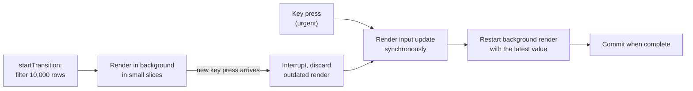
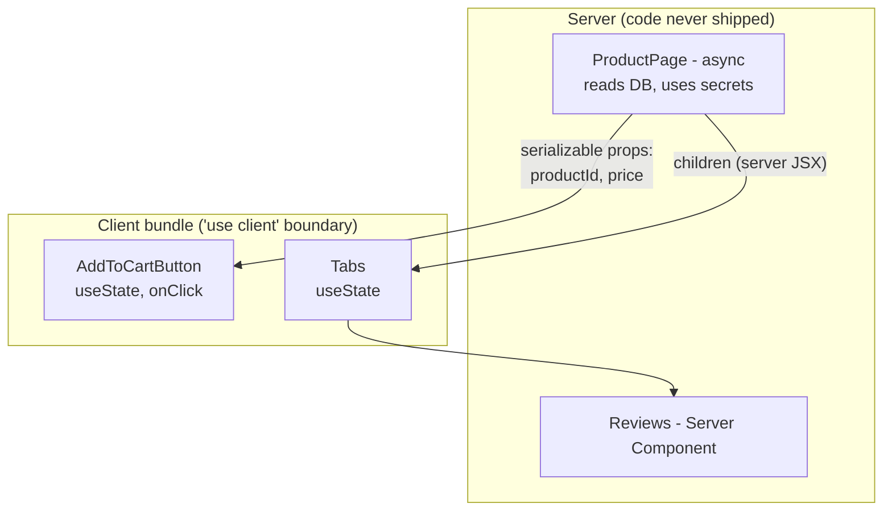

# React 18 and 19: Concurrent Features, Actions and Server Components

> In this document you will learn what changed in modern React and how to talk about it in interviews: concurrent rendering, transitions, `useDeferredValue`, Suspense for code and data, streaming server rendering, React 19 Actions (`useActionState`, `useFormStatus`, `useOptimistic`), the `use` API, Server Components and the `'use client'` / `'use server'` directives, the React Compiler, what React 19 removed, and how to migrate from 18 to 19. Many companies are still on React 18, so the differences are marked everywhere.

**Before this:** [Rendering, reconciliation and keys](02-rendering-reconciliation-and-keys.md) (Fiber, batching) · [Hooks in depth](03-hooks-in-depth.md) · [Rendering strategies: CSR, SSR, SSG](../05-frontend-engineering/09-rendering-strategies-csr-ssr-ssg.md) · **Interview questions:** [jump to the interview section](#interview-questions)

## Table of contents

1. [Concepts](#concepts)
   - [Release timeline](#release-timeline)
   - [Concurrent rendering](#concurrent-rendering)
   - [createRoot and hydrateRoot](#createroot-and-hydrateroot)
   - [Transitions: useTransition and startTransition](#transitions-usetransition-and-starttransition)
   - [useDeferredValue](#usedeferredvalue)
   - [Suspense for code and data](#suspense-for-code-and-data)
   - [Streaming SSR and selective hydration](#streaming-ssr-and-selective-hydration)
   - [React 19 Actions](#react-19-actions)
   - [useActionState and useFormStatus](#useactionstate-and-useformstatus)
   - [useOptimistic](#useoptimistic)
   - [The use API](#the-use-api)
   - [Other React 19 improvements](#other-react-19-improvements)
   - [Server Components and Client Components](#server-components-and-client-components)
   - [Server Functions and use server](#server-functions-and-use-server)
   - [The React Compiler](#the-react-compiler)
   - [React 19.2 and 19.3 additions](#react-192-and-193-additions)
   - [Removed and deprecated in React 19](#removed-and-deprecated-in-react-19)
   - [Migrating from React 18 to 19](#migrating-from-react-18-to-19)
2. [Interview questions](#interview-questions)
3. [Quick revision](#quick-revision)
4. [Summary](#summary)
5. [References](#references)

> **Versions and verification.** Facts were checked against react.dev (release posts, upgrade guide, API reference) in October 2026. Client behavior (transitions, `useDeferredValue`, Suspense, `use`, Actions, `useOptimistic`, metadata, `<Activity>`, removed APIs) was verified by running the code with **React 19.3.1** in Node.js 22 with jsdom; streaming output was verified with `renderToPipeableStream`. React 18 comparisons were run with **React 18.3.1**. Server Components and Server Functions need a framework bundler (Next.js, React Router, Parcel, Vite RSC plugin), so they were verified against the official docs and by reasoning, not executed.

---

## Concepts

### Release timeline

| Version | Date | Headline features |
| --- | --- | --- |
| React 18.0 | March 2022 | Concurrent renderer, `createRoot`, automatic batching, transitions, `useDeferredValue`, Suspense on the server (streaming), `useId`, `useSyncExternalStore` |
| React 18.3 | April 2024 | Deprecation warnings to prepare for 19 |
| React 19.0 | December 5, 2024 | Actions, `useActionState`, `useFormStatus`, `useOptimistic`, `use`, ref as a prop, `<Context>` as provider, metadata, stylesheets, stable Server Components and Server Functions |
| React 19.1 | March 2025 | Owner stacks for debugging, Suspense and RSC improvements |
| React 19.2 | October 1, 2025 | `<Activity>`, `useEffectEvent`, `cacheSignal`, partial pre-rendering, Performance tracks in DevTools |
| React Compiler 1.0 | October 7, 2025 | Stable build-time automatic memoization |
| React 19.3 | September 9, 2026 | `<ViewTransition>` and `addTransitionType` stable, Fragment refs, `browser()` in `react-dom`, Trusted Types |

Also worth knowing for interviews: Create React App was deprecated in February 2025 (start with a framework or Vite), React moved to the **React Foundation** under the Linux Foundation (announced October 2025), and in December 2025 critical security fixes were released for React Server Components (CVE-2025-55182, fixed in 19.0.1, 19.1.2 and 19.2.1, followed by further denial-of-service and source-exposure fixes).

### Concurrent rendering

Before React 18, every render was **synchronous and blocking**: once React started rendering an update, it finished the whole tree before the browser could do anything else. A big update could freeze typing for hundreds of milliseconds.

**Concurrent rendering** means React can **prepare several versions of the UI at the same time** and **interrupt** a render that is in progress:

- An urgent update (typing, clicking) can interrupt a non-urgent render (filtering a big list).
- React can **throw away** a render that became outdated (the user typed another character).
- React can render a new screen **in the background** and keep showing the old one until the new one is ready.

It is not multithreading. JavaScript still runs on one thread; React works in small units (fibers) and **yields** to the browser between them, about every 5 ms, so input events and painting can happen. See [Fiber in simple words](02-rendering-reconciliation-and-keys.md#fiber-in-simple-words).

Concurrent rendering is **opt-in per update**. Normal `setState` calls still render synchronously and in one go. Only updates you mark as non-urgent use it:

- updates inside `startTransition` / `useTransition`,
- `useDeferredValue`,
- Suspense-related rendering (revealing content, retrying).



### createRoot and hydrateRoot

```jsx
// React 18+ (the only API in React 19)
import { createRoot, hydrateRoot } from 'react-dom/client';

createRoot(document.getElementById('root')).render(<App />);               // client-rendered app
hydrateRoot(document.getElementById('root'), <App />);                     // attach to server HTML

// React 17 (removed in React 19; verified: ReactDOM.render is undefined in 19.3)
ReactDOM.render(<App />, document.getElementById('root'));
```

`createRoot` enables all React 18+ features. Before 19, a React 18 app that kept using `ReactDOM.render` ran in "legacy mode": no concurrent features and no automatic batching outside React events (verified with 18.3.1: two setters in a timeout gave 2 renders with `ReactDOM.render`, 1 with `createRoot`).

React 19 adds root options for error reporting:

```jsx
createRoot(container, {
  onUncaughtError: (error, info) => reportToSentry(error, info.componentStack),   // not caught by a boundary
  onCaughtError: (error, info) => logCaught(error),                               // caught by an error boundary
  onRecoverableError: (error) => logRecoverable(error),                           // e.g. hydration fell back to client render
});
```

### Transitions: useTransition and startTransition

A **transition** marks a state update as **non-urgent**. React renders it in the background, keeps the current UI interactive, and can interrupt it.

```jsx
import { useState, useTransition } from 'react';

function TabContainer() {
  const [tab, setTab] = useState('about');
  const [isPending, startTransition] = useTransition();

  function selectTab(next) {
    startTransition(() => {
      setTab(next);             // non-urgent: React may interrupt this render
    });
  }

  return (
    <>
      <TabButtons current={tab} onSelect={selectTab} />
      <div style={{ opacity: isPending ? 0.6 : 1 }}>
        {tab === 'about' && <AboutTab />}
        {tab === 'posts' && <PostsTab />}     {/* slow to render */}
        {tab === 'contact' && <ContactTab />}
      </div>
    </>
  );
}
```

Verified render sequence after clicking: `tab=home pending=false` → `tab=home pending=true` → `tab=posts pending=false`. React first renders **urgently** with `isPending = true` (and the old tab), then renders the transition with the new tab and `isPending = false`.

Rules and facts:

- `useTransition` returns `[isPending, startTransition]`. The standalone `startTransition` (imported from `react`) has no `isPending`; use it outside components (for example in a store or router).
- **Do not** use a transition for a controlled input's value. The input must update urgently, or typing feels broken. Split the state: the input value is urgent, the expensive derived update is a transition.
- A transition does **not** make the work faster. It makes the UI stay responsive while the work happens and lets React skip outdated intermediate renders.
- **Transitions prevent unwanted Suspense fallbacks.** If a transition causes a component to suspend, React keeps showing the old UI instead of replacing it with a fallback. Verified: without a transition, switching tabs showed `FALLBACK` while the old content was hidden with `display: none`; with a transition, the old content stayed visible with a `pending` indicator, then switched.
- **React 19: async transitions.** The function passed to `startTransition` can be `async`. `isPending` stays `true` until the whole async function finishes. These async transitions are called **Actions**.

```jsx
startTransition(async () => {
  const error = await updateName(name);   // isPending stays true during the request
  if (error) { setError(error); return; }
  startTransition(() => {                 // state updates AFTER an await must be wrapped again
    redirect('/profile');
  });
});
```

Why the second `startTransition`? In JavaScript, React cannot know that code after an `await` belongs to the same transition (the async context is lost). An unwrapped `setState` after `await` is treated as urgent. Verified: unwrapped, the committed sequence was `name=old pending=true → name=new pending=true → name=new pending=false` (the new name showed while still "pending"); wrapped, it was `name=old pending=true → name=new pending=false` (one clean switch).

### useDeferredValue

`useDeferredValue(value)` returns a **lagging copy** of a value. On an update, React first renders with the **old** deferred value (fast), then re-renders in the background with the new one (interruptible).

```jsx
function SearchPage() {
  const [query, setQuery] = useState('');
  const deferredQuery = useDeferredValue(query);
  const isStale = query !== deferredQuery;

  return (
    <>
      <input value={query} onChange={e => setQuery(e.target.value)} aria-label="Search" />
      <div style={{ opacity: isStale ? 0.5 : 1 }}>
        <SlowResults query={deferredQuery} />     {/* should be memo() so the urgent render skips it */}
      </div>
    </>
  );
}
const SlowResults = memo(function SlowResults({ query }) { /* expensive */ });
```

Verified render sequence when `q` changes from `a` to `ab`: `q=a deferred=a` → `q=ab deferred=a` → `q=ab deferred=ab`.

Important details:

- Wrap the slow child in `memo`. During the urgent render, its prop (`deferredQuery`) has not changed, so `memo` skips it; otherwise the urgent render is still slow.
- **React 19: initial value.** `useDeferredValue(value, initialValue)` renders `initialValue` first, then the real value in the background. Verified: `initial` then `final`.
- If the deferred render suspends, React keeps showing the old content (like a transition).

| | `useTransition` | `useDeferredValue` |
| --- | --- | --- |
| You control | The **state update** (setter call) | A **value** (often a prop you receive) |
| Pending flag | `isPending` | Compare `value !== deferredValue` |
| Typical use | Tab switches, navigation, actions | Filtering results from an input you do not own |

**Not a debounce.** Debouncing waits a fixed time before doing anything. A deferred value starts rendering immediately in the background and is interrupted by new input. On a fast device there is almost no delay; on a slow device it adapts. Debouncing is still the right tool for **network requests** (to send fewer requests); deferring is for **rendering** work.

### Suspense for code and data

**`<Suspense>`** shows a **fallback** while something inside it is not ready (it "suspends"), then shows the content.

```jsx
<Suspense fallback={<PageSkeleton />}>
  <ProductPage />
</Suspense>
```

**What can suspend:**

1. **Lazy-loaded code** with `React.lazy`:

```jsx
const AdminPanel = lazy(() => import('./AdminPanel'));   // separate JS chunk, loaded on first render

<Suspense fallback={<Spinner />}>
  {isAdmin && <AdminPanel />}
</Suspense>
```

Verified: the container showed `loading chart` until the lazy module resolved, then `chart loaded`.

2. **Data** read with `use(promise)` (React 19) or by Suspense-enabled libraries and frameworks (TanStack Query `useSuspenseQuery`, Relay, Next.js, React Router). Verified: `Loading...` until the promise resolved, then the list.

3. Server Components streaming from the server (see below).

**What does not suspend:** fetching in `useEffect`. Suspense only knows about things that suspend **during render**.

**How it works:** while rendering, a component that is not ready **suspends** (internally React treats it like a thrown promise). React looks up the tree for the nearest `<Suspense>` boundary and shows its fallback. When the promise resolves, React retries rendering.

**Design the loading states with boundaries:**

```jsx
<Suspense fallback={<HeaderSkeleton />}>
  <Header />
  <Suspense fallback={<FeedSkeleton />}>
    <Feed />                         {/* can appear after the header */}
  </Suspense>
  <Suspense fallback={<SidebarSkeleton />}>
    <Sidebar />                      {/* independent of the feed */}
  </Suspense>
</Suspense>
```

**Errors:** Suspense does not handle errors. A rejected promise throws to the nearest **error boundary**. Put error boundaries next to Suspense boundaries. Verified: an error boundary around a Suspense boundary showed `Loading`, then `Error: network down` after the promise rejected.

```jsx
<ErrorBoundary fallback={<p>Could not load comments.</p>}>
  <Suspense fallback={<CommentsSkeleton />}>
    <Comments commentsPromise={commentsPromise} />
  </Suspense>
</ErrorBoundary>
```

**React 19 change (pre-warming):** in React 18, when a component suspended, React kept rendering its siblings before showing the fallback. React 19 commits the fallback **immediately** and renders the suspended siblings afterwards ("pre-warming"), so fallbacks appear faster.

### Streaming SSR and selective hydration

React 18 brought Suspense to the server:

- **Streaming:** `renderToPipeableStream` (Node.js) and `renderToReadableStream` (web streams, Edge) send HTML **in chunks**. The shell (everything outside unresolved Suspense boundaries) is sent first, with fallbacks. When a boundary's data is ready, React streams its HTML plus a tiny inline script that swaps it into place.
- **Selective hydration:** the client can hydrate parts of the page independently, and **prioritizes the part the user is interacting with**.

Verified with `renderToPipeableStream` (React 19.3): the output came in 3 chunks:

```text
#0: <!DOCTYPE html><html><head></head><body><h1>Shell</h1><!--$?--><template id="B:0"></template><p>Loading comments</p><!--/$-->...
#1: <div hidden id="S:0"><p>comments arrived</p></div><script>...</script>     (swaps the content into B:0)
#2: </body></html>
```

This improves TTFB and FCP (the shell arrives fast) and avoids "all-or-nothing" SSR, where the slowest data blocks the whole page. Theory and trade-offs: [Streaming SSR](../05-frontend-engineering/09-rendering-strategies-csr-ssr-ssg.md#streaming-ssr).

React 19.2 added **partial pre-rendering** APIs (`prerender` in `react-dom/static` to pre-render a static shell, then `resume` to fill in dynamic parts at request time), which frameworks use.

### React 19 Actions

By convention, an **Action** is a function that runs inside a transition, usually async, typically to submit data. React 19 manages for you:

- **Pending state:** `isPending` is true from the start of the action until it ends (including the final state updates).
- **Optimistic updates:** with `useOptimistic`.
- **Errors:** an error thrown in an Action goes to the nearest error boundary (verified: `boundary: save failed`).
- **Forms:** `<form action={fn}>` calls `fn(formData)` as an Action and **resets the uncontrolled form** when the action completes (verified: also when the action *returns* an error state, so return the submitted values if the user must not lose them).

```jsx
// Before Actions (React 18 style)
function UpdateName() {
  const [name, setName] = useState('');
  const [error, setError] = useState(null);
  const [isPending, setIsPending] = useState(false);

  async function handleSubmit(e) {
    e.preventDefault();
    setIsPending(true);
    const err = await updateName(name);
    setIsPending(false);
    if (err) setError(err);
  }
  // ...
}

// With Actions (React 19)
function UpdateName() {
  const [error, submitAction, isPending] = useActionState(async (prev, formData) => {
    const err = await updateName(formData.get('name'));
    return err ?? null;
  }, null);

  return (
    <form action={submitAction}>
      <input name="name" />
      <button type="submit" disabled={isPending}>Update</button>
      {error && <p role="alert">{error}</p>}
    </form>
  );
}
```

> **If you know Angular…** Actions are a bit like an Angular reactive form's submit handler combined with a loading flag managed by the framework. The difference is that React's Actions are built on transitions, so the UI stays interactive and pending state is tracked automatically.

### useActionState and useFormStatus

```jsx
const [state, formAction, isPending] = useActionState(actionFn, initialState, permalink?);
// actionFn(previousState, formData) => newState  (can be async)
```

- `state`: the last value returned by the action (starts as `initialState`).
- `formAction`: pass it to `<form action>` or `<button formAction>`, or call it inside `startTransition`.
- `isPending`: true while it runs.
- Calls are **queued**: each action receives the previous action's result.
- It was called `useFormState` (in `react-dom`) in the React 19 canaries; the stable name is `useActionState` in `react` (the old name still exists as a deprecated alias in 19.3).

**`useFormStatus`** (from `react-dom`) lets a component **inside a `<form>`** read that form's status without props:

```jsx
import { useFormStatus } from 'react-dom';

function SubmitButton() {
  const { pending, data, method, action } = useFormStatus();
  return <button type="submit" disabled={pending}>{pending ? 'Saving...' : 'Save'}</button>;
}
```

It only reads the status of a **parent** `<form>`. Calling it in the same component that renders the `<form>` always returns `pending: false`.

Verified sequence (empty name, then a valid name), with the form and button above:

```text
Form isPending=true state={"error":null,"count":0}
Submit pending=true
Form isPending=false state={"error":"Name is required","count":1}
Submit pending=false
--- second submit
Form isPending=true state={"error":"Name is required","count":1}     (old state stays visible while pending)
Submit pending=true
Form isPending=false state={"error":null,"saved":"Ankit","count":2}
Submit pending=false
input value after success: ""                                        (uncontrolled form was reset)
```

### useOptimistic

`useOptimistic` shows a **temporary** value while an Action runs. When the Action ends, the optimistic value is replaced by the real state; if the real state did not change (failure), the UI **automatically goes back**.

```jsx
function LikeButton({ postId, likes }) {
  const [optimisticLikes, addOptimisticLike] = useOptimistic(likes, (current, delta) => current + delta);

  function handleLike() {
    startTransition(async () => {
      addOptimisticLike(1);               // shows likes + 1 immediately
      await api.like(postId);             // on success the parent refreshes `likes`
    });
  }
  return <button onClick={handleLike}>Like ({optimisticLikes})</button>;
}
```

Verified with `likes = 10`: success → `10, 11, 11` (optimistic 11, then real 11); failure (real state unchanged) → `10, 11, 10` (rolled back automatically). Calling `addOptimistic` outside a transition or Action warns: "An optimistic state update occurred outside a transition or action." Remember to wrap state updates after `await` in `startTransition` (verified: unwrapped, the UI briefly showed `12`, the real 11 plus the still-active optimistic +1).

### The use API

`use(resource)` reads the value of a **promise** or a **context** during render.

```jsx
import { use, Suspense } from 'react';

function Comments({ commentsPromise }) {
  const comments = use(commentsPromise);          // suspends until resolved; throws to error boundary if rejected
  return comments.map(c => <p key={c.id}>{c.text}</p>);
}

function Page({ commentsPromise }) {
  return (
    <Suspense fallback={<p>Loading comments...</p>}>
      <Comments commentsPromise={commentsPromise} />
    </Suspense>
  );
}
```

- Unlike hooks, `use` can be called **conditionally** and in loops (verified: `if (!show) return ...; const t = use(Theme);` worked).
- It must still be called during render (not in event handlers), and not inside `try/catch` (use an error boundary).
- **The promise must be stable.** A promise created during render in a Client Component is a new promise every render: React suspends, retries, gets a new promise, suspends again. Verified: the component stayed on its fallback (`wait`) and never showed the data. Create the promise in a Server Component, a framework loader, a cache, or an event handler, and pass it down.
- `use(Context)` is like `useContext`, but callable conditionally.

### Other React 19 improvements

- **`ref` as a prop** for function components; `forwardRef` no longer needed (see [Hooks in depth](03-hooks-in-depth.md#refs-to-components-forwardref-ref-as-a-prop-useimperativehandle)).
- **`<Context value>` as provider**: verified, `<Ctx value="new-style">` and `<Ctx.Provider value="old-style">` both work in 19.3. `Context.Provider` will be deprecated later.
- **Ref callback cleanup:** a ref callback can return a cleanup function (verified: `attach DIV`, `cleanup`).
- **Document metadata:** `<title>`, `<meta>` and `<link>` rendered anywhere are hoisted to `<head>`. Verified on the client: the `<head>` contained `<title>My Post</title><meta name="author" content="Ankit">` and the component's container kept only the `<article>`. Verified in SSR: `renderToString` placed `<title>` inside `<head>`.
- **Stylesheets with `precedence`:** `<link rel="stylesheet" href="..." precedence="default" />` is deduplicated, ordered, and Suspense waits for it before showing content.
- **Resource preloading:** `preload`, `preinit`, `preconnect`, `prefetchDNS` from `react-dom`.
- **Better hydration errors:** one error with a diff of the mismatched content instead of many warnings; third-party scripts and browser extensions that inject tags in `<head>`/`<body>` no longer break hydration.
- **Errors:** errors are reported once (not re-thrown and logged twice); new root options `onUncaughtError` and `onCaughtError`.
- **Custom elements:** full support for Web Components properties and events.
- **`useDeferredValue(value, initialValue)`**.

### Server Components and Client Components

**React Server Components (RSC)** are components that run **only on the server** (or at build time). Their code is **never sent to the browser**. They return a serialized description of the UI (the "RSC payload"), which React merges into the client tree.

```jsx
// app/products/[id]/page.jsx   (Server Component by default in Next.js App Router)
import { db } from '@/lib/db';
import AddToCartButton from './AddToCartButton';

export default async function ProductPage({ params }) {
  const { id } = await params;
  const product = await db.product.findUnique({ where: { id } });   // direct database access, no API needed
  return (
    <article>
      <h1>{product.name}</h1>
      <p>{product.description}</p>
      <AddToCartButton productId={product.id} />                    {/* Client Component */}
    </article>
  );
}
```

```jsx
// AddToCartButton.jsx
'use client';                                  // this module and its imports run on the client too
import { useState } from 'react';

export default function AddToCartButton({ productId }) {
  const [added, setAdded] = useState(false);
  return <button onClick={() => { addToCart(productId); setAdded(true); }}>{added ? 'Added' : 'Add to cart'}</button>;
}
```

| | Server Component | Client Component |
| --- | --- | --- |
| Runs | Server / build time only | Server (SSR, for HTML) **and** browser |
| Code sent to browser | No | Yes |
| `async` component, `await` data | Yes | No (use `use()` with a passed promise, or a library) |
| Direct DB, file system, secrets | Yes | No |
| `useState`, `useEffect`, event handlers | No | Yes |
| Browser APIs (`window`, `localStorage`) | No | Yes (in effects/handlers) |
| Context | Can render a provider (React 19.3: render `<Context value>` imported from a client module directly) | Read and provide |

**The `'use client'` directive** marks a **boundary**: the module and everything it imports become part of the client bundle. You do not need it in every client file, only at the entry points from server code.

Common misunderstandings:

- **"Client Components are not server-rendered."** Wrong. In frameworks they are still pre-rendered to HTML on the server (SSR) and then hydrated. "Client" means "also runs in the browser", not "only in the browser".
- **"Server Components are SSR."** No. SSR turns components into HTML for the first load. RSC is about where component **code runs** and is never shipped; RSC payloads are also used for client-side navigations, without full HTML.
- **"A Client Component cannot contain Server Components."** It cannot **import** them, but it can **receive** them as props (usually `children`) from a Server Component parent.

```jsx
// Server Component
<ClientTabs>                     {/* 'use client' */}
  <ServerRenderedReport />       {/* still a Server Component, rendered on the server and passed as children */}
</ClientTabs>
```

**The serialization boundary.** Props passed from a Server Component to a Client Component must be **serializable** by React: strings, numbers, booleans, `null`/`undefined`, plain objects and arrays, `Date`, `Map`, `Set`, typed arrays, `BigInt`, **Promises** (the client can `use()` them), JSX elements (including Server Components), and **Server Functions**. Not allowed: normal functions (event handlers), class instances, and symbols that are not globally registered.



### Server Functions and use server

**Server Functions** (called "Server Actions" when used as a form `action`) are async functions marked with `'use server'` that run on the server but can be **called from the client**. The bundler replaces them on the client with a reference; calling it sends a request to the server.

```jsx
// actions.js
'use server';

export async function addToCart(productId, quantity) {
  const session = await getSession();
  if (!session) throw new Error('Not signed in');                   // always authenticate
  const qty = Number(quantity);
  if (!Number.isInteger(qty) || qty < 1 || qty > 10) throw new Error('Invalid quantity');   // always validate
  await db.cart.add({ userId: session.userId, productId, quantity: qty });
}
```

```jsx
// Client Component
'use client';
import { addToCart } from './actions';

export function QuickAdd({ productId }) {
  return (
    <form action={async (formData) => { await addToCart(productId, formData.get('qty')); }}>
      <input name="qty" type="number" defaultValue={1} min={1} max={10} aria-label="Quantity" />
      <button type="submit">Add</button>
    </form>
  );
}
```

Key facts:

- `'use server'` is **not** the marker for Server Components (they need no directive). It marks **functions callable from the client**.
- Every exported Server Function is effectively a **public HTTP endpoint**. Anyone can call it with any arguments. Authenticate, authorize and validate inside it.
- Arguments and return values must be serializable.
- With `<form action={serverFunction}>`, forms work **before JavaScript loads** (progressive enhancement), and `useActionState` can take a `permalink` for that.
- Keep the React and framework versions patched: the December 2025 RSC vulnerabilities (remote code execution, CVE-2025-55182, and later denial-of-service and source-code exposure issues) were in the Server Function request decoding.

### The React Compiler

The **React Compiler** is a build-time tool (a Babel plugin, `babel-plugin-react-compiler`, with integrations for Vite, Metro/Expo, Rsbuild, and Next.js via its `reactCompiler` option) that **automatically memoizes** components and hooks.

- It analyzes each component and caches values, callbacks and JSX that depend only on unchanged inputs, like a precise `useMemo`/`useCallback`/`memo` everywhere. It even handles cases manual memoization cannot (for example, after an early return, or inline callbacks like `onClick={() => handle(item)}`).
- **Status:** v1.0 stable since October 7, 2025, used in production at Meta.
- **Versions:** works with React 17, 18 and 19. React 19 has the runtime built in; for 17/18 set `target: '18'` (or `'17'`) and install `react-compiler-runtime` as a normal dependency.
- **Requirements:** code that follows the Rules of React (pure render, no mutation of props/state, hooks rules). When it detects a violation in a component, it **skips that component** and compiles the rest. The `eslint-plugin-react-hooks` recommended rules report these problems even without the compiler.
- **Opting out:** the `'use no memo'` directive at the top of a function skips compilation for it (a temporary escape hatch).
- **Manual memoization after adopting it:** keep existing `useMemo`/`useCallback` (removing them can change behavior); for new code, rely on the compiler and use them only as escape hatches, such as stabilizing an effect dependency.

```js
// vite.config.js (React 19)
import react from '@vitejs/plugin-react';
export default {
  plugins: [react({ babel: { plugins: ['babel-plugin-react-compiler'] } })],
};
```

### React 19.2 and 19.3 additions

**React 19.2 (October 2025):**

- **`<Activity mode="visible" | "hidden">`**: hides part of the UI while **keeping its state**; hidden content is hidden with `display: none`, its effects are cleaned up, and it re-renders at low priority. Verified: a counter at 2 inside a hidden `<Activity>` had `style="display: none !important;"` and showed 2 again when visible. Good for tabs and back-navigation, and for pre-rendering a screen the user will probably open next.
- **`useEffectEvent`**: non-reactive logic for effects (see [Hooks in depth](03-hooks-in-depth.md#useeffectevent)).
- **`cacheSignal`** (Server Components): an `AbortSignal` that tells you when a `cache()` lifetime ends, to cancel work.
- **Partial pre-rendering** (`prerender` + `resume`), **Performance tracks** in Chrome DevTools, and SSR batching of Suspense reveals.

**React 19.3 (September 2026):**

- **`<ViewTransition>`** (stable) animates elements entering, exiting, updating or moving, using the browser View Transition API. Only updates inside transitions (`startTransition`, Suspense reveals, `useDeferredValue`) animate. **`addTransitionType`** tags a transition (`'next'`, `'back'`) to choose different animations.
- **Fragment refs:** `<Fragment ref={ref}>` gives a `FragmentInstance` to add event listeners, focus, observe (`IntersectionObserver`) or scroll a group of children without a wrapper `<div>`.
- **`browser()`** from `react-dom`: `use(browser())` makes a component render only on the client. On the server it suspends (the nearest Suspense fallback goes into the HTML), on the client it renders normally after hydration. Verified: the server output contained a client-render marker ("Switched to client rendering because a component requested it."), and the client rendered the component. It replaces the old `const [mounted, setMounted] = useState(false)` + effect trick.
- **Trusted Types** support: values are passed to DOM sinks without string coercion.
- Server Components can render a client `<Context value>` directly.
- Notable fixes: Strict Mode now double-invokes effects during hydration too; independent transitions no longer block each other.

### Removed and deprecated in React 19

Verified in React 19.3 unless noted:

| Removed or changed | Replacement |
| --- | --- |
| `ReactDOM.render`, `ReactDOM.hydrate` (verified `undefined`) | `createRoot`, `hydrateRoot` |
| `unmountComponentAtNode` (verified `undefined`) | `root.unmount()` |
| `ReactDOM.findDOMNode` (verified `undefined`) | Refs |
| `propTypes` on components (verified: silently ignored) | TypeScript |
| `defaultProps` on **function** components (verified: ignored; class `defaultProps` still work) | Default parameters |
| String refs `ref="input"` (verified: throws "Expected ref to be a function, an object returned by React.createRef(), or undefined/null") | Callback refs or `useRef`/`createRef` |
| Legacy context (`contextTypes`, `getChildContext`) | `createContext` |
| `React.createFactory` (verified `undefined`) | JSX |
| Module pattern factories | Normal components |
| `react-dom/test-utils` (only a deprecated `act` remains, verified) | `act` from `react`; React Testing Library |
| `react-test-renderer/shallow` | React Testing Library |
| UMD builds | ESM CDNs (for example esm.sh) |
| `element.ref` (deprecated, warns: "Accessing element.ref was removed in React 19") | `element.props.ref` |
| `react-test-renderer` (deprecated) | React Testing Library |
| `useFormState` (renamed; deprecated alias still exported, verified) | `useActionState` from `react` |

TypeScript changes in `@types/react` 19: `useRef` requires an argument (`useRef<T>(null)`), ref callbacks must not implicitly return values, the global `JSX` namespace moved to `React.JSX`, and `ReactElement` props default to `unknown`.

### Migrating from React 18 to 19

A safe order of steps, which is also a good interview answer:

1. **Upgrade to React 18.3** first and fix all deprecation warnings it prints.
2. **Use `createRoot`/`hydrateRoot`** everywhere (required).
3. **Enable the modern JSX transform** (required in 19).
4. **Run the codemods:** `npx codemod@latest react/19/migration-recipe` (string refs, `propTypes`/`defaultProps`, `act` imports, `ReactDOM.render`) and `npx types-react-codemod@latest preset-19 ./src` for TypeScript.
5. **Upgrade the ecosystem:** routers, state libraries, UI kits, testing libraries (React Testing Library 16+), and check peer dependencies.
6. **Run tests and Strict Mode**, check error reporting (`onCaughtError`/`onUncaughtError`), and check hydration warnings.
7. **Adopt new features gradually:** ref as a prop instead of `forwardRef`, `<Context>` as provider, Actions for new forms, metadata tags, then the React Compiler as a separate step.

---

## Interview questions

Many interviewers ask "what's new in React 18/19?" as an opener, then dig into one feature. Have a 30-second overview ready (Q1, Q14), and be precise about version numbers: it shows you actually work with them.

### Q1. What is concurrent rendering in React 18?

**What the interviewer is checking:** Real understanding of the model, not buzzwords.

**What to say (30–60 seconds):**
> "Concurrent rendering means React can work on a render without blocking the main thread, interrupt it for something more urgent, and even throw it away if it's outdated. Before 18, once rendering started, it ran to the end, so a big update could freeze typing. Now React renders in small units and yields to the browser between them. It's not multithreading, just cooperative scheduling on one thread. It's opt-in per update: normal updates are still synchronous, and I mark non-urgent ones with `startTransition` or `useDeferredValue`. Suspense also uses it: React can prepare the next screen in the background and keep the old one visible. It needs `createRoot`; React 19 only has that API."

**Deeper explanation:** See [Concurrent rendering](#concurrent-rendering) and the diagram. The commit phase is still synchronous, so users never see half-applied updates. Because a render can be interrupted and restarted, components must be pure; Strict Mode's double render checks that.

**Follow-up questions and how to answer them:**
- **"Does React 18 make my app faster automatically?"** — Mostly no. Automatic batching reduces renders a bit, but responsiveness gains come only from marking updates as transitions or deferred values.
- **"What is tearing?"** — Different components showing different versions of the same external data during one concurrent render. `useSyncExternalStore` prevents it for external stores.
- **"How often does React yield?"** — The scheduler works in slices of about 5 ms, then checks whether the browser needs the main thread.

**Common mistakes / weak answers:** "React renders in parallel threads." "Every update is concurrent now."

**Real-project example:** A product table with 5,000 rows and live filtering: with the filter update in a transition, typing stays smooth on a low-end laptop.

### Q2. What changes when you move from `ReactDOM.render` to `createRoot`?

**Short answer:** `createRoot(container).render(<App />)` turns on the concurrent renderer: automatic batching everywhere (verified with React 18.3.1: 2 renders for two setters in a timeout with `ReactDOM.render`, 1 with `createRoot`), transitions, `useDeferredValue`, Suspense improvements and streaming hydration with `hydrateRoot`. Unmounting is `root.unmount()` instead of `unmountComponentAtNode`. The `render` callback argument is gone (use an effect or ref callback). In React 18, staying on `ReactDOM.render` ran in legacy mode with a warning; in React 19 it is removed (verified `undefined`). Risk during the switch: code that relied on synchronous renders after `setState` in timeouts or promises.

### Q3. Explain `useTransition`. What renders happen when a tab is clicked?

```jsx
function Tabs() {
  const [tab, setTab] = useState('home');
  const [isPending, startTransition] = useTransition();
  console.log(`render tab=${tab} pending=${isPending}`);
  return <button onClick={() => startTransition(() => setTab('posts'))}>{tab}</button>;
}
```

**What the interviewer is checking:** The urgent/non-urgent split and the exact render sequence.

**What to say (30–60 seconds):**
> "It logs three renders: tab=home pending=false on mount, then tab=home pending=true, then tab=posts pending=false. When I call `startTransition`, React first does an urgent render where only `isPending` becomes true and the old tab is still shown, so I can show a spinner or dim the content. Then it renders the transition with the new tab in the background; that render is interruptible. When it commits, `isPending` goes back to false. I use transitions for updates that can wait a moment, like switching tabs, navigation, or heavy filtering, so clicks and typing stay responsive."

**Deeper explanation:** Verified: `render tab=home pending=false | render tab=home pending=true | render tab=posts pending=false`. More in [Transitions](#transitions-usetransition-and-starttransition).

**Follow-up questions and how to answer them:**
- **"What happens if the user clicks another tab during the slow render?"** — React interrupts the in-progress transition render and starts rendering the newest tab; the intermediate tab is never committed.
- **"Can I put an input's value update in a transition?"** — No. A controlled input must update synchronously, or typed characters lag or get lost. Keep the input state urgent and put the expensive dependent state in the transition.
- **"Does the callback run later, like `setTimeout`?"** — No. The function passed to `startTransition` runs **immediately and synchronously**; only the state updates inside it are marked as low priority.

**Common mistakes / weak answers:** "It delays the update like a debounce." "isPending is true during the whole callback execution" (it reflects the pending render, and for async Actions, the whole async function).

**Real-project example:** A sidebar with heavy dashboards: clicking a menu item keeps the old dashboard visible (dimmed) until the new one is ready, instead of freezing the click.

### Q4. `startTransition` vs `useTransition`: when do you use each?

**Short answer:** `useTransition` is a hook: it gives `isPending` and can only be used inside components. `startTransition` imported from `react` does the same marking but has **no pending state**, and can be called anywhere: in a router, a store, a data library or utility code. Use the hook when the UI needs to show pending feedback; use the function in non-component code. In React 19 both accept async functions (Actions).

### Q5. What does `useDeferredValue` do? What renders happen when `q` changes?

```jsx
function Search() {
  const [q, setQ] = useState('a');
  const deferred = useDeferredValue(q);
  console.log(`q=${q} deferred=${deferred}`);
  return <button onClick={() => setQ('ab')}>{deferred}</button>;
}
```

**What the interviewer is checking:** The two-render mechanism and the `memo` requirement.

**What to say (30–60 seconds):**
> "After the click it renders twice: first `q=ab deferred=a`, an urgent render where the deferred value still holds the old value, so the input updates instantly; then, in the background, `q=ab deferred=ab`. The background render can be interrupted by new keystrokes. To actually benefit, the slow child that receives the deferred value must be wrapped in `memo`, so in the urgent render it sees the same prop and skips. I use it when I receive a value I don't control, like a prop, and want heavy rendering to lag behind it. In React 19 there's also an initial value argument for the first render."

**Deeper explanation:** Verified: `q=a deferred=a | q=ab deferred=a | q=ab deferred=ab`; with `useDeferredValue('final', 'initial')`: `initial | final`. See [useDeferredValue](#usedeferredvalue) for the full search example and comparison table.

**Follow-up questions and how to answer them:**
- **"How do you show that results are stale?"** — Compare: `const isStale = q !== deferred;` and dim the results.
- **"What if the slow component suspends?"** — React keeps showing the previous results instead of the Suspense fallback while the new ones load, which is what users want for search-as-you-type.

**Common mistakes / weak answers:** Forgetting `memo` on the slow child. Saying it "waits 300 ms".

**Real-project example:** A command palette searching 20,000 items locally: the input stays instant and the list catches up.

### Q6. Transitions and deferred values vs debouncing: which do you use when?

**Short answer:** They solve different problems. **Debouncing** waits a fixed time after the last event, so it **reduces work that costs something per call** — API requests, autosave. **Transitions and `useDeferredValue`** do not wait: React starts the render at once, keeps it interruptible, and drops it if newer input arrives, so they **keep the UI responsive during heavy rendering** (no delay on a fast device). For a search box that calls an API, combine them: debounce the request and defer the rendering of the big result list. Transitions do not help much when one single component is slow, because React yields only **between** components.

The full answer — comparison table (debounce, throttle, `useTransition`, `useDeferredValue`), follow-ups and examples — is in [Performance Q16](08-performance-optimization.md#q16-debounce-vs-usedeferredvalue-vs-usetransition--when-do-you-use-each). The hook is in [Hooks in depth — `useDebouncedValue`](03-hooks-in-depth.md#q27-write-usedebouncedvalue-what-does-this-search-send), and the general technique in [Debounce and throttle](../02-javascript/20-debounce-throttle-and-performance.md).

**Real-project example:** An address search: debounced API calls (300 ms) + `useDeferredValue` for rendering a map with many markers.

### Q7. What is Suspense? How does a component "suspend"?

**What the interviewer is checking:** The mechanism and what can and cannot trigger it.

**What to say (30–60 seconds):**
> "Suspense lets me declare loading states in the tree: `<Suspense fallback={<Spinner/>}>` shows the fallback while something inside isn't ready, then shows the content. A component suspends during render when it needs something that isn't available yet: lazy-loaded code with `React.lazy`, a promise read with `use()`, or data from a Suspense-enabled library or framework. Internally React catches that, finds the nearest boundary, shows its fallback, and retries when the promise resolves. Fetching in `useEffect` doesn't trigger Suspense, because it happens after render. Errors aren't handled by Suspense: a rejected promise goes to the nearest error boundary. With transitions, React keeps the old UI instead of showing a fallback again."

**Deeper explanation:** Verified: `use(promise)` showed `Loading...`, then the list; `lazy` showed `loading chart`, then `chart loaded`; a rejected promise inside `ErrorBoundary > Suspense` ended with the boundary's error message. Details: [Suspense for code and data](#suspense-for-code-and-data).

**Follow-up questions and how to answer them:**
- **"Where do you place boundaries?"** — Where the design wants a loading state: per independent section (feed, sidebar), not around every small component (spinner chaos) and not only at the root (one big spinner). Nested boundaries reveal outer content first.
- **"What did React 19 change in Suspense?"** — When something suspends, React 19 shows the fallback immediately and pre-renders the siblings afterwards ("pre-warming"), instead of rendering all siblings first.
- **"Can I make my own data library suspend?"** — The supported way for app code is `use(promise)` with a cached promise. Throwing promises yourself is an undocumented implementation detail; leave it to libraries.

**Common mistakes / weak answers:** "Suspense is for data fetching in `useEffect`." "Suspense catches errors."

**Real-project example:** A product page streams the header and price first, while reviews and recommendations load behind their own boundaries.

### Q8. Scenario: the initial JavaScript bundle is too big. How do you use code splitting in React?

**Short answer:** Split by **route** first (users need only the current page), then split **heavy widgets** that are not needed at once — charts, rich-text editors, maps, admin panels. In React: `const Editor = lazy(() => import('./Editor'))`, declared at **module level**, rendered inside a `<Suspense>` boundary with a good fallback; the bundler puts the module in its own chunk. Preload on intent (hover/focus calls the same `import()`), add an **error boundary** for failed chunk loads, and check with a bundle analyzer that the initial chunk really shrank.

```jsx
const ReportChart = lazy(() => import('./ReportChart'));
const preloadChart = () => import('./ReportChart');      // same module: the browser caches it

<button onMouseEnter={preloadChart} onClick={() => setShow(true)}>Show chart</button>
{show && <Suspense fallback={<ChartSkeleton />}><ReportChart /></Suspense>}
```

The full answer (how `lazy` suspends, named exports, failed chunks after a deploy, where to put boundaries) is in [Performance Q19](08-performance-optimization.md#q19-how-does-code-splitting-work-with-reactlazy-and-suspense), and finding what makes the bundle big is [Performance Q20](08-performance-optimization.md#q20-scenario-the-javascript-bundle-is-too-big-how-do-you-find-and-fix-the-cause).

**Real-project example:** Moving a 400 KB rich-text editor behind `lazy` cut the dashboard's initial JavaScript in half.

### Q9. Output question: what does the user see when switching tabs, with and without a transition?

```jsx
function App({ useT }) {
  const [tab, setTab] = useState('home');
  const [isPending, startTransition] = useTransition();
  return (
    <>
      <button onClick={() => (useT ? startTransition(() => setTab('posts')) : setTab('posts'))}>go</button>
      {isPending && <i>pending</i>}
      <Suspense fallback={<p>FALLBACK</p>}>
        <TabContent name={tab} />          {/* suspends while 'posts' data loads */}
      </Suspense>
    </>
  );
}
```

**What the interviewer is checking:** How transitions interact with Suspense, a subtle and important behavior.

**What to say (30–60 seconds):**
> "Without the transition, the tab content suspends, so React replaces the visible home content with the fallback until posts are ready: the user sees the page jump to a spinner. With the transition, React knows this update isn't urgent, so it keeps showing the old home content, sets `isPending` to true so I can show a small indicator, and swaps to posts only when they're ready. That's why routers wrap navigations in transitions: already-visible content shouldn't be replaced by a fallback."

**Deeper explanation:** Verified DOM during loading: without a transition, `<p style="display: none !important;">content of home</p><p>FALLBACK</p>` (React hides the old content and shows the fallback); with a transition, `<i>pending</i><p>content of home</p>`. After loading, both showed `content of posts`.

Rule: Suspense fallbacks are shown for **new** boundaries (content appearing for the first time) or for urgent updates; transitions avoid hiding **already revealed** content.

**Follow-up questions and how to answer them:**
- **"How do you still show a fallback for a new section inside a transition?"** — Put the new content behind its own, new `<Suspense>` boundary; a newly mounted boundary shows its fallback even during a transition.
- **"What if the transition takes very long?"** — Show `isPending` feedback; for very long waits, consider showing a skeleton for that region by using a `key` to remount the boundary.

**Common mistakes / weak answers:** "Both show the fallback."

**Real-project example:** Clicking between pages in a Next.js or React Router app keeps the current page visible with a top progress bar, because navigation is a transition.

### Q10. Find the bug: the component never stops showing "Loading".

```jsx
'use client';
function Comments({ postId }) {
  const comments = use(fetch(`/api/posts/${postId}/comments`).then(r => r.json()));
  return comments.map(c => <p key={c.id}>{c.text}</p>);
}
```

**What the interviewer is checking:** That `use` needs a stable (cached) promise.

**What to say (30–60 seconds):**
> "The promise is created during render. When it suspends, React retries the render after the promise resolves, but the retry calls `fetch` again and creates a brand-new pending promise, so it suspends again, forever, and fires a request each time. I verified that a component creating its promise in render stayed on its fallback. The promise must be created outside render and be stable: in a Server Component that passes it as a prop, in a framework loader, in a cache keyed by `postId`, or in an event handler. In a client-only app I'd simply use TanStack Query's `useSuspenseQuery`, which caches the promise for me."

**Deeper explanation:** Verified: the component was called 3 times and the HTML stayed `<p>wait</p>` (the fallback).

```jsx
// Server Component creates the promise once and does NOT await it, so the page can stream
export default function PostPage({ postId }) {
  const commentsPromise = getComments(postId);
  return (
    <Suspense fallback={<CommentsSkeleton />}>
      <Comments commentsPromise={commentsPromise} />   {/* Client Component calls use(commentsPromise) */}
    </Suspense>
  );
}

// Or a tiny client cache
const cache = new Map();
function getCommentsCached(postId) {
  if (!cache.has(postId)) cache.set(postId, fetch(`/api/posts/${postId}/comments`).then(r => r.json()));
  return cache.get(postId);
}
```

**Follow-up questions and how to answer them:**
- **"Why does `use` work in Server Components with a new promise?"** — In a Server Component you would just `await` the data; the component renders once per request. The problem is specific to client re-renders.
- **"Will React warn me?"** — Do not count on it. In my test (React 19.3.1, development build) React printed no warning at all; the component was called three times, created three promises, and stayed on its fallback. Design the cache instead.

**Common mistakes / weak answers:** "Wrap it in useMemo" (React can drop the memo cache when a component suspends before mounting, so it is not reliable). "Add useEffect."

**Real-project example:** A migration from `useEffect` fetching to `use()` that caused an infinite request loop in staging; the fix was moving the promise creation to the route loader.

### Q11. How do Suspense and error boundaries work together?

**Short answer:** Suspense handles **loading**, error boundaries handle **failures**. When a promise read with `use()` (or a lazy chunk) rejects, the error is thrown to the nearest error boundary above, which shows its fallback (verified: `Loading` → `Error: network down`). Place an error boundary around (or near) each Suspense boundary so one failed section does not take down the page. Error boundaries are still class components (`getDerivedStateFromError`, `componentDidCatch`) or `react-error-boundary`'s `<ErrorBoundary>`. They do not catch errors in event handlers (verified: a click handler's error went to `window`'s error event and the boundary did not render its fallback), in async code outside rendering, or in the boundary itself. React 19 Actions are an exception: an error thrown inside an Action (a transition) **is** sent to the nearest error boundary (verified: `boundary: save failed`). How to write a boundary, where to place it and how to handle async errors are answered in full in [Patterns Q12](09-patterns-architecture-and-typescript.md#q12-what-is-an-error-boundary-how-do-you-write-one), [Q13](09-patterns-architecture-and-typescript.md#q13-my-error-boundary-doesnt-catch-my-async-error-why-and-how-do-i-fix-it) and [Q14](09-patterns-architecture-and-typescript.md#q14-where-should-you-place-error-boundaries-in-an-application).

### Q12. Explain streaming SSR and selective hydration.

**What the interviewer is checking:** How React 18 changed server rendering.

**What to say (30–60 seconds):**
> "Before React 18, SSR was all-or-nothing: the server had to fetch all data and render the whole page before sending anything, and the client had to download all JavaScript and hydrate the whole page before anything was interactive. With streaming, `renderToPipeableStream` or `renderToReadableStream` sends the shell immediately with Suspense fallbacks in place, and streams each section's HTML later, with a small inline script that puts it in the right place. Selective hydration means the client hydrates sections independently, and if the user clicks a section that isn't hydrated yet, React prioritizes it. Result: faster first paint, and slow data only delays its own section."

**Deeper explanation:** Verified with React 19.3, three chunks: the shell with `<!--$?--><template id="B:0"></template><p>Loading comments</p>`, then `<div hidden id="S:0"><p>comments arrived</p></div>` plus a swap script, then `</body></html>`. Background theory: [Streaming SSR](../05-frontend-engineering/09-rendering-strategies-csr-ssr-ssg.md#streaming-ssr) and [Hydration](../05-frontend-engineering/09-rendering-strategies-csr-ssr-ssg.md#hydration-and-its-cost).

**Follow-up questions and how to answer them:**
- **"What is the shell, and what if it fails?"** — Everything outside unresolved Suspense boundaries. `onShellReady` fires when it can be sent; if rendering the shell fails, `onShellError` lets you send an error page. Errors inside a boundary make that boundary fall back to client rendering.
- **"How does this relate to SEO bots?"** — For crawlers you can wait for `onAllReady` and send the complete HTML at once.
- **"What do frameworks add?"** — Next.js and React Router wire streaming to routes, data loading and Server Components; you rarely call the streaming APIs yourself.

**Common mistakes / weak answers:** "Streaming means WebSockets." Not mentioning that Suspense boundaries define the streaming units.

**Real-project example:** An e-commerce product page streams the product details first and the personalized recommendations (slow, per-user) later, improving LCP.

### Q13. What are Actions in React 19?

**What the interviewer is checking:** The core React 19 idea, beyond listing hook names.

**What to say (30–60 seconds):**
> "An Action is a function that runs inside a transition, usually async, typically to send data. React 19 lets `startTransition` take an async function, and React tracks it: `isPending` stays true until it finishes, errors go to the nearest error boundary, and optimistic updates via `useOptimistic` are reverted automatically when it ends. On top of that, forms accept a function as `action`: `<form action={fn}>` calls it with the `FormData`, runs it as an Action, and resets the uncontrolled form when the action completes. Then there are helper hooks: `useActionState` for the result and pending state of an action, `useFormStatus` for a submit button to read its form's status, and `useOptimistic`. In frameworks, the action can be a Server Function."

**Deeper explanation:** See [React 19 Actions](#react-19-actions) for a before/after comparison. What the user gets: no manual `isSaving` flags, no `preventDefault`, sequential handling of repeated submissions, and with Server Functions, forms that work before JavaScript loads.

**Follow-up questions and how to answer them:**
- **"Do I need a framework for Actions?"** — No. Client-side Actions (async functions, `useActionState`, `<form action>`) work in any React 19 app. Only Server Functions need a framework or RSC bundler.
- **"How does it compare to React Hook Form?"** — React Hook Form is about field registration, validation and minimal re-renders. Actions are about submission and pending/optimistic state. They can be combined (validate with RHF/Zod, submit through an action). See [Routing and forms](07-routing-and-forms.md).
- **"What happens to controlled inputs?"** — The automatic reset applies to uncontrolled fields; controlled values are whatever your state says. You can reset manually with `requestFormReset` from `react-dom`.

**Common mistakes / weak answers:** "Actions are Redux actions." "Actions only work with Next.js."

**Real-project example:** A "change password" form rewritten with `useActionState`: 40 lines of loading/error state became 10, and double submits are queued instead of racing.

### Q14. Output question: what does this form log on an empty submit and then a valid submit?

```jsx
async function updateName(prev, formData) {
  await delay(10);
  const name = formData.get('name');
  if (!name) return { error: 'Name is required', count: prev.count + 1 };
  return { error: null, saved: name, count: prev.count + 1 };
}

function Submit() {
  const { pending } = useFormStatus();
  console.log('Submit pending=' + pending);
  return <button type="submit" disabled={pending}>Save</button>;
}

function Form() {
  const [state, formAction, isPending] = useActionState(updateName, { error: null, count: 0 });
  console.log(`Form isPending=${isPending} state=${JSON.stringify(state)}`);
  return (
    <form action={formAction}>
      <input name="name" defaultValue="" />
      <Submit />
      {state.error && <p role="alert">{state.error}</p>}
    </form>
  );
}
```

**What the interviewer is checking:** How `useActionState` passes previous state, pending timing, and `useFormStatus`.

**What to say (30–60 seconds):**
> "On the first submit: the form renders with isPending true and the initial state, the Submit button sees pending true; when the action finishes, the form renders with isPending false and the returned state, error 'Name is required' and count 1, and the button sees pending false. On the second submit with a name: pending true while the old state with the error is still shown, then the new state with saved name and count 2. The count proves the action receives the previous state. And after the successful submit the uncontrolled input is reset to empty, because form actions reset the form."

**Deeper explanation:** This is the exact verified output shown in [useActionState and useFormStatus](#useactionstate-and-useformstatus) (development build, no Strict Mode). Note that while pending, the **old** state is still displayed; design the UI to dim or disable it.

**Follow-up questions and how to answer them:**
- **"Why is `Submit` a separate component?"** — `useFormStatus` reads the status of the **parent** form. If it were called in `Form` itself (which renders the `<form>`), `pending` would always be false.
- **"How do you keep the typed value after a validation error?"** — The reset happens whenever the action completes without throwing, even if it *returns* an error state (verified: the input was cleared after an action returned `{ error: "Too short" }`). Return the submitted values in the state and use them as `defaultValue` (verified: the input kept `ab`), or use controlled inputs for fields that must persist.

**Common mistakes / weak answers:** Saying the state updates immediately. Calling `useFormStatus` in the same component as the form.

**Real-project example:** A newsletter signup showing "Subscribing..." on the button and the server's error message below the form, with no local state at all.

### Q15. What is `useOptimistic`? What happens when the request fails?

**What the interviewer is checking:** Optimistic UI and automatic rollback.

**What to say (30–60 seconds):**
> "`useOptimistic` gives me a value that I can temporarily change while an Action is running. I pass the real state and an update function; inside a transition I call `addOptimistic`, and the UI shows the optimistic value immediately. When the Action finishes, React drops the optimistic layer and shows the real state. So if the server call succeeds and I update the real state, the user sees no change; if it fails and I don't update the real state, the UI automatically goes back to the previous value. One trap: state updates after `await` must be wrapped in another `startTransition`, otherwise React briefly shows the real value plus the optimistic change."

**Deeper explanation:** Verified with `likes = 10`: success → shown `10 → 11 → 11`; failure → `10 → 11 → 10`; unwrapped `setLikes` after `await` → shown `10 → 11 → 12 → 11` (a visible glitch); wrapped → `10 → 11 → 11`. See [useOptimistic](#useoptimistic).

```jsx
function handleLike() {
  startTransition(async () => {
    addOptimisticLike(1);
    try {
      const updated = await api.like(postId);
      startTransition(() => setLikes(updated.likes));   // wrap updates after await
    } catch {
      showToast('Could not like the post');             // no state change: optimistic value rolls back
    }
  });
}
```

**Follow-up questions and how to answer them:**
- **"How is this different from optimistic updates in TanStack Query?"** — TanStack Query does it in its cache (`onMutate` sets data, `onError` rolls back manually, `onSettled` invalidates). `useOptimistic` is local UI state tied to an Action's lifetime. See [Data fetching](06-data-fetching-axios-and-tanstack-query.md).
- **"What about calling it outside a transition?"** — React warns: "An optimistic state update occurred outside a transition or action" (verified).

**Common mistakes / weak answers:** Manually writing rollback code for `useOptimistic` (not needed). Forgetting the transition.

**Real-project example:** Chat messages appear immediately as "sending..." items, then become normal messages when the server confirms, or disappear with an error.

### Q16. `use` vs `useContext`: what is the difference?

**Short answer:** Both read context, but `use(Context)` can be called **conditionally** and in loops (verified: after an early return), while `useContext` follows the rules of hooks. `use` can also read a **promise** (suspending until it resolves). `use` cannot be called in event handlers or inside `try/catch`. In new React 19 code, `use` is a flexible default for context; `useContext` remains fully supported.

### Q17. Explain React Server Components. How are they different from SSR?

**What the interviewer is checking:** That you can separate Server Components from SSR clearly and name the trade-offs.

**What to say (30–60 seconds):**
> "Server Components are components that run only on the server or at build time, and their code is never sent to the browser. They can be async, read the database or files directly, and use secrets. They render to a serialized description of the UI, the RSC payload, which the client merges into the React tree. Interactive parts are Client Components, marked with a `'use client'` boundary, which can have state, effects and event handlers. That's different from SSR: SSR renders components to HTML for the first load, and then all component code still ships for hydration. With RSC, server-only components ship zero JavaScript, and the payload is also used for client navigations without full HTML. In practice I use them through a framework like Next.js App Router."

**Deeper explanation:** Tables and examples: [Server Components and Client Components](#server-components-and-client-components). The two ideas combine: a Next.js page uses RSC to decide what runs where, and SSR to produce the first HTML (including Client Components' HTML).

**Follow-up questions and how to answer them:**
- **"What are the benefits?"** — Smaller bundles (server-only code and libraries like Markdown parsers stay on the server), no client-server waterfalls for data (fetch where the data is), direct backend access, secrets stay server-side, and streaming with Suspense.
- **"What are the costs?"** — More complex mental model (two environments), serialization limits on props, framework dependency, server infrastructure, and caching questions. Not every app needs them.
- **"Can Server Components re-render on the client?"** — No. They re-run on the server (on navigation or after a mutation like `revalidatePath`/`router.refresh()` in Next.js), and the new payload is merged in, keeping client state.

**Common mistakes / weak answers:** "Server Components are SSR." "Client Components don't render on the server." "`'use server'` marks Server Components."

**Real-project example:** A docs site where the Markdown rendering and syntax highlighting run in Server Components, removing about 200 KB of client JavaScript. See [Next.js essentials](11-nextjs-essentials-for-interviews.md).

### Q18. Find the bug: "useState is not a function" or "Event handlers cannot be passed to Client Component props".


```jsx
// app/cart/page.jsx  (Server Component)
import { useState } from 'react';
import QuantityPicker from './QuantityPicker';    // 'use client'

export default async function CartPage() {
  const [coupon, setCoupon] = useState('');
  const cart = await getCart();
  return <QuantityPicker items={cart.items} onChange={(id, qty) => updateQty(id, qty)} />;
}
```

**Short answer:** Two bugs. (1) `useState` in a **Server Component**: Server Components run once on the server and never re-render in the browser, so they cannot have state, effects or event handlers — move the coupon input into its own `'use client'` component. (2) Passing a plain **function** (`onChange`) from a Server to a Client Component: props that cross the boundary must be **serializable**, and functions are not. Pass a **Server Function** (`'use server'`), which React sends as a reference, or handle the change inside the Client Component and call a Server Function from there. Keep the `'use client'` boundary as low as possible; do not mark the whole page as client "to make it work".

The full spoken answers with code are in [Next.js Q4 — why `useState` does not work](11-nextjs-essentials-for-interviews.md#q4-why-does-usestate-not-work-in-this-component) and [Next.js Q5 — what you can pass between Server and Client Components](11-nextjs-essentials-for-interviews.md#q5-how-do-server-and-client-components-work-together-what-can-you-pass-between-them). Writing a safe Server Function is [Q20](#q20-what-are-server-functions-use-server-what-security-rules-apply) below.

**Real-project example:** This exact error shows up when someone first moves a Pages Router component into the Next.js App Router.

### Q19. What does `'use client'` really mean? Is a Client Component rendered only in the browser?

**Short answer:** `'use client'` at the top of a module marks a **boundary**: that module and everything it imports are bundled for the client. Client Components are **still pre-rendered to HTML on the server** in frameworks (SSR), then hydrated; "client" means "this code also runs in the browser". You only need the directive at entry points imported from server code, not in every file. A Client Component cannot import a Server Component, but it can render Server Components passed to it as `children` or other props. To render something truly client-only, use `use(browser())` (React 19.3), a dynamic import with SSR disabled in your framework, or render it after mount.

### Q20. What are Server Functions (`'use server'`)? What security rules apply?

**What the interviewer is checking:** Correct terminology and security awareness (very relevant after the December 2025 vulnerabilities).

**What to say (30–60 seconds):**
> "A Server Function is an async function marked with `'use server'`, either at the top of a module or inside the function. It runs on the server, but client code can call it like a normal function; the bundler replaces it with a reference, and calling it sends a POST request with serialized arguments. When it's used as a form action, it's called a Server Action, and the form even works before JavaScript loads. Security-wise, every exported Server Function is a public endpoint: anyone can call it with any arguments. So I authenticate and authorize inside it, validate inputs, for example with Zod, never trust IDs from the client, and return only what the client needs. And keep React and the framework patched: the critical RSC vulnerabilities in December 2025 were in exactly this request handling."

**Deeper explanation:** See [Server Functions and use server](#server-functions-and-use-server).

```js
'use server';
import { z } from 'zod';

const Input = z.object({ productId: z.string().uuid(), quantity: z.coerce.number().int().min(1).max(10) });

export async function addToCart(formData) {
  const session = await getSession();
  if (!session) return { error: 'Please sign in' };
  const parsed = Input.safeParse(Object.fromEntries(formData));
  if (!parsed.success) return { error: 'Invalid input' };
  await db.cart.add({ userId: session.userId, ...parsed.data });
  return { ok: true };
}
```

**Follow-up questions and how to answer them:**
- **"Are Server Functions for fetching data?"** — They are designed for mutations. For reads, fetch in Server Components (or route loaders). Calls are sequential, and they are POST requests, so they are not cached like GETs.
- **"What about CSRF?"** — Frameworks add protections (Next.js compares the `Origin` header with the host for Server Actions), but you should know your framework's rules and still use auth.

**Common mistakes / weak answers:** "`'use server'` makes a component a Server Component." "Only my UI can call it."

**Real-project example:** A security review found a Server Function `deleteProject(projectId)` that checked login but not ownership; any logged-in user could delete any project.

### Q21. What is the React Compiler, and should we adopt it?

**What the interviewer is checking:** Current status (2025–2026) and a pragmatic adoption plan.

**What to say (30–60 seconds):**
> "The React Compiler is a build-time tool, a Babel plugin with integrations for Vite, Next.js, Expo and others, that automatically memoizes components and hooks. It analyzes the code and caches values, callbacks and JSX, so children skip re-rendering when their inputs didn't change, like perfect `useMemo`, `useCallback` and `memo` everywhere, even in places where manual memoization isn't possible. Version 1.0 has been stable since October 2025 and it's used in production at Meta. It works with React 17, 18 and 19; 17 and 18 need the `react-compiler-runtime` package. It requires code that follows the Rules of React; components that break them are skipped. My adoption plan: turn on the lint rules from `eslint-plugin-react-hooks` first and fix violations, enable the compiler on part of the app, measure with the Profiler, then roll out."

**Deeper explanation:** Details: [The React Compiler](#the-react-compiler). What it means for `memo`, `useMemo` and `useCallback`, and the Vite and Next.js setup, are in [Performance Q24](08-performance-optimization.md#q24-what-is-the-react-compiler-and-does-it-make-memo-usememo-and-usecallback-obsolete). Things that break under the compiler are the same things that are already bugs: mutating props or state, reading refs during render, side effects in render, and libraries that rely on mutation (the `incompatible-library` lint rule flags known ones).

**Follow-up questions and how to answer them:**
- **"Do we still need `useMemo` and `useCallback`?"** — For new code, rarely: the compiler handles it. Keep them as escape hatches, for example to make an effect dependency stable on purpose. Do not mass-delete existing ones without testing.
- **"How do you opt a component out?"** — Add the `'use no memo'` directive at the top of the function, as a temporary measure while fixing it.
- **"Does it make React like Svelte or Solid?"** — No. React still re-renders components; the compiler just skips work that would produce the same result. The mental model stays "UI = f(state)".

**Common mistakes / weak answers:** "It's experimental" (outdated since October 2025). "It changes how React renders at runtime."

**Real-project example:** Enabling the compiler on a large admin app removed most "why did this render?" issues without code changes; two components were skipped by the compiler because they mutated props, which the lint rule pointed out.

### Q22. What was removed in React 19? What breaks when you upgrade?

**What the interviewer is checking:** Practical upgrade knowledge.

**What to say (30–60 seconds):**
> "The main removals: `ReactDOM.render` and `hydrate`, replaced by `createRoot` and `hydrateRoot`; `unmountComponentAtNode` and `findDOMNode`; `propTypes` checks and `defaultProps` on function components, so I use TypeScript and default parameters; string refs; legacy context with `contextTypes`; `createFactory`; `react-dom/test-utils` except a deprecated `act`, which moved to `react`; the shallow renderer; and UMD builds. `element.ref` is deprecated because ref is now a prop, and `react-test-renderer` is deprecated. The modern JSX transform is required. TypeScript types changed too: `useRef` needs an argument, and the global `JSX` namespace moved to `React.JSX`. Most of this is handled by the official codemods."

**Deeper explanation:** Verified list with replacements: [Removed and deprecated in React 19](#removed-and-deprecated-in-react-19). Notable verified behaviors: `defaultProps` on a function component renders `undefined` silently (no warning in 19; 18.3.1 warned "Support for defaultProps will be removed from function components"), and `propTypes` are ignored without any error.

**Follow-up questions and how to answer them:**
- **"What breaks silently?"** — `defaultProps` on function components (props become `undefined` without a warning), and `propTypes` validation disappearing. Search the codebase for both before upgrading.
- **"What about error handling changes?"** — Errors caught by error boundaries are no longer re-thrown; they are reported through `console.error` and the new `onCaughtError` root option. Uncaught errors go to `window.reportError` and `onUncaughtError`. Error monitoring setups may need updates.

**Common mistakes / weak answers:** Listing only new features. Saying class components were removed.

**Real-project example:** A UI library still using `Button.defaultProps = { variant: 'primary' }` rendered unstyled buttons after the upgrade; tests caught it only because they checked class names.

### Q23. Scenario: your team is on React 18. How do you plan the upgrade to React 19?

**What the interviewer is checking:** Senior-level planning, risk management and communication.

**What to say (30–60 seconds):**
> "I'd do it in small, reversible steps. First, upgrade to 18.3 and fix every deprecation warning it prints. Make sure we use `createRoot`, the new JSX transform, and no string refs or legacy context. Then check the ecosystem: our router, state library, UI kit, testing libraries and anything with a React peer dependency must support 19. Run the React 19 codemods and the TypeScript types codemod on a branch, upgrade, and run unit tests, end-to-end tests and the app in Strict Mode; look specifically for `defaultProps` on function components and for error-reporting changes. Ship it without adopting new features. Afterwards, adopt features gradually: ref as a prop, Actions for new forms, and the React Compiler as a separate, measured step."

**Deeper explanation:** The step list is in [Migrating from React 18 to 19](#migrating-from-react-18-to-19).

Talking points:

- **Why upgrade at all?** Security and support (the December 2025 RSC fixes were released for 19.x lines), ecosystem moving to 19 (libraries dropping 18), Actions and `use` simplify code, compiler support without extra runtime, better hydration errors and metadata support.
- **Risk control:** feature-flag nothing (it is a dependency upgrade), but deploy to a staging environment first, watch error monitoring, have a rollback plan (revert the lockfile).
- **Communication:** a short migration guide for the team ("no more `forwardRef` in new code", "use default parameters").

**Follow-up questions and how to answer them:**
- **"What if a critical library doesn't support 19 yet?"** — Check for a maintained fork or newer major, wrap and replace it, or postpone the upgrade; npm `overrides` can force a peer version only as a short-term, tested workaround.
- **"How long would it take?"** — For a medium app that already uses `createRoot` and no legacy APIs: days, mostly testing. Apps with class-heavy legacy code or old libraries: weeks.

**Common mistakes / weak answers:** "Just bump the version." Planning to adopt Server Components as part of the upgrade (that is a framework migration, a separate project).

**Real-project example:** A team upgraded 18 → 19 in one sprint: 18.3 warnings first, codemods, two library upgrades, one `defaultProps` bug found in visual tests.

### Q24. What does React 19 do with title and meta tags inside components?

**Short answer:** React 19 **hoists** `<title>`, `<meta>` and `<link>` rendered anywhere in the tree into `<head>`, both on the client (verified: the head contained `<title>My Post</title><meta name="author" content="Ankit">` and the component's own DOM kept only `<article>`) and in SSR (verified: `renderToString` put the title in `<head>`). This replaces many uses of `react-helmet` for simple cases. Frameworks still have their own metadata APIs (Next.js `metadata`/`generateMetadata`), which handle merging and deduplication across routes better; with plain React, a `<title>` from the deepest rendered component wins only by render order, so keep one owner per page.

### Q25. What is Activity, and how is it different from conditional rendering?

**Short answer:** `<Activity mode="hidden">` (React 19.2) hides its children **without unmounting** them: the DOM stays but gets `display: none` (verified), **state is kept** (verified: a counter at 2 showed 2 again after hiding and showing), effects are cleaned up while hidden and re-created when visible, and updates inside hidden content render at low priority. `{show && <X />}` unmounts and loses state; CSS hiding keeps state but keeps effects running. Uses: tabs that should keep their form state, back navigation that restores a screen instantly, and pre-rendering a likely next screen in the background. The performance angle (memory cost, low-priority updates while hidden) is in [Performance Q30](08-performance-optimization.md#q30-what-is-activity-in-react-192-and-how-can-it-help-performance).

### Q26. What is new in React 19.2 and 19.3?

**Short answer:** **19.2 (October 2025):** `<Activity>`, `useEffectEvent`, `cacheSignal` for Server Components, partial pre-rendering (`prerender`/`resume`), Performance tracks in Chrome DevTools, and SSR batching of Suspense reveals; `eslint-plugin-react-hooks` v6/v7 brought flat config and compiler-powered rules. **19.3 (September 2026):** `<ViewTransition>` and `addTransitionType` are stable (animations driven by transitions), Fragment refs (`<Fragment ref>` with methods like `focus`, `observeUsing`, `addEventListener`), `use(browser())` in `react-dom` for client-only rendering, Trusted Types support, Server Components rendering a client `<Context value>` directly, Strict Mode double effects during hydration, and transitions that no longer block each other. Saying "I know the current version is 19.3, and the big recent additions are View Transitions and Fragment refs" is a strong signal in 2026 interviews.

### Q27. How did error handling change in React 19?

**Short answer:** In React 18, an error caught by an error boundary was logged twice (re-thrown plus `console.error`), and uncaught errors were thrown. React 19 reports each error **once**: uncaught errors go to `window.reportError`, caught errors to `console.error`, and recoverable errors (like a hydration mismatch that React fixed by client rendering) to `console.error` too. New root options let you route them to monitoring: `onUncaughtError`, `onCaughtError`, `onRecoverableError` on `createRoot`/`hydrateRoot`. Hydration errors now show a single message with a diff. Error boundaries still need a class (or `react-error-boundary`), and they still do not catch event-handler or async errors outside rendering; Actions are the exception (errors thrown in an Action reach the nearest boundary, verified).

### Q28. Scenario: a dashboard page loads slowly and freezes while filters change. Which React 18/19 features would you use?

**What the interviewer is checking:** Combining features into a coherent solution.

**What to say (30–60 seconds):**
> "I'd separate the two problems. For the slow load: split heavy widgets with `React.lazy`, give each independent panel its own Suspense boundary with a skeleton and an error boundary, so the page shell appears fast and panels fill in; if we're on a framework with streaming SSR or Server Components, fetch the data on the server per panel and stream it. For the freezing filters: keep the filter inputs urgent and mark the expensive state update as a transition with `useTransition`, showing `isPending` as a subtle indicator, or use `useDeferredValue` for the filter value passed to the charts, with the charts memoized. Server requests for filters get debounced and cached with TanStack Query. Then I'd confirm with the Profiler and INP measurements."

**Deeper explanation:**

```jsx
function Dashboard() {
  const [filters, setFilters] = useState(defaultFilters);
  const deferredFilters = useDeferredValue(filters);
  const isStale = filters !== deferredFilters;

  return (
    <>
      <FilterBar value={filters} onChange={setFilters} />                 {/* urgent */}
      <div className={isStale ? 'stale' : undefined}>
        <ErrorBoundary fallback={<PanelError />}>
          <Suspense fallback={<ChartSkeleton />}>
            <RevenueChart filters={deferredFilters} />                    {/* memo + lazy-loaded chart lib */}
          </Suspense>
        </ErrorBoundary>
        <ErrorBoundary fallback={<PanelError />}>
          <Suspense fallback={<TableSkeleton />}>
            <OrdersTable filters={deferredFilters} />                     {/* virtualized */}
          </Suspense>
        </ErrorBoundary>
      </div>
    </>
  );
}
```

**Follow-up questions and how to answer them:**
- **"How do you measure success?"** — LCP and INP from real users (web-vitals), the React Profiler for render times, and the bundle analyzer for chunk sizes. See [Web performance](../05-frontend-engineering/05-web-performance-and-core-web-vitals.md).
- **"Would `<Activity>` help here?"** — If the dashboard has tabs, yes: hidden tabs keep their state and can be pre-rendered at low priority.

**Common mistakes / weak answers:** Picking one feature for everything. Not mentioning error boundaries with Suspense.

**Real-project example:** This combination (lazy chart library, per-panel Suspense, deferred filters, virtualized table) took a reporting page's INP from about 600 ms to under 150 ms on mid-range laptops.

---

## Quick revision

1. **Concurrent rendering?** Interruptible, prioritized rendering on one thread; opt-in via transitions, deferred values, Suspense.
2. **`createRoot`?** Required for React 18+ features; `ReactDOM.render` is removed in 19.
3. **`useTransition` render sequence?** Urgent render with `isPending = true` and old UI, then background render with new state.
4. **Input value in a transition?** No; keep inputs urgent.
5. **`useDeferredValue`?** Old value first, new value in a background render; memoize the slow child; 19 adds an initial value.
6. **Transition vs debounce?** Debounce reduces work/requests with a fixed delay; transitions keep rendering responsive.
7. **What suspends?** `lazy`, `use(promise)`, Suspense-enabled libraries; not `useEffect` fetching.
8. **Suspense and errors?** Rejections go to the nearest error boundary.
9. **Transition + Suspense?** Already visible content stays instead of a fallback.
10. **`use(promise)` created in render?** Never resolves; the promise must be cached or created outside render.
11. **Streaming SSR?** Shell first, Suspense sections streamed later; selective hydration prioritizes interaction.
12. **Actions?** Async transitions with automatic pending, errors, optimistic updates; `<form action={fn}>`.
13. **`useActionState`?** `[state, formAction, isPending]`; action gets `(previousState, formData)`.
14. **`useFormStatus`?** Reads the parent form's status; must be in a child component.
15. **`useOptimistic`?** Temporary value during an Action; reverts automatically; wrap post-`await` updates.
16. **Server vs Client Components?** Server: no JS shipped, async, data access, no state. Client: `'use client'`, interactive, still SSR'd.
17. **Props across the boundary?** Serializable only; functions only as Server Functions.
18. **`'use server'`?** Marks Server Functions (public endpoints: auth + validate), not Server Components.
19. **React Compiler?** Stable 1.0 (Oct 2025), automatic memoization, React 17–19, requires Rules of React.
20. **React 19 removals?** `ReactDOM.render`, `findDOMNode`, `propTypes`, function `defaultProps`, string refs, legacy context, `test-utils`.
21. **19.2 / 19.3?** `<Activity>`, `useEffectEvent` / `<ViewTransition>`, Fragment refs, `browser()`.

## Summary

- **Concurrent rendering** (React 18) makes rendering interruptible and prioritized; you opt in with **transitions** (`useTransition`, `startTransition`) and **`useDeferredValue`**. They improve responsiveness, not raw speed, and are different from debouncing.
- **Suspense** declares loading states for lazy code and Suspense-enabled data (`use`), works with **error boundaries** for failures, and with transitions avoids replacing visible content. On the server it enables **streaming SSR** and **selective hydration**.
- **React 19 Actions** (async transitions, `<form action>`, `useActionState`, `useFormStatus`, `useOptimistic`) remove most manual pending/error/optimistic code. Wrap state updates after `await` in `startTransition`.
- **`use`** reads promises and context, even conditionally; promises must be stable.
- **Server Components** run only on the server and ship no JavaScript; **Client Components** (`'use client'`) are interactive and still server-rendered. Props crossing the boundary must be serializable. **Server Functions** (`'use server'`) are public endpoints: authenticate, authorize, validate, and keep versions patched.
- The **React Compiler** (stable since October 2025) automates memoization for code that follows the Rules of React.
- React 19 **removed** legacy APIs (`ReactDOM.render`, `findDOMNode`, `propTypes`, function `defaultProps`, string refs, legacy context); migrate via 18.3 warnings and codemods. React **19.2** added `<Activity>` and `useEffectEvent`; **19.3** added `<ViewTransition>`, Fragment refs and `browser()`.

## References

- React — React v18.0: https://react.dev/blog/2022/03/29/react-v18
- React — How to Upgrade to React 18: https://react.dev/blog/2022/03/08/react-18-upgrade-guide
- React — React v19: https://react.dev/blog/2024/12/05/react-19
- React — React 19 Upgrade Guide: https://react.dev/blog/2024/04/25/react-19-upgrade-guide
- React — React 19.2: https://react.dev/blog/2025/10/01/react-19-2
- React — React 19.3: https://react.dev/blog/2026/09/09/react-19-3
- React — React Compiler v1.0: https://react.dev/blog/2025/10/07/react-compiler-1
- React — React Compiler introduction and `target` option: https://react.dev/learn/react-compiler/introduction, https://react.dev/reference/react-compiler/target
- React — Critical Security Vulnerability in React Server Components (CVE-2025-55182): https://react.dev/blog/2025/12/03/critical-security-vulnerability-in-react-server-components
- React — `useTransition`, `startTransition`: https://react.dev/reference/react/useTransition, https://react.dev/reference/react/startTransition
- React — `useDeferredValue`: https://react.dev/reference/react/useDeferredValue
- React — `<Suspense>` and `lazy`: https://react.dev/reference/react/Suspense, https://react.dev/reference/react/lazy
- React — `use`: https://react.dev/reference/react/use
- React — `useActionState`, `useOptimistic`: https://react.dev/reference/react/useActionState, https://react.dev/reference/react/useOptimistic
- React DOM — `useFormStatus`, `<form>`: https://react.dev/reference/react-dom/hooks/useFormStatus, https://react.dev/reference/react-dom/components/form
- React DOM — `renderToPipeableStream`, `createRoot`: https://react.dev/reference/react-dom/server/renderToPipeableStream, https://react.dev/reference/react-dom/client/createRoot
- React — Server Components, `'use client'`, `'use server'`, Server Functions: https://react.dev/reference/rsc/server-components, https://react.dev/reference/rsc/use-client, https://react.dev/reference/rsc/use-server, https://react.dev/reference/rsc/server-functions
- React — `<Activity>`: https://react.dev/reference/react/Activity
- React — `<ViewTransition>`: https://react.dev/reference/react/ViewTransition
- React — Sunsetting Create React App: https://react.dev/blog/2025/02/14/sunsetting-create-react-app
- React working group — New Suspense SSR architecture in React 18: https://github.com/reactwg/react-18/discussions/37
