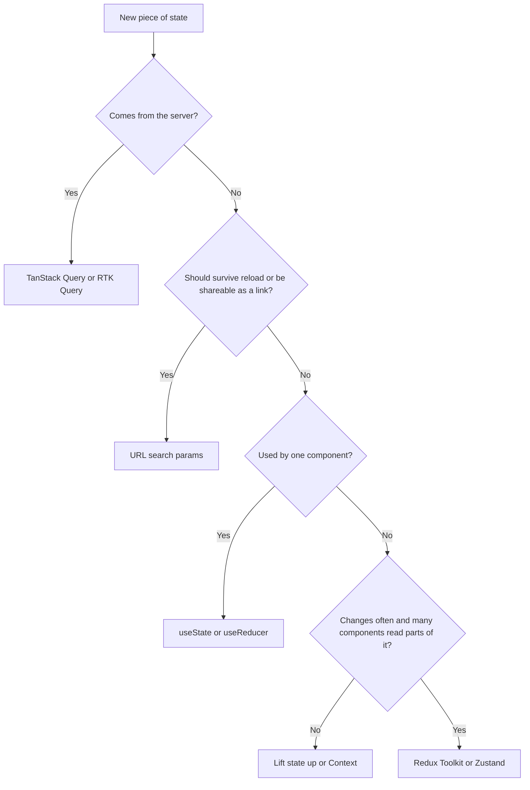
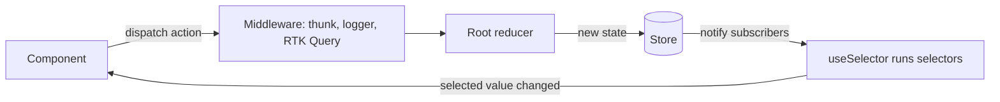

# State Management: Context, Redux Toolkit and Zustand

> In this document you will learn how React apps share state: the kinds of state and where each one belongs, the Context API and its performance traps, Redux and Redux Toolkit (slices, Immer, thunks, selectors, entity adapters), React-Redux hooks, RTK Query, and lighter tools like Zustand and Jotai. Most of the document is interview questions with spoken answers, follow-ups and common mistakes.

**Before this:** [Components and state management](../05-frontend-engineering/06-components-and-state-management.md) (kinds of state, lifting state, immutability, a tiny store) · [Hooks in depth](./03-hooks-in-depth.md) · [Rendering, reconciliation and keys](./02-rendering-reconciliation-and-keys.md) · **Interview questions:** [jump to the interview section](#interview-questions)

## Table of contents

1. [Concepts](#concepts)
   - [Kinds of state and choosing a tool](#kinds-of-state-and-choosing-a-tool)
   - [The Context API](#the-context-api)
   - [Redux core concepts](#redux-core-concepts)
   - [Redux Toolkit](#redux-toolkit)
   - [React-Redux hooks](#react-redux-hooks)
   - [RTK Query](#rtk-query)
   - [Redux DevTools](#redux-devtools)
   - [Zustand and Jotai](#zustand-and-jotai)
   - [Choosing a tool: decision table](#choosing-a-tool-decision-table)
   - [If you know Angular](#if-you-know-angular)
2. [Interview questions](#interview-questions)
3. [Quick revision](#quick-revision)
4. [Summary](#summary)
5. [References](#references)

> **Versions.** React 19 (19.3 is the latest minor; 19.2 was released in October 2025), with React 18 notes, Redux Toolkit 2.x (2.13 at the time of writing), React-Redux 9.x, Redux core 5, Reselect 5, Immer 10+, Zustand 5. React 18 differences are marked. The Redux Toolkit, Reselect, RTK Query and Context examples (render counts, thunk lifecycle, Immer errors, selector memoization, tag invalidation) were run with Vitest, jsdom and React Testing Library against React 19.3, RTK 2.13 and React-Redux 9.3. Zustand examples were checked against the official docs, not run.

---

## Concepts

### Kinds of state and choosing a tool

The general theory (local, shared, server, URL and form state; derived state; single source of truth) is in [Kinds of state](../05-frontend-engineering/06-components-and-state-management.md#kinds-of-state). Here is the React-specific version: **which tool fits which kind of state.**

| Kind of state | Example | Best React tool |
| --- | --- | --- |
| Local UI state | Is this dropdown open? Input text | `useState` / `useReducer` in the component |
| Shared UI state (a few components) | Selected tab shared by sibling panels | Lift state to the common parent |
| App-wide, rarely changing | Theme, locale, logged-in user, feature flags | Context |
| App-wide, often changing, complex | Cart, editor document, multi-step wizard, real-time dashboard | Redux Toolkit or Zustand |
| Server cache | Products, orders, user profile from the API | TanStack Query or RTK Query (not hand-written Redux) |
| URL state | Filters, sort, page, selected id | The router (`useSearchParams`, params) |
| Form state | Field values, errors, touched | React Hook Form or form Actions (see [Routing and forms](./07-routing-and-forms.md)) |



The most important senior idea: **most "global state" in old Redux apps was really server cache.** When you move server data into a server-state library, the remaining client state is usually small, and Context plus local state may be enough.

### The Context API

**What it is.** Context passes a value down the tree without passing props through every level. You create a context, provide a value high in the tree, and any descendant reads it with `useContext` (or `use` in React 19).

```jsx
import { createContext, useContext, useMemo, useState } from 'react';

const AuthContext = createContext(null);

export function AuthProvider({ children }) {
  const [user, setUser] = useState(null);

  // Memoize the value so consumers do not re-render when the provider's parent re-renders
  const value = useMemo(() => ({
    user,
    login: (u) => setUser(u),
    logout: () => setUser(null),
  }), [user]);

  // React 19: <AuthContext value={value}> works; React 18 needs <AuthContext.Provider value={value}>
  return <AuthContext value={value}>{children}</AuthContext>;
}

export function useAuth() {
  const ctx = useContext(AuthContext);
  if (ctx === null) throw new Error('useAuth must be used inside <AuthProvider>');
  return ctx;
}
```

**How it works inside.** When the provider's `value` changes (compared with `Object.is`), React finds **every component that reads this context** below the provider and schedules it to re-render, **even if it is wrapped in `React.memo`** and even if it uses only one field of the value. Components that do not read the context are not affected by the context change itself.

**Key facts (verified by running):**

- A context value `{ user, theme }` changes `theme`. Both the component that reads `user` and the one that reads `theme` re-render. A memoized component that does not read the context does not.
- If the provider value is a new object literal on every render (`value={{ user }}`), every consumer re-renders whenever the provider's component re-renders, even if `user` did not change. With `useMemo`, they do not.

**Context is a transport, not a state manager.** It does not store anything by itself; the state lives in `useState`/`useReducer` in the provider. It has no selectors, no middleware and no devtools. That is fine for values that change rarely.

**Common fixes for Context performance:**

1. **Memoize the value** (`useMemo`, and `useCallback` for functions).
2. **Split contexts** by how often they change: `ThemeContext`, `AuthContext`, and a separate context for frequently changing data.
3. **Split state and dispatch:** put `state` in one context and `dispatch` (stable) in another, so components that only dispatch never re-render.
4. **Move the state down** or pass components as `children` so fewer components sit under the provider.
5. If many components read small parts of a fast-changing value, **use a store** (Redux, Zustand) that supports selectors. Libraries like `use-context-selector` exist, but a store is usually the cleaner answer.

### Redux core concepts

**Redux** is a small library for a **single, predictable store** of app state. Five words explain it:

- **Store** — one object that holds the whole state tree. `store.getState()`, `store.dispatch(action)`, `store.subscribe(listener)`.
- **Action** — a plain object describing *what happened*: `{ type: 'cart/itemAdded', payload: { id: 7 } }`.
- **Reducer** — a pure function `(state, action) => newState`. It never changes the old state; it returns a new one.
- **Dispatch** — the only way to change state: send an action to the store.
- **Selector** — a function that reads a piece of state: `(state) => state.cart.items`.



**Why Redux exists.** It makes state changes **predictable and traceable**: every change is an action you can log, replay and inspect in DevTools. It gives one source of truth, which helps when many distant parts of the UI read and change the same data.

**Middleware** sits between `dispatch` and the reducer. It can log, call APIs, delay or transform actions. Its shape is `store => next => action => { ... }`. The `redux-thunk` middleware lets you dispatch **functions** for async logic.

**The three Redux principles:** single source of truth, state is read-only (only changed by actions), changes are made with pure functions.

### Redux Toolkit

**Redux Toolkit (RTK)** is the official, recommended way to write Redux. Plain Redux with hand-written action types, switch statements and spread operators is now called "legacy" style. RTK removes the boilerplate and adds good defaults.

#### configureStore

```js
import { configureStore } from '@reduxjs/toolkit';
import cartReducer from './cartSlice';
import userReducer from './userSlice';

export const store = configureStore({
  reducer: { cart: cartReducer, user: userReducer },
  // RTK 2: middleware must be a callback that receives the defaults
  // middleware: (getDefaultMiddleware) => getDefaultMiddleware().concat(logger),
});
```

`configureStore` combines the reducers, adds **thunk** middleware, adds **development-only checks** (an immutability check that catches mutations, and a serializability check that warns about values like `Date`, `Map` or class instances in state or actions), and connects **Redux DevTools**.

#### createSlice and Immer

```js
import { createSlice, nanoid } from '@reduxjs/toolkit';

const todosSlice = createSlice({
  name: 'todos',
  initialState: { items: [], filter: 'all' },
  reducers: {
    // "prepare" builds the payload, so components just call added('Buy milk')
    added: {
      reducer(state, action) {
        state.items.push(action.payload); // looks like mutation; Immer makes it immutable
      },
      prepare(text) {
        return { payload: { id: nanoid(), text, done: false } };
      },
    },
    toggled(state, action) {
      const todo = state.items.find((t) => t.id === action.payload);
      if (todo) todo.done = !todo.done;
    },
    filterChanged(state, action) {
      state.filter = action.payload;
    },
    cleared() {
      return { items: [], filter: 'all' }; // returning a new value is also allowed
    },
  },
});

export const { added, toggled, filterChanged, cleared } = todosSlice.actions;
export default todosSlice.reducer;
```

`createSlice` generates **action creators** and **action types** (`todos/added`) from the reducer names. Inside, it uses **Immer**: your reducer receives a **draft** (a Proxy). You "mutate" the draft, and Immer records the changes and produces a **new immutable state**, copying only the changed path (**structural sharing**). Verified: after `toggled`, `state.items` is a new array, but after `filterChanged`, `state.items` is the **same** array reference as before. In development, Immer also **freezes** the result, so accidental mutation outside a reducer throws a `TypeError`.

**Immer rule:** either mutate the draft **or** return a new value, never both. Verified error message: `[Immer] An immer producer returned a new value *and* modified its draft.` A common way to hit this by accident is an arrow function with an implicit return: `add: (state, action) => state.items.push(action.payload)` returns the new array length.

#### createAsyncThunk

```js
import { createAsyncThunk, createSlice } from '@reduxjs/toolkit';
import { api } from '../api/client';

export const fetchUser = createAsyncThunk(
  'users/fetchById',
  async (userId, { rejectWithValue, signal }) => {
    try {
      const res = await api.get(`/users/${userId}`, { signal });
      return res.data; // becomes action.payload of "fulfilled"
    } catch (err) {
      // a typed, serializable error for the "rejected" action
      return rejectWithValue({ status: err.response?.status, message: err.message });
    }
  },
  {
    // skip the request if one is already running
    condition: (userId, { getState }) => getState().users.status !== 'loading',
  },
);

const usersSlice = createSlice({
  name: 'users',
  initialState: { entity: null, status: 'idle', error: null },
  reducers: {},
  extraReducers: (builder) => {
    builder
      .addCase(fetchUser.pending, (state) => { state.status = 'loading'; state.error = null; })
      .addCase(fetchUser.fulfilled, (state, action) => { state.status = 'succeeded'; state.entity = action.payload; })
      .addCase(fetchUser.rejected, (state, action) => {
        state.status = 'failed';
        state.error = action.payload ?? { message: action.error.message };
      });
  },
});
```

`createAsyncThunk` dispatches `pending`, then `fulfilled` or `rejected`. Verified details:

- If the payload creator **throws**, `rejected` has `action.payload === undefined` and `action.error.message` holds the message (a serialized error, not an `Error` instance).
- With `rejectWithValue(x)`, `rejected` has `action.payload === x` and `action.error.message === 'Rejected'`.
- If `condition` returns `false`, **no** `pending` is dispatched; the returned promise resolves with a `rejected` action whose `meta.condition` is `true` (and nothing is dispatched to the reducer by default).
- `dispatch(thunk()).abort()` aborts the `signal` and produces `rejected` with `error.name === 'AbortError'`.
- `await dispatch(thunk()).unwrap()` returns the payload or **throws** the `rejectWithValue` value (or the serialized error).

#### createSelector (Reselect)

A selector that returns a **new array or object** (filter, map) must be **memoized**, or every store update gives a new reference and re-renders the component.

```js
import { createSelector } from '@reduxjs/toolkit';

const selectItems = (state) => state.todos.items;
const selectFilter = (state) => state.todos.filter;

export const selectVisibleTodos = createSelector(
  [selectItems, selectFilter],
  (items, filter) => (filter === 'all' ? items : items.filter((t) => t.done === (filter === 'done'))),
);
```

The output function runs only when an input result changes (by reference). Reselect 5 (shipped with RTK 2) uses `weakMapMemoize` by default, which caches results **per argument combination**; Reselect 4 cached only the last call. In development, Reselect warns when an input selector returns a new reference for the same input, and when the output function just returns its input (an "identity" selector that memoizes nothing). Both warnings were seen when running the examples.

#### createEntityAdapter and normalized state

For collections, store items **normalized**: `{ ids: [...], entities: { [id]: item } }`. Lookup by id is O(1), updates touch one item, and there is no duplication.

```js
import { createEntityAdapter, createSlice } from '@reduxjs/toolkit';

const productsAdapter = createEntityAdapter({
  sortComparer: (a, b) => a.name.localeCompare(b.name),
});

const productsSlice = createSlice({
  name: 'products',
  initialState: productsAdapter.getInitialState({ status: 'idle' }),
  reducers: {
    productsReceived: productsAdapter.setAll,
    productUpdated: productsAdapter.updateOne, // payload: { id, changes }
    productRemoved: productsAdapter.removeOne,
  },
});

export const { selectAll: selectAllProducts, selectById: selectProductById } =
  productsAdapter.getSelectors((state) => state.products);
```

Verified output after `setAll`, `updateOne`, `upsertOne` and `removeOne`: `{"ids":[2,3],"entities":{"2":{...},"3":{...}},"status":"idle"}`, sorted by name.

### React-Redux hooks

```jsx
import { Provider, useSelector, useDispatch } from 'react-redux';

function TodoCount() {
  const count = useSelector((state) => state.todos.items.length);
  return <span>{count}</span>;
}

function AddTodo() {
  const dispatch = useDispatch();
  return <button onClick={() => dispatch(added('New'))}>Add</button>;
}

export function App() {
  return (
    <Provider store={store}>
      <TodoCount />
      <AddTodo />
    </Provider>
  );
}
```

**How `useSelector` decides to re-render:** after every dispatched action, it runs your selector and compares the new result with the previous one using **strict reference equality (`===`)**. Only if it differs does the component re-render. It is built on `useSyncExternalStore`, so it is safe with concurrent rendering. Verified render counts:

| Selector | After an unrelated action | After a related action |
| --- | --- | --- |
| `s => s.todos.filter` (primitive) | No re-render | Re-render |
| `s => ({ f: s.todos.filter })` (new object every time) | **Re-render** | Re-render |
| Same with `shallowEqual` as second argument | No re-render | Re-render |

In development, React-Redux 9 also warns: `Selector unknown returned a different result when called with the same parameters.`

**Typed hooks (TypeScript):**

```ts
// store.ts
export type RootState = ReturnType<typeof store.getState>;
export type AppDispatch = typeof store.dispatch;

// hooks.ts (React-Redux 9.1+)
import { useDispatch, useSelector } from 'react-redux';
export const useAppDispatch = useDispatch.withTypes<AppDispatch>();
export const useAppSelector = useSelector.withTypes<RootState>();
```

`AppDispatch` includes the thunk middleware type, so `dispatch(fetchUser(1))` type-checks and `.unwrap()` is typed.

### RTK Query

**RTK Query** is a data-fetching and caching layer built into Redux Toolkit. It is the Redux answer to TanStack Query: you describe endpoints, and it generates hooks, caches results, de-duplicates requests and refetches after mutations.

```js
import { createApi, fetchBaseQuery } from '@reduxjs/toolkit/query/react';

export const api = createApi({
  reducerPath: 'api',
  baseQuery: fetchBaseQuery({
    baseUrl: '/api',
    prepareHeaders: (headers, { getState }) => {
      const token = getState().auth.token;
      if (token) headers.set('Authorization', `Bearer ${token}`);
      return headers;
    },
  }),
  tagTypes: ['Todo'],
  endpoints: (build) => ({
    getTodos: build.query({
      query: () => '/todos',
      providesTags: (result = []) => [
        ...result.map(({ id }) => ({ type: 'Todo', id })),
        { type: 'Todo', id: 'LIST' },
      ],
    }),
    addTodo: build.mutation({
      query: (body) => ({ url: '/todos', method: 'POST', body }),
      invalidatesTags: [{ type: 'Todo', id: 'LIST' }],
    }),
  }),
});

export const { useGetTodosQuery, useAddTodoMutation } = api;

// store: reducer: { [api.reducerPath]: api.reducer }, middleware: (g) => g().concat(api.middleware)
```

```jsx
function Todos() {
  const { data = [], isLoading, isFetching, error } = useGetTodosQuery(undefined, { pollingInterval: 30_000 });
  const [addTodo, { isLoading: isSaving }] = useAddTodoMutation();
  if (isLoading) return <Spinner />;
  if (error) return <ErrorMessage error={error} />;
  return (
    <>
      <button disabled={isSaving} onClick={() => addTodo({ title: 'New' })}>Add</button>
      <ul>{data.map((t) => <li key={t.id}>{t.title}</li>)}</ul>
      {isFetching && <small>Refreshing…</small>}
    </>
  );
}
```

Verified against a local test server: two subscribers to `getTodos` sent **one** `GET /todos`; after the `addTodo` mutation, RTK Query sent `POST /todos` and then **automatically refetched** `GET /todos` because the mutation invalidated the `Todo` tag. A 500 response produced `error = { status: 500, data: {...} }`. Default `keepUnusedDataFor` is **60 seconds** (how long unused data stays cached).

### Redux DevTools

The Redux DevTools browser extension shows every action, the state before and after, a diff, and lets you **time-travel** (jump back to an earlier state) and replay actions. This works because reducers are pure and actions are plain serializable objects. `configureStore` connects it automatically (`devTools: true` by default; you can turn it off for production with `devTools: process.env.NODE_ENV !== 'production'`).

### Zustand and Jotai

**Zustand** is a small store library built on hooks. A store is a hook; components subscribe with a **selector** and re-render only when the selected value changes.

```jsx
import { create } from 'zustand';
import { useShallow } from 'zustand/react/shallow';

const useCartStore = create((set, get) => ({
  items: [],
  addItem: (item) => set((state) => ({ items: [...state.items, item] })), // shallow-merged into state
  removeItem: (id) => set((state) => ({ items: state.items.filter((i) => i.id !== id) })),
  total: () => get().items.reduce((sum, i) => sum + i.price, 0),
}));

function CartBadge() {
  const count = useCartStore((s) => s.items.length); // re-renders only when the count changes
  return <span>{count}</span>;
}

function CartActions() {
  // Selecting several values as an object: wrap with useShallow (Zustand 5) to avoid new-object re-renders
  const { addItem, removeItem } = useCartStore(useShallow((s) => ({ addItem: s.addItem, removeItem: s.removeItem })));
  return <button onClick={() => addItem({ id: 1, price: 10 })}>Add</button>;
}
```

Zustand needs no Provider, has little boilerplate, works outside React (`useCartStore.getState()`), and supports middleware (`persist`, `devtools`, `immer`). In Zustand 5, a selector that returns a new object on every call without `useShallow` can cause an **infinite render loop** ("Maximum update depth exceeded"), because v5 relies on React's `useSyncExternalStore` directly.

**Jotai** uses **atoms**: tiny independent pieces of state (`const countAtom = atom(0)`), read and written with `useAtom(countAtom)`. Derived atoms compute from other atoms. Components re-render only for the atoms they use. It feels like `useState` that can be shared, and fits apps with many small, independent pieces of state.

### Choosing a tool: decision table

| Need | Context | Redux Toolkit | Zustand | Jotai | TanStack Query / RTK Query |
| --- | --- | --- | --- | --- | --- |
| Rarely changing global value (theme, auth user) | Best | Overkill | OK | OK | — |
| Frequent updates read by many components | Poor (all consumers re-render) | Good (selectors) | Good (selectors) | Good (atoms) | — |
| Server data: caching, refetch, loading states | Poor | Use RTK Query | Poor | Poor | Best |
| Strict structure for a large team, DevTools, time travel | No | Best | Partial (devtools middleware) | Partial | Devtools for cache |
| Boilerplate | Very little | Moderate | Very little | Very little | Little |
| Bundle size | 0 (built in) | Larger | Tiny | Tiny | Medium |
| Works outside React | No | Yes | Yes | Partly (store API) | Yes (QueryClient) |

### If you know Angular

- **Context vs Angular DI:** Context is like providing a service in a component's `providers` and injecting it below. But Angular services are long-lived objects with their own state and methods, and Angular does not re-render all injectors when a field changes. React Context re-renders every consumer when the value changes.
- **Redux Toolkit vs NgRx:** same ideas (store, actions, reducers, selectors, DevTools). NgRx uses RxJS: selectors return Observables, and side effects live in **Effects** (streams of actions). Redux uses thunks or listener middleware for effects, and `useSelector` for reading. `createSlice` is closer to NgRx `createFeature` plus `createReducer`; RTK Query is closer to NgRx plus a data library. See [State management and NgRx](../06-angular-16/11-state-management-and-ngrx.md).
- **Zustand vs a service with a `BehaviorSubject` or signals:** both are small stores you subscribe to; Zustand's selector is like `map` plus `distinctUntilChanged`.

---

## Interview questions

Questions go from basic to senior. For the general way to structure spoken answers, see [How to explain technical answers](../11-coding-interviews/01-how-to-explain-technical-answers.md).

### Q1. What kinds of state exist in a React app, and how do you decide where each one lives?

**What the interviewer is checking:** Whether you think about state before picking a library. Seniors classify state first; juniors say "I put everything in Redux".

**What to say (30–60 seconds):**
> "I first ask what kind of state it is. Local UI state, like whether a dropdown is open, stays in the component with useState. State shared by a few components goes to their closest common parent. Server data, like products or orders, is really a cache of the backend, so I use TanStack Query or RTK Query, which handle loading, caching and refetching. Filters, sort and page go in the URL so they survive reload and can be shared. Form state goes in the form library. Only what is left — truly global client state like the theme, the logged-in user or a shopping cart — goes into Context or a store. Usually that leftover is small."

**Deeper explanation:** The table and flowchart in [Kinds of state and choosing a tool](#kinds-of-state-and-choosing-a-tool) are the full answer. The general theory is in [Components and state management](../05-frontend-engineering/06-components-and-state-management.md#kinds-of-state). The key point is that each kind of state has different needs: server state needs caching and invalidation, URL state needs to be serializable, form state needs validation, UI state needs nothing special.

**Follow-up questions and how to answer them:**
- **"Where would you keep the selected item in a master-detail page?"** — In the URL (`/orders/42`), because the user expects Back to work and the link to be shareable. The detail data itself comes from the server cache, keyed by that id.
- **"Is derived state a kind of state?"** — No, and I avoid storing it. A filtered list or a total is computed from other state during render (with `useMemo` or a memoized selector if it is expensive). Storing it creates two sources of truth that can get out of sync.
- **"When is useReducer enough instead of a library?"** — When the complex state belongs to one component tree, like a multi-step form or an editor panel. `useReducer` plus Context (state and dispatch in separate contexts) is a small Redux without the library.

**Common mistakes / weak answers:** Saying "everything global goes into Redux"; copying server responses into Redux and writing loading flags by hand; forgetting URL state.

**Real-project example:** In an admin dashboard, moving API data from Redux to TanStack Query removed about 70% of the Redux code; the store kept only UI preferences and a draft editor.

### Q2. What is the Context API, and is it a state management tool?

**What the interviewer is checking:** That you know Context is a dependency-injection / transport mechanism, not a store.

**What to say (30–60 seconds):**
> "Context lets a component provide a value that any descendant can read without passing props through every level. It solves prop drilling. But Context itself doesn't manage state — the state still lives in useState or useReducer in the provider component; Context just delivers it. It has no selectors, so when the value changes, every component that reads that context re-renders. That makes it great for values that change rarely, like theme, locale or the current user, and a poor fit for data that changes many times per second."

**Deeper explanation:** See [The Context API](#the-context-api). A good pattern is a custom hook (`useAuth`) that reads the context and throws if the provider is missing. This hides the context object and gives a clear error.

```jsx
const ThemeContext = createContext('light'); // default used when there is no provider

function Toolbar() {
  const theme = useContext(ThemeContext); // React 19 also allows: const theme = use(ThemeContext)
  return <div className={`toolbar-${theme}`} />;
}
```

**Follow-up questions and how to answer them:**
- **"What is the default value of createContext used for?"** — It is returned when a component reads the context and there is no provider above it. It is useful for tests and for optional providers. For required providers I pass `null` and throw in the custom hook, so a missing provider is a clear error instead of a silent default.
- **"What is the difference between useContext and use(Context) in React 19?"** — Both read the context. `use` can be called conditionally (inside `if` or after an early return), which `useContext` cannot. It can also read promises.
- **"What did React 19 change in Context syntax?"** — You can render `<MyContext value={...}>` directly; `<MyContext.Provider>` still works but is expected to be deprecated later.

**Common mistakes / weak answers:** "Context replaces Redux" without mentioning re-renders; putting fast-changing state (like mouse position or form input) into one big app context.

**Real-project example:** Theme, locale and the auth session in Context; the shopping cart in Zustand; products in TanStack Query.

### Q3. Output question: how many times does each component render?

**What the interviewer is checking:** Whether you know that `React.memo` does not block context updates, and that consumers re-render even if their field did not change.

```jsx
const Ctx = createContext(null);

const UserName = memo(function UserName() {
  const { user } = useContext(Ctx);
  console.log('UserName');
  return user;
});
const ThemeLabel = memo(function ThemeLabel() {
  const { theme } = useContext(Ctx);
  console.log('ThemeLabel');
  return theme;
});
const Footer = memo(function Footer() {
  console.log('Footer');
  return 'footer';
});

function App() {
  const [user] = useState('ann');
  const [theme, setTheme] = useState('light');
  const value = { user, theme };
  return (
    <Ctx value={value}>
      <UserName /><ThemeLabel /><Footer />
      <button onClick={() => setTheme('dark')}>Dark</button>
    </Ctx>
  );
}
// Initial render, then the button is clicked once. How many times does each log?
```

**What to say (30–60 seconds):**
> "On mount, each logs once. After the click, App re-renders and creates a new value object, so the context value changed. Every component that reads the context re-renders — UserName and ThemeLabel both log again, even though UserName only uses user, which didn't change, and even though both are memoized. Footer is memoized and doesn't read the context, and it has no props, so it doesn't re-render. Totals: UserName 2, ThemeLabel 2, Footer 1."

**Deeper explanation:** Verified by running: `{"a":2,"b":2,"plain":1}`. `memo` only compares **props**. Context changes go around `memo`: React marks every consumer of that context for update. There is no built-in way to subscribe to only one field.

**Follow-up questions and how to answer them:**
- **"How would you stop UserName from re-rendering?"** — Split into a `UserContext` and a `ThemeContext`. Or read the context in a small wrapper and pass only `user` as a prop into a memoized child; then the wrapper re-renders but the expensive child does not.
- **"Would useMemo on the value help here?"** — No, because `theme` really changed, so the memoized value would also change. `useMemo` helps only when the provider re-renders for other reasons.
- **"What if Footer were not memoized?"** — Then it re-renders because its parent App re-rendered. Normal parent-child re-rendering, nothing to do with context.

**Common mistakes / weak answers:** "Only ThemeLabel re-renders because only theme changed" — that is how selector-based stores behave, not Context.

**Real-project example:** A single `AppContext` with `{ user, cart, notifications }` re-rendered the whole header on every notification; splitting it fixed the jank.

### Q4. Find the bug: why do context consumers re-render when nothing in the context changed?

**What the interviewer is checking:** Object identity and memoizing the provider value.

```jsx
function AuthProvider({ children }) {
  const [user, setUser] = useState(null);
  const [now, setNow] = useState(Date.now());
  useEffect(() => {
    const id = setInterval(() => setNow(Date.now()), 1000);
    return () => clearInterval(id);
  }, []);
  return (
    <AuthContext.Provider value={{ user, login: setUser }}>
      <Clock now={now} />
      {children}
    </AuthContext.Provider>
  );
}
```

**What to say (30–60 seconds):**
> "Every second, the clock state changes and AuthProvider re-renders. That creates a new value object `{ user, login }`, so Object.is says the context value changed and every consumer re-renders every second, although user is the same. The fix is to memoize the value with useMemo depending on user. setUser is already stable. I'd also move the clock out of the provider into its own component, so the provider doesn't re-render at all."

**Deeper explanation:**

```jsx
const value = useMemo(() => ({ user, login: setUser }), [user]);
return <AuthContext value={value}>{children}</AuthContext>;
```

Verified by running: a memoized consumer under an unmemoized object value rendered **2** times after an unrelated parent update; with `useMemo` it rendered **1** time. Note that `children` passed from above do not re-render just because the provider re-rendered — React reuses the same element objects — but **consumers** do, because the value changed.

**Follow-up questions and how to answer them:**
- **"Does the React Compiler fix this?"** — Yes, mostly. The compiler memoizes values like this object automatically, so it would keep the same reference while `user` is the same. But you should still understand the problem, because many codebases do not use the compiler yet (see [React 18 and 19 features](./04-react-18-and-19-concurrent-features-and-server-components.md)).
- **"Why is setUser safe without useCallback?"** — State setter functions from `useState` and `dispatch` from `useReducer` are stable: React guarantees the same function for the component's lifetime.

**Common mistakes / weak answers:** Wrapping every consumer in `memo` (does nothing for context); memoizing the value but putting a new inline function inside it without `useCallback`.

**Real-project example:** A provider that also held a polling timer re-rendered dozens of consumers every few seconds; moving the timer out and memoizing the value made the React Profiler quiet.

### Q5. How do you fix Context performance problems in a large app?

**Short answer:** Measure first with the React Profiler to confirm the context is the cause. Then, in order: (1) **memoize the provider value** (`useMemo`) and its functions (`useCallback`); (2) **split** one big context by how often each part changes; (3) put **state and dispatch in separate contexts**, so components that only dispatch never re-render; (4) move the provider **lower** and pass the subtree as `children`; (5) if many components need small slices of data that changes often, Context is the wrong tool — move that state to a store with selectors (Zustand, Redux Toolkit). React has no built-in context selector; `use-context-selector` emulates one.

```jsx
function TodosProvider({ children }) {
  const [state, dispatch] = useReducer(todosReducer, initialState);
  return (
    <TodosDispatchContext value={dispatch}>   {/* dispatch never changes */}
      <TodosStateContext value={state}>{children}</TodosStateContext>
    </TodosDispatchContext>
  );
}
```

The full spoken answer, follow-ups and a verified test are in [Performance Q13 — "Our context causes the whole app to re-render"](08-performance-optimization.md#q13-scenario-our-context-causes-the-whole-app-to-re-render-what-do-you-do); a render-count puzzle is [Performance Q14](08-performance-optimization.md#q14-output-question-which-components-re-render-when-the-theme-changes).

**Real-project example:** An editor kept selection, document and UI flags in one context; splitting into three contexts reduced re-renders per keystroke from about 200 components to about 15.

### Q6. Explain Redux: store, actions, reducers and the data flow.

**What the interviewer is checking:** Clear fundamentals and the vocabulary.

**What to say (30–60 seconds):**
> "Redux keeps the app's global state in one store. The UI never changes state directly. It dispatches an action, a plain object that describes what happened, like 'cart/itemAdded' with a payload. The store passes the current state and the action to the root reducer, a pure function that returns the next state without mutating the old one. Then the store notifies subscribers; with React-Redux, each useSelector re-runs its selector and the component re-renders only if its selected value changed. Middleware sits between dispatch and the reducer for side effects like API calls. The benefit is a predictable, one-direction flow that you can log, replay and debug with DevTools."

**Deeper explanation:** See the diagram in [Redux core concepts](#redux-core-concepts). A minimal store implementation is in [Build a tiny store](../05-frontend-engineering/06-components-and-state-management.md#build-a-tiny-store-to-understand-stores). With RTK you rarely write action types yourself: `createSlice` generates them.

```js
// What dispatch does, conceptually
function dispatch(action) {
  state = rootReducer(state, action);
  listeners.forEach((listener) => listener());
  return action;
}
```

**Follow-up questions and how to answer them:**
- **"Why actions instead of calling setters directly?"** — Actions are events with a name and a payload, so every change is recorded and can be logged, replayed, sent to DevTools, and handled by several reducers at once (for example, `logout` clears several slices).
- **"Can several reducers respond to one action?"** — Yes. Every slice reducer sees every action. In RTK you use `extraReducers` to respond to actions defined elsewhere.
- **"Is Redux synchronous?"** — Yes, `dispatch` runs the reducers synchronously and the state is updated when `dispatch` returns. Async work happens in middleware (thunks) which dispatch plain actions when results arrive.

**Common mistakes / weak answers:** Confusing reducers with "functions that call the API"; saying actions "change the state" (reducers do).

**Real-project example:** In a trading UI, logging every action with timestamps made it possible to replay the exact state sequence a user reported in a bug.

### Q7. Why must reducers be pure? What breaks if they are not?

**What the interviewer is checking:** Understanding of purity, determinism and the consequences.

**What to say (30–60 seconds):**
> "A reducer must return the same output for the same state and action, with no side effects: no API calls, no random numbers, no Date.now, no mutation of the inputs. Redux depends on this. Time-travel debugging replays actions and expects the same states. React-Redux compares references to decide what to re-render, which only works if a change creates a new object. And tests become trivial: input in, output out. Side effects belong in middleware — thunks or listeners — and random ids or timestamps go into the action payload, for example in createSlice's prepare callback."

**Deeper explanation:**

```js
// Bad: side effect and non-deterministic value inside the reducer
added(state, action) {
  fetch('/api/log', { method: 'POST' });       // side effect
  state.items.push({ id: Math.random(), text: action.payload }); // non-deterministic
}

// Good: randomness in prepare, side effect in a thunk or listener
added: {
  reducer(state, action) { state.items.push(action.payload); },
  prepare(text) { return { payload: { id: nanoid(), text, createdAt: Date.now() } }; },
}
```

**Follow-up questions and how to answer them:**
- **"Isn't the createSlice reducer impure, since it mutates?"** — It mutates an Immer **draft**, not the real state. Immer turns those mutations into a new immutable state, so from the outside the reducer is pure.
- **"Where do I put a side effect that must happen after an action, like saving to localStorage?"** — In middleware: RTK's `createListenerMiddleware` (`startListening({ actionCreator: added, effect })`) or a store subscription. Never in the reducer.
- **"What about reading the current time for 'last updated'?"** — Put `Date.now()` in the action payload (prepare callback or thunk), so the reducer stays deterministic and replays give the same result.

**Common mistakes / weak answers:** "Because Redux says so"; not knowing where side effects go instead.

**Real-project example:** A reducer that generated ids with `Math.random()` made DevTools replays produce different ids, and the "selected item" pointed at nothing after a replay.

### Q8. Why is immutability so important in Redux and React?

**What the interviewer is checking:** That you connect immutability to reference equality and change detection.

**What to say (30–60 seconds):**
> "React and React-Redux detect changes by comparing references, not by deep comparison, because deep comparison of large state on every update would be slow. If I mutate an array in place, the reference stays the same, useSelector thinks nothing changed, and the UI doesn't update. With immutable updates, a changed part gets a new reference and unchanged parts keep their old references, so a cheap === check tells React exactly what changed. It also enables memoized selectors, React.memo, undo and time travel, because old states are never overwritten."

**Deeper explanation:** The general idea, with the bug it prevents, is in [Immutability](../05-frontend-engineering/06-components-and-state-management.md#immutability). In Redux the cost of manual immutable updates was nested spreads:

```js
// Legacy Redux: easy to get wrong
return {
  ...state,
  orders: {
    ...state.orders,
    [id]: { ...state.orders[id], status: 'shipped' },
  },
};

// RTK with Immer: same result
state.orders[id].status = 'shipped';
```

**Follow-up questions and how to answer them:**
- **"What is structural sharing?"** — The new state reuses every unchanged sub-object from the old state. Only the path to the change is copied. Verified with `createSlice`: changing `filter` kept the same `items` array reference, so components selecting `items` did not re-render.
- **"Is immutability slow because of copying?"** — Copying is shallow and only along the changed path, so it is cheap. The win (cheap `===` checks everywhere) is much bigger than the cost. For huge, hot collections, normalized state keeps copies small.
- **"What happens if I mutate state outside a reducer in RTK?"** — In development it throws: Immer freezes the state, and assigning to it gives `TypeError: Cannot assign to read only property`. The immutability-check middleware also catches mutations between dispatches.

**Common mistakes / weak answers:** "Immutability prevents bugs" without explaining reference checks; claiming React deep-compares state.

**Real-project example:** A bug where `state.items.sort()` inside a selector mutated the store and silently re-ordered data was found by RTK's dev checks.

### Q9. How does Immer work in Redux Toolkit?

**What the interviewer is checking:** Internals: Proxy drafts, copy-on-write, freezing, the return-or-mutate rule.

**What to say (30–60 seconds):**
> "createSlice wraps each reducer with Immer's produce. Immer gives the reducer a draft, a Proxy around the current state. When I read from it, I get values or nested drafts; when I write, Immer copies only that object and its parents — copy-on-write — and records the change. When the reducer finishes, Immer builds the next state from the modified copies, reusing every untouched object, and in development freezes it. So I write simple mutating code, but the result is a new immutable state with structural sharing. The one rule is: either mutate the draft or return a new value, never both."

**Deeper explanation:**

```js
import { produce } from 'immer';

const base = { user: { name: 'Ann' }, items: [1, 2] };
const next = produce(base, (draft) => {
  draft.user.name = 'Bob';
});

console.log(next === base);             // false — new root
console.log(next.user === base.user);   // false — changed path copied
console.log(next.items === base.items); // true  — untouched part shared
```

Returning a new value is fine for **replacing** the state, for example `cleared: () => initialState`. Verified error when you do both: `[Immer] An immer producer returned a new value *and* modified its draft.`

**Follow-up questions and how to answer them:**
- **"Why does `(state, action) => state.items.push(x)` fail?"** — The arrow function implicitly returns `push`'s result, the new length. That is "returning a new value" while also mutating the draft. Verified: it throws the same Immer error. Use braces: `(state, action) => { state.items.push(x); }`.
- **"How do I reset state to initial?"** — `return initialState` (do not assign `state = initialState`; reassigning the local variable does nothing).
- **"How do I log a draft?"** — `console.log(state)` prints a Proxy. Use `current(state)` from RTK to get a plain snapshot.
- **"Does Immer work with Map and Set?"** — Yes, Immer supports them, but Redux recommends plain objects and arrays because Maps and Sets are not serializable (DevTools and the serializability check will complain).

**Common mistakes / weak answers:** "RTK lets you mutate state" (it does not; it lets you write mutating syntax on a draft); assigning `state = ...`.

**Real-project example:** Updating a deeply nested form schema (sections → fields → options) went from 20 lines of spreads to three lines with Immer.

### Q10. Find the bug in this slice.

**What the interviewer is checking:** Practical knowledge of Immer and RTK rules.

```js
const cartSlice = createSlice({
  name: 'cart',
  initialState: { items: [], coupon: null },
  reducers: {
    itemAdded: (state, action) => state.items.push(action.payload),
    couponApplied(state, action) {
      state.coupon = action.payload;
      return { ...state, appliedAt: new Date() };
    },
    reset(state) {
      state = { items: [], coupon: null };
    },
  },
});
```

**What to say (30–60 seconds):**
> "There are three bugs. itemAdded uses an implicit-return arrow, so it returns push's number while mutating the draft; Immer throws. couponApplied mutates the draft and also returns a new object — Immer throws again — and it puts a Date in state, which is not serializable, so RTK warns. reset reassigns the local variable state, which changes nothing; it must return the initial state. Fixes: braces in itemAdded, either mutate or return in couponApplied and store the date as an ISO string or timestamp, and `return initialState` in reset."

**Deeper explanation:**

```js
const initialState = { items: [], coupon: null, appliedAt: null };

reducers: {
  itemAdded(state, action) { state.items.push(action.payload); },
  couponApplied: {
    reducer(state, action) {
      state.coupon = action.payload.code;
      state.appliedAt = action.payload.appliedAt;
    },
    prepare(code) { return { payload: { code, appliedAt: new Date().toISOString() } }; },
  },
  reset: () => initialState,
}
```

Verified by running: both Immer errors are thrown, and a `Date` in an action and in state produced two warnings: "A non-serializable value was detected in an action, in the path: `payload`" and "...in the state, in the path: `s.d`".

**Follow-up questions and how to answer them:**
- **"Why does Redux care about serializability?"** — DevTools, persistence (`redux-persist`), time travel and server rendering all need state that can be turned into JSON and back. Class instances, Dates, Promises and functions break that, and they can also be mutated outside Redux.
- **"What if a library forces non-serializable values into actions?"** — Configure the check: `getDefaultMiddleware({ serializableCheck: { ignoredActions: [...] } })`. That is a documented escape hatch, not a default.

**Common mistakes / weak answers:** Spotting only one bug; suggesting `JSON.parse(JSON.stringify(state))` as a fix.

**Real-project example:** Storing a `Date` from a date picker in Redux broke `redux-persist` rehydration; storing ISO strings fixed it.

### Q11. What is Redux Toolkit, and what does configureStore add over plain createStore?

**What the interviewer is checking:** That you know RTK is the standard, and what it gives you for free.

**What to say (30–60 seconds):**
> "Redux Toolkit is the official, recommended way to write Redux. It removes the boilerplate: createSlice generates action creators and types from reducer functions and uses Immer for immutable updates; createAsyncThunk handles async request lifecycles; createSelector, createEntityAdapter and RTK Query cover selectors, normalized collections and data fetching. configureStore combines reducers and sets up good defaults: thunk middleware, development checks that catch state mutations and non-serializable values, and Redux DevTools. In Redux 5 the old createStore is marked deprecated to push people to configureStore."

**Deeper explanation:**

```js
// Legacy setup (what configureStore replaces)
import { legacy_createStore, applyMiddleware, combineReducers, compose } from 'redux';
import { thunk } from 'redux-thunk';
const composeEnhancers = window.__REDUX_DEVTOOLS_EXTENSION_COMPOSE__ || compose;
const store = legacy_createStore(
  combineReducers({ cart, user }),
  composeEnhancers(applyMiddleware(thunk)),
);

// RTK
const store = configureStore({ reducer: { cart, user } });
```

**Follow-up questions and how to answer them:**
- **"What changed in RTK 2?"** — The object syntax for `extraReducers` and `createReducer` was removed (use the builder callback); `middleware` and `enhancers` must be callbacks; `createSlice` gained a `selectors` field and a `reducers: (create) => ({...})` callback form; `combineSlices` supports lazy-loaded slices; Reselect 5 with `weakMapMemoize`; Redux core 5 requires string action types. RTK 2 also ships modern ESM builds.
- **"How do you add a custom middleware?"** — `middleware: (getDefaultMiddleware) => getDefaultMiddleware().concat(logger)`. Returning only `[logger]` would drop thunk and the dev checks.
- **"Are the dev checks slow?"** — They run only in development and are removed in production builds. On very large states you can tune their `warnAfter` threshold or disable them for specific paths.

**Common mistakes / weak answers:** Describing hand-written `switch` reducers as the normal way; not knowing RTK is the official recommendation.

**Real-project example:** Migrating a legacy store slice by slice to `createSlice` cut the code in half and the dev checks immediately found two hidden mutations.

### Q12. Walk me through createAsyncThunk. What happens when the request fails or is cancelled?

**What the interviewer is checking:** Exact lifecycle knowledge and error handling.

**What to say (30–60 seconds):**
> "createAsyncThunk takes an action type prefix and an async payload creator. When I dispatch it, it dispatches 'pending', runs my function, and then dispatches 'fulfilled' with the returned value as payload, or 'rejected' if it throws. If it throws, the error is serialized into action.error and payload is undefined. If I want a typed error, like the API's validation message, I return rejectWithValue, and that value becomes the rejected action's payload. It passes an AbortSignal I can forward to axios or fetch, and the dispatched promise has an abort method. There's a condition option to skip the call, for example if data is already loading. In components I can await dispatch(thunk()).unwrap() to get the value or catch the error."

**Deeper explanation:** Full code in [createAsyncThunk](#createasyncthunk). Verified sequence of actions from running five dispatches:

```text
users/fetch/pending
users/fetch/fulfilled                         <- success
users/fetch/pending
users/fetch/rejected  payload={"code":"NOPE"}  error.message="Rejected"   <- rejectWithValue
users/fetch/pending
users/fetch/rejected  payload=undefined         error.message="boom"      <- thrown Error
```

A second dispatch while the first was loading was skipped by `condition`: no `pending` action, and the returned result had `meta.condition === true`. Calling `.abort()` gave a `rejected` action with `error.name === 'AbortError'` and `meta.aborted === true`.

```jsx
async function onSave() {
  try {
    const user = await dispatch(saveUser(form)).unwrap();
    toast.success(`Saved ${user.name}`);
  } catch (err) {
    setFieldErrors(err.fieldErrors ?? {}); // the rejectWithValue payload
  }
}
```

**Follow-up questions and how to answer them:**
- **"Why is the thrown error not an Error instance in the action?"** — Actions must be serializable, so RTK converts errors to a plain `SerializedError` (`name`, `message`, `stack`, `code`). Verified: after `unwrap()`, the caught thrown error was a plain object, `instanceof Error` was `false`.
- **"How do you cancel a thunk when the component unmounts?"** — Keep the promise from `dispatch` and call `promise.abort()` in the effect cleanup, and pass `signal` into the HTTP call so the request is really cancelled.
- **"How do you avoid writing pending/fulfilled/rejected for every thunk?"** — Use `addMatcher` with `isPending`, `isRejected` helpers for shared loading or error handling, or, better, use RTK Query for server data so you write none of it.

**Common mistakes / weak answers:** Putting the API call in the reducer; not handling `rejected`; not knowing `rejectWithValue` or `unwrap`.

**Real-project example:** A form submit used `unwrap()` to show server validation errors next to fields, while the slice tracked only the global saving status.

### Q13. What is the difference between `reducers` and `extraReducers` in createSlice?

**What the interviewer is checking:** How slices respond to their own vs other actions.

**What to say (30–60 seconds):**
> "reducers defines the slice's own case reducers, and createSlice generates an action creator for each one. extraReducers is for responding to actions that are defined somewhere else — thunk lifecycle actions, actions from other slices, or a global logout — so no action creators are generated. In RTK 2 extraReducers must use the builder callback: addCase for one action, addMatcher for a group of actions matching a predicate, and addDefaultCase."

**Deeper explanation:**

```js
import { createSlice, isPending, isRejected } from '@reduxjs/toolkit';
import { logout } from '../auth/authSlice';
import { fetchOrders, cancelOrder } from './ordersThunks';

const ordersSlice = createSlice({
  name: 'orders',
  initialState: { list: [], loading: false, error: null },
  reducers: {
    ordersCleared: (state) => { state.list = []; },
  },
  extraReducers: (builder) => {
    builder
      .addCase(fetchOrders.fulfilled, (state, action) => { state.list = action.payload; })
      .addCase(logout, () => ({ list: [], loading: false, error: null })) // another slice's action
      .addMatcher(isPending(fetchOrders, cancelOrder), (state) => { state.loading = true; })
      .addMatcher(isRejected(fetchOrders, cancelOrder), (state, action) => {
        state.loading = false;
        state.error = action.error.message;
      });
  },
});
```

**Follow-up questions and how to answer them:**
- **"What is the order rule for builder methods?"** — `addCase` calls must come before `addMatcher`, and `addDefaultCase` last. If an action matches several matchers, all of them run in order.
- **"How do you reset every slice on logout?"** — Either handle `logout` in each slice's `extraReducers`, or wrap the root reducer: `(state, action) => rootReducer(action.type === 'auth/logout' ? undefined : state, action)`. Passing `undefined` makes every slice return its initial state. Also clear the server cache (`queryClient.clear()` or `api.util.resetApiState()`).

**Common mistakes / weak answers:** Using the removed object syntax (`extraReducers: { [fetchOrders.fulfilled]: ... }`), which is a TypeScript and runtime error in RTK 2.

**Real-project example:** A global `logout` action handled by every slice made sure no customer data stayed in memory after sign-out.

### Q14. What is Redux middleware? Write a logger and explain how thunk works.

**What the interviewer is checking:** The middleware signature and that thunk is tiny.

**What to say (30–60 seconds):**
> "Middleware wraps dispatch. Each middleware is a curried function store => next => action. It can look at the action, call next(action) to pass it on to the next middleware and finally the reducer, skip it, change it, or dispatch other actions. That's where side effects live: logging, analytics, API calls. Redux thunk is just a few lines: if the action is a function, call it with dispatch and getState instead of passing it to the reducer; otherwise call next."

**Deeper explanation:**

```js
const logger = (store) => (next) => (action) => {
  console.log('dispatching', action.type);
  const result = next(action);              // reducers run here
  console.log('next state', store.getState());
  return result;
};

// The essence of redux-thunk
const thunk = ({ dispatch, getState }) => (next) => (action) =>
  typeof action === 'function' ? action(dispatch, getState) : next(action);

const store = configureStore({
  reducer,
  middleware: (getDefaultMiddleware) => getDefaultMiddleware().concat(logger),
});
```

**Follow-up questions and how to answer them:**
- **"Why curried?"** — Each level is called at a different time: `store` once when the store is created, `next` once when the chain is built, and `action` on every dispatch. It lets middleware be composed into a chain.
- **"What does the thunk's return value do?"** — `dispatch(thunk)` returns whatever the thunk returns, usually a promise. That is why you can `await dispatch(fetchUser(1))`.
- **"What is an analytics middleware example?"** — Check `action.type` against a list and send an event to the analytics service, then call `next(action)`. Components stay clean because they just dispatch business actions.

**Common mistakes / weak answers:** Forgetting to call `next(action)` (the action never reaches reducers); doing heavy work synchronously in middleware on every action.

**Real-project example:** An error-reporting middleware sent every `*/rejected` action with its `meta.arg` to Sentry.

### Q15. Thunks vs sagas vs the listener middleware: which do you use?

**What the interviewer is checking:** Awareness of side-effect options and modern recommendations.

**What to say (30–60 seconds):**
> "Thunks are the default for simple async work: fetch, then dispatch. Sagas use generator functions and effects like takeLatest and race; they're powerful for complex workflows like cancellation and long-running processes, but they add a big concept and are less common today. RTK's createListenerMiddleware is the modern lightweight alternative to sagas: you say 'when this action happens, run this async effect', and you get helpers like cancelActiveListeners, delay and take for debouncing and cancellation. For server data I use neither — RTK Query or TanStack Query handles it."

**Deeper explanation:**

```js
import { createListenerMiddleware } from '@reduxjs/toolkit';

export const listener = createListenerMiddleware();

// Debounced search: like takeLatest + delay in redux-saga
listener.startListening({
  actionCreator: searchChanged,
  effect: async (action, listenerApi) => {
    listenerApi.cancelActiveListeners(); // cancel the previous run
    await listenerApi.delay(300);        // throws if cancelled meanwhile
    const results = await api.search(action.payload, { signal: listenerApi.signal });
    listenerApi.dispatch(searchResultsReceived(results));
  },
});

// store: middleware: (g) => g().prepend(listener.middleware)
```

**Follow-up questions and how to answer them:**
- **"Why not sagas for everything?"** — They need generators, effects and a separate mental model; testing is nice but onboarding is slow. Most of their use cases (API calls) are better served by RTK Query, and the rest by listeners.
- **"How is a saga's takeLatest different from a debounce?"** — `takeLatest` cancels the previous task when a new action arrives but starts immediately; debounce waits for a quiet period before starting. The listener example above does both.
- **"Where does an Angular developer see the same idea?"** — NgRx Effects: a stream of actions with `switchMap` (like `takeLatest`) and `debounceTime`.

**Common mistakes / weak answers:** Claiming sagas are required for async Redux; not knowing listener middleware exists.

**Real-project example:** Auto-save of a document was done with a listener that waited 1 second after the last edit action and cancelled older saves.

### Q16. How does `useSelector` decide when to re-render? What is wrong with this selector?

**What the interviewer is checking:** Reference equality and selector design — the most common Redux performance bug.

```jsx
function Header() {
  const { name, avatar } = useSelector((state) => ({
    name: state.user.name,
    avatar: state.user.avatar,
  }));
  return <Avatar name={name} src={avatar} />;
}
```

**What to say (30–60 seconds):**
> "After every dispatched action, useSelector runs the selector and compares the result with the previous one using ===. This selector builds a new object every time, so the comparison always fails and Header re-renders on every action in the whole app, even unrelated ones. Fixes: select each primitive with its own useSelector, or pass shallowEqual as the second argument, or return an existing object like state.user, or use a memoized selector. React-Redux also warns about this in development."

**Deeper explanation:** Verified render counts (mount, then an unrelated action, then a related action):

```text
object selector:               1 -> 2 -> 3   (re-renders on unrelated actions)
primitive selector:            1 -> 1 -> 2
object selector + shallowEqual: 1 -> 1 -> 2
```

```jsx
// Fix 1: separate selectors
const name = useSelector((s) => s.user.name);
const avatar = useSelector((s) => s.user.avatar);

// Fix 2: shallowEqual
import { shallowEqual, useSelector } from 'react-redux';
const { name, avatar } = useSelector((s) => ({ name: s.user.name, avatar: s.user.avatar }), shallowEqual);
```

**Follow-up questions and how to answer them:**
- **"What is the difference from the old connect() behavior?"** — `connect`'s `mapStateToProps` used shallow equality on the returned object by default; `useSelector` uses `===`. People who migrated from `connect` often brought this bug with them.
- **"Does a parent re-render cause useSelector to re-run?"** — Yes, the selector runs during render too, but a re-render caused by the parent is not caused by Redux. The point is that Redux-triggered re-renders happen only when the selected value changes.
- **"Is it bad to call useSelector many times in a component?"** — No. Each call is cheap; several small selectors are the recommended pattern.

**Common mistakes / weak answers:** Selecting the whole state (`useSelector((s) => s)`), which re-renders on every action; thinking `useSelector` compares deeply.

**Real-project example:** A header with an object selector re-rendered on every WebSocket price tick; switching to primitive selectors removed thousands of renders per minute.

### Q17. When do you need memoized selectors? Explain this selector bug.

**What the interviewer is checking:** createSelector, input selectors, and cache behavior.

```jsx
const selectTodosByStatus = (state, done) => state.todos.items.filter((t) => t.done === done);

function DoneList() {
  const done = useSelector((s) => selectTodosByStatus(s, true));
  return <List items={done} />;
}
```

**What to say (30–60 seconds):**
> "filter returns a new array on every call, so useSelector sees a new reference after every action and DoneList re-renders constantly, and the filtering runs each time. I'd memoize it with createSelector: input selectors pick state.todos.items and the done argument, and the output function filters. It recomputes only when items or done change, and otherwise returns the same array reference. Reselect 5 caches per argument combination by default, so different components calling it with true and false don't break each other's cache anymore, which was a classic bug with Reselect 4."

**Deeper explanation:**

```js
export const selectTodosByStatus = createSelector(
  [(state) => state.todos.items, (state, done) => done],
  (items, done) => items.filter((t) => t.done === done),
);

// usage
const done = useSelector((s) => selectTodosByStatus(s, true));
```

Verified: calling the memoized selector with `true, false, true, false` on the same state ran the output function **2** times (once per argument) with Reselect 5's default `weakMapMemoize`. With Reselect 4's cache size of 1 it would run 4 times, which is why older code created one selector instance per component with `useMemo(() => makeSelectTodos(), [])`.

Two dev-mode warnings seen while running the examples:
- An **identity** output function (`items => items`) memoizes nothing; Reselect warns "The result function returned its own inputs without modification".
- An input selector that creates a new value (`s => s.items.map(...)`) defeats memoization; Reselect warns "An input selector returned a different result when passed same arguments".

**Follow-up questions and how to answer them:**
- **"When is a memoized selector unnecessary?"** — When the selector returns an existing reference or a primitive, like `s => s.todos.items` or `s => s.todos.items.length`. Wrapping those in `createSelector` adds nothing.
- **"What are input selectors allowed to do?"** — Only extract values, never transform. All computation goes in the output function.
- **"Is there a memory concern with weakMapMemoize?"** — It caches by argument identity using WeakMaps for objects, so old state objects can be garbage collected. For primitive arguments with many distinct values, the cache can grow; you can switch to `lruMemoize` with a max size.

**Common mistakes / weak answers:** Memoizing everything; putting `.filter` in the input selector; not knowing why selectors need stable references.

**Real-project example:** A product grid's "filtered and sorted" selector was memoized; typing in an unrelated chat widget no longer re-sorted 5,000 products.

### Q18. What does "normalizing state" mean? How does createEntityAdapter help?

**What the interviewer is checking:** Data modeling in a client store.

**What to say (30–60 seconds):**
> "Normalizing means storing each entity once, in a lookup table by id, and referencing it by id everywhere else, like a database. Instead of an array of posts that each contain a full author object, I keep posts in { ids, entities } and authors in their own table, and a post stores authorId. Updates touch one place, lookups by id are O(1), and there's no duplicated data getting out of sync. createEntityAdapter gives me that shape plus ready-made reducers like addOne, setAll, updateOne, upsertMany and removeOne, and selectors like selectAll and selectById, with optional sorting."

**Deeper explanation:**

```js
// Nested (problematic)
posts: [{ id: 1, title: 'A', author: { id: 7, name: 'Ann' } }, { id: 2, title: 'B', author: { id: 7, name: 'Ann' } }]

// Normalized
posts:   { ids: [1, 2], entities: { 1: { id: 1, title: 'A', authorId: 7 }, 2: { id: 2, title: 'B', authorId: 7 } } }
authors: { ids: [7],    entities: { 7: { id: 7, name: 'Ann' } } }
```

See the adapter code in [createEntityAdapter and normalized state](#createentityadapter-and-normalized-state).

**Follow-up questions and how to answer them:**
- **"How do you get back a post with its author for the UI?"** — A memoized selector joins them: `createSelector([selectPostById, selectAuthorEntities], (post, authors) => ({ ...post, author: authors[post.authorId] }))`.
- **"Does TanStack Query need normalization?"** — It caches per query key, not per entity, so the same user may appear in several cached responses. You fix freshness with invalidation instead of normalization. Normalizing caches exist (Apollo, RTK Query's tags help) but most apps do not need them.
- **"What is selectId for?"** — If entities use a key other than `id`, like `sku`, you pass `selectId: (p) => p.sku`.

**Common mistakes / weak answers:** Storing the same entity in several slices; storing arrays and using `find` everywhere for updates.

**Real-project example:** A chat app normalized messages and users; renaming a user updated every message bubble from one entity.

### Q19. Should you store derived data in Redux, like a cart total?

**What the interviewer is checking:** Single source of truth applied to Redux.

**What to say (30–60 seconds):**
> "No. I store the minimal state — the cart items — and compute the total with a selector. If I stored the total, every reducer that changes items would also have to update it, and one day someone forgets and the total is wrong. If the computation is expensive or returns a new object, I memoize the selector with createSelector. The only time I'd store a derived value is when it's expensive and computed on the server, and then it is server data anyway."

**Deeper explanation:**

```js
export const selectCartTotal = createSelector(
  [(s) => s.cart.items, (s) => s.cart.coupon],
  (items, coupon) => {
    const subtotal = items.reduce((sum, i) => sum + i.price * i.qty, 0);
    return coupon ? subtotal * (1 - coupon.percent / 100) : subtotal;
  },
);
```

The general rule is in [Derived state](../05-frontend-engineering/06-components-and-state-management.md#derived-state). RTK 2's slice `selectors` field lets you keep selectors next to the slice: `selectors: { selectCount: (state) => state.items.length }`, exported as `cartSlice.selectors`.

**Follow-up questions and how to answer them:**
- **"A total returns a number; does it need createSelector?"** — Not for re-renders, because numbers compare by value. Only for the cost of recomputing it on every action, which is usually tiny. Memoize when the work is big.

**Common mistakes / weak answers:** Storing `total`, `count`, `filteredItems` next to `items`.

**Real-project example:** A bug where the cart badge showed 3 but the list showed 2 came from a stored `count` field that one reducer forgot to update.

### Q20. How do you type Redux with TypeScript?

**What the interviewer is checking:** Practical TS setup for RTK.

**What to say (30–60 seconds):**
> "I infer types from the store instead of writing them by hand. RootState is ReturnType of store.getState, and AppDispatch is typeof store.dispatch, which includes thunk types. Then I create pre-typed hooks once: useAppSelector and useAppDispatch, using withTypes in React-Redux 9. Slices get their state type through initialState, and actions through PayloadAction<T> on each reducer. createAsyncThunk is typed with generics for the return value, the argument, and a config with rejectValue and state."

**Deeper explanation:**

```ts
import { createSlice, createAsyncThunk, type PayloadAction } from '@reduxjs/toolkit';

interface Todo { id: string; text: string; done: boolean }
interface TodosState { items: Todo[]; status: 'idle' | 'loading' | 'failed' }

const initialState: TodosState = { items: [], status: 'idle' };

export const fetchTodos = createAsyncThunk<
  Todo[],                                     // return type
  void,                                       // argument type
  { rejectValue: { message: string } }        // config
>('todos/fetch', async (_, { rejectWithValue }) => {
  const res = await fetch('/api/todos');
  if (!res.ok) return rejectWithValue({ message: `HTTP ${res.status}` });
  return (await res.json()) as Todo[];
});

const todosSlice = createSlice({
  name: 'todos',
  initialState,
  reducers: {
    toggled(state, action: PayloadAction<string>) {
      const t = state.items.find((x) => x.id === action.payload);
      if (t) t.done = !t.done;
    },
  },
  extraReducers: (b) => {
    b.addCase(fetchTodos.rejected, (state, action) => {
      state.status = 'failed';
      console.log(action.payload?.message); // typed as { message: string } | undefined
    });
  },
});

// store.ts
export const store = configureStore({ reducer: { todos: todosSlice.reducer } });
export type RootState = ReturnType<typeof store.getState>;
export type AppDispatch = typeof store.dispatch;
```

Typed hooks are shown in [React-Redux hooks](#react-redux-hooks). For deeper React TypeScript topics, see [Patterns, architecture and TypeScript](./09-patterns-architecture-and-typescript.md).

**Follow-up questions and how to answer them:**
- **"Why not just use the plain useDispatch?"** — Its `Dispatch` type does not know about thunks, so `dispatch(fetchTodos())` gives a type error or loses the promise type. `useAppDispatch` fixes that once for the whole app.
- **"How do you avoid a circular import between store.ts and slices?"** — Slices import only types (`import type { RootState }`), which are erased at compile time. Or use `createAsyncThunk.withTypes<{ state: RootState }>()`.

**Common mistakes / weak answers:** Writing a manual `RootState` interface that drifts from the real reducers; casting everything with `as any`.

**Real-project example:** Introducing `useAppSelector` across the app caught dozens of selectors that read fields renamed in a refactor.

### Q21. What is RTK Query, and how do tags and invalidation work?

**What the interviewer is checking:** Server-state thinking inside Redux.

**What to say (30–60 seconds):**
> "RTK Query is the data-fetching and caching layer that ships with Redux Toolkit. I define an API with createApi, a baseQuery like fetchBaseQuery, and endpoints — queries for reads, mutations for writes. It generates hooks like useGetTodosQuery that return data, isLoading, isFetching and error, de-duplicate identical requests, and cache results per endpoint and argument. Freshness is handled with tags: a query says which tags it provides, like Todo with an id, and a mutation says which tags it invalidates. After the mutation succeeds, every active query that provides those tags refetches automatically. Unused data is removed after keepUnusedDataFor, 60 seconds by default."

**Deeper explanation:** See [RTK Query](#rtk-query) for code. Verified with a local server: two components subscribed to the same query sent one request; a mutation that invalidated `Todo` triggered an automatic refetch (`GET /todos`, `POST /todos`, `GET /todos`).

Other features worth naming:

- `pollingInterval`, `refetchOnFocus`, `refetchOnReconnect` (the last two need `setupListeners(store.dispatch)`).
- `skip` (or the `skipToken` argument) for conditional queries.
- `transformResponse` to reshape data; `onQueryStarted` with `updateQueryData` for optimistic updates and `patchResult.undo()` for rollback.
- `api.util.invalidateTags`, `api.util.resetApiState()` for logout.
- Code generation from OpenAPI (`@rtk-query/codegen-openapi`).

**Follow-up questions and how to answer them:**
- **"What is the difference between isLoading and isFetching?"** — `isLoading` is true only for the first load when there is no data yet. `isFetching` is true for any request in flight, including background refetches. Show a full spinner for `isLoading` and a small indicator for `isFetching`.
- **"How do you do an optimistic update in RTK Query?"** — In the mutation's `onQueryStarted`, call `dispatch(api.util.updateQueryData('getTodos', undefined, (draft) => { ... }))`, keep the returned `patchResult`, and in `catch` after `await queryFulfilled` call `patchResult.undo()`.
- **"Why 'LIST' tags?"** — Item tags (`{ type: 'Todo', id: 5 }`) let an update refetch only queries that contain item 5. A `LIST` tag lets a create invalidate the list queries, since a new item is not in any existing item tag.

**Common mistakes / weak answers:** Using RTK Query and also copying its data into a slice with `createAsyncThunk`; forgetting to add `api.middleware` (caching and invalidation will not work).

**Real-project example:** An admin app replaced 30 thunks and their loading flags with one `createApi` file of endpoints and tags.

### Q22. createAsyncThunk, RTK Query or TanStack Query: how do you choose?

**What the interviewer is checking:** Trade-off reasoning, not loyalty to one library.

**What to say (30–60 seconds):**
> "createAsyncThunk is a low-level tool: it runs async logic and gives me lifecycle actions, but I write the caching, loading flags and refetching myself. I use it for workflows that are not plain server reads, like a multi-step checkout. For server data, I want a cache library. If the app already uses Redux, RTK Query is the natural fit: one store, one DevTools, tags for invalidation. If there's no Redux, or the team wants richer features like infinite queries with fine control, structural sharing and a big ecosystem, TanStack Query is excellent and works with any state solution. Both solve the same problem; the main mistake is solving it by hand."

**Deeper explanation:**

| | createAsyncThunk | RTK Query | TanStack Query |
| --- | --- | --- | --- |
| Caching and de-duplication | Write yourself | Built in | Built in |
| Invalidation | Manual refetch | Tags | Query keys (`invalidateQueries`) |
| Lives in Redux store | Yes | Yes | No (own `QueryClient`) |
| Infinite queries | Manual | Supported (infinite query endpoints, RTK 2.6+) | Mature `useInfiniteQuery` |
| Best when | Complex non-CRUD workflows | Redux apps | Apps without Redux or any framework |

TanStack Query in depth is in [Data fetching, axios and TanStack Query](./06-data-fetching-axios-and-tanstack-query.md).

**Follow-up questions and how to answer them:**
- **"Can you use TanStack Query and Redux together?"** — Yes, and it is common: TanStack Query for server data, a small Redux or Zustand store for client state. Just do not copy query data into Redux.
- **"Which is easier for new team members?"** — TanStack Query's hook-first API is usually quicker to learn; RTK Query is easier if they already know Redux.

**Common mistakes / weak answers:** "We use thunks for all API calls" in a new project in 2026, with hand-written `isLoading` in every slice.

**Real-project example:** A team kept RTK Query in their Redux monolith but used TanStack Query in a new standalone micro-frontend with no store.

### Q23. What can Redux DevTools do, and why does it need serializable state?

**What the interviewer is checking:** Debugging skills and the reasons behind Redux rules.

**What to say (30–60 seconds):**
> "Redux DevTools shows every dispatched action in order, its payload, the state after it, and a diff. I can jump to any earlier state — time travel — replay actions, skip one to see what the app would look like without it, and export a session to attach to a bug report. Middleware like RTK Query also shows its cache entries there. All of this assumes actions and state are plain serializable data and reducers are pure, because DevTools stores and replays them. That's why RTK warns when you put Dates, class instances or functions in state."

**Deeper explanation:** `configureStore` enables DevTools by default. Useful options: `devTools: { name: 'Admin app', trace: true, actionsDenylist: ['ticker/priceUpdated'] }` to filter noisy actions. In production you can disable it or keep it read-only depending on the security policy.

**Follow-up questions and how to answer them:**
- **"How do you debug 'the state changed but the UI didn't update'?"** — Check in DevTools that the action reached the reducer and the state diff shows the change. If the state changed but the component did not re-render, the selector probably returns the same reference (mutation) or reads the wrong path. If the state did not change, the reducer did not handle the action (wrong type, missing `extraReducers` case).
- **"Is DevTools a security risk in production?"** — It can expose data to anyone who opens the extension on that page. Many teams disable it in production or sanitize sensitive fields with `stateSanitizer`.

**Common mistakes / weak answers:** Only using `console.log`; not knowing what time travel is.

**Real-project example:** Exported DevTools sessions from QA reproduced a race condition in checkout exactly, without guessing the steps.

### Q24. How does Zustand work, and what are its pitfalls?

**What the interviewer is checking:** Familiarity with the most popular lightweight store.

**What to say (30–60 seconds):**
> "Zustand creates a store as a hook. I call create with a function that receives set and get and returns the initial state plus actions. Components read with a selector, like useStore(s => s.count), and re-render only when that selected value changes by Object.is. No provider, very little boilerplate, and the store also works outside React with getState and subscribe. The main pitfall is selectors that return new objects or arrays: in Zustand 5 that can cause an infinite loop, so I select primitives separately or wrap the selector with useShallow. Also, set merges only one level deep, so nested updates need spreads or the immer middleware."

**Deeper explanation:** See [Zustand and Jotai](#zustand-and-jotai) for code. Middleware examples:

```js
import { create } from 'zustand';
import { persist, devtools } from 'zustand/middleware';

export const useSettings = create()(
  devtools(
    persist(
      (set) => ({
        theme: 'light',
        setTheme: (theme) => set({ theme }),
      }),
      { name: 'settings' }, // localStorage key
    ),
  ),
);

// Outside React, for example in an axios interceptor:
const token = useAuthStore.getState().token;
```

**Follow-up questions and how to answer them:**
- **"How is it different from Context?"** — Context re-renders every consumer on any change; Zustand components subscribe to a selected slice. Zustand is also usable outside components.
- **"How do you test a Zustand store?"** — Call actions through `useStore.getState()` and assert state; reset between tests with `useStore.setState(initialState, true)` (the `true` replaces instead of merging).
- **"What changed in Zustand 5?"** — It requires React 18+, uses `useSyncExternalStore` natively, removed the default export (use `import { create }`), and the custom equality function moved to `createWithEqualityFn` from `zustand/traditional`; for object selectors you use `useShallow`.

**Common mistakes / weak answers:** `const { a, b } = useStore()` with no selector, which re-renders on every change; putting server data in Zustand.

**Real-project example:** A design tool kept canvas selection and tool mode in Zustand; the toolbar and canvas subscribed to separate fields and stayed fast.

### Q25. What is Jotai, and when would you choose atoms over a single store?

**What the interviewer is checking:** Breadth: the atomic model.

**What to say (30–60 seconds):**
> "Jotai models state as atoms — small, independent units, like a shared useState. I create an atom with atom(0), read and write it with useAtom, and build derived atoms that compute from other atoms. Components only re-render for the atoms they use, and derived atoms update automatically. It fits apps with many small, independent pieces of state that combine in different ways, like form builders or editors. A single store like Redux or Zustand is better when I want one place to see all state, strict patterns and DevTools history."

**Deeper explanation:**

```jsx
import { atom, useAtom, useAtomValue } from 'jotai';

const priceAtom = atom(100);
const qtyAtom = atom(2);
const totalAtom = atom((get) => get(priceAtom) * get(qtyAtom)); // derived, read-only

function Qty() {
  const [qty, setQty] = useAtom(qtyAtom);
  return <button onClick={() => setQty(qty + 1)}>{qty}</button>;
}
function Total() {
  return <p>{useAtomValue(totalAtom)}</p>; // re-renders when price or qty changes
}
```

**Follow-up questions and how to answer them:**
- **"Recoil?"** — Recoil had the same atom idea from Meta but is no longer maintained (archived in 2025); Jotai is the common choice for atoms now.

**Common mistakes / weak answers:** Treating Jotai as "Redux with another name".

**Real-project example:** A dashboard builder stored each widget's settings as an atom; adding widgets did not touch the others.

### Q26. Context vs Redux vs Zustand: how do you choose? Do we still need Redux?

**What the interviewer is checking:** Senior judgment — the classic "do we still need Redux" question.

**What to say (30–60 seconds):**
> "First I take server data out of the question; that goes to TanStack Query or RTK Query. What's left is client state. If it's small and rarely changes, like theme and the current user, Context is enough. If it changes often and many components read different parts, I need selectors, so Zustand or Redux Toolkit. I pick Redux Toolkit when the team is large and benefits from strict conventions, DevTools time travel, middleware and an established structure, or when the app already uses it. I pick Zustand for smaller teams or apps that want minimal boilerplate. So: Redux isn't required anymore, but it's still a good, well-supported choice for complex client state in big apps."

**Deeper explanation:** See the [decision table](#choosing-a-tool-decision-table). A good structured answer covers: kind of state → update frequency → number of readers → team size and need for conventions → existing code.

**Follow-up questions and how to answer them:**
- **"Your team lead wants to remove Redux. What do you check first?"** — How much of the store is server cache (move it to a query library first, it is the biggest win), how many slices are true client state, whether DevTools and middleware are used, and the migration cost. Then migrate gradually, feature by feature, not in one big rewrite.
- **"Can Context plus useReducer replace Redux?"** — For small to medium apps, yes. You lose selectors (re-render cost), middleware, DevTools time travel and some conventions.
- **"Is Redux slow?"** — No. Dispatch and reducers are fast; slowness comes from bad selectors (new references) or too many components subscribing to big objects.

**Common mistakes / weak answers:** Religious answers ("Redux is dead", "always Redux"); not separating server state from client state.

**Real-project example:** A mid-size SaaS app moved API data to TanStack Query and the remaining state to two Zustand stores, deleting Redux entirely over three sprints.

### Q27. Code review: what would you change in this Redux code?

**What the interviewer is checking:** Ability to spot several design issues at once.

```jsx
// productsSlice.js
const productsSlice = createSlice({
  name: 'products',
  initialState: { list: [], filtered: [], loading: false, search: '', page: 1 },
  reducers: {
    setProducts(state, action) { state.list = action.payload; state.filtered = action.payload; },
    setSearch(state, action) {
      state.search = action.payload;
      state.filtered = state.list.filter((p) => p.name.includes(action.payload));
    },
  },
});

// ProductPage.jsx
function ProductPage() {
  const dispatch = useDispatch();
  const state = useSelector((s) => s);
  useEffect(() => {
    fetch('/api/products').then((r) => r.json()).then((d) => dispatch(setProducts(d)));
  }, []);
  return <ProductList items={state.products.filtered} />;
}
```

**What to say (30–60 seconds):**
> "Several things. Products are server data, so I'd fetch them with RTK Query or TanStack Query instead of fetch in an effect plus a slice. That gives me caching, loading and error states. Here they are missing: loading is never set and errors are ignored. filtered is derived state; it should be a memoized selector from list and search. search and page are better in the URL so reload and Back keep them. useSelector(s => s) subscribes to the whole store, so this page re-renders on every action anywhere. And fetch doesn't check response.ok."

**Deeper explanation:**

```jsx
function ProductPage() {
  const [params, setParams] = useSearchParams();
  const search = params.get('q') ?? '';
  const page = Number(params.get('page') ?? 1);
  const { data = [], isLoading, error } = useGetProductsQuery({ page });

  const visible = useMemo(
    () => data.filter((p) => p.name.toLowerCase().includes(search.toLowerCase())),
    [data, search],
  );

  if (isLoading) return <Spinner />;
  if (error) return <ErrorBanner error={error} />;
  return <ProductList items={visible} />;
}
```

If the API supports search, the search term should become part of the query argument instead of client-side filtering.

**Follow-up questions and how to answer them:**
- **"When is client-side filtering fine?"** — When the full list is small and already loaded (a few hundred items). For large data, filter on the server and include the filter in the cache key.

**Common mistakes / weak answers:** Finding only the `useSelector(s => s)` problem.

**Real-project example:** This exact pattern — stored `filtered` arrays — caused stale lists after edits, because only `list` was updated after saving.

### Q28. Scenario: typing in a form re-renders the whole app. The form state is in a global store. What do you do?

**What the interviewer is checking:** State colocation and measuring.

**What to say (30–60 seconds):**
> "First I confirm with the React Profiler which components re-render on each keystroke and why. Usually the cause is form state in a global context or a store subscribed by big components. Form input state is local: it belongs in the form, ideally in React Hook Form, which keeps values in refs and re-renders very little. Only the submitted result goes to the server or the store. If the draft really must be global — for example, auto-saving a document — I keep it in a store with narrow selectors, so only the field component subscribes to its value, and I debounce the save."

**Deeper explanation:** State colocation means keeping state as close as possible to where it is used. Moving input state down is the cheapest performance fix in React. Detailed render optimization is in [Performance optimization](./08-performance-optimization.md); forms are in [Routing and forms](./07-routing-and-forms.md).

**Follow-up questions and how to answer them:**
- **"What if a sibling needs to show a live preview of the form?"** — Lift the state only to the closest common parent of the form and the preview, not to the app root. Or use RHF's `useWatch` in the preview component so only it re-renders.
- **"Would useTransition help?"** — It can keep typing responsive if the expensive part is a big render that depends on the input, but it does not remove the wasted renders. Fix the state location first.

**Common mistakes / weak answers:** Adding `memo` everywhere instead of moving the state; putting each keystroke through Redux "for consistency".

**Real-project example:** A settings page stored every input in an app-wide context; moving inputs into React Hook Form cut keystroke latency from about 120 ms to under 10 ms.

### Q29. How would you migrate a legacy Redux app (switch reducers, connect, hand-written action types) to Redux Toolkit?

**What the interviewer is checking:** Safe, incremental migration planning.

**What to say (30–60 seconds):**
> "Incrementally, never as a big rewrite. Step one: replace createStore with configureStore — existing reducers keep working, and I get DevTools and the dev checks, which often reveal hidden mutations to fix. Step two: convert reducers one slice at a time to createSlice; existing action types can be kept, because createSlice reducers can respond to old actions through extraReducers. Step three: replace connect with useSelector and useDispatch in components as I touch them. Step four: move API thunks for server data to RTK Query. Tests on reducers and selectors protect each step."

**Deeper explanation:** RTK and legacy Redux share the same store, so mixing is fine during migration. `connect` still works in React-Redux 9, so there is no deadline to remove it.

**Follow-up questions and how to answer them:**
- **"What breaks most often?"** — Mutations that legacy code got away with: the immutability check now throws in development. And non-serializable values in state cause warnings. Both are real bugs, so fix them.
- **"How do you prove nothing changed?"** — Reducer unit tests comparing old and new reducers with the same actions, plus E2E tests of the main flows.

**Common mistakes / weak answers:** Proposing to rewrite the store in one sprint; dropping `connect` everywhere before anything else.

**Real-project example:** A three-year-old store was migrated over two months, slice by slice, with no feature freeze.

### Q30. Compare Redux Toolkit with NgRx.

**What the interviewer is checking:** Cross-framework understanding (useful for Angular developers moving to React).

**What to say (30–60 seconds):**
> "They share the same architecture: a single store, actions, pure reducers, selectors and DevTools. The differences come from the frameworks. NgRx is built on RxJS: store.select returns an Observable, and side effects are Effects — streams of actions transformed with operators like switchMap. Redux is synchronous and plain JavaScript: useSelector returns values, and side effects are thunks or listener middleware. RTK's createSlice is shorter than NgRx's createAction plus createReducer, though NgRx's createFeature has narrowed that gap. For server data, RTK Query is built in, while Angular apps often use NgRx Effects or a separate library."

**Deeper explanation:**

| | NgRx | Redux Toolkit |
| --- | --- | --- |
| Read state | `store.select(selector)` → Observable (or `selectSignal`) | `useSelector(selector)` → value |
| Side effects | Effects (RxJS streams) | Thunks, listener middleware, RTK Query |
| Boilerplate reduction | `createFeature`, `createActionGroup` | `createSlice` |
| Collections | `@ngrx/entity` | `createEntityAdapter` (same idea) |
| Server cache | Effects or a separate library | RTK Query |

See [State management and NgRx](../06-angular-16/11-state-management-and-ngrx.md) and [Angular dependency injection](../06-angular-16/05-dependency-injection.md) for the Angular side.

**Follow-up questions and how to answer them:**
- **"What is the React equivalent of an NgRx Effect with switchMap?"** — A listener with `cancelActiveListeners()` (see Q15), or simply RTK Query/TanStack Query, which ignore outdated responses for you.

**Common mistakes / weak answers:** Saying they are completely different, or identical.

**Real-project example:** An Angular team learning React mapped their NgRx feature modules one-to-one onto RTK slices, which made the first React project much faster.

### Q31. Where should API calls and other side effects live in a Redux app?

**What the interviewer is checking:** Architecture: separation of UI, state and API.

**What to say (30–60 seconds):**
> "Not in reducers and not scattered in components. HTTP details — base URL, auth headers, error mapping — live in one API client module. Server data is fetched through RTK Query endpoints or TanStack Query hooks that use that client. Other workflows live in thunks or listener middleware. Components only dispatch intent, like checkoutStarted, or call a query hook. This keeps components simple, makes logic testable without rendering, and means a change in the API touches one place."

**Deeper explanation:** The API layer pattern is in [Building an API layer](../05-frontend-engineering/07-api-integration-and-data-fetching.md#building-an-api-layer-and-a-typed-api-client), and the axios version in [Data fetching, axios and TanStack Query](./06-data-fetching-axios-and-tanstack-query.md). A feature folder often looks like `features/cart/{cartSlice.ts, cartSelectors.ts, cartApi.ts, CartPage.tsx}`.

**Follow-up questions and how to answer them:**
- **"Is dispatching in a useEffect bad?"** — Dispatching a fetch thunk on mount is the classic pattern and works, but you must handle StrictMode double effects (use `condition` or RTK Query, which de-duplicates). Never dispatch during render.

**Common mistakes / weak answers:** Calling `fetch` directly in many components; API calls inside reducers.

**Real-project example:** Moving all endpoints into one API module made it possible to add request tracing headers in one line.

### Q32. How do you test reducers, selectors and thunks?

**What the interviewer is checking:** That Redux logic is easy to test and you know how.

**What to say (30–60 seconds):**
> "Reducers and selectors are pure functions, so I test them directly: call the reducer with a state and an action and check the result, or call a selector with a state object. For thunks and components, I prefer integration tests: create a real store with configureStore, render the component inside a Provider, mock the network with MSW, and assert what the user sees. That tests the real behavior instead of the implementation details like which actions were dispatched."

**Deeper explanation:**

```js
import { describe, it, expect } from 'vitest';
import reducer, { added, toggled } from './todosSlice';

describe('todos reducer', () => {
  it('toggles a todo', () => {
    const start = reducer(undefined, added('Buy milk'));
    const id = start.items[0].id;
    const next = reducer(start, toggled(id));
    expect(next.items[0].done).toBe(true);
    expect(start.items[0].done).toBe(false); // old state untouched
  });
});
```

More, including a `renderWithProviders` helper and MSW, is in [Testing React applications](./10-testing-react-applications.md).

**Follow-up questions and how to answer them:**
- **"Should I mock the store?"** — Usually no. A real store is cheap to create, and mocks hide integration bugs. Create a fresh store per test so tests do not share state.

**Common mistakes / weak answers:** Testing that `dispatch` was called with a specific action object instead of testing the outcome.

**Real-project example:** Reducer tests caught a regression where a refactor stopped resetting the cart on logout.

---

## Quick revision

1. **Where does server data go?** In TanStack Query or RTK Query, not in hand-written slices.
2. **Does Context have selectors?** No. Every consumer re-renders when the value changes, even inside `React.memo`.
3. **Why memoize the provider value?** A new object each render makes all consumers re-render.
4. **Three Redux principles?** Single source of truth, read-only state, changes by pure reducers.
5. **What does configureStore add?** Thunk, dev immutability and serializability checks, DevTools.
6. **How does Immer work?** Proxy draft, copy-on-write, structural sharing, frozen result.
7. **Immer rule?** Mutate the draft or return a new value, never both.
8. **createAsyncThunk actions?** `pending`, `fulfilled`, `rejected`; `rejectWithValue` sets the payload; `unwrap()` throws on rejection.
9. **extraReducers syntax in RTK 2?** Builder callback only: `addCase`, `addMatcher`, `addDefaultCase`.
10. **useSelector comparison?** `===` by default; new objects re-render on every action; use primitives, `shallowEqual` or memoized selectors.
11. **When to use createSelector?** When the selector returns a new array/object or does expensive work.
12. **Reselect 5 default memoizer?** `weakMapMemoize`, caches per argument combination.
13. **Normalized state shape?** `{ ids: [], entities: {} }`, via `createEntityAdapter`.
14. **RTK Query invalidation?** Queries `providesTags`, mutations `invalidatesTags`; matching active queries refetch.
15. **RTK Query isLoading vs isFetching?** First load only vs any request in flight.
16. **Thunk vs saga vs listener?** Thunk for simple async; saga for complex flows (less common now); listener middleware is RTK's modern reactive option.
17. **Zustand selector pitfall?** New object from a selector: use `useShallow` (can loop infinitely in v5).
18. **Do we still need Redux?** Not always; after moving server state out, choose by update frequency, team size and need for conventions.
19. **Redux vs NgRx?** Same architecture; NgRx uses Observables and Effects, Redux uses values and thunks/listeners.

## Summary

- Classify state first: local, shared, app-wide client, server cache, URL and form state each have a best home.
- Context is a delivery mechanism with no selectors: memoize the value, split contexts, separate state and dispatch, and use a store for fast-changing data.
- Redux gives one predictable store with actions, pure reducers, middleware and DevTools. Redux Toolkit is the standard way to write it.
- `createSlice` uses Immer for safe "mutating" syntax; `createAsyncThunk` models request lifecycles; `createSelector` memoizes derived data; `createEntityAdapter` normalizes collections.
- `useSelector` re-renders when its result changes by reference; never return new objects without memoization or `shallowEqual`.
- RTK Query and TanStack Query remove most hand-written async Redux code; tags or query keys keep data fresh.
- Zustand and Jotai are light alternatives with selector or atom subscriptions. Choose with a clear reason, not by habit.

## References

- React — Passing data deeply with context: https://react.dev/learn/passing-data-deeply-with-context
- React — `useContext` (including performance notes): https://react.dev/reference/react/useContext
- React — Scaling up with reducer and context: https://react.dev/learn/scaling-up-with-reducer-and-context
- React 19 release post (`<Context>` as provider): https://react.dev/blog/2024/12/05/react-19
- Redux — Fundamentals and Essentials tutorials: https://redux.js.org/tutorials/essentials/part-1-overview-concepts
- Redux Style Guide: https://redux.js.org/style-guide/
- Redux — Why Redux Toolkit is how to use Redux today: https://redux.js.org/introduction/why-rtk-is-redux-today
- Redux Toolkit — `createSlice`: https://redux-toolkit.js.org/api/createSlice
- Redux Toolkit — `createAsyncThunk`: https://redux-toolkit.js.org/api/createAsyncThunk
- Redux Toolkit — `createEntityAdapter`: https://redux-toolkit.js.org/api/createEntityAdapter
- Redux Toolkit — `createListenerMiddleware`: https://redux-toolkit.js.org/api/createListenerMiddleware
- Redux Toolkit — Migrating to RTK 2.0 and Redux 5.0: https://redux-toolkit.js.org/usage/migrating-rtk-2
- Redux Toolkit — RTK Query overview: https://redux-toolkit.js.org/rtk-query/overview
- Redux Toolkit — Automated re-fetching (tags): https://redux-toolkit.js.org/rtk-query/usage/automated-refetching
- Redux — Deriving data with selectors: https://redux.js.org/usage/deriving-data-selectors
- Reselect documentation: https://reselect.js.org/
- React-Redux — Hooks API: https://react-redux.js.org/api/hooks
- Immer documentation: https://immerjs.github.io/immer/
- Zustand documentation: https://zustand.docs.pmnd.rs/
- Zustand — Migrating to v5: https://zustand.docs.pmnd.rs/migrations/migrating-to-v5
- Jotai documentation: https://jotai.org/
- NgRx documentation: https://ngrx.io/docs
