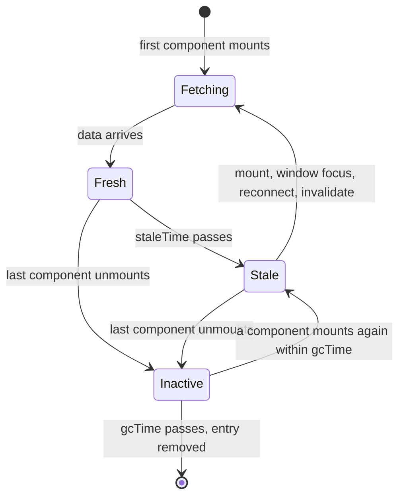

# Data Fetching: axios and TanStack Query

> In this document you will learn how React apps talk to APIs in production: when to use `fetch` or axios, how to build an axios instance with interceptors, how to refresh an expired token safely when many requests fail at once, how to cancel requests and read axios errors, why fetching in `useEffect` gets hard, and how TanStack Query v5 solves caching, refetching, pagination, mutations and optimistic updates. Most of the document is interview questions with spoken answers, follow-ups and common mistakes.

**Before this:** [API integration and data fetching](../05-frontend-engineering/07-api-integration-and-data-fetching.md) (fetch basics, HTTP vs network errors, retries, races, caching theory, token refresh with `fetch`) · [Hooks in depth](./03-hooks-in-depth.md) (`useEffect`, cleanup) · [Event loop](../02-javascript/16-event-loop.md) · **Interview questions:** [jump to the interview section](#interview-questions)

## Table of contents

1. [Concepts](#concepts)
   - [fetch vs axios](#fetch-vs-axios)
   - [An axios instance](#an-axios-instance)
   - [Interceptors](#interceptors)
   - [Token refresh with a request queue](#token-refresh-with-a-request-queue)
   - [Cancellation and timeouts](#cancellation-and-timeouts)
   - [The axios error object](#the-axios-error-object)
   - [Typing axios with TypeScript](#typing-axios-with-typescript)
   - [Fetching in useEffect correctly](#fetching-in-useeffect-correctly)
   - [TanStack Query v5](#tanstack-query-v5)
   - [Mutations, invalidation and optimistic updates](#mutations-invalidation-and-optimistic-updates)
   - [Pagination and infinite queries](#pagination-and-infinite-queries)
   - [Prefetching, Suspense and devtools](#prefetching-suspense-and-devtools)
   - [SWR in one paragraph](#swr-in-one-paragraph)
   - [Where API calls live](#where-api-calls-live)
   - [If you know Angular](#if-you-know-angular)
2. [Interview questions](#interview-questions)
3. [Quick revision](#quick-revision)
4. [Summary](#summary)
5. [References](#references)

> **Versions.** axios 1.x (1.20 at the time of writing), TanStack Query v5 (5.10x), React 19 with React 18 notes. TanStack Query v5 requires React 18 or newer. All axios examples (error shapes, timeouts, cancellation, interceptor order, retry, and the token-refresh queue with five parallel requests) were run with Node.js 22 against a local test HTTP server. The TanStack Query and `useEffect` examples (de-duplication, StrictMode behavior, status flags, retries, optimistic rollback, infinite queries, `keepPreviousData`, the search race) were run with Vitest, jsdom and React Testing Library on React 19.3 and TanStack Query 5.104.

---

## Concepts

### fetch vs axios

`fetch` is built into browsers and Node.js 18+. axios is a library that wraps XHR in the browser and the `http` module in Node (and can use `fetch` as an adapter since 1.7). The basics of `fetch` — and the important fact that **`fetch` does not reject on 404 or 500** — are in [Network errors vs HTTP errors](../05-frontend-engineering/07-api-integration-and-data-fetching.md#network-errors-vs-http-errors).

| Feature | `fetch` | axios |
| --- | --- | --- |
| Install | Built in | ~13 kB min+gzip dependency |
| JSON | `await res.json()` yourself; `JSON.stringify` the body yourself | Parses JSON responses and serializes object bodies automatically |
| Non-2xx status | Resolves; you check `res.ok` | **Rejects** with `AxiosError` (configurable with `validateStatus`) |
| Interceptors | None (write a wrapper function) | Request and response interceptors |
| Timeout | `AbortSignal.timeout(ms)` | `timeout` option |
| Cancellation | `AbortController` | `AbortController` via `signal` (old `CancelToken` is deprecated) |
| Upload progress | Not available in `fetch` (use XHR) | `onUploadProgress` (XHR adapter in browsers) |
| Download progress | Read the stream manually | `onDownloadProgress` |
| Base URL, default headers | Write a wrapper | `axios.create({ baseURL, headers })` |
| XSRF token from cookie | Manual | Built in for same-origin requests (`xsrfCookieName`) |
| Streaming responses | Native `ReadableStream` | Limited in browsers |
| Next.js server caching | `fetch` is the integration point | Not integrated |

**Honest summary:** a small `fetch` wrapper (30–60 lines) gives you most of axios. axios is worth it when you want interceptors, upload progress and consistent error handling without writing them. In Next.js server code, prefer `fetch` because the framework's caching hooks into it.

### An axios instance

Never configure the global `axios` object. Create an **instance** per backend:

```js
// src/api/client.js
import axios from 'axios';

export const api = axios.create({
  baseURL: import.meta.env.VITE_API_URL, // e.g. https://api.example.com/v1
  timeout: 10_000,                       // default is 0 = no timeout
  headers: { Accept: 'application/json' },
  withCredentials: true,                 // send cookies (needed for HttpOnly refresh cookies)
});

// Usage
const { data } = await api.get('/orders', { params: { status: 'open', page: 2 } }); // ?status=open&page=2
await api.post('/orders', { productId: 7, qty: 1 }); // JSON body, Content-Type set for you
```

The response object has `data`, `status`, `statusText`, `headers` (an `AxiosHeaders` object), `config` and `request`.

### Interceptors

Interceptors are functions that run **before every request** or **after every response** of an instance. Typical uses: add the auth header, add a request id, log timing, convert errors to one app error type, refresh tokens, retry.

```js
api.interceptors.request.use((config) => {
  const token = tokenStore.get();
  if (token) config.headers.Authorization = `Bearer ${token}`;
  config.headers['X-Request-Id'] = crypto.randomUUID();
  return config; // always return the config
});

api.interceptors.response.use(
  (response) => response,                  // 2xx
  (error) => Promise.reject(toAppError(error)), // non-2xx, network, timeout, cancel
);

// Remove an interceptor
const id = api.interceptors.request.use(fn);
api.interceptors.request.eject(id);
```

**Order (verified by running):** request interceptors run in **reverse** order of registration (last added runs first, LIFO); response interceptors run in the order they were added (FIFO). Two request interceptors A then B, and two response interceptors A then B, logged: `req B -> req A -> res A -> res B`.

### Token refresh with a request queue

When the access token expires, several requests can fail with 401 at the same time. The interceptor must **refresh once** and let every failed request wait for that one refresh, then retry. The concept, the sequence diagram and the `fetch` version are in [The refresh flow and the concurrency problem](../05-frontend-engineering/07-api-integration-and-data-fetching.md#the-refresh-flow-and-the-concurrency-problem). Here is the axios version:

```js
// src/api/client.js
import axios from 'axios';

export const api = axios.create({ baseURL: '/api', withCredentials: true });
const authApi = axios.create({ baseURL: '/api', withCredentials: true }); // no interceptors: avoids loops

let accessToken = null;           // keep in memory, not localStorage
let refreshPromise = null;        // the single in-flight refresh

export function setAccessToken(token) { accessToken = token; }

function refreshAccessToken() {
  // Start a refresh only if none is running; everyone else shares the same promise
  refreshPromise ??= authApi
    .post('/auth/refresh')                      // refresh token travels in an HttpOnly cookie
    .then((res) => {
      accessToken = res.data.accessToken;
      return accessToken;
    })
    .finally(() => { refreshPromise = null; });
  return refreshPromise;
}

api.interceptors.request.use((config) => {
  if (accessToken) config.headers.Authorization = `Bearer ${accessToken}`;
  return config;
});

api.interceptors.response.use(
  (response) => response,
  async (error) => {
    const original = error.config;
    const is401 = error.response?.status === 401;

    // Not a 401, or already retried once: give up
    if (!is401 || original._retry) return Promise.reject(error);
    original._retry = true;

    try {
      await refreshAccessToken();   // the first 401 starts it; the others wait for the same promise
    } catch (refreshError) {
      accessToken = null;
      onSessionExpired();           // e.g. clear caches and redirect to /login
      return Promise.reject(refreshError);
    }
    return api(original);           // retry; the request interceptor adds the new token
  },
);
```

**Verified by running:** five parallel `GET /me` requests with an expired token all got 401; the server log showed **exactly one** `POST /auth/refresh`, then all five retried with the new token and finished with status 200.

Why this works step by step:

1. All five requests fail with 401. Each one reaches the error interceptor.
2. The first one sets `refreshPromise`. The other four find it already set (`??=`) and await the same promise.
3. When the refresh resolves, `accessToken` is updated and `refreshPromise` is cleared in `finally`.
4. Each request is retried once. The `_retry` flag prevents an endless loop if the server keeps saying 401.
5. The refresh call uses a separate instance without the interceptor, so a 401 from `/auth/refresh` does not try to refresh itself.

### Cancellation and timeouts

```js
const controller = new AbortController();
const promise = api.get('/search', { params: { q }, signal: controller.signal });
controller.abort(); // the promise rejects with a CanceledError

try {
  await promise;
} catch (err) {
  if (axios.isCancel(err)) return; // not a real error: ignore it
  throw err;
}

// Timeout options
api.get('/report', { timeout: 5000 });                   // axios timeout -> code 'ECONNABORTED'
api.get('/report', { signal: AbortSignal.timeout(5000) }); // abort-based timeout -> CanceledError
```

Verified results: abort gives `name: 'CanceledError'`, `code: 'ERR_CANCELED'`, `axios.isCancel(err) === true`. The `timeout` option gives `code: 'ECONNABORTED'` and message `timeout of 5000ms exceeded`; with `transitional: { clarifyTimeoutError: true }` the code becomes `ETIMEDOUT`. `CancelToken` still exists but has been deprecated since v0.22; use `signal`.

### The axios error object

| Situation | `error.response` | `error.request` | `error.code` | Example message |
| --- | --- | --- | --- | --- |
| 4xx from server | Present (`status`, `data`, `headers`) | Present | `ERR_BAD_REQUEST` | `Request failed with status code 404` |
| 5xx from server | Present | Present | `ERR_BAD_RESPONSE` | `Request failed with status code 500` |
| No response (offline, DNS, CORS block) | `undefined` | Present | `ERR_NETWORK` in browsers (`ECONNREFUSED` etc. in Node) | `Network Error` |
| Timeout | `undefined` | Present | `ECONNABORTED` (or `ETIMEDOUT`) | `timeout of 50ms exceeded` |
| Cancelled | `undefined` | — | `ERR_CANCELED` | `canceled` |
| Bad config, error in a request interceptor | `undefined` | `undefined` | varies | your error |

All rows except the browser-only `ERR_NETWORK` and the last row were reproduced by running. A good error mapper:

```js
export function toAppError(error) {
  if (axios.isCancel(error)) return { kind: 'cancelled' };
  if (!axios.isAxiosError(error)) return { kind: 'unknown', message: String(error) };
  if (error.response) {
    const { status, data } = error.response;
    return { kind: 'http', status, message: data?.message ?? error.message, fieldErrors: data?.errors };
  }
  if (error.code === 'ECONNABORTED' || error.code === 'ETIMEDOUT') return { kind: 'timeout' };
  return { kind: 'network' }; // request sent, no response
}
```

### Typing axios with TypeScript

```ts
import axios, { AxiosError, type AxiosResponse } from 'axios';
import { z } from 'zod';

interface Order { id: string; total: number; status: 'open' | 'shipped' }
interface ApiErrorBody { message: string; errors?: Record<string, string[]> }

// Generic parameter = type of response.data (a promise to TypeScript, not a runtime check)
const res: AxiosResponse<Order[]> = await api.get<Order[]>('/orders');

// Typed error handling
try {
  await api.post<Order>('/orders', { productId: 7 });
} catch (e) {
  if (axios.isAxiosError<ApiErrorBody>(e)) {
    console.log(e.response?.data.message); // typed as string | undefined chain
  }
}

// Runtime validation for data you do not control
const OrderSchema = z.object({ id: z.string(), total: z.number(), status: z.enum(['open', 'shipped']) });
export async function getOrder(id: string) {
  const { data } = await api.get(`/orders/${id}`);
  return OrderSchema.parse(data); // throws if the API sends something unexpected
}
```

Why runtime validation matters even with TypeScript is answered in [API integration Q22](../05-frontend-engineering/07-api-integration-and-data-fetching.md#q22-why-validate-api-responses-at-runtime-if-you-already-use-typescript).

### Fetching in useEffect correctly

If you fetch in an effect, you must handle **loading, error, cleanup and races**:

```jsx
function UserProfile({ userId }) {
  const [state, setState] = useState({ status: 'loading', data: null, error: null });

  useEffect(() => {
    const controller = new AbortController();
    setState({ status: 'loading', data: null, error: null });

    api.get(`/users/${userId}`, { signal: controller.signal })
      .then((res) => setState({ status: 'success', data: res.data, error: null }))
      .catch((err) => {
        if (axios.isCancel(err)) return; // the effect was cleaned up: ignore
        setState({ status: 'error', data: null, error: toAppError(err) });
      });

    return () => controller.abort(); // runs when userId changes or the component unmounts
  }, [userId]);

  if (state.status === 'loading') return <Spinner />;
  if (state.status === 'error') return <ErrorMessage error={state.error} />;
  return <h1>{state.data.name}</h1>;
}
```

Verified facts:

- In **StrictMode (development)**, React mounts, unmounts and mounts again, so the effect runs **twice**: the fetch function was called **2** times and the first request was **aborted** by the cleanup. In production it runs once.
- **Race without cleanup:** a search for `"a"` (slow, 50 ms) followed by `"ab"` (fast, 5 ms) ended showing `results for a` — the wrong, older result. With an `ignore` flag (or abort) in the cleanup it showed `results for ab`.

**Why it gets hard:** every component repeats this code, and you still have no caching (navigating back refetches and shows a spinner), no de-duplication (two components fetch the same thing twice), no background refresh, no retry, no invalidation after a mutation, and no shared loading state. That is exactly what a server-state library provides. See also React's own guidance "You might not need an effect" in [Hooks in depth](./03-hooks-in-depth.md).

### TanStack Query v5

TanStack Query (formerly React Query) is a **server-state cache**. You give it a **query key** and a **query function**; it fetches, caches by key, de-duplicates, refetches in the background, retries and tracks status.

```jsx
// main.jsx
import { QueryClient, QueryClientProvider } from '@tanstack/react-query';
import { ReactQueryDevtools } from '@tanstack/react-query-devtools';

const queryClient = new QueryClient({
  defaultOptions: {
    queries: { staleTime: 30_000 }, // app-wide choice; the library default is 0
  },
});

createRoot(document.getElementById('root')).render(
  <QueryClientProvider client={queryClient}>
    <App />
    <ReactQueryDevtools initialIsOpen={false} />
  </QueryClientProvider>,
);
```

```jsx
// features/users/queries.js
import { queryOptions, useQuery } from '@tanstack/react-query';
import { api } from '../../api/client';

export const userKeys = {
  all: ['users'],
  detail: (id) => ['users', 'detail', id],
  list: (filters) => ['users', 'list', filters],
};

export const userQuery = (id) => queryOptions({
  queryKey: userKeys.detail(id),
  queryFn: ({ signal }) => api.get(`/users/${id}`, { signal }).then((r) => r.data), // signal: cancel on unmount / key change
  staleTime: 60_000,
});

function UserCard({ id }) {
  const { data, isPending, isError, error, isFetching } = useQuery(userQuery(id));
  if (isPending) return <Spinner />;
  if (isError) return <ErrorMessage error={error} />;
  return <div>{data.name} {isFetching && <small>updating…</small>}</div>;
}
```

**Important defaults (verified in the v5 source and by running):**

| Option | Default | Meaning |
| --- | --- | --- |
| `staleTime` | `0` | Data is stale immediately; stale data is shown but refetched on triggers |
| `gcTime` | 5 minutes (`Infinity` on the server) | How long an **unused** query (no mounted observers) stays in the cache |
| `retry` | `3` on the client (`0` on the server) | So a failing query calls the function **4** times in total (verified) |
| `retryDelay` | `min(1000 * 2^attempt, 30000)` | Exponential backoff, capped at 30 s |
| `refetchOnWindowFocus`, `refetchOnReconnect`, `refetchOnMount` | `true` | Refetch **stale** queries on these events |
| Structural sharing | On | Unchanged parts of the new data keep their old references |

The life of one cache entry:



**Status flags in v5:**

- `status`: `'pending'` (no data yet), `'error'`, `'success'` (has data). `isPending`, `isError`, `isSuccess` mirror it.
- `fetchStatus`: `'fetching'`, `'paused'` (offline), `'idle'`. `isFetching` mirrors it.
- `isLoading` = `isPending && isFetching` (first load in progress).

Verified sequence for a first load: `pending/fetching` (isPending and isLoading true) → `success/idle`. After `invalidateQueries`: `success/fetching` (isPending false, isLoading false) → `success/idle`. So a background refetch never shows the full spinner if you branch on `isPending`.

**De-duplication (verified):** two components using the same key inside `StrictMode` caused **one** call to the query function, unlike the plain effect, which fetched twice.

**v4 → v5 renames:** `cacheTime` → `gcTime`; `status: 'loading'` → `'pending'` and `isLoading` → `isPending`; `keepPreviousData: true` → `placeholderData: keepPreviousData`; `useErrorBoundary` → `throwOnError`; only the object signature `useQuery({ queryKey, queryFn })`; `onSuccess`/`onError`/`onSettled` removed from `useQuery` (still on `useMutation`); `suspense: true` → `useSuspenseQuery`; infinite queries require `initialPageParam`.

### Mutations, invalidation and optimistic updates

```jsx
function AddTodo() {
  const queryClient = useQueryClient();
  const mutation = useMutation({
    mutationFn: (newTodo) => api.post('/todos', newTodo).then((r) => r.data),
    onSuccess: () => {
      // Mark every query starting with ['todos'] stale and refetch the active ones
      return queryClient.invalidateQueries({ queryKey: ['todos'] });
    },
  });

  return (
    <button disabled={mutation.isPending} onClick={() => mutation.mutate({ title: 'New' })}>
      {mutation.isPending ? 'Saving…' : 'Add'}
    </button>
  );
}
```

**Optimistic update with rollback** (verified: the list showed `a,b` immediately, then the server failed, and it rolled back to `a`):

```jsx
const queryClient = useQueryClient();

const addTodo = useMutation({
  mutationFn: (todo) => api.post('/todos', todo).then((r) => r.data),

  onMutate: async (newTodo) => {
    await queryClient.cancelQueries({ queryKey: ['todos'] });   // stop refetches that would overwrite us
    const previous = queryClient.getQueryData(['todos']);       // snapshot
    queryClient.setQueryData(['todos'], (old = []) => [...old, { ...newTodo, id: 'temp' }]);
    return { previous };                                         // passed to onError/onSettled
  },

  onError: (err, newTodo, onMutateResult) => {
    queryClient.setQueryData(['todos'], onMutateResult.previous); // roll back
    toast.error('Could not add the todo');
  },

  onSettled: () => queryClient.invalidateQueries({ queryKey: ['todos'] }), // sync with the server
});
```

In current v5 versions the callbacks also receive a last `context` argument with the `client` (`onMutate(variables, context)`, `onError(error, variables, onMutateResult, context)`). Older v5 tutorials call the third argument `context`; it is the value you returned from `onMutate`.

A simpler option for many cases: render the pending item from `mutation.variables` while `mutation.isPending`, without touching the cache.

### Pagination and infinite queries

```jsx
// Paginated table: keep showing the old page while the next one loads
import { keepPreviousData, useQuery } from '@tanstack/react-query';

const { data, isPlaceholderData } = useQuery({
  queryKey: ['orders', { page }],
  queryFn: () => api.get('/orders', { params: { page } }).then((r) => r.data),
  placeholderData: keepPreviousData,
});
// Verified: after page 1 -> 2, the component rendered "page1" with isPlaceholderData=true, then "page2".
```

```jsx
// Infinite feed
const { data, fetchNextPage, hasNextPage, isFetchingNextPage } = useInfiniteQuery({
  queryKey: ['feed'],
  queryFn: ({ pageParam }) => api.get('/feed', { params: { cursor: pageParam } }).then((r) => r.data),
  initialPageParam: null,                          // required in v5
  getNextPageParam: (lastPage) => lastPage.nextCursor ?? undefined, // undefined = no more pages
});
const items = data?.pages.flatMap((p) => p.items) ?? [];
```

Verified: three pages loaded with `fetchNextPage`, and `hasNextPage` became `false` when `getNextPageParam` returned `undefined`. Offset vs cursor pagination and the `IntersectionObserver` trigger are in [Pagination and infinite scroll](../05-frontend-engineering/07-api-integration-and-data-fetching.md#pagination-and-infinite-scroll).

### Prefetching, Suspense and devtools

```jsx
// Prefetch on hover so the detail page opens instantly
<Link to={`/users/${id}`} onMouseEnter={() => queryClient.prefetchQuery(userQuery(id))}>Open</Link>

// Prefetch in a router loader (React Router data mode)
loader: ({ params }) => queryClient.ensureQueryData(userQuery(params.id)),

// Suspense: data is always defined; loading goes to <Suspense>, errors to an error boundary
function UserName({ id }) {
  const { data } = useSuspenseQuery(userQuery(id));
  return data.name;
}
<ErrorBoundary fallback={<p>Failed</p>}>
  <Suspense fallback={<Spinner />}><UserName id={1} /></Suspense>
</ErrorBoundary>
```

> **Version note.** The newest v5 releases (checked on 5.104) add `queryClient.query(options)` and mark `fetchQuery`, `prefetchQuery` and `ensureQueryData` as deprecated, to be removed in the next major version. They still work. The replacements are `queryClient.query(options)` for `fetchQuery`, `queryClient.query(options).catch(noop)` for `prefetchQuery`, and `queryClient.query({ ...options, staleTime: 'static' })` for `ensureQueryData`. Most codebases and tutorials still use the older names, so know both.

The devtools panel (`@tanstack/react-query-devtools`, included only in development builds by default) shows every query key, its status (fresh, stale, fetching, inactive), its data, and buttons to refetch, invalidate or reset.

### SWR in one paragraph

**SWR** (by Vercel) is a smaller server-state library named after stale-while-revalidate. `const { data, error, isLoading, mutate } = useSWR('/api/user', fetcher)` returns cached data, revalidates on focus and reconnect, and de-duplicates requests. It is lighter and simpler than TanStack Query, with fewer built-in tools for mutations, infinite queries and cache manipulation. Choose SWR for simple read-heavy apps; TanStack Query for complex apps with many mutations.

### Where API calls live

```text
src/
  api/
    client.ts          <- axios instance, interceptors, error mapping, token refresh
  features/
    orders/
      ordersApi.ts     <- getOrders(params), createOrder(body): plain async functions using client
      ordersQueries.ts <- query key factory, queryOptions, useOrders(), useCreateOrder()
      OrdersPage.tsx   <- UI: calls hooks only
```

Components never import axios. HTTP details live in one client; endpoints are plain functions (easy to test and reuse in loaders); hooks connect them to the cache. The general layered design is in [Building an API layer](../05-frontend-engineering/07-api-integration-and-data-fetching.md#building-an-api-layer-and-a-typed-api-client).

### If you know Angular

- **axios interceptors vs `HttpInterceptor`:** same idea. Angular interceptors are DI classes or functions that transform an Observable (`next.handle(req).pipe(catchError(...))`); axios interceptors are promise functions. Angular runs request interceptors in the order provided; axios runs **request** interceptors in reverse order. See [HttpClient and interceptors](../06-angular-16/08-httpclient-and-interceptors.md).
- **Cancellation:** Angular cancels by unsubscribing (`switchMap`, `takeUntil`); React uses `AbortController` in the effect cleanup or lets TanStack Query pass a `signal`.
- **TanStack Query vs services with `shareReplay`:** an Angular service caching an Observable is a hand-made, simpler version of a query cache. TanStack Query also has an Angular adapter.

---

## Interview questions

Questions go from basic to senior. For how to structure spoken answers, see [How to explain technical answers](../11-coding-interviews/01-how-to-explain-technical-answers.md).

### Q1. fetch or axios: which do you use and why?

**What the interviewer is checking:** Honest trade-offs, not "axios is better".

**What to say (30–60 seconds):**
> "Both work; the difference is what you get for free. fetch is built in, has zero bundle cost, supports streaming, and in Next.js it's the integration point for server caching. But it resolves on 404 and 500, so I must check response.ok, and I write JSON handling, timeouts and a wrapper myself. axios rejects on non-2xx, parses JSON, has interceptors for auth and errors, a timeout option, upload progress, and the same API in the browser and Node. In a typical SPA with auth and many endpoints I use an axios instance; in a small app or Next.js server code I use fetch with a thin wrapper. Either way, components never call it directly — they go through one API client."

**Deeper explanation:** See the comparison table in [fetch vs axios](#fetch-vs-axios). The equivalent of axios's basic behavior with `fetch`:

```js
export async function http(path, { body, timeout = 10_000, ...options } = {}) {
  const res = await fetch(`/api${path}`, {
    ...options,
    headers: { 'Content-Type': 'application/json', ...options.headers },
    body: body === undefined ? undefined : JSON.stringify(body),
    signal: options.signal ?? AbortSignal.timeout(timeout),
  });
  const data = res.status === 204 ? null : await res.json().catch(() => null);
  if (!res.ok) throw Object.assign(new Error(data?.message ?? `HTTP ${res.status}`), { status: res.status, data });
  return data;
}
```

**Follow-up questions and how to answer them:**
- **"How do you get upload progress with fetch?"** — You cannot with plain `fetch` today. Use XHR (`xhr.upload.onprogress`) or axios's `onUploadProgress`, which uses XHR in the browser. See [File uploads with progress](../05-frontend-engineering/07-api-integration-and-data-fetching.md#file-uploads-with-progress).
- **"Does axios use fetch?"** — By default the adapter list is `['xhr', 'http', 'fetch']`: XHR in browsers, `http` in Node, and `fetch` when the others are not available (for example some edge runtimes). You can force `adapter: 'fetch'` since 1.7.
- **"Is axios a security risk?"** — Like any dependency, keep it updated; axios has had CVEs (for example around SSRF and the XSRF token being sent to other hosts in old versions). Prefer one maintained client and update it.

**Common mistakes / weak answers:** "fetch can't do interceptors so we must use axios" (a wrapper function is an interceptor); forgetting that fetch does not reject on HTTP errors.

**Real-project example:** A team removed axios from a Next.js app because all data loading moved to server components using `fetch` with revalidation, but kept it in their admin SPA for upload progress.

### Q2. Output question: what does this code print?

**What the interviewer is checking:** That you know axios rejects on non-2xx and what the error contains.

```js
try {
  const res = await axios.get('/api/users/999'); // server answers 404 { "message": "User not found" }
  console.log('ok', res.status);
} catch (err) {
  console.log(err.name, err.code, err.response.status, err.response.data.message, err.message);
}
```

**What to say (30–60 seconds):**
> "axios rejects for any status outside 2xx by default, so 'ok' is not printed. The catch prints AxiosError, ERR_BAD_REQUEST, 404, 'User not found', and the message 'Request failed with status code 404'. The server's error body is in error.response.data, not in error.message. With fetch, the same request would print 'ok 404', because fetch only rejects on network failures."

**Deeper explanation:** Verified output: `AxiosError ERR_BAD_REQUEST 404 User not found Request failed with status code 404`. For a 500 the code is `ERR_BAD_RESPONSE`. You can change what counts as success:

```js
const res = await axios.get('/api/users/999', { validateStatus: (s) => s < 500 }); // 404 now resolves
console.log(res.status); // 404 (verified)
```

**Follow-up questions and how to answer them:**
- **"What if the server is down?"** — There is no `error.response`, so `err.response.status` would throw a `TypeError` inside the catch. Always use optional chaining: `err.response?.status`. In the browser the code is `ERR_NETWORK` and the message `Network Error`.
- **"Where is the HTTP status if I don't want to dig into response?"** — Recent axios versions also put it on `error.status`.

**Common mistakes / weak answers:** Showing `err.message` to the user (it is a technical message, not the server's message); assuming `err.response` always exists.

**Real-project example:** A login form showed "Request failed with status code 401" until the team mapped `error.response.data.message` to the UI.

### Q3. How do you set up axios in a real project?

**What the interviewer is checking:** Instance configuration and structure.

**What to say (30–60 seconds):**
> "I create one axios instance per backend with axios.create: baseURL from environment config, a timeout because the default is no timeout, default headers, and withCredentials if I use cookies. On that instance I add a request interceptor for the auth header and request id, and a response interceptor that maps errors to one app error shape and handles 401 with token refresh. Endpoint functions like getOrders use the instance, and React code only calls those functions through TanStack Query hooks. I never change global axios defaults, because libraries and other instances share them."

**Deeper explanation:** See [An axios instance](#an-axios-instance) and [Where API calls live](#where-api-calls-live). Per-request config merges over instance config:

```js
api.get('/reports/big', { timeout: 60_000 });          // override timeout for one call
api.get('/files/1', { responseType: 'blob' });         // download a file
api.post('/upload', formData, { onUploadProgress: (e) => setProgress(Math.round((e.progress ?? 0) * 100)) });
```

**Follow-up questions and how to answer them:**
- **"Why set a timeout?"** — The default `timeout` is `0`, meaning wait forever. A hung request keeps a spinner up indefinitely. A timeout turns it into an error you can retry or report.
- **"Do I set Content-Type for FormData?"** — No. Let the browser set `multipart/form-data` with the boundary. Setting it by hand breaks the boundary.
- **"Several backends?"** — One instance each (`authApi`, `paymentsApi`), each with its own base URL and interceptors, so tokens are only sent where they belong.

**Common mistakes / weak answers:** `axios.defaults.headers.common.Authorization = token` globally (the token goes to every host, including third parties).

**Real-project example:** Separating a `cdnApi` instance with no auth header stopped the app from leaking bearer tokens to an image CDN.

### Q4. What are interceptors? In what order do they run?

**What the interviewer is checking:** Mechanics and the LIFO surprise.

```js
const api = axios.create();
api.interceptors.request.use((c) => { console.log('req A'); return c; });
api.interceptors.request.use((c) => { console.log('req B'); return c; });
api.interceptors.response.use((r) => { console.log('res A'); return r; });
api.interceptors.response.use((r) => { console.log('res B'); return r; });
await api.get('/ok');
```

**What to say (30–60 seconds):**
> "Interceptors are hooks on an axios instance that run for every request before it is sent, and for every response or error before my code receives it. Here it logs req B, req A, res A, res B. Request interceptors run in reverse order of registration — the last one added runs first — and response interceptors run in the order added. That matters if one interceptor depends on another, for example a signing interceptor that must run after the one that adds headers: register the signing interceptor first."

**Deeper explanation:** Verified output: `req B -> req A -> res A -> res B`. Each interceptor must **return** the config or response (or a promise of it); returning nothing breaks the chain. The error handler must return `Promise.reject(error)` to keep the request failed, or return a value (or a retried request) to recover. Request interceptors also accept options: `{ synchronous: true }` and `runWhen: (config) => boolean`.

**Follow-up questions and how to answer them:**
- **"How do you remove an interceptor, for example in tests or on logout?"** — `use` returns an id; call `api.interceptors.request.eject(id)`. In React, if you add interceptors inside a component's effect, eject them in the cleanup, or StrictMode will register them twice.
- **"Where should interceptors be registered?"** — Once, at module level in the API client, not inside components. If they need React state (like a token from context), read it from a store or module variable instead.
- **"What runs if a request interceptor throws?"** — The request is not sent and the promise rejects with that error; response interceptors' error handlers still see it.

**Common mistakes / weak answers:** Registering interceptors in a component without cleanup (duplicates on every mount); forgetting to return `config`.

**Real-project example:** Duplicate `Authorization` handling and double toasts came from interceptors registered in `App`'s `useEffect`; moving them to the client module fixed it.

### Q5. How do you attach the auth token, and where do you keep it?

**What the interviewer is checking:** Security awareness with practical code.

**What to say (30–60 seconds):**
> "A request interceptor adds the Authorization header to requests for my own API only. I keep the short-lived access token in memory — a module variable or store — not in localStorage, because any XSS can read localStorage. The refresh token goes in an HttpOnly, Secure, SameSite cookie set by the server, so JavaScript never sees it. When the page reloads, the app calls the refresh endpoint once to get a new access token. Many teams go one step further with a backend-for-frontend, where the browser only has a session cookie and tokens never reach JavaScript."

**Deeper explanation:** The trade-offs of each storage option are in [Where should the frontend keep tokens?](../05-frontend-engineering/07-api-integration-and-data-fetching.md#where-should-the-frontend-keep-tokens). Code is in [Token refresh with a request queue](#token-refresh-with-a-request-queue).

**Follow-up questions and how to answer them:**
- **"If tokens are in memory, what about a second tab?"** — Each tab refreshes on load using the cookie. Logout is broadcast with `BroadcastChannel` or the `storage` event so other tabs clear their state.
- **"Cookies mean CSRF; how is that handled?"** — `SameSite=Lax` or `Strict` on the cookie, plus a CSRF token for state-changing requests if needed. axios can send the XSRF token from a cookie automatically for same-origin requests.

**Common mistakes / weak answers:** "localStorage is fine because we use HTTPS" (HTTPS does not stop XSS); adding the token to every URL as a query parameter.

**Real-project example:** A security review flagged tokens in localStorage; the team moved to an HttpOnly refresh cookie and in-memory access tokens with no UX change.

### Q6. Five requests fail with 401 because the token expired. Write the refresh logic.

**What the interviewer is checking:** The concurrency problem: one refresh, a queue, retry once, no loops.

**What to say (30–60 seconds):**
> "In the response interceptor, when I get a 401 on a request that hasn't been retried, I mark it as retried and await a shared refresh promise. If no refresh is running, the first request starts one and stores the promise; the other four find it and wait on the same promise, so the refresh endpoint is called exactly once. When it resolves, I store the new access token and retry each original request with api(originalConfig); the request interceptor adds the new token. If the refresh fails, I clear the session, redirect to login and reject all of them. The refresh call uses a separate axios instance, so its own 401 can't trigger another refresh."

**Deeper explanation:** Full code in [Token refresh with a request queue](#token-refresh-with-a-request-queue). Verified: five parallel requests, one `POST /auth/refresh`, five retries with the new token, all 200.

Many tutorials use an explicit **queue of callbacks** instead of a shared promise. It is the same idea:

```js
let isRefreshing = false;
let queue = []; // { resolve, reject }

function flushQueue(error, token) {
  queue.forEach(({ resolve, reject }) => (error ? reject(error) : resolve(token)));
  queue = [];
}

api.interceptors.response.use(undefined, async (error) => {
  const original = error.config;
  if (error.response?.status !== 401 || original._retry) return Promise.reject(error);
  original._retry = true;

  if (isRefreshing) {
    await new Promise((resolve, reject) => queue.push({ resolve, reject })); // wait in line
    return api(original);
  }

  isRefreshing = true;
  try {
    const { data } = await authApi.post('/auth/refresh');
    setAccessToken(data.accessToken);
    flushQueue(null, data.accessToken);
    return api(original);
  } catch (refreshError) {
    flushQueue(refreshError, null);
    onSessionExpired();
    return Promise.reject(refreshError);
  } finally {
    isRefreshing = false;
  }
});
```

**Follow-up questions and how to answer them:**
- **"Why is calling refresh five times harmful?"** — With refresh-token rotation, each refresh token can be used once. The second call uses an already-rotated token, fails, and may even make the server revoke the whole session as suspected theft. The user is logged out at random.
- **"What if a request is sent while the refresh is already running?"** — It goes out with the old token, gets 401, and joins the same refresh promise. To avoid the wasted round trip, the request interceptor can also `await refreshPromise` if one exists before attaching the token.
- **"How do you avoid an infinite loop?"** — The `_retry` flag (retry once only), a separate instance for the refresh call, and never refreshing when the failing URL is the refresh endpoint.
- **"Should you refresh before expiry?"** — Proactive refresh (a timer from the token's `exp`) avoids most 401s, but you still need the reactive path for clock skew, sleep/wake and revoked tokens.

**Common mistakes / weak answers:** Refreshing inside every failed request; retrying without a flag; using the same instance for the refresh call; forgetting to reject queued requests when the refresh fails (they hang forever).

**Real-project example:** Random logouts on a dashboard that fired eight requests on load disappeared after switching to a single shared refresh.

### Q7. Scenario: the refresh itself fails, or the user's session is revoked. What should happen?

**What the interviewer is checking:** Failure paths and clean logout.

**What to say (30–60 seconds):**
> "If the refresh call fails with 401 or 403, the session is over. The interceptor rejects every waiting request with that error, clears the in-memory token, clears client caches — queryClient.clear() so no previous user's data can show — resets any store, and redirects to the login page, ideally remembering the current URL to return to after login. I make sure this happens once, not once per failed request, and I don't show five error toasts; one 'Your session expired' message is enough. If the refresh fails because of a network error, I don't log the user out — I show an offline message and let them retry."

**Deeper explanation:**

```js
let sessionExpiredHandled = false;

export function onSessionExpired() {
  if (sessionExpiredHandled) return;    // many requests may call this
  sessionExpiredHandled = true;
  setAccessToken(null);
  queryClient.clear();                  // remove all cached server data
  store.dispatch(loggedOut());          // reset client state, if any
  const back = encodeURIComponent(window.location.pathname + window.location.search);
  window.location.assign(`/login?next=${back}`); // full reload also drops in-memory state
}
```

**Follow-up questions and how to answer them:**
- **"Why redirect with a full page load instead of navigate()?"** — It guarantees every in-memory cache and singleton is reset. With client navigation you must remember to reset everything yourself. Both are valid if done carefully.
- **"Is the `next` parameter safe?"** — Only if you validate it is a relative path on your own site; otherwise it is an open redirect.

**Common mistakes / weak answers:** Logging out on any refresh error, including network errors; leaving cached data of the previous user visible.

**Real-project example:** On a shared kiosk, a user briefly saw the previous user's orders after login, because the query cache was not cleared on session expiry.

### Q8. How do you handle API errors globally?

**What the interviewer is checking:** The split between global and local error handling.

**What to say (30–60 seconds):**
> "I handle cross-cutting errors in one place and leave feature errors to the feature. In the response interceptor I normalize every error into one app error shape and handle what's truly global: 401 triggers refresh or logout, 403 may redirect to an access-denied page, and I report 5xx and network errors to monitoring. I don't show a toast for every error in the interceptor, because the component often wants to show the error itself, like field errors on a form. With TanStack Query I can also add a QueryCache onError for a global toast for background refetch failures, and let components show inline errors for the first load."

**Deeper explanation:**

```js
const queryClient = new QueryClient({
  queryCache: new QueryCache({
    onError: (error, query) => {
      // Only toast if we already had data (a background refetch failed); first-load errors render inline
      if (query.state.data !== undefined) toast.error(`Could not refresh: ${error.message}`);
    },
  }),
});
```

The error classification and UX rules are in [Error handling and error UX](../05-frontend-engineering/07-api-integration-and-data-fetching.md#error-handling-and-error-ux).

**Follow-up questions and how to answer them:**
- **"How do errors reach error boundaries?"** — Error boundaries catch render errors, not promise rejections. TanStack Query's `throwOnError: true` (or `useSuspenseQuery`) rethrows query errors during render so the nearest boundary shows them. See [Patterns, architecture and TypeScript](./09-patterns-architecture-and-typescript.md).
- **"Do you log 4xx to monitoring?"** — Usually not individually (they are often user errors), but track rates; a spike in 400s after a deploy means the client and server disagree on a contract.

**Common mistakes / weak answers:** `alert(error.message)` in the interceptor; swallowing errors in the interceptor so components think the call succeeded.

**Real-project example:** Moving toasts out of the interceptor stopped double messages on the checkout form, which already showed inline errors.

### Q9. Write a retry interceptor. Which requests should be retried?

**What the interviewer is checking:** Safe retries: idempotency, temporary errors, backoff, limits.

**What to say (30–60 seconds):**
> "Only temporary failures and only safe requests. I retry network errors, timeouts, 429 and 5xx like 502, 503 and 504, and only for idempotent methods like GET, or for POSTs that carry an idempotency key. I never retry 400, 401, 403 or 404, because they will fail again. I keep a retry count on the request config, wait with exponential backoff plus jitter, respect a Retry-After header for 429, and stop after about three attempts. If I use TanStack Query, I usually let it retry queries instead and keep axios retries off, so I don't multiply retries."

**Deeper explanation:**

```js
api.interceptors.response.use(undefined, async (error) => {
  const config = error.config;
  if (!config || axios.isCancel(error)) return Promise.reject(error);

  const status = error.response?.status;
  const temporary = !error.response || status === 429 || status >= 500;
  const safeMethod = ['get', 'head', 'options'].includes(config.method);
  config.__retryCount = config.__retryCount ?? 0;

  if (!temporary || !safeMethod || config.__retryCount >= 3) return Promise.reject(error);
  config.__retryCount += 1;

  const retryAfter = Number(error.response?.headers?.['retry-after']) * 1000;
  const backoff = Math.min(1000 * 2 ** config.__retryCount, 10_000) * (0.5 + Math.random() / 2);
  await new Promise((r) => setTimeout(r, retryAfter || backoff));
  return api(config);
});
```

Verified with a server that returned 503 twice and then 200: the request succeeded on the third attempt. The general retry theory is in [Retries with exponential backoff](../05-frontend-engineering/07-api-integration-and-data-fetching.md#retries-with-exponential-backoff).

**Follow-up questions and how to answer them:**
- **"Why jitter?"** — Without it, thousands of clients that failed at the same moment retry at the same moment and overload the recovering server again (thundering herd).
- **"What about TanStack Query's retry?"** — It retries 3 times by default with exponential delay for every error. I usually pass a function: `retry: (count, err) => count < 3 && (!err.response || err.response.status >= 500)`, so 404s fail fast.

**Common mistakes / weak answers:** Retrying POST payments; retrying 4xx; infinite retries; retries in both axios and the query library.

**Real-project example:** A mobile web app on flaky networks cut visible errors by half with a two-retry policy for GETs only.

### Q10. How do you cancel requests with axios? What about CancelToken?

**What the interviewer is checking:** Modern cancellation API and when to use it.

**What to say (30–60 seconds):**
> "I pass an AbortController's signal in the request config and call controller.abort() when the result is no longer needed — when the component unmounts, when the user types a new search, or when they leave a page. The promise rejects with a CanceledError with code ERR_CANCELED, and I check axios.isCancel to ignore it instead of showing an error. CancelToken is the old API and has been deprecated since v0.22; new code should use signal. With TanStack Query I just forward the signal the query function receives, and the library aborts when the query is no longer needed."

**Deeper explanation:** Verified: `CanceledError ERR_CANCELED canceled true`. With TanStack Query:

```js
useQuery({
  queryKey: ['search', term],
  queryFn: ({ signal }) => api.get('/search', { params: { q: term }, signal }).then((r) => r.data),
});
// When term changes, the previous query is no longer observed. If its signal was consumed,
// TanStack Query aborts the old request instead of letting it finish.
```

**Follow-up questions and how to answer them:**
- **"Does aborting stop the server work?"** — No. It only stops the client from waiting and frees the connection. The server may still finish, so cancelling a POST does not undo it.
- **"Can one controller cancel several requests?"** — Yes, pass the same `signal` to all of them; one `abort()` cancels all. `AbortSignal.any([a, b])` combines a user cancel with a timeout.

**Common mistakes / weak answers:** Showing "Request failed" when the user simply navigated away; still using `CancelToken.source()` in new code.

**Real-project example:** Cancelling in-flight report requests on route change stopped old reports from overwriting the new page's data.

### Q11. What is the difference between axios's `timeout` and an `AbortSignal.timeout`?

**What the interviewer is checking:** Detail knowledge of error codes.

**What to say (30–60 seconds):**
> "Both stop waiting after a time. The axios timeout option makes axios reject with code ECONNABORTED and a 'timeout of N ms exceeded' message — or ETIMEDOUT if clarifyTimeoutError is on. A signal from AbortSignal.timeout is a cancellation, so axios rejects with a CanceledError, and axios.isCancel returns true. That difference matters in error handling: I want to show a timeout as an error, maybe retry it, but silently ignore real cancellations. So I usually use the axios timeout option for timeouts and signals for user or lifecycle cancellation."

**Deeper explanation:** Verified codes: `timeout` → `ECONNABORTED`; with `transitional: { clarifyTimeoutError: true }` → `ETIMEDOUT`; `signal: AbortSignal.timeout(30)` → `CanceledError`, `ERR_CANCELED`, `isCancel === true`.

**Follow-up questions and how to answer them:**
- **"What is a good timeout value?"** — Depends on the endpoint: a few seconds for interactive reads, longer for reports or uploads (override per request). The point is to have one, because the default is infinite.

**Common mistakes / weak answers:** Treating every `isCancel` error as a timeout, or vice versa.

**Real-project example:** A slow export endpoint got its own 2-minute timeout while the rest of the app used 10 seconds.

### Q12. How do you tell a network error from an HTTP error in axios?

**What the interviewer is checking:** The error object shape.

**What to say (30–60 seconds):**
> "I look at three properties. If error.response exists, the server answered with a non-2xx status, and error.response.status and data tell me what went wrong. If there's no response but error.request exists, the request was sent but nothing came back — offline, DNS failure, CORS block, or a timeout, which I recognize by the code ECONNABORTED. If neither exists, the error happened while setting up the request, like in an interceptor. Before all that I check axios.isCancel to ignore cancellations, and axios.isAxiosError to make sure it's an axios error at all."

**Deeper explanation:** See the table and `toAppError` in [The axios error object](#the-axios-error-object). Verified in Node: a refused connection gave `error.response === undefined`, `error.request` present, code `ECONNREFUSED`. In browsers the code is `ERR_NETWORK` and you cannot see the reason (the browser hides CORS details from JavaScript on purpose).

**Follow-up questions and how to answer them:**
- **"Why can't I see the CORS reason in JavaScript?"** — For security, the browser reports a blocked cross-origin response as a generic network error; the real reason is only in the DevTools console. See [CORS errors](../05-frontend-engineering/07-api-integration-and-data-fetching.md#cors-errors-from-the-frontend-point-of-view).

**Common mistakes / weak answers:** `if (error.response.status === 401)` without optional chaining, which crashes on network errors.

**Real-project example:** Distinguishing network from HTTP errors let the app show "You're offline" with a retry button instead of a generic failure.

### Q13. How do you type axios calls in TypeScript? Is the generic enough?

**What the interviewer is checking:** That a generic is a compile-time promise, not validation.

**What to say (30–60 seconds):**
> "api.get<Order[]>('/orders') types response.data as Order[], and axios.isAxiosError<ErrorBody>(e) types the error's response data. That's good for developer experience, but it's only a promise to the compiler — nothing checks the real JSON. For data I don't control, or critical paths like payments, I validate at the boundary with a schema library like Zod and infer the TypeScript type from the schema, so the type and the runtime check can't drift apart."

**Deeper explanation:** See [Typing axios with TypeScript](#typing-axios-with-typescript).

```ts
const Order = z.object({ id: z.string(), total: z.number() });
type Order = z.infer<typeof Order>; // one source of truth for the type

export const getOrders = async (): Promise<Order[]> =>
  z.array(Order).parse((await api.get('/orders')).data);
```

**Follow-up questions and how to answer them:**
- **"Isn't validation expensive?"** — For typical API payloads it is cheap compared with the network. For very large lists you can validate in development only or validate a sample.
- **"Can types be generated from the backend?"** — Yes: OpenAPI generators (`openapi-typescript`, Orval) create types and even TanStack Query hooks from the API spec. That removes hand-written types.

**Common mistakes / weak answers:** `as any` on responses; believing TypeScript checks runtime data.

**Real-project example:** Zod validation caught a backend change that turned `total` from number to string before it broke the invoice math.

### Q14. Write a component that fetches data in useEffect correctly.

**What the interviewer is checking:** Loading/error states, cleanup, and races.

**What to say (30–60 seconds):**
> "I keep a status of loading, error or success. In the effect, I create an AbortController, start the request with its signal, and set state when it finishes. The cleanup aborts the request, which happens when the dependency changes or the component unmounts, so an old response can't overwrite new data and I don't set state after unmount. I ignore cancellation errors. The effect depends on the id I fetch. Then I'd mention that in real apps I'd use TanStack Query instead, because this still has no caching, de-duplication or retry."

**Deeper explanation:** Full code in [Fetching in useEffect correctly](#fetching-in-useeffect-correctly). The race condition itself is explained with a diagram in [Hooks Q7](03-hooks-in-depth.md#q7-find-the-bug-the-profile-sometimes-shows-the-wrong-user), and a reusable hook version is [Hooks Q28 — `useFetch`](03-hooks-in-depth.md#q28-write-a-usefetch-hook-what-are-its-limits). If the API cannot be cancelled, use an `ignore` flag:

```jsx
useEffect(() => {
  let ignore = false;
  fetchResults(query).then((r) => { if (!ignore) setResults(r); });
  return () => { ignore = true; };
}, [query]);
```

**Follow-up questions and how to answer them:**
- **"Why can't the effect function be async?"** — An async function returns a promise, but React expects the effect to return nothing or a cleanup function. Define an async function inside the effect and call it.
- **"Why does it fetch twice in development?"** — StrictMode mounts, unmounts and remounts to check that cleanup works. Verified: two calls, the first aborted. That is expected and does not happen in production. Q16 covers it.
- **"Should the loading state reset when the id changes?"** — Yes, or the old user's data shows under the new id until the request ends. Alternatively key the component by id so it remounts.

**Common mistakes / weak answers:** No cleanup; missing dependency; `useEffect(async () => ...)`; never resetting the error.

**Real-project example:** A profile page showed the previous user's name for a second when switching users, until the effect reset state and aborted the old request.

### Q15. Scenario: a search box sometimes shows results for an older query. Why, and how do you fix it?

**What the interviewer is checking:** Race conditions in React specifically.

**What to say (30–60 seconds):**
> "It's a race. Each keystroke starts a request, and responses don't come back in order. If the request for 'a' is slower than the one for 'ab', the 'a' response arrives last and overwrites the correct results. The fix is to make sure only the latest request can update state: in the effect cleanup, abort the previous request or set an ignore flag. Debouncing reduces the number of requests but does not fix the race on its own. With TanStack Query, putting the search term in the query key solves it, because each term has its own cache entry and the component only shows the data for the current key."

**Deeper explanation:** Verified: without cleanup the component ended with `results for a` after typing `ab`; with an `ignore` flag it showed `results for ab`.

```jsx
function Search() {
  const [term, setTerm] = useState('');
  const debounced = useDebounce(term, 300); // custom hook from Hooks in depth
  const { data = [], isFetching } = useQuery({
    queryKey: ['search', debounced],
    queryFn: ({ signal }) => api.get('/search', { params: { q: debounced }, signal }).then((r) => r.data),
    enabled: debounced.length >= 2,
    placeholderData: keepPreviousData, // keep old results visible while typing
  });
  return (
    <>
      <input value={term} onChange={(e) => setTerm(e.target.value)} aria-label="Search" />
      {isFetching && <small>Searching…</small>}
      <ul>{data.map((r) => <li key={r.id}>{r.name}</li>)}</ul>
    </>
  );
}
```

The general version (and RxJS `switchMap`) is in [Race conditions and the latest request wins](../05-frontend-engineering/07-api-integration-and-data-fetching.md#race-conditions-and-the-latest-request-wins).

**Follow-up questions and how to answer them:**
- **"Why doesn't debounce fix it?"** — Debounce only spaces requests out. Two requests can still overlap if the user pauses, types again, and the first response is slow.
- **"How does TanStack Query avoid showing the stale response?"** — The component observes the query for the **current** key only. A late response for an old key goes into that old key's cache entry and never reaches the component.

**Common mistakes / weak answers:** "Use debounce" as the whole answer; disabling the input while loading.

**Real-project example:** A customer lookup showed the wrong customer in a support tool; adding abort in the cleanup fixed a serious data-entry bug.

### Q16. Scenario: in development every request is sent twice. Is that a bug?

**What the interviewer is checking:** StrictMode understanding and the right fix.

**What to say (30–60 seconds):**
> "Probably not. In development, React StrictMode mounts each component, unmounts it, and mounts it again to reveal effects that don't clean up properly. So an effect that fetches runs twice. If the cleanup aborts the first request, the duplicate is harmless, and it doesn't happen in production. I wouldn't remove StrictMode or add a 'didFetch' ref hack. Better options are proper cleanup, or a data library: TanStack Query de-duplicates by key, so it sends one request even in StrictMode. If the duplicated request is a POST with side effects, that's a real bug — side-effecting requests belong in event handlers, not effects."

**Deeper explanation:** Verified: the plain effect called the fetcher **2** times with the first one aborted; `useQuery` inside `StrictMode` called the query function **1** time. Details of StrictMode behavior are in [Rendering, reconciliation and keys](./02-rendering-reconciliation-and-keys.md) and [Hooks in depth](./03-hooks-in-depth.md).

**Follow-up questions and how to answer them:**
- **"What about analytics 'page viewed' events sent from an effect?"** — They are also doubled in development only. Accept it in dev, or send them from the router's navigation event instead of a component effect.
- **"Does React 19 change this?"** — StrictMode still double-invokes effects in development. React 19 added that the second render reuses memoized results from the first, but effects still run twice.

**Common mistakes / weak answers:** Removing StrictMode; `useRef(false)` "run once" guards that break in real remounts.

**Real-project example:** A team reported "duplicate orders in dev"; the cause was a POST in an effect on mount, moved into the submit handler.

### Q17. What problems does TanStack Query solve that useEffect fetching does not?

**What the interviewer is checking:** Server state vs client state thinking.

**What to say (30–60 seconds):**
> "Server data is a cache of something I don't own: it can change on the server, it can be stale, and many components need it. useEffect fetching treats it like local state, so every component refetches, shows spinners again when I navigate back, can't share in-flight requests, and has no retry, background refresh or invalidation. TanStack Query keeps one cache keyed by query key. It de-duplicates requests, shows cached data instantly and refetches in the background when it's stale, retries failures, refetches on window focus and reconnect, cancels outdated requests, and after a mutation I invalidate keys and everything showing that data updates. It also gives consistent status flags, pagination, infinite queries, optimistic updates and devtools."

**Deeper explanation:** The general server-state idea is in [Server state and server-state libraries](../05-frontend-engineering/06-components-and-state-management.md#server-state-and-server-state-libraries) and [Client-side caching and stale-while-revalidate](../05-frontend-engineering/07-api-integration-and-data-fetching.md#client-side-caching-and-stale-while-revalidate). Concretely, TanStack Query replaced the 25-line effect from Q14 with:

```jsx
const { data, isPending, error } = useQuery({
  queryKey: ['users', userId],
  queryFn: ({ signal }) => api.get(`/users/${userId}`, { signal }).then((r) => r.data),
});
```

**Follow-up questions and how to answer them:**
- **"Is TanStack Query a state manager?"** — For server state, yes. It is not meant for client state like "is the modal open". Keep that in `useState`, Context or a store.
- **"Does it fetch data for me?"** — No, it is fetch-agnostic. You give it any function that returns a promise (axios, fetch, GraphQL client). It manages the cache and lifecycle around that function.

**Common mistakes / weak answers:** Calling it "a fetching library like axios"; copying query data into `useState` or Redux (two sources of truth).

**Real-project example:** Moving a CRM's list and detail screens to TanStack Query made Back navigation instant because the list came from cache.

### Q18. How do you design query keys?

**What the interviewer is checking:** Cache identity and invalidation design.

**What to say (30–60 seconds):**
> "The query key is the cache identity, so it must include every variable the query function uses — the id, filters, page, the user or tenant if it changes. If a variable is missing from the key, different requests share one cache entry and you see wrong data. Keys are arrays and hashed deterministically, so object order inside doesn't matter. I organize them hierarchically, from general to specific, like ['todos', 'list', { status }] and ['todos', 'detail', id], and I generate them with a key factory per feature. Then invalidateQueries({ queryKey: ['todos'] }) refreshes everything about todos, while ['todos', 'detail', 5] targets one item."

**Deeper explanation:**

```js
export const todoKeys = {
  all: ['todos'],
  lists: () => [...todoKeys.all, 'list'],
  list: (filters) => [...todoKeys.lists(), filters],
  details: () => [...todoKeys.all, 'detail'],
  detail: (id) => [...todoKeys.details(), id],
};

queryClient.invalidateQueries({ queryKey: todoKeys.lists() });         // all lists, any filters
queryClient.invalidateQueries({ queryKey: todoKeys.detail(5), exact: true }); // only this one
```

`queryOptions({ queryKey, queryFn, ... })` keeps the key and function together and gives typed `getQueryData` in TypeScript.

**Follow-up questions and how to answer them:**
- **"Bug: changing the filter doesn't refetch. Why?"** — The filter is used in `queryFn` but not in `queryKey`. The key did not change, so the cache returns the old entry. Add it to the key; the ESLint plugin `@tanstack/eslint-plugin-query` has a rule (`exhaustive-deps`) for this.
- **"Should the auth token be in the key?"** — No, tokens change on refresh and would throw away the cache. Include the **user id or tenant id** if data differs per user, and clear the cache on logout.

**Common mistakes / weak answers:** String keys like `'todos' + page`; keys missing variables; random key shapes per component.

**Real-project example:** A multi-tenant app showed tenant A's data after switching to tenant B until `tenantId` was added to every key.

### Q19. Explain staleTime vs gcTime. What are the defaults?

**What the interviewer is checking:** The most-asked TanStack Query concept.

**What to say (30–60 seconds):**
> "staleTime is how long data counts as fresh. While fresh, TanStack Query serves it from cache and doesn't refetch on mount, focus or reconnect. The default is zero, so data is stale immediately: it's still shown, but refetched in the background on those triggers. gcTime, called cacheTime before v5, is how long a query stays in the cache after no component uses it. The default is five minutes; after that it's garbage collected and the next use starts from pending again. So staleTime controls when to refetch, gcTime controls when to forget. I usually raise staleTime for data that changes rarely, like reference data, to cut needless requests."

**Deeper explanation:** Defaults verified in the v5 source: `staleTime` 0, `gcTime` 300,000 ms on the client (`Infinity` on the server), `retry` 3. A timeline for one key with `staleTime: 30s`:

```text
t=0     component mounts   -> fetch (pending -> success), data fresh
t=10s   second component   -> served from cache, no request (fresh)
t=40s   window focus       -> data stale -> background refetch, old data stays on screen
t=60s   all components unmount -> query inactive, gc timer starts (5 min)
t=3min  component mounts   -> cached data shown instantly + background refetch (stale)
t=6min+ nothing mounted for 5 min -> entry removed; next mount shows pending again
```

**Follow-up questions and how to answer them:**
- **"What does staleTime: Infinity mean? And 'static'?"** — `Infinity` means never stale on its own; it refetches only when you invalidate it. Recent v5 versions also accept `staleTime: 'static'`, which means it is not refetched even by `invalidateQueries`; good for truly immutable data.
- **"Should gcTime be smaller than staleTime?"** — It can be, but it rarely makes sense: data would be forgotten while still considered fresh. Keep `gcTime` at least as long as you want instant back-navigation.
- **"How do you set them for the whole app?"** — `new QueryClient({ defaultOptions: { queries: { staleTime: 60_000 } } })`, then override per query.

**Common mistakes / weak answers:** Saying `gcTime` controls refetching; thinking `staleTime: 0` means "do not cache".

**Real-project example:** Country and currency lists got `staleTime: Infinity`, removing hundreds of requests per session.

### Q20. What is the difference between isPending, isLoading and isFetching?

**What the interviewer is checking:** v5 status model and correct UI choices.

**What to say (30–60 seconds):**
> "In v5 there are two dimensions. status says whether we have data: pending means no data yet, then success or error. fetchStatus says whether the query function is running: fetching, paused when offline, or idle. isPending is status pending. isFetching is any request in flight, including background refetches. isLoading is isPending and isFetching together — the first load is actually running. So I show a full skeleton when isPending, and a small 'updating' indicator when isFetching but not pending. A disabled query with no data is pending but not loading, which is why isLoading exists."

**Deeper explanation:** Verified states: first load `pending/fetching` (isPending, isLoading true) → `success/idle`; after invalidation `success/fetching` (isPending false, isLoading false, isFetching true) → `success/idle`.

```jsx
if (isPending) return <Skeleton />;              // no data yet
if (isError) return <ErrorState error={error} />;
return (
  <>
    {isFetching && <TopProgressBar />}           // background refresh
    <OrdersTable rows={data} />
  </>
);
```

**Follow-up questions and how to answer them:**
- **"What were these called in v4?"** — v4 had `status: 'loading'` and `isLoading` with today's `isPending` meaning, plus `isInitialLoading` with today's `isLoading` meaning. v5 renamed them.
- **"Can a query have data and an error at the same time?"** — Yes: if a background refetch fails, `status` is `'error'` but `data` still holds the last successful result. Show the data plus a small error message, not a full error page.

**Common mistakes / weak answers:** Showing a full-page spinner on every `isFetching`, so the page flashes on each window focus.

**Real-project example:** Switching from `isFetching` to `isPending` for the skeleton removed a flicker that users reported as "the page reloads when I come back to the tab".

### Q21. Scenario: our API is hit every time a user switches browser tabs. Why, and what do you do?

**What the interviewer is checking:** Knowing the refetch triggers and tuning them sensibly.

**What to say (30–60 seconds):**
> "That's refetchOnWindowFocus, which is on by default, combined with staleTime zero, so every query is stale and refetches when the window regains focus. That's usually a feature — users see fresh data — but if it's too much, I don't just turn focus refetching off everywhere. I set a sensible staleTime, like 30 seconds or a few minutes, per kind of data, so focus only refetches data that's actually old. For data that rarely changes I use a long staleTime. I'd disable focus refetch only for specific expensive queries."

**Deeper explanation:** Refetch triggers for **stale** queries: a new component mounting (`refetchOnMount`), window focus (`refetchOnWindowFocus`), network reconnect (`refetchOnReconnect`), and an optional `refetchInterval` for polling. Fresh queries ignore the first three.

```js
useQuery({ queryKey: ['prices'], queryFn: getPrices, refetchInterval: 5_000, refetchIntervalInBackground: false }); // polling
useQuery({ queryKey: ['countries'], queryFn: getCountries, staleTime: Infinity });                            // reference data
```

**Follow-up questions and how to answer them:**
- **"Why does it refetch when I open DevTools in development?"** — Focusing the page again after clicking in DevTools fires a focus event, which looks like switching tabs.
- **"How do you poll only while the tab is visible?"** — `refetchInterval` already pauses in the background by default; `refetchIntervalInBackground: true` makes it continue.

**Common mistakes / weak answers:** Globally setting `refetchOnWindowFocus: false` and losing freshness everywhere.

**Real-project example:** Setting `staleTime: 60_000` app-wide cut API traffic by about 40% with no complaints about stale data.

### Q22. How do retries work in TanStack Query, and how do you customize them?

**What the interviewer is checking:** Defaults and good error policy.

**What to say (30–60 seconds):**
> "By default a failing query retries three times on the client, so the query function runs four times, with exponential backoff — one, two, four seconds, capped at thirty. The error shows only after the last attempt; failureCount tells me how many failed so far. That's good for network blips but bad for errors that won't change, like 404 or 403, because the user waits several seconds for an error. So I pass a retry function that retries only network and 5xx errors. Mutations don't retry by default, which is right because they may not be idempotent."

**Deeper explanation:** Verified: with the default `retry` and a short `retryDelay`, the query function was called **4** times and `failureCount` was 4.

```js
const queryClient = new QueryClient({
  defaultOptions: {
    queries: {
      retry: (failureCount, error) => {
        const status = error?.response?.status;
        if (status && status < 500 && status !== 429) return false; // do not retry 4xx
        return failureCount < 3;
      },
    },
  },
});
```

**Follow-up questions and how to answer them:**
- **"Why do my tests take so long when a request fails?"** — Default retries with backoff. In tests, create the `QueryClient` with `retry: false`. See [Testing React applications](./10-testing-react-applications.md).
- **"What happens while offline?"** — With the default `networkMode: 'online'`, queries do not even start when offline; `fetchStatus` is `'paused'` and they resume on reconnect.

**Common mistakes / weak answers:** Adding axios retries on top of query retries (up to 16 attempts); retrying 401s.

**Real-project example:** Not retrying 404s made "item not found" pages appear instantly instead of after 7 seconds.

### Q23. How do you do dependent and parallel queries?

**What the interviewer is checking:** `enabled`, `useQueries`, and avoiding waterfalls.

**What to say (30–60 seconds):**
> "Parallel queries are simply several useQuery calls in the same component — they all start at once. For a dynamic number, like one query per selected id, I use useQueries with an array of query options. Dependent queries wait for data from another query: I pass enabled: !!userId so the second query doesn't run until the first gives me the id. While disabled it stays pending with fetchStatus idle. I try to avoid unnecessary waterfalls, because each dependent step adds a full round trip; sometimes the backend can return both in one call, or I can prefetch earlier."

**Deeper explanation:**

```jsx
// Dependent
const { data: user } = useQuery({ queryKey: ['user', email], queryFn: () => getUserByEmail(email) });
const userId = user?.id;
const { data: projects } = useQuery({
  queryKey: ['projects', userId],
  queryFn: () => getProjects(userId),
  enabled: !!userId,
});

// Dynamic parallel
const results = useQueries({
  queries: ids.map((id) => ({ queryKey: ['product', id], queryFn: () => getProduct(id) })),
  combine: (rs) => ({ data: rs.map((r) => r.data), pending: rs.some((r) => r.isPending) }),
});
```

**Follow-up questions and how to answer them:**
- **"enabled vs skipToken?"** — `queryFn: userId ? () => getProjects(userId) : skipToken` also disables the query and is better for TypeScript, because inside the function `userId` is known to be defined.
- **"Why not useQuery in a loop?"** — Hooks cannot be called in loops with a changing count; `useQueries` exists for that.

**Common mistakes / weak answers:** Chaining requests inside one `queryFn` (no caching of the first result); forgetting `enabled` and calling the API with `undefined`.

**Real-project example:** A comparison page loaded up to five products with `useQueries`, each cached separately so detail pages opened instantly afterward.

### Q24. How do you implement pagination and infinite scroll with TanStack Query?

**What the interviewer is checking:** `placeholderData`, `useInfiniteQuery` and v5 requirements.

**What to say (30–60 seconds):**
> "For page-number pagination I put the page in the query key and use placeholderData: keepPreviousData, so while page two loads the table keeps showing page one instead of jumping to a spinner; isPlaceholderData tells me to dim it or disable the Next button. I can prefetch the next page for instant navigation. For infinite scroll I use useInfiniteQuery: the queryFn gets a pageParam, I must give initialPageParam in v5, and getNextPageParam reads the next cursor from the last page, returning undefined when there are no more. data.pages holds all pages, and fetchNextPage loads the next one, usually triggered by an IntersectionObserver."

**Deeper explanation:** Code and verified behavior are in [Pagination and infinite queries](#pagination-and-infinite-queries): `keepPreviousData` rendered `page1` with `isPlaceholderData=true`, then `page2`; the infinite query loaded three pages and then `hasNextPage` was `false`.

```js
// Prefetch the next page
useEffect(() => {
  if (!isPlaceholderData && data?.hasMore) {
    queryClient.prefetchQuery({ queryKey: ['orders', { page: page + 1 }], queryFn: () => getOrders(page + 1) });
  }
}, [data, isPlaceholderData, page, queryClient]);
```

**Follow-up questions and how to answer them:**
- **"How do you limit memory in a long infinite list?"** — `maxPages` keeps only the last N pages in the cache, and list virtualization keeps the DOM small (see [Performance optimization](./08-performance-optimization.md)).
- **"What happens on refetch of an infinite query?"** — It refetches pages one by one from the first, using the stored page params, so the list stays consistent.

**Common mistakes / weak answers:** Forgetting `initialPageParam` (a v5 type error); storing all pages in local state and concatenating manually.

**Real-project example:** A social feed used `useInfiniteQuery` with cursors and `maxPages: 10`, keeping memory stable during long sessions.

### Q25. How do mutations work, and when do you invalidate vs update the cache directly?

**What the interviewer is checking:** Write-side cache management.

**What to say (30–60 seconds):**
> "useMutation wraps a function that changes data on the server. I call mutate or mutateAsync, and I get isPending, isError, data and variables, plus callbacks onMutate, onSuccess, onError and onSettled. After success I either invalidate related query keys, which marks them stale and refetches the active ones — simple and always correct — or I write the server's response directly into the cache with setQueryData, which saves a request when the response contains the full updated entity. I often do both: set the detail from the response and invalidate the lists, because I can't easily know where the item appears in filtered lists."

**Deeper explanation:**

```js
const updateTodo = useMutation({
  mutationFn: (todo) => api.put(`/todos/${todo.id}`, todo).then((r) => r.data),
  onSuccess: (saved) => {
    queryClient.setQueryData(todoKeys.detail(saved.id), saved);          // exact, no refetch
    return queryClient.invalidateQueries({ queryKey: todoKeys.lists() }); // lists refetch
  },
});
```

Returning the promise from `onSuccess` keeps the mutation in `isPending` until the refetch is done, so the button spinner covers the whole operation.

**Follow-up questions and how to answer them:**
- **"mutate vs mutateAsync?"** — `mutate` does not return a promise and handles errors through callbacks; `mutateAsync` returns a promise you must `await` and `catch`, useful when you need to chain steps.
- **"Callbacks on useMutation vs on mutate()?"** — Hook-level callbacks always run (cache logic belongs there). Callbacks passed to `mutate(vars, { onSuccess })` do not run if the component unmounts first, so use them for UI things like closing a dialog or navigating.

**Common mistakes / weak answers:** Manually refetching with `refetch()` from other components; forgetting to invalidate lists after creating an item.

**Real-project example:** After "Create invoice", invalidating `['invoices']` updated the list, the dashboard counter and the customer's invoice tab at once.

### Q26. Implement an optimistic update with rollback in TanStack Query.

**What the interviewer is checking:** The four steps and the race with in-flight refetches.

**What to say (30–60 seconds):**
> "In onMutate I first cancel outgoing queries for that key, so a refetch that's already running can't overwrite my optimistic data. Then I snapshot the current cache with getQueryData, update the cache with setQueryData to show the change immediately, and return the snapshot. In onError I put the snapshot back and tell the user. In onSettled — success or error — I invalidate the key so the cache ends up matching the server. I use this for low-risk, likely-to-succeed actions like toggling a like or reordering, not for payments."

**Deeper explanation:** Code is in [Mutations, invalidation and optimistic updates](#mutations-invalidation-and-optimistic-updates). Verified by running: the UI went from `a` to `a,b` immediately; the server call failed after 20 ms; `onError` restored `a`; `onMutate`'s context argument contained the same `QueryClient`. Theory and pitfalls are in [Optimistic updates with rollback](../05-frontend-engineering/07-api-integration-and-data-fetching.md#optimistic-updates-with-rollback).

**Follow-up questions and how to answer them:**
- **"Why cancelQueries first?"** — If a refetch started before the mutation, its (old) response could arrive after your optimistic write and erase it, causing a flicker back to the old state.
- **"Two quick optimistic mutations, the first fails — what happens?"** — Rolling back to the first snapshot would also erase the second change. Options: invalidate on error instead of restoring the snapshot, or use mutation `scope` to run them one by one, or use the `variables` approach that renders pending items without editing the cache.
- **"What's the simpler alternative?"** — Render `mutation.variables` as a greyed-out pending row while `isPending`; on error, show a retry button. No cache surgery, and no rollback needed.

**Common mistakes / weak answers:** No rollback; no `cancelQueries`; not invalidating at the end, so temporary ids stay in the cache.

**Real-project example:** A kanban board moved cards optimistically between columns; on failure the card snapped back with a toast.

### Q27. How and why do you prefetch data?

**What the interviewer is checking:** Perceived performance techniques.

**What to say (30–60 seconds):**
> "Prefetching loads data into the cache before a component asks for it, so the next screen renders instantly. Common triggers: hovering or focusing a link, the router loader for the route being opened, or the next page of a paginated list. prefetchQuery fetches only if the data is missing or stale and never throws; ensureQueryData returns cached data or fetches it, which is handy in loaders. With the router loader approach, the fetch starts in parallel with loading the route's code, which avoids a render-then-fetch waterfall."

**Deeper explanation:** See [Prefetching, Suspense and devtools](#prefetching-suspense-and-devtools). With React Router data mode (see [Routing and forms](./07-routing-and-forms.md)):

```js
{
  path: 'users/:id',
  loader: ({ params }) => queryClient.ensureQueryData(userQuery(params.id)),
  Component: UserPage, // UserPage calls useQuery(userQuery(id)) and finds the data in cache
}
```

**Follow-up questions and how to answer them:**
- **"Does prefetching waste bandwidth?"** — It can. Prefetch on clear intent (hover, focus, viewport) and give prefetched data a `staleTime`, or the component will refetch it immediately on mount.
- **"Aren't prefetchQuery and ensureQueryData deprecated?"** — In the newest v5 releases, yes: they are replaced by `queryClient.query(options)`, which you can combine with `.catch(noop)` or `staleTime: 'static'`. The old methods still work until the next major version. See the version note in [Prefetching, Suspense and devtools](#prefetching-suspense-and-devtools).
- **"What is a request waterfall?"** — Parent renders, fetches, then a child renders and fetches, one after another. Loaders and prefetching start all requests early so they run in parallel.

**Common mistakes / weak answers:** Prefetching everything on app start; prefetching with a different key than the component uses (no cache hit).

**Real-project example:** Prefetching order details on row hover made the details drawer open with data already present most of the time.

### Q28. How do you use TanStack Query with Suspense?

**What the interviewer is checking:** `useSuspenseQuery` and boundaries.

**What to say (30–60 seconds):**
> "In v5 I use useSuspenseQuery. Instead of returning isPending, it suspends the component while loading, so the nearest Suspense boundary shows the fallback, and if it fails it throws to the nearest error boundary. In return, data is always defined, which simplifies components and TypeScript. I place Suspense and error boundaries around sections of the page, and use QueryErrorResetBoundary or the error boundary's reset to retry. One gotcha: two useSuspenseQuery calls in the same component run one after the other, a waterfall, so I use useSuspenseQueries or prefetch to run them in parallel."

**Deeper explanation:**

```jsx
import { QueryErrorResetBoundary, useSuspenseQuery } from '@tanstack/react-query';
import { ErrorBoundary } from 'react-error-boundary';

function OrdersSection() {
  return (
    <QueryErrorResetBoundary>
      {({ reset }) => (
        <ErrorBoundary onReset={reset} fallbackRender={({ resetErrorBoundary }) => (
          <button onClick={resetErrorBoundary}>Retry</button>
        )}>
          <Suspense fallback={<TableSkeleton />}>
            <Orders />
          </Suspense>
        </ErrorBoundary>
      )}
    </QueryErrorResetBoundary>
  );
}

function Orders() {
  const { data } = useSuspenseQuery({ queryKey: ['orders'], queryFn: getOrders }); // data always defined
  return <OrdersTable rows={data} />;
}
```

Suspense itself is covered in [React 18 and 19 features](./04-react-18-and-19-concurrent-features-and-server-components.md).

**Follow-up questions and how to answer them:**
- **"Can I pass enabled to useSuspenseQuery?"** — No; a suspense query must run. For conditional fetching, render the component conditionally instead.
- **"Does it work with server rendering?"** — Yes, with streaming setups (for example Next.js App Router with the TanStack Query hydration helpers), but that needs extra setup per framework.

**Common mistakes / weak answers:** No error boundary (an error crashes the whole tree); two suspense queries in one component causing a waterfall.

**Real-project example:** A dashboard used one Suspense boundary per card, so slow cards loaded independently without blocking the page.

### Q29. Scenario: after logout and login as a different user, the old user's data appears for a moment. Fix it.

**What the interviewer is checking:** Cache lifecycle and security hygiene.

**What to say (30–60 seconds):**
> "The query cache still holds the previous user's data, and the new user's components show it from cache while refetching in the background. On logout I call queryClient.clear() to drop every query and mutation, reset client stores, and clear the in-memory token. If the app supports switching accounts or tenants without logout, I also put the user or tenant id in the query keys, so different users never share an entry. And I check persisted caches, like a localStorage persister, which must be cleared too."

**Deeper explanation:**

```js
async function logout() {
  await api.post('/auth/logout').catch(() => {}); // best effort
  setAccessToken(null);
  queryClient.clear();         // removes all cached queries and mutations
  store.dispatch(loggedOut()); // if a client store exists
  navigate('/login', { replace: true });
}
```

**Follow-up questions and how to answer them:**
- **"clear vs removeQueries vs resetQueries?"** — `clear()` empties everything. `removeQueries({ queryKey })` removes matching entries without refetching. `resetQueries` puts matching queries back to their initial state and refetches active ones.
- **"Why is this a security issue, not just a UX bug?"** — On shared computers, another person sees personal data. It can also send writes with stale assumptions about permissions.

**Common mistakes / weak answers:** Only redirecting to `/login`; using `invalidateQueries` (it keeps the old data visible while refetching).

**Real-project example:** A clinic app's shared front-desk PCs required `queryClient.clear()` on logout after an audit.

### Q30. TanStack Query vs SWR vs RTK Query: how do you choose?

**What the interviewer is checking:** Ecosystem awareness with reasons.

**What to say (30–60 seconds):**
> "All three are server-state caches using stale-while-revalidate. SWR is the smallest and simplest — great for read-heavy apps, especially with Next.js — but it has fewer built-in tools for mutations, optimistic updates and infinite queries. TanStack Query is the most complete: detailed cache control, mutations with optimistic updates, infinite queries, prefetching, Suspense, devtools and adapters for other frameworks. RTK Query is the natural choice if the app already uses Redux Toolkit, with tag-based invalidation and everything in Redux DevTools. For a new React app without Redux, I'd pick TanStack Query."

**Deeper explanation:** RTK Query details and a comparison with `createAsyncThunk` are in [State management Q22](./05-state-management-context-redux-toolkit-and-zustand.md#q22-createasyncthunk-rtk-query-or-tanstack-query-how-do-you-choose). In Next.js App Router, a lot of data loading moves to Server Components with `fetch`; client-side libraries are then used for interactive, client-only data. See [Next.js essentials](./11-nextjs-essentials-for-interviews.md).

**Follow-up questions and how to answer them:**
- **"What about Apollo Client?"** — For GraphQL APIs, Apollo or urql give a normalized cache by type and id, which REST-oriented libraries do not. TanStack Query also works with GraphQL but without normalization.

**Common mistakes / weak answers:** "They're all the same"; choosing by popularity only.

**Real-project example:** A marketing site used SWR for a few read-only widgets; the company's complex admin app used TanStack Query.

### Q31. How do you structure API code in a large React app, and how do you handle 401s globally with TanStack Query?

**What the interviewer is checking:** Architecture: client, endpoint functions, hooks; one place for auth.

**What to say (30–60 seconds):**
> "Three layers. One API client — the axios instance with base URL, auth interceptor, token refresh and error mapping. Then per-feature endpoint functions like getOrders and createOrder that return typed, validated data. Then per-feature query hooks and key factories, like useOrders and useCreateOrder, which components use. Components never see axios or URLs. 401s are handled once in the axios response interceptor with the refresh queue; TanStack Query only sees the final result. If the session can't be refreshed, the interceptor triggers logout, which clears the query cache. I also make sure query retries don't retry 401s."

**Deeper explanation:** Folder layout in [Where API calls live](#where-api-calls-live).

```js
// features/orders/ordersApi.js
export const getOrders = (params, signal) => api.get('/orders', { params, signal }).then((r) => r.data);
export const createOrder = (body) => api.post('/orders', body).then((r) => r.data);

// features/orders/ordersQueries.js
export const orderKeys = { all: ['orders'], list: (p) => ['orders', 'list', p] };
export const useOrders = (params) =>
  useQuery({ queryKey: orderKeys.list(params), queryFn: ({ signal }) => getOrders(params, signal) });
export const useCreateOrder = () => {
  const qc = useQueryClient();
  return useMutation({ mutationFn: createOrder, onSuccess: () => qc.invalidateQueries({ queryKey: orderKeys.all }) });
};
```

**Follow-up questions and how to answer them:**
- **"Why keep endpoint functions separate from hooks?"** — They are reusable outside React (router loaders, prefetching, tests, workers) and easy to unit test or mock with MSW.
- **"How do you mock the API in tests?"** — With MSW at the network level, so the real client, interceptors and hooks run. See [Testing React applications](./10-testing-react-applications.md).

**Common mistakes / weak answers:** Handling 401 in every component; putting URLs in components.

**Real-project example:** When the backend moved from `/api/v1` to `/api/v2`, only the client's `baseURL` and three endpoint functions changed.

### Q32. Code review: what is wrong with this data-fetching code?

**What the interviewer is checking:** Spotting many issues quickly.

```jsx
function Orders({ status }) {
  const [orders, setOrders] = useState([]);
  const queryClient = new QueryClient();

  const { data } = useQuery({
    queryKey: ['orders'],
    queryFn: async () => {
      const res = await fetch(`/api/orders?status=${status}`);
      return res.json();
    },
  });

  useEffect(() => {
    if (data) setOrders(data);
  }, [data]);

  const add = async (o) => {
    await axios.post('/api/orders', o);
    queryClient.invalidateQueries(['orders']);
  };

  return <OrdersTable rows={orders} onAdd={add} />;
}
```

**What to say (30–60 seconds):**
> "Several problems. A new QueryClient is created on every render, so invalidateQueries runs on an empty cache that nobody uses — it must come from useQueryClient. status is used in the queryFn but missing from the query key, so changing the filter shows cached data for the old status. fetch doesn't check res.ok, so a 500 becomes 'successful' data. Copying data into useState through an effect creates a second source of truth and an extra render; just use data. invalidateQueries(['orders']) is the v4 signature; v5 needs an object with queryKey. The POST should be a useMutation, so I get isPending and error handling, and it should use the shared API client, not axios directly. And there's no loading or error UI."

**Deeper explanation:**

```jsx
function Orders({ status }) {
  const { data = [], isPending, error } = useOrders({ status }); // key includes status
  const createOrder = useCreateOrder();                          // invalidates ['orders']

  if (isPending) return <TableSkeleton />;
  if (error) return <ErrorState error={error} />;
  return <OrdersTable rows={data} onAdd={(o) => createOrder.mutate(o)} adding={createOrder.isPending} />;
}
```

**Follow-up questions and how to answer them:**
- **"Where should the QueryClient be created?"** — Once, outside components (module level) or in `useState(() => new QueryClient())` in the root component, and provided with `QueryClientProvider`.

**Common mistakes / weak answers:** Finding only one or two issues.

**Real-project example:** The "data doesn't update after adding" bug in a real code review came from exactly this local `new QueryClient()`.

---

## Quick revision

1. **Does fetch reject on 404?** No. axios does (`ERR_BAD_REQUEST`); 5xx is `ERR_BAD_RESPONSE`.
2. **Where is the server's error message in axios?** `error.response.data`; `error.message` is generic.
3. **No `error.response`?** No reply: network, CORS, timeout (`ECONNABORTED`) — or cancelled.
4. **axios interceptor order?** Request interceptors LIFO, response interceptors FIFO.
5. **Default axios timeout?** `0` (none). Always set one.
6. **How to cancel in axios?** `signal` from `AbortController`; `axios.isCancel(err)`; `CancelToken` is deprecated.
7. **Token refresh rule?** One shared refresh promise, retry each request once (`_retry`), separate instance for refresh, logout if refresh fails.
8. **Effect fetching essentials?** Loading/error state, abort or ignore flag in cleanup, correct dependencies.
9. **Why double requests in dev?** StrictMode remounts; harmless with cleanup; TanStack Query de-duplicates.
10. **Query key rule?** Include every variable the `queryFn` uses; hierarchical keys plus a key factory.
11. **staleTime vs gcTime defaults?** `0` and 5 minutes; staleTime = when to refetch, gcTime = when to forget unused data.
12. **Default retries?** 3 (4 calls), backoff `min(1000 * 2^n, 30000)`; mutations 0.
13. **isPending vs isLoading vs isFetching?** No data yet / first load running / any request running.
14. **v5 renames?** `cacheTime` → `gcTime`, `loading` → `pending`, `keepPreviousData` → `placeholderData: keepPreviousData`, object signature only.
15. **Infinite query requirement in v5?** `initialPageParam` plus `getNextPageParam` returning `undefined` at the end.
16. **Optimistic update steps?** `cancelQueries`, snapshot, `setQueryData`, return snapshot; roll back in `onError`; invalidate in `onSettled`.
17. **On logout?** `queryClient.clear()` and include user/tenant in keys.
18. **Suspense in v5?** `useSuspenseQuery`, data always defined, needs Suspense and error boundaries.

## Summary

- `fetch` is built in and enough with a small wrapper; axios adds rejection on HTTP errors, JSON handling, interceptors, timeouts and upload progress. Hide either behind one API client.
- Build an axios instance per backend with a timeout; add the token in a request interceptor; map errors in a response interceptor; remember request interceptors run in reverse order.
- Refresh tokens with one shared refresh promise, retry once, use a separate instance for the refresh call, and log out cleanly (clear caches) if it fails.
- Cancel with `AbortController` and ignore `CanceledError`; distinguish HTTP, network, timeout and cancel errors by `response`, `request` and `code`.
- Fetching in `useEffect` needs cleanup for races and StrictMode, and still lacks caching; that is why server-state libraries exist.
- TanStack Query v5: design keys carefully, tune `staleTime`, understand `gcTime`, use `isPending` for first load and `isFetching` for background work, invalidate after mutations, use optimistic updates with rollback for low-risk actions, and prefetch on intent.

## References

- axios — Introduction and API: https://axios-http.com/docs/intro
- axios — Request config: https://axios-http.com/docs/req_config
- axios — Interceptors: https://axios-http.com/docs/interceptors
- axios — Handling errors: https://axios-http.com/docs/handling_errors
- axios — Cancellation: https://axios-http.com/docs/cancellation
- axios — GitHub README (error codes, fetch adapter): https://github.com/axios/axios
- MDN — Using the Fetch API: https://developer.mozilla.org/en-US/docs/Web/API/Fetch_API/Using_Fetch
- MDN — AbortController: https://developer.mozilla.org/en-US/docs/Web/API/AbortController
- React — Synchronizing with effects (fetching data, StrictMode): https://react.dev/learn/synchronizing-with-effects
- React — You might not need an effect: https://react.dev/learn/you-might-not-need-an-effect
- TanStack Query — Overview: https://tanstack.com/query/latest/docs/framework/react/overview
- TanStack Query — Important defaults: https://tanstack.com/query/latest/docs/framework/react/guides/important-defaults
- TanStack Query — Query keys: https://tanstack.com/query/latest/docs/framework/react/guides/query-keys
- TanStack Query — Optimistic updates: https://tanstack.com/query/latest/docs/framework/react/guides/optimistic-updates
- TanStack Query — Infinite queries: https://tanstack.com/query/latest/docs/framework/react/guides/infinite-queries
- TanStack Query — Suspense: https://tanstack.com/query/latest/docs/framework/react/guides/suspense
- TanStack Query — Migrating to v5: https://tanstack.com/query/latest/docs/framework/react/guides/migrating-to-v5
- TanStack Query — Query cancellation: https://tanstack.com/query/latest/docs/framework/react/guides/query-cancellation
- SWR documentation: https://swr.vercel.app/
- OWASP — HTML5 Security Cheat Sheet (local storage): https://cheatsheetseries.owasp.org/cheatsheets/HTML5_Security_Cheat_Sheet.html
