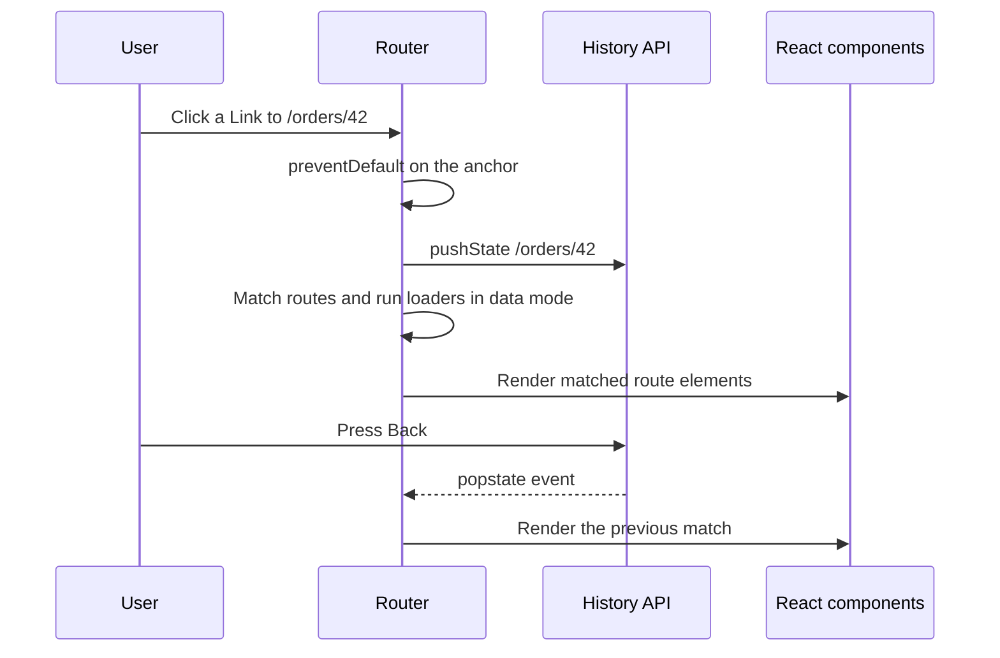

# Routing and Forms

> In this document you will learn the two things almost every React app needs after state and data: routing with React Router v7 (its three modes, nested routes, params, search params, navigation, protected routes, lazy routes, loaders and actions, error pages, scroll restoration) and forms (controlled vs uncontrolled inputs, validation strategies, React Hook Form, Zod schemas, dynamic field arrays, async validation, React 19 form Actions and accessible forms). Most of the document is interview questions with spoken answers, follow-ups and common mistakes.

**Before this:** [Fundamentals: JSX, components, props and state](./01-react-fundamentals-jsx-components-props-and-state.md) (controlled inputs intro) · [Hooks in depth](./03-hooks-in-depth.md) · [HTML semantics and forms](../05-frontend-engineering/01-html-semantics-and-forms.md) · [Accessibility](../05-frontend-engineering/04-accessibility.md) · **Interview questions:** [jump to the interview section](#interview-questions)

## Table of contents

1. [Concepts](#concepts)
   - [Client-side routing in one minute](#client-side-routing-in-one-minute)
   - [React Router v7 and its three modes](#react-router-v7-and-its-three-modes)
   - [Routes, nesting and Outlet](#routes-nesting-and-outlet)
   - [Params and search params](#params-and-search-params)
   - [Navigation](#navigation)
   - [Protected routes](#protected-routes)
   - [Lazy routes and code splitting](#lazy-routes-and-code-splitting)
   - [Loaders and actions](#loaders-and-actions)
   - [Not-found and error routes](#not-found-and-error-routes)
   - [Scroll restoration](#scroll-restoration)
   - [Controlled and uncontrolled inputs](#controlled-and-uncontrolled-inputs)
   - [Validation strategies](#validation-strategies)
   - [React Hook Form](#react-hook-form)
   - [Schema validation with Zod](#schema-validation-with-zod)
   - [Dynamic field arrays](#dynamic-field-arrays)
   - [React 19 form Actions](#react-19-form-actions)
   - [Accessible forms](#accessible-forms)
   - [If you know Angular](#if-you-know-angular)
2. [Interview questions](#interview-questions)
3. [Quick revision](#quick-revision)
4. [Summary](#summary)
5. [References](#references)

> **Versions.** React Router **v7** (7.18 at the time of writing) is the main target, with v6 differences marked. **React Router v8 was released in June 2026** (8.5 at the time of writing); it is a small major version, summarized in [React Router v7 and its three modes](#react-router-v7-and-its-three-modes). Forms use React Hook Form 7 (7.90), Zod 4 (4.6) and React 19 form Actions. The router examples (nested routes, params, `NavLink` active state, search params, a guard with `Navigate`, a loader redirect, an error route and a lazy route) and the form examples (render counts, Zod validation through a resolver, `useFieldArray`, `useActionState` and `useFormStatus`) were run with Vitest, jsdom and React Testing Library on React 19.3. `@hookform/resolvers` was not installed; a hand-written resolver equivalent to `zodResolver` was used instead.

---

## Concepts

### Client-side routing in one minute

In a classic multi-page site, every link click asks the server for a new HTML page. In a **single-page app (SPA)**, the server sends one HTML page and the JavaScript bundle. When the user clicks a link, the router:

1. Prevents the full page load.
2. Updates the URL with the **History API** (`history.pushState`).
3. Matches the new URL against the route configuration.
4. Renders the matching components.

Back and Forward fire a `popstate` event, and the router renders the matching route again. The server must return the same `index.html` for every app URL (a "fallback" or "rewrite" rule), or a reload on `/orders/42` gives a 404 from the server.



Server-side and hybrid rendering (where the server renders the matched route first) are explained in [Rendering strategies](../05-frontend-engineering/09-rendering-strategies-csr-ssr-ssg.md).

### React Router v7 and its three modes

React Router v7 can be used in three ways. You choose by how much of the app you want the router to own.

| Mode | Setup | What you get | Good for |
| --- | --- | --- | --- |
| **Declarative** | `<BrowserRouter>`, `<Routes>`, `<Route>` | URL matching, navigation, params, nested routes, `useNavigate` | Existing apps, simple SPAs, the v6 style |
| **Data** | `createBrowserRouter([...])` + `<RouterProvider>` | Everything above plus **loaders**, **actions**, pending states, `useFetcher`, error elements, lazy routes, scroll restoration | SPAs that want data loading tied to routes |
| **Framework** | Vite plugin `@react-router/dev`, a `routes.ts` file, route modules | Everything above plus type-safe route modules, server rendering, pre-rendering, code splitting by route, server loaders and actions | New full-stack apps; it is the successor to Remix |

**Changes from v6 to v7:**

- The main package is `react-router`. `react-router-dom` still exists in v7 and re-exports everything, so v6 imports keep working.
- v7 enables the v6 "future flags" by default: navigations are wrapped in `startTransition`, relative paths inside splat routes changed, `formMethod` is uppercase, and fetchers persist differently.
- `json()` and `defer()` are deprecated: return plain objects (and promises) from loaders.
- Requires React 18 or newer.
- Remix's features moved into React Router as framework mode.

**React Router v8 (June 2026), what changed:** `react-router-dom` is **removed**. Import `RouterProvider` from `react-router/dom` and everything else from `react-router`. The packages are ESM-only. The minimums are now **React 19.2.7** and **Node.js 22.22**. Middleware is always enabled, and v7 future flags that were still optional became the default. Most v7 code that already imports from `react-router` moves to v8 with small changes. Many companies are still on v6, so in interviews say which version you used.

### Routes, nesting and Outlet

```jsx
// main.jsx — data mode
import { createBrowserRouter, RouterProvider } from 'react-router'; // v8: RouterProvider from 'react-router/dom'

const router = createBrowserRouter([
  {
    path: '/',
    element: <AppLayout />,           // header, sidebar, <Outlet />
    errorElement: <RootError />,      // catches errors in this branch
    children: [
      { index: true, element: <Home /> },                 // renders at "/"
      { path: 'users', element: <UsersPage /> },          // "/users"
      { path: 'users/:userId', element: <UserDetails /> }, // "/users/42"
      {
        path: 'settings',
        element: <SettingsLayout />,                      // nested layout with its own <Outlet />
        children: [
          { index: true, element: <ProfileSettings /> },  // "/settings"
          { path: 'billing', element: <BillingSettings /> }, // "/settings/billing"
        ],
      },
      { path: '*', element: <NotFound /> },               // anything else
    ],
  },
]);

createRoot(document.getElementById('root')).render(<RouterProvider router={router} />);
```

```jsx
import { NavLink, Outlet } from 'react-router';

function AppLayout() {
  return (
    <>
      <nav>
        <NavLink to="/" end>Home</NavLink>
        <NavLink to="/users">Users</NavLink>
      </nav>
      <main>
        <Outlet /> {/* the matched child route renders here */}
      </main>
    </>
  );
}
```

The same routes in **declarative mode**:

```jsx
<BrowserRouter>
  <Routes>
    <Route path="/" element={<AppLayout />}>
      <Route index element={<Home />} />
      <Route path="users" element={<UsersPage />} />
      <Route path="users/:userId" element={<UserDetails />} />
      <Route path="*" element={<NotFound />} />
    </Route>
  </Routes>
</BrowserRouter>
```

**Key ideas:** a **layout route** renders shared UI plus an `<Outlet />`. An **index route** is the default child at the parent's exact path. Child paths are **relative** to the parent. Verified: at `/users/42` the `User` component read `id = 42`, and an unknown path rendered the `*` route.

### Params and search params

```jsx
import { useParams, useSearchParams } from 'react-router';

function UserDetails() {
  const { userId } = useParams();   // always a string (or undefined)
  return <UserProfile id={Number(userId)} />;
}

function ProductsPage() {
  const [searchParams, setSearchParams] = useSearchParams();
  const page = Number(searchParams.get('page') ?? 1);
  const sort = searchParams.get('sort') ?? 'relevance';

  const goToPage = (p) =>
    setSearchParams((prev) => {   // functional update keeps the other params
      prev.set('page', String(p));
      return prev;
    });

  return <ProductGrid page={page} sort={sort} onPageChange={goToPage} />;
}
```

Verified: starting at `/p?sort=price` and calling the functional update gave `?sort=price&page=2`. **Path params** identify a resource (`/users/42`). **Search params** describe a view of it (filters, sort, page, tab). Both survive reload and can be shared as a link. Why filter state belongs in the URL is explained in [URL state example](../05-frontend-engineering/06-components-and-state-management.md#url-state-example).

### Navigation

```jsx
import { Link, NavLink, useNavigate, Navigate } from 'react-router';

<Link to="/users/42">Open</Link>                        // an <a href>; keyboard and middle-click work
<Link to="../billing" relative="path">Billing</Link>    // relative links
<NavLink to="/users" className={({ isActive }) => (isActive ? 'active' : undefined)}>Users</NavLink>

function SaveButton() {
  const navigate = useNavigate();
  async function onSave() {
    await save();
    navigate('/orders', { replace: true, state: { flash: 'Saved' } }); // after an event
  }
  return <button onClick={onSave}>Save</button>;
}

// During render (for example in a guard): use the component, not the hook
if (!user) return <Navigate to="/login" replace />;
```

- `NavLink` is **active for descendant paths too**. Verified: a `NavLink` to `/users` was active at `/users/42`. Add `end` to match only the exact path (needed for a "Home" link to `/`).
- `replace` replaces the current history entry instead of adding one. Use it for redirects, so Back does not bounce the user into the redirect again.
- `navigate(-1)` goes back one entry.
- In data mode, loaders and actions return `redirect('/path')` instead of calling `navigate`.

### Protected routes

**Component guard** (works in every mode):

```jsx
import { Navigate, Outlet, useLocation } from 'react-router';

function RequireAuth({ roles }) {
  const { user, isLoading } = useAuth();
  const location = useLocation();

  if (isLoading) return <FullPageSpinner />;   // don't redirect while the session is being restored
  if (!user) return <Navigate to="/login" replace state={{ from: location }} />;
  if (roles && !roles.includes(user.role)) return <Navigate to="/forbidden" replace />;
  return <Outlet />;                            // render the protected child routes
}

// Routes
{
  element: <RequireAuth />,        // pathless layout route
  children: [
    { path: 'dashboard', element: <Dashboard /> },
    { element: <RequireAuth roles={['admin']} />, children: [{ path: 'admin', element: <Admin /> }] },
  ],
}

// Login page: go back to where the user wanted to go
function LoginPage() {
  const navigate = useNavigate();
  const location = useLocation();
  const from = location.state?.from?.pathname ?? '/';
  const onLoggedIn = () => navigate(from, { replace: true });
  // ...
}
```

Verified: opening `/dashboard` while logged out showed the login page with `from = /dashboard` and the history action `REPLACE`; after signing in, the app returned to `/dashboard`.

**Loader guard** (data mode): the check runs **before** the route renders, so protected components never mount and their data is never requested.

```js
import { redirect } from 'react-router';

async function requireUser({ request }) {
  const user = await getSessionUser();
  if (!user) {
    const next = new URL(request.url).pathname;
    throw redirect(`/login?next=${encodeURIComponent(next)}`);
  }
  return user;
}

{ path: 'orders', loader: async (args) => { await requireUser(args); return getOrders(); }, element: <Orders /> }
```

Verified: the loader redirected to `/login?next=/orders`. React Router middleware (stable since v7.9 behind the `future.v8_middleware` flag, always on in v8) is another place to run the same check once for a whole branch.

**Security rule:** client-side guards are **UX only**. Anyone can change JavaScript in the browser. The API must check authentication and permissions on every request.

### Lazy routes and code splitting

```jsx
// Option 1: React.lazy + Suspense (any mode)
const Reports = lazy(() => import('./pages/Reports'));
<Route path="reports" element={<Suspense fallback={<PageSpinner />}><Reports /></Suspense>} />

// Option 2: route.lazy (data and framework mode) — loads the module before rendering, in parallel with the loader
{
  path: 'reports',
  lazy: async () => {
    const { Reports, reportsLoader } = await import('./pages/Reports');
    return { Component: Reports, loader: reportsLoader };
  },
}
```

Verified: the `lazy` function ran only when its route was first visited, and then the page rendered. In framework mode, code splitting by route is automatic. More on bundle splitting is in [Performance optimization](./08-performance-optimization.md).

### Loaders and actions

In data mode, a route can have:

- A **loader**: runs before the route renders, on navigation. It returns data that the component reads with `useLoaderData()`.
- An **action**: runs when a `<Form>` in that route is submitted (non-GET). After the action, the router **revalidates** (re-runs) loaders on the page so the UI shows fresh data.

```jsx
import { Form, useLoaderData, useActionData, useNavigation, redirect } from 'react-router';

export async function contactLoader({ params }) {
  const contact = await getContact(params.id);
  if (!contact) throw new Response('Not Found', { status: 404 });
  return contact;
}

export async function contactAction({ request, params }) {
  const formData = await request.formData();
  const errors = validateContact(formData);
  if (errors) return { errors };                         // stays on the page; read with useActionData
  await updateContact(params.id, Object.fromEntries(formData));
  return redirect(`/contacts/${params.id}`);
}

export function EditContact() {
  const contact = useLoaderData();
  const actionData = useActionData();
  const navigation = useNavigation();                    // 'idle' | 'loading' | 'submitting'
  const busy = navigation.state === 'submitting';

  return (
    <Form method="post">
      <input name="name" defaultValue={contact.name} aria-invalid={!!actionData?.errors?.name} />
      {actionData?.errors?.name && <p role="alert">{actionData.errors.name}</p>}
      <button disabled={busy}>{busy ? 'Saving…' : 'Save'}</button>
    </Form>
  );
}
```

`useFetcher()` calls a loader or action **without navigating** (like buttons in a list, "add to favorites", or an inline edit). Loaders pair well with TanStack Query: the loader calls `queryClient.ensureQueryData(...)` and the component uses `useQuery` with the same key (see [Data fetching Q27](./06-data-fetching-axios-and-tanstack-query.md#q27-how-and-why-do-you-prefetch-data)).

When the very first page load in data mode runs loaders, React Router may warn "No `HydrateFallback` element provided" (seen in the tests); pass `hydrateFallbackElement` (or a `HydrateFallback` component) to show something while initial loaders run.

### Not-found and error routes

- **404 page:** a `path: '*'` route (catch-all) at the end of the children.
- **Errors in data mode:** if a loader, action or render throws, the router renders the closest `errorElement` (or `ErrorBoundary`) up the tree. Inside it, `useRouteError()` returns the error, and `isRouteErrorResponse(error)` tells you if it is a thrown `Response` with `status` and `statusText`.

```jsx
function RouteError() {
  const error = useRouteError();
  if (isRouteErrorResponse(error)) {
    return <h1>{error.status} {error.statusText}</h1>; // verified: "404 Not Found"
  }
  return <h1>Something went wrong</h1>;
}
```

Put an `errorElement` on the root route so no error shows a blank page, and on important child routes so the layout (navigation) stays usable when one page fails.

### Scroll restoration

In a SPA the browser does not reset the scroll position for you on client navigation. In data mode, render `<ScrollRestoration />` once in the root layout: new pages start at the top, and Back/Forward restore the previous position. In declarative mode, write a small effect that calls `window.scrollTo(0, 0)` when `location.pathname` changes. Also move **focus** to the main heading after navigation so screen-reader users know the page changed.

### Controlled and uncontrolled inputs

The basics are in [Fundamentals](./01-react-fundamentals-jsx-components-props-and-state.md). In short:

```jsx
// Controlled: React state is the source of truth; re-renders on every keystroke
const [email, setEmail] = useState('');
<input value={email} onChange={(e) => setEmail(e.target.value)} />

// Uncontrolled: the DOM is the source of truth; read it when needed
const emailRef = useRef(null);
<input ref={emailRef} defaultValue="" name="email" />
// on submit: emailRef.current.value, or new FormData(event.currentTarget).get('email')
```

**Controlled** is good when the UI must react to every change: live validation, formatting (credit card spacing), enabling a button, dependent fields. **Uncontrolled** is simpler and faster for plain forms read on submit. React Hook Form and React 19 form Actions are both built on uncontrolled inputs by default.

Verified render counts: after 5 keystrokes, a controlled input component rendered **6** times (1 mount + 5 changes); a React Hook Form input rendered **2** times.

### Validation strategies

| When | How | Good for |
| --- | --- | --- |
| On submit | Validate all fields when the user submits | Short forms; least noisy |
| On blur (touched) | Validate a field when it loses focus | Most forms: errors appear after the user finishes a field |
| On change after the first error | Re-validate live once an error is shown, so it disappears as soon as it is fixed | React Hook Form's `reValidateMode: 'onChange'` default |
| Native constraint validation | `required`, `type="email"`, `minLength`, `pattern` | Simple forms, progressive enhancement |
| Schema | One Zod schema for the whole form | Complex rules, sharing rules with the server |
| Async | Check the server (is the username free?) | Uniqueness checks; debounce and cancel |
| Server | The final authority; map server errors to fields | Always |

Client validation is for **user experience**. The server must validate again.

### React Hook Form

React Hook Form (RHF) keeps field values in **refs and an internal store**, not in React state. Inputs are uncontrolled and registered with `register`. The form re-renders only when something you **subscribed to** changes (for example `formState.errors`), not on every keystroke.

```jsx
import { useForm } from 'react-hook-form';

function SignupForm({ onSubmit }) {
  const {
    register,
    handleSubmit,
    setError,
    reset,
    formState: { errors, isSubmitting, isDirty },
  } = useForm({
    defaultValues: { email: '', password: '' },
    mode: 'onBlur', // when to validate first: onSubmit (default) | onBlur | onChange | onTouched | all
  });

  async function submit(values) {
    try {
      await onSubmit(values);
      reset(values); // clears dirty state; new defaults
    } catch (err) {
      if (err.status === 409) setError('email', { message: 'This email is already registered' });
      else setError('root.server', { message: 'Something went wrong. Try again.' });
    }
  }

  return (
    <form onSubmit={handleSubmit(submit)} noValidate>
      <label htmlFor="email">Email</label>
      <input id="email" type="email" aria-invalid={!!errors.email} aria-describedby="email-error"
        {...register('email', { required: 'Email is required', pattern: { value: /\S+@\S+\.\S+/, message: 'Enter a valid email' } })} />
      {errors.email && <p id="email-error" role="alert">{errors.email.message}</p>}

      <label htmlFor="password">Password</label>
      <input id="password" type="password" {...register('password', { required: 'Password is required', minLength: { value: 8, message: 'At least 8 characters' } })} />
      {errors.password && <p role="alert">{errors.password.message}</p>}

      {errors.root?.server && <p role="alert">{errors.root.server.message}</p>}
      <button disabled={isSubmitting}>{isSubmitting ? 'Creating…' : 'Create account'}</button>
    </form>
  );
}
```

`register('email')` returns `{ name, onChange, onBlur, ref }`. For **controlled third-party components** (date pickers, MUI `Select`, React Select), use `Controller`:

```jsx
import { Controller } from 'react-hook-form';

<Controller
  name="country"
  control={control}
  rules={{ required: 'Choose a country' }}
  render={({ field, fieldState }) => (
    <CountrySelect {...field} error={fieldState.error?.message} />
  )}
/>
```

`useWatch({ control, name })` subscribes **one component** to a field's value (for previews or dependent fields) without re-rendering the whole form; `watch()` at the top of the form re-renders the whole form.

### Schema validation with Zod

**Zod** describes the shape of data once; you get validation **and** a TypeScript type from the same schema.

```ts
import { z } from 'zod';
import { useForm } from 'react-hook-form';
import { zodResolver } from '@hookform/resolvers/zod';

const signupSchema = z
  .object({
    email: z.email({ error: 'Enter a valid email' }),                   // Zod 4 style
    password: z.string().min(8, { error: 'At least 8 characters' }),
    confirm: z.string(),
    age: z.coerce.number().int().min(18, { error: 'You must be 18 or older' }), // inputs give strings
  })
  .refine((d) => d.password === d.confirm, { error: 'Passwords do not match', path: ['confirm'] });

type SignupValues = z.infer<typeof signupSchema>;

const form = useForm({ resolver: zodResolver(signupSchema) });
```

Verified with Zod 4.6: invalid input produced `Enter a valid email | At least 8 characters | Passwords do not match`; after fixing email and password only `Passwords do not match` remained; `z.coerce.number()` turned `'42'` into the number `42`; the default message for `z.string().min(2)` is `Too small: expected string to have >=2 characters`; `z.flattenError(error).fieldErrors` gives `{ email: [...], password: [...] }`.

**Zod 3 → 4 changes you may see:** string formats moved to the top level (`z.email()`, `z.url()`, `z.uuid()`; `z.string().email()` still works but is deprecated); the `message` option is replaced by `error` (still accepted); error helpers like `z.flattenError()` and `z.treeifyError()` replace `error.flatten()` and `error.format()`. `@hookform/resolvers` supports both Zod 3.25+ and Zod 4.

### Dynamic field arrays

```jsx
import { useFieldArray, useForm, useWatch } from 'react-hook-form';

function InvoiceForm() {
  const { register, control, handleSubmit } = useForm({ defaultValues: { items: [{ name: '', qty: 1 }] } });
  const { fields, append, remove } = useFieldArray({ control, name: 'items' });
  const items = useWatch({ control, name: 'items' });
  const totalQty = items.reduce((sum, i) => sum + (Number(i.qty) || 0), 0);

  return (
    <form onSubmit={handleSubmit(console.log)}>
      {fields.map((field, index) => (
        <fieldset key={field.id}> {/* field.id, never the index */}
          <input aria-label={`Item ${index + 1} name`} {...register(`items.${index}.name`, { required: true })} />
          <input aria-label={`Item ${index + 1} quantity`} type="number" {...register(`items.${index}.qty`, { valueAsNumber: true })} />
          <button type="button" onClick={() => remove(index)}>Remove</button>
        </fieldset>
      ))}
      <button type="button" onClick={() => append({ name: '', qty: 1 })}>Add item</button>
      <p>Total quantity: {totalQty}</p>
      <button>Save</button>
    </form>
  );
}
```

Verified: add a row, fill it with `B` and `4`, remove the first row, submit → `{"items":[{"name":"B","qty":4}]}`, total `4`, and the remaining input correctly showed `B`. That works because the key is `field.id`; with the index as key, React would reuse the first row's DOM input for the second item (see [Rendering, reconciliation and keys](./02-rendering-reconciliation-and-keys.md)).

### React 19 form Actions

React 19 lets you pass a **function** to a form's `action` prop. React calls it with the `FormData` on submit, inside a transition, and tracks the pending state. The full explanation of Actions, `useActionState`, `useFormStatus` and `useOptimistic`, with verified logs, is in [React 18 and 19 — React 19 Actions](04-react-18-and-19-concurrent-features-and-server-components.md#react-19-actions) and [useActionState and useFormStatus](04-react-18-and-19-concurrent-features-and-server-components.md#useactionstate-and-useformstatus). Here is the form-focused version:

```jsx
import { useActionState } from 'react';
import { useFormStatus } from 'react-dom';

async function saveProfile(previousState, formData) {
  const name = formData.get('name');
  if (!name) return { error: 'Name is required', name: '' };
  await api.put('/me', { name });
  return { error: null, savedName: name, name };
}

function SubmitButton() {
  const { pending } = useFormStatus(); // status of the parent <form>; must be inside it
  return <button disabled={pending}>{pending ? 'Saving…' : 'Save'}</button>;
}

function ProfileForm() {
  const [state, formAction] = useActionState(saveProfile, { error: null, name: '' });
  return (
    <form action={formAction}>
      <label htmlFor="name">Name</label>
      <input id="name" name="name" defaultValue={state.name} />
      <SubmitButton />
      {state.error && <p role="alert">{state.error}</p>}
      {state.savedName && <p>Saved {state.savedName}</p>}
    </form>
  );
}
```

Three form facts to remember (all verified):

1. When the action finishes, React **resets the uncontrolled fields — even when the action returned an error state**. Users lose what they typed. Fix: return the submitted values in the state and use them as `defaultValue` (the example does this with `name`), or use controlled inputs.
2. Return **expected** errors (validation) as state. If the action **throws**, the error goes to the nearest error boundary.
3. `useFormStatus` must be called in a **child** of the `<form>`; in the component that renders the form it always returns `pending: false`.

`useActionState` is not in React 18 stable. With Server Components, the action can be a **Server Function** (`'use server'`), and the form works before JavaScript loads.

### Accessible forms

- Every input has a visible `<label htmlFor>` (placeholder is not a label).
- Mark errors with `aria-invalid="true"` and connect the message with `aria-describedby`.
- Announce errors: `role="alert"` on the message, or an error summary at the top that receives focus.
- Move focus to the first invalid field on submit (React Hook Form does this by default with `shouldFocusError: true`).
- Group related inputs with `<fieldset>` and `<legend>` (radio groups, addresses).
- Use the right `type` and `autocomplete` (`email`, `tel`, `current-password`, `one-time-code`).
- Do not disable the submit button as the only way to show errors; let users submit and then show what is wrong.

More in [Accessibility](../05-frontend-engineering/04-accessibility.md) and [HTML semantics and forms](../05-frontend-engineering/01-html-semantics-and-forms.md).

### If you know Angular

- **Route guards:** Angular has `canActivate` / `canMatch` guards in the route config. React Router has no guard API in declarative mode; you write a guard component (`RequireAuth`) or check in a **loader** or **middleware** in data mode, which is the closest match to `canActivate` + resolvers. See [Routing, guards and lazy loading](../06-angular-16/06-routing-guards-and-lazy-loading.md).
- **Resolvers vs loaders:** an Angular `resolve` fetches data before activating a route; a React Router loader does the same.
- **`<router-outlet>` vs `<Outlet />`**, **`routerLink` vs `<Link>`**, **`ActivatedRoute.paramMap` vs `useParams`**, **`queryParamMap` vs `useSearchParams`**.
- **Reactive forms vs React Hook Form:** `FormGroup`/`FormControl` with validators is similar to RHF's `register` with rules or a Zod schema; `FormArray` is `useFieldArray`; Angular's `valueChanges` is like `useWatch`. Angular template-driven forms are closer to controlled inputs with `ngModel`. See [Angular forms](../06-angular-16/07-forms.md).

---

## Interview questions

Questions go from basic to senior. The first half is about routing, the second half about forms. For how to structure spoken answers, see [How to explain technical answers](../11-coding-interviews/01-how-to-explain-technical-answers.md).

### Q1. How does client-side routing work, and how is it different from server-side routing?

**What the interviewer is checking:** The mechanism behind the router, not just the API.

**What to say (30–60 seconds):**
> "With server-side routing, every navigation is a new HTTP request and the server returns a full HTML page. With client-side routing, the server sends the app once; when I click a Link, the router prevents the browser's default navigation, updates the URL with history.pushState, matches the URL against the route config and renders the matching components — no page reload, and shared layout and state stay alive. Back and Forward trigger popstate, and the router re-renders the matching route. Because the URL is real, the server must return index.html for every app path, otherwise reloading a deep link gives a 404. Frameworks like Next.js or React Router framework mode combine both: the server renders the first page and the client router takes over."

**Deeper explanation:** See the diagram in [Client-side routing in one minute](#client-side-routing-in-one-minute). A server fallback rule example for nginx: `try_files $uri /index.html;`. Hash routing (`/#/orders`) avoids the server rule because the part after `#` is never sent to the server, but it is uglier and worse for SEO; use it only when you cannot configure the server.

**Follow-up questions and how to answer them:**
- **"Why use Link instead of an `<a>` tag?"** — A plain `<a href>` causes a full page reload, which loses React state and downloads the app again. `Link` renders an `<a>` (so accessibility, middle-click and "open in new tab" still work) but intercepts the click.
- **"What is the SEO impact of a pure SPA?"** — Search engines can run JavaScript, but slower and less reliably; social preview bots often cannot. Pages that need SEO should be server-rendered or pre-rendered. See [Rendering strategies](../05-frontend-engineering/09-rendering-strategies-csr-ssr-ssg.md).

**Common mistakes / weak answers:** "The router reloads the component from the server"; not knowing about the server fallback.

**Real-project example:** A deployment to S3 returned 404 on every refresh until a CloudFront error rule rewrote unknown paths to `index.html`.

### Q2. What are React Router v7's three modes, and which would you choose?

**What the interviewer is checking:** Up-to-date knowledge of the router and reasoning about the choice.

**What to say (30–60 seconds):**
> "Declarative mode is the classic v6 style: BrowserRouter, Routes and Route elements, giving matching, params and navigation. Data mode uses createBrowserRouter and RouterProvider, and adds loaders that fetch data before a route renders, actions for form submissions, pending UI, error elements, fetchers and lazy routes. Framework mode adds a Vite plugin and route modules — basically what Remix was — with type-safe routes, server rendering, pre-rendering and automatic code splitting. For an existing SPA I'd keep declarative or move to data mode for loaders; for a new full-stack app that needs SSR I'd consider framework mode or Next.js. v8, released in mid-2026, keeps the same three modes but drops the react-router-dom package and requires React 19.2.7."

**Deeper explanation:** See the table and version notes in [React Router v7 and its three modes](#react-router-v7-and-its-three-modes).

**Follow-up questions and how to answer them:**
- **"What changed from v6 to v7 for a typical app?"** — Import from `react-router` instead of `react-router-dom` (optional in v7), enable the v6 future flags first and fix warnings, and replace `json()`/`defer()` with plain return values. Navigation is wrapped in `startTransition`, which can change timing in tests. Most v6 apps upgrade without code changes once the flags are on.
- **"Why are loaders better than fetching in useEffect?"** — Fetching starts as soon as navigation starts, in parallel for all nested routes, instead of after each component renders (no render-then-fetch waterfall). Pending and error states are handled by the router in one place.
- **"Can I use TanStack Query with loaders?"** — Yes: the loader calls `queryClient.ensureQueryData` to start or reuse the fetch, and the component reads the same query with `useQuery`, keeping the cache, background refetching and mutations.

**Common mistakes / weak answers:** Knowing only v5 syntax (`<Switch>`, `component={}`, `useHistory`); claiming v7 requires framework mode.

**Real-project example:** A dashboard moved from declarative to data mode route by route; loaders removed the spinner-inside-spinner waterfall on nested pages.

### Q3. How do nested routes and Outlet work? What is an index route?

**What the interviewer is checking:** Layout composition with the router.

**What to say (30–60 seconds):**
> "Routes can have children. The parent route renders its layout — header, sidebar, tabs — and an Outlet where the matched child renders. Child paths are relative to the parent, so 'billing' under 'settings' matches /settings/billing. An index route is the child that renders at the parent's exact path, like the default tab at /settings. A layout route can also have no path at all; that's useful for wrapping a group of routes with a guard or a shared layout without changing URLs. When navigating between children, the parent layout stays mounted, so its state and scroll position are preserved."

**Deeper explanation:** Code in [Routes, nesting and Outlet](#routes-nesting-and-outlet). An `Outlet` can pass data down with `context`: `<Outlet context={{ user }} />` and `useOutletContext()` in the child.

**Follow-up questions and how to answer them:**
- **"What happens if the parent forgets the Outlet?"** — The child route matches, but nothing renders for it, which looks like a blank page with only the parent layout. A common bug.
- **"How do you build tabs with routes?"** — A parent route with `NavLink` tabs and an `Outlet`, and one child route per tab. The selected tab is then in the URL, so reload and Back work.

**Common mistakes / weak answers:** Putting full absolute paths in every child; using conditional rendering for pages instead of routes.

**Real-project example:** Account settings with six tabs became six child routes; deep links to "Billing" from emails started working.

### Q4. Route params vs search params: when do you use each? Output question about NavLink.

**What the interviewer is checking:** URL design and a known NavLink detail.

```jsx
<NavLink to="/users" className={({ isActive }) => (isActive ? 'on' : 'off')}>Users</NavLink>
// The current URL is /users/42. What is the class?
```

**What to say (30–60 seconds):**
> "Path params identify which resource I'm looking at, like /users/42 or /orders/abc. Search params describe how I'm looking at it — filters, sort, page, selected tab, search text — and they're optional. Both live in the URL, so reload, Back and sharing work. For the output: the class is 'on', because NavLink is active for the path and all its descendants by default. If I only want it active on exactly /users, I add the end prop. That's why a Home link to '/' always needs end, or it would be active everywhere."

**Deeper explanation:** Verified: the `NavLink` to `/users` had class `on` at `/users/42`. Params code is in [Params and search params](#params-and-search-params). Remember that every param is a **string**: `Number(searchParams.get('page') ?? 1)`, and validate it (a user can type `?page=abc`). For complex filter objects, parse the URL with a Zod schema with defaults.

**Follow-up questions and how to answer them:**
- **"Why use the functional form of setSearchParams?"** — `setSearchParams({ page: 2 })` replaces all params and would drop `sort`. The functional form receives the current params so you change one and keep the rest. Verified: `?sort=price` became `?sort=price&page=2`.
- **"Should typing in a search box push a history entry per keystroke?"** — No. Use `setSearchParams(next, { replace: true })` while typing (and debounce), so Back does not walk through every letter.

**Common mistakes / weak answers:** Keeping filters in `useState` so they reset on reload; treating params as numbers without conversion.

**Real-project example:** Support staff could finally send each other links to "open tickets, sorted by priority, page 3".

### Q5. Link, NavLink, useNavigate, Navigate and redirect: when do you use each?

**What the interviewer is checking:** Correct navigation API for each situation.

**What to say (30–60 seconds):**
> "Link for normal user-clicked navigation, because it's a real anchor — accessible, middle-clickable. NavLink when the link needs an active style, like menus and tabs. useNavigate for navigation after an event or async work, like after saving a form. Navigate is a component for redirecting during render, like in a route guard, because I must not call navigate during render. In data mode, loaders and actions return or throw redirect instead. For redirects I use replace, so the redirecting page isn't left in history."

**Deeper explanation:** See [Navigation](#navigation). Passing state: `navigate('/orders', { state: { flash: 'Saved' } })` and read it with `useLocation().state`. State is not in the URL, so it is lost on a new tab and should not hold essential data.

**Follow-up questions and how to answer them:**
- **"Why not call navigate() directly in the component body?"** — Navigation is a side effect; calling it during render can cause warnings and loops. Use `<Navigate>` in render or `navigate` in an event handler or effect.
- **"How do you go back, but to a safe page if there is no history?"** — `navigate(-1)` only if `location.key !== 'default'` (meaning there is a previous entry in this app); otherwise navigate to a fallback route.

**Common mistakes / weak answers:** Using `onClick={() => navigate('/x')}` on a `div` instead of a `Link` (not keyboard accessible, no "open in new tab").

**Real-project example:** Replacing clickable table rows (`div` + `navigate`) with real links fixed keyboard navigation and let users open orders in new tabs.

### Q6. How do you protect a route? Write it.

**What the interviewer is checking:** A working guard, waiting for auth, returning the user to the original page, and the security caveat.

**What to say (30–60 seconds):**
> "I write a RequireAuth layout route. It reads the auth state. While the session is still being restored — for example, the refresh call on page load — it shows a spinner, because redirecting too early would send logged-in users to the login page on every reload. If there's no user, it renders Navigate to /login with replace, and passes the current location in state. Otherwise it renders an Outlet with the protected child routes. After login, the login page navigates back to state.from with replace. For roles, the same guard takes an allowed-roles prop. And I always say: this is only UX — the API must enforce authentication and permissions."

**Deeper explanation:** Full code in [Protected routes](#protected-routes). Verified: logged out at `/dashboard` → login page with `from = /dashboard` and history action `REPLACE` → sign in → back at `/dashboard`.

**Follow-up questions and how to answer them:**
- **"Why replace?"** — Without it, history is `/dashboard → /login`. After login, pressing Back returns to `/dashboard`, which redirects to login again or, worse, shows the login page to a logged-in user. With `replace`, the guarded URL is replaced by `/login`.
- **"Why pass the location in state instead of a query parameter?"** — Both work. State keeps the URL clean; a `?next=` parameter survives a full page reload (for example with an OAuth redirect). If you use `?next=`, validate it is a relative path to avoid an open redirect.
- **"How do you avoid flashing the protected page?"** — Never render children until auth status is known; render a spinner or the app shell while `isLoading`.

**Common mistakes / weak answers:** Checking auth inside every page component; redirecting before the session check finishes; believing hidden routes are secure.

**Real-project example:** Users were logged out on every refresh until the guard waited for the silent refresh call to finish.

### Q7. How do you protect routes in data mode, and why is that better?

**What the interviewer is checking:** Loader-based guards and the render-then-redirect problem.

**What to say (30–60 seconds):**
> "In data mode, I check authentication in a loader, or in middleware for a whole branch of routes. If the user is missing, the loader throws redirect('/login?next=…'). The difference from a component guard is timing: the loader runs before anything renders, so the protected page never mounts, its data requests never start, and there's no flash. Middleware lets me write the check once for all child routes instead of in every loader. The API still enforces the real security."

**Deeper explanation:** Code in [Protected routes](#protected-routes). Verified: the loader redirected to `/login?next=/orders`, and after login the loader returned the data and the page rendered `orders 3`.

**Follow-up questions and how to answer them:**
- **"Can loaders read React context to get the user?"** — No, loaders run outside React. Read from a module-level auth client, a store's `getState()`, or the router context provided to loaders and middleware.
- **"How does this compare to Angular?"** — It is the same idea as `canActivate` plus a resolver: both run before the route activates.

**Common mistakes / weak answers:** Calling hooks in loaders; putting the same check in 20 loaders instead of a parent loader or middleware.

**Real-project example:** Moving guards to a parent loader removed a burst of 401 errors that unauthenticated page components used to fire before redirecting.

### Q8. How do you do role-based access in routes and in the UI?

**What the interviewer is checking:** Authorization design beyond "logged in or not".

**What to say (30–60 seconds):**
> "I keep permissions as data: after login, the session contains the user's roles or permission list. A route guard or loader checks the required permission for a route and redirects to a 403 page if it's missing — not to login, because the user is logged in. In the UI, a small helper like can('orders.refund') hides or disables buttons. I prefer permission names over role checks in components, so adding a role doesn't mean changing code everywhere. And the backend checks the same permissions on every request."

**Deeper explanation:**

```jsx
function RequirePermission({ permission }) {
  const { user } = useAuth();
  if (!user.permissions.includes(permission)) return <Navigate to="/forbidden" replace />;
  return <Outlet />;
}

function RefundButton({ order }) {
  const { can } = usePermissions();
  if (!can('orders.refund')) return null;
  return <button onClick={() => refund(order.id)}>Refund</button>;
}
```

**Follow-up questions and how to answer them:**
- **"Hide or disable the button?"** — Hide if the user should not know the action exists; disable with an explanation (tooltip) if the user could get the permission or needs to understand why.

**Common mistakes / weak answers:** `if (user.role === 'admin')` scattered everywhere; redirecting forbidden users to login.

**Real-project example:** Moving from role checks to permission names let the product team add a "support lead" role without a frontend release.

### Q9. How do you lazy-load routes? React.lazy vs route.lazy?

**What the interviewer is checking:** Code splitting and avoiding waterfalls.

**What to say (30–60 seconds):**
> "Code splitting makes each page its own chunk, so the first load downloads only what's needed. In any mode I can wrap a page with React.lazy and a dynamic import, and put a Suspense boundary with a fallback around it. In data mode, route.lazy is better: the router downloads the route module when navigation starts, in parallel with running the loader, and it can lazy-load the loader and action too. With React.lazy inside the component, the code downloads first, then the component renders and starts fetching — a waterfall. In framework mode, route splitting is automatic."

**Deeper explanation:** Code in [Lazy routes and code splitting](#lazy-routes-and-code-splitting). Good split points are routes and heavy, rarely used widgets (charts, editors). Prefetching the chunk on link hover makes navigation feel instant.

**Follow-up questions and how to answer them:**
- **"What happens if a chunk fails to load after a deploy?"** — Old clients ask for chunk files that no longer exist. Catch the error in an error boundary or route error element and offer a reload, or keep old chunks on the CDN for a while.
- **"Where do you place Suspense boundaries?"** — Around the route outlet in the layout, so the header and navigation stay visible while the page chunk loads.

**Common mistakes / weak answers:** Lazy-loading tiny components (more requests, no gain); no fallback, causing a blank screen.

**Real-project example:** Splitting a reporting module with a large charting library out of the main bundle cut the initial JavaScript by about 40%.

### Q10. What are loaders and actions, and how do they change data flow?

**What the interviewer is checking:** Data-mode concepts: fetch-then-render, revalidation, Form, fetchers.

**What to say (30–60 seconds):**
> "A loader is a function on a route that loads data before the route renders; the component reads it with useLoaderData. An action handles a non-GET form submission for that route. I submit with the router's Form component or useSubmit, and I read validation results with useActionData. After the action, the router re-runs the page's loaders, so the UI shows fresh data without manual refetching. useNavigation tells me if we're loading or submitting, for pending UI. useFetcher runs a loader or action without a navigation, for things like toggling a favorite in a list. It moves data loading from 'render, then fetch in an effect' to 'fetch, then render', and it works with plain HTML form semantics."

**Deeper explanation:** Code in [Loaders and actions](#loaders-and-actions). A thrown `Response` (like a 404) goes to the route's `errorElement` (see Q11).

**Follow-up questions and how to answer them:**
- **"Do I still need TanStack Query with loaders?"** — Loaders do not give you a shared cache, background refetching, polling or optimistic helpers by themselves. Many teams combine them: loaders start the fetch, TanStack Query owns the cache.
- **"How do you avoid blocking navigation on slow data?"** — Return a promise for the slow part without awaiting it, and render it with `<Suspense>` and `<Await>` (or React 19 `use`), so the page shows immediately and that section streams in.

**Common mistakes / weak answers:** Using `useEffect` fetching inside a data router app; calling `navigate` after an action instead of returning `redirect`.

**Real-project example:** An edit page used an action with `redirect`; the list page's loader re-ran automatically, removing custom "refresh the list" code.

### Q11. How do you handle 404 pages and route errors?

**What the interviewer is checking:** Resilient routing and error boundaries.

**What to say (30–60 seconds):**
> "For unknown URLs I add a catch-all route with path '*' that renders a Not Found page. For errors in data mode, each route can have an errorElement; if its loader, action or component throws, the router renders the closest errorElement up the tree instead of a blank screen. Inside it, useRouteError gives me the error, and isRouteErrorResponse tells me whether it's a thrown Response with a status, like a 404 for 'order not found', or a real exception. I put one on the root and on important child routes, so the main navigation stays usable when one page breaks."

**Deeper explanation:** Code in [Not-found and error routes](#not-found-and-error-routes). Verified: a loader that threw `new Response('Nope', { status: 404, statusText: 'Not Found' })` rendered `error: 404 Not Found`. In declarative mode there is no `errorElement`; use a normal error boundary around routes (see [Patterns, architecture and TypeScript](./09-patterns-architecture-and-typescript.md)).

**Follow-up questions and how to answer them:**
- **"A valid URL like /orders/999 where the order doesn't exist — is that a 404 route?"** — The route matches, so the catch-all does not apply. The loader (or component) should detect the missing resource and throw a 404 `Response` or render a "not found" state.

**Common mistakes / weak answers:** Only a catch-all route, so missing resources show a broken page; no root error element.

**Real-project example:** A root error element with a "Reload" button turned chunk-load failures after deploys into a one-click recovery.

### Q12. After navigating, the new page opens scrolled to the middle. Why, and how do you fix it?

**What the interviewer is checking:** SPA navigation details: scroll and focus.

**What to say (30–60 seconds):**
> "On a full page load the browser resets the scroll, but on client-side navigation the document stays the same, so the scroll position carries over. In data mode I render ScrollRestoration once in the root layout: new pages start at the top and Back/Forward restore where the user was. In declarative mode I write a small component that scrolls to top when the pathname changes. For accessibility I also move focus to the new page's main heading or announce the page title, because screen readers otherwise don't notice a client navigation."

**Deeper explanation:**

```jsx
// Declarative mode
function ScrollToTop() {
  const { pathname } = useLocation();
  useEffect(() => { window.scrollTo(0, 0); }, [pathname]);
  return null;
}

// Focus management
function PageTitle({ children }) {
  const ref = useRef(null);
  useEffect(() => { ref.current?.focus(); }, []);
  return <h1 tabIndex={-1} ref={ref}>{children}</h1>;
}
```

**Follow-up questions and how to answer them:**
- **"Should changing only the search params scroll to top?"** — Usually not (changing a filter should not jump the page). That is why the effect depends on `pathname`, not on the full location.

**Common mistakes / weak answers:** Scrolling to top on every location change, including Back (which should restore).

**Real-project example:** Long product pages opened at the footer after navigating from another long page until `<ScrollRestoration />` was added.

### Q13. Scenario: where should the filter and sort state of a list page live?

**What the interviewer is checking:** URL as state — a classic senior question.

**What to say (30–60 seconds):**
> "In the URL search params. Then a reload keeps the filters, Back and Forward move between filter states, users can share or bookmark a filtered view, and analytics see it. The component reads them with useSearchParams, parses and validates them with defaults, and writes them with the functional setSearchParams so other params stay. The filters also go into the query key, so each filter combination is cached separately. While the user types in a text filter, I debounce and use replace so history doesn't fill up with every keystroke. Only temporary UI state, like whether the filter panel is open, stays in useState."

**Deeper explanation:**

```jsx
const FiltersSchema = z.object({
  status: z.enum(['all', 'open', 'closed']).catch('all'),
  sort: z.enum(['date', 'total']).catch('date'),
  page: z.coerce.number().int().min(1).catch(1),
});

function OrdersPage() {
  const [params, setParams] = useSearchParams();
  const filters = FiltersSchema.parse(Object.fromEntries(params)); // bad values fall back to defaults
  const { data } = useQuery({ queryKey: ['orders', filters], queryFn: () => getOrders(filters) });

  const update = (patch) =>
    setParams((prev) => {
      Object.entries(patch).forEach(([k, v]) => prev.set(k, String(v)));
      if (!('page' in patch)) prev.set('page', '1'); // a new filter resets paging
      return prev;
    });
  // ...
}
```

The general argument is in [URL state example](../05-frontend-engineering/06-components-and-state-management.md#url-state-example).

**Follow-up questions and how to answer them:**
- **"What doesn't belong in the URL?"** — Secrets and personal data (URLs end up in logs, history and referrer headers), very large state, and purely temporary UI state.

**Common mistakes / weak answers:** Redux or Context for filters "because many components need them" — the URL is already global.

**Real-project example:** This is the exact fix for the complaint "the filters reset when I press Back" in an orders admin.

### Q14. Find the bug: the details page shows stale data when navigating from /users/1 to /users/2.

**What the interviewer is checking:** Component reuse across param changes.

```jsx
function UserDetails() {
  const { userId } = useParams();
  const [user, setUser] = useState(null);
  const [draftNote, setDraftNote] = useState('');

  useEffect(() => {
    getUser(userId).then(setUser);
  }, []);

  return <UserView user={user} note={draftNote} onNoteChange={setDraftNote} />;
}
```

**What to say (30–60 seconds):**
> "When only the param changes, React Router renders the same route element, so React keeps the same component instance. State is preserved and the effect with an empty dependency array doesn't run again. So user 2's page still shows user 1's data and draft note. Fixes: add userId to the effect's dependencies with a cleanup to ignore stale responses, and reset per-user state. The simplest way to reset all local state is to key the component by the param: render UserDetails with key={userId}, so React mounts a fresh instance for each user. Or better, use useQuery keyed by userId."

**Deeper explanation:**

```jsx
function UserDetailsRoute() {
  const { userId } = useParams();
  return <UserDetails key={userId} userId={userId} />; // new instance per user: state resets
}

function UserDetails({ userId }) {
  const { data: user, isPending } = useQuery({ queryKey: ['user', userId], queryFn: () => getUser(userId) });
  const [draftNote, setDraftNote] = useState('');
  if (isPending) return <Spinner />;
  return <UserView user={user} note={draftNote} onNoteChange={setDraftNote} />;
}
```

Keys and state reset are explained in [Rendering, reconciliation and keys](./02-rendering-reconciliation-and-keys.md).

**Follow-up questions and how to answer them:**
- **"Wouldn't the ESLint hooks rule catch this?"** — Yes, `react-hooks/exhaustive-deps` warns that `userId` is missing. Many such bugs come from silencing that rule.

**Common mistakes / weak answers:** Adding `window.location.reload()`; adding `userId` to deps but not resetting the draft state.

**Real-project example:** A CRM saved a note to the wrong customer because the draft note survived navigation between customers.

### Q15. Controlled vs uncontrolled inputs: which do you use, and when?

**What the interviewer is checking:** Trade-offs beyond the definition.

**What to say (30–60 seconds):**
> "A controlled input gets its value from React state and reports every change through onChange, so React is the single source of truth. I use it when the UI must react to each keystroke: live validation, formatting like phone numbers, character counters, enabling a button, or fields that depend on each other. An uncontrolled input keeps its value in the DOM; I set defaultValue and read it on submit with a ref or FormData. It's simpler and doesn't re-render the component on every keystroke. Modern form tools build on uncontrolled inputs: React Hook Form registers them with refs, and React 19 form Actions read FormData. I never switch an input between the two — that's the 'changing an uncontrolled input to be controlled' warning, usually from value starting as undefined."

**Deeper explanation:** See [Controlled and uncontrolled inputs](#controlled-and-uncontrolled-inputs). Verified render counts after 5 keystrokes: controlled **6**, React Hook Form **2**. File inputs are always uncontrolled (their value is read-only for security).

**Follow-up questions and how to answer them:**
- **"How do you fix the controlled/uncontrolled warning?"** — Make sure `value` is never `undefined` or `null`: initialize with `''` (or use `value={x ?? ''}`).
- **"How do you reset an uncontrolled form?"** — `formRef.current.reset()`, or change the form's `key` to remount it, or RHF's `reset()`. React 19 resets uncontrolled fields automatically after a form action finishes.

- **"Why is my input read-only?"** — It has `value` but no `onChange` (React warns: "This will render a read-only field"). Add `onChange`, use `defaultValue`, or add `readOnly` if that is what you want.

**Common mistakes / weak answers:** "Controlled is always better because it's the React way"; not knowing the warning's cause.

**Real-project example:** A 60-field insurance form was laggy with controlled inputs; switching to React Hook Form made typing smooth.

### Q16. What validation strategy do you use, and when should errors appear?

**What the interviewer is checking:** UX judgment about validation timing.

**What to say (30–60 seconds):**
> "I don't show errors while the user is still typing a field for the first time — that's annoying. I validate a field on blur, or on submit for short forms. Once a field shows an error, I re-validate it on every change, so the error disappears as soon as it's fixed. On submit I validate everything, focus the first invalid field and announce the errors. Rules live in one schema, often Zod, so they're consistent and can be shared with the server. Uniqueness checks, like 'is this username free', run async with a debounce. And the server always validates again — the client is only for user experience."

**Deeper explanation:** The strategy table is in [Validation strategies](#validation-strategies). In RHF that is `mode: 'onBlur'` (or `'onTouched'`) with the default `reValidateMode: 'onChange'`.

**Follow-up questions and how to answer them:**
- **"Why use noValidate on the form?"** — To turn off the browser's own validation bubbles when the app shows its own consistent, accessible messages. Keep the HTML attributes (`required`, `type`) for semantics and autofill.
- **"Should the submit button be disabled until the form is valid?"** — Usually not. A disabled button does not explain what is wrong, and some users cannot find the problem. Let them submit and show the errors.

**Common mistakes / weak answers:** Validating on every keystroke from the start; trusting client validation for security.

**Real-project example:** Switching a signup form from on-change to on-blur validation raised completion rates in an A/B test.

### Q17. Scenario: a big form re-renders on every keystroke and typing lags. What do you do?

**What the interviewer is checking:** A structured performance fix for forms.

**What to say (30–60 seconds):**
> "First I confirm with the React Profiler what re-renders per keystroke. The usual cause is a single state object for the whole form at the top, so every keystroke re-renders all fields — or worse, form state in a global context. Fixes, in order: move state down so each field or section owns its state; or switch to React Hook Form, which keeps values in refs and only re-renders what subscribes to changes; avoid watch() at the top of the form and use useWatch in the small component that needs a value; memoize expensive child sections. If the lag comes from an expensive derived view of the input, like filtering a big list, I use useDeferredValue for that part."

**Deeper explanation:** Verified: controlled form 6 renders for 5 keystrokes vs RHF 2. In RHF, reading `formState.isDirty` or `errors` subscribes the form to those changes; read only what you use. For deep performance techniques see [Performance optimization](./08-performance-optimization.md).

**Follow-up questions and how to answer them:**
- **"Why does `watch()` hurt?"** — `watch()` called in the form component subscribes the whole form to every change, re-rendering everything on each keystroke. `useWatch` in a child isolates that re-render.
- **"What about the React Compiler?"** — It reduces re-rendering of children by memoizing automatically, but a top-level state change still re-renders the component that owns it. Moving state is still the bigger fix.

**Common mistakes / weak answers:** Wrapping every field in `memo` while passing a new `onChange` each render; debouncing the input value itself (makes typing feel broken).

**Real-project example:** A pricing configurator went from 300 ms to 15 ms per keystroke after replacing a top-level state object with RHF and `useWatch`.

### Q18. How does React Hook Form work, and why does it re-render less?

**What the interviewer is checking:** Internals of the most popular form library.

**What to say (30–60 seconds):**
> "React Hook Form treats inputs as uncontrolled. register returns name, onChange, onBlur and a ref; RHF uses the ref to read the DOM value and keeps values in its own internal store, not in React state. So typing doesn't trigger a React render. The form re-renders only when state I subscribed to changes — formState is a Proxy, so if I read errors or isSubmitting, RHF knows to re-render for those. handleSubmit prevents the default submit, runs validation — built-in rules or a resolver like Zod — focuses the first error, and calls my function with the values only if valid. For controlled third-party components I use Controller."

**Deeper explanation:** Code in [React Hook Form](#react-hook-form). Useful API: `defaultValues` (always set them, for reset and dirty checks), `reset`, `setValue`, `getValues`, `trigger` (validate on demand), `setError` (server errors), `formState: { errors, isDirty, isValid, isSubmitting, dirtyFields }`, `useFormContext` for big forms split into components.

**Follow-up questions and how to answer them:**
- **"Why is formState a Proxy?"** — To track which fields of `formState` you read during render. If you never read `isValid`, RHF does not re-render when validity changes. So destructure what you need at render time.
- **"How do you split a large form into components?"** — Wrap with `<FormProvider {...methods}>` and use `useFormContext()` in child components to get `register` and `control`.
- **"Does RHF work with React 19 Actions?"** — Yes; you keep `handleSubmit` for client validation. You can call a server function from inside the submit handler, or use RHF only for validation and pass values to an action.

**Common mistakes / weak answers:** "It uses useState under the hood"; forgetting `defaultValues`, which breaks `reset` and `isDirty`.

**Real-project example:** A loan application split into steps shared one RHF instance through `FormProvider`, keeping values when moving between steps.

### Q19. How do you use a UI-library component (date picker, custom select) with React Hook Form?

**What the interviewer is checking:** `register` vs `Controller`.

**What to say (30–60 seconds):**
> "register works when the component forwards a ref to a real input and calls onChange with a normal event. Many UI-library components are controlled — they want value and onChange with a value, not an event, and they don't expose an input ref. For those I use Controller, or the useController hook: it gives me field with value, onChange, onBlur, name and ref, plus fieldState with the error. I spread field onto the component and map props if the names differ."

**Deeper explanation:**

```jsx
import { useController } from 'react-hook-form';

function DateField({ name, control, label }) {
  const { field, fieldState } = useController({ name, control, rules: { required: `${label} is required` } });
  return (
    <>
      <DatePicker
        label={label}
        value={field.value ?? null}
        onChange={(date) => field.onChange(date)}  // the picker passes a value, not an event
        onBlur={field.onBlur}
        inputRef={field.ref}                        // lets RHF focus it on error
      />
      {fieldState.error && <p role="alert">{fieldState.error.message}</p>}
    </>
  );
}
```

**Follow-up questions and how to answer them:**
- **"Does Controller re-render more?"** — Only that field's controller re-renders on its changes, not the whole form.

**Common mistakes / weak answers:** Using `register` on a component without a forwarded ref (values never update); calling `setValue` in the component's `onChange` manually everywhere.

**Real-project example:** A shared `FormSelect` wrapper with `useController` made every select in the design system work with RHF the same way.

### Q20. How do you validate a form with Zod and React Hook Form? What changed in Zod 4?

**What the interviewer is checking:** Schema-first validation and current Zod knowledge.

**What to say (30–60 seconds):**
> "I write one Zod schema for the form — types, required fields, formats, min lengths, and cross-field rules with refine. I connect it with zodResolver from @hookform/resolvers, so RHF runs the schema on validation and maps issues to field errors. The TypeScript type of the form comes from z.infer, so the type and validation never drift apart, and I can share the schema with a Node backend. Inputs give strings, so I use z.coerce.number for numeric fields, or valueAsNumber in register. In Zod 4, string formats moved to top-level functions like z.email(), the message option is now called error, and the error helpers changed to z.flattenError and z.treeifyError."

**Deeper explanation:** Code and verified results are in [Schema validation with Zod](#schema-validation-with-zod). What a resolver does (verified with a hand-written equivalent):

```js
const resolver = async (values) => {
  const result = schema.safeParse(values);
  if (result.success) return { values: result.data, errors: {} };
  const errors = {};
  for (const issue of result.error.issues) {
    const path = issue.path.join('.');
    errors[path] ??= { type: issue.code, message: issue.message }; // first error per field
  }
  return { values: {}, errors };
};
```

**Follow-up questions and how to answer them:**
- **"Why not validate only with register rules?"** — Fine for simple forms. A schema is better when rules are complex, cross-field, reused, or shared with the server.
- **"How do you validate optional numbers?"** — An empty input is `''`, which `z.coerce.number()` turns into `0`. Use a preprocess step or a union that treats `''` as `undefined`, then `.optional()`.
- **"Other schema libraries?"** — Yup (older, common in Formik code), Valibot (very small bundles), and ArkType. Resolvers exist for all of them, and many support the Standard Schema interface.

**Common mistakes / weak answers:** Duplicating rules in the schema and in `register`; not knowing inputs give strings.

**Real-project example:** One Zod schema validated a signup form in the browser and the same request body in the Express API.

### Q21. How do you validate dependent fields, like "confirm password" or "end date after start date"?

**What the interviewer is checking:** Cross-field validation and showing the error on the right field.

**What to say (30–60 seconds):**
> "With a schema, I use refine or superRefine on the object and set path to the field where the error should appear, like ['confirm']. With RHF rules only, the validate function receives all form values as its second argument. One detail: when the first field changes, the dependent field's error doesn't update by itself, so I call trigger('confirm') after a change to password, or use the deps option in register, which re-validates the listed fields."

**Deeper explanation:**

```js
// Schema version
const schema = z.object({ start: z.coerce.date(), end: z.coerce.date() })
  .refine((d) => d.end > d.start, { error: 'End must be after start', path: ['end'] });

// register version
register('confirm', {
  validate: (value, formValues) => value === formValues.password || 'Passwords do not match',
  deps: ['password'], // re-validate confirm when password changes
});
```

Verified: the Zod `refine` with `path: ['confirm']` produced the error on `confirm` only, and it cleared after both passwords matched.

**Follow-up questions and how to answer them:**
- **"How about conditional required fields — company name required only if 'business account' is checked?"** — A discriminated union in Zod (`z.discriminatedUnion('type', [...])`) or `superRefine` checking the flag. In the UI, use `useWatch` on the checkbox to show the field.

**Common mistakes / weak answers:** Putting the error on the form root so users do not know which field is wrong.

**Real-project example:** A booking form used a schema-level rule for "check-out after check-in" with the error under the check-out field.

### Q22. How do you build a form with a dynamic list of fields?

**What the interviewer is checking:** `useFieldArray` and keys.

**What to say (30–60 seconds):**
> "With React Hook Form's useFieldArray. It gives me fields to render and helpers like append, remove, insert, move and swap. I register each input with an index path like items.0.name. The key must be field.id, which RHF generates, not the array index — with index keys, removing the first row would make React reuse the wrong DOM inputs, so values appear in the wrong rows. For a live total I use useWatch on the array. Validation works per item, and a schema can validate the whole array, like 'at least one item'."

**Deeper explanation:** Code and the verified result are in [Dynamic field arrays](#dynamic-field-arrays): after adding a row, filling it and removing the first row, the submitted value was `[{"name":"B","qty":4}]`, and the remaining input showed `B`.

**Follow-up questions and how to answer them:**
- **"Why valueAsNumber?"** — Number inputs still give strings; `valueAsNumber: true` makes RHF store a number, so totals and schemas work.
- **"How do you require at least one row?"** — In Zod: `items: z.array(itemSchema).min(1, { error: 'Add at least one item' })`, or `rules: { minLength: 1 }` on `useFieldArray`.

**Common mistakes / weak answers:** `key={index}`; keeping a parallel `useState` array of rows.

**Real-project example:** An invoice editor with dozens of line items used `useFieldArray` plus `useWatch` for live totals without lag.

### Q23. How do you implement async validation, like "is this username available"?

**What the interviewer is checking:** Async checks without spamming the server or racing.

**What to say (30–60 seconds):**
> "I run it on blur or debounced on change, not on every keystroke. In RHF, the validate function can be async and return true or an error message. I cancel or ignore outdated checks, so an older 'taken' answer can't overwrite a newer 'available'. I show a 'checking…' state, and I still handle the conflict on submit, because the name can be taken between the check and the submit — the server's 409 becomes a field error with setError. Simple format rules run first, so I don't call the server for obviously invalid values."

**Deeper explanation:**

```jsx
let controller;

async function usernameAvailable(value) {
  if (value.length < 3) return true;             // the format rule handles this case
  controller?.abort();                           // cancel the previous check
  controller = new AbortController();
  try {
    const { data } = await api.get('/users/available', { params: { username: value }, signal: controller.signal });
    return data.available || 'This username is taken';
  } catch (err) {
    if (axios.isCancel(err)) return true;        // a newer check is running
    return true;                                 // do not block the user if the check fails; the server decides
  }
}

<input {...register('username', { required: 'Required', minLength: { value: 3, message: 'At least 3 characters' }, validate: usernameAvailable })} />
// with useForm({ mode: 'onBlur' }) so the check runs when the field loses focus
```

**Follow-up questions and how to answer them:**
- **"Where does the debounce go if I validate on change?"** — Debounce the check (a debounced function returning a promise), or use `useWatch` plus a debounced query with TanStack Query and call `setError`/`clearErrors` from its result.

**Common mistakes / weak answers:** Calling the API on every keystroke; treating the async check as a guarantee.

**Real-project example:** A signup page checked email availability on blur; a 409 on submit was still mapped to the email field for the rare race.

### Q24. How do you show server-side validation errors in the form?

**What the interviewer is checking:** The full loop: client → server → field errors.

**What to say (30–60 seconds):**
> "The API returns errors in a predictable shape, like a map of field names to messages, with status 400 or 422. In the submit handler I catch the error, and for each field call setError with the message, so it appears under the right input and RHF focuses it. Errors that aren't about one field go into a form-level error, like root.server, shown at the top. With React 19 actions, the action returns the errors as state from useActionState instead of throwing — and it should also return the submitted values, because React resets uncontrolled fields after the action. With React Hook Form the values simply stay as the user typed them, so they can fix and resubmit."

**Deeper explanation:**

```js
async function onSubmit(values) {
  try {
    await api.post('/accounts', values);
  } catch (err) {
    const body = err.response?.data;
    if (err.response?.status === 422 && body?.errors) {
      Object.entries(body.errors).forEach(([field, messages]) =>
        setError(field, { type: 'server', message: messages[0] }, { shouldFocus: true }));
    } else {
      setError('root.server', { message: 'Could not save. Please try again.' });
    }
  }
}
```

**Follow-up questions and how to answer them:**
- **"What if the server's field names differ from the form's?"** — Map them in the API layer (`toAppError` in [Data fetching](./06-data-fetching-axios-and-tanstack-query.md#the-axios-error-object)) so components only see form field names.

**Common mistakes / weak answers:** Showing one generic toast for all errors; clearing the form after a failed submit.

**Real-project example:** Mapping the backend's 422 errors to fields removed most "the form doesn't work" support tickets.

### Q25. Explain React 19 form Actions: the action prop, useActionState and useFormStatus.

**Short answer:** In React 19 a form's `action` prop can be a **function**. On submit React calls it with the `FormData` inside a transition, so you need no `preventDefault` and no own `isSaving` flag. `useActionState(fn, initialState)` returns `[state, formAction, isPending]`; the action receives `(previousState, formData)` and what it returns becomes the new state — good for validation errors and success messages. `useFormStatus` (from `react-dom`), called in a component **inside** the form such as the submit button, returns `pending`, `data` and `method` of the parent form. After the action finishes React resets uncontrolled fields, even after an error, so return the submitted values for `defaultValue`. Not available in React 18 — there you use `onSubmit` and your own pending state, or a form library.

The full spoken answer, verified render logs and follow-ups are in [React 18 and 19 Q13 — Actions](04-react-18-and-19-concurrent-features-and-server-components.md#q13-what-are-actions-in-react-19) and [Q14 — the form output question](04-react-18-and-19-concurrent-features-and-server-components.md#q14-output-question-what-does-this-form-log-on-an-empty-submit-and-then-a-valid-submit). The form-focused code is in [React 19 form Actions](#react-19-form-actions) above; choosing between Actions and React Hook Form is the next question.

**Real-project example:** A comment box used `useActionState` for errors and `useOptimistic` to show the new comment instantly.

### Q26. React Hook Form or React 19 Actions: which would you use?

**What the interviewer is checking:** Choosing tools by need.

**What to say (30–60 seconds):**
> "They solve different parts. React 19 Actions are about submitting: pending state, results, progressive enhancement and server functions, with very little code. They don't give me client-side field validation timing, dirty tracking, field arrays or integration with custom components. React Hook Form is about the editing experience: validation on blur, schema resolvers, errors per field, field arrays, dirty and touched state, and good performance on large forms. For a small form — login, newsletter, comment — Actions alone are enough. For a complex form I use RHF, and I can still call a server function or mutation inside handleSubmit."

**Deeper explanation:**

| Need | React 19 Actions | React Hook Form |
| --- | --- | --- |
| Pending state, result state | Built in (`useActionState`, `useFormStatus`) | `isSubmitting`, your own state |
| Works without JavaScript (with server functions) | Yes | No |
| Field-level validation on blur/change | Manual | Built in |
| Schema resolvers (Zod) | Validate inside the action | `resolver` |
| Field arrays, dirty/touched tracking | Manual | Built in |
| Large forms performance | Uncontrolled, good | Uncontrolled, good |

**Follow-up questions and how to answer them:**
- **"What about Formik?"** — Formik was popular but stores values in React state (controlled), so large forms re-render more, and it is much less active today. New projects usually choose React Hook Form or TanStack Form.

**Common mistakes / weak answers:** Saying React 19 makes form libraries obsolete.

**Real-project example:** A Next.js marketing site used plain Actions for forms; its internal admin app used RHF with Zod.

### Q27. What makes a React form accessible?

**What the interviewer is checking:** Practical accessibility.

**What to say (30–60 seconds):**
> "Every input has a visible label connected with htmlFor and id; placeholders are not labels. Errors are linked to the input with aria-describedby, the input gets aria-invalid, and the message is announced with role alert or an error summary. On submit, focus moves to the first invalid field. Related controls are grouped in a fieldset with a legend. I use correct input types and autocomplete attributes, so mobile keyboards and password managers work. Everything is reachable and usable by keyboard, and custom controls use native elements or proper ARIA roles. And the submit button stays enabled so users can find out what's wrong."

**Deeper explanation:** Checklist in [Accessible forms](#accessible-forms); the form example in [React Hook Form](#react-hook-form) uses `aria-invalid`, `aria-describedby` and `role="alert"`. In tests, query by accessible names (`getByLabelText('Email')`, `getByRole('alert')`) — if the test cannot find the field by label, a screen reader user cannot either. See [Testing React applications](./10-testing-react-applications.md).

**Follow-up questions and how to answer them:**
- **"How do you generate ids for label/input pairs in reusable components?"** — With `useId()`, which gives a unique, SSR-safe id per component instance.

**Common mistakes / weak answers:** Red borders as the only error indicator; custom `div` checkboxes without roles.

**Real-project example:** An accessibility audit failed a checkout form because errors were not announced; adding `role="alert"` and focus management fixed it.

### Q28. How do you warn users about unsaved changes before they leave the page?

**What the interviewer is checking:** Router blocking and browser events.

**What to say (30–60 seconds):**
> "There are two exits to cover. For in-app navigation, React Router's useBlocker, available in data mode, lets me block a navigation when the form is dirty and show my own confirm dialog, then proceed or reset. For closing the tab or reloading, I add a beforeunload listener while the form is dirty, which shows the browser's generic dialog — I can't customize its text. I only enable this when there are real unsaved changes, using RHF's isDirty, and turn it off after a successful save."

**Deeper explanation:**

```jsx
import { useBlocker } from 'react-router';

function useUnsavedChangesWarning(isDirty) {
  const blocker = useBlocker(({ currentLocation, nextLocation }) =>
    isDirty && currentLocation.pathname !== nextLocation.pathname);

  useEffect(() => {
    if (!isDirty) return;
    const onBeforeUnload = (e) => { e.preventDefault(); e.returnValue = ''; };
    window.addEventListener('beforeunload', onBeforeUnload);
    return () => window.removeEventListener('beforeunload', onBeforeUnload);
  }, [isDirty]);

  return blocker; // blocker.state === 'blocked' -> show dialog; blocker.proceed() or blocker.reset()
}
```

**Follow-up questions and how to answer them:**
- **"Why not always attach beforeunload?"** — It annoys users, and in some browsers it disables the back-forward cache, making navigation slower.

**Common mistakes / weak answers:** `window.confirm` on every link click; forgetting to remove the listener.

**Real-project example:** A long article editor lost drafts on accidental Back presses until `useBlocker` and auto-save were added.

### Q29. How do you build a multi-step (wizard) form? Where does its state live?

**What the interviewer is checking:** State design across steps and routes.

**What to say (30–60 seconds):**
> "I keep one form state for the whole wizard, owned above the steps — one React Hook Form instance with FormProvider, or a small store if steps are separate routes. Each step validates only its own fields before moving on, with trigger on that step's field names or a per-step schema. The current step goes in the URL, like /checkout/shipping, so Back works and the user can refresh. If losing data is costly, I save a draft to sessionStorage or the server. The final submit validates everything again with the full schema, and the server validates too."

**Deeper explanation:**

```jsx
const steps = [
  { id: 'account', fields: ['email', 'password'] },
  { id: 'profile', fields: ['name', 'birthDate'] },
  { id: 'review', fields: [] },
];

function Wizard() {
  const methods = useForm({ resolver: zodResolver(fullSchema), mode: 'onTouched' });
  const [stepIndex, setStepIndex] = useState(0);
  const step = steps[stepIndex];

  async function next() {
    const ok = await methods.trigger(step.fields); // validate only this step
    if (ok) setStepIndex((i) => i + 1);
  }

  return (
    <FormProvider {...methods}>
      <form onSubmit={methods.handleSubmit(submitAll)}>
        {step.id === 'account' && <AccountStep />}
        {step.id === 'profile' && <ProfileStep />}
        {step.id === 'review' && <ReviewStep />}
        {stepIndex < steps.length - 1 ? <button type="button" onClick={next}>Next</button> : <button>Submit</button>}
      </form>
    </FormProvider>
  );
}
```

By default RHF keeps values of fields that unmount (`shouldUnregister: false`), so moving between steps does not lose input.

**Follow-up questions and how to answer them:**
- **"Should each step be a route?"** — If steps are long or users may want to come back to a step directly, yes. Then the form state must live above the routes (a layout route holding the `FormProvider`, or a store), and direct entry to a later step should redirect to the first incomplete step.

**Common mistakes / weak answers:** A separate `useForm` per step without combining values; validating the whole schema on step 1.

**Real-project example:** A checkout used step routes inside a layout that owned the form, so refreshing on "Payment" kept the shipping details.

### Q30. Machine coding: build a login page with validation, error handling and a redirect back after login.

**What the interviewer is checking:** Putting routing, forms, API errors and accessibility together under time pressure.

**What to say (30–60 seconds):**
> "I'll use a RequireAuth guard that sends users to /login with the original location in state. The login page uses React Hook Form with a Zod schema for email and password, validates on blur, and shows accessible errors. On submit I call the login mutation; a 401 becomes a form-level error 'Wrong email or password' — not a field error, so I don't reveal which one is wrong — and other errors show a retry message. The button shows a pending state. On success I store the session and navigate to from with replace. I'd test it with React Testing Library: invalid input shows errors, a mocked 401 shows the message, and success lands on the original page."

**Deeper explanation:**

```jsx
const loginSchema = z.object({
  email: z.email({ error: 'Enter a valid email' }),
  password: z.string().min(1, { error: 'Enter your password' }),
});

export function LoginPage() {
  const navigate = useNavigate();
  const location = useLocation();
  const from = location.state?.from?.pathname ?? '/';
  const { login } = useAuth();
  const { register, handleSubmit, setError, formState: { errors, isSubmitting } } = useForm({
    resolver: zodResolver(loginSchema),
    mode: 'onBlur',
    defaultValues: { email: '', password: '' },
  });

  async function onSubmit(values) {
    try {
      await login(values);                    // calls the API, stores the session
      navigate(from, { replace: true });
    } catch (err) {
      const status = err.response?.status;
      setError('root.server', {
        message: status === 401 ? 'Wrong email or password' : 'Could not sign in. Please try again.',
      });
    }
  }

  return (
    <form onSubmit={handleSubmit(onSubmit)} noValidate aria-labelledby="login-title">
      <h1 id="login-title">Sign in</h1>
      {errors.root?.server && <p role="alert">{errors.root.server.message}</p>}

      <label htmlFor="email">Email</label>
      <input id="email" type="email" autoComplete="email" aria-invalid={!!errors.email}
        aria-describedby={errors.email ? 'email-error' : undefined} {...register('email')} />
      {errors.email && <p id="email-error" role="alert">{errors.email.message}</p>}

      <label htmlFor="password">Password</label>
      <input id="password" type="password" autoComplete="current-password" aria-invalid={!!errors.password}
        aria-describedby={errors.password ? 'password-error' : undefined} {...register('password')} />
      {errors.password && <p id="password-error" role="alert">{errors.password.message}</p>}

      <button type="submit" disabled={isSubmitting}>{isSubmitting ? 'Signing in…' : 'Sign in'}</button>
    </form>
  );
}
```

More machine-coding practice is in [Machine coding round](../11-coding-interviews/05-machine-coding-round.md).

**Follow-up questions and how to answer them:**
- **"Why not say 'email not found'?"** — It lets attackers find which emails have accounts (account enumeration). A generic message is safer.
- **"What about rate limiting and brute force?"** — That is the server's job (rate limits, lockouts, CAPTCHA after failures); the client can disable the button briefly after many failures but cannot enforce anything.
- **"How would you test the redirect?"** — Render with `createMemoryRouter` starting at the protected route, submit valid credentials with MSW returning 200, and assert the protected page's heading appears.

**Common mistakes / weak answers:** No pending state (double submits); `navigate('/')` ignoring where the user came from; errors without labels or announcements.

**Real-project example:** This exact structure (guard + RHF + Zod + root error + redirect back) is the standard login in many production React apps.

---

## Quick revision

1. **How does client routing work?** `pushState` + route matching + render; `popstate` for Back; the server must fall back to `index.html`.
2. **Three React Router v7 modes?** Declarative (`<Routes>`), data (`createBrowserRouter` + loaders/actions), framework (Vite plugin, SSR, route modules).
3. **v8 in one line?** June 2026: `react-router-dom` removed, ESM-only, React 19.2.7+ and Node 22.22+, middleware always on.
4. **Layout vs index route?** Layout renders shared UI and `<Outlet />`; index is the default child at the parent path.
5. **Params vs search params?** Params identify the resource; search params describe the view (filters, sort, page).
6. **Why functional `setSearchParams`?** It keeps the other params.
7. **NavLink active rule?** Active for descendants too; add `end` for an exact match.
8. **Redirect in render?** `<Navigate replace>`; in loaders `throw redirect()`; after events `navigate()`.
9. **Protected route essentials?** Wait for auth, `Navigate` with `replace` and `state.from`, return after login; the API enforces security.
10. **route.lazy vs React.lazy?** `route.lazy` loads code in parallel with the loader; `React.lazy` can create a waterfall.
11. **Error route?** `errorElement` + `useRouteError` + `isRouteErrorResponse`; `path: '*'` for unknown URLs.
12. **Same route, new param, stale state?** The component is reused: add deps, or `key={param}` to remount.
13. **Controlled vs uncontrolled?** React state vs the DOM; RHF and form Actions use uncontrolled inputs.
14. **Why does RHF re-render less?** Values live in refs and an internal store; the `formState` Proxy tracks what you read.
15. **register vs Controller?** Native-like inputs with refs vs controlled third-party components.
16. **Zod 4 changes?** `z.email()` top level, `error` instead of `message`, `z.flattenError`.
17. **Field array key?** `field.id`, never the index.
18. **useActionState returns?** `[state, formAction, isPending]`; the action gets `(previousState, formData)`.
19. **useFormStatus rule?** Call it in a child component of the `<form>`.
20. **Filters live where?** In the URL.

## Summary

- Client-side routing uses the History API; the server must serve `index.html` for app paths.
- React Router v7 offers declarative, data and framework modes; data mode adds loaders, actions, error elements, lazy routes and scroll restoration. v8 (June 2026) removes `react-router-dom` and requires React 19.2.7+.
- Use nested layout routes with `<Outlet />`, path params for identity, search params for view state, and the right navigation tool for each situation.
- Protect routes with a guard component or loader/middleware, wait for the auth check, use `replace` and return users to where they were — and always enforce security on the server.
- For forms, prefer uncontrolled inputs with React Hook Form for complex forms and React 19 Actions for simple submit flows; validate with a Zod schema, show errors on blur, map server errors to fields, use `field.id` keys in field arrays, and make every form accessible.

## References

- React Router — Home and modes: https://reactrouter.com/home
- React Router — Picking a mode: https://reactrouter.com/start/modes
- React Router — Upgrading from v6: https://reactrouter.com/upgrading/v6
- React Router — Data mode routing: https://reactrouter.com/start/data/routing
- React Router — Data loading (loaders): https://reactrouter.com/start/data/data-loading
- React Router — Actions: https://reactrouter.com/start/data/actions
- React Router — Navigating: https://reactrouter.com/start/declarative/navigating
- React Router — `useSearchParams`: https://reactrouter.com/api/hooks/useSearchParams
- React Router — `useBlocker`: https://reactrouter.com/api/hooks/useBlocker
- React Router — `ScrollRestoration`: https://reactrouter.com/api/components/ScrollRestoration
- React Router — CHANGELOG (v7 and v8 releases): https://github.com/remix-run/react-router/blob/main/CHANGELOG.md
- React — `<form>` and Actions: https://react.dev/reference/react-dom/components/form
- React — `useActionState`: https://react.dev/reference/react/useActionState
- React — `useFormStatus`: https://react.dev/reference/react-dom/hooks/useFormStatus
- React — `<input>` (controlled and uncontrolled): https://react.dev/reference/react-dom/components/input
- React Hook Form — Get started: https://react-hook-form.com/get-started
- React Hook Form — `useForm`: https://react-hook-form.com/docs/useform
- React Hook Form — `useFieldArray`: https://react-hook-form.com/docs/usefieldarray
- React Hook Form — `Controller`: https://react-hook-form.com/docs/usecontroller/controller
- `@hookform/resolvers`: https://github.com/react-hook-form/resolvers
- Zod documentation: https://zod.dev/
- Zod — Migration guide (v3 to v4): https://zod.dev/v4/changelog
- MDN — History API: https://developer.mozilla.org/en-US/docs/Web/API/History_API
- WAI — Forms tutorial: https://www.w3.org/WAI/tutorials/forms/
