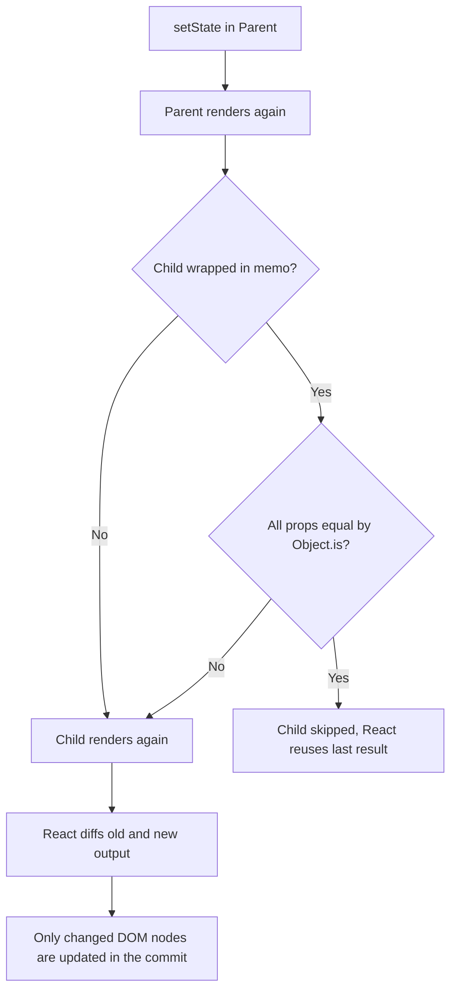
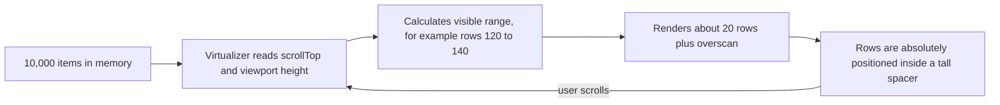
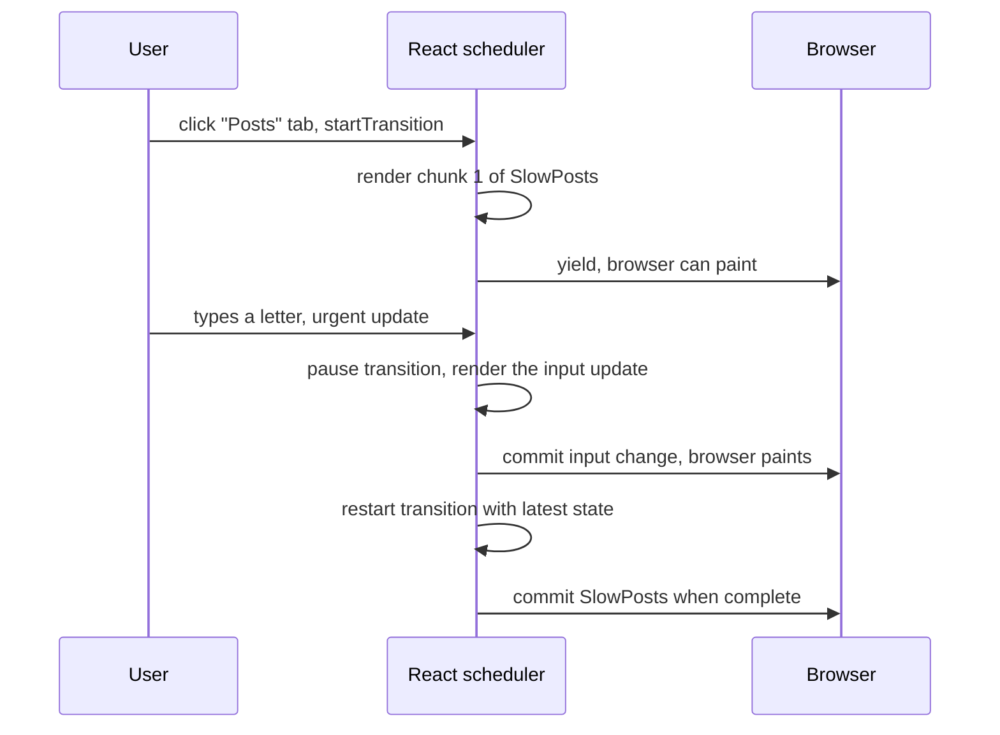

# React Performance Optimization

> In this document you will learn how to find and fix slow React screens: how to measure first, why components re-render, when `React.memo`, `useMemo` and `useCallback` really help (and when they do nothing), how to move state down and lift content up, how to stop context from re-rendering the whole app, how to render 10,000 rows, how to split code with `React.lazy`, how to keep typing smooth with `useTransition` and `useDeferredValue`, and what the React Compiler changes. Most of the document is interview questions with spoken answers and follow-ups.

**Before this:** [Rendering, reconciliation and keys](./02-rendering-reconciliation-and-keys.md) · [Hooks in depth](./03-hooks-in-depth.md) · [Web performance and Core Web Vitals](../05-frontend-engineering/05-web-performance-and-core-web-vitals.md) · **Interview questions:** [jump to the interview section](#interview-questions)

## Table of contents

1. [Concepts](#concepts)
   1. [Measure first](#measure-first)
   2. [Why React screens become slow](#why-react-screens-become-slow)
   3. [A short recap of re-rendering](#a-short-recap-of-re-rendering)
   4. [React.memo](#reactmemo)
   5. [useMemo and useCallback used correctly](#usememo-and-usecallback-used-correctly)
   6. [State colocation: move state down](#state-colocation-move-state-down)
   7. [Lift content up: children as props](#lift-content-up-children-as-props)
   8. [Context performance](#context-performance)
   9. [Large lists and virtualization](#large-lists-and-virtualization)
   10. [Code splitting with React.lazy and Suspense](#code-splitting-with-reactlazy-and-suspense)
   11. [Debouncing input](#debouncing-input)
   12. [useTransition and useDeferredValue for heavy UI](#usetransition-and-usedeferredvalue-for-heavy-ui)
   13. [Images, bundles and bundle analysis](#images-bundles-and-bundle-analysis)
   14. [The React Compiler](#the-react-compiler)
   15. [Common mistakes](#common-mistakes)
2. [Interview questions](#interview-questions)
3. [Quick revision](#quick-revision)
4. [Summary](#summary)
5. [References](#references)

> **Versions.** React 19 is the main target (19.3, released September 2026, is the latest minor at the time of writing; nothing in this document needs more than 19.0 unless marked). React 18 differences are marked **React 18 note**. All render-count answers in this document were checked by running the code with React 19.3, React Testing Library 16 and Vitest 5 in jsdom, **without** Strict Mode (Strict Mode renders twice in development, see [Q26](#q26-does-strict-mode-make-my-app-slower-why-do-my-render-counts-double)).

---

## Concepts

### Measure first

**What:** Before you change any code, find out **what** is slow and **why**. Performance work without measurement is guessing, and guessing usually adds `useMemo` everywhere while the real problem (a 2 MB bundle, a 10,000-row table, a slow API) stays.

**The tools, from most React-specific to most general:**

| Tool | What it tells you |
| --- | --- |
| **React DevTools → Profiler** | Every **commit** (each time React updated the screen), which components rendered in it, how long each took, and (with the setting "Record why each component rendered while profiling") **why** it rendered: "props changed: `onClick`", "hook 2 changed", "parent rendered". |
| **React DevTools → "Highlight updates when components render"** | Flashes a border around components as they re-render. Fast way to see "the whole page flashes when I type". |
| **Chrome DevTools → Performance panel** | Real main-thread time: scripting, layout, paint, long tasks. Since React 19.2 there are **React Performance Tracks** (Scheduler and Components tracks) in this panel, so you see React work next to browser work. |
| **`<Profiler>` component** | The same timing data in code (`onRender` callback), useful for logging in tests or production. |
| **`web-vitals` library / RUM tool** | Real-user **INP**, **LCP**, **CLS**. INP (Interaction to Next Paint) is the metric most affected by slow React renders. |
| **Bundle analyzer** | What is inside your JavaScript bundles and how big each part is. |

General browser performance (Core Web Vitals, long tasks, the Performance panel, lab vs field data) is explained in [Web performance and Core Web Vitals](../05-frontend-engineering/05-web-performance-and-core-web-vitals.md#measuring-with-chrome-devtools). This document focuses on the React side.

**Using the `<Profiler>` API:**

```jsx
import { Profiler } from 'react';

function onRender(id, phase, actualDuration, baseDuration) {
  // phase: "mount" | "update" | "nested-update"
  // actualDuration: ms spent rendering this commit (with memoization)
  // baseDuration:   estimated ms to re-render the whole subtree without memoization
  console.log({ id, phase, actualDuration, baseDuration });
}

export function Dashboard() {
  return (
    <Profiler id="OrdersTable" onRender={onRender}>
      <OrdersTable />
    </Profiler>
  );
}
```

Running this and clicking a button once logs `phase: "mount"` and then `phase: "update"` (checked). Profiling adds overhead, so production builds disable it unless you use the special profiling build (`react-dom/profiling`).

**A good habit:** always profile a **production build** (`npm run build && npm run preview` in Vite). Development React is several times slower because of extra checks and warnings; a component that takes 30 ms in development may take 5 ms in production.

### Why React screens become slow

Almost every React performance problem falls into one of these groups:

| Cause | Typical symptom | Main fix |
| --- | --- | --- |
| **Too many re-renders** (unnecessary renders of big subtrees) | Typing lags, whole page flashes in "Highlight updates" | Move state down, lift content up, `React.memo` with stable props, split context |
| **Expensive render** (one component does heavy work) | Profiler shows one slow bar | `useMemo` for the heavy calculation, move work out of render, Web Worker |
| **Too many DOM nodes** (huge lists, tables) | Slow mount, slow scroll, high memory | Virtualization, pagination |
| **Big JavaScript bundle** | Slow first load, poor LCP/INP on low-end phones | Code splitting, `React.lazy`, removing heavy libraries |
| **Effect chains and waterfalls** | Several renders per change, spinners one after another | Compute during render, fetch in parallel, use a data library |
| **Urgent and non-urgent work mixed** | Input feels stuck while a list updates | `useTransition` / `useDeferredValue`, debouncing |
| **Not React at all** | Slow API, big images, layout thrashing | Network/caching fixes, image optimization, CSS fixes |

### A short recap of re-rendering

The full rules are in [Rendering, reconciliation and keys](./02-rendering-reconciliation-and-keys.md). The parts you need for performance:

1. A component re-renders when **its state changes**, when **its parent re-renders**, or when a **context it reads** changes.
2. Props changing is **not** the trigger. A child re-renders when its parent re-renders, **even if its props are the same** — unless it is wrapped in `React.memo`.
3. A re-render means "React calls your function again and compares the result". It does **not** mean the DOM changes. If the output is the same, React touches no DOM.
4. So a re-render costs the time to run your component function and its children, plus the diff. Usually this is tiny. It becomes a problem when the subtree is large or a component does heavy work.



### React.memo

**What it is:** `memo(Component)` returns a component that **skips re-rendering** when its parent re-renders **and** every prop is equal to last time. Equality is checked **shallowly** with `Object.is` for each prop.

```jsx
import { memo } from 'react';

const ProductRow = memo(function ProductRow({ product, onSelect }) {
  return (
    <li onClick={() => onSelect(product.id)}>
      {product.name} — {product.price}
    </li>
  );
});
```

**How the shallow compare works:**

```js
// Simplified version of what React does for memo
function shallowEqual(prevProps, nextProps) {
  const prevKeys = Object.keys(prevProps);
  if (prevKeys.length !== Object.keys(nextProps).length) return false;
  return prevKeys.every((key) => Object.is(prevProps[key], nextProps[key]));
}
```

`Object.is('a', 'a')` is `true`, `Object.is(5, 5)` is `true`, but `Object.is({}, {})` is `false` and `Object.is(() => {}, () => {})` is `false`. Objects, arrays and functions are compared **by reference**.

**When `memo` fails (the props are "new" on every render):**

```jsx
function Page() {
  const [count, setCount] = useState(0);
  return (
    <>
      <button onClick={() => setCount(count + 1)}>{count}</button>
      {/* All four break memo: a new value is created on every render of Page */}
      <MemoChart options={{ color: 'red' }} />          {/* new object */}
      <MemoChart data={items.filter((i) => i.active)} /> {/* new array */}
      <MemoChart onPointClick={() => {}} />              {/* new function */}
      <MemoCard><span>Hi</span></MemoCard>                {/* children is a new element */}
    </>
  );
}
```

The last one surprises many people: `children` is a prop, and `<span>Hi</span>` creates a **new element object** every render, so a `memo` component that receives JSX children re-renders every time (checked: 2 renders after 1 click).

**Fixes:** move constants outside the component, wrap objects/arrays in `useMemo`, wrap functions in `useCallback`, or (best) restructure so the prop does not change at all.

**Custom compare function:** `memo(Component, arePropsEqual)` lets you decide. Return `true` to **skip** the render. It is easy to get wrong: if you ignore a prop that is used (for example a callback), the component keeps a **stale** version of it. Use it rarely and compare every prop that matters.

> **If you know Angular…** `React.memo` is like `ChangeDetectionStrategy.OnPush`: the component is only checked when its inputs change by reference. In both, mutating an object instead of replacing it breaks the optimization.

### useMemo and useCallback used correctly

- `useMemo(fn, deps)` **caches a value** between renders. It re-runs `fn` only when a dependency changed (`Object.is` per item).
- `useCallback(fn, deps)` **caches a function** between renders. `useCallback(fn, deps)` is the same as `useMemo(() => fn, deps)`.

They have **two** real uses:

1. **Skip an expensive calculation.** "Expensive" means it shows up in the Profiler — as a rule of thumb, over about 1 ms. Filtering 20 items is not expensive; sorting 50,000 rows with a complex comparator is.
2. **Keep a reference stable** so that something that **compares references** can skip work: a `memo` child, a dependency array of `useEffect`/`useMemo`, or a context value.

```jsx
function OrdersPage({ orders, filter }) {
  // 1. Expensive calculation: cached until orders or filter changes
  const visibleOrders = useMemo(
    () => orders.filter((o) => matches(o, filter)).sort(byDate),
    [orders, filter],
  );

  // 2. Stable function for a memo child
  const handleSelect = useCallback((id) => {
    setSelectedId(id);
  }, []);

  return <OrderTable rows={visibleOrders} onSelect={handleSelect} />; // OrderTable is memo
}
```

**When they are useless:**

- `useCallback` on a function passed to a **plain DOM element** (`<button onClick={...}>`) or to a child **not** wrapped in `memo`. Nobody compares the reference, so you pay the cost and get nothing.
- `useMemo` for cheap work (`a + b`, a small `map`). The hook call, the dependency array and the comparison cost more than the work.
- Dependencies that change every render. `useMemo(() => ..., [{ status: 'open' }])` recalculates on every render (checked: 3 renders → 3 calculations), because the inline object is new each time.
- `memo` on a child but an unstable prop anyway (one unmemoized object prop is enough to make the `memo` useless).

> **Note:** `useMemo` is a performance hint, not a guarantee. React may throw away the cache (for example, during development hot reload or for a component that suspends). Your code must still be correct if the function runs again.

### State colocation: move state down

**What:** Keep state **as close as possible** to the components that use it. If state lives high in the tree, every change re-renders everything below it.

```jsx
// Before: typing re-renders BigList on every keystroke
function SearchPage() {
  const [query, setQuery] = useState('');
  return (
    <>
      <input value={query} onChange={(e) => setQuery(e.target.value)} />
      <BigList />  {/* does not even use query */}
    </>
  );
}

// After: the state moved into a small component; BigList is not re-rendered
function SearchBox() {
  const [query, setQuery] = useState('');
  return <input value={query} onChange={(e) => setQuery(e.target.value)} />;
}

function SearchPage() {
  return (
    <>
      <SearchBox />
      <BigList />
    </>
  );
}
```

Checked: after typing two characters, `BigList` rendered **3** times in the first version (mount + 2) and **1** time in the second (mount only). No `memo` was needed.

### Lift content up: children as props

**What:** When a component **must** own state (for example a wrapper that tracks scroll position or a color), pass the expensive part **in as `children`** (or another prop) from above. The wrapper re-renders, but the `children` element was created by the parent, which did **not** re-render, so React sees the **same element object** and skips it.

```jsx
function ColorPicker({ children }) {
  const [color, setColor] = useState('red');
  return (
    <div style={{ color }}>
      <button onClick={() => setColor(color === 'red' ? 'blue' : 'red')}>Toggle</button>
      {children}
    </div>
  );
}

function App() {
  return (
    <ColorPicker>
      <ExpensiveTree />  {/* created by App, which does not re-render */}
    </ColorPicker>
  );
}
```

Checked: clicking "Toggle" twice rendered `ExpensiveTree` only **once** (on mount). This pattern is often the cleanest fix because it needs no memoization at all.

### Context performance

When a context value changes, **every component that reads that context re-renders** — and `memo` does **not** stop it, because context is not a prop.

Three common problems:

1. **A new value object on every render** of the provider: `<Ctx.Provider value={{ user, setUser }}>`. If the provider's parent re-renders for any reason, all consumers re-render even if `user` did not change. **Fix:** `useMemo` the value.
2. **One big context for unrelated data** (user + theme + cart + notifications). A theme change re-renders every component that only needs the user. **Fix:** split into several contexts.
3. **High-frequency values in context** (mouse position, form input, a timer). **Fix:** do not put them in context; use local state, or an external store with **selectors** (Redux, Zustand, or `useSyncExternalStore`), where each component subscribes only to the slice it needs.

```jsx
// Split contexts + memoized values
const UserContext = createContext(null);
const ThemeContext = createContext(null);

function AppProviders({ children }) {
  const [user, setUser] = useState(null);
  const [theme, setTheme] = useState('light');

  const userValue = useMemo(() => ({ user, setUser }), [user]);
  const themeValue = useMemo(() => ({ theme, setTheme }), [theme]);

  return (
    <UserContext value={userValue}>
      <ThemeContext value={themeValue}>{children}</ThemeContext>
    </UserContext>
  );
}
```

> **React 18 note:** `<UserContext value={...}>` (rendering the context directly as a provider) is React 19. In React 18 write `<UserContext.Provider value={...}>`. Both work in 19; `.Provider` will be deprecated later.

Checked: with one combined context, a theme change re-rendered the user-name component (2 renders) even though it was in `memo`; a `memo` component that did not read the context rendered only once. After splitting, the user component rendered **once** and the theme component twice.

More about Context vs Redux vs Zustand is in [State management: Context, Redux Toolkit and Zustand](./05-state-management-context-redux-toolkit-and-zustand.md).

### Large lists and virtualization

**Problem:** Rendering 10,000 rows creates 10,000+ components and maybe 100,000 DOM nodes. Mounting is slow, scrolling is slow, memory is high, and every parent re-render is expensive.

**Virtualization (windowing)** renders only the rows that are **visible** (plus a few extra, called **overscan**), and uses a tall inner element so the scrollbar looks right. When you scroll, the same small set of row components is reused with different data.



**TanStack Virtual** (headless, you render the markup):

```jsx
import { useRef } from 'react';
import { useVirtualizer } from '@tanstack/react-virtual';

function OrdersList({ orders }) {
  const parentRef = useRef(null);

  const virtualizer = useVirtualizer({
    count: orders.length,
    getScrollElement: () => parentRef.current,
    estimateSize: () => 48, // px per row
    overscan: 5,
  });

  return (
    <div ref={parentRef} style={{ height: 600, overflow: 'auto' }}>
      <div style={{ height: virtualizer.getTotalSize(), position: 'relative' }}>
        {virtualizer.getVirtualItems().map((row) => (
          <div
            key={orders[row.index].id}
            style={{
              position: 'absolute',
              top: 0,
              left: 0,
              width: '100%',
              height: row.size,
              transform: `translateY(${row.start}px)`,
            }}
          >
            {orders[row.index].customer} — {orders[row.index].total}
          </div>
        ))}
      </div>
    </div>
  );
}
```

**react-window** (version 2, a ready-made component):

```jsx
import { List } from 'react-window';

function Row({ index, style, orders }) {
  return <div style={style}>{orders[index].customer}</div>;
}

function OrdersList({ orders }) {
  return (
    <List
      rowComponent={Row}
      rowCount={orders.length}
      rowHeight={48}
      rowProps={{ orders }}
      style={{ height: 600 }}
    />
  );
}
```

> **Version note:** react-window 2 (2025) changed the API. Older code (version 1) uses `<FixedSizeList height itemCount itemSize>{Row}</FixedSizeList>` with `data`/`itemData`. Interviewers may show either.

**Trade-offs:** browser "find in page" (Ctrl+F) cannot find rows that are not rendered; screen readers see only part of the list (use correct `aria-rowcount`/`aria-rowindex` for grids); variable row heights need measuring; SEO crawlers do not see off-screen rows. For a few hundred simple rows, virtualization is usually not needed. Pagination or "load more" is a simpler alternative when users do not need to scroll through everything.

### Code splitting with React.lazy and Suspense

**What:** Split the bundle so the browser downloads code **only when it is needed**. `React.lazy` takes a function that returns a dynamic `import()`, and `<Suspense>` shows a fallback while the code loads.

```jsx
import { lazy, Suspense } from 'react';

// The module must have a default export that is a component
const AdminPage = lazy(() => import('./AdminPage'));
const ReportsChart = lazy(() => import('./ReportsChart'));

function App() {
  return (
    <Suspense fallback={<PageSpinner />}>
      <Routes>
        <Route path="/admin" element={<AdminPage />} />
      </Routes>
    </Suspense>
  );
}
```

How it works: the first time `AdminPage` renders, `lazy` starts the `import()`, and the component **suspends** (throws a promise internally). React shows the nearest `<Suspense>` fallback. When the module arrives, React renders the real component. Later renders use the cached module.

Rules and tips:

- Declare `lazy` components at **module top level**, never inside another component (that would create a new lazy component and reset state on every render).
- For a **named export**: `lazy(() => import('./charts').then((m) => ({ default: m.ReportsChart })))`.
- **Route-level** splitting gives the biggest win with the least effort. Next: heavy widgets (charts, rich-text editors, maps) that are below the fold or behind a click.
- **Preload** on intent: call the same `import('./AdminPage')` on `mouseenter` of the link so the code is ready on click.
- Wrap lazy parts in an **error boundary** too: a chunk can fail to load (offline, a new deploy removed old files).

Bundler details (how `import()` creates chunks) are in [Build tools and bundlers](../05-frontend-engineering/10-build-tools-and-bundlers.md#code-splitting-and-dynamic-import). React Router v7 also has route-level `lazy` (see [Routing and forms](./07-routing-and-forms.md)).

### Debouncing input

**Debouncing** waits until the user stops typing for N ms before doing the expensive work (filtering, an API call). **Throttling** runs the work at most once every N ms (good for scroll and resize).

```jsx
import { useEffect, useState } from 'react';

function useDebouncedValue(value, delayMs) {
  const [debounced, setDebounced] = useState(value);
  useEffect(() => {
    const id = setTimeout(() => setDebounced(value), delayMs);
    return () => clearTimeout(id); // the next keystroke cancels the previous timer
  }, [value, delayMs]);
  return debounced;
}

function ProductSearch() {
  const [query, setQuery] = useState('');
  const debouncedQuery = useDebouncedValue(query, 300);
  const { data } = useProductsQuery(debouncedQuery); // API call only after 300 ms pause
  return <input value={query} onChange={(e) => setQuery(e.target.value)} />;
}
```

The input stays **controlled by the fast state** (`query`) so typing is instant; only the expensive part uses the slow value.

### useTransition and useDeferredValue for heavy UI

React 18 introduced **concurrent rendering**: React can prepare a render in the background, **pause** it to handle more urgent work (like a keystroke), and **throw it away** if newer data arrives. You opt in by marking updates as **non-urgent**. The details of concurrent features are in [React 18 and 19 features](./04-react-18-and-19-concurrent-features-and-server-components.md); here is how they help performance.

- `useTransition` → `const [isPending, startTransition] = useTransition()`. Wrap a **state update** in `startTransition` to mark it as non-urgent. Use it when **you own the setter**.
- `useDeferredValue(value)` → returns a copy of the value that "lags behind" during heavy renders. Use it when you **receive a value** (for example a prop) and cannot wrap its setter.

```jsx
import { useState, useDeferredValue, memo } from 'react';

function SearchPage({ allProducts }) {
  const [query, setQuery] = useState('');
  const deferredQuery = useDeferredValue(query);
  const isStale = query !== deferredQuery;

  return (
    <>
      <input value={query} onChange={(e) => setQuery(e.target.value)} />
      <div style={{ opacity: isStale ? 0.6 : 1 }}>
        {/* memo is required: otherwise SlowResults re-renders with every keystroke anyway */}
        <SlowResults query={deferredQuery} items={allProducts} />
      </div>
    </>
  );
}

const SlowResults = memo(function SlowResults({ query, items }) {
  const filtered = items.filter((p) => p.name.toLowerCase().includes(query.toLowerCase()));
  return filtered.map((p) => <ProductCard key={p.id} product={p} />);
});
```

What happens on a keystroke: React first renders urgently with the **new** `query` and the **old** `deferredQuery` (so `SlowResults` is skipped by `memo` and the input updates immediately). Then it starts a background render with the new `deferredQuery`. If you type again before it finishes, React abandons that render and starts again with the newest value.

**Debounce vs transition:** debouncing always waits a fixed time, even on a fast laptop, and is the right tool to **reduce network requests**. Transitions do not wait: on a fast device the result appears almost instantly; on a slow device React keeps input responsive. For CPU-heavy rendering, prefer transitions; for API calls, debounce (or both).

### Images, bundles and bundle analysis

- **Images** are usually the LCP element. In React: give images `width`/`height` (prevents CLS), use `loading="lazy"` for below-the-fold images and `fetchPriority="high"` for the hero image, serve modern formats (AVIF/WebP) and responsive `srcSet`. React 19 also supports `preload()` / `preinit()` from `react-dom` for resource hints. General rules: [Web performance — Loading performance](../05-frontend-engineering/05-web-performance-and-core-web-vitals.md#loading-performance).
- **Bundle analysis:** `rollup-plugin-visualizer` (Vite), `webpack-bundle-analyzer`, `source-map-explorer`, or the Next.js bundle analyzer. Look for: one huge vendor chunk, duplicated libraries (two versions of the same package), whole-library imports (`import _ from 'lodash'`, all of `moment` locales, all icons), and code that is only used on one route but sits in the main bundle.
- **Fixes:** import only what you use (`import debounce from 'lodash/debounce'`), replace heavy libraries (`date-fns`/`Intl` instead of `moment`), lazy-load rarely used features, check tree shaking works (ES modules, `sideEffects` field). See [Build tools — Tree shaking](../05-frontend-engineering/10-build-tools-and-bundlers.md#tree-shaking).

### The React Compiler

**What:** The **React Compiler** (version 1.0, October 2025) is a build-time tool (a Babel plugin, `babel-plugin-react-compiler`, with integrations for Vite, Next.js, Expo and others) that **automatically memoizes** components and hooks. It analyzes your code and inserts caching so that values, functions and JSX elements are reused when their inputs did not change — roughly as if you had written `useMemo`, `useCallback` and `memo` everywhere it is safe, but more precisely (it can even memoize after an early return, which hooks cannot).

```jsx
// You write this:
function TodoList({ todos, filter }) {
  const visible = todos.filter((t) => t.status === filter);
  const handleClick = (id) => toggle(id);
  return visible.map((t) => <Todo key={t.id} todo={t} onClick={handleClick} />);
}
// The compiler output caches `visible`, `handleClick` and the JSX,
// and recalculates them only when `todos` or `filter` change.
```

Key facts for interviews:

- It works with React 19 directly, and with React 17/18 using the `react-compiler-runtime` package.
- It **relies on the Rules of React** (pure render, no mutation of props/state, rules of hooks). Code that breaks the rules is **skipped** (not compiled), not broken. The ESLint rules in `eslint-plugin-react-hooks` (recommended preset) report these problems.
- You can opt a component out with the `"use no memo"` directive at the top of the function.
- It does **not** fix: huge lists (still virtualize), big bundles (still split), slow network, or expensive work that runs anyway when inputs change. It also does not replace **state colocation** — the clean structure is still the best fix.
- With the compiler, most manual `useMemo`/`useCallback`/`memo` become unnecessary in new code. Keep existing ones until you have tested; manual memoization can still be used as an "escape hatch", for example to control exactly when an effect dependency changes.
- Next.js 16 has stable support (`reactCompiler: true` in `next.config`), not enabled by default.

### Common mistakes

- Optimizing without measuring, or measuring in development mode.
- Wrapping every component in `memo` and every function in `useCallback` "just in case" — more code, more memory, more bugs (stale closures), little gain.
- `memo` on a child while passing a new object, array, function or JSX children to it.
- Using an index as `key` in a list that can be reordered — causes wrong state **and** extra DOM work (see [Rendering, reconciliation and keys](./02-rendering-reconciliation-and-keys.md)).
- Storing **derived data** in state and syncing it with `useEffect` — every change causes an extra render (checked: 2 renders instead of 1). Compute it during render instead.
- Putting fast-changing values (input text, mouse position) in a global context or store that many components read.
- Defining a component **inside** another component: it is a new component type on each render, so React unmounts and remounts it (state is lost, and it is slow).
- Creating `lazy()` components inside a component body.
- Trying to make every render "zero"; a few cheap re-renders are fine.

---

## Interview questions


### Q1. A React page is slow. How do you approach the problem?

**What the interviewer is checking:** Do you measure before changing code, and do you have a systematic process instead of "add `useMemo`"?

**What to say (30–60 seconds):**

> "First I reproduce it and measure, because the cause decides the fix. I use a production build, then the React DevTools Profiler to record the slow interaction: it shows each commit, which components rendered, how long they took and why they rendered. I also look at the Chrome Performance panel for long tasks, and at real-user INP if we collect it. Then I classify the problem: too many re-renders, one expensive component, too many DOM nodes, a big bundle, or something outside React like a slow API. For re-renders I first try structural fixes — moving state down or passing children — and only then `memo` and `useCallback`. For big lists I virtualize; for bundles I code-split. After the fix I measure again to prove it helped."

**Deeper explanation:**

A practical step-by-step process:

1. **Reproduce** on a realistic device (use CPU throttling 4× or 6× in DevTools) and with a realistic amount of data.
2. **Profile** the exact interaction (React Profiler + Performance panel).
3. **Find the biggest cost.** In the Profiler's "Ranked" view, the slowest components are at the top. In the flame graph, gray bars did not render; colored bars did.
4. **Ask "why did it render?"** (enable "Record why each component rendered while profiling" in the Profiler settings).
5. **Fix the biggest cause first**, one change at a time.
6. **Measure again** and keep the before/after numbers — useful for the team and for your interview story.

**Follow-up questions and how to answer them:**

- **"Why profile a production build?"** — Development React does extra work: warnings, checks, Strict Mode double rendering, and no minification. Timings can be several times slower and misleading. Use `vite build && vite preview` or `next build && next start`; for React timings in production, use the profiling build.
- **"What if the Profiler shows nothing slow, but the page still feels slow?"** — Then the problem is probably not React rendering: check the network (waterfalls, slow APIs), big images, layout and paint in the Performance panel, third-party scripts, or main-thread work outside React (heavy JSON parsing, analytics).
- **"How do you know your fix worked in production?"** — Track real-user metrics (INP, LCP) with the `web-vitals` library or a RUM tool, and compare before and after the release. Lab numbers on your laptop are not enough.

**Common mistakes / weak answers:** "I wrap components in `React.memo` and use `useCallback`" as the first answer — it shows you optimize blindly. Not mentioning measurement at all. Measuring only on a fast developer laptop.

**Real-project example:** On an orders dashboard, the Profiler showed that every filter change re-rendered a 2,000-row table; moving the filter state into the filter panel and virtualizing the table cut the interaction from about 400 ms to under 50 ms.

### Q2. How do you use the React DevTools Profiler? What does it show?

**What the interviewer is checking:** Practical, hands-on experience with the main React performance tool.

**What to say (30–60 seconds):**

> "In the Profiler tab I press record, do the slow interaction, and stop. At the top I see a bar for every commit — every time React updated the DOM. For each commit there's a flame graph, where colored bars are components that rendered and gray ones didn't, and the bar width shows render time. The ranked chart sorts components by time. I turn on 'Record why each component rendered', so clicking a component tells me 'props changed: onSelect', 'parent rendered' or 'hook changed'. I also use 'Highlight updates when components render' to see visually what re-renders while I type."

**Deeper explanation:**

- **Commit chart** (top right): many tall bars for one keystroke means many or slow commits.
- **Flame graph:** the tree of one commit. Yellow/orange means slower, blue/green faster, gray means it did not render in this commit.
- **Ranked chart:** components sorted by their own render time — where to look first.
- **Component details:** render duration, how many times it rendered during the recording, and the reason.
- **Performance tracks:** React 19.2 added React-specific tracks to the Chrome Performance panel (Scheduler and Components), so you can see transitions, blocking updates and component render time on the same timeline as browser work.

**Follow-up questions and how to answer them:**

- **"The Profiler says 'The parent component rendered'. What does that mean?"** — The component's own props and state did not change; it rendered only because its parent rendered. That is the typical candidate for `memo`, for lifting content up, or for moving state down in the parent.
- **"It says 'props changed: onClick', but the function does the same thing."** — A new function was created in the parent's render, so the reference changed. If the child is `memo`, wrap the function in `useCallback` (or let the React Compiler do it); if the child is not `memo`, the reference does not matter.
- **"Can you profile in production?"** — Yes, with the profiling build of React DOM (`react-dom/profiling`, configured as an alias in the bundler). It has a small overhead, so teams usually use it on a staging environment.

**Common mistakes / weak answers:** Only knowing `console.log` counts. Confusing "rendered" in the Profiler with "the DOM changed".

**Real-project example:** "Highlight updates" showed the whole sidebar flashing on every chat message; the cause was a context value created inline in the chat provider.

### Q3. Is a re-render bad? What is the difference between re-rendering and updating the DOM?

**What the interviewer is checking:** You understand that re-renders are normal and usually cheap.

**What to say (30–60 seconds):**

> "A re-render just means React calls the component function again to get a new description of the UI, then compares it with the previous one. Only the differences are applied to the DOM in the commit phase. So a re-render isn't bad by itself — it's how React works — and most re-renders cost microseconds. It becomes a problem when a re-render is expensive: a big subtree, a heavy calculation, or a very frequent update like typing or scrolling. So I don't try to remove every re-render; I remove the ones that are measurably slow."

**Deeper explanation:**

Rendering = running component functions + reconciliation (diffing). Committing = DOM changes, then layout effects, then the browser paints. A component can render 100 times while the DOM never changes, because the output is identical:

```jsx
function Clock() {
  const [, setTick] = useState(0);
  useEffect(() => {
    const id = setInterval(() => setTick((t) => t + 1), 1000);
    return () => clearInterval(id);
  }, []);
  return <h1>Hello</h1>; // renders every second, but the DOM never changes
}
```

**Follow-up questions and how to answer them:**

- **"When does a re-render become a real problem?"** — When the render work in one interaction is long enough to delay the next paint (users notice above roughly 50–100 ms, and a "good" INP is 200 ms or less for the whole interaction), or when it happens at high frequency (every keystroke, every scroll frame, every WebSocket message).
- **"Does React re-render if I set state to the same value?"** — If the new value is `Object.is`-equal to the current one, React bails out and does not re-render the children. In some cases React may call the component one more time before bailing out, but it will not commit. Checked: setting the same number twice caused no extra render.

**Common mistakes / weak answers:** "Re-renders are always bad", or "a re-render rebuilds the whole DOM".

**Real-project example:** A team spent days adding `memo` to small buttons; the real problem was one chart component taking 300 ms per render.

### Q4. What causes unnecessary re-renders in React?

**What the interviewer is checking:** You can list the real triggers and the usual mistakes.

**What to say (30–60 seconds):**

> "A component re-renders when its state changes, when its parent re-renders, or when a context it reads changes. Unnecessary re-renders usually have five causes. One: state that lives too high in the tree, so a small change re-renders a big subtree. Two: a context whose value object is recreated each time, or that mixes unrelated data. Three: new object, array or function props that break `memo`. Four: derived data stored in state and synced with effects, which adds extra renders. Five: store selectors that return too much. Defining a component inside another component is even worse: it remounts every time."

**Deeper explanation:** See [Why React screens become slow](#why-react-screens-become-slow) and [Context performance](#context-performance). Two less known causes:

```jsx
// 1. A selector that returns a new object on every call
const { items, total } = useSelector((s) => ({ items: s.cart.items, total: s.cart.total }));
// New object every time -> re-render on every store update.
// Fix: select separately, or use shallowEqual / createSelector.

// 2. A component defined inside a component
function Page({ items }) {
  function Row({ item }) { return <li>{item.name}</li>; } // a new component type every render!
  return <ul>{items.map((i) => <Row key={i.id} item={i} />)}</ul>; // rows unmount and mount again
}
```

**Follow-up questions and how to answer them:**

- **"Do props changing cause a re-render?"** — Not by themselves. A child gets new props only because its parent rendered, and the parent rendering is what re-renders the child. `memo` is what makes props matter: then the child re-renders only if a prop changed.
- **"How do Redux and Zustand avoid unnecessary renders?"** — Components subscribe with a **selector**. After each store update the selector runs, and the component re-renders only if the selected value changed (by `===` by default in React-Redux, or a custom equality function). That is why selecting small, primitive values is efficient.

**Common mistakes / weak answers:** Saying "when props change" as the main trigger. Forgetting context.

**Real-project example:** A `useSelector((s) => s.user)` re-rendered the header every 10 seconds because a profile poll replaced the user object; selecting `s.user.name` fixed it.

### Q5. What does React.memo do, and how does it compare props?

**What the interviewer is checking:** Precise knowledge of shallow comparison.

**What to say (30–60 seconds):**

> "`React.memo` wraps a component so that, when its parent re-renders, React first compares the new props with the old ones. If every prop is the same by `Object.is` — a shallow comparison — it skips rendering and reuses the last result. Primitives compare by value, but objects, arrays and functions compare by reference, so a new object with the same content counts as changed. `memo` doesn't stop re-renders caused by the component's own state or by a context it reads. There's an optional second argument, a custom comparison function, but that's rarely a good idea."

**Deeper explanation:** See [React.memo](#reactmemo). Also:

- `memo` only affects re-renders **caused by the parent**.
- It is not free: React keeps the previous props and compares them on every parent render.
- With the React Compiler, most manual `memo` becomes unnecessary because the compiler keeps the JSX element itself stable when its inputs did not change.

**Follow-up questions and how to answer them:**

- **"What's the difference between `memo` and `useMemo`?"** — `memo` wraps a **component** and skips its render based on props. `useMemo` is a hook inside a component that caches a **value**. They often work together: `useMemo` keeps a prop stable so that `memo` can work.
- **"Why not wrap every component in `memo` by default?"** — If the props change most of the time anyway, the comparison is wasted work. It also adds noise and forces you to stabilize every prop with `useCallback`/`useMemo`, which spreads dependency arrays (and stale-closure bugs) through the code. Use it where the Profiler shows an expensive component re-rendering with the same props.
- **"How did class components do this?"** — With `PureComponent` (shallow compare of props and state) or `shouldComponentUpdate(nextProps, nextState)`. Note the opposite meaning: `shouldComponentUpdate` returns `true` to **render**, while the `memo` comparison function returns `true` to **skip**.

**Common mistakes / weak answers:** "`memo` does a deep comparison." "`memo` stops all re-renders." Mixing up `memo` and `useMemo`.

**Real-project example:** In a data grid, wrapping `Row` in `memo` and stabilizing `onSelect` with `useCallback` meant that selecting one row re-rendered 1 row instead of 500.

### Q6. Output question: how many times does each child render?

**What the interviewer is checking:** Can you apply shallow comparison precisely?

```jsx
const Plain = () => { console.log('Plain'); return null; };
const Memo = memo(() => { console.log('Memo'); return null; });
const MemoObj = memo(({ style }) => { console.log('MemoObj'); return null; });
const MemoFn = memo(({ onClick }) => { console.log('MemoFn'); return null; });
const MemoCb = memo(({ onClick }) => { console.log('MemoCb'); return null; });

function App() {
  const [n, setN] = useState(0);
  const cb = useCallback(() => {}, []);
  return (
    <>
      <button onClick={() => setN(n + 1)}>inc</button>
      <Plain />
      <Memo />
      <MemoObj style={{ color: 'red' }} />
      <MemoFn onClick={() => {}} />
      <MemoCb onClick={cb} />
    </>
  );
}
// The user clicks "inc" two times. How many renders does each child have in total?
```

**What to say (30–60 seconds):**

> "Counting the mount: `Plain` renders 3 times — it has no `memo`, so it follows the parent. `Memo` renders once, because it has no props, so the comparison always passes. `MemoObj` renders 3 times, because `{ color: 'red' }` is a new object on each render. `MemoFn` renders 3 times for the same reason with an inline arrow function. `MemoCb` renders once, because `useCallback` with an empty dependency array returns the same function every time."

**Deeper explanation:** Checked by running: `{ Plain: 3, Memo: 1, MemoObj: 3, MemoFn: 3, MemoCb: 1 }`. To fix `MemoObj`, move the object outside the component (`const redStyle = { color: 'red' }`) or use `useMemo`.

**Follow-up questions and how to answer them:**

- **"And in Strict Mode, in development?"** — Every component function is called twice per render, so the logs double (6, 2, 6, 6, 2). Strict Mode does not change the number of commits. See [Q26](#q26-does-strict-mode-make-my-app-slower-why-do-my-render-counts-double).
- **"What if `MemoCb` used `useCallback(() => {}, [n])`?"** — The function would change every time `n` changes, so it would render 3 times like `MemoFn`.

**Common mistakes / weak answers:** Saying `MemoObj` renders once "because the style is the same". Forgetting to count the mount.

**Real-project example:** Inline `style={{...}}` props on a `memo` list item silently disabled the optimization in a product grid.

### Q7. Find the bug: why does React.memo not help here?

**What the interviewer is checking:** You can spot less obvious memo-breakers, especially `children`.

```jsx
const Card = memo(function Card({ title, children }) {
  console.log('Card render');
  return (
    <section>
      <h2>{title}</h2>
      {children}
    </section>
  );
});

function Dashboard() {
  const [tick, setTick] = useState(0);
  useInterval(() => setTick((t) => t + 1), 1000);
  return (
    <Card title="Sales">
      <SalesSummary />
    </Card>
  );
}
```

**What to say (30–60 seconds):**

> "`Card` is in `memo`, but it still renders every second. The reason is `children`: JSX like `<SalesSummary />` creates a new element object on every render of `Dashboard`, and children is just a prop, so the shallow comparison sees a new value. The best fix is to remove the reason `Dashboard` re-renders — move the tick state into the component that needs it. Another option is to memoize the children element with `useMemo`."

**Deeper explanation:** Checked: a `memo` component receiving `<span>Hi</span>` as children rendered 2 times after 1 parent update. Fixes:

```jsx
// Option 1: move the frequently changing state down
function Dashboard() {
  return (
    <>
      <LiveClock /> {/* owns the tick state */}
      <Card title="Sales"><SalesSummary /></Card>
    </>
  );
}

// Option 2: memoize the element
function Dashboard() {
  const [tick, setTick] = useState(0);
  const summary = useMemo(() => <SalesSummary />, []);
  return <Card title="Sales">{summary}</Card>;
}
```

**Follow-up questions and how to answer them:**

- **"Will `SalesSummary` also re-render in the original code?"** — Yes. `Card` renders its `children`, which is a new `<SalesSummary />` element, so `SalesSummary` renders too (unless it is `memo` itself).
- **"Children as props is a fix in one place and a problem in another. Why?"** — Children help when the component that **creates** them does not re-render (lifting content up). They break `memo` when the component that creates them **does** re-render. It depends on where the state lives.

**Common mistakes / weak answers:** Blaming `title` (a string, so it is stable). Saying "memo is broken".

**Real-project example:** A layout `Panel` in `memo` re-rendered on every WebSocket message until the live data moved into its own small component.

### Q8. When should you use useMemo and useCallback, and when are they useless?

**What the interviewer is checking:** Mature judgment, not "always" or "never".

**What to say (30–60 seconds):**

> "`useMemo` caches a value and `useCallback` caches a function between renders. I use them for two reasons: to skip a calculation that's measurably expensive, and to keep a reference stable when something compares references — a `memo` child, an effect's dependency array, or a context value. They're useless when the function goes to a plain DOM element or a non-memo child, when the calculation is cheap, or when the dependencies change on every render anyway. They also cost something: the comparison and extra code. And with the React Compiler most of this is automatic."

**Deeper explanation:** See [useMemo and useCallback used correctly](#usememo-and-usecallback-used-correctly). A useless and a useful case:

```jsx
// Useless: <button> is a DOM element; nobody compares this function
const handleClick = useCallback(() => setOpen(true), []);
return <button onClick={handleClick}>Open</button>;

// Useful: an effect depends on the function; without useCallback it would re-subscribe on every render
const handleMessage = useCallback((msg) => {
  if (msg.roomId === roomId) addMessage(msg);
}, [roomId]);
useEffect(() => socket.subscribe(handleMessage), [handleMessage]); // subscribe returns an unsubscribe function
```

**Follow-up questions and how to answer them:**

- **"How do you decide a calculation is expensive?"** — Measure it: `console.time('filter')` / `console.timeEnd('filter')` with realistic data and CPU throttling, or the Profiler. React's documentation suggests that around 1 ms or more is worth memoizing.
- **"Does `useCallback` prevent the function from being created?"** — No. The inline function is still created on every render. `useCallback` only returns the previous function when the dependencies are equal, so the **reference** stays the same.
- **"Can `useMemo` stop an effect from re-running?"** — Yes, if the effect depends on an object built during render, `useMemo` keeps it stable. Often a better fix is to depend on primitive values (`[filter.status]`) or to create the object inside the effect.
- **"Is there a better tool than `useCallback` for functions used inside effects?"** — `useEffectEvent` (stable in React 19.2) lets an effect call the latest version of a function without listing it as a dependency. That removes many `useCallback` + dependency problems.

**Common mistakes / weak answers:** "I wrap every function in `useCallback` for performance." Thinking `useCallback` makes the function itself run faster.

**Real-project example:** Removing about 200 unnecessary `useCallback` calls made a code base easier to read with no measurable performance change; the 5 that mattered were for `memo` rows and effect dependencies.

### Q9. Find the bug: a memoized callback sends old data

**What the interviewer is checking:** Stale closures caused by memoization with wrong dependencies.

```jsx
function Chat({ roomId }) {
  const [draft, setDraft] = useState('');

  const send = useCallback(() => {
    api.sendMessage(roomId, draft);
    setDraft('');
  }, []); // dependencies "optimized" away

  return (
    <>
      <input value={draft} onChange={(e) => setDraft(e.target.value)} />
      <SendButton onSend={send} /> {/* memo */}
    </>
  );
}
```

**What to say (30–60 seconds):**

> "The `useCallback` has an empty dependency array, so `send` is created only on the first render. It captures the first `roomId` and the first `draft`, which is an empty string, so every click sends an empty message to the first room. That's a stale closure. The fix is to list the real dependencies, `[roomId, draft]`. Then the function changes when the draft changes, so `SendButton` re-renders while typing — but that's correct and cheap. If I really need a stable function, I can read the latest values from a ref."

**Deeper explanation:** Memoization never makes code more correct; it only reuses an old value. The `react-hooks/exhaustive-deps` lint rule flags this bug. Closures are explained in [Closures](../02-javascript/05-closures.md), and stale closures in hooks in [Hooks in depth](./03-hooks-in-depth.md).

**Follow-up questions and how to answer them:**

- **"How would you keep `send` stable and still correct?"** — Keep the latest values in a ref (`draftRef.current = draft` in an effect) and read `draftRef.current` inside `useCallback(..., [])`. This "latest ref" pattern works but is easy to misuse; prefer correct dependencies unless profiling shows a problem.
- **"Would the React Compiler produce this bug?"** — No. The compiler works out the dependencies from the code itself, so it would include `roomId` and `draft`.

**Common mistakes / weak answers:** Disabling the lint rule. Saying "the input does not update" (it does; only the callback is stale).

**Real-project example:** A "Save" button saved the form's initial values because someone removed dependencies from `useCallback` to stop a child re-render.

### Q10. What does the second argument of React.memo do? When is it dangerous?

**What the interviewer is checking:** Awareness of custom comparison and its risks.

**What to say (30–60 seconds):**

> "`memo` accepts a second argument, `arePropsEqual(prevProps, nextProps)`. If it returns true, React skips the render. It's useful when shallow comparison isn't good enough — for example when the API recreates an item object on every poll, but only `id` and `updatedAt` matter. It's dangerous because if you ignore a prop that's actually used, like a callback or a field you forgot, the component shows stale data or calls an old function. Deep equality can also be slower than re-rendering. So I prefer to fix references at the source, and use a comparator only with a clear reason."

**Deeper explanation:**

```jsx
const OrderRow = memo(
  function OrderRow({ order, onSelect }) { /* ... */ },
  (prev, next) =>
    prev.order.id === next.order.id &&
    prev.order.updatedAt === next.order.updatedAt &&
    prev.onSelect === next.onSelect, // do not forget functions
);
```

Checked: a comparator that compared only `item.id` kept a row from re-rendering even though another field of `item` changed — exactly the stale-data risk.

**Follow-up questions and how to answer them:**

- **"Why not use `JSON.stringify` or lodash `isEqual`?"** — Deep comparison costs time on every parent render, can be slower than rendering, does not handle functions, and hides the real problem (unstable references). It is acceptable only for small props.
- **"What is a better alternative?"** — Keep references stable at the data layer. For example, TanStack Query's structural sharing keeps unchanged objects as the same reference across refetches, so plain `memo` works.

**Common mistakes / weak answers:** Returning `true` to mean "re-render" (that is `shouldComponentUpdate`; `memo` is the opposite).

**Real-project example:** A comparator that ignored `onSelect` made a list call a handler that still used the previous page's filters.

### Q11. What is state colocation? Show how it improves performance.

**What the interviewer is checking:** You know the cheapest and cleanest optimization.

**What to say (30–60 seconds):**

> "State colocation means keeping state as close as possible to where it's used. If state lives high up, every change re-renders the whole subtree below it. For example, if a search input's text lives in the page component, every keystroke re-renders the big list next to it. If I move the input and its state into a small `SearchBox` component, only `SearchBox` re-renders, and no `memo` is needed. It also makes the code easier to follow. Lifting state up is right only when siblings really need to share it."

**Deeper explanation:** See [State colocation: move state down](#state-colocation-move-state-down). Checked: `BigList` rendered 3 times before and 1 time after.

When the list **does** need the query (it filters by it), you cannot move the state fully down. Then keep the input fast and pass a **debounced** or **deferred** value to the list, with the list in `memo`.

**Follow-up questions and how to answer them:**

- **"Isn't this the opposite of 'lifting state up'?"** — Both put state in the **right** place: the lowest common owner of all components that need it. Lift up when siblings share data; move down when only one part uses it.
- **"What about state in a big form?"** — Use uncontrolled inputs or a form library like React Hook Form, which keeps values outside React state and re-renders only what needs to update (see [Routing and forms](./07-routing-and-forms.md)).

**Common mistakes / weak answers:** Putting all state in Redux or a top-level context "to be safe".

**Real-project example:** Moving a dialog's `isOpen` state from the app root into the toolbar stopped the entire app from re-rendering whenever the dialog opened.

### Q12. Explain the "children as props" (lift content up) pattern.

**What the interviewer is checking:** Understanding of element identity in reconciliation.

**What to say (30–60 seconds):**

> "If a component has to own frequently changing state, like a scroll tracker or an animated wrapper, I pass the expensive content into it as `children` from the parent. When the wrapper's state changes, the wrapper re-renders, but the `children` element was created by the parent, which didn't re-render, so it's the same object as last time. React sees the same element and skips that subtree. It's a structural fix, so no `memo` or `useCallback` is needed."

**Deeper explanation:** See [Lift content up: children as props](#lift-content-up-children-as-props). Checked: `ExpensiveTree` rendered once after two toggles. The same works with any prop that carries JSX (`header={<Header />}`, also called "slots").

```jsx
function ScrollShadow({ children }) {
  const [scrolled, setScrolled] = useState(false); // changes often
  return (
    <div
      onScroll={(e) => setScrolled(e.currentTarget.scrollTop > 0)}
      className={scrolled ? 'shadow' : ''}
    >
      {children} {/* the same element each time -> not re-rendered */}
    </div>
  );
}
```

**Follow-up questions and how to answer them:**

- **"Why does React skip the children if they are not in `memo`?"** — During reconciliation, if the new element is the **exact same object** (`===`) as the old one, its props cannot have changed, so React bails out of that subtree. `memo` is another way to reach the same "props are the same" decision.
- **"When does this pattern stop working?"** — When the children need the wrapper's state. Then they must re-render; use a render prop or context and `memo` the parts that do not use the state.

**Common mistakes / weak answers:** Thinking that `children` always re-render together with the wrapper.

**Real-project example:** A theme-animation wrapper at the root re-rendered the whole app on every animation frame; turning it into a `children` wrapper fixed it.

### Q13. Scenario: "Our context causes the whole app to re-render." What do you do?

**What the interviewer is checking:** Real knowledge of context limits and a step-by-step fix.

**What to say (30–60 seconds):**

> "First I confirm it in the Profiler and check which context changes. Then I look at three things. One: is the provider value a new object on every render? Then I wrap it in `useMemo` so consumers only re-render when the data really changes. Two: is one context holding unrelated data, like user, theme and cart together? Then I split it, so a theme change only re-renders theme consumers. I can also split state and setters into two contexts, because many components only need the setter. Three: is it high-frequency data? Context isn't a good fit for that, because every consumer re-renders and `memo` can't stop it — I move it to local state or to a store with selectors like Zustand or Redux."

**Deeper explanation:** See [Context performance](#context-performance). The state/dispatch split is a common trick:

```jsx
const CartStateContext = createContext(null);
const CartDispatchContext = createContext(null);

function CartProvider({ children }) {
  const [cart, dispatch] = useReducer(cartReducer, initialCart);
  return (
    <CartDispatchContext value={dispatch}>   {/* dispatch never changes */}
      <CartStateContext value={cart}>{children}</CartStateContext>
    </CartDispatchContext>
  );
}

// An "Add to cart" button only needs dispatch -> it does not re-render when the cart changes
function AddToCartButton({ id }) {
  const dispatch = useContext(CartDispatchContext);
  return <button onClick={() => dispatch({ type: 'add', id })}>Add</button>;
}
```

Checked in a test: with one combined context, a `memo` component that read only `user` still re-rendered on a theme change; after splitting, it did not.

**Follow-up questions and how to answer them:**

- **"Why doesn't `React.memo` stop a context re-render?"** — `memo` only compares props. Context is a separate subscription: when the provider's value changes (by `Object.is`), React finds all components that read that context and schedules them to render, even inside `memo` parents.
- **"Can a component subscribe to only part of a context?"** — Not with built-in `useContext`. Options: split the context, use the `use-context-selector` library, or put the data in an external store and read it with `useSyncExternalStore` and a selector — which is what Zustand and React-Redux do internally.
- **"If I know Angular, how does this compare?"** — Angular's DI service with a `BehaviorSubject` or signal lets each component subscribe to exactly what it needs, similar to a store with selectors. React Context is closer to "inject a value and re-render all readers when it changes".
- **"How many contexts is too many?"** — Nesting 5–10 providers is normal (theme, auth, i18n, query client, router). If you have dozens of tiny contexts that depend on each other, you are building a store by hand; use a real one.
- **"Is context bad for performance?"** — No. It is great for values that change rarely: theme, locale, the current user, feature flags, a service instance. The problems come from using it as a high-frequency global state store.

**Common mistakes / weak answers:** "Wrap consumers in `memo`" (does not help). "Never use context." Not mentioning the inline value object.

**Real-project example:** An `AppContext` with user, theme, notifications and a live unread counter re-rendered 300 components on every new notification; splitting out the counter into a small Zustand store fixed it.

### Q14. Output question: which components re-render when the theme changes?

**What the interviewer is checking:** Precise reasoning about context and `memo` together.

```jsx
const AppContext = createContext(null);

const UserName = memo(() => { const { user } = useContext(AppContext); console.log('UserName'); return <span>{user}</span>; });
const ThemeButton = memo(() => {
  const { theme, setTheme } = useContext(AppContext);
  console.log('ThemeButton');
  return <button onClick={() => setTheme(theme === 'light' ? 'dark' : 'light')}>Theme</button>;
});
const Footer = memo(() => { console.log('Footer'); return null; });

function Provider({ children }) {
  const [theme, setTheme] = useState('light');
  const value = { user: 'Ann', theme, setTheme };
  return <AppContext value={value}>{children}</AppContext>;
}

// <Provider><UserName /><ThemeButton /><Footer /></Provider>
// The user clicks "Theme" once. What is logged after the click?
```

**What to say (30–60 seconds):**

> "After the click, `Provider` re-renders with a new `value` object. `UserName` and `ThemeButton` both read the context, so both re-render — `memo` doesn't help, and `UserName` re-renders even though `user` didn't change, because it reads the whole object. `Footer` does not re-render: it doesn't read the context, and its element came from the parent of `Provider` as children, which didn't re-render. So the log is `UserName` and `ThemeButton`."

**Deeper explanation:** Checked: counts after the click were `{ user: 2, theme: 2, nonConsumer: 1 }` (including the mount). With split contexts and memoized values the user component stayed at 1.

**Follow-up questions and how to answer them:**

- **"Would `Footer` re-render if it was not in `memo`?"** — No, in this code, because `Footer` is passed as `children` to `Provider` — the lift-content-up effect. It would re-render if `Provider` created `<Footer />` itself inside its own JSX.
- **"How would you make `UserName` not re-render?"** — Put `user` in its own context (or a memoized value that does not include `theme`).

**Common mistakes / weak answers:** Saying `memo` stops `UserName`. Saying `Footer` re-renders "because everything under a provider re-renders".

**Real-project example:** This exact pattern — one "app context" — is the most common cause of whole-app re-renders found in code reviews.

### Q15. Scenario: typing in a search input lags. Walk me through your fix.

**What the interviewer is checking:** A full, ordered troubleshooting process for the most common React performance scenario.

**What to say (30–60 seconds):**

> "Typing lags when each keystroke triggers too much render work before the browser can paint the new character. I'd profile one keystroke to see what renders. Step one: is the input state too high? If the input's state lives in a page component, I move it down so only the input re-renders. Step two: if the results really depend on the query, I separate urgent from non-urgent work: the input stays controlled by fast state, and the heavy list gets a deferred value with `useDeferredValue` plus `memo` on the list, or I wrap the filter update in `startTransition`. Step three: if each keystroke calls an API, I debounce it. Step four: if the list itself is huge, I virtualize it. And if one filter calculation is slow, `useMemo` or moving it to a worker."

**Deeper explanation:** The step-by-step fix:

1. **Measure** one keystroke in the Profiler. Note how many components render and the total time.
2. **Colocate:** move the input state down ([Q11](#q11-what-is-state-colocation-show-how-it-improves-performance)).
3. **Split urgent/non-urgent:**

   ```jsx
   const [query, setQuery] = useState('');
   const deferredQuery = useDeferredValue(query);
   // input uses query (instant); <Results query={deferredQuery} /> is memo
   ```

4. **Debounce network calls:** `useDebouncedValue(query, 300)` before calling the API ([Debouncing input](#debouncing-input)).
5. **Virtualize** a long results list ([Large lists and virtualization](#large-lists-and-virtualization)).
6. **Memoize** the expensive filter with `useMemo`, or precompute a search index once.
7. **Measure again.**

**Follow-up questions and how to answer them:**

- **"Why not make the input uncontrolled?"** — It helps if the parent does not need the value on every keystroke (for example, only on submit). But for live search you need the value, so the better fix is separating the fast input from the slow list.
- **"Why does `useDeferredValue` need `memo` on the list?"** — During the urgent render the list receives the **old** deferred value. Only `memo` lets React skip it in that render. Without `memo`, the list re-renders anyway because its parent rendered, and you gain nothing.
- **"What does the user see while the deferred render is running?"** — The old results. Show that they are stale with `query !== deferredQuery` (for example, lower opacity) instead of a spinner, so the screen does not flash.

**Common mistakes / weak answers:** Only "debounce" (it delays results even on fast machines and does not reduce the render cost). Only "useMemo" (does not help if the work is rendering many components).

**Real-project example:** A customer search over 8,000 local records lagged on older laptops; `useDeferredValue` + `memo` + virtualization made typing smooth with no visible delay.

### Q16. Debounce vs useDeferredValue vs useTransition — when do you use each?

**What the interviewer is checking:** That you know these tools solve different problems.

**What to say (30–60 seconds):**

> "Debouncing waits until the user stops typing for a fixed time. It's the right tool to reduce work that has a real cost per call, like API requests. `useTransition` marks a state update as non-urgent, so React can interrupt the heavy render to handle input and show the previous UI until it's ready; I use it when I control the setter, like switching tabs or applying a filter. `useDeferredValue` does the same for a value I receive, like a prop, by giving me a lagging copy. Transitions don't add a fixed delay: on a fast device the update shows immediately. They're for CPU-heavy rendering, not for reducing network calls."

**Deeper explanation:**

| Tool | Delays by a fixed time? | Reduces API calls? | Interruptible render? | Use when |
| --- | --- | --- | --- | --- |
| Debounce | Yes | Yes | No | Search requests, autosave |
| Throttle | Limits frequency | Yes | No | Scroll, resize, mouse move handlers |
| `useTransition` | No | No | Yes | You own the state update: tabs, filters, navigation |
| `useDeferredValue` | No | No (unless combined) | Yes | You receive a value: props, a value from a parent |

```jsx
function Tabs() {
  const [tab, setTab] = useState('about');
  const [isPending, startTransition] = useTransition();
  function selectTab(next) {
    startTransition(() => setTab(next)); // the slow Posts tab renders in the background
  }
  return (
    <>
      <TabButtons onSelect={selectTab} pending={isPending} />
      {tab === 'posts' ? <SlowPosts /> : <About />}
    </>
  );
}
```

**Follow-up questions and how to answer them:**

- **"Can I put a controlled input's own update inside `startTransition`?"** — No. Text input updates must be urgent; if the input value is updated in a transition, typing becomes slow or jumps. Keep the input update urgent and make only the expensive update non-urgent.
- **"What changed in React 19 for transitions?"** — `startTransition` accepts **async functions** ("Actions"), and `isPending` stays true until the async work finishes. That is mainly for data mutations (see [React 18 and 19 features](./04-react-18-and-19-concurrent-features-and-server-components.md)).
- **"React 18 note?"** — `useTransition` and `useDeferredValue` exist since React 18. `useDeferredValue(value, initialValue)` with the second argument was added in React 19.

**Common mistakes / weak answers:** "Transitions make rendering faster" — they make the same work **interruptible**, they do not reduce it. Using `useTransition` to reduce API calls.

**Real-project example:** Switching between heavy report tabs froze the UI for 700 ms; wrapping the tab change in `startTransition` kept the old tab visible and clickable while the new one rendered.

### Q17. How does useTransition actually keep the UI responsive?

**What the interviewer is checking:** Internals: lanes/priorities, interruptible rendering, time slicing.

**What to say (30–60 seconds):**

> "React gives every update a priority. A click or keystroke is urgent; an update inside `startTransition` gets a lower, transition priority. React renders transition work in small chunks and yields back to the browser about every few milliseconds, so the browser can handle input and paint. If an urgent update arrives in the middle, React pauses or throws away the unfinished transition render, handles the urgent update first, then restarts the transition with the latest state. Because rendering is pure and nothing is committed until the end, throwing away a half-finished render is safe. Only the final, complete result is committed to the DOM."

**Deeper explanation:**



Internally React uses **lanes** (bit flags for priority levels) and the Scheduler package, which uses a message-channel-based loop to yield to the browser. This is also why render functions must be **pure**: React may call them and then discard the result.

**Follow-up questions and how to answer them:**

- **"Does a transition help if one single component takes 500 ms to render?"** — Not much. React can only yield **between** components, not in the middle of one component function. A single slow component still blocks; you must make it cheaper (memoize the calculation, split it into smaller components, or move the work to a Web Worker).
- **"What is `isPending` for?"** — It is `true` while the transition is in progress, so you can show a subtle indicator (spinner on the tab, dimmed content) while keeping the old UI.
- **"What happens to effects of an abandoned render?"** — Nothing: effects only run after a commit. An abandoned render never commits, so its effects never run.

**Common mistakes / weak answers:** "It runs the render in another thread." React is still single-threaded; it just splits and interrupts work.

**Real-project example:** A tree view with 3,000 nodes expanded inside a transition, so the "Collapse all" button stayed clickable during expansion.

### Q18. Scenario: you need to show a list of 10,000 rows. What do you do?

**What the interviewer is checking:** Virtualization, alternatives, and trade-offs.

**What to say (30–60 seconds):**

> "Rendering 10,000 rows means tens of thousands of DOM nodes, so mounting, scrolling and every re-render are slow. My first question is whether users really need all of them — often pagination, infinite loading or server-side filtering is a better product answer. If they do need one scrollable list, I use virtualization with TanStack Virtual or react-window: only the visible rows plus a small overscan are rendered, positioned inside a tall container so the scrollbar is correct. I also make each row cheap and `memo`'d with stable props, use stable ids as keys, and avoid passing new objects to rows. For variable heights I let the library measure rows."

**Deeper explanation:** See [Large lists and virtualization](#large-lists-and-virtualization) for code. The numbers: 10,000 rows × ~10 DOM nodes = 100,000 nodes; a virtualized list with a 600 px viewport and 48 px rows renders about 13 rows + overscan, so about 25 rows.

**Follow-up questions and how to answer them:**

- **"What are the downsides of virtualization?"** — Browser find-in-page cannot see unrendered rows; accessibility needs care (screen readers see only rendered rows, so for grids set `aria-rowcount` and `aria-rowindex`); dynamic row heights need measurement and can make the scrollbar jump; printing and SEO see only part of the list; focus can be lost when a focused row scrolls out and unmounts.
- **"How do you handle rows with different heights?"** — Give an `estimateSize`, then let the library measure real heights (`measureElement` in TanStack Virtual, `useDynamicRowHeight` in react-window 2). Keep estimates close to reality to reduce jumps.
- **"What about a grid with many columns?"** — Virtualize both directions (TanStack Virtual supports horizontal virtualizers; react-window has `Grid`). Data-grid libraries (AG Grid, TanStack Table + Virtual) do this for you.
- **"Is there a CSS-only alternative?"** — `content-visibility: auto` with `contain-intrinsic-size` lets the browser skip layout and paint for off-screen content. It helps rendering cost in the browser, but React still creates all the components and DOM nodes, so it is not a full replacement.

**Common mistakes / weak answers:** "Use `memo` on rows" as the only answer (mounting 10,000 rows is still slow). Using index as key in a list that can be sorted.

**Real-project example:** A log viewer with 50,000 lines went from a 4-second freeze on open to instant using TanStack Virtual, plus a search that scrolls to the matching index (because Ctrl+F no longer worked).

### Q19. How does code splitting work with React.lazy and Suspense?

**What the interviewer is checking:** How `lazy` works, where to split, and edge cases.

**What to say (30–60 seconds):**

> "`React.lazy` takes a function that returns a dynamic `import()`. The bundler sees the dynamic import and puts that module into a separate chunk. The first time the lazy component renders, React calls the function to start loading, and the component suspends, so the nearest `Suspense` boundary shows its fallback. When the chunk is loaded, React renders the real component, and later renders use the cached module. I split by route first, because that's the biggest win, then heavy widgets like charts or editors. I also add an error boundary for failed chunk loads, and preload chunks on hover when I know the user will probably click."

**Deeper explanation:** See [Code splitting with React.lazy and Suspense](#code-splitting-with-reactlazy-and-suspense). Checked in a test: the fallback text is shown first, then the component appears.

Preloading pattern:

```jsx
const loadReports = () => import('./ReportsPage');
const ReportsPage = lazy(loadReports);

<Link to="/reports" onMouseEnter={loadReports} onFocus={loadReports}>Reports</Link>
```

**Follow-up questions and how to answer them:**

- **"What if the chunk fails to load after a new deployment?"** — Old HTML may reference chunk files that the new deployment deleted. The `import()` rejects, the lazy component throws, and the nearest error boundary catches it. Show "A new version is available, reload", and on the server keep old chunks for a while or use immutable hashed file names with long caching.
- **"Where should Suspense boundaries go?"** — Close enough that the fallback does not hide the whole page (do not show a full-page spinner for a small widget), but not around every tiny component (too many spinners). Typical places: the route outlet, a dashboard panel, a modal's content.
- **"Does `lazy` work with server-side rendering?"** — Yes, in React 18+ streaming SSR, `lazy` and `Suspense` work on the server. Frameworks like Next.js also have their own helpers (`next/dynamic`).
- **"If you know Angular…"** — This is the same idea as Angular lazy-loaded routes (`loadComponent` / `loadChildren`) and `@defer` blocks.

**Common mistakes / weak answers:** Calling `lazy()` inside a component. Forgetting the `Suspense` boundary (React throws an error when a component suspends with no boundary above it). Lazy-loading tiny components (more requests, no gain).

**Real-project example:** Moving a rich-text editor (300 KB) and a charting library (250 KB) behind `lazy` reduced the main bundle by 40% and improved LCP on mobile by about a second.

### Q20. Scenario: the JavaScript bundle is too big. How do you find and fix the cause?

**What the interviewer is checking:** Practical bundle knowledge beyond React.

**What to say (30–60 seconds):**

> "I run a bundle analyzer — like `rollup-plugin-visualizer` for Vite or `webpack-bundle-analyzer` — to see what's inside each chunk. Usually I find big libraries imported as a whole, like all of lodash or every icon, heavy date libraries like moment with all locales, duplicate versions of the same package, or code for one page sitting in the main bundle. Then I fix them: import only what I use, replace heavy libraries, code-split routes and heavy widgets with `lazy`, and make sure tree shaking works by using ES-module builds. Finally I add a size budget in CI so it doesn't grow back."

**Deeper explanation:**

```js
// Before: pulls the whole library into the bundle (if the package is CommonJS, tree shaking can't help)
import _ from 'lodash';
const fn = _.debounce(save, 300);

// After: only the function you need
import debounce from 'lodash/debounce';
```

Other checks: are source maps or dev-only code in production? Are polyfills for old browsers sent to everyone? Are big JSON files imported into code instead of fetched? General tooling is in [Build tools and bundlers](../05-frontend-engineering/10-build-tools-and-bundlers.md).

**Follow-up questions and how to answer them:**

- **"How do you stop the bundle from growing again?"** — A size budget in CI (`size-limit`, bundler warnings, Lighthouse CI) that fails or warns the pull request when a chunk grows above a limit.
- **"Does a smaller bundle help INP, not only load time?"** — Yes. Less JavaScript means less parsing and compiling on the main thread, and hydration work is smaller in SSR apps, so the page responds to input sooner.

**Common mistakes / weak answers:** Only "minify the code". Splitting everything into tiny chunks (too many requests, waterfalls).

**Real-project example:** The analyzer showed two versions of a date library (one from a UI kit) and 1,800 icons; deduplicating and importing icons one by one saved 280 KB gzipped.

### Q21. One component itself is slow to render. What can you do?

**What the interviewer is checking:** Techniques for expensive renders, not just "fewer renders".

**What to say (30–60 seconds):**

> "If the Profiler shows one component with a long self-time, I look at what it does during render. If it's a heavy calculation, I memoize it with `useMemo` so it runs only when inputs change, or precompute it once — for example build an index when data loads, not on every render. If it renders a lot of elements, I split it into smaller memoized components, or virtualize. If the calculation is truly CPU-heavy, like parsing a big file or complex math, I move it to a Web Worker so it doesn't block the main thread. And I check that it's not doing work that belongs in an event handler."

**Deeper explanation:**

```jsx
// Expensive: groups 50,000 transactions on every render, even when only `selectedId` changes
function Report({ transactions, selectedId }) {
  const grouped = useMemo(() => groupByMonth(transactions), [transactions]); // only when data changes
  return <MonthTable grouped={grouped} selectedId={selectedId} />;
}
```

Web Worker sketch (the worker does the heavy work; React only receives the result):

```jsx
function useWorkerResult(data) {
  const [result, setResult] = useState(null);
  useEffect(() => {
    const worker = new Worker(new URL('./stats.worker.js', import.meta.url), { type: 'module' });
    worker.onmessage = (e) => setResult(e.data);
    worker.postMessage(data);
    return () => worker.terminate();
  }, [data]);
  return result;
}
```

**Follow-up questions and how to answer them:**

- **"Why not just wrap it in `useTransition`?"** — React yields only between components. A single component that takes 400 ms still blocks for 400 ms. You must reduce the work itself.
- **"What is the cost of a Web Worker?"** — Data is copied between threads (structured clone), which costs time for big objects; the worker has no DOM access; and the code is more complex. Use it for really heavy, pure computations.

**Common mistakes / weak answers:** Adding `memo` around the slow component (it does not make each render faster).

**Real-project example:** A CSV import preview parsed a 20 MB file on the main thread; moving parsing into a worker removed a 3-second freeze.

### Q22. Find the bug: why does this component render twice for every change?

**What the interviewer is checking:** Derived state anti-pattern and effect chains.

```jsx
function CartSummary({ items }) {
  const [total, setTotal] = useState(0);
  useEffect(() => {
    setTotal(items.reduce((sum, item) => sum + item.price * item.qty, 0));
  }, [items]);
  return <p>Total: {total}</p>;
}
```

**What to say (30–60 seconds):**

> "`total` is derived from `items`, but it's stored in state and synced with an effect. So every time `items` changes, React renders with the old total, commits it, runs the effect, sets the new total, and renders again. That's two renders, and for one frame the screen shows a wrong total. The fix is to calculate it during render: `const total = items.reduce(...)`. If it's expensive, wrap it in `useMemo`. Effects are for synchronizing with external systems, not for computing values from props or state."

**Deeper explanation:** Checked: the effect version rendered 2 times on mount, the computed version 1 time. Effect **chains** (effect A sets state that triggers effect B, which sets more state) multiply this. React's guide "You Might Not Need an Effect" covers more cases: resetting state when a prop changes (use a `key`), handling events (do it in the handler), and fetching (use a data library).

**Follow-up questions and how to answer them:**

- **"What if I need to reset some state when a prop changes?"** — Give the component a `key` based on that prop (`<Profile key={userId} />`) so React creates fresh state, or adjust the state during render with a check against the previous prop. Do not use an effect for it.
- **"Can the user see the wrong value?"** — Yes. `useEffect` runs after paint, so the old total can flash for one frame. With `useLayoutEffect` it would not be visible, but you still do two renders — the real fix is not to store it.

**Common mistakes / weak answers:** "Add `total` to the dependency array". "Use `useLayoutEffect`" as the fix.

**Real-project example:** A checkout page had four chained effects computing subtotal, tax, discount and total — 5 renders per change. Computing all of them in one function during render reduced it to 1.

### Q23. Do keys affect performance? When does a wrong key make things slow?

**What the interviewer is checking:** Link between reconciliation and performance (details are in doc 02).

**What to say (30–60 seconds):**

> "Yes. Keys tell React which item is which between renders. With stable ids, when you insert an item at the top React creates one new DOM node and keeps the rest. With the index as key, every item's key shifts, so React thinks every item changed: it updates all of them and their state goes to the wrong rows. Random keys like `Math.random()` are the worst — every render, every item is unmounted and mounted again, so all DOM nodes and state are recreated. So stable, unique ids are both correct and fast."

**Deeper explanation:** Full explanation with examples: [Rendering, reconciliation and keys](./02-rendering-reconciliation-and-keys.md). A useful trick in the other direction: **changing a key on purpose** resets a component's state (for example `<ChatRoom key={roomId} />`) — cheaper and cleaner than an effect that resets many state variables.

**Follow-up questions and how to answer them:**

- **"Is index as key ever fine?"** — Yes, when the list is static (never reordered, filtered, or inserted into) and items have no state. It is the default React uses, with a warning, when you give no key.

**Common mistakes / weak answers:** "Keys are only to remove the console warning."

**Real-project example:** `key={Math.random()}` in a feed made every new message remount 200 rows and lose image loading state.

### Q24. What is the React Compiler, and does it make memo, useMemo and useCallback obsolete?

**What the interviewer is checking:** Up-to-date knowledge (React Compiler 1.0) and a balanced view.

**What to say (30–60 seconds):**

> "The React Compiler is a build-time tool, stable since version 1.0 in October 2025. It analyzes components and hooks and automatically memoizes values, functions and JSX, so a component and its children only re-render when the data they actually use changes. It's more precise than manual memoization — it can memoize after early returns, for example. For new code it removes most of the need to write `memo`, `useMemo` and `useCallback` by hand. But it only works on code that follows the Rules of React; code that mutates props or breaks hook rules is skipped. And it doesn't fix big lists, big bundles, slow APIs or bad state structure — those still need the usual techniques."

**Deeper explanation:** See [The React Compiler](#the-react-compiler). The step-by-step adoption plan is in [React 18 and 19 Q21](04-react-18-and-19-concurrent-features-and-server-components.md#q21-what-is-the-react-compiler-and-should-we-adopt-it). Setup in Vite:

```js
// vite.config.js
import { defineConfig } from 'vite';
import react from '@vitejs/plugin-react';

export default defineConfig({
  plugins: [
    react({
      babel: { plugins: ['babel-plugin-react-compiler'] },
    }),
  ],
});
```

In Next.js 16: `reactCompiler: true` in `next.config.ts` (stable, but off by default; Next.js 16.3 added an experimental Rust version of the compiler inside Turbopack).

**Follow-up questions and how to answer them:**

- **"How do you adopt it in an existing big app?"** — Enable the ESLint rules first (in `eslint-plugin-react-hooks`) and fix violations. Then enable the compiler for one folder or with an opt-in mode (`compilationMode: 'annotation'` plus `"use memo"` directives), test, and expand. Use `"use no memo"` to exclude a problematic component.
- **"Should I delete existing `useMemo`/`useCallback`?"** — Not automatically. The compiler works with them. Remove them gradually after testing, because some may be there to control effect dependencies, and changing that can change behavior.
- **"How can you see that a component was compiled?"** — React DevTools shows a "Memo ✨" badge next to compiled components.
- **"Does it work with React 18?"** — Yes, with the `react-compiler-runtime` package and the `target` option set to `'18'` (also `'17'`).

**Common mistakes / weak answers:** "The compiler makes React faster at everything." "It's still experimental" (it is stable since October 2025). Not knowing it depends on pure components.

**Real-project example:** After enabling the compiler, the team removed a custom ESLint rule that forced `useCallback` everywhere; the Profiler showed the same or fewer renders with simpler code.

### Q25. Code review: what performance problems do you see?

**What the interviewer is checking:** Ability to spot several problems at once and prioritize.

```jsx
function ProductsPage({ products }) {
  const [search, setSearch] = useState('');
  const [sorted, setSorted] = useState([]);

  useEffect(() => {
    setSorted([...products].sort((a, b) => a.price - b.price));
  }, [products]);

  const ProductItem = ({ product }) => <li>{product.name}</li>;

  return (
    <AppContext.Provider value={{ search, setSearch }}>
      <input value={search} onChange={(e) => setSearch(e.target.value)} />
      <ul>
        {sorted
          .filter((p) => p.name.includes(search))
          .map((p, i) => <ProductItem key={Math.random()} product={p} />)}
      </ul>
    </AppContext.Provider>
  );
}
```

**What to say (30–60 seconds):**

> "I see five problems. First, `ProductItem` is defined inside the component, so it's a new component type every render and all items remount. Second, `key={Math.random()}` also forces a remount of every item on every render. Third, `sorted` is derived state synced by an effect, which costs an extra render — it should be computed with `useMemo`. Fourth, the context value is a new object on every keystroke, so every consumer in the app re-renders while typing. Fifth, if the list is long, it isn't virtualized and the filter runs on every keystroke without deferring. I'd fix the remounting bugs first, because they're the most expensive and also cause lost state."

**Deeper explanation:** A fixed version:

```jsx
const ProductItem = memo(function ProductItem({ product }) {
  return <li>{product.name}</li>;
});

function ProductsPage({ products }) {
  const [search, setSearch] = useState('');
  const deferredSearch = useDeferredValue(search);

  const sorted = useMemo(
    () => [...products].sort((a, b) => a.price - b.price),
    [products],
  );
  const visible = useMemo(
    () => sorted.filter((p) => p.name.includes(deferredSearch)),
    [sorted, deferredSearch],
  );
  const contextValue = useMemo(() => ({ search, setSearch }), [search]);

  return (
    <AppContext value={contextValue}>
      <input value={search} onChange={(e) => setSearch(e.target.value)} />
      <ul>
        {visible.map((p) => <ProductItem key={p.id} product={p} />)}
      </ul>
    </AppContext>
  );
}
```

Also ask: does `search` need to be in context at all? If no other component reads it, remove the context.

**Follow-up questions and how to answer them:**

- **"Which fix gives the biggest win?"** — Removing the remounts (inner component definition and random keys): remounting destroys and recreates DOM nodes, which is much more expensive than re-rendering.
- **"Why `[...products]` before `sort`?"** — `sort` mutates the array in place. Mutating a prop breaks React's rules and can cause bugs elsewhere. In modern JavaScript you can use `products.toSorted(...)`.

**Common mistakes / weak answers:** Finding only one problem. Suggesting `memo` on `ProductItem` without moving it outside (a new type each render cannot be memoized).

**Real-project example:** This review checklist (inner components, keys, derived state, context values, list size) catches most performance bugs in pull requests.

### Q26. Does Strict Mode make my app slower? Why do my render counts double?

**What the interviewer is checking:** You know development-only behavior and do not misread measurements.

**What to say (30–60 seconds):**

> "In development, Strict Mode calls component functions, initializers and reducers twice, and it mounts, unmounts and remounts components once to run effects twice. That's to find impure code and missing cleanups. So in development, `console.log` render counts double and effects run twice. It has no effect in production builds. That's one reason I never measure performance in development: the numbers include Strict Mode and other dev-only checks."

**Deeper explanation:** What Strict Mode checks and why is answered in full in [Fundamentals Q27](01-react-fundamentals-jsx-components-props-and-state.md#q27-what-does-strictmode-do-why-does-my-component-log-twice); the exact log order is [Rendering Q19](02-rendering-reconciliation-and-keys.md#q19-output-question-what-does-this-log-under-strictmode-in-development), and the double effect is [Hooks Q6](03-hooks-in-depth.md#q6-why-does-my-effect-run-twice-in-development-how-should-i-handle-it). Here only the performance angle: one component inside `<StrictMode>` was called 2 times on mount in development. With React DevTools installed, logs from the second call are shown dimmed (there is a setting to hide them). React 19.3 also double-invokes effects during **hydration** in Strict Mode, matching client-rendered roots.

**Follow-up questions and how to answer them:**

- **"Should I remove Strict Mode to make the app faster?"** — No. It has no production cost, and it catches real bugs (missing effect cleanups, impure renders) that would later cause problems with concurrent features.
- **"How do you count renders reliably?"** — Use the Profiler (it counts commits), or count in a test without Strict Mode, as done in this document.

**Common mistakes / weak answers:** "React renders twice in production." "Strict Mode causes the double API call bug, so remove it" — the real fix is a cleanup or a data-fetching library.

**Real-project example:** A developer "optimized" a component from 2 to 1 render by removing Strict Mode; production behavior was identical, and a missing WebSocket cleanup went unnoticed.

### Q27. How do you measure React performance in production?

**What the interviewer is checking:** Real-user monitoring, not only lab tools.

**What to say (30–60 seconds):**

> "I collect Core Web Vitals from real users with the `web-vitals` library or a RUM tool — especially INP, which shows slow interactions, and LCP for loading. I send them to analytics with the page and device type, so I can see the slow cases. For React-specific data, I can wrap important areas in `<Profiler>` and send render durations above a threshold, using the profiling build on a staging environment or for a small sample of users. I also track bundle size per release. Then I look at the 75th percentile, not the average, because that's what Core Web Vitals use."

**Deeper explanation:**

```js
import { onINP, onLCP, onCLS } from 'web-vitals';

function send(metric) {
  navigator.sendBeacon('/analytics', JSON.stringify({
    name: metric.name,     // "INP", "LCP", "CLS"
    value: metric.value,
    rating: metric.rating, // "good" | "needs-improvement" | "poor"
    page: location.pathname,
  }));
}

onINP(send);
onLCP(send);
onCLS(send);
```

INP's attribution build (`web-vitals/attribution`) tells you **which element** and which phase (input delay, processing, presentation) was slow. Metric definitions and thresholds: [Web performance — INP](../05-frontend-engineering/05-web-performance-and-core-web-vitals.md#inp-interaction-to-next-paint).

**Follow-up questions and how to answer them:**

- **"Why the 75th percentile?"** — Averages hide the slow users. Google evaluates Core Web Vitals at the 75th percentile of page loads, so "good" means at least 75% of visits are good.
- **"Which React problems show up in INP?"** — Long renders after a click or keystroke (processing time), heavy effects that run before paint (`useLayoutEffect`), and big commits that delay the next frame (presentation delay).

**Common mistakes / weak answers:** Only Lighthouse scores. Average values. No device breakdown.

**Real-project example:** RUM showed INP was poor only on low-end Android devices on the product filter page, which led directly to the deferred-value fix.

### Q28. How does automatic batching affect performance?

**Short answer:** Batching means React groups several state updates into **one** render. Since React 18 (with `createRoot`) it happens everywhere — event handlers, timeouts, promises and native listeners — so it reduces renders for free (checked in React 19: two setters in a `setTimeout` gave one render). For performance, two points matter: you do **not** need `unstable_batchedUpdates` or manual merging of setters any more, and `flushSync` does the **opposite** of an optimization — it forces an immediate render and commit, so use it only when you must read the updated DOM right away (for example, to scroll to a just-added item). The full explanation, the verified React 17/18/19 render-count table and the `flushSync` example are in [Rendering — Automatic batching and flushSync](./02-rendering-reconciliation-and-keys.md#automatic-batching-and-flushsync) and [Q17 there](./02-rendering-reconciliation-and-keys.md#q17-output-question-how-many-renders-do-these-handlers-cause-in-react-18-vs-react-17).

**Real-project example:** After upgrading to React 18, a data-loading function with five `setState` calls in a `.then()` went from 5 renders to 1 with no code change.

### Q29. How do you optimize images in a React app?

**What the interviewer is checking:** Awareness that LCP is often an image problem, not a React problem.

**What to say (30–60 seconds):**

> "Images are often the LCP element and the biggest bytes on the page. I always set `width` and `height` or an aspect ratio to avoid layout shift, use `loading="lazy"` for images below the fold, but never for the hero image — that one gets `fetchPriority="high"` and maybe a preload. I serve responsive sizes with `srcSet` and `sizes` and modern formats like AVIF or WebP, ideally through an image CDN. In Next.js, `next/image` does most of this automatically. In lists, I virtualize so off-screen images aren't even created."

**Deeper explanation:**

```jsx
function Hero() {
  return (
    
  );
}

function ProductThumb({ product }) {
  return ;
}
```

React 19 supports `fetchPriority` as a normal prop (camelCase). Full rules: [Web performance — LCP](../05-frontend-engineering/05-web-performance-and-core-web-vitals.md#lcp-largest-contentful-paint).

**Follow-up questions and how to answer them:**

- **"Why not lazy-load the hero image?"** — The browser would wait until layout to know it is visible, delaying LCP. Lazy loading is only for content outside the first viewport.
- **"Can React help preload resources?"** — Yes, React 19's `preload('/hero.avif', { as: 'image' })` from `react-dom` adds a preload hint, and it works during server rendering too.

**Common mistakes / weak answers:** Only talking about React rendering for a load-time problem.

**Real-project example:** Adding width/height and `fetchPriority="high"` to a hero carousel image cut LCP by 900 ms and fixed a 0.25 CLS score.

### Q30. What is Activity in React 19.2, and how can it help performance?

**What the interviewer is checking:** Awareness of new APIs (a bonus question for senior roles).

**What to say (30–60 seconds):**

> "`<Activity mode="visible" | "hidden">` became stable in React 19.2. When it's hidden, React hides the children with `display: none`, unmounts their effects, but keeps their state and DOM. Updates inside hidden content are deferred to low priority. So you can keep a tab's state when switching away, and switching back is instant because React doesn't need to recreate it. You can also pre-render content the user will probably open next, in the background. The trade-off is memory: hidden trees still live in memory."

**Deeper explanation:**

```jsx
import { Activity } from 'react';

function Tabs({ tab }) {
  return (
    <>
      <Activity mode={tab === 'inbox' ? 'visible' : 'hidden'}>
        <Inbox />   {/* keeps scroll position, drafts, loaded data */}
      </Activity>
      <Activity mode={tab === 'reports' ? 'visible' : 'hidden'}>
        <Reports />
      </Activity>
    </>
  );
}
```

Compared with conditional rendering (`{tab === 'inbox' && <Inbox />}`), which unmounts and loses state, and CSS hiding (`hidden` attribute), which keeps effects running in the background.

**Follow-up questions and how to answer them:**

- **"Why do effects get cleaned up when hidden?"** — So hidden content does not keep running subscriptions, timers or videos in the background. When it becomes visible again, effects run again, which is one more reason effects must have correct cleanups.
- **"React 18 note?"** — Not available in React 18 (it was called "Offscreen" in experimental builds).

**Common mistakes / weak answers:** Hiding everything with `Activity` and using a lot of memory.

**Real-project example:** A support tool kept up to three customer tabs inside `Activity`, so agents could switch between them instantly without losing half-typed replies.

### Q31. How do you prevent performance regressions in a team?

**What the interviewer is checking:** Senior-level thinking: process, not heroics.

**What to say (30–60 seconds):**

> "Performance has to be protected continuously, otherwise it slowly gets worse. I set budgets — bundle size per route and target Core Web Vitals — and check them in CI with tools like `size-limit` or Lighthouse CI. I keep real-user monitoring with alerts on INP and LCP. In code review we use a short checklist: state placement, keys, components defined inside components, context values, list sizes, and new heavy dependencies. ESLint with the React hooks rules catches many mistakes, and the React Compiler removes most manual memoization work. For critical screens, a test with a large data set can catch big regressions."

**Deeper explanation:** Tools: bundle size checks per pull request, `eslint-plugin-react-hooks` (including compiler-related rules), Lighthouse CI for lab metrics on key pages, a RUM dashboard per release, and Playwright traces for critical flows. Decide **who owns** the budgets and what happens when they are exceeded.

**Follow-up questions and how to answer them:**

- **"How do you convince the product team to spend time on performance?"** — Connect it to business metrics: conversion, bounce rate and SEO are measurably linked to LCP and INP. Show before/after numbers from your own RUM data.
- **"Can you test render counts in unit tests?"** — Yes, with a `Profiler` `onRender` callback or a counter in a test component (as done for this document). Use it only for a few critical components; render counts are an implementation detail and such tests can be brittle.

**Common mistakes / weak answers:** "We fix performance when users complain."

**Real-project example:** A 200 KB budget on the checkout route caught a pull request that accidentally imported a whole charting library into a shared utility.

### Q32. If you know Angular: how does React performance tuning compare to Angular's?

**What the interviewer is checking:** Ability to transfer knowledge (useful for this repository's owner, who also knows Angular).

**What to say (30–60 seconds):**

> "The goals are the same but the mechanisms differ. Angular with Zone.js runs change detection on the component tree after events; you optimize with `OnPush`, which is close to `React.memo`, immutable inputs, and `trackBy`, which is like React keys. Newer Angular uses signals for fine-grained updates, so only the bindings that read a changed signal update. React re-runs component functions top-down from where state changed, and you optimize by placing state well, `memo`, stable references, or now the React Compiler. Virtualization is the CDK virtual scroll in Angular, and lazy routes and `@defer` are like `React.lazy` and `Suspense`."

**Deeper explanation:**

| Idea | Angular | React |
| --- | --- | --- |
| Skip unchanged subtrees | `ChangeDetectionStrategy.OnPush` | `React.memo` |
| List identity | `trackBy` / `track` in `@for` | `key` |
| Cached derived value | pure pipe, `computed()` signal | `useMemo` |
| Fine-grained updates | signals | not built in (external stores with selectors; compiler memoization) |
| Lazy code | lazy routes, `@defer` | `React.lazy` + `Suspense` |
| Virtual lists | CDK `cdk-virtual-scroll-viewport` | TanStack Virtual, react-window |

**Follow-up questions and how to answer them:**

- **"Which model is faster?"** — Neither in general. Both are fast enough for most apps when used well; the big wins come from the same places (fewer DOM nodes, less JavaScript, correct state placement).

**Common mistakes / weak answers:** Claiming React has a "real DOM diff per binding" like signals — React diffs component output, not individual bindings.

**Real-project example:** An Angular developer moving to React used "OnPush thinking" (immutable updates, stable references) and avoided most re-render problems from the start.

---

## Quick revision

1. **First step for a slow page?** Measure: React Profiler + Performance panel on a production build.
2. **What triggers a re-render?** Own state change, parent re-render, or a context it reads changes.
3. **Is a re-render a DOM update?** No — React diffs and changes only what differs.
4. **What does `React.memo` compare?** Each prop with `Object.is` (shallow).
5. **What breaks `memo`?** New objects, arrays, functions or JSX children on every render.
6. **`useMemo` vs `useCallback`?** Caches a value vs caches a function.
7. **When are they useless?** Cheap work, props to DOM elements or non-memo children, unstable dependencies.
8. **Cheapest re-render fix?** Move state down (colocation) or pass content as `children`.
9. **Why doesn't `memo` stop context re-renders?** Context is not a prop; all readers re-render on value change.
10. **Context fixes?** `useMemo` the value, split contexts, keep fast-changing data out of context.
11. **10,000 rows?** Virtualize (TanStack Virtual / react-window) or paginate.
12. **Code splitting?** `lazy(() => import('./Page'))` + `<Suspense>` + error boundary; split by route first.
13. **Debounce vs transition?** Debounce reduces calls with a fixed delay; transitions make rendering interruptible with no fixed delay.
14. **`useDeferredValue` needs what?** A `memo` child that receives the deferred value.
15. **Does a transition fix one 500 ms component?** No — React yields only between components.
16. **Derived state in an effect costs?** An extra render and a flash of a wrong value.
17. **React Compiler?** Stable 1.0 (Oct 2025), automatic memoization; needs Rules of React; not a fix for lists/bundles.
18. **Strict Mode doubles renders?** Only in development.
19. **Production measurement?** `web-vitals` (INP, LCP, CLS) at the 75th percentile.
20. **React 18 batching?** Automatic everywhere; `flushSync` opts out for one update.

## Summary

- **Measure first**, in a production build, with the React Profiler (with "why did this render") and the Performance panel; confirm with real-user INP/LCP.
- Re-renders are normal; remove only the **expensive** ones. Re-render ≠ DOM update.
- Prefer **structural fixes**: move state down, lift content up with `children`, split contexts, compute derived values during render.
- Use `memo` + stable props (`useMemo`/`useCallback`) where the Profiler shows expensive re-renders with unchanged props; remember objects, functions and JSX children break shallow compare.
- **Large lists** → virtualization; **big bundles** → `React.lazy`, `Suspense`, analysis and budgets; **images** → sizes, priority, lazy loading.
- Keep input urgent and heavy UI non-urgent with `useTransition` / `useDeferredValue`; debounce network calls.
- The **React Compiler** automates most memoization, but good state structure, virtualization and code splitting are still your job.

## References

- React — `memo`: https://react.dev/reference/react/memo
- React — `useMemo`: https://react.dev/reference/react/useMemo
- React — `useCallback`: https://react.dev/reference/react/useCallback
- React — `<Profiler>`: https://react.dev/reference/react/Profiler
- React — `lazy`: https://react.dev/reference/react/lazy
- React — `useTransition`: https://react.dev/reference/react/useTransition
- React — `useDeferredValue`: https://react.dev/reference/react/useDeferredValue
- React — `<Activity>`: https://react.dev/reference/react/Activity
- React — You Might Not Need an Effect: https://react.dev/learn/you-might-not-need-an-effect
- React — Passing Data Deeply with Context: https://react.dev/learn/passing-data-deeply-with-context
- React — React Compiler introduction: https://react.dev/learn/react-compiler
- React — React Compiler v1.0 (October 2025): https://react.dev/blog/2025/10/07/react-compiler-1
- React — React 19.2 (Activity, Performance Tracks, useEffectEvent): https://react.dev/blog/2025/10/01/react-19-2
- React — React 19.3 (September 2026): https://react.dev/blog/2026/09/09/react-19-3
- React DevTools: https://react.dev/learn/react-developer-tools
- TanStack Virtual: https://tanstack.com/virtual/latest
- react-window: https://react-window.vercel.app/
- web-vitals library: https://github.com/GoogleChrome/web-vitals
- Next.js 16 release (React Compiler support): https://nextjs.org/blog/next-16
