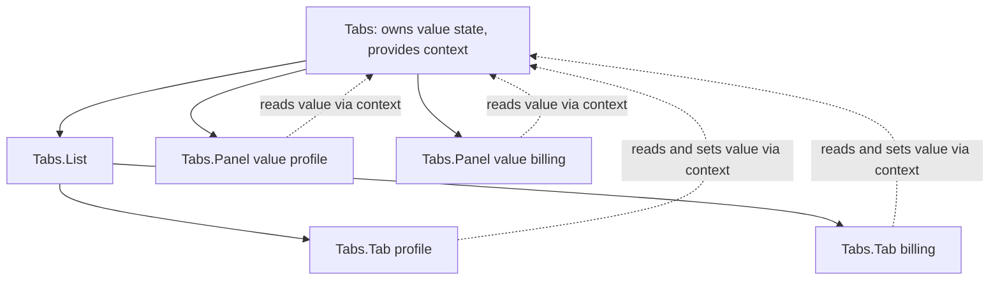
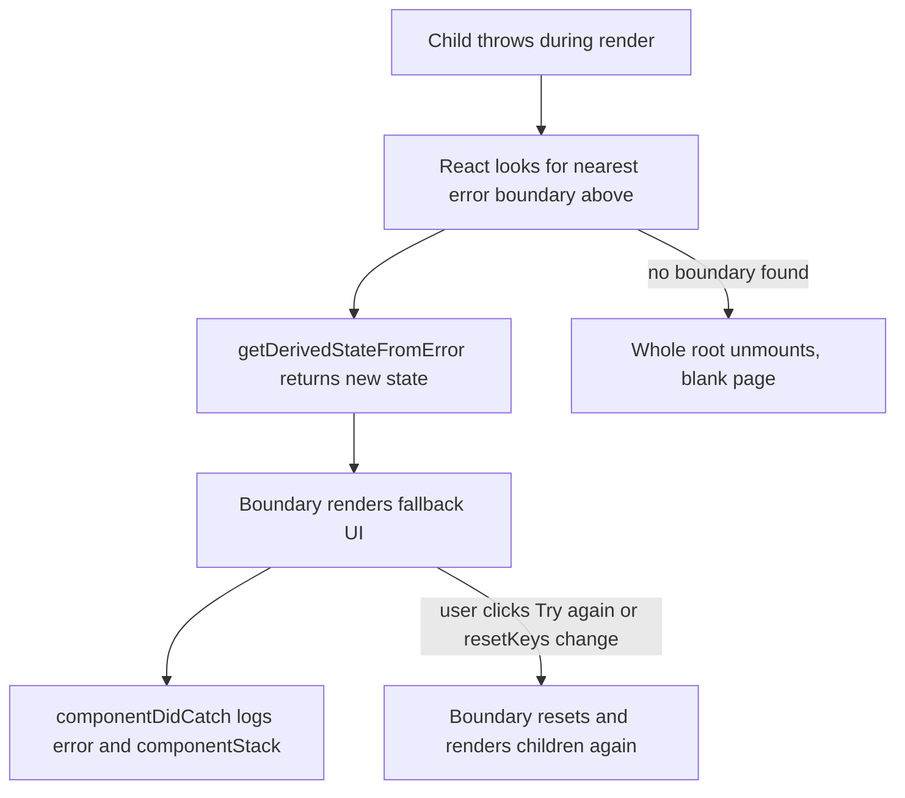

# React Patterns, Architecture and TypeScript

> In this document you will learn the patterns that interviewers expect from a mid-level or senior React developer: composition with `children`, container and presentational components, custom hooks, higher-order components and render props, compound components, controlled and uncontrolled component APIs, portals, error boundaries, refs and `useImperativeHandle`. You will also learn how to structure a large React app, how to build design-system components that are accessible, and how to type React code well with TypeScript. Most of the document is interview questions with spoken answers and follow-ups.

**Before this:** [Hooks in depth](./03-hooks-in-depth.md) · [Components and state management](../05-frontend-engineering/06-components-and-state-management.md) · [Accessibility](../05-frontend-engineering/04-accessibility.md) · **Interview questions:** [jump to the interview section](#interview-questions)

## Table of contents

1. [Concepts](#concepts)
   1. [Composition and children](#composition-and-children)
   2. [Container and presentational components](#container-and-presentational-components)
   3. [Custom hooks: the main reuse pattern](#custom-hooks-the-main-reuse-pattern)
   4. [Higher-order components and render props](#higher-order-components-and-render-props)
   5. [Compound components](#compound-components)
   6. [Controlled and uncontrolled component APIs](#controlled-and-uncontrolled-component-apis)
   7. [Portals](#portals)
   8. [Error boundaries](#error-boundaries)
   9. [Refs, ref as a prop and useImperativeHandle](#refs-ref-as-a-prop-and-useimperativehandle)
   10. [Folder structure and layers](#folder-structure-and-layers)
   11. [Design system components](#design-system-components)
   12. [Accessibility basics in React](#accessibility-basics-in-react)
   13. [TypeScript with React](#typescript-with-react)
2. [Interview questions](#interview-questions)
3. [Quick revision](#quick-revision)
4. [Summary](#summary)
5. [References](#references)

> **Versions.** React 19 (19.3 is the latest minor at the time of writing) with **React 18 notes** where behavior differs. TypeScript examples use `@types/react` 19. The JavaScript behavior in this document (error boundaries, portals, compound components, ref as a prop, ref cleanup, `useImperativeHandle`) was checked by running it with React 19.3 and React Testing Library in jsdom. TypeScript snippets were checked by careful review against the `@types/react` 19 rules, not compiled.

---

## Concepts

### Composition and children

**What:** React builds UIs by **putting components inside other components**, not by inheritance. A component can accept any content through the `children` prop, or through other props that hold JSX ("slots").

```jsx
function Card({ title, actions, children }) {
  return (
    <section className="card">
      <header>
        <h2>{title}</h2>
        <div className="card-actions">{actions}</div>   {/* a named slot */}
      </header>
      <div className="card-body">{children}</div>        {/* the default slot */}
    </section>
  );
}

<Card title="Invoices" actions={<button>Export</button>}>
  <InvoiceTable />
</Card>
```

**Why:** The parent decides **what** goes inside; `Card` decides **how it looks**. You get reuse without a growing list of props like `showExportButton`, `exportLabel`, `onExport`. The React team says it has not found use cases where component inheritance hierarchies are better than composition.

> **If you know Angular…** `children` is like content projection with `<ng-content>`, and named slot props are like `<ng-content select="[actions]">`. The big difference: in React, slots are just values, so you can also pass functions (render props) and conditionally render them.

### Container and presentational components

**What:** A split between components that **know where the data comes from** (container: fetch, state, store) and components that only **render props** (presentational: markup and styles).

```jsx
// Presentational: easy to reuse, test and show in Storybook
function UserList({ users, onSelect }) {
  return (
    <ul>
      {users.map((u) => <li key={u.id} onClick={() => onSelect(u.id)}>{u.name}</li>)}
    </ul>
  );
}

// Container: knows about data and side effects
function UserListContainer() {
  const { data: users = [] } = useUsersQuery();
  const navigate = useNavigate();
  return <UserList users={users} onSelect={(id) => navigate(`/users/${id}`)} />;
}
```

With hooks, the strict split is less necessary: a **custom hook** (`useUsersQuery`) now holds the data logic, and a component can call it directly. The idea is still useful for design-system components (always presentational) and for keeping data access out of deeply nested UI. The general idea is in [Components and state management — Presentational and container components](../05-frontend-engineering/06-components-and-state-management.md#presentational-and-container-components).

### Custom hooks: the main reuse pattern

**What:** A **custom hook** is a function whose name starts with `use` and that calls other hooks. It shares **stateful logic**, not state: every component that calls it gets its **own** copy of the state.

```jsx
import { useEffect, useState } from 'react';

export function useLocalStorage(key, initialValue) {
  const [value, setValue] = useState(() => {
    try {
      const stored = localStorage.getItem(key);
      return stored !== null ? JSON.parse(stored) : initialValue;
    } catch {
      return initialValue;
    }
  });

  useEffect(() => {
    try {
      localStorage.setItem(key, JSON.stringify(value));
    } catch {
      // storage full or blocked: ignore, the in-memory state still works
    }
  }, [key, value]);

  return [value, setValue];
}

// Two components, two independent states that each persist under their key
function Settings() {
  const [theme, setTheme] = useLocalStorage('theme', 'light');
  // ...
}
```

Custom hooks replaced most HOCs and render props because they: (1) compose by just calling them, (2) do not add components to the tree ("wrapper hell"), (3) make data flow explicit (`const x = useX()`), and (4) work well with TypeScript. Hook rules and more examples are in [Hooks in depth](./03-hooks-in-depth.md).

### Higher-order components and render props

These two patterns came **before hooks** (2015–2018). You will see them in older code and in some libraries.

**Higher-order component (HOC):** a function that takes a component and returns a new component with extra behavior.

```jsx
function withAuth(Component) {
  function WithAuth(props) {
    const { user, isLoading } = useAuth();
    if (isLoading) return <Spinner />;
    if (!user) return <Navigate to="/login" replace />;
    return <Component {...props} user={user} />;
  }
  WithAuth.displayName = `withAuth(${Component.displayName || Component.name})`;
  return WithAuth;
}

const ProtectedSettings = withAuth(SettingsPage);
```

Examples from history: `connect()` in React-Redux, `withRouter` in React Router v5, `withStyles` in Material UI v4.

**Render prop:** a prop whose value is a **function that returns JSX**. The component calls it with its internal data, and the caller decides what to render.

```jsx
function MouseTracker({ render }) {
  const [pos, setPos] = useState({ x: 0, y: 0 });
  return (
    <div onPointerMove={(e) => setPos({ x: e.clientX, y: e.clientY })}>
      {render(pos)}
    </div>
  );
}

<MouseTracker render={({ x, y }) => <p>Pointer at {x}, {y}</p>} />
```

**Problems:** HOCs hide where props come from, can have **prop name collisions**, need `displayName` and ref forwarding, and stacking several creates deep "wrapper hell" in DevTools. Render props create deeply nested callbacks.

**When they are still useful:**

- **Render props** are still the right tool when a component must let the caller render **per item** or **per state** with internal data: list and table libraries (`renderItem`, `renderCell`), virtualizers, `react-hook-form`'s `<Controller render={...}>`, Downshift-style headless components.
- **HOCs** still fit for cross-cutting wrapping of components you do not control, or applying the same wrapper to many route components (for example `withErrorBoundary(Component)` from `react-error-boundary`).

### Compound components

**What:** A group of components that **work together** and share **implicit state** through context, like `<select>` and `<option>`. The user composes the parts freely; the parent owns the state.

```jsx
import { createContext, useContext, useId, useState } from 'react';

const TabsContext = createContext(null);

function useTabsContext() {
  const ctx = useContext(TabsContext);
  if (!ctx) throw new Error('Tabs.* components must be used inside <Tabs>');
  return ctx;
}

export function Tabs({ defaultValue, children }) {
  const [value, setValue] = useState(defaultValue);
  const baseId = useId();
  return (
    <TabsContext value={{ value, setValue, baseId }}>
      <div className="tabs">{children}</div>
    </TabsContext>
  );
}

function TabList({ children }) {
  return <div role="tablist">{children}</div>;
}

function Tab({ value, children }) {
  const { value: selected, setValue, baseId } = useTabsContext();
  const isSelected = selected === value;
  return (
    <button
      role="tab"
      id={`${baseId}-tab-${value}`}
      aria-selected={isSelected}
      aria-controls={`${baseId}-panel-${value}`}
      tabIndex={isSelected ? 0 : -1}
      onClick={() => setValue(value)}
    >
      {children}
    </button>
  );
}

function TabPanel({ value, children }) {
  const { value: selected, baseId } = useTabsContext();
  if (selected !== value) return null;
  return (
    <div role="tabpanel" id={`${baseId}-panel-${value}`} aria-labelledby={`${baseId}-tab-${value}`}>
      {children}
    </div>
  );
}

Tabs.List = TabList;
Tabs.Tab = Tab;
Tabs.Panel = TabPanel;

// Usage: the user decides the layout
<Tabs defaultValue="profile">
  <Tabs.List>
    <Tabs.Tab value="profile">Profile</Tabs.Tab>
    <Tabs.Tab value="billing">Billing</Tabs.Tab>
  </Tabs.List>
  <Tabs.Panel value="profile"><ProfileForm /></Tabs.Panel>
  <Tabs.Panel value="billing"><BillingForm /></Tabs.Panel>
</Tabs>
```

Checked: clicking the "Billing" tab shows the billing panel and sets `aria-selected="true"` on that tab. (A complete tabs widget also needs arrow-key navigation; see [Q8](#q8-how-do-you-make-the-tabs-compound-component-accessible).)



### Controlled and uncontrolled component APIs

You know this from inputs: `<input value onChange>` is **controlled**, `<input defaultValue>` is **uncontrolled**. Good reusable components offer the **same choice**:

- **Uncontrolled:** the component keeps its own state; the parent can give an initial value (`defaultOpen`, `defaultValue`) and listen (`onOpenChange`).
- **Controlled:** the parent owns the state (`open`, `value`) and must update it in the callback.

```jsx
function useControllableState({ value, defaultValue, onChange }) {
  const [internal, setInternal] = useState(defaultValue);
  const isControlled = value !== undefined;
  const current = isControlled ? value : internal;

  function setValue(next) {
    if (!isControlled) setInternal(next);
    onChange?.(next);
  }
  return [current, setValue];
}

function Accordion({ open, defaultOpen = false, onOpenChange, title, children }) {
  const [isOpen, setIsOpen] = useControllableState({
    value: open,
    defaultValue: defaultOpen,
    onChange: onOpenChange,
  });
  return (
    <div>
      <button aria-expanded={isOpen} onClick={() => setIsOpen(!isOpen)}>{title}</button>
      {isOpen && <div>{children}</div>}
    </div>
  );
}

<Accordion title="Details" defaultOpen>…</Accordion>                     {/* uncontrolled */}
<Accordion title="Details" open={open} onOpenChange={setOpen}>…</Accordion> {/* controlled */}
```

Rule: a component should not switch between controlled and uncontrolled during its life (React warns about this for inputs). Libraries like Radix UI and Headless UI follow exactly this `value`/`defaultValue`/`onValueChange` convention.

### Portals

**What:** `createPortal(children, domNode)` renders children into a **different DOM node** (usually `document.body`), while they stay in the **same place in the React tree**.

```jsx
import { createPortal } from 'react-dom';

function Modal({ children }) {
  return createPortal(<div className="modal-backdrop">{children}</div>, document.body);
}
```

**Why:** modals, tooltips, dropdowns and toasts must escape parents with `overflow: hidden`, `transform` or a low `z-index` stacking context.

**Important behavior:** because the portal is still in the React tree:

- **Context** from parents still works inside the portal.
- **React events bubble through the React tree**, not the DOM tree. A click inside a portal triggers `onClick` handlers on the React parent even though the DOM node is elsewhere. Checked: a click on a button inside a portal called the parent `<div onClick>` once.

### Error boundaries

**What:** A component that **catches errors thrown while rendering** its children (and in their lifecycle methods and effects), and shows a **fallback UI** instead of unmounting the whole app. Without an error boundary, an uncaught render error unmounts the **whole** React root (a blank page).

There is still **no hook** for this; an error boundary must be a **class component** with `static getDerivedStateFromError` (to render the fallback) and optionally `componentDidCatch` (to log):

```jsx
import { Component } from 'react';

class ErrorBoundary extends Component {
  state = { error: null };

  static getDerivedStateFromError(error) {
    return { error }; // the next render shows the fallback
  }

  componentDidCatch(error, info) {
    // info.componentStack shows which components were rendering
    reportError(error, info.componentStack);
  }

  render() {
    if (this.state.error) {
      return this.props.fallback ?? <p role="alert">Something went wrong.</p>;
    }
    return this.props.children;
  }
}
```

In practice most teams use the **`react-error-boundary`** package, which adds a reset mechanism and a hook:

```jsx
import { ErrorBoundary, useErrorBoundary } from 'react-error-boundary';

function Fallback({ error, resetErrorBoundary }) {
  return (
    <div role="alert">
      <p>Could not load this section.</p>
      <pre>{error instanceof Error ? error.message : String(error)}</pre>
      <button onClick={resetErrorBoundary}>Try again</button>
    </div>
  );
}

<ErrorBoundary FallbackComponent={Fallback} resetKeys={[userId]} onError={logError}>
  <UserProfile userId={userId} />
</ErrorBoundary>
```

**What error boundaries do NOT catch:**

| Not caught | Why | What to do |
| --- | --- | --- |
| Errors in **event handlers** | They run outside rendering; React knows the UI is still fine | `try/catch` in the handler, set error state, or `showBoundary(error)` |
| **Async code** (`setTimeout`, promise callbacks, `await` after the render) | It runs later, outside React's render call stack | Catch it and set state (or `showBoundary`); in React 19 throw inside a `startTransition` action |
| **Server-side rendering** errors | Handled by the server renderer/framework | Framework error handling (`error.tsx` in Next.js) |
| Errors in the **boundary itself** | A boundary cannot catch its own fallback error | It goes to the next boundary above |

Checked: an error thrown in a click handler did not show the fallback; an error thrown in `useEffect` did; an error re-thrown inside a state updater (`setState(() => { throw e })`) did; and in React 19 an error thrown inside an async `startTransition` action reached the nearest boundary.

> **React 19 note:** React 19 changed error reporting: errors caught by a boundary are reported once to `console.error` (no more duplicate logs), and `createRoot` accepts `onCaughtError`, `onUncaughtError` and `onRecoverableError` options for central logging. React 18 logged caught errors twice in development and re-threw them.

### Refs, ref as a prop and useImperativeHandle

**Refs** give you a direct handle to a DOM node or a mutable value that does not trigger re-renders (basics in [Hooks in depth](./03-hooks-in-depth.md)). For reusable components, you often need to pass a ref **through** your component to an inner DOM element (to focus an input, measure, scroll).

**React 19: `ref` is a normal prop for function components.**

```jsx
// React 19
function TextField({ label, ref, ...props }) {
  const id = useId();
  return (
    <>
      <label htmlFor={id}>{label}</label>
      <input id={id} ref={ref} {...props} />
    </>
  );
}

function SearchBar() {
  const inputRef = useRef(null);
  return (
    <>
      <TextField label="Search" ref={inputRef} />
      <button onClick={() => inputRef.current.focus()}>Focus</button>
    </>
  );
}
```

> **React 18 note:** In React 18, `ref` was not passed as a prop to function components; you had to wrap them in `forwardRef((props, ref) => ...)`. `forwardRef` still works in React 19, but it is no longer needed and will be deprecated in a future version. A codemod converts it.

**React 19: ref callbacks can return a cleanup function** (like effects). Checked: the cleanup runs when the element is removed.

```jsx
<div ref={(node) => {
  const observer = new ResizeObserver(onResize);
  observer.observe(node);
  return () => observer.disconnect(); // React 19: called on unmount
}} />
```

**`useImperativeHandle`** lets a component expose a **custom, limited** object through its ref instead of the raw DOM node:

```jsx
function VideoPlayer({ src, ref }) {
  const videoRef = useRef(null);
  useImperativeHandle(ref, () => ({
    play: () => videoRef.current.play(),
    pause: () => videoRef.current.pause(),
  }), []);
  return <video ref={videoRef} src={src} />;
}

// parent: playerRef.current.play()  — but it cannot change videoRef's styles or src
```

Use it rarely: for imperative actions that do not fit props (focus, scroll into view, play/pause, open a native dialog). If you can express it as a prop (`isOpen`), use a prop.

### Folder structure and layers

For small apps any structure works. For large apps, the most common recommendation is **feature-based** (also called "feature-sliced" or "domain-based") folders: code that changes together lives together.

```text
src/
  app/                  # app shell: providers, router, global styles, error boundary
    providers.tsx
    router.tsx
  features/
    orders/
      api/              # API calls and query hooks: ordersApi.ts, useOrdersQuery.ts
      components/       # OrderTable.tsx, OrderFilters.tsx
      hooks/            # useOrderFilters.ts
      model/            # types, Zod schemas, pure helpers, slice/store if needed
      routes/           # OrdersPage.tsx, OrderDetailsPage.tsx
      index.ts          # public API of the feature: export only what others may use
    auth/
    checkout/
  shared/
    ui/                 # design system: Button, Modal, TextField
    lib/                # generic helpers: formatMoney, http client
    hooks/              # generic hooks: useDebouncedValue, useMediaQuery
```

Rules that keep it healthy:

- Features import from `shared/` and from other features only through their `index.ts` (public API). `shared/` never imports from `features/`.
- Keep the **layers** separate inside a feature: **UI** (components), **state** (hooks, stores), **API** (HTTP calls, query hooks, DTO mapping). Components should not build URLs or parse raw API responses.
- Tests and stories live next to the code (`OrderTable.test.tsx`).
- Enforce boundaries with ESLint (`import/no-restricted-paths`, `eslint-plugin-boundaries`) in big teams.

### Design system components

Design-system components (`Button`, `TextField`, `Modal`, `Select`) are used hundreds of times, so their API matters more than their code:

- **Forward native props and the ref** to the main element (`...props`, `ref`), so users can add `aria-*`, `data-*`, `type`, `onBlur` without you adding a prop for each.
- **Variants** as a small set of string unions (`variant: 'primary' | 'secondary' | 'danger'`, `size: 'sm' | 'md'`), not many booleans (`isPrimary`, `isDanger`) that can conflict.
- **Composition over configuration:** `children` and slots instead of `iconLeft`, `iconRight`, `iconColor`, ….
- **Accessible by default:** correct element (`button`, not `div`), visible focus, labels connected to inputs, keyboard support.
- **Controlled and uncontrolled** support for stateful components.
- **Headless libraries** (Radix UI, React Aria, Headless UI, Ariakit) give accessible behavior; you add the styles. Building an accessible combobox or date picker from scratch is a lot of work.

More on design systems in general: [Components and state management — Design systems](../05-frontend-engineering/06-components-and-state-management.md#design-systems-and-component-libraries).

### Accessibility basics in React

React renders normal HTML, so all accessibility rules apply (see [Accessibility](../05-frontend-engineering/04-accessibility.md)). React-specific points:

- Attribute names: `htmlFor` (not `for`), `className`; `aria-*` and `data-*` attributes are written as in HTML (`aria-expanded={isOpen}`).
- **`useId()`** creates stable, unique ids for connecting labels, descriptions and errors (`aria-describedby`), and they match between server and client rendering. Do not use `Math.random()` for ids.
- **Focus management** after client-side changes: move focus into a modal when it opens and back to the trigger when it closes; move focus to the new page heading after a route change; do not lose focus when a focused item is removed from a list.
- **Live regions** (`aria-live="polite"` / `role="status"`) for messages that appear without a page load (toasts, "3 results found"). The live region element should exist **before** the message is put into it.
- Prefer **native elements**: `<button>` gives keyboard and screen-reader support for free; `<div onClick>` gives neither.
- Test with `eslint-plugin-jsx-a11y`, React Testing Library role queries (if `getByRole('button', { name: 'Save' })` cannot find it, a screen reader probably cannot either), axe, and real keyboard/screen-reader checks.

### TypeScript with React

The most important typing patterns, with `@types/react` 19:

```tsx
import type { ReactNode, ComponentProps, ChangeEvent, FormEvent, Dispatch, SetStateAction } from 'react';

// 1. Props and children
type CardProps = {
  title: string;
  subtitle?: string;           // optional
  children: ReactNode;          // anything renderable: JSX, string, number, null, arrays
  onClose?: () => void;
};

function Card({ title, subtitle, children, onClose }: CardProps) {
  return <section>{/* ... */}{children}</section>;
}

// 2. Events
function SearchInput({ onSearch }: { onSearch: (q: string) => void }) {
  function handleChange(e: ChangeEvent<HTMLInputElement>) {
    onSearch(e.target.value);
  }
  function handleSubmit(e: FormEvent<HTMLFormElement>) {
    e.preventDefault();
  }
  return <form onSubmit={handleSubmit}><input onChange={handleChange} /></form>;
}

// 3. useState generics: needed when the initial value does not show the full type
const [user, setUser] = useState<User | null>(null);
const [status, setStatus] = useState<'idle' | 'loading' | 'error'>('idle');

// 4. useRef types
const inputRef = useRef<HTMLInputElement>(null);   // DOM ref: RefObject<HTMLInputElement | null>
const timerRef = useRef<number | undefined>(undefined); // mutable value; React 19 types require an argument

// 5. Extending native element props
type ButtonProps = ComponentProps<'button'> & { variant?: 'primary' | 'secondary' };
function Button({ variant = 'primary', ...rest }: ButtonProps) {
  return <button className={`btn btn-${variant}`} {...rest} />;
}

// 6. Passing a setter down
type FiltersProps = { setPage: Dispatch<SetStateAction<number>> };
```

**Generic components** keep the item type flowing from props to callbacks:

```tsx
type ListProps<T> = {
  items: T[];
  getKey: (item: T) => string | number;
  renderItem: (item: T) => ReactNode;
};

function List<T>({ items, getKey, renderItem }: ListProps<T>) {
  return <ul>{items.map((item) => <li key={getKey(item)}>{renderItem(item)}</li>)}</ul>;
}

// T is inferred as Product: `p` is typed in both callbacks
<List items={products} getKey={(p) => p.id} renderItem={(p) => p.name} />;
```

**Discriminated unions** make invalid prop combinations impossible:

```tsx
type LinkOrButtonProps =
  | ({ as: 'link'; href: string } & Omit<ComponentProps<'a'>, 'href'>)
  | ({ as: 'button'; onClick: () => void } & Omit<ComponentProps<'button'>, 'onClick'>);

function Action(props: LinkOrButtonProps) {
  if (props.as === 'link') {
    const { as, ...rest } = props;     // TypeScript knows: href exists here
    return <a {...rest} />;
  }
  const { as, ...rest } = props;       // here: onClick exists
  return <button type="button" {...rest} />;
}

<Action as="link" href="/help">Help</Action>;
// <Action as="link" onClick={...} />  -> type error: href is missing
```

**Typed context and reducer:**

```tsx
type CartItem = { id: string; qty: number };
type CartAction =
  | { type: 'added'; id: string }
  | { type: 'removed'; id: string }
  | { type: 'cleared' };

function cartReducer(state: CartItem[], action: CartAction): CartItem[] {
  switch (action.type) {
    case 'added':   return [...state, { id: action.id, qty: 1 }];
    case 'removed': return state.filter((i) => i.id !== action.id);
    case 'cleared': return [];
    default: {
      const exhaustive: never = action; // compile error if a new action type is not handled
      return exhaustive;
    }
  }
}

type CartContextValue = { items: CartItem[]; dispatch: Dispatch<CartAction> };
const CartContext = createContext<CartContextValue | null>(null);

export function useCart() {
  const ctx = useContext(CartContext);
  if (!ctx) throw new Error('useCart must be used inside <CartProvider>');
  return ctx; // typed as CartContextValue, never null
}
```

> **Types note (`@types/react` 19):** `useRef` now requires an argument; `useRef<T>(null)` returns `RefObject<T | null>` (the old `MutableRefObject` is deprecated); the global `JSX` namespace is deprecated in favor of `React.JSX`; `ReactElement`'s props default to `unknown` instead of `any`; `ElementRef` is deprecated in favor of `ComponentRef`. Since `@types/react` 18, `React.FC` no longer adds `children` automatically.

---

## Interview questions


### Q1. What is composition in React, and why does React prefer it over inheritance?

**What the interviewer is checking:** The core React design idea and practical use of `children` and slots.

**What to say (30–60 seconds):**

> "Composition means building components by putting other components inside them, instead of extending a base class. In React, a component can receive any content through `children` or through props that contain JSX, like `header` or `actions`. So a `Card` or `Modal` controls the layout, and the user of the component decides what goes inside. This gives flexible reuse without adding a new prop for every variation. Inheritance creates tight coupling: a change in the base class affects all children, and you can't easily combine behaviors. In React, logic is shared with custom hooks and UI is shared with composition, so inheritance is basically never needed."

**Deeper explanation:** See [Composition and children](#composition-and-children). A common anti-pattern is the "configuration component":

```jsx
// Configuration style: grows forever
<Dialog title="Delete?" showCancel cancelText="No" confirmText="Yes" confirmVariant="danger" icon="warning" />

// Composition style: stable API, unlimited variations
<Dialog>
  <Dialog.Title><WarningIcon /> Delete?</Dialog.Title>
  <Dialog.Actions>
    <Button variant="secondary">No</Button>
    <Button variant="danger">Yes</Button>
  </Dialog.Actions>
</Dialog>
```

**Follow-up questions and how to answer them:**

- **"What is 'specialization' in React?"** — A more specific component that renders a generic one with some props fixed: `function DangerButton(props) { return <Button variant="danger" {...props} />; }`. This replaces what would be a subclass in OOP.
- **"Can children be a function?"** — Yes, that is the render-prop pattern (`children` as a function). React itself does not care what type `children` is; your component decides how to use it.
- **"What's the downside of composition?"** — The user has more freedom, so they can build inconsistent layouts. Design systems balance this with a few well-designed slots and compound components.

**Common mistakes / weak answers:** "React doesn't support classes so we can't use inheritance" (it does; it is just not recommended). Not knowing slot props.

**Real-project example:** Replacing a `Table` with 40 config props by `Table`, `Table.Header`, `Table.Row` and `Table.Cell` let teams add custom cells without changing the shared component.

### Q2. What are container and presentational components? Are they still relevant with hooks?

**What the interviewer is checking:** Separation of concerns and awareness of how patterns evolved.

**What to say (30–60 seconds):**

> "Presentational components only render what they receive in props — markup and styles, no data fetching or global state. Container components know where data comes from: they fetch, read the store, handle side effects, and pass data and callbacks to presentational components. The benefit is that presentational components are easy to reuse, test and show in Storybook. With hooks, the strict split matters less, because the data logic moves into a custom hook like `useOrdersQuery`, and the component can call it directly. I still keep design-system components purely presentational and keep API calls out of deeply nested UI, but I don't create a container file for every component anymore."

**Deeper explanation:** See [Container and presentational components](#container-and-presentational-components). Dan Abramov, who popularized the pattern in 2015, later wrote that he no longer suggests splitting components this way by default, because hooks solve the same problem.

**Follow-up questions and how to answer them:**

- **"Where do Server Components fit in?"** — In the Next.js App Router, Server Components often act as "containers": they fetch data on the server and pass it to interactive Client Components, which are closer to presentational components with local UI state (see [Next.js essentials](./11-nextjs-essentials-for-interviews.md)).
- **"How does this help testing?"** — Presentational components are tested with plain props, no mocks. Containers or hooks are tested with mocked network (MSW) or providers. See [Testing React applications](./10-testing-react-applications.md).

**Common mistakes / weak answers:** Saying it is "deprecated" with no nuance, or creating container components that only pass props through.

**Real-project example:** A design-system `DataTable` stayed presentational (rows, columns, callbacks), and each feature had a small hook that fetched and mapped data for it.

### Q3. Why are custom hooks the main reuse pattern in React? Do two components using the same hook share state?

**What the interviewer is checking:** That you understand hooks share **logic**, not state.

**What to say (30–60 seconds):**

> "A custom hook is just a function starting with `use` that calls other hooks. It lets me extract stateful logic — like fetching, subscriptions, form handling, or reading local storage — and reuse it in many components. It became the main pattern because it composes by simply calling functions, doesn't add wrapper components to the tree, makes it clear where values come from, and is easy to type. And no, two components calling the same hook don't share state: each call has its own state, like calling `useState` twice. If I need shared state, I lift it up, use context, or use a store — and the hook can read from that."

**Deeper explanation:**

```jsx
function useCounter() {
  const [count, setCount] = useState(0);
  return { count, increment: () => setCount((c) => c + 1) };
}

function A() { const { count, increment } = useCounter(); /* own count */ }
function B() { const { count, increment } = useCounter(); /* separate count */ }

// Shared state: the hook reads a shared source instead
const CounterContext = createContext(null);
function useSharedCounter() {
  return useContext(CounterContext); // everyone under the provider sees the same value
}
```

Good custom hooks: have one clear responsibility, return a small, stable API (an object for many values, a tuple for two like `useState`), accept options instead of many positional arguments, and clean up their effects.

**Follow-up questions and how to answer them:**

- **"Why must custom hooks start with `use`?"** — So the linter and the React Compiler can recognize them and check the Rules of Hooks (only call hooks at the top level, never in conditions or loops). React itself does not check the name at runtime.
- **"When should something NOT be a hook?"** — If it does not call any hook, make it a plain function (`formatPrice`, `calculateTotal`). Making it a hook adds the hook rules for no reason.
- **"How do you test a custom hook?"** — With `renderHook` from React Testing Library, or by testing a small component that uses it (see [Testing React applications](./10-testing-react-applications.md)).

**Common mistakes / weak answers:** "Custom hooks share state between components." Calling a custom hook conditionally.

**Real-project example:** A `useWebSocketChannel(channel)` hook replaced four copies of subscribe/unsubscribe code and fixed a leak, because the cleanup now lived in one place.

### Q4. What is a higher-order component (HOC)? What problems does it have?

**What the interviewer is checking:** Knowledge of a legacy pattern you will meet in older code.

**What to say (30–60 seconds):**

> "A higher-order component is a function that takes a component and returns a new component that renders the original with extra props or behavior — for example `withAuth(Page)` that redirects when there's no user, or the old `connect()` from React-Redux. It was the main way to reuse logic before hooks. The problems are: it's not obvious where a prop comes from, two HOCs can inject props with the same name and overwrite each other, refs and static methods need extra work to pass through, and stacking several HOCs creates deep wrapper trees. Today I use custom hooks for logic, and HOCs only for wrapping, like adding an error boundary or a route guard around many pages."

**Deeper explanation:** See [Higher-order components and render props](#higher-order-components-and-render-props). Rules if you write one: do not mutate the input component; pass through unrelated props (`{...props}`); set a `displayName`; **never create the HOC inside a render** (`const Enhanced = withX(Comp)` inside a component creates a new type every render, so state is lost):

```jsx
function Page() {
  const SafeChart = withErrorBoundary(Chart); // bug: new component type on every render
  return <SafeChart />;
}
// Fix: create it once at module level
const SafeChart = withErrorBoundary(Chart);
```

**Follow-up questions and how to answer them:**

- **"How did HOCs handle refs before React 19?"** — The ref attached to the wrapper, not the inner component, so HOCs had to use `forwardRef`. In React 19, `ref` is a normal prop for function components, so `{...props}` passes it through.
- **"What about static methods?"** — Static properties on the wrapped component (for example `Page.getLayout`) are not copied automatically; libraries used `hoist-non-react-statics`.
- **"Is `React.memo` a HOC?"** — Technically yes: it takes a component and returns a new one. `memo` and `lazy` are examples of the pattern built into React.

**Common mistakes / weak answers:** Confusing HOCs with higher-order functions in general without connecting it to components. Saying HOCs are "removed" from React.

**Real-project example:** A legacy app had `withRouter(connect(...)(withStyles(...)(Component)))`; replacing it with `useNavigate`, `useSelector` and CSS modules removed three wrapper levels per component.

### Q5. What are render props? When are they still useful?

**What the interviewer is checking:** Pattern knowledge and modern judgment.

**What to say (30–60 seconds):**

> "A render prop is a prop whose value is a function that returns JSX. The component calls that function with its internal data, and the caller decides what to render. Before hooks, it was a way to share stateful logic, like a mouse tracker. For logic sharing, hooks replaced it. But render props are still the right tool when a component needs the caller to render something per item or per state using the component's internal data — like `renderItem` in a list or virtualizer, `renderCell` in a table, or `Controller`'s `render` prop in React Hook Form."

**Deeper explanation:**

```jsx
// Still a good use: the List owns virtualization; the caller owns the row UI
<VirtualList
  items={orders}
  itemHeight={48}
  renderItem={(order, { isSelected }) => (
    <OrderRow order={order} highlighted={isSelected} />
  )}
/>

// React Hook Form: connecting a third-party controlled input
<Controller
  name="country"
  control={control}
  render={({ field }) => <CountrySelect {...field} />}
/>
```

**Follow-up questions and how to answer them:**

- **"Do render props hurt performance?"** — The inline function is new on every render, which breaks `memo` on the component that receives it. Usually this is fine; if not, wrap it in `useCallback`.
- **"What is the 'function as children' variant?"** — The same pattern using `children`: `<Media query="(min-width: 800px)">{(matches) => matches ? <Desktop /> : <Mobile />}</Media>`.

**Common mistakes / weak answers:** "Render props are just props that render." Not knowing a single current library that uses them.

**Real-project example:** A headless `Combobox` exposed `renderOption(option, state)` so teams could show avatars and badges without forking the component.

### Q6. HOC vs render props vs custom hook — how do you choose?

**What the interviewer is checking:** A clear comparison and modern default.

**What to say (30–60 seconds):**

> "For reusing stateful logic, my default is a custom hook: it's explicit, composes easily and adds no wrapper components. I use a render prop when the reusable component must let the caller render part of its UI with internal data, like list items or table cells. I use a HOC when I need to wrap whole components in the same way, especially components I don't own or many route components — like adding an error boundary, analytics, or a permission check. All three can solve the same problem; the difference is readability and composition."

**Deeper explanation:**

| | Custom hook | Render prop | HOC |
| --- | --- | --- | --- |
| Shares | logic and state | logic + caller-controlled UI | logic + wrapping |
| Adds components to tree | No | Yes (one) | Yes (one per HOC) |
| Where values come from | Explicit: `const x = useX()` | Explicit: function argument | Hidden: injected props |
| Name collisions | No | No | Possible |
| Can wrap a component you don't own | No | No | Yes |
| Typing with TypeScript | Easy | Easy | Harder (injected props) |

**Follow-up questions and how to answer them:**

- **"Can you convert a HOC into a hook?"** — Usually yes: move the logic into `useX()` and return what the HOC injected as props. Then, if needed, keep a thin HOC that calls the hook, for backward compatibility: `const withX = (C) => (props) => <C {...props} {...useX()} />`.
- **"Is there anything hooks cannot do?"** — Hooks cannot wrap rendering with a boundary. Error boundaries and Suspense boundaries must be components, so HOCs or wrapper components are still used there.

**Common mistakes / weak answers:** "Hooks replace everything" without the exceptions; or recommending HOCs for new logic sharing.

**Real-project example:** A team wrote `usePermissions()` for logic and kept `withPermission('admin')(Page)` only for route-level guards.

### Q7. What are compound components? Build a Tabs component.

**What the interviewer is checking:** A senior pattern, context usage, and API design.

**What to say (30–60 seconds):**

> "Compound components are a set of components that work together and share state implicitly, like `select` and `option` in HTML. For tabs I'd have `Tabs`, `Tabs.List`, `Tabs.Tab` and `Tabs.Panel`. The parent `Tabs` owns the selected value and puts it in a context; each `Tab` reads the context to know whether it's selected and to change it; each `Panel` shows itself only when its value is selected. The user can arrange the parts freely — put the tab list below the panels, add extra elements — without passing props through each level. I also add a hook that throws a clear error when a part is used outside `Tabs`."

**Deeper explanation:** The full code is in [Compound components](#compound-components). Design decisions to mention:

- **Context instead of `React.Children.map` + `cloneElement`**: the old approach only works with direct children and breaks when the user wraps a tab in a `div`; context works at any depth.
- **`useId`** for connecting `aria-controls` and `aria-labelledby`.
- **Controlled and uncontrolled:** support `value` + `onValueChange` as well as `defaultValue` ([Controlled and uncontrolled component APIs](#controlled-and-uncontrolled-component-apis)).
- **Error for wrong usage:** `useTabsContext()` throws if there is no provider.

**Follow-up questions and how to answer them:**

- **"Why not `React.Children` and `cloneElement`?"** — They inspect only direct children, break with fragments and wrappers, are hard to type, and React's docs list them as legacy APIs. Context is the recommended way.
- **"How do you keep inactive panels' state?"** — By default inactive panels unmount and lose state. Options: render all panels and hide inactive ones with the `hidden` attribute, or use `<Activity mode="hidden">` (React 19.2), which also pauses their effects.
- **"Is the context value a performance problem?"** — The value object is new on every `Tabs` render, so all parts re-render when `Tabs` re-renders. For tabs this is cheap. For bigger compound components, `useMemo` the value.

**Common mistakes / weak answers:** Passing `selected` and `onSelect` manually to each tab (that is not compound). No accessibility roles.

**Real-project example:** A settings page used compound `Tabs` from the design system; teams added a "beta" badge inside one `Tab` without any change to the shared component.

### Q8. How do you make the Tabs compound component accessible?

**What to say (short answer):**

> "I follow the WAI-ARIA Tabs pattern: the list has `role="tablist"`, each tab has `role="tab"`, `aria-selected` and `aria-controls` pointing to its panel, and each panel has `role="tabpanel"` and `aria-labelledby` pointing to its tab. Only the selected tab is in the tab order (`tabIndex={0}`; others `-1`), and the arrow keys move between tabs, with Home and End going to the first and last. Ids come from `useId` so they're unique and SSR-safe."

**Deeper explanation:** Keyboard handling inside `Tabs.List`:

```jsx
function TabList({ children }) {
  function onKeyDown(e) {
    const tabs = [...e.currentTarget.querySelectorAll('[role="tab"]')];
    const i = tabs.indexOf(document.activeElement);
    let next = null;
    if (e.key === 'ArrowRight') next = tabs[(i + 1) % tabs.length];
    if (e.key === 'ArrowLeft') next = tabs[(i - 1 + tabs.length) % tabs.length];
    if (e.key === 'Home') next = tabs[0];
    if (e.key === 'End') next = tabs[tabs.length - 1];
    if (next) {
      e.preventDefault();
      next.focus();
      next.click(); // "automatic activation": focusing a tab selects it
    }
  }
  return <div role="tablist" onKeyDown={onKeyDown}>{children}</div>;
}
```

More patterns (focus, roles, testing) are in [Accessibility](../05-frontend-engineering/04-accessibility.md#accessible-custom-components).

### Q9. How do you design a component that supports both controlled and uncontrolled use?

**What the interviewer is checking:** API design skill for reusable components.

**What to say (30–60 seconds):**

> "I follow the same convention as inputs: `value` and `onValueChange` for controlled use, and `defaultValue` for uncontrolled use. Inside, I check if `value` is undefined: if it is, the component keeps its own state; if it's defined, the parent owns it and I only call the callback. I usually put this into a small `useControllableState` hook. I always call the change callback in both modes so the parent can listen. And I don't allow switching between modes after mount, like React does for inputs, because it causes confusing bugs."

**Deeper explanation:** See [Controlled and uncontrolled component APIs](#controlled-and-uncontrolled-component-apis). Typed version of the hook:

```tsx
function useControllableState<T>({
  value,
  defaultValue,
  onChange,
}: {
  value?: T;
  defaultValue: T;
  onChange?: (value: T) => void;
}) {
  const [internal, setInternal] = useState(defaultValue);
  const isControlled = value !== undefined;
  const current = isControlled ? value : internal;
  const setValue = (next: T) => {
    if (!isControlled) setInternal(next);
    onChange?.(next);
  };
  return [current, setValue] as const;
}
```

**Follow-up questions and how to answer them:**

- **"What happens if a parent passes `value` but never updates it?"** — The component becomes "read-only": clicks call `onChange` but nothing changes visually. That is correct controlled behavior; React's `<input value="x">` without `onChange` does the same (with a warning).
- **"How do you reset an uncontrolled component?"** — Change its `key` from the parent, which creates a fresh instance with `defaultValue` again; or expose a `reset()` via `useImperativeHandle` if needed.
- **"When do you prefer controlled?"** — When the parent must validate, sync with the URL or other components, or save the value. Uncontrolled is simpler for "fire and forget" UI like a collapsible section.

**Common mistakes / weak answers:** Copying a prop into state with `useState(props.value)` and expecting it to update when the prop changes (it does not; the initial value is used only once).

**Real-project example:** A `DateRangePicker` supporting both modes was used uncontrolled in simple forms and controlled in a report page that synced the range to the URL.

### Q10. Design a reusable Modal component.

**What the interviewer is checking:** A full design answer: API, portal, accessibility, focus, scroll, stacking — a classic senior question.

**What to say (30–60 seconds):**

> "I'd make it controlled: `open` and `onOpenChange`, plus `title` and `children`, and maybe compound parts like `Modal.Footer`. I'd render it with a portal to `document.body`, so parents with `overflow` or `z-index` can't clip it. For accessibility: `role="dialog"`, `aria-modal`, `aria-labelledby` pointing to the title, focus moves into the dialog on open, focus is trapped inside while open, Escape closes it, and focus returns to the trigger on close. I also lock page scroll and make the rest of the page `inert`. Today I'd seriously consider the native `dialog` element with `showModal()`, because it gives focus trapping, Escape and the top layer for free."

**Deeper explanation:** A version based on the native `<dialog>` element:

```jsx
import { useEffect, useId, useRef } from 'react';

export function Modal({ open, onOpenChange, title, children }) {
  const dialogRef = useRef(null);
  const titleId = useId();

  useEffect(() => {
    const dialog = dialogRef.current;
    if (open && !dialog.open) dialog.showModal(); // top layer, focus trap, inert background
    if (!open && dialog.open) dialog.close();     // the browser returns focus to the opener
  }, [open]);

  return (
    <dialog
      ref={dialogRef}
      aria-labelledby={titleId}
      onClose={() => onOpenChange(false)}          // Escape key or form method="dialog"
      onClick={(e) => { if (e.target === e.currentTarget) onOpenChange(false); }} // backdrop click
    >
      <h2 id={titleId}>{title}</h2>
      {children}
      <button type="button" onClick={() => onOpenChange(false)}>Close</button>
    </dialog>
  );
}
```

A custom (non-`<dialog>`) version needs: `createPortal`, a focus trap (find focusable elements, wrap Tab/Shift+Tab), `keydown` Escape handler, saving `document.activeElement` on open and restoring it on close, `inert` on the app root, and `overflow: hidden` on `body`. Detailed focus-trap code is in [Accessibility — Modals and focus traps](../05-frontend-engineering/04-accessibility.md#modals-and-focus-traps).

**Follow-up questions and how to answer them:**

- **"Controlled or uncontrolled?"** — Mostly controlled (the parent knows when to open, often after an action), with an optional `Modal.Trigger` for simple cases. Same convention as Q9.
- **"How do you handle nested modals?"** — With native `<dialog>`, each `showModal()` goes to the top layer in order. With a custom version, keep a stack of open modals so only the top one handles Escape and the focus trap.
- **"How do you test it?"** — Query by role: `getByRole('dialog', { name: 'Delete item' })`, press Escape with `user-event`, assert `onOpenChange(false)` was called and focus returned to the trigger. Note: jsdom does not implement `showModal()` and `close()` (checked with jsdom 29), so tests must stub them, for example `HTMLDialogElement.prototype.showModal = vi.fn(function () { this.open = true; })`, or run in a real browser (Playwright, Vitest browser mode).
- **"Why a portal if using `<dialog>`?"** — `showModal()` already uses the browser top layer, which escapes `overflow` and `z-index`, so a portal is not required. You may still portal it to keep CSS inheritance and DOM order simple.

**Common mistakes / weak answers:** Forgetting focus management. A `div` with `onClick` close button. No Escape key. Rendering inside a parent with `overflow: hidden`.

**Real-project example:** Moving the design-system modal to native `<dialog>` removed 200 lines of focus-trap code and fixed a screen-reader bug where background content was still readable.

### Q11. Output question: does the parent's onClick fire when clicking inside a portal?

**What the interviewer is checking:** Understanding that portals keep React tree behavior.

```jsx
function Modal({ children }) {
  return createPortal(<div role="dialog">{children}</div>, document.body);
}

function Page() {
  return (
    <div onClick={() => console.log('page clicked')}>
      <Modal>
        <button>Inside modal</button>
      </Modal>
    </div>
  );
}
// The user clicks "Inside modal". Is "page clicked" logged?
```

**What to say (30–60 seconds):**

> "Yes. In the DOM, the button is under `document.body`, not inside the page `div`. But React events bubble along the React component tree, and in the React tree the modal is still a child of that `div`. So the `onClick` on the `div` fires. Context also works the same way. If I don't want that, I stop propagation in the portal, or check `e.target` in the handler."

**Deeper explanation:** Checked by running: the parent handler was called once, and the dialog element was in `document.body`, not in the component's container. Native listeners added with `addEventListener` on the DOM parent would **not** see the event, because the DOM ancestors are different.

**Follow-up questions and how to answer them:**

- **"Why did React design it this way?"** — So a portal behaves like any other child: context, events and error boundaries work, and moving a component into a portal does not change its logic.
- **"What problem can it cause?"** — A "click outside to close" handler on a parent may think a click inside the portal is a click inside the parent (or the opposite if it uses DOM `contains`). Check with the React tree logic or use `e.stopPropagation()` deliberately.

**Common mistakes / weak answers:** "No, because the DOM node is elsewhere."

**Real-project example:** A dropdown menu rendered in a portal closed its parent card's "click to expand" handler every time; a `stopPropagation` in the menu fixed it.

### Q12. What is an error boundary? How do you write one?

**What the interviewer is checking:** Correct API, why it is a class, and fallback/reset design.

**What to say (30–60 seconds):**

> "An error boundary is a component that catches errors thrown while rendering its children, and in their lifecycle methods and effects, and shows a fallback UI instead. Without one, a render error unmounts the whole React root and the user sees a blank page. It must still be a class component, with `static getDerivedStateFromError` to switch to the fallback and `componentDidCatch` to log the error and component stack. In practice I use `react-error-boundary`, which gives `FallbackComponent`, a `resetErrorBoundary` function, `resetKeys` to reset automatically when something like a user id changes, and a `useErrorBoundary` hook."

**Deeper explanation:** See [Error boundaries](#error-boundaries) for the class and the library. The flow:



**Follow-up questions and how to answer them:**

- **"Why is there no hook version?"** — Catching an error needs to happen at the component boundary, during rendering of the children, which hooks cannot express today. React's docs say there is no function-component equivalent yet; use a class or a library.
- **"What is the difference between `getDerivedStateFromError` and `componentDidCatch`?"** — `getDerivedStateFromError` runs during render and must be pure: it only returns new state for the fallback. `componentDidCatch` runs in the commit phase and is for side effects like logging.
- **"How does the reset work?"** — The boundary sets `error` back to `null` and renders the children again. If the cause is still there, it fails again — so also reset the cause (refetch, clear bad state) in `onReset`.

**Common mistakes / weak answers:** "Use try/catch around JSX" (render errors in children are not caught by a try/catch in the parent's function). "Error boundaries catch all errors."

**Real-project example:** Each dashboard widget had its own boundary with "This widget failed to load — Retry", so one broken API no longer blanked the whole dashboard.

### Q13. My error boundary doesn't catch my async error. Why, and how do I fix it?

**What the interviewer is checking:** The most common error-boundary misunderstanding.

```jsx
function SaveButton() {
  async function handleClick() {
    await api.save(); // throws 500
  }
  return <button onClick={handleClick}>Save</button>;
}

<ErrorBoundary fallback={<p>Failed</p>}>
  <SaveButton />
</ErrorBoundary>
```

**What to say (30–60 seconds):**

> "Error boundaries only catch errors thrown while React is rendering, or in lifecycle methods and effects. An error in an event handler or in a promise happens later, outside React's render call stack, so React doesn't know about it — it becomes an unhandled promise rejection and the UI just doesn't change. To fix it, I catch the error and either show it in the component with error state, which is usually best for a save button, or pass it to the boundary with `showBoundary` from `react-error-boundary`'s `useErrorBoundary`. In React 19 there's also a built-in way: if the async work runs inside `startTransition` from `useTransition`, an error thrown there reaches the nearest error boundary."

**Deeper explanation:** Checked by running: a handler error did not show the fallback; an error re-thrown with a state updater did; and an error thrown inside an async `startTransition` action (React 19) reached the boundary.

```jsx
// Option 1: local error state (best for form actions)
function SaveButton() {
  const [error, setError] = useState(null);
  async function handleClick() {
    try {
      await api.save();
    } catch (e) {
      setError('Could not save. Try again.');
    }
  }
  return (
    <>
      <button onClick={handleClick}>Save</button>
      {error && <p role="alert">{error}</p>}
    </>
  );
}

// Option 2: send it to the nearest boundary
import { useErrorBoundary } from 'react-error-boundary';
function LoadReport() {
  const { showBoundary } = useErrorBoundary();
  useEffect(() => {
    fetchReport().then(setReport).catch(showBoundary);
  }, []);
}

// Option 3 (React 19): an Action inside a transition
function SaveButton() {
  const [isPending, startTransition] = useTransition();
  return (
    <button disabled={isPending} onClick={() => startTransition(async () => { await api.save(); })}>
      Save
    </button>
  );
}
```

How `showBoundary` works inside: it sets state with an updater that **throws** the error during the next render, so the error now happens during rendering and the boundary catches it. You can do the same without the library: `setState(() => { throw error; })`.

**Follow-up questions and how to answer them:**

- **"Should every error go to an error boundary?"** — No. Expected errors (validation, 404, "could not save") are part of normal UI and should be shown near the action. Boundaries are for unexpected errors that make a section unusable.
- **"What about TanStack Query?"** — It catches fetch errors and returns them as `error` in the query result. Set `throwOnError: true` to throw them during render, so a boundary catches them (and use `QueryErrorResetBoundary` to retry).
- **"What does the user see in the original code?"** — Nothing changes; the browser logs an "Uncaught (in promise)" error. That is why silent failures are dangerous.

**Common mistakes / weak answers:** "Wrap it in another error boundary." "Error boundaries don't work with async functions in React" without explaining when.

**Real-project example:** Payment errors disappeared silently because the team relied on a global error boundary; adding local error state plus a `showBoundary` for unexpected cases fixed both UX and logging.

### Q14. Where should you place error boundaries in an application?

**What the interviewer is checking:** Architecture judgment.

**What to say (30–60 seconds):**

> "At several levels. One at the top of the app as a last safety net, with a friendly 'something went wrong, reload' page and logging. One per route, so an error on one page keeps the navigation and layout working. And around independent widgets — a chart, a comments section, a third-party embed — so one failure doesn't take down the whole page. I don't wrap every small component, because too many boundaries make the UI fragmented and hide bugs. I also reset route boundaries on navigation, using the location as a reset key."

**Deeper explanation:**

```jsx
<ErrorBoundary FallbackComponent={AppCrashPage} onError={logToSentry}>   {/* app level */}
  <Layout>
    <ErrorBoundary FallbackComponent={RouteError} resetKeys={[location.pathname]}> {/* route level */}
      <Outlet />
    </ErrorBoundary>
  </Layout>
</ErrorBoundary>

// widget level, inside a page
<ErrorBoundary fallback={<WidgetError name="Revenue chart" />}>
  <RevenueChart />
</ErrorBoundary>
```

Frameworks do this for you: React Router v7 has `errorElement` / `ErrorBoundary` per route, and Next.js has `error.tsx` per route segment.

**Follow-up questions and how to answer them:**

- **"How do you log errors?"** — In `onError` / `componentDidCatch`, send `error` and `info.componentStack` to a tool like Sentry. In React 19 you can also use `createRoot(container, { onCaughtError, onUncaughtError })` for central logging.
- **"Do boundaries work with Suspense?"** — Yes, they are complementary: Suspense handles "not ready yet" (loading), error boundaries handle "failed". A typical async section is wrapped in both.

**Common mistakes / weak answers:** Only one global boundary, or one around every component.

**Real-project example:** An embedded third-party map crashed on old Safari; a widget-level boundary showed a static address instead of a blank page.

### Q15. forwardRef vs ref as a prop: what changed in React 19?

**What the interviewer is checking:** Up-to-date knowledge and migration awareness.

**What to say (30–60 seconds):**

> "In React 18 and before, `ref` was a special attribute that wasn't passed to function components as a prop. To let a parent get a ref to an input inside your component, you had to wrap it in `forwardRef`, which gave you the ref as a second argument. In React 19, function components receive `ref` as a normal prop, so you just destructure it and put it on the element. `forwardRef` still works but isn't needed and will be deprecated later. React 19 also allows ref callbacks to return a cleanup function, like effects. Class components still don't get `ref` as a prop — for them it's the instance."

**Deeper explanation:**

```jsx
// React 18
const TextField = forwardRef(function TextField(props, ref) {
  return <input ref={ref} {...props} />;
});

// React 19
function TextField({ ref, ...props }) {
  return <input ref={ref} {...props} />;
}
```

TypeScript in React 19: `ComponentProps<'input'>` already includes `ref`, so `function TextField(props: ComponentProps<'input'>)` accepts a ref with no extra work.

**Follow-up questions and how to answer them:**

- **"What is the ref callback cleanup good for?"** — Attaching observers or listeners to a DOM node: create in the callback, return a function that disconnects. Before React 19, React called the callback with `null` on unmount; with a cleanup function returned, React calls the cleanup instead. Checked: attach then cleanup were logged.
- **"Any gotcha with ref callbacks?"** — An inline ref callback is a new function each render, so React calls the old cleanup and the new callback on every render. Usually harmless; if the setup is expensive, make the callback stable with `useCallback`.
- **"How do you pass a ref through a HOC in React 19?"** — It is a normal prop now, so `{...props}` passes it.

**Common mistakes / weak answers:** Saying `forwardRef` is "removed" in React 19. Not knowing the React 18 way (many companies still use React 18).

**Real-project example:** A design-system upgrade to React 19 ran the codemod that removed `forwardRef` from 60 components, simplifying their TypeScript types.

### Q16. When would you use useImperativeHandle?

**What the interviewer is checking:** Knowing that imperative APIs are the exception.

**What to say (30–60 seconds):**

> "`useImperativeHandle` customizes what a parent gets through a ref. Instead of the raw DOM node, I expose a small object with specific methods, like `focus`, `scrollToItem`, or `play` and `pause`. It's useful for actions that are naturally imperative and don't fit props — focusing, scrolling, media control, opening a native dialog. It also hides internal details: the parent can't change styles or attributes of my inner element. But it's an escape hatch: if something can be described as state, like `isOpen`, it should be a prop."

**Deeper explanation:** See [Refs, ref as a prop and useImperativeHandle](#refs-ref-as-a-prop-and-useimperativehandle). Checked: the parent's ref contained only `{ play }`.

```jsx
function ChatMessages({ ref, messages }) {
  const listRef = useRef(null);
  useImperativeHandle(ref, () => ({
    scrollToBottom() {
      listRef.current.lastElementChild?.scrollIntoView({ block: 'end' });
    },
  }), []);
  return <ul ref={listRef}>{messages.map((m) => <li key={m.id}>{m.text}</li>)}</ul>;
}
```

**Follow-up questions and how to answer them:**

- **"Why the dependency array?"** — Like `useMemo`, the handle object is recreated only when dependencies change. Include values used inside the methods, or read them from refs.
- **"If you know Angular…"** — It is like a parent using `@ViewChild` to call public methods of a child component; in both frameworks inputs/outputs (props/callbacks) are preferred.

**Common mistakes / weak answers:** Using it to read child state ("lift the state up instead"). Exposing the whole DOM node anyway.

**Real-project example:** A rich-text editor wrapper exposed `focus()`, `insertText()` and `getHTML()` so forms could integrate it without knowing the editor library.

### Q17. How would you structure the folders of a large React application?

**What the interviewer is checking:** Architecture experience on real, growing code bases.

**What to say (30–60 seconds):**

> "For a large app I group code by feature, not by file type. Instead of global `components`, `hooks`, `services` folders with hundreds of files, I have `features/orders`, `features/auth`, `features/checkout`, each with its own components, hooks, API calls, types and tests. Shared, generic things live in `shared` — the design system, generic hooks, the HTTP client. The app shell — providers, router, global error boundary — lives in `app`. Each feature exposes a public `index.ts`, other features import only from that, and `shared` never imports from features. That keeps related code together, makes ownership clear, and makes it easy to delete or lazy-load a feature."

**Deeper explanation:** See [Folder structure and layers](#folder-structure-and-layers).

**Follow-up questions and how to answer them:**

- **"When is by-type structure fine?"** — Small apps or prototypes with a few dozen files. The problem starts when one change touches five distant folders.
- **"How do you stop features from importing each other's internals?"** — ESLint rules (`import/no-restricted-paths`, `eslint-plugin-boundaries`), TypeScript path aliases pointing to feature `index.ts` files, and code review. In monorepos, separate packages with explicit dependencies.
- **"Where do routes go?"** — The router config lives in `app/`, but each page component lives in its feature (`features/orders/routes/OrdersPage.tsx`), and lazy imports point there, so each feature becomes its own chunk.

**Common mistakes / weak answers:** "We put everything in `components/`." No rules about dependencies.

**Real-project example:** Moving a 900-file `components/` folder to feature folders made code ownership (CODEOWNERS per feature) possible and reduced merge conflicts.

### Q18. How do you separate UI, state and API logic in React?

**What the interviewer is checking:** Clean layering, testability.

**What to say (30–60 seconds):**

> "I keep three layers. The API layer is plain functions that call the server and map responses to app types — no React there, so they're easy to test and reuse. The state layer is hooks: TanStack Query hooks for server state, like `useOrdersQuery`, and local state or a store for UI state. The UI layer is components that call those hooks and render — they don't build URLs, parse responses or know about HTTP headers. That way I can change the backend format in one place, test components with mocked network, and reuse the logic in different screens."

**Deeper explanation:**

```ts
// features/orders/api/ordersApi.ts  (API layer: no React)
export async function fetchOrders(params: OrdersParams): Promise<Order[]> {
  const { data } = await http.get<OrderDto[]>('/orders', { params });
  return data.map(toOrder); // map DTO -> domain type in one place
}

// features/orders/api/useOrdersQuery.ts  (state layer)
export function useOrdersQuery(params: OrdersParams) {
  return useQuery({ queryKey: ['orders', params], queryFn: () => fetchOrders(params) });
}

// features/orders/components/OrdersPage.tsx  (UI layer)
export function OrdersPage() {
  const [params, setParams] = useOrderFilters();     // URL search params
  const { data = [], isPending, error } = useOrdersQuery(params);
  if (isPending) return <TableSkeleton />;
  if (error) return <ErrorMessage error={error} />;
  return <OrderTable orders={data} onFilterChange={setParams} />;
}
```

Details on axios and TanStack Query: [Data fetching: axios and TanStack Query](./06-data-fetching-axios-and-tanstack-query.md).

**Follow-up questions and how to answer them:**

- **"Why map DTOs to domain types?"** — The backend format (snake_case, nested envelopes, string dates) stays out of components; when the API changes, only the mapper changes.
- **"Where does validation of API responses go?"** — In the API layer, with a schema library like Zod (`OrderSchema.parse(data)`), so bad data fails early with a clear error.

**Common mistakes / weak answers:** `fetch` calls with URL strings inside many components. Business rules inside JSX.

**Real-project example:** When the backend renamed `order_total` to `totalAmount`, only one mapper function changed instead of 14 components.

### Q19. Design a reusable Button for a design system.

**What the interviewer is checking:** API design, prop forwarding, variants, accessibility, TypeScript.

**What to say (30–60 seconds):**

> "I'd base it on the native `button` element and forward all native props and the ref, so users can pass `type`, `disabled`, `aria-*` and event handlers without me adding each one. Styles come from a small set of variants as string unions — `variant` primary, secondary, danger, and `size` small, medium — not many booleans that can conflict. I'd default `type` to `button`, because the native default `submit` causes accidental form submits. For loading I'd add `isLoading`, which disables it, sets `aria-busy`, and keeps the width stable. And if it needs to look like a button but navigate, I'd use a separate link component or an `asChild` approach, not a `div`."

**Deeper explanation:**

```tsx
import type { ComponentProps } from 'react';

type ButtonProps = ComponentProps<'button'> & {
  variant?: 'primary' | 'secondary' | 'danger';
  size?: 'sm' | 'md';
  isLoading?: boolean;
};

export function Button({
  variant = 'primary',
  size = 'md',
  isLoading = false,
  type = 'button',
  disabled,
  className,
  children,
  ...rest // includes ref in React 19, onClick, aria-*, data-*
}: ButtonProps) {
  return (
    <button
      type={type}
      disabled={disabled || isLoading}
      aria-busy={isLoading || undefined}
      className={['btn', `btn-${variant}`, `btn-${size}`, className].filter(Boolean).join(' ')}
      {...rest}
    >
      {isLoading ? <Spinner aria-hidden="true" /> : null}
      <span className={isLoading ? 'btn-label-hidden' : undefined}>{children}</span>
    </button>
  );
}
```

**Follow-up questions and how to answer them:**

- **"What is a polymorphic `as` prop?"** — `<Button as="a" href="/x">` renders a different element with button styles. It is flexible but hard to type correctly (props must change with `as`). Many libraries now prefer `asChild` (Radix): `<Button asChild><Link to="/x">Docs</Link></Button>`, where the button merges its props into the child element.
- **"Why not disable the button while the form is invalid?"** — Disabled buttons cannot be focused and give no reason. Often it is better to keep it enabled and show validation errors on submit.
- **"Icon-only buttons?"** — Require an accessible name: `aria-label` (make it a required prop in TypeScript when there are no children, using a discriminated union).

**Common mistakes / weak answers:** `<div onClick>` buttons. Not forwarding `...rest`. A boolean per color.

**Real-project example:** Defaulting `type="button"` in the shared Button fixed a series of bugs where clicking "Add row" inside a form submitted it.

### Q20. What are the accessibility basics you check in React components?

**What the interviewer is checking:** Practical a11y habits, React-specific details.

**What to say (30–60 seconds):**

> "First, use the right native elements — real buttons, links, labels, headings — because they give keyboard and screen-reader support for free. Every input has a label connected with `htmlFor` and an id from `useId`, and error messages are linked with `aria-describedby`. Custom widgets follow the WAI-ARIA patterns for roles, states and keyboard keys. In a single-page app I manage focus myself: into a modal on open and back on close, to the main heading after navigation. Dynamic messages go into a live region. And I test with role-based queries in React Testing Library, the jsx-a11y lint plugin, axe, and a real keyboard."

**Deeper explanation:** See [Accessibility basics in React](#accessibility-basics-in-react).

```jsx
function EmailField({ error }) {
  const id = useId();
  const errorId = `${id}-error`;
  return (
    <>
      <label htmlFor={id}>Email</label>
      <input
        id={id}
        type="email"
        aria-invalid={error ? true : undefined}
        aria-describedby={error ? errorId : undefined}
      />
      {error && <p id={errorId}>{error}</p>}
    </>
  );
}
```

**Follow-up questions and how to answer them:**

- **"Why `useId` and not a counter or `Math.random()`?"** — `useId` gives the same id on the server and the client, so hydration matches, and it is unique per component instance. Random values differ between server and client and cause hydration errors.
- **"How do you announce route changes?"** — Move focus to the new page's `<h1>` (with `tabIndex={-1}`) or update a visually hidden live region with the page title. Frameworks like Next.js include a route announcer.

**Common mistakes / weak answers:** "We add ARIA attributes everywhere" — incorrect ARIA is worse than none. Only checking color contrast.

**Real-project example:** Switching tests to `getByRole` queries exposed 30 "buttons" that were `div`s with click handlers.

### Q21. How do you type props and children in TypeScript? Should you use React.FC?

**What the interviewer is checking:** The basics of typing React, and a well-known debate.

**What to say (30–60 seconds):**

> "I define a `type` or `interface` for the props and annotate the destructured parameter: `function Card({ title, children }: CardProps)`. For children I use `ReactNode`, which accepts anything React can render — elements, strings, numbers, null, arrays. `ReactElement` is narrower: only an element, which I use when I need an element, for example to clone it. About `React.FC`: it used to add `children` automatically, which was removed in the React 18 types, so now it's mostly a style choice. I prefer plain functions with typed props, because they're simpler, work naturally with generics, and the return type is inferred."

**Deeper explanation:**

| Type | Accepts | Use for |
| --- | --- | --- |
| `ReactNode` | elements, strings, numbers, `null`, `undefined`, booleans, arrays | `children` and slot props (most cases) |
| `ReactElement` | one React element | a prop that must be an element (`icon: ReactElement`) |
| `React.JSX.Element` | the result of a JSX expression | return types (rarely needed; inferred) |
| `PropsWithChildren<P>` | `P & { children?: ReactNode }` | quick helper when children are optional |

```tsx
type PanelProps = { title: string; icon?: ReactElement; children: ReactNode };

function Panel({ title, icon, children }: PanelProps) {
  return <section><h2>{icon}{title}</h2>{children}</section>;
}
```

**Follow-up questions and how to answer them:**

- **"`type` or `interface` for props?"** — Both work. `interface` can be extended and merged; `type` supports unions (needed for discriminated union props). Many teams use `type` for consistency.
- **"How do you type default props?"** — With default values in destructuring (`size = 'md'`) and making the prop optional (`size?: 'sm' | 'md'`). `defaultProps` for function components was removed in React 19.

**Common mistakes / weak answers:** `children: JSX.Element` (rejects strings and arrays). Typing props as `any`.

**Real-project example:** Changing `children: JSX.Element` to `ReactNode` in a shared `Tooltip` fixed errors wherever people passed plain text.

### Q22. How do you type events, useState and useRef?

**What the interviewer is checking:** Daily TypeScript + React fluency.

**What to say (30–60 seconds):**

> "For events, React has its own event types with the element as a generic: `ChangeEvent<HTMLInputElement>`, `FormEvent<HTMLFormElement>`, `MouseEvent<HTMLButtonElement>`, `KeyboardEvent`. If I write the handler inline, TypeScript infers it. For `useState`, the type is inferred from the initial value, but I add a generic when the initial value doesn't show the full type — like `useState<User | null>(null)` or a union of statuses. For `useRef` there are two cases: a DOM ref is `useRef<HTMLInputElement>(null)`, and in React 19 types that's a `RefObject<HTMLInputElement | null>`, so I check for null before using it. For a mutable value like a timer id, I use `useRef<number | undefined>(undefined)`."

**Deeper explanation:** See [TypeScript with React](#typescript-with-react). A few details:

```tsx
// Event types come from React, not from the DOM lib
import type { MouseEvent } from 'react';
function handleClick(e: MouseEvent<HTMLButtonElement>) {
  e.currentTarget.disabled = true; // currentTarget is typed as HTMLButtonElement
}

// Reading a DOM ref safely
const inputRef = useRef<HTMLInputElement>(null);
function focus() {
  inputRef.current?.focus();
}

// Typing an empty array state
const [items, setItems] = useState<Item[]>([]); // without the generic it would be never[]
```

**Follow-up questions and how to answer them:**

- **"`e.target` vs `e.currentTarget` types?"** — `currentTarget` is the element the handler is attached to, so it has the generic type. `target` is whatever was clicked (could be a child), typed as a general `EventTarget`.
- **"What changed in React 19 types for `useRef`?"** — `useRef()` with no argument is an error; you must pass an initial value. All refs return `RefObject` with a writable `current`; `MutableRefObject` is deprecated.

**Common mistakes / weak answers:** Using the DOM `Event` type instead of React's event types. `useState([])` without a generic.

**Real-project example:** Adding `useState<Order[]>([])` turned a confusing "property id does not exist on type never" error into correct autocompletion.

### Q23. How do you write a generic component in TypeScript?

**What the interviewer is checking:** Intermediate/advanced TypeScript.

**What to say (30–60 seconds):**

> "I add a type parameter to the component function and use it in the props. For example, a `Select<T>` takes `options: T[]`, `getLabel: (option: T) => string`, and `onChange: (option: T) => void`. When someone uses it, TypeScript infers `T` from the options, so the `onChange` callback receives the correct type with no casting. This is how tables, lists, selects and autocompletes are usually typed. In a `.tsx` file, if I write it as an arrow function, I write `<T,>` because `<T>` alone looks like JSX."

**Deeper explanation:**

```tsx
type SelectProps<T> = {
  options: T[];
  value: T | null;
  getLabel: (option: T) => string;
  getKey: (option: T) => string | number;
  onChange: (option: T) => void;
};

export function Select<T>({ options, value, getLabel, getKey, onChange }: SelectProps<T>) {
  return (
    <select
      value={value ? String(getKey(value)) : ''}
      onChange={(e) => {
        const selected = options.find((o) => String(getKey(o)) === e.target.value);
        if (selected) onChange(selected);
      }}
    >
      <option value="" disabled>Choose…</option>
      {options.map((o) => (
        <option key={getKey(o)} value={String(getKey(o))}>{getLabel(o)}</option>
      ))}
    </select>
  );
}

// T inferred as Country; onChange receives a Country
<Select options={countries} value={country} getKey={(c) => c.code} getLabel={(c) => c.name} onChange={setCountry} />;

// Arrow function form in .tsx
const List = <T,>({ items }: { items: T[] }) => <ul>{/* ... */}</ul>;
```

**Follow-up questions and how to answer them:**

- **"How do you restrict `T`?"** — With a constraint: `function Table<T extends { id: string }>(...)` lets you use `row.id` as a key without a `getKey` prop.
- **"Can a generic component be wrapped in `memo`?"** — `memo` loses the generic type parameter in the returned type. A common fix is a type assertion: `export const List = memo(ListInner) as typeof ListInner;`.

**Common mistakes / weak answers:** Typing options as `any[]`, forcing casts in every callback.

**Real-project example:** A generic `DataTable<T>` with typed `columns: Column<T>[]` caught a renamed field at compile time in 12 screens.

### Q24. How do you extend the props of a native element (ComponentProps)?

**What the interviewer is checking:** Building wrappers correctly.

**What to say (30–60 seconds):**

> "I use `ComponentProps<'button'>` or `ComponentProps<'input'>` to get all the props of the native element, including events, aria attributes and, in React 19, `ref`. Then I intersect it with my own props: `ComponentProps<'input'> & { label: string }`. If I change the meaning of a native prop, I remove it first with `Omit`, for example `Omit<ComponentProps<'input'>, 'size'>` when my `size` means small or large. I can also get props of another component with `ComponentProps<typeof Button>`, which is handy when wrapping library components."

**Deeper explanation:**

```tsx
import type { ComponentProps } from 'react';

type TextFieldProps = Omit<ComponentProps<'input'>, 'size'> & {
  label: string;
  size?: 'sm' | 'md';
  error?: string;
};

export function TextField({ label, size = 'md', error, id, ...inputProps }: TextFieldProps) {
  const autoId = useId();
  const inputId = id ?? autoId;
  return (
    <div className={`field field-${size}`}>
      <label htmlFor={inputId}>{label}</label>
      <input id={inputId} aria-invalid={!!error || undefined} {...inputProps} />
      {error && <p>{error}</p>}
    </div>
  );
}

// Reusing another component's props
type IconButtonProps = Omit<ComponentProps<typeof Button>, 'children'> & { icon: ReactNode; label: string };
```

**Follow-up questions and how to answer them:**

- **"What about `ComponentPropsWithRef` and `ComponentPropsWithoutRef`?"** — In React 18 types, `ComponentProps<'input'>` did not reliably include `ref`, so these helpers were used with `forwardRef`. In React 19, `ref` is a prop, and `ComponentProps` includes it; `ComponentPropsWithoutRef` is still useful when you must not accept a ref.
- **"How do you get the instance type of a ref?"** — `ComponentRef<typeof MyInput>` (React 19 types; `ElementRef` is deprecated).

**Common mistakes / weak answers:** Re-declaring `onClick`, `disabled`, `className` one by one. Using `React.HTMLAttributes<HTMLButtonElement>` (misses button-specific props like `type`).

**Real-project example:** A `TextField` built on `ComponentProps<'input'>` automatically supported `autoComplete`, `inputMode` and `maxLength`, which were missing in the old hand-typed version.

### Q25. How do you use discriminated unions for component props?

**What the interviewer is checking:** Advanced typing that prevents invalid states.

**What to say (30–60 seconds):**

> "A discriminated union is a union of object types that share a literal field, like `variant` or `as`. TypeScript uses that field to know which other props must exist. For props, it lets me make invalid combinations impossible at compile time. For example, an `Alert` with `variant: 'confirm'` must have `onConfirm`, while `variant: 'info'` must not. Or a component that is either a link with `href` or a button with `onClick`. Inside the component, a check on the discriminant narrows the type, so I get the right props without casting."

**Deeper explanation:** See the `Action` example in [TypeScript with React](#typescript-with-react). Another common case is async state:

```tsx
type AsyncState<T> =
  | { status: 'loading' }
  | { status: 'error'; error: Error }
  | { status: 'success'; data: T };

function UserView({ state }: { state: AsyncState<User> }) {
  switch (state.status) {
    case 'loading': return <Spinner />;
    case 'error':   return <p role="alert">{state.error.message}</p>;
    case 'success': return <h1>{state.data.name}</h1>; // data exists only here
  }
}
```

Compared with `{ isLoading: boolean; error?: Error; data?: T }`, which allows impossible combinations like loading **and** error **and** data.

**Follow-up questions and how to answer them:**

- **"Any gotcha with destructuring?"** — If you destructure in the parameter list (`function Action({ as, href, onClick })`), TypeScript can no longer narrow, because the variables are separated from the union. Destructure **after** checking the discriminant (TypeScript 4.6+ also narrows destructured discriminants in many cases, but not all).
- **"How does this relate to reducers?"** — Action types in `useReducer` are the same pattern, with an exhaustive `never` check in the `default` case.

**Common mistakes / weak answers:** Many optional props with runtime checks ("if variant is confirm and onConfirm is missing, throw").

**Real-project example:** Making `onConfirm` required only for `variant: 'confirm'` dialogs caught three dialogs that had a confirm button that did nothing.

### Q26. How do you type context and reducers?

**What the interviewer is checking:** A clean, safe pattern for context in TypeScript.

**What to say (30–60 seconds):**

> "I create the context with the real value type or null, like `createContext<CartContextValue | null>(null)`, and I don't export the context directly. Instead I export a provider and a custom hook, `useCart`, that reads the context, throws a clear error if it's null — meaning it's used outside the provider — and returns the non-null type. That way consumers never deal with null. For reducers, I type the state and use a discriminated union for actions; then each case narrows the action, and an exhaustive check with `never` in the default case gives a compile error if I add an action and forget to handle it."

**Deeper explanation:** See the cart example in [TypeScript with React](#typescript-with-react).

**Follow-up questions and how to answer them:**

- **"Why not `createContext<CartContextValue>({} as CartContextValue)`?"** — That lies to the compiler: a component outside the provider gets an empty object and crashes at runtime with a confusing error. The null + hook pattern fails fast with a clear message.
- **"How do you type the provider's value with `useMemo`?"** — `const value = useMemo<CartContextValue>(() => ({ items, dispatch }), [items]);` — or let TypeScript infer it and check it against the context type at `<CartContext value={value}>`.
- **"How is this done in Redux Toolkit?"** — `RootState = ReturnType<typeof store.getState>` and `AppDispatch = typeof store.dispatch`, then typed hooks `useAppSelector`/`useAppDispatch` (`useSelector.withTypes<RootState>()`). See [State management](./05-state-management-context-redux-toolkit-and-zustand.md).

**Common mistakes / weak answers:** `createContext<any>(null)`. Optional chaining on every `useContext` result.

**Real-project example:** The `useX must be used inside XProvider` error caught a test that rendered a component without its provider, which otherwise failed with "cannot read properties of undefined".

### Q27. Find the bug: a HOC that breaks hooks rules and loses state

**What the interviewer is checking:** Combining pattern knowledge with hook rules.

```jsx
function withFeatureFlag(flag, Component) {
  return function Wrapped(props) {
    if (!useFlags()[flag]) return null;
    const [dismissed, setDismissed] = useState(false); // (1)
    return dismissed ? null : <Component {...props} onDismiss={() => setDismissed(true)} />;
  };
}

function Dashboard() {
  const Banner = withFeatureFlag('promo', PromoBanner); // (2)
  return <Banner />;
}
```

**What to say (30–60 seconds):**

> "There are two bugs. First, `useState` is called after an early return, so the number of hooks changes when the flag changes. That breaks the rules of hooks: React matches hooks by call order, so when the flag changes the hook list no longer matches. In development React warns about 'a change in the order of Hooks', and in bigger components it throws 'Rendered more hooks than during the previous render' or mixes up state between hooks. I move the `useState` above the `if`. Second, the HOC is called inside `Dashboard`'s render, so `Banner` is a brand new component type every render. React unmounts and remounts it each time, so `dismissed` is always reset to false and the banner comes back. I create `Banner` once, at module level."

**Deeper explanation:** Checked by running (React 19.3): switching the flag from off to on logged "React has detected a change in the order of Hooks"; creating the HOC inside `Dashboard` remounted the banner on every `Dashboard` render, so a dismissed banner came back.

```jsx
function withFeatureFlag(flag, Component) {
  function Wrapped(props) {
    const flags = useFlags();
    const [dismissed, setDismissed] = useState(false); // all hooks before any return
    if (!flags[flag] || dismissed) return null;
    return <Component {...props} onDismiss={() => setDismissed(true)} />;
  }
  Wrapped.displayName = `withFeatureFlag(${Component.displayName || Component.name})`;
  return Wrapped;
}

const Banner = withFeatureFlag('promo', PromoBanner); // once, at module level

function Dashboard() {
  return <Banner />;
}
```

**Follow-up questions and how to answer them:**

- **"How would you write this today?"** — A hook plus a condition in JSX: `const showPromo = useFlag('promo'); return showPromo && <PromoBanner />;`. Simpler and no wrapper.
- **"Which tool catches these bugs?"** — `eslint-plugin-react-hooks` (rules of hooks) catches the first. The second is harder to spot: newer versions of the plugin include React Compiler-based rules that flag components created during render, and the Profiler shows the remounts.

**Common mistakes / weak answers:** Finding only one bug.

**Real-project example:** A "dismissible" banner that came back on every keystroke was caused by exactly bug (2).

### Q28. Code review: how would you refactor this "god component"?

**What the interviewer is checking:** Refactoring skill using all the patterns in this document.

```jsx
function OrdersPage() {
  const [orders, setOrders] = useState([]);
  const [loading, setLoading] = useState(false);
  const [error, setError] = useState(null);
  const [status, setStatus] = useState('all');
  const [page, setPage] = useState(1);
  const [selected, setSelected] = useState(null);
  const [showModal, setShowModal] = useState(false);

  useEffect(() => {
    setLoading(true);
    fetch(`/api/orders?status=${status}&page=${page}`)
      .then((r) => r.json())
      .then((data) => setOrders(data.items.map((o) => ({ ...o, total: o.total_cents / 100 }))))
      .catch(setError)
      .finally(() => setLoading(false));
  }, [status, page]);

  // ... 400 more lines: filters JSX, table JSX, pagination JSX, modal JSX with focus code
}
```

**What to say (30–60 seconds):**

> "This component mixes everything: API calls, response mapping, server state, URL-like filter state, UI state and all the markup. I'd split it in layers. The fetch and the cents-to-money mapping go into an API function, and the loading, error and caching go into a `useOrdersQuery` hook with TanStack Query — which also fixes race conditions this effect has. Filters and page move into the URL with a `useOrderFilters` hook so they survive refresh and can be shared. Then the JSX becomes small presentational components: `OrderFilters`, `OrderTable`, `Pagination`, and the modal uses the shared design-system `Modal`. The page component just wires them together. Each piece is then easy to test."

**Deeper explanation:** Problems in the original: no cancellation (a slow response for page 1 can overwrite page 2 — a race condition), `r.json()` without checking `r.ok`, string-built URLs, mapping inside the component, `selected` + `showModal` are two states for one thing (derive `showModal` from `selected !== null`), and no reuse. The target structure follows [Folder structure and layers](#folder-structure-and-layers) and [Q18](#q18-how-do-you-separate-ui-state-and-api-logic-in-react).

**Follow-up questions and how to answer them:**

- **"How do you refactor safely?"** — Add behavior tests first (React Testing Library + MSW) for the current page, then refactor in small steps that keep those tests green. See [Testing React applications](./10-testing-react-applications.md).
- **"How small should components be?"** — Split by responsibility and reuse, not by line count. A 150-line component with one job is fine; a 60-line one with three jobs is not.

**Common mistakes / weak answers:** "Split it into smaller files" with no idea of the layers. Moving everything into Redux.

**Real-project example:** A 700-line `OrdersPage` became 6 files of under 150 lines; a race condition causing wrong pages to show disappeared because TanStack Query handled request ordering.

### Q29. If you know Angular: how do React patterns map to Angular concepts?

**What the interviewer is checking:** Transfer of knowledge (useful for this repository's owner).

**What to say (30–60 seconds):**

> "Many patterns have direct equivalents. `children` and slot props are content projection with `ng-content`. Custom hooks are like injectable services or, closer, composition functions with signals — reusable logic — but hook state is per component unless I use context. Context is React's version of hierarchical dependency injection, but it only provides values and re-renders consumers, while Angular DI provides service instances. Portals are like the CDK Overlay. Error boundaries roughly match a global `ErrorHandler`, but they're per subtree and show fallback UI. And refs with `useImperativeHandle` are like `@ViewChild` calling a child's public methods."

**Deeper explanation:**

| React | Angular |
| --- | --- |
| `children`, slot props | `<ng-content>`, `select` slots |
| Custom hooks | Services, `inject()`-based functions, signals |
| Context | Dependency injection (hierarchical injectors) |
| Compound components with context | Parent component injected into child directives (e.g. `mat-tab-group` + `mat-tab`) |
| `createPortal` | CDK `Overlay` / `Portal` |
| Error boundary | `ErrorHandler` (global), no built-in per-subtree fallback |
| `ref` + `useImperativeHandle` | `@ViewChild` / `viewChild()` + public methods |
| HOC | No direct equivalent; directives add behavior to components |

**Follow-up questions and how to answer them:**

- **"What is the biggest mental shift?"** — In React the component function runs again on every render, so values are recreated unless memoized and state lives in hooks; in Angular the component instance lives on and change detection updates bindings.

**Common mistakes / weak answers:** Saying context "is the same as DI" without the differences.

**Real-project example:** An Angular team migrating to React rebuilt their `AuthService` as an `AuthProvider` + `useAuth()` hook and their overlay service with portals.

### Q30. What is the difference between ReactNode, ReactElement and JSX.Element?

**What to say (short answer):**

> "`ReactNode` is the widest: anything React can render — elements, strings, numbers, booleans, null, undefined and arrays of these. I use it for `children` and slot props. `ReactElement` is one object created by JSX or `createElement`, with `type`, `props` and `key`. `JSX.Element` is the type of a JSX expression, basically a `ReactElement` with any props; in React 19 types the global `JSX` namespace is deprecated, so you write `React.JSX.Element`. Function component return types are usually inferred, so I rarely write them."

---

## Quick revision

1. **Why composition over inheritance?** Flexible reuse via `children` and slots, no tight coupling.
2. **Container vs presentational today?** Logic in custom hooks; keep design-system components presentational.
3. **Do two components share a custom hook's state?** No — each call has its own state.
4. **HOC problems?** Hidden props, name collisions, ref/static forwarding, wrapper hell.
5. **Render props still useful for?** Caller-controlled rendering per item/state (`renderItem`, `Controller`).
6. **Compound components share state how?** Context from the parent, read by the parts.
7. **Controlled vs uncontrolled API?** `value` + `onValueChange` vs `defaultValue`.
8. **Portal events bubble through?** The React tree, not the DOM tree.
9. **Error boundary must be?** A class with `getDerivedStateFromError` (+ `componentDidCatch`).
10. **Not caught by error boundaries?** Event handlers, async code, SSR, the boundary's own errors.
11. **Send an async error to a boundary?** `showBoundary` / throw in a state updater / React 19 `startTransition` action.
12. **React 19 refs?** `ref` is a normal prop; `forwardRef` not needed; ref callbacks can return cleanup.
13. **`useImperativeHandle`?** Expose a small imperative API through a ref.
14. **Large app folders?** Feature-based with a `shared` layer and public `index.ts` per feature.
15. **Button default `type`?** `"button"` to avoid accidental form submit.
16. **Children type?** `ReactNode`.
17. **DOM ref type in React 19?** `useRef<HTMLInputElement>(null)` → `RefObject<HTMLInputElement | null>`.
18. **Extend native props?** `ComponentProps<'button'> & MyProps` (use `Omit` for conflicts).
19. **Invalid prop combinations?** Prevent with discriminated unions.
20. **Typed context?** `createContext<T | null>(null)` + a hook that throws outside the provider.

## Summary

- Prefer **composition** (`children`, slots, compound components) over configuration props and inheritance.
- **Custom hooks** are the default way to reuse logic; HOCs and render props remain for wrapping and caller-controlled rendering.
- Good reusable components forward native props and refs, support **controlled and uncontrolled** use, and are **accessible** by default.
- **Portals** move DOM output but keep React tree behavior (context, event bubbling).
- **Error boundaries** catch render/effect errors only; handle event and async errors yourself, or forward them with `showBoundary` or React 19 transitions. Place boundaries at app, route and widget level.
- React 19 makes `ref` a normal prop and adds ref cleanup functions; `useImperativeHandle` is an escape hatch.
- Structure large apps **by feature** with clear UI / state / API layers.
- TypeScript: `ReactNode` for children, React event types, generic `useState`/`useRef`, `ComponentProps` for wrappers, generics for reusable data components, discriminated unions for props, actions and async state.

## References

- React — Passing JSX as children: https://react.dev/learn/passing-props-to-a-component#passing-jsx-as-children
- React — Reusing Logic with Custom Hooks: https://react.dev/learn/reusing-logic-with-custom-hooks
- React — `createPortal`: https://react.dev/reference/react-dom/createPortal
- React — Catching rendering errors with an error boundary: https://react.dev/reference/react/Component#catching-rendering-errors-with-an-error-boundary
- React — `useImperativeHandle`: https://react.dev/reference/react/useImperativeHandle
- React — `forwardRef` (and ref as a prop in React 19): https://react.dev/reference/react/forwardRef
- React — `useId`: https://react.dev/reference/react/useId
- React — Legacy APIs (`Children`, `cloneElement`): https://react.dev/reference/react/legacy
- React — React 19 release (ref as a prop, ref cleanup, error reporting): https://react.dev/blog/2024/12/05/react-19
- React — React 19 upgrade guide (TypeScript changes): https://react.dev/blog/2024/04/25/react-19-upgrade-guide
- React — Using TypeScript: https://react.dev/learn/typescript
- react-error-boundary: https://github.com/bvaughn/react-error-boundary
- WAI-ARIA Authoring Practices — Tabs pattern: https://www.w3.org/WAI/ARIA/apg/patterns/tabs/
- WAI-ARIA Authoring Practices — Dialog (modal) pattern: https://www.w3.org/WAI/ARIA/apg/patterns/dialog-modal/
- MDN — The dialog element: https://developer.mozilla.org/en-US/docs/Web/HTML/Element/dialog
- Dan Abramov — Presentational and Container Components (with 2019 update): https://medium.com/@dan_abramov/smart-and-dumb-components-7ca2f9a7c7d0
- React TypeScript Cheatsheet: https://react-typescript-cheatsheet.netlify.app/
