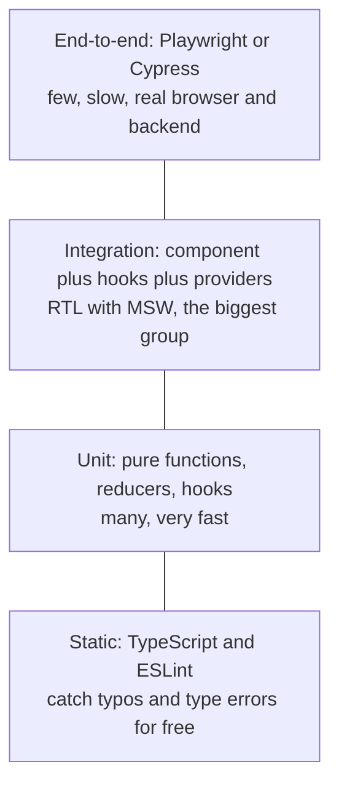

# Testing React Applications

> In this document you will learn how to test React apps the way interviewers expect: what to test and what not to test, Jest vs Vitest, the React Testing Library philosophy and its queries, `user-event` vs `fireEvent`, async tests with `findBy` and `waitFor`, the famous `act(...)` warning, mocking the network with MSW, testing custom hooks, testing components that use Redux, TanStack Query and React Router, snapshot tests, end-to-end tests and coverage. Most of the document is interview questions with spoken answers, follow-ups and runnable test code.

**Before this:** [Hooks in depth](./03-hooks-in-depth.md) · [Data fetching: axios and TanStack Query](./06-data-fetching-axios-and-tanstack-query.md) · [Patterns, architecture and TypeScript](./09-patterns-architecture-and-typescript.md) · **Interview questions:** [jump to the interview section](#interview-questions)

## Table of contents

1. [Concepts](#concepts)
   1. [What to test: behavior, not implementation](#what-to-test-behavior-not-implementation)
   2. [The testing pyramid for React](#the-testing-pyramid-for-react)
   3. [Jest and Vitest](#jest-and-vitest)
   4. [React Testing Library](#react-testing-library)
   5. [Queries and their priority](#queries-and-their-priority)
   6. [user-event and fireEvent](#user-event-and-fireevent)
   7. [Async tests and act](#async-tests-and-act)
   8. [Mocking the network with MSW](#mocking-the-network-with-msw)
   9. [Testing custom hooks](#testing-custom-hooks)
   10. [Testing with providers: Redux, TanStack Query and React Router](#testing-with-providers-redux-tanstack-query-and-react-router)
   11. [Snapshot tests](#snapshot-tests)
   12. [End-to-end tests](#end-to-end-tests)
   13. [Coverage](#coverage)
   14. [Common mistakes](#common-mistakes)
2. [Interview questions](#interview-questions)
3. [Quick revision](#quick-revision)
4. [Summary](#summary)
5. [References](#references)

> **Versions.** React 19 (19.3), React Testing Library 16, `@testing-library/dom` 10, `@testing-library/user-event` 14, `@testing-library/jest-dom`, Vitest 5 (Jest 30 notes where different), MSW 3 (MSW 2 differences marked), TanStack Query v5, Redux Toolkit 2 with React-Redux 9, React Router v7. The tests in this document were **run** with Vitest 5, jsdom, React 19.3, RTL 16, MSW 3.0, axios 1.x, TanStack Query 5, Redux Toolkit 2.13 and React Router 7.18 — except the `user-event` examples, which were checked against the user-event 14 documentation because that package was not installed in the test environment (the same flows were run with `fireEvent`).

---

## Concepts

### What to test: behavior, not implementation

**The rule:** test what the **user** sees and does, and what the **code that uses your component** relies on (its props and callbacks). Do **not** test internal details: state variable names, which hooks are used, private functions, component instance methods, CSS class names.

The guiding principle of Testing Library (from its author, Kent C. Dodds) is that tests give more confidence the closer they are to how real users use the software.

Why: tests that check implementation details **break when you refactor** even though the app still works (false failures), and they **pass when the app is broken** if the details stay the same (false confidence).

| Test this (behavior) | Not this (implementation) |
| --- | --- |
| "After clicking **Add**, the list shows 'Milk'" | "`setItems` was called with `['Milk']`" |
| "An error message appears when the API returns 500" | "`state.error` is `true`" |
| "`onSubmit` is called with `{ email, password }`" | "the `handleSubmit` method exists" |
| "The dialog with name 'Delete item' is visible" | "the component has class `modal--open`" |

### The testing pyramid for React



For React apps many teams use the **"testing trophy"** idea (also from Kent C. Dodds): static checks at the base, a moderate number of unit tests, **the most integration tests** (render a screen with its real children and providers, mock only the network), and a few end-to-end tests for critical flows. Integration tests give the best confidence per minute of effort for UI code.

### Jest and Vitest

Both are test runners with the same style of API (`describe`, `test`/`it`, `expect`, mocks, fake timers, snapshots).

| | Jest (30) | Vitest (5) |
| --- | --- | --- |
| Transform | Babel or `ts-jest`/SWC, separate config | Uses Vite: same config, plugins and aliases as the app |
| ESM and TypeScript | Works, but ESM setup can be painful | Native ESM and TypeScript |
| Speed | Good | Usually faster, especially watch mode |
| DOM environment | `testEnvironment: 'jsdom'` with `jest-environment-jsdom` | `environment: 'jsdom'` or `'happy-dom'`, or real browser mode |
| Mocks | `jest.fn()`, `jest.mock()` | `vi.fn()`, `vi.mock()` (Jest-compatible API) |
| Typical projects | Older apps, React Native, many CRA-era projects | Vite apps, new projects |

A minimal Vitest setup for React (used for the tests in this document):

```js
// vitest.config.js
import { defineConfig } from 'vitest/config';
import react from '@vitejs/plugin-react';

export default defineConfig({
  plugins: [react()],
  test: {
    environment: 'jsdom',
    globals: true,                  // describe/test/expect without imports, and RTL auto-cleanup
    setupFiles: ['./vitest.setup.js'],
  },
});
```

```js
// vitest.setup.js
import '@testing-library/jest-dom/vitest'; // adds matchers like toBeInTheDocument()
```

> **Gotcha (checked):** React Testing Library unmounts rendered components after each test **automatically only if a global `afterEach` exists**. With Vitest's default `globals: false`, components from earlier tests stay in the document and queries find duplicates ("Found multiple elements"). Fix: set `globals: true`, or call `cleanup()` in an `afterEach` yourself.

### React Testing Library

**React Testing Library (RTL)** renders components into a real DOM (jsdom in Node.js) and gives you queries that find elements **the way a user would**: by role, label, and visible text. It deliberately gives no access to component state or instances.

```jsx
import { render, screen } from '@testing-library/react';
import userEvent from '@testing-library/user-event';
import { Counter } from './Counter';

test('increments the count when the button is clicked', async () => {
  const user = userEvent.setup();
  render(<Counter />);

  await user.click(screen.getByRole('button', { name: /increment/i }));

  expect(screen.getByText('Count: 1')).toBeInTheDocument();
});
```

The API you use most:

- `render(ui, { wrapper })` — mounts the component; `wrapper` adds providers.
- `screen` — queries bound to `document.body`.
- `within(element)` — queries limited to one part of the page (a table row, a dialog).
- `renderHook(() => useX(), { wrapper })` — tests a hook.
- `act` — re-exported from React; RTL already wraps `render` and events in it.

> **History:** Enzyme was the older library (shallow rendering, access to state and instances). It never got an official adapter for React 17 or 18, and React 19 removed `react-dom/test-utils` APIs it depended on (`act` now comes from `react`). RTL is the standard today.

### Queries and their priority

Each query comes in three types (and an `All` version of each):

| Query | 0 matches | 1 match | More than 1 | Async? | Use for |
| --- | --- | --- | --- | --- | --- |
| `getBy...` | throws | returns element | throws | No | Element that **should be there now** |
| `queryBy...` | returns `null` | returns element | throws | No | Asserting an element is **not** there |
| `findBy...` | rejects after timeout | resolves element | rejects | **Yes** (returns a promise) | Element that **will appear** (after fetch, timer) |
| `getAllBy...` / `queryAllBy...` / `findAllBy...` | throws / `[]` / rejects | array | array | as above | Lists |

Checked: for an element that appears after 50 ms, `getByText` threw, `queryByText` returned `null`, and `await findByText` returned the element.

**Priority** (from the Testing Library guide) — use the first one that works:

1. **`getByRole`** (with `{ name }`) — buttons, links, headings, textboxes, checkboxes, dialogs, tabs… This also tests accessibility.
2. **`getByLabelText`** — form fields.
3. `getByPlaceholderText` — only if there is no label.
4. **`getByText`** — non-interactive text content.
5. `getByDisplayValue` — current value of a filled field.
6. `getByAltText`, `getByTitle`.
7. **`getByTestId`** — last resort, when there is no accessible way (for example a canvas chart container).

Useful details: `name` is the **accessible name** (button text, `aria-label`, or the label of an input); `type="password"` inputs have **no** `textbox` role (checked), so use `getByLabelText('Password')`; headings can be filtered with `{ level: 2 }`.

### user-event and fireEvent

- **`fireEvent`** dispatches **one** DOM event (`fireEvent.click(el)`, `fireEvent.change(input, { target: { value: 'a' } })`).
- **`@testing-library/user-event`** simulates **real user interactions**: `user.click()` fires `pointerdown`, `mousedown`, focus change, `pointerup`, `mouseup`, `click`; `user.type()` focuses the field and fires `keydown`, `keypress`, `beforeinput`, `input`, `keyup` for **each character**. It also respects `disabled` and `pointer-events: none`, like a real browser.

```jsx
const user = userEvent.setup(); // create once per test, before render
await user.type(screen.getByLabelText('Email'), 'ann@example.com');
await user.click(screen.getByRole('checkbox', { name: 'Remember me' }));
await user.selectOptions(screen.getByRole('combobox', { name: 'Country' }), 'IN');
await user.keyboard('{Escape}');
await user.tab(); // moves focus like the Tab key
```

All `user-event` 14 methods are **async**: always `await` them. Prefer `user-event`; use `fireEvent` for events `user-event` does not cover (for example `scroll`, custom events) or when you need one specific low-level event.

### Async tests and act

React updates the screen **asynchronously** after state changes from promises, timers or network calls. Tests must **wait** for the result:

```jsx
// 1. findBy: wait for something to appear (default timeout 1000 ms)
expect(await screen.findByText('Write tests')).toBeInTheDocument();

// 2. waitFor: retry an assertion until it passes (default: every 50 ms, up to 1000 ms)
await waitFor(() => expect(onSave).toHaveBeenCalledTimes(1));

// 3. waitForElementToBeRemoved: wait for a spinner to go away
await waitForElementToBeRemoved(() => screen.queryByText('Loading...'));
```

**`act(...)`** tells React "process all updates and effects from this block before I make assertions". RTL already wraps `render`, `fireEvent`, `user-event` and the async utilities in `act`, so you rarely call it yourself (you do in `renderHook` tests when you call a hook's function directly).

The warning **"An update to Component inside a test was not wrapped in act(...)"** means React state changed **while nothing was waiting for it** — usually a promise resolved or a timer fired after your assertions, or after the test ended. Checked: a component that set state in a `Promise.then` after render, in a test that did not wait for the result, produced exactly this warning. The fix is almost never "wrap it in `act`"; it is to **wait for the expected result** (`await findBy...`), or to stop the async work (clean up, mock timers).

### Mocking the network with MSW

**Mock Service Worker (MSW)** intercepts requests **at the network level** (in Node.js by patching `http`, `fetch` and `XMLHttpRequest`; in the browser with a Service Worker). Your component, your `fetch`/axios code and your TanStack Query hooks run **for real**; only the server is fake.

```js
// src/test/server.js — MSW 3
import { http, HttpResponse } from 'msw/http';
import { setupServer } from 'msw/node';

export const handlers = [
  http.get('/api/todos', () => HttpResponse.json([{ id: 1, title: 'Write tests' }])),
  http.post('/api/todos', async ({ request }) => {
    const body = await request.json();
    return HttpResponse.json({ id: 2, ...body }, { status: 201 });
  }),
];

export const server = setupServer(...handlers);
```

```js
// vitest.setup.js
import { server } from './src/test/server';

beforeAll(() => server.listen({ onUnhandledFrame: 'error' })); // fail on requests with no handler
afterEach(() => server.resetHandlers());                       // remove per-test overrides
afterAll(() => server.close());
```

```jsx
// Override for one test: simulate a server error
server.use(http.get('/api/todos', () => new HttpResponse(null, { status: 500 })));
```

> **MSW 2 → 3 note:** In MSW 2, you import `http` and `HttpResponse` from `'msw'` and the option is `onUnhandledRequest: 'error'`. In MSW 3 (2026), handlers live in **`msw/http`** (also `msw/graphql`, `msw/ws`, `msw/sse`), `onUnhandledRequest` is renamed to **`onUnhandledFrame`** (it also covers WebSocket), and Node.js 22+ is required. Checked with MSW 3.0.3: the `msw/http` imports and `onUnhandledFrame: 'error'` work, and (in this version) the old root `'msw'` imports still worked too, but the migration guide says to move to `msw/http`.

> **Gotcha (checked):** in jsdom, axios uses the `XMLHttpRequest` adapter, and jsdom's XHR **enforces CORS**. A request from the test page (`http://localhost:3000`) to another origin like `https://api.test/todos` failed with "Network Error" even though an MSW handler matched — because the mocked response had no `Access-Control-Allow-Origin` header. `fetch` (Node's implementation) did not have this problem. Fixes: use relative URLs / a same-origin `baseURL` in tests, or add the CORS header in the handler.

### Testing custom hooks

```jsx
import { renderHook, act } from '@testing-library/react';

function useCounter(initial = 0) {
  const [count, setCount] = useState(initial);
  return { count, increment: () => setCount((c) => c + 1) };
}

test('useCounter increments', () => {
  const { result } = renderHook(() => useCounter(5));
  act(() => result.current.increment()); // calling the hook's function directly -> needs act
  expect(result.current.count).toBe(6);  // read result.current AFTER the update (checked)
});
```

`renderHook` was moved into `@testing-library/react` (version 13.1+); the old `@testing-library/react-hooks` package is deprecated. Use `rerender(newProps)` to change hook arguments, and the `wrapper` option for providers.

**Prefer testing a hook through a component** when the hook exists only for one component; use `renderHook` for reusable hooks with their own API (`useDebouncedValue`, `useLocalStorage`, `useOrdersQuery`).

### Testing with providers: Redux, TanStack Query and React Router

Components that use a store, a query client or the router need those **providers** in tests. The standard approach is a **custom render** helper that creates **fresh** instances for each test:

```jsx
// src/test/render.jsx
import { render } from '@testing-library/react';
import { Provider } from 'react-redux';
import { QueryClient, QueryClientProvider } from '@tanstack/react-query';
import { MemoryRouter } from 'react-router';
import { makeStore } from '../app/store';

export function renderWithProviders(ui, { preloadedState, route = '/', ...options } = {}) {
  const store = makeStore(preloadedState);           // a NEW real store per test
  const queryClient = new QueryClient({
    defaultOptions: { queries: { retry: false } },   // fail fast in tests
  });

  function Wrapper({ children }) {
    return (
      <Provider store={store}>
        <QueryClientProvider client={queryClient}>
          <MemoryRouter initialEntries={[route]}>{children}</MemoryRouter>
        </QueryClientProvider>
      </Provider>
    );
  }

  return { store, queryClient, ...render(ui, { wrapper: Wrapper, ...options }) };
}
```

- **Redux:** use the **real** store and reducers with `preloadedState`, not a mocked store — this is the official Redux recommendation. Assert on the UI, and if useful on `store.getState()` (checked: clicking "Add" changed `Items: 1` to `Items: 2` and the store state).
- **TanStack Query:** a new `QueryClient` per test (so the cache does not leak between tests) and `retry: false` (otherwise a failing query retries 3 times with delays and the test times out). Checked: with `retry: false`, `isError` became `true` quickly for a 500 response.
- **React Router v7:** `MemoryRouter` with `initialEntries` for components that use `useParams`/`Link`; `createMemoryRouter` + `RouterProvider` to test routes with loaders and actions (checked: clicking a `Link` rendered the "About page" heading). Import from `react-router` (in v7, `react-router-dom` only re-exports it).

### Snapshot tests

`expect(container).toMatchSnapshot()` saves the rendered HTML to a file the first time and compares it on later runs.

- **Pros:** very fast to write; catch unexpected changes in output of small, stable components (an icon set, a formatted email template, serializers).
- **Cons:** big snapshots nobody reads; every intended change requires updating the snapshot, so people press `u` without looking; they test markup (implementation), not behavior; they fail on harmless changes (a class name).
- **Good practice:** keep snapshots small (`toMatchInlineSnapshot()` for a few lines), use them for output that really should not change, and do not use them as the main test of a component.

### End-to-end tests

**End-to-end (E2E)** tests run the real app in a real browser, usually against a real or staging backend: **Playwright** (multi-browser: Chromium, Firefox, WebKit; parallel by default; auto-waiting locators; trace viewer) or **Cypress** (runs inside the browser; great interactive runner; component testing mode).

```ts
// Playwright
import { test, expect } from '@playwright/test';

test('user can log in', async ({ page }) => {
  await page.goto('/login');
  await page.getByLabel('Email').fill('ann@example.com');
  await page.getByLabel('Password').fill('test-password');
  await page.getByRole('button', { name: 'Sign in' }).click();
  await expect(page.getByRole('heading', { name: 'Dashboard' })).toBeVisible();
});
```

Use E2E for a **small number of critical journeys** (sign-up, login, checkout, payment), because they are slower and more fragile. Use RTL integration tests for everything else. Locator style is similar to RTL (`getByRole`, `getByLabel`), so the same accessibility-first habits apply.

### Coverage

Coverage tools (`vitest --coverage` with `@vitest/coverage-v8` or `istanbul`; `jest --coverage`) report which **lines, branches, functions and statements** ran during tests.

- Coverage shows what is **not** tested; it does not prove what **is** tested well. A test with no assertions can give 100% coverage.
- **Branch coverage** is more useful than line coverage (did we test both the success and the error path?).
- Reasonable targets: around 70–80% for app code, higher for critical shared logic. A rule like "coverage must not go down in a pull request" often works better than a fixed number.

### Common mistakes

- Testing implementation details (state, class names, hook calls) instead of what the user sees.
- Using `getByTestId` everywhere instead of role and label queries.
- `getBy` for "not present" checks (it throws) instead of `queryBy`.
- Forgetting `await` on `findBy`, `waitFor` or `user-event` calls.
- Wrapping things in `act` to silence the warning instead of waiting for the real result.
- Putting side effects inside `waitFor` (for example `user.click` inside the callback, which repeats on every retry).
- Mocking `axios`/`fetch`/your API module so heavily that the test checks only the mock.
- Sharing a store or `QueryClient` between tests (state leaks, order-dependent tests).
- Leaving TanStack Query `retry` on in tests (slow, time-outs).
- Large snapshot tests as the only test.
- Not resetting MSW handlers after each test.

---

## Interview questions


### Q1. What should you test in a React application?

**What the interviewer is checking:** The behavior-vs-implementation principle and a sense of priorities.

**What to say (30–60 seconds):**

> "I test behavior — what the user sees and does, and the contract with the parent: props in, callbacks out. For example: when I type an email and click Sign in, `onSubmit` is called with the values; when the API fails, an error message appears. I don't test internal state, which hooks are used, or class names, because those tests break on every refactor and still pass when the UI is broken. In terms of priorities, I focus on critical user flows and complex logic: forms with validation, data loading with loading and error states, permissions, and pure business logic like price calculations. Simple presentational components often don't need their own tests; they're covered by the screen tests."

**Deeper explanation:** See [What to test: behavior, not implementation](#what-to-test-behavior-not-implementation). A useful question when writing a test: "If I refactor this component without changing what the user sees, will this test still pass?" If not, it tests implementation.

**Follow-up questions and how to answer them:**

- **"What about pure functions and reducers?"** — Unit test them directly with many input cases; they are cheap to test and contain logic. A Redux reducer is just `(state, action) => newState`.
- **"How many tests is enough?"** — Enough that you can refactor and deploy with confidence. Measure by bugs that escape to production, not by test count. Coverage helps find untested branches.
- **"Do you test third-party components?"** — No, test your usage of them (that your date picker integration sends the right value), not the library itself.

**Common mistakes / weak answers:** "I test every component and every function." "I check that `useState` was called." Aiming for 100% coverage as the goal.

**Real-project example:** Replacing 300 Enzyme tests that checked `state()` with 80 RTL screen tests reduced false failures during a redesign to almost zero.

### Q2. What does the testing pyramid (or trophy) look like for a React app?

**What the interviewer is checking:** Testing strategy at the team level.

**What to say (30–60 seconds):**

> "At the bottom are static checks: TypeScript and ESLint, which catch many bugs for free. Then unit tests for pure logic — utilities, reducers, custom hooks with their own API. The biggest group for UI code is integration tests: rendering a whole screen or feature with its real child components and providers, mocking only the network with MSW, and interacting like a user with React Testing Library. At the top, a few end-to-end tests with Playwright or Cypress for critical journeys like login and checkout. This is the 'testing trophy' idea: integration tests give the best confidence for the cost in frontend apps."

**Deeper explanation:** See [The testing pyramid for React](#the-testing-pyramid-for-react).

| Level | Tool | Speed | Confidence | Count |
| --- | --- | --- | --- | --- |
| Static | TypeScript, ESLint | Instant | Low–medium | Everything |
| Unit | Vitest/Jest | ms | Medium | Many |
| Integration | RTL + MSW | 10–500 ms | High | Most UI tests |
| E2E | Playwright/Cypress | seconds | Highest | Few |

**Follow-up questions and how to answer them:**

- **"Where do visual regression tests fit?"** — Next to E2E or component tests: tools like Playwright screenshots, Chromatic (Storybook) or Percy compare screenshots to catch CSS changes that functional tests miss.
- **"Where does component testing in a real browser fit?"** — Between integration and E2E: Vitest browser mode, Playwright component testing or Cypress component testing run components in a real browser, which avoids jsdom limitations (layout, `<dialog>`, `IntersectionObserver`).

**Common mistakes / weak answers:** Only unit tests for every tiny component, or only E2E tests ("ice-cream cone" anti-pattern: slow and flaky).

**Real-project example:** A team moved from 40 slow E2E tests per pull request to 8 critical E2E flows plus RTL integration tests; CI time dropped from 25 to 7 minutes with no more escaped bugs.

### Q3. Jest or Vitest — what's the difference, and which would you choose?

**What the interviewer is checking:** Tooling awareness and reasoning.

**What to say (30–60 seconds):**

> "Both are test runners with almost the same API — `describe`, `test`, `expect`, mocks, fake timers, snapshots — so tests look nearly the same; Vitest uses `vi.fn` instead of `jest.fn`. The difference is the engine. Vitest is built on Vite, so it reuses the app's Vite config, plugins and aliases, supports ESM and TypeScript natively, and is usually faster, especially in watch mode. Jest is older, very stable, has a huge ecosystem, and is still standard in many existing projects and in React Native. For a new Vite-based app I'd choose Vitest; in an existing Jest project I wouldn't migrate unless the config pain or speed is a real problem."

**Deeper explanation:** See [Jest and Vitest](#jest-and-vitest). Migration is mostly mechanical: replace `jest.` with `vi.`, move config, and check `vi.mock` hoisting rules.

**Follow-up questions and how to answer them:**

- **"What is jsdom, and what can it not do?"** — jsdom is a JavaScript implementation of the DOM for Node.js. It has no layout (sizes are 0, `getBoundingClientRect` returns zeros), no real navigation, no `IntersectionObserver`/`ResizeObserver`, and incomplete APIs (checked: `HTMLDialogElement.showModal` is not implemented in jsdom 29). Mock these, or use a real browser (Vitest browser mode, Playwright).
- **"jsdom or happy-dom?"** — happy-dom is faster but less complete; jsdom is more standard-compliant. Use jsdom unless speed is a problem and your tests work with happy-dom.
- **"Anything new in Vitest 5 that affects React tests?"** — `vi.mock` must be at the top level of the file (calling it inside a test now throws), `clearMocks` is `true` by default, and Node.js 22.12+ and Vite 6.4+ are required.

**Common mistakes / weak answers:** "Vitest is only for Vue." "Jest is deprecated."

**Real-project example:** Moving a Vite app from Jest + Babel config to Vitest removed 120 lines of duplicate config (aliases, SVG mocks, CSS module mocks) and made the watch mode about 3× faster.

### Q4. What is the philosophy of React Testing Library, and how is it different from Enzyme?

**What the interviewer is checking:** Understanding *why* RTL is designed the way it is.

**What to say (30–60 seconds):**

> "React Testing Library is built on the idea that tests should use the app the way users do. So it renders the real component tree into a DOM and gives you queries by role, label and text — not access to state, props or component instances. If a test can find a button by its role and name, a screen-reader user can probably find it too, so tests also push you to write accessible markup. Enzyme gave access to internals — shallow rendering, reading state, calling instance methods — which made tests break on refactors. Enzyme also never got official adapters for React 17 or 18 and doesn't work with React 19, so RTL is the standard now."

**Deeper explanation:** RTL does not support **shallow rendering** on purpose: rendering the real children catches integration bugs between parent and child. If a child is heavy (a chart library), mock that module, not the rendering model.

**Follow-up questions and how to answer them:**

- **"Isn't full rendering slower than shallow?"** — A little, but the confidence gain is large, and RTL tests are still fast (milliseconds). Mock only truly heavy or browser-only children.
- **"Can RTL test components in isolation?"** — Yes: render one component with props and assert on its output and callbacks. "Isolation" means controlling inputs, not cutting off its children.

**Common mistakes / weak answers:** "RTL is just a different syntax for Enzyme."

**Real-project example:** When the team switched a form from class to function components, all RTL tests passed unchanged, while the old Enzyme tests had to be rewritten.

### Q5. Explain getBy, queryBy and findBy. When do you use each?

**What the interviewer is checking:** The most basic RTL knowledge — must be precise.

**What to say (30–60 seconds):**

> "All three find elements, but they behave differently when the element isn't there. `getBy` throws immediately if there's no match or more than one, so I use it for things that should be on the screen right now — and the error message prints the DOM, which helps debugging. `queryBy` returns null when there's no match, so it's the one for asserting that something is *not* there. `findBy` returns a promise: it retries until the element appears or a timeout, by default one second, so I use it for things that appear after a fetch or a timer, and I always await it. Each also has an `All` version for multiple elements."

**Deeper explanation:** Checked by running:

```jsx
function Late() {
  const [ready, setReady] = useState(false);
  useEffect(() => { setTimeout(() => setReady(true), 50); }, []);
  return ready ? <p>ready</p> : null;
}

test('getBy, queryBy, findBy', async () => {
  render(<Late />);
  expect(() => screen.getByText('ready')).toThrow();          // not there yet -> throws
  expect(screen.queryByText('ready')).not.toBeInTheDocument(); // null
  expect(await screen.findByText('ready')).toBeInTheDocument(); // waits, then found
});
```

**Follow-up questions and how to answer them:**

- **"How is `findBy` related to `waitFor`?"** — `findBy...` is `waitFor(() => getBy...)`. Use `findBy` for "wait until an element appears", and `waitFor` for other assertions (a mock was called, text changed in an existing element).
- **"How do you assert something disappears?"** — `await waitForElementToBeRemoved(() => screen.queryByText('Loading...'))`, or `await waitFor(() => expect(screen.queryByText('Loading...')).not.toBeInTheDocument())`.
- **"What happens if `queryBy` finds two matches?"** — It throws too ("Found multiple elements"). Only "zero matches" is different. Use `queryAllBy` for lists.

**Common mistakes / weak answers:** `expect(screen.getByText('x')).toBeNull()` (it throws before the assertion). `findBy` without `await`.

**Real-project example:** A flaky test that used `getByText` right after a click was fixed by `await findByText`, because the text appeared after a state update from a resolved promise.

### Q6. Which query should you use first? When is getByTestId acceptable?

**What the interviewer is checking:** Accessibility-first testing.

**What to say (30–60 seconds):**

> "I follow the Testing Library priority: `getByRole` first, with the accessible name — like `getByRole('button', { name: 'Save' })` — because that's how assistive technology sees the page. For form fields, `getByLabelText`. For plain content, `getByText`. Test ids are the last resort, for things that have no accessible role or text, like a chart canvas or a drag-and-drop area. If I can't find an element by role, that's often a sign the markup isn't accessible — for example a `div` used as a button — and I fix the component, not the test."

**Deeper explanation:** See [Queries and their priority](#queries-and-their-priority). Common roles: `button`, `link`, `heading`, `textbox`, `checkbox`, `radio`, `combobox` (a `<select>`), `listbox`, `option`, `dialog`, `alert`, `status`, `tab`, `tabpanel`, `table`, `row`, `cell`, `img`, `navigation`, `main`.

```jsx
screen.getByRole('heading', { name: 'Orders', level: 1 });
screen.getByRole('textbox', { name: 'Email' });          // input type=email has role textbox
screen.getByLabelText('Password');                         // password inputs have no textbox role
within(screen.getByRole('row', { name: /order 42/i })).getByRole('button', { name: 'Cancel' });
```

**Follow-up questions and how to answer them:**

- **"`getByRole` is slow in big DOMs — what do you do?"** — It computes accessibility info for many elements. Limit the search with `within(container)`, or use `getByText`/`getByLabelText` in very large trees; you can also pass `hidden: false` (the default) to skip hidden elements.
- **"How do you find the role of an element?"** — `screen.logTestingPlaygroundURL()` or `screen.debug()`, and the error message of a failing `getByRole` lists all available roles and names.

**Common mistakes / weak answers:** Adding `data-testid` to everything "because it's stable". Querying by CSS class with `container.querySelector`.

**Real-project example:** Switching to role queries found that the "Close" icon button had no accessible name; adding `aria-label="Close"` fixed both the test and the screen-reader experience.

### Q7. user-event or fireEvent — which do you use and why?

**What the interviewer is checking:** Realistic interaction testing.

**What to say (30–60 seconds):**

> "I use `user-event` by default. `fireEvent` dispatches a single DOM event, like one `click` or one `change` with a new value. `user-event` simulates what a real user does: a click includes pointer and mouse events and moves focus; typing focuses the field and fires key and input events for each character, so things like `onKeyDown` handlers, input masks and character limits are really tested. It also won't click a disabled button. With version 14, I create `const user = userEvent.setup()` at the start of the test and await every call. I use `fireEvent` only for events `user-event` doesn't cover, like `scroll`."

**Deeper explanation:**

```jsx
// fireEvent: sets the value at once, fires one change event
fireEvent.change(input, { target: { value: 'hello' } });

// user-event: focus, then keydown/keypress/input/keyup for h, e, l, l, o
const user = userEvent.setup();
await user.type(input, 'hello');
await user.clear(input);
await user.click(screen.getByRole('button', { name: 'Save' }));
```

**Follow-up questions and how to answer them:**

- **"What breaks with fireEvent that user-event catches?"** — A disabled button: `fireEvent.click` still dispatches the click event (React does not call `onClick` for disabled buttons, but other listeners may run), while `user.click` refuses because `pointer-events` are blocked. Typing: `fireEvent.change` skips `onKeyDown`, so a "submit on Enter" or "max 10 characters" handler is not tested.
- **"How do you use user-event with fake timers?"** — `userEvent.setup({ advanceTimers: vi.advanceTimersByTime })`, otherwise user-event's internal delays wait for timers that never advance and the test hangs. See [Q22](#q22-how-do-you-test-a-debounced-search-with-fake-timers).
- **"Why `setup()` instead of calling `userEvent.click` directly?"** — `setup()` creates one "user session" that shares keyboard and pointer state (for example a held Shift key) across calls. The direct API still exists but calls `setup` internally each time.

**Common mistakes / weak answers:** Forgetting `await` with user-event 14 (the assertion runs before the interaction finishes).

**Real-project example:** A phone-number input mask worked with `fireEvent.change` in tests but broke for real users; switching the test to `user.type` reproduced the bug.

### Q8. Write a test for a login form.

**What the interviewer is checking:** A complete, realistic test using best practices.

```jsx
// LoginForm.jsx
export function LoginForm({ onSubmit }) {
  const [email, setEmail] = useState('');
  const [password, setPassword] = useState('');
  const [error, setError] = useState('');

  function handleSubmit(e) {
    e.preventDefault();
    if (!email) {
      setError('Email is required');
      return;
    }
    setError('');
    onSubmit({ email, password });
  }

  return (
    <form onSubmit={handleSubmit}>
      <label htmlFor="email">Email</label>
      <input id="email" type="email" value={email} onChange={(e) => setEmail(e.target.value)} />
      <label htmlFor="password">Password</label>
      <input id="password" type="password" value={password} onChange={(e) => setPassword(e.target.value)} />
      {error && <p role="alert">{error}</p>}
      <button type="submit">Sign in</button>
    </form>
  );
}
```

**What to say (30–60 seconds):**

> "I'd write two or three behavior tests. First, the validation: click Sign in with an empty form and expect an alert saying 'Email is required', and expect that `onSubmit` was not called. Second, the happy path: type an email and password using the labels, click Sign in, and expect `onSubmit` to be called once with exactly those values. I'd find fields with `getByLabelText` or `getByRole('textbox', { name })`, the button with `getByRole('button', { name: /sign in/i })`, use `user-event`, and pass a mock function as `onSubmit`. If the form calls an API itself, I'd mock the API with MSW and assert on what the user sees after login."

**Deeper explanation:**

```jsx
import { render, screen } from '@testing-library/react';
import userEvent from '@testing-library/user-event';
import { LoginForm } from './LoginForm';

describe('LoginForm', () => {
  test('shows an error when email is missing', async () => {
    const user = userEvent.setup();
    const onSubmit = vi.fn();
    render(<LoginForm onSubmit={onSubmit} />);

    await user.click(screen.getByRole('button', { name: /sign in/i }));

    expect(screen.getByRole('alert')).toHaveTextContent('Email is required');
    expect(onSubmit).not.toHaveBeenCalled();
  });

  test('submits email and password', async () => {
    const user = userEvent.setup();
    const onSubmit = vi.fn();
    render(<LoginForm onSubmit={onSubmit} />);

    await user.type(screen.getByRole('textbox', { name: 'Email' }), 'ann@example.com');
    await user.type(screen.getByLabelText('Password'), 'secret');
    await user.click(screen.getByRole('button', { name: /sign in/i }));

    expect(onSubmit).toHaveBeenCalledTimes(1);
    expect(onSubmit).toHaveBeenCalledWith({ email: 'ann@example.com', password: 'secret' });
  });
});
```

Checked: the same flow with `fireEvent` passed with React 19.3 (alert text, `onSubmit` arguments, and that the password field has no `textbox` role).

**Follow-up questions and how to answer them:**

- **"How would you test 'submit on Enter'?"** — `await user.type(passwordInput, 'secret{Enter}')`; the browser-like behavior submits the form. This is a good reason to use a real `<form>` and `type="submit"`.
- **"How do you test a loading state during login?"** — Make the MSW handler slow (`await delay(100)` from `msw/utils/delay` in MSW 3, or `delay` from `'msw'` in MSW 2), then assert `getByRole('button', { name: /signing in/i })` is disabled, and later `await findByRole('heading', { name: 'Dashboard' })`.
- **"Should you test that the password is masked?"** — You can assert `toHaveAttribute('type', 'password')`. It is an attribute users rely on, so it is acceptable.

**Common mistakes / weak answers:** Querying by `id` or class. Testing `useState` values. Not checking that `onSubmit` was **not** called on invalid input.

**Real-project example:** A login test written this way caught a regression where a refactor changed the payload key from `email` to `username`.

### Q9. How do you test asynchronous behavior? What are the rules for waitFor?

**What the interviewer is checking:** Correct async testing, a top source of flaky tests.

**What to say (30–60 seconds):**

> "Anything that happens after a promise or timer needs waiting. For 'an element will appear', I use `await findBy...`. For other conditions — like a mock was called, or text changed — I use `await waitFor(() => expect(...))`, which retries the callback until it passes or times out after one second by default. Rules for `waitFor`: put only assertions inside, never side effects like clicks, because the callback runs many times; one assertion per `waitFor` is best; and don't use it with `getBy` for something that can be a `findBy`. For 'disappears', `waitForElementToBeRemoved`."

**Deeper explanation:**

```jsx
// Good
await user.click(screen.getByRole('button', { name: 'Save' }));
await waitFor(() => expect(onSaved).toHaveBeenCalledTimes(1));

// Bad: the click is repeated on every retry
await waitFor(() => {
  user.click(screen.getByRole('button', { name: 'Save' }));
  expect(onSaved).toHaveBeenCalled();
});

// Bad: empty waitFor "waits a tick" by accident and hides timing problems
await waitFor(() => {});
```

**Follow-up questions and how to answer them:**

- **"How do you change the timeout?"** — `findByText('x', {}, { timeout: 3000 })` or `waitFor(cb, { timeout: 3000 })`. But if you need long timeouts, the test probably waits for real delays that should be mocked (MSW without delay, fake timers).
- **"Does `waitFor` work with fake timers?"** — Yes, Testing Library detects Jest fake timers and advances them while waiting. With Vitest fake timers, advance time explicitly (`await vi.advanceTimersByTimeAsync(300)`), and configure `user-event` with `advanceTimers`.

**Common mistakes / weak answers:** Using `setTimeout`/`sleep` in tests to "wait enough". Asserting synchronously right after an async event.

**Real-project example:** A test that slept 500 ms passed locally and failed in slow CI; replacing the sleep with `findByRole` made it fast and stable.

### Q10. What does the "not wrapped in act(...)" warning mean, and how do you fix it?

**What the interviewer is checking:** Deep understanding of a warning everyone has seen.

**What to say (30–60 seconds):**

> "`act` makes React process all pending state updates and effects before the test continues, so assertions see the final UI. React Testing Library already wraps render, events and its async helpers in `act`. The warning appears when a state update happens outside of that — usually a promise or timer resolves after the test finished its assertions, or after the test ended. So it's a sign that the test didn't wait for something the component does. The right fix is to wait for the result the user would see — `await findBy...` for the loaded data — or to control the async work with MSW or fake timers. Wrapping random code in `act` usually just hides the problem."

**Deeper explanation:** Checked: this component and test produce the warning (React 19.3):

```jsx
function Profile() {
  const [name, setName] = useState('...');
  useEffect(() => {
    fetchUser().then((u) => setName(u.name)); // updates state later
  }, []);
  return <p>{name}</p>;
}

test('renders', () => {
  render(<Profile />);
  // the test ends here; then the promise resolves -> "An update to Profile inside a test was not wrapped in act(...)"
});

// Fix: wait for what the user sees
test('renders the user name', async () => {
  render(<Profile />);
  expect(await screen.findByText('Ann')).toBeInTheDocument();
});
```

**Follow-up questions and how to answer them:**

- **"When do you call `act` yourself?"** — When you trigger updates outside RTL helpers: calling a function from `renderHook`'s `result.current`, advancing fake timers that cause state updates (`act(() => vi.advanceTimersByTime(300))`), or calling a store's method directly. In React 19, import `act` from `react` (or from RTL); `react-dom/test-utils` `act` was removed.
- **"Why does React even need `act`?"** — React batches and schedules updates asynchronously. In tests, `act` flushes that work synchronously (or awaits it with `await act(async () => ...)`), so the DOM matches the latest state when you assert. RTL sets `IS_REACT_ACT_ENVIRONMENT = true` so React warns when updates happen outside `act`.
- **"The warning appears from a component I'm not testing, like a tooltip. What then?"** — Something in the tree still runs async work after the test: an animation timer, a polling query. Wait for it to settle, mock it, or make sure it is cleaned up on unmount.

**Common mistakes / weak answers:** "Wrap the whole test in `act`." "Ignore it, it's just a warning" — it often means the test asserts on an intermediate state.

**Real-project example:** Dozens of act warnings in a suite came from a `useQuery` polling every 5 seconds; passing `refetchInterval: false` in the test `QueryClient` defaults removed them.

### Q11. Why is my test flaky? What are the common causes?

**What the interviewer is checking:** Debugging experience with unreliable tests.

**What to say (30–60 seconds):**

> "Flaky tests usually come from timing or shared state. Timing: asserting before async work finishes, using fixed sleeps, real timers and debounce, animations, or missing `await` on user-event and `findBy`. Shared state: a store, a React Query client or MSW handlers reused between tests, mocks not reset, or global objects like `localStorage` or `Date` changed by one test. Also order dependency — a test that passes alone but fails in the suite. To fix, I make every test independent with fresh providers and reset mocks, wait for visible results instead of time, control time with fake timers, and make the network deterministic with MSW. Running the test many times, or in random order, helps reproduce it."

**Deeper explanation:** A checklist:

| Cause | Fix |
| --- | --- |
| Missing `await` | `await user.click`, `await findBy`, lint rules (`eslint-plugin-testing-library`) |
| `sleep(500)` | `findBy` / `waitFor` on the expected UI |
| Shared `QueryClient` / store | Create a new one per test in the custom render |
| MSW override leaking | `afterEach(() => server.resetHandlers())` |
| Real dates and timers | `vi.useFakeTimers()`, `vi.setSystemTime(new Date('2026-01-01'))` |
| Random data | Fixed seeds or fixed fixtures |
| Retries in queries | `retry: false` in tests |
| Tests depending on order | Run with `--sequence.shuffle` (Vitest) to find them |

**Follow-up questions and how to answer them:**

- **"A test passes locally but fails in CI. Why?"** — CI machines are slower (timeouts, race conditions), may have a different time zone or locale (date formatting), different Node version, and run tests in parallel. Set `TZ=UTC` and a fixed locale in tests, and do not depend on timing.
- **"Should you retry flaky tests automatically?"** — Retries hide the problem and slow CI. They can be a temporary measure for E2E tests, but track and fix the root cause.

**Common mistakes / weak answers:** "Increase the timeout." "Mark it as skip."

**Real-project example:** A date-picker test failed only between 00:00 and 05:30 UTC because CI used UTC while the developers were in India; `vi.setSystemTime` and `TZ=UTC` fixed it.

### Q12. How do you mock API calls? Why MSW instead of mocking axios or fetch?

**What the interviewer is checking:** Mocking strategy and its trade-offs.

**What to say (30–60 seconds):**

> "I prefer MSW, which intercepts requests at the network level. My component, my API module, axios or fetch, and TanStack Query all run for real; only the server's response is fake. So the test covers the real URL, method, headers, body and response parsing, and it doesn't care if I switch from axios to fetch. The same handlers work in unit tests, in the browser during development, and in Storybook. If I mock axios with `vi.mock`, the test only knows that 'axios.get was called', it skips interceptors and parsing, and it breaks when I refactor the HTTP layer. I'd mock a module only for things that aren't network, like a chart library or analytics."

**Deeper explanation:**

```jsx
// Mocking axios directly — tied to implementation
vi.mock('axios');
axios.get.mockResolvedValue({ data: [{ id: 1, title: 'Write tests' }] });
// Breaks if the code switches to fetch, an axios instance, or adds a param.

// MSW — tied to the network contract
server.use(http.get('/api/todos', () => HttpResponse.json([{ id: 1, title: 'Write tests' }])));
```

See [Mocking the network with MSW](#mocking-the-network-with-msw).

**Follow-up questions and how to answer them:**

- **"How do you check what the component sent to the server?"** — Read it inside the handler: `http.post('/api/todos', async ({ request }) => { received = await request.json(); return HttpResponse.json(...) })`, then assert on `received`. Or better, assert on the UI result that depends on it.
- **"Isn't MSW slower?"** — Slightly, but negligible (milliseconds), and the test is far more realistic.
- **"How do you keep mocks in sync with the real API?"** — Generate handlers or types from the OpenAPI schema, validate responses with Zod in the app, and use contract tests or a few E2E tests against the real backend.

**Common mistakes / weak answers:** Mocking `useQuery` or your own hook so the test checks only the mock. Using real backend in unit tests (slow, flaky).

**Real-project example:** Moving 200 tests from `vi.mock('axios')` to MSW revealed that the auth interceptor was never tested; one test immediately found a token-refresh bug.

### Q13. Write a test for a component that fetches data (loading, success, error).

**What the interviewer is checking:** End-to-end understanding of an async component test.

```jsx
// TodoList.jsx
import axios from 'axios';

export function TodoList() {
  const [todos, setTodos] = useState(null);
  const [error, setError] = useState(null);

  useEffect(() => {
    let ignore = false;
    axios.get('/api/todos')
      .then((res) => { if (!ignore) setTodos(res.data); })
      .catch((e) => { if (!ignore) setError(e); });
    return () => { ignore = true; };
  }, []);

  if (error) return <p role="alert">Could not load todos</p>;
  if (!todos) return <p>Loading...</p>;
  return <ul>{todos.map((t) => <li key={t.id}>{t.title}</li>)}</ul>;
}
```

**What to say (30–60 seconds):**

> "I'd set up MSW with a default handler that returns a list. The success test renders the component, checks that 'Loading...' is shown first, then awaits `findByText` for a todo title. The error test overrides the handler with `server.use` to return a 500, renders, and awaits `findByRole('alert')` with the error text. I'd also consider an empty-list test. MSW resets handlers after each test, so overrides don't leak. And the URL is relative, which matters in jsdom because axios uses XHR there and jsdom enforces CORS for other origins."

**Deeper explanation:** Checked by running (MSW 3, axios, React 19.3):

```jsx
import { render, screen } from '@testing-library/react';
import { http, HttpResponse } from 'msw/http';
import { server } from '../test/server';
import { TodoList } from './TodoList';

test('shows todos after loading', async () => {
  render(<TodoList />);
  expect(screen.getByText('Loading...')).toBeInTheDocument();
  expect(await screen.findByText('Write tests')).toBeInTheDocument();
  expect(screen.queryByText('Loading...')).not.toBeInTheDocument();
});

test('shows an error when the request fails', async () => {
  server.use(http.get('/api/todos', () => new HttpResponse(null, { status: 500 })));
  render(<TodoList />);
  expect(await screen.findByRole('alert')).toHaveTextContent('Could not load todos');
});

test('shows a list item for each todo', async () => {
  server.use(http.get('/api/todos', () => HttpResponse.json([
    { id: 1, title: 'A' },
    { id: 2, title: 'B' },
  ])));
  render(<TodoList />);
  expect(await screen.findAllByRole('listitem')).toHaveLength(2);
});
```

**Follow-up questions and how to answer them:**

- **"How do you test the loading state reliably if the mock is very fast?"** — Assert it synchronously right after `render` (the request cannot finish before the first assertion, because MSW responds asynchronously), or add `await delay(100)` in the handler for a test that needs a long loading phase.
- **"How do you test a network error (no response at all)?"** — `http.get('/api/todos', () => HttpResponse.error())` simulates a failed request (axios: "Network Error", fetch: `TypeError`).
- **"What if the component used TanStack Query?"** — Same test, but render with a `QueryClientProvider` using a fresh client with `retry: false` ([Q16](#q16-how-do-you-test-a-component-that-uses-tanstack-query)).

**Common mistakes / weak answers:** Mocking `useEffect` or `useState`. Forgetting the error case. Using absolute URLs to a different origin with axios in jsdom.

**Real-project example:** The "empty list" test led the team to add a proper "No todos yet" message, which was missing.

### Q14. What MSW setup mistakes do you see in real projects?

**What the interviewer is checking:** Practical MSW experience, including version changes.

**What to say (30–60 seconds):**

> "The common ones: not resetting handlers after each test, so one test's error override breaks the next test; not failing on unhandled requests, so a typo in a URL silently hits nothing and the test checks a loading spinner forever; forgetting to `await` the request body in a handler; and using a different base URL than the app. In jsdom with axios, cross-origin URLs fail because jsdom's XHR enforces CORS, so I use relative URLs or the same origin. In Jest, MSW needs a jsdom environment with the right globals; MSW's docs recommend `jest-fixed-jsdom`. And when upgrading to MSW 3, imports move to `msw/http` and `onUnhandledRequest` becomes `onUnhandledFrame`."

**Deeper explanation:** See [Mocking the network with MSW](#mocking-the-network-with-msw) for setup, the version note and the CORS gotcha (all checked with MSW 3.0.3).

**Follow-up questions and how to answer them:**

- **"How do you share handlers between tests, Storybook and the dev server?"** — Keep `handlers.js` in one place; use `setupServer(...handlers)` in tests and `setupWorker(...handlers)` from `msw/browser` in the browser (with the generated `mockServiceWorker.js` file in `public/`).
- **"How do you simulate different users or states?"** — Use `server.use()` overrides per test, or `http.get(url, resolver, { once: true })` for a response that should happen only once (for example a first failure then success).

**Common mistakes / weak answers:** Only knowing MSW 1 syntax (`rest.get((req, res, ctx) => res(ctx.json(...)))`), which was replaced in MSW 2 (2023).

**Real-project example:** Turning on "error on unhandled requests" found 11 tests that were silently passing while their API calls went nowhere.

### Q15. How do you test a custom hook?

**What the interviewer is checking:** `renderHook`, `act`, `result.current`, wrappers.

**What to say (30–60 seconds):**

> "For a reusable hook, I use `renderHook` from React Testing Library. It renders a tiny test component that calls the hook, and gives me `result.current` with the latest return value. If I call a function from the hook that updates state, I wrap it in `act`, then read `result.current` again — not a value I saved before, because that's an old render's value. `rerender` lets me pass new arguments, and the `wrapper` option adds providers like a QueryClient. For a hook that's only used by one component, I'd rather test it through that component."

**Deeper explanation:** Checked by running (both tests):

```jsx
import { renderHook, act } from '@testing-library/react';

test('useCounter', () => {
  const { result, rerender } = renderHook(({ initial }) => useCounter(initial), {
    initialProps: { initial: 5 },
  });
  act(() => result.current.increment());
  expect(result.current.count).toBe(6);
});

// Async hook (debounce), with fake timers
test('useDebouncedValue', () => {
  vi.useFakeTimers();
  const { result, rerender } = renderHook(({ v }) => useDebouncedValue(v, 300), {
    initialProps: { v: 'a' },
  });
  rerender({ v: 'ab' });
  expect(result.current).toBe('a');           // not updated yet
  act(() => vi.advanceTimersByTime(300));
  expect(result.current).toBe('ab');
  vi.useRealTimers();
});
```

**Follow-up questions and how to answer them:**

- **"Why not destructure `const { count } = result.current` at the top?"** — That copies the value from the first render. After an update, `result.current` points to the new return value, but your variable still has the old one.
- **"What about `@testing-library/react-hooks`?"** — Deprecated; `renderHook` lives in `@testing-library/react` since 13.1. Its `waitForNextUpdate` is replaced by `waitFor`.

**Common mistakes / weak answers:** Calling the hook directly in the test (`useCounter()` outside a component throws an "Invalid hook call" error).

**Real-project example:** `renderHook` tests for a `usePagination` hook covered 15 edge cases (first page, last page, empty list) in milliseconds, without any UI.

### Q16. How do you test a component that uses TanStack Query?

**What the interviewer is checking:** Correct provider setup and known pitfalls.

**What to say (30–60 seconds):**

> "I render the component inside a `QueryClientProvider` with a new `QueryClient` for each test, so the cache doesn't leak between tests. I set `retry: false` in the default query options; otherwise a failing query retries three times with exponential delay and the error test times out. I don't mock `useQuery` — I mock the network with MSW and let the real query run. Then I assert on what the user sees with `findBy`. For hooks, I use `renderHook` with the same wrapper and `waitFor(() => expect(result.current.isSuccess).toBe(true))`."

**Deeper explanation:** Checked by running:

```jsx
function createWrapper() {
  const queryClient = new QueryClient({
    defaultOptions: { queries: { retry: false } },
  });
  return function Wrapper({ children }) {
    return <QueryClientProvider client={queryClient}>{children}</QueryClientProvider>;
  };
}

test('useTodos reports an error', async () => {
  server.use(http.get('/api/todos', () => new HttpResponse(null, { status: 500 })));
  const { result } = renderHook(() => useTodos(), { wrapper: createWrapper() });
  await waitFor(() => expect(result.current.isError).toBe(true));
});
```

**Follow-up questions and how to answer them:**

- **"How do you test a mutation that invalidates a query?"** — Render the screen, trigger the mutation with `user-event`, change the MSW GET handler to return the new data (or keep state in the handler), and `await findByText` for the updated item. That tests the real invalidation.
- **"How do you start a test with data already in the cache?"** — `queryClient.setQueryData(['todos'], [...])` before rendering, for tests that do not care about loading.
- **"Why do tests sometimes hang after finishing?"** — Timers from `gcTime` or `refetchInterval` keep running. A fresh client per test, and `queryClient.clear()` in `afterEach` if needed, avoid it.

**Common mistakes / weak answers:** One global `QueryClient` for all tests. Mocking `useQuery` to return `{ data }` (tests nothing real).

**Real-project example:** A shared test `QueryClient` made tests pass only in a certain order, because one test's cached data appeared in another; a per-test client fixed it.

### Q17. How do you test components connected to Redux?

**What the interviewer is checking:** The officially recommended approach.

**What to say (30–60 seconds):**

> "The Redux docs recommend testing with a real store, not a mocked one. I have a `makeStore(preloadedState)` function and a `renderWithProviders` helper that creates a new store for each test and wraps the component in the `Provider`. I set up the state I need with `preloadedState`, interact like a user, and assert on the UI — and if useful on `store.getState()`. That tests the component, selectors, actions and reducers together, like in production. Reducers and complex selectors I also unit-test directly as pure functions. For async thunks or RTK Query, I mock the network with MSW."

**Deeper explanation:** Checked by running:

```jsx
const cartSlice = createSlice({
  name: 'cart',
  initialState: { items: [] },
  reducers: { added: (state, action) => { state.items.push(action.payload); } },
});

export const makeStore = (preloadedState) =>
  configureStore({ reducer: { cart: cartSlice.reducer }, preloadedState });

function CartButton() {
  const count = useSelector((s) => s.cart.items.length);
  const dispatch = useDispatch();
  return <button onClick={() => dispatch(cartSlice.actions.added('x'))}>Items: {count}</button>;
}

test('adds an item', async () => {
  const user = userEvent.setup();
  const store = makeStore({ cart: { items: ['a'] } });
  render(<Provider store={store}><CartButton /></Provider>);

  await user.click(screen.getByRole('button', { name: 'Items: 1' }));

  expect(screen.getByRole('button')).toHaveTextContent('Items: 2');
  expect(store.getState().cart.items).toEqual(['a', 'x']);
});
```

**Follow-up questions and how to answer them:**

- **"Why not `redux-mock-store`?"** — A mock store does not run reducers, so the UI never updates and you only check that an action was dispatched — an implementation detail. The Redux team discourages it.
- **"How do you test a thunk?"** — Through the UI with MSW, or directly: `await store.dispatch(fetchUser(1))`, then check `store.getState()`.

**Common mistakes / weak answers:** Mocking `useSelector`. Sharing one store across tests.

**Real-project example:** Real-store tests caught a selector bug (memoized on the wrong input) that mocked-store tests had missed for months.

### Q18. How do you test components that use React Router?

**What the interviewer is checking:** Router testing in v7.

**What to say (30–60 seconds):**

> "A component that uses `Link`, `useParams` or `useNavigate` needs a router in the test. For simple cases I wrap it in a `MemoryRouter` with `initialEntries`, like `['/users/7']`, and define the route so `useParams` works. To test navigation, I render a small route table and click a link, then assert that the new page's heading appears. If the app uses the data router with loaders and actions, I use `createMemoryRouter` with the real route objects and `RouterProvider`, and mock the network with MSW. In v7 everything is imported from `react-router`."

**Deeper explanation:** Checked by running (React Router 7.18):

```jsx
import { MemoryRouter, Routes, Route, createMemoryRouter, RouterProvider, Link, useParams } from 'react-router';

function User() {
  const { id } = useParams();
  return <h1>User {id}</h1>;
}

test('reads the route param', () => {
  render(
    <MemoryRouter initialEntries={['/users/7']}>
      <Routes><Route path="/users/:id" element={<User />} /></Routes>
    </MemoryRouter>,
  );
  expect(screen.getByRole('heading')).toHaveTextContent('User 7');
});

test('navigates with a link', async () => {
  const user = userEvent.setup();
  const router = createMemoryRouter(
    [
      { path: '/', element: <Link to="/about">About</Link> },
      { path: '/about', element: <h1>About page</h1> },
    ],
    { initialEntries: ['/'] },
  );
  render(<RouterProvider router={router} />);
  await user.click(screen.getByRole('link', { name: 'About' }));
  expect(await screen.findByRole('heading', { name: 'About page' })).toBeInTheDocument();
  expect(router.state.location.pathname).toBe('/about');
});
```

**Follow-up questions and how to answer them:**

- **"How do you test a protected route redirect?"** — Render the route table with the guard and an unauthenticated user (via a provider), start at `/settings`, and assert that the login page heading appears. See [Routing and forms](./07-routing-and-forms.md).
- **"React Router v6 note?"** — v6 is the same, but imports come from `react-router-dom`. In v7 the `react-router-dom` package still exists and re-exports from `react-router`. In **v8** (June 2026) `react-router-dom` is removed: import test helpers like `createMemoryRouter` from `react-router` and `RouterProvider` from `react-router/dom`; v8 also needs React 19.2.7 or newer.
- **"Is there a helper for testing route components with loaders?"** — Yes, `createRoutesStub` from `react-router` renders a component inside a stub route with fake `loader`/`action` functions, so you can test a route module without the whole app. The React Router docs recommend it for data and framework modes.
- **"Should you mock `useNavigate`?"** — Usually not: render a destination route and assert it appears. Mocking `useNavigate` checks an implementation detail and breaks if you switch to a `<Link>`.

**Common mistakes / weak answers:** "useNavigate() may be used only in the context of a router" errors because the test has no router. Using `BrowserRouter` in tests (shares the jsdom URL across tests).

**Real-project example:** A route-table test caught that a refactor changed `/orders/:orderId` to `/orders/:id` while a component still read `orderId`.

### Q19. How do you set up a reusable custom render with all providers?

**What to say (short answer):**

> "I create a `renderWithProviders` helper in a test utils file. It accepts the UI and options like `preloadedState` and `route`, creates fresh instances — a store, a QueryClient with retries off, a `MemoryRouter` — and passes a `Wrapper` component to RTL's `render`. It returns everything `render` returns plus the store and query client, so tests can inspect them. Then most tests just call `renderWithProviders(<OrdersPage />, { route: '/orders?status=open' })`. Theme, i18n and auth providers go in the same wrapper."

**Deeper explanation:** The full helper is in [Testing with providers: Redux, TanStack Query and React Router](#testing-with-providers-redux-tanstack-query-and-react-router). Re-export everything from RTL in the same file (`export * from '@testing-library/react'`), so tests import from one place.

### Q20. When would you use vi.mock (or jest.mock), and what are the pitfalls?

**What the interviewer is checking:** Module mocking knowledge and judgment.

**What to say (30–60 seconds):**

> "I mock modules for things that are not my code's behavior and are hard to run in jsdom: a chart or map library, analytics, a feature-flag SDK, the current date, or browser APIs jsdom lacks. I don't mock my own components or hooks just to make tests shorter, and I use MSW instead of mocking HTTP. The pitfalls: `vi.mock` calls are hoisted to the top of the file, so you can't use variables defined later in the factory unless you use `vi.hoisted`; in Vitest 5 `vi.mock` must be at the top level of the file; mocks must be reset between tests; and too many mocks make the test check the mocks instead of the app."

**Deeper explanation:**

```jsx
// Mock a heavy chart library: render a simple placeholder with the data we care about
vi.mock('recharts', () => ({
  LineChart: ({ data }) => <div data-testid="line-chart">{data.length} points</div>,
  Line: () => null,
  XAxis: () => null,
  YAxis: () => null,
}));

// Shared mock function referenced inside the factory -> vi.hoisted
const { trackMock } = vi.hoisted(() => ({ trackMock: vi.fn() }));
vi.mock('../analytics', () => ({ track: trackMock }));

test('tracks the export click', async () => {
  const user = userEvent.setup();
  render(<ReportPage />);
  await user.click(screen.getByRole('button', { name: 'Export' }));
  expect(trackMock).toHaveBeenCalledWith('report_exported');
});
```

**Follow-up questions and how to answer them:**

- **"`vi.mock` vs `vi.spyOn`?"** — `vi.mock` replaces a whole module for the file; `vi.spyOn(object, 'method')` wraps one method and can call through to the real one. Spies are less invasive (for example `vi.spyOn(console, 'error')` or `vi.spyOn(window, 'confirm').mockReturnValue(true)`).
- **"How do you mock browser APIs missing in jsdom?"** — Define them in the setup file: `window.matchMedia = vi.fn().mockImplementation(...)`, a fake `IntersectionObserver` class, `HTMLDialogElement.prototype.showModal`. Checked: stubbing `showModal`/`close` made a native `<dialog>` modal testable in jsdom.

**Common mistakes / weak answers:** Mocking child components everywhere (shallow rendering through the back door). Forgetting that mocks persist across tests without reset.

**Real-project example:** A test file mocked six internal hooks; deleting the mocks and using MSW found two real bugs in the hooks.

### Q21. How do you test components that use timers or debouncing?

**What to say (short answer):**

> "I use fake timers so the test controls time instead of waiting. With Vitest: `vi.useFakeTimers()` before rendering, and when I use user-event, `userEvent.setup({ advanceTimers: vi.advanceTimersByTime })` so its internal delays work. Then I type, assert the expensive thing hasn't happened yet, advance time by the debounce delay with `act` or `vi.advanceTimersByTimeAsync`, and assert it happened. I restore real timers after the test. Alternatively, for small delays, `findBy` with real timers is fine."

### Q22. How do you test a debounced search with fake timers?

**What the interviewer is checking:** Combining fake timers, user-event and async assertions correctly.

**What to say (30–60 seconds):**

> "I turn on fake timers, set up user-event with `advanceTimers` so typing doesn't hang, and mock the search API with MSW, recording how many requests arrive. I type 'react' — five keystrokes — and check that no request was sent yet. Then I advance the timers past the debounce delay and await the results with `findBy`. Finally I assert that exactly one request was sent with `q=react`. That tests the real user-visible behavior and the debounce contract without waiting 300 milliseconds of real time."

**Deeper explanation:**

```jsx
test('searches once after the user stops typing', async () => {
  vi.useFakeTimers({ shouldAdvanceTime: true });
  const user = userEvent.setup({ advanceTimers: vi.advanceTimersByTime });
  const queries = [];
  server.use(
    http.get('/api/search', ({ request }) => {
      queries.push(new URL(request.url).searchParams.get('q'));
      return HttpResponse.json([{ id: 1, name: 'React' }]);
    }),
  );

  render(<ProductSearch />); // uses useDebouncedValue(query, 300)
  await user.type(screen.getByRole('searchbox', { name: 'Search' }), 'react');
  expect(queries).toEqual([]);

  await act(() => vi.advanceTimersByTimeAsync(300));

  expect(await screen.findByText('React')).toBeInTheDocument();
  expect(queries).toEqual(['react']);
  vi.useRealTimers();
});
```

Checked: the same test with five `fireEvent.change` calls in place of `user.type` (fake timers with `shouldAdvanceTime`, MSW 3, `advanceTimersByTimeAsync`) recorded no request before the timer and exactly one request with `q=react` after it.

**Follow-up questions and how to answer them:**

- **"Why `shouldAdvanceTime: true`?"** — It lets fake time also move with real time, so promise-based libraries (MSW responses, `findBy` polling) are not frozen. Without it, you must advance time manually for every wait.
- **"Why `advanceTimersByTimeAsync` instead of the sync version?"** — The async version also runs promise callbacks between timers, which a debounced fetch needs.

**Common mistakes / weak answers:** Fake timers without configuring user-event (test hangs). Asserting with real `setTimeout` waits.

**Real-project example:** This test caught a regression where a refactor removed the debounce and the search sent one request per keystroke.

### Q23. What are snapshot tests good for, and what are their problems?

**What the interviewer is checking:** Balanced judgment about a controversial tool.

**What to say (30–60 seconds):**

> "A snapshot test saves the rendered output to a file and fails when it changes. It's quick to write and good for small, stable outputs that really shouldn't change — like a serializer, an email template, or a small icon component. The problems are that big snapshots are never really reviewed; when a change is intended, people just update them without reading; and they test markup, not behavior, so a harmless class rename fails while a broken click handler passes. So I use them rarely, keep them small or inline, and never as the main test for a component."

**Deeper explanation:** See [Snapshot tests](#snapshot-tests).

```jsx
test('formats the price label', () => {
  const { container } = render(<Price amount={1234.5} currency="EUR" />);
  expect(container.innerHTML).toMatchInlineSnapshot(`"<span class="price">€1,234.50</span>"`);
});
```

**Follow-up questions and how to answer them:**

- **"What's better than a big component snapshot?"** — A few explicit assertions on what matters (`getByRole('heading', { name })`, `toHaveTextContent`), or visual regression tests for appearance.

**Common mistakes / weak answers:** "Snapshots give us 100% coverage quickly" — coverage without meaningful assertions.

**Real-project example:** A team deleted 400 snapshot files that were updated in almost every pull request and replaced the important ones with explicit assertions.

### Q24. How do you test accessibility in React?

**What the interviewer is checking:** Practical a11y testing.

**What to say (30–60 seconds):**

> "First, by using role and label queries in every test — if `getByRole('button', { name: 'Save' })` can't find the button, a screen reader user probably can't either. Second, automated checks: `eslint-plugin-jsx-a11y` while coding, and axe in tests — `jest-axe` or `vitest-axe` to run `axe(container)` in component tests, or `@axe-core/playwright` in end-to-end tests. Third, keyboard tests with user-event: Tab order, Escape closes the dialog, focus returns to the trigger. Automated tools find maybe a third to a half of issues, so we still do manual checks with a keyboard and a screen reader for important flows."

**Deeper explanation:**

```jsx
import { axe } from 'vitest-axe'; // or jest-axe

test('modal has no detectable a11y violations and traps focus', async () => {
  const user = userEvent.setup();
  const { container } = render(<DeleteDialog open />);
  expect(await axe(container)).toHaveNoViolations();

  await user.keyboard('{Escape}');
  expect(screen.getByRole('button', { name: 'Delete item' })).toHaveFocus();
});
```

Note: jsdom has no layout or colors, so color-contrast checks need a real browser (Playwright + axe). More: [Accessibility — Testing accessibility](../05-frontend-engineering/04-accessibility.md#testing-accessibility).

**Follow-up questions and how to answer them:**

- **"Does `getByRole` check visibility?"** — By default role queries ignore elements hidden from the accessibility tree (`display: none`, `hidden`, `aria-hidden`). That is useful: if a "hidden" element is still found, it is probably exposed to screen readers.

**Common mistakes / weak answers:** "Lighthouse says 100, so it's accessible."

**Real-project example:** Adding axe to the design-system component tests caught a missing label on the search field used on 40 pages.

### Q25. Playwright or Cypress? What should be covered by end-to-end tests?

**What the interviewer is checking:** E2E strategy and tool awareness.

**What to say (30–60 seconds):**

> "Both are good. Playwright runs tests outside the browser and supports Chromium, Firefox and WebKit, runs tests in parallel by default, has auto-waiting locators like `getByRole`, and a great trace viewer for debugging CI failures. Cypress runs inside the browser, has a very nice interactive runner and time-travel debugging, and a component testing mode; cross-browser and multi-tab scenarios are more limited. For new projects I'd usually pick Playwright. As for scope, I keep E2E for a few critical journeys — sign-up, login, checkout, the main create-and-edit flow — and test everything else with RTL integration tests, because E2E tests are slower and more fragile."

**Deeper explanation:** See [End-to-end tests](#end-to-end-tests). Make E2E tests stable: use role-based locators, seed test data through an API (not through the UI), isolate each test's data, avoid fixed waits, and run against a stable test environment. Next.js 16.3 even ships an `instant()` helper for Playwright to test that navigations show instant loading UI (see [Next.js essentials](./11-nextjs-essentials-for-interviews.md)).

**Follow-up questions and how to answer them:**

- **"How do you handle login in every E2E test?"** — Log in once in a setup step and save the session (Playwright `storageState`, Cypress `cy.session`), then reuse it, instead of typing credentials in every test.
- **"Should E2E tests hit the real backend?"** — For a few smoke tests, yes (they catch integration problems). For broader UI flows, many teams mock the network (Playwright `page.route`, or MSW in the browser) for speed and stability.

**Common mistakes / weak answers:** Testing every validation message with E2E. Using CSS selectors that break on every redesign.

**Real-project example:** Playwright traces showed that a "random" CI failure was a cookie banner covering the button on the first visit; the test setup now accepts the banner in the stored session.

### Q26. What does code coverage tell you? What target would you set?

**What the interviewer is checking:** Mature view of metrics.

**What to say (30–60 seconds):**

> "Coverage tells me which lines and branches ran during tests, so it's good for finding code that's not tested at all — especially untested error branches. It doesn't tell me if the tests check anything meaningful: a test without assertions can reach 100%. I care more about branch coverage than line coverage, and I'd rather use a rule like 'coverage on new code must be high' or 'total coverage must not drop' than chase a global number. Around 70 to 80% is usually healthy for app code, higher for critical logic like payments, lower for glue code."

**Deeper explanation:** Vitest: `vitest run --coverage` with `@vitest/coverage-v8` (fast, uses V8's built-in coverage) or `@vitest/coverage-istanbul`. Vitest 5 writes coverage artifacts to a `.vitest` directory, and `coverage.include`/`exclude` patterns are relative to the project root. Exclude generated code, stories, type files and test utilities from the report.

**Follow-up questions and how to answer them:**

- **"How do you check that tests actually catch bugs?"** — Mutation testing (for example Stryker) changes the code (flips a condition) and checks that some test fails. It is slow, so teams run it on critical modules only.

**Common mistakes / weak answers:** "We require 100% coverage." "Coverage proves the code works."

**Real-project example:** The coverage report showed the refund error branch had never run in any test; adding one test exposed that the error message used an undefined variable.

### Q27. How do you test error boundaries and error states?

**What the interviewer is checking:** Testing failure paths, handling expected console errors.

**What to say (30–60 seconds):**

> "For error states from the API, I override the MSW handler with a 500 or a network error and assert the error message the user sees. For error boundaries, I render the boundary around a test component that throws during render and assert the fallback appears; then I click 'Try again' after fixing the cause and assert the content is back. React logs caught errors to `console.error`, so I spy on `console.error` with a mock implementation in that test to keep the output clean — and I restore it after. I don't silence console errors globally, because they often show real problems."

**Deeper explanation:** Checked by running (React 19.3): a component that throws during render shows the fallback; the logging callback receives `info.componentStack`; an error thrown in an event handler does not trigger the fallback.

```jsx
test('shows the fallback and recovers', async () => {
  const user = userEvent.setup();
  const spy = vi.spyOn(console, 'error').mockImplementation(() => {});
  let shouldThrow = true;
  function Flaky() {
    if (shouldThrow) throw new Error('boom');
    return <p>Loaded</p>;
  }

  render(
    <ErrorBoundary fallbackRender={({ resetErrorBoundary }) => (
      <div role="alert">Failed <button onClick={resetErrorBoundary}>Try again</button></div>
    )}>
      <Flaky />
    </ErrorBoundary>,
  );

  expect(screen.getByRole('alert')).toHaveTextContent('Failed');
  shouldThrow = false;
  await user.click(screen.getByRole('button', { name: 'Try again' }));
  expect(screen.getByText('Loaded')).toBeInTheDocument();
  spy.mockRestore();
});
```

More on what boundaries catch: [Patterns — Error boundaries](./09-patterns-architecture-and-typescript.md#error-boundaries).

**Follow-up questions and how to answer them:**

- **"Why do you silence `console.error` in this test?"** — React logs every error caught by a boundary to the console in development. The log is expected here, so the test spies on `console.error` to keep the output clean, and restores it at the end. Do not silence it globally: in other tests a `console.error` is often a real warning you want to see.
- **"How do you test an API error state instead of a render error?"** — That is not an error boundary case. Return an error from MSW for that test (`server.use(http.get('/api/users', () => new HttpResponse(null, { status: 500 })))`) and assert the error message the component shows with `findByRole('alert')`.
- **"How do you check that the error was reported to monitoring?"** — Pass a mock `onError` (or mock the logging module) and assert it was called with the error and `info.componentStack`.

**Common mistakes / weak answers:** Testing only the happy path. Expecting a boundary to catch an error thrown in a click handler (it does not). Leaving `console.error` mocked for the whole test file.

**Real-project example:** A dashboard test suite added one "widget throws" test per panel; it found a panel without a boundary that blanked the whole page on a bad API field.

### Q28. Find the bug: this test passes, but the feature is broken in the app

**What the interviewer is checking:** Recognizing over-mocking and implementation-detail tests.

```jsx
vi.mock('./useCart', () => ({
  useCart: () => ({ items: [{ id: 1, name: 'Milk' }], addItem: vi.fn() }),
}));

test('adds milk to the cart', async () => {
  const user = userEvent.setup();
  render(<ProductPage />);
  await user.click(screen.getByRole('button', { name: 'Add milk' }));
  expect(screen.getByText('Milk')).toBeInTheDocument();
});
```

**What to say (30–60 seconds):**

> "The test mocks `useCart` so that 'Milk' is always in the cart. The click doesn't matter — the text is there before the click too — so the test passes even if the button does nothing. It also replaces the real hook, so a bug inside `useCart`, like a wrong API call, can never be caught. I'd remove the mock, render with the real provider or store, mock only the network with MSW, assert that 'Milk' is not in the cart before the click, click, and then await it appearing. A good habit is to make the test fail once on purpose to see that it can fail."

**Deeper explanation:** Improved test:

```jsx
test('adds milk to the cart', async () => {
  const user = userEvent.setup();
  renderWithProviders(<ProductPage />);

  const cart = screen.getByRole('region', { name: 'Cart' });
  expect(within(cart).queryByText('Milk')).not.toBeInTheDocument();

  await user.click(screen.getByRole('button', { name: 'Add milk' }));

  expect(await within(cart).findByText('Milk')).toBeInTheDocument();
});
```

**Follow-up questions and how to answer them:**

- **"How do you notice such tests in a code base?"** — Tests that never fail when you break the code; many `vi.mock` calls for internal modules; assertions that do not depend on the action. Mutation testing finds them systematically.

**Common mistakes / weak answers:** Only saying "add `expect(addItem).toHaveBeenCalled()`" — that still tests the mock, not the feature.

**Real-project example:** A checkout test suite was "all green" while the real "Add to cart" button was broken for a day, because every test mocked the cart hook.

### Q29. How do you test a form built with React Hook Form and Zod?

**What the interviewer is checking:** Async validation awareness with form libraries.

**What to say (30–60 seconds):**

> "The same way as any form: by behavior, not by the library. I type into the fields by label with user-event, submit, and assert on error messages and on the submitted data. The key detail is that React Hook Form validates asynchronously — especially with a Zod resolver — so error messages appear after a microtask, and I use `await findByText` or `findByRole('alert')` instead of `getBy`. I don't mock `useForm`. For the schema itself, I can unit-test the Zod schema directly with `safeParse`, which is fast and covers many edge cases."

**Deeper explanation:**

```jsx
test('shows schema errors and submits valid data', async () => {
  const user = userEvent.setup();
  const onSubmit = vi.fn();
  render(<SignupForm onSubmit={onSubmit} />); // useForm({ resolver: zodResolver(schema) })

  await user.click(screen.getByRole('button', { name: 'Create account' }));
  expect(await screen.findByText('Email is required')).toBeInTheDocument();
  expect(onSubmit).not.toHaveBeenCalled();

  await user.type(screen.getByLabelText('Email'), 'ann@example.com');
  await user.type(screen.getByLabelText('Password'), 'long-enough-password');
  await user.click(screen.getByRole('button', { name: 'Create account' }));

  await waitFor(() => expect(onSubmit).toHaveBeenCalledTimes(1));
  expect(onSubmit.mock.calls[0][0]).toEqual({ email: 'ann@example.com', password: 'long-enough-password' });
});

// The schema alone
test('password must be at least 12 characters', () => {
  expect(signupSchema.safeParse({ email: 'a@b.co', password: 'short' }).success).toBe(false);
});
```

Note that React Hook Form calls `handleSubmit`'s callback with the data **and** the event, so assert on the first argument. Form details are in [Routing and forms](./07-routing-and-forms.md).

**Follow-up questions and how to answer them:**

- **"Why does `getByText('Email is required')` fail right after the click?"** — Validation and re-render happen asynchronously after submit. `getBy` runs immediately and finds nothing. Use `await screen.findByText(...)`, which retries until the message appears.
- **"Do you test every Zod rule through the UI?"** — No. Test the rules with `safeParse` in fast unit tests, and keep two or three UI tests: one error case, one success case, and one special case such as "confirm password must match".
- **"How do you test a field from a UI library wrapped in `Controller`?"** — The same way: find it by its accessible role and label and interact with user-event. If the library component has no accessible name, that is an accessibility bug to fix first.

**Common mistakes / weak answers:** Mocking `useForm` or the resolver. Using `getBy` for validation messages. Asserting on React Hook Form's internal state instead of what the user sees.

**Real-project example:** A signup form's tests were flaky until every validation assertion was changed from `getByText` to `await findByText`; the schema rules moved to 15 fast `safeParse` tests.

### Q30. Code review: what is wrong with this test?

**What the interviewer is checking:** Applying all best practices at once.

```jsx
let store = makeStore();
const queryClient = new QueryClient();

test('loads users', async () => {
  const { container } = render(
    <Provider store={store}><QueryClientProvider client={queryClient}><Users /></QueryClientProvider></Provider>,
  );
  fireEvent.click(container.querySelector('.load-btn'));
  await new Promise((r) => setTimeout(r, 1000));
  expect(container.querySelectorAll('li').length).toBe(3);
  expect(store.getState().users.status).toBe('succeeded');
});
```

**What to say (30–60 seconds):**

> "Several problems. The store and query client are shared across all tests in the file, so state leaks between tests; they should be created per test, ideally in a custom render. The query client has retries on, so error tests would time out. It finds the button with a CSS class through `container.querySelector` instead of `getByRole`, and uses `fireEvent` instead of user-event. It waits a fixed second instead of `findAllByRole('listitem')`, which is slow and flaky. It checks `users.status` in the store, which is an implementation detail when the UI already shows the result. And I don't see how the network is mocked — it should use MSW with a known response."

**Deeper explanation:** Rewritten:

```jsx
test('loads users', async () => {
  const user = userEvent.setup();
  server.use(http.get('/api/users', () => HttpResponse.json([{ id: 1, name: 'A' }, { id: 2, name: 'B' }, { id: 3, name: 'C' }])));
  renderWithProviders(<Users />);

  await user.click(screen.getByRole('button', { name: 'Load users' }));

  expect(await screen.findAllByRole('listitem')).toHaveLength(3);
});
```

**Follow-up questions and how to answer them:**

- **"What does `renderWithProviders` do here?"** — It creates a **new** store and a new `QueryClient` (with `retry: false`) for every test and wraps the component in all providers. That removes the shared state between tests. See [Q19](#q19-how-do-you-set-up-a-reusable-custom-render-with-all-providers).
- **"Is it ever right to assert on the store?"** — For the reducer or thunk itself, yes, in a unit test of that logic. In a component test, assert on the screen; the store is an implementation detail there.
- **"Why is the fixed one-second wait so bad?"** — It makes every run at least one second slower, and on a slow CI machine one second may not be enough, so the test still fails sometimes. `findBy` waits only as long as needed (up to its timeout).

**Common mistakes / weak answers:** Fixing only the CSS selector and missing the shared store and query client. Replacing the `setTimeout` with a bigger timeout.

**Real-project example:** A test file passed alone but failed in the full run because a shared `QueryClient` returned cached users from an earlier test; moving the client into a per-test render fixed it.

### Q31. If you know Angular: how does React testing compare with Angular testing?

**What the interviewer is checking:** Knowledge transfer (useful for this repository's owner).

**What to say (30–60 seconds):**

> "Angular traditionally uses `TestBed` to configure a testing module with declarations and providers, then `fixture.detectChanges()` to run change detection, and Jasmine with Karma as the classic runner — newer Angular CLI versions offer Vitest instead of Karma. In React there's no module system to configure: I render the component with RTL and wrap it in providers when needed. There's no `detectChanges`; React updates after `act`, which RTL handles. Angular's `HttpTestingController` mocks HTTP at the Angular level, while in React I usually use MSW at the network level. And Testing Library also exists for Angular — `@testing-library/angular` — with the same role-based queries."

**Deeper explanation:**

| Angular | React |
| --- | --- |
| `TestBed.configureTestingModule({ providers })` | `render(ui, { wrapper })` with providers |
| `fixture.detectChanges()` | automatic via `act` in RTL |
| `fakeAsync` + `tick()` | `vi.useFakeTimers()` + `advanceTimersByTime` |
| `HttpTestingController` | MSW |
| `DebugElement.query(By.css(...))` | `screen.getByRole(...)` |
| Jasmine/Karma (classic) | Vitest/Jest |

**Follow-up questions and how to answer them:**

- **"What replaces Angular's dependency injection in tests?"** — Providers. You wrap the component in the same providers the app uses (store, query client, router), created fresh for each test, and you mock the network with MSW instead of replacing services.
- **"Is there anything like `fixture.detectChanges()`?"** — No. React re-renders by itself after state changes. RTL wraps `render` and user-event in `act`, and you wait for async changes with `findBy` or `waitFor`.

**Common mistakes / weak answers:** Trying to recreate `TestBed`-style dependency mocking for every React component.

**Real-project example:** A team moving from Angular to React first mocked every custom hook in every test; switching to MSW and real providers removed most of the mocks and found two real integration bugs.

---

## Quick revision

1. **What to test?** Behavior the user sees and the props/callback contract — not state or hook calls.
2. **Biggest group of UI tests?** Integration tests (RTL + real children + MSW).
3. **Jest vs Vitest?** Same API style; Vitest reuses Vite config, native ESM/TS, faster.
4. **`getBy` / `queryBy` / `findBy`?** Throws / returns `null` / async promise that waits.
5. **First choice of query?** `getByRole` with `{ name }`; test ids last.
6. **Password input role?** None — use `getByLabelText`.
7. **`user-event` vs `fireEvent`?** Realistic event sequences vs one event; await user-event.
8. **`findBy` equals?** `waitFor` + `getBy`.
9. **What goes in `waitFor`?** Assertions only, no side effects.
10. **act warning means?** A state update happened that the test did not wait for — wait for the result.
11. **Why MSW?** Mocks the network, not your code; works with fetch/axios/Query.
12. **MSW 3 imports?** `http`, `HttpResponse` from `msw/http`; `onUnhandledFrame`.
13. **axios + jsdom gotcha?** XHR enforces CORS — use same-origin/relative URLs.
14. **Hook testing?** `renderHook`, `act`, read `result.current` after updates.
15. **TanStack Query in tests?** New `QueryClient` per test, `retry: false`.
16. **Redux in tests?** Real store via `makeStore(preloadedState)` per test.
17. **Router in tests?** `MemoryRouter` or `createMemoryRouter` + `RouterProvider`, imports from `react-router`.
18. **RTL auto-cleanup in Vitest needs?** `globals: true` or manual `cleanup()`.
19. **Snapshots?** Small and stable outputs only.
20. **Coverage?** Finds untested code; does not prove tests are good.

## Summary

- Test **behavior**: what users see and do, and the component's public contract. Avoid implementation details.
- Use the **testing trophy**: static checks, unit tests for logic, **mostly integration tests** with React Testing Library, and a few E2E tests (Playwright or Cypress) for critical journeys.
- Query by **role and label** first; use `getBy` for present, `queryBy` for absent, `findBy` for "will appear".
- Simulate users with **`user-event`** (await every call); wait with `findBy`/`waitFor`; treat the `act` warning as "the test did not wait".
- Mock the **network with MSW** (MSW 3: `msw/http`, `onUnhandledFrame`), not axios or your hooks; watch the jsdom CORS gotcha with axios.
- Wrap components in **fresh providers** per test: real Redux store, new `QueryClient` with `retry: false`, `MemoryRouter`/`createMemoryRouter`.
- Use `renderHook` for reusable hooks, fake timers for debounce, small snapshots only, and coverage as a guide rather than a goal.

## References

- Testing Library — Guiding principles: https://testing-library.com/docs/guiding-principles
- Testing Library — Which query should I use?: https://testing-library.com/docs/queries/about#priority
- Testing Library — React Testing Library API (`render`, `renderHook`): https://testing-library.com/docs/react-testing-library/api
- Testing Library — Async methods (`findBy`, `waitFor`): https://testing-library.com/docs/dom-testing-library/api-async
- Testing Library — user-event v14: https://testing-library.com/docs/user-event/intro
- Kent C. Dodds — Common mistakes with React Testing Library: https://kentcdodds.com/blog/common-mistakes-with-react-testing-library
- Kent C. Dodds — The Testing Trophy and Testing Classifications: https://kentcdodds.com/blog/the-testing-trophy-and-testing-classifications
- React — `act`: https://react.dev/reference/react/act
- Vitest — Getting started and config: https://vitest.dev/guide/
- Vitest — Migration guide (Vitest 5): https://vitest.dev/guide/migration
- Jest — Documentation: https://jestjs.io/docs/getting-started
- MSW — Documentation: https://mswjs.io/docs
- MSW — Migration from 2.x to 3.x: https://mswjs.io/docs/migrations/2.x-to-3.x
- Redux — Writing tests: https://redux.js.org/usage/writing-tests
- TanStack Query — Testing: https://tanstack.com/query/latest/docs/framework/react/guides/testing
- React Router — Testing: https://reactrouter.com/start/data/testing
- Playwright — Documentation: https://playwright.dev/docs/intro
- Cypress — Documentation: https://docs.cypress.io/
