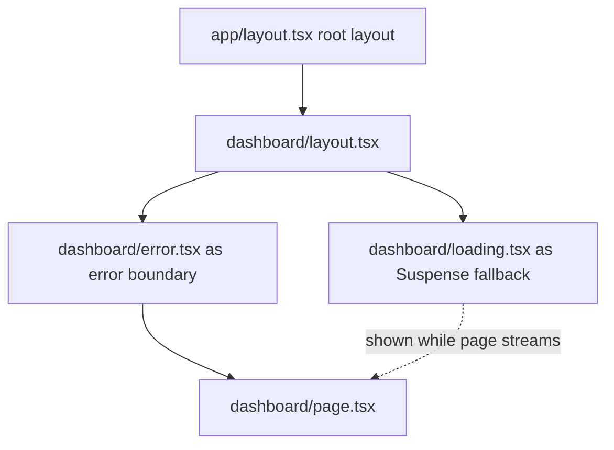
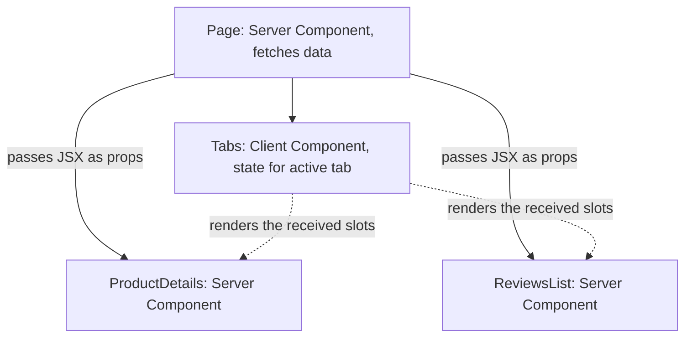

# Next.js Essentials for Interviews

> In this document you will learn the Next.js knowledge that React interviews expect: why Next.js exists, the App Router and how it differs from the Pages Router, file-based routing with layouts, loading and error files, Server and Client Components in Next.js, data fetching and caching (including the big caching changes in Next.js 15 and 16), static, dynamic, ISR and streaming rendering, Server Actions, Route Handlers, `proxy.ts` (formerly middleware), image and font optimization, metadata and SEO, environment variables and deployment. Most of the document is interview questions with spoken answers and follow-ups.

**Before this:** [Rendering strategies: CSR, SSR, SSG](../05-frontend-engineering/09-rendering-strategies-csr-ssr-ssg.md) (the theory — read it first) · [React 18 and 19 features and Server Components](./04-react-18-and-19-concurrent-features-and-server-components.md) · **Interview questions:** [jump to the interview section](#interview-questions)

## Table of contents

1. [Concepts](#concepts)
   1. [Why Next.js](#why-nextjs)
   2. [App Router and Pages Router](#app-router-and-pages-router)
   3. [File-based routing and special files](#file-based-routing-and-special-files)
   4. [Server and Client Components in Next.js](#server-and-client-components-in-nextjs)
   5. [Data fetching and caching](#data-fetching-and-caching)
   6. [Rendering modes: static, dynamic, ISR and streaming](#rendering-modes-static-dynamic-isr-and-streaming)
   7. [Server Actions and Route Handlers](#server-actions-and-route-handlers)
   8. [proxy.ts (formerly middleware)](#proxyts-formerly-middleware)
   9. [Images, fonts and metadata](#images-fonts-and-metadata)
   10. [Environment variables and deployment](#environment-variables-and-deployment)
2. [Interview questions](#interview-questions)
3. [Quick revision](#quick-revision)
4. [Summary](#summary)
5. [References](#references)

> **Versions.** Next.js **16** (16.0 released October 2025; **16.4**, October 2026, is the latest at the time of writing) with the **App Router** and React 19. Notes mark what changed in **Next.js 15** and **16**, because many companies still run 14 or 15 and the defaults changed. Next.js caching has **two models**: the **previous model** (default in 15 and 16 when `cacheComponents` is off) and **Cache Components** (`cacheComponents: true`, introduced in 16.0, enabled by default in new `create-next-app` projects since 16.4, and announced to become the default in Next.js 17). Facts in this document were checked against the Next.js 16, 16.3 and 16.4 release posts and the current Next.js documentation; Next.js code was not executed here.

---

## Concepts

### Why Next.js

React is a UI library. A production app also needs routing, server rendering, data loading, code splitting, image optimization, SEO tags, API endpoints and a build setup. **Next.js** is a React **framework** that provides all of these with conventions:

- **Rendering on the server** (SSR, static generation, streaming) → fast first paint and good SEO. Theory: [Rendering strategies](../05-frontend-engineering/09-rendering-strategies-csr-ssr-ssg.md).
- **File-based routing** with nested layouts.
- **React Server Components** and **Server Actions** as a first-class model.
- **Built-in optimizations:** automatic code splitting per route, `next/image`, `next/font`, prefetching of links.
- **Full-stack:** Route Handlers for API endpoints, server-only code next to UI.
- **Tooling:** Turbopack (the default bundler since Next.js 16), TypeScript, ESLint integration.

The React team recommends starting new apps with a framework such as Next.js or React Router (framework mode), since Create React App was deprecated in February 2025.

### App Router and Pages Router

| | Pages Router (`pages/`) | App Router (`app/`) |
| --- | --- | --- |
| Since | 2016 | 13.4 stable (2023) |
| Components | All Client Components (hydrated) | **Server Components by default**, opt in to client with `'use client'` |
| Data fetching | `getServerSideProps`, `getStaticProps`, `getStaticPaths` | `async` components with `await`, `'use cache'`, `fetch` options |
| Layouts | `_app.js`, `_document.js`, manual per-page layouts | Nested `layout.js` files that keep state between navigations |
| Loading / errors | Manual | `loading.js` (Suspense), `error.js` (error boundary) |
| Mutations | API routes + client fetch | **Server Actions** (and Route Handlers) |
| Streaming | Limited | Built in |
| Status | Supported, maintenance | Recommended for new apps |

Both can live in one project during migration (a URL must not exist in both).

### File-based routing and special files

Folders define URL segments; special files define the UI for each segment:

```text
app/
  layout.tsx          # root layout (required): <html> and <body>
  page.tsx            # "/"
  loading.tsx         # Suspense fallback for this segment
  error.tsx           # error boundary for this segment ('use client')
  not-found.tsx       # UI for notFound() and unknown URLs
  global-error.tsx    # catches errors in the root layout
  dashboard/
    layout.tsx        # wraps every page under /dashboard, stays mounted on navigation
    page.tsx          # "/dashboard"
    settings/page.tsx # "/dashboard/settings"
  blog/
    [slug]/page.tsx   # "/blog/:slug"  (dynamic segment)
  shop/
    [...path]/page.tsx  # catch-all: "/shop/a/b/c"
  (marketing)/        # route group: organizes files, not part of the URL
    about/page.tsx    # "/about"
  api/
    orders/route.ts   # Route Handler: GET/POST /api/orders
  @modal/             # parallel route slot (needs default.tsx in Next.js 16)
proxy.ts              # request interception (Next.js 16; formerly middleware.ts)
```



How the files nest for one segment: `layout` wraps `error` (an error boundary), which wraps `loading` (a Suspense boundary), which wraps the `page`. That is why an `error.tsx` does **not** catch errors thrown in the `layout.tsx` of the **same** segment — it sits inside it (use the parent's `error.tsx` or `global-error.tsx`).

Pages and layouts receive `params` and (pages only) `searchParams` as **promises** since Next.js 15 (sync access was removed in 16):

```tsx
// app/blog/[slug]/page.tsx
export default async function BlogPost({ params }: PageProps<'/blog/[slug]'>) {
  const { slug } = await params;
  const post = await getPost(slug);
  if (!post) notFound();            // renders not-found.tsx
  return <article><h1>{post.title}</h1></article>;
}
```

(`PageProps<'/route'>` and `LayoutProps<'/route'>` are global type helpers generated by Next.js for typed routes.)

Navigation: `<Link href="/dashboard">` (prefetches in production when visible), and in Client Components `useRouter()`, `usePathname()`, `useSearchParams()` from `next/navigation`; on the server, `redirect()` and `notFound()`.

### Server and Client Components in Next.js

In the App Router, every component is a **Server Component** unless its file (or a file that imports it) starts with **`'use client'`**. The React-level concepts are in [React 18 and 19 features and Server Components](./04-react-18-and-19-concurrent-features-and-server-components.md); the Next.js-specific rules:

| Server Components (default) | Client Components (`'use client'`) |
| --- | --- |
| Run on the server (at build or request time), code never sent to the browser | Pre-rendered to HTML on the server, **then hydrated** and run in the browser |
| Can be `async`, read databases, files, secrets | Can use `useState`, `useEffect`, event handlers, browser APIs |
| Cannot use state, effects, event handlers, browser APIs, context providers' state | Cannot be `async` components; cannot import server-only code |
| Good for: data fetching, large dependencies (markdown, syntax highlighting), static content | Good for: interactivity, forms with live validation, animations |

Rules that cause most interview questions:

- `'use client'` marks a **boundary**: that file and everything it imports become client code. Put it as **low** in the tree as possible (a `LikeButton`, not the whole page).
- A Client Component **cannot import** a Server Component, but it can **receive** one as `children` or another prop from a Server Component parent.
- Props passed from Server to Client Components must be **serializable** (plain data, JSX; not functions — except Server Actions — and not class instances).
- Anything passed to a Client Component is visible in the browser. Use the `server-only` package to make sure secret code is never imported into client code.

```tsx
// app/products/[id]/page.tsx — Server Component
import { AddToCartButton } from './AddToCartButton';

export default async function ProductPage({ params }: PageProps<'/products/[id]'>) {
  const { id } = await params;
  const product = await db.product.findUnique({ where: { id } }); // direct DB access
  return (
    <main>
      <h1>{product.name}</h1>
      <p>{product.description}</p>
      <AddToCartButton productId={product.id} />   {/* small client island */}
    </main>
  );
}

// app/products/[id]/AddToCartButton.tsx
'use client';
import { useState } from 'react';

export function AddToCartButton({ productId }: { productId: string }) {
  const [added, setAdded] = useState(false);
  return <button onClick={() => setAdded(true)}>{added ? 'Added' : 'Add to cart'}</button>;
}
```

### Data fetching and caching

This is the area that **changed the most** between versions. Know the history:

| Version | Default for `fetch` in Server Components | Notes |
| --- | --- | --- |
| **Next.js 13–14** | **Cached** (`force-cache`) — implicit and confusing | `fetch(url, { cache: 'no-store' })` to opt out; GET Route Handlers cached by default |
| **Next.js 15** (Oct 2024) | **Not cached** by default | Opt in with `cache: 'force-cache'` or `next: { revalidate }`; GET Route Handlers and the client router cache for pages also not cached by default; async `params`, `cookies()`, `headers()` introduced |
| **Next.js 16** (Oct 2025), previous model | Same as 15 | `revalidateTag(tag, profile)` now needs a second argument; new `updateTag()` and `refresh()` for Server Actions; sync request APIs removed |
| **Next.js 16** with **Cache Components** | Nothing is cached unless you say so with **`'use cache'`** | Uncached async work must be inside `<Suspense>` (or cached); Partial Prerendering (PPR) is the default rendering model |

**The previous model (Next.js 15/16 without `cacheComponents`):**

```tsx
// Cached in the Data Cache and revalidated at most every hour, tagged for on-demand revalidation
const res = await fetch('https://api.example.com/products', {
  next: { revalidate: 3600, tags: ['products'] },
});

// Always fresh
const res2 = await fetch('https://api.example.com/stock', { cache: 'no-store' });

// Route segment config
export const revalidate = 60;              // revalidate this page at most every 60 s (ISR)
export const dynamic = 'force-dynamic';    // always render at request time
```

Calling `cookies()`, `headers()` or reading `searchParams` makes the **whole route dynamic** in this model.

**Cache Components (Next.js 16+, `cacheComponents: true`):**

```tsx
// next.config.ts
const nextConfig = { cacheComponents: true, partialPrefetching: true }; // 16.3+ adds partialPrefetching
export default nextConfig;
```

```tsx
import { Suspense } from 'react';
import { cookies } from 'next/headers';
import { cacheLife, cacheTag } from 'next/cache';

export default function ShopPage() {
  return (
    <>
      <h1>Shop</h1>                         {/* static: part of the prerendered shell */}
      <ProductList />                       {/* cached: also in the shell */}
      <Suspense fallback={<p>Loading cart…</p>}>
        <CartSummary />                     {/* per-request: streams in */}
      </Suspense>
    </>
  );
}

async function ProductList() {
  'use cache';
  cacheLife('hours');       // how long the cached result is fresh
  cacheTag('products');     // for on-demand revalidation
  const products = await db.product.findMany();
  return <ul>{products.map((p) => <li key={p.id}>{p.name}</li>)}</ul>;
}

async function CartSummary() {
  const session = (await cookies()).get('session')?.value; // runtime data
  const cart = await getCart(session);
  return <p>{cart.items.length} items</p>;
}
```

Key rules of Cache Components:

- `'use cache'` works on functions, components and whole files. Its arguments become part of the cache key.
- Uncached async work and runtime APIs (`cookies`, `headers`, `searchParams`, unknown `params`) must be inside `<Suspense>`. If not, the dev overlay reports a "blocking route" and the build fails.
- Reading `cookies()` no longer makes the whole route dynamic — only the part inside the Suspense boundary.

Route segment options like `dynamic` and `revalidate` belong to the previous model; with Cache Components you use `'use cache'` + `cacheLife` instead.

**On-demand revalidation (both models):**

```tsx
'use server';
import { revalidatePath, revalidateTag, updateTag } from 'next/cache';

export async function saveProduct(formData: FormData) {
  await db.product.update(/* ... */);
  updateTag('products');               // Next 16: expire and read fresh data now (read-your-writes), Server Actions only
  // revalidateTag('products', 'max'); // Next 16: stale-while-revalidate; one-argument form is deprecated
  // revalidatePath('/products');      // invalidate everything for a path
}
```

Also important: `fetch` calls with the same URL and options are **memoized** (deduplicated) during one server render, and React's `cache()` does the same for database functions — so several components can ask for the same data without extra requests.

### Rendering modes: static, dynamic, ISR and streaming

The theory of CSR, SSR, SSG, ISR and streaming is in [Rendering strategies](../05-frontend-engineering/09-rendering-strategies-csr-ssr-ssg.md). In Next.js terms:

| Mode | How you get it in the App Router | When |
| --- | --- | --- |
| **Static (SSG)** | Default when a route uses no runtime data; `generateStaticParams` for dynamic segments | Marketing pages, docs, blogs |
| **Dynamic (SSR)** | Using `cookies()`, `headers()`, `searchParams`, uncached data; `dynamic = 'force-dynamic'` (previous model) | Personalized dashboards, search results |
| **ISR** | `revalidate` (time-based) or `revalidateTag`/`revalidatePath` (on demand); with Cache Components: `cacheLife` + `generateStaticParams` | Product catalogs, news |
| **Streaming** | `loading.tsx` or `<Suspense>` boundaries | Pages with slow parts |
| **Partial Prerendering (PPR)** | Default with Cache Components: static/cached shell + streamed dynamic holes | Most pages that mix static and personal content |
| **Client-side only** | A Client Component that fetches in the browser (TanStack Query) | Highly interactive widgets after load |

```tsx
// app/blog/[slug]/page.tsx — static generation of known slugs (previous model shown)
export async function generateStaticParams() {
  const posts = await getAllPosts();
  return posts.map((p) => ({ slug: p.slug }));
}
export const revalidate = 3600; // ISR: regenerate each page at most hourly
```

You can check what each route became in the `next build` output (static, dynamic, partial prerender symbols).

### Server Actions and Route Handlers

**Server Actions** (React 19 "Server Functions" used as actions) are async functions marked with **`'use server'`** that run on the server but can be called from the client — most often as a `<form action>`.

```tsx
// app/todos/actions.ts
'use server';
import { z } from 'zod';
import { updateTag } from 'next/cache';

const TodoSchema = z.object({ title: z.string().min(1).max(200) });

export async function addTodo(prevState: { error?: string }, formData: FormData) {
  const session = await getSession();                 // 1. authenticate: actions are public endpoints
  if (!session) return { error: 'Please sign in' };

  const parsed = TodoSchema.safeParse({ title: formData.get('title') }); // 2. validate
  if (!parsed.success) return { error: 'Title is required' };

  await db.todo.create({ data: { title: parsed.data.title, userId: session.userId } });
  updateTag('todos');                                  // 3. refresh cached data
  return {};
}
```

```tsx
// app/todos/AddTodoForm.tsx
'use client';
import { useActionState } from 'react';
import { addTodo } from './actions';

export function AddTodoForm() {
  const [state, formAction, isPending] = useActionState(addTodo, {});
  return (
    <form action={formAction}>
      <input name="title" aria-label="Title" />
      <button disabled={isPending}>{isPending ? 'Adding…' : 'Add'}</button>
      {state.error && <p role="alert">{state.error}</p>}
    </form>
  );
}
```

Forms with Server Actions work **before JavaScript loads** (progressive enhancement) when the form is rendered by a Server Component.

**Route Handlers** are HTTP endpoints in `route.ts` files using the Web `Request`/`Response` APIs:

```ts
// app/api/orders/route.ts
import { NextResponse } from 'next/server';

export async function GET(request: Request) {
  const { searchParams } = new URL(request.url);
  const orders = await db.order.findMany({ where: { status: searchParams.get('status') ?? undefined } });
  return NextResponse.json(orders);
}

export async function POST(request: Request) {
  const body = await request.json();
  // validate + authenticate here
  const order = await db.order.create({ data: body });
  return NextResponse.json(order, { status: 201 });
}
```

Use Server Actions for **mutations from your own UI**; use Route Handlers for **public APIs**, webhooks, mobile clients, file downloads and anything that needs a stable URL or other HTTP methods.

### proxy.ts (formerly middleware)

`proxy.ts` at the project root (or in `src/`) runs **before a request is matched to a route**. It can **redirect, rewrite, set headers and cookies**. Next.js 16 renamed `middleware.ts` to `proxy.ts` (export a function called `proxy`) to make the "network boundary" role clear, and it runs on the **Node.js runtime**. `middleware.ts` still works for the Edge runtime but is deprecated.

```ts
// proxy.ts
import { NextResponse, type NextRequest } from 'next/server';

export function proxy(request: NextRequest) {
  const hasSession = request.cookies.has('session');
  if (!hasSession && request.nextUrl.pathname.startsWith('/dashboard')) {
    return NextResponse.redirect(new URL('/login', request.url));
  }
  return NextResponse.next();
}

export const config = { matcher: ['/dashboard/:path*'] };
```

Use it for **fast, coarse checks** (is there a session cookie? which locale? A/B bucket?), not as the only authorization layer. Always check permissions again where data is read or changed (Server Components, Server Actions, Route Handlers). In March 2025 a vulnerability (CVE-2025-29927) allowed bypassing middleware with a special header in some versions — a real example of why middleware must not be the only security check.

### Images, fonts and metadata

**`next/image`** resizes, converts (WebP/AVIF), lazy-loads by default and prevents layout shift (requires `width`/`height` or `fill`):

```tsx
import Image from 'next/image';

<Image src="/hero.jpg" alt="Spring sale" width={1200} height={600} preload sizes="100vw" />
<Image src={product.imageUrl} alt={product.name} width={300} height={300} />
```

> **Next.js 16 note:** the `priority` prop is **deprecated** in favor of **`preload`**, and the docs suggest `loading="eager"` or `fetchPriority="high"` in most cases. Next.js 16 also changed image defaults: `qualities` defaults to `[75]`, `minimumCacheTTL` to 4 hours, remote images need `images.remotePatterns` (`images.domains` is deprecated), and local images with query strings need `images.localPatterns`.

**`next/font`** downloads Google Fonts (or local fonts) **at build time**, self-hosts them, and sets size-adjusted fallbacks to avoid layout shift:

```tsx
// app/layout.tsx
import { Inter } from 'next/font/google';
const inter = Inter({ subsets: ['latin'], display: 'swap' });

export default function RootLayout({ children }: { children: React.ReactNode }) {
  return <html lang="en" className={inter.className}><body>{children}</body></html>;
}
```

**Metadata** for SEO is exported from layouts and pages, static or generated:

```tsx
export const metadata = { title: 'Orders', description: 'All your orders' };

export async function generateMetadata({ params }: PageProps<'/blog/[slug]'>) {
  const { slug } = await params;
  const post = await getPost(slug);
  return { title: post.title, openGraph: { images: [post.coverUrl] } };
}
```

File conventions add more: `sitemap.ts`, `robots.ts`, `opengraph-image.tsx`, `icon.png`. `fetch` requests with the same arguments in `generateMetadata` and the page are deduplicated.

### Environment variables and deployment

- `.env`, `.env.local`, `.env.development`, `.env.production` are loaded automatically (`.env.local` should not be committed).
- Variables are **server-only by default** (`process.env.DATABASE_URL` in Server Components, Actions, Route Handlers).
- Variables prefixed with **`NEXT_PUBLIC_`** are **inlined into the client bundle at build time**. They are public, and changing them requires a **rebuild** (they are not read at runtime in the browser).
- `serverRuntimeConfig` / `publicRuntimeConfig` were removed in Next.js 16; use environment variables.

Deployment options:

| Option | What you get |
| --- | --- |
| **Vercel** (or another platform with a Next.js adapter) | Zero-config, CDN for static assets and ISR, serverless/edge functions |
| **`next build && next start`** on a Node.js server | Full feature set on your own server (Node.js 20.9+ for Next.js 16) |
| **Docker** with `output: 'standalone'` | Minimal server folder with only needed `node_modules` |
| **Static export** `output: 'export'` | Plain HTML/CSS/JS on any static host; no SSR, no Server Actions, no ISR, no proxy |

Next.js 16.2 made the **Adapter API** stable so other platforms (Netlify, Cloudflare via OpenNext, AWS) can support all features consistently. For self-hosting with several instances, configure a shared **cache handler** so ISR and `'use cache'` results are shared.

---

## Interview questions


### Q1. Why would you use Next.js instead of plain React with Vite?

**What the interviewer is checking:** You understand what a framework adds and when it is worth it.

**What to say (30–60 seconds):**

> "React only renders UI. Next.js is a framework on top of it that gives routing with nested layouts, server rendering — static, dynamic, incremental and streaming — React Server Components, Server Actions for mutations, API endpoints, and built-in optimizations like code splitting per route, image and font optimization and link prefetching. That matters for public, content-heavy or SEO-sensitive sites, and for apps that want fast first loads and less client JavaScript. For an internal dashboard behind a login, where SEO doesn't matter, a Vite single-page app with React Router and TanStack Query can be simpler to build, host and reason about."

**Deeper explanation:** See [Why Next.js](#why-nextjs). Trade-offs of Next.js: a more complex mental model (server/client boundary, caching), a Node.js server or a platform for SSR features, and framework upgrades that sometimes change defaults (caching in 15 and 16).

**Follow-up questions and how to answer them:**

- **"What alternatives exist?"** — React Router v7 or v8 in framework mode (the successor of Remix), TanStack Start, Astro (content sites with islands), Gatsby (older, static), and Vite + React for SPAs.
- **"Is Next.js only for SEO?"** — No. Server Components reduce the JavaScript sent to the browser, and server-side data access avoids client-server waterfalls, which helps performance even behind a login.

**Common mistakes / weak answers:** "Next.js is faster than React" (it is React). "You always need Next.js for production."

**Real-project example:** A marketing site moved from a Vite SPA to Next.js static generation; pages became indexable and LCP dropped from 3.1 s to 1.2 s.

### Q2. What is the difference between the App Router and the Pages Router?

**What the interviewer is checking:** Modern Next.js knowledge and migration awareness.

**What to say (30–60 seconds):**

> "The Pages Router is the original system: files in `pages/`, every component is a client component that gets hydrated, and data comes from `getServerSideProps` or `getStaticProps` at the page level. The App Router, in `app/`, is built on React Server Components: components are server components by default, any component can be `async` and fetch its own data, layouts are nested and stay mounted across navigations, `loading` and `error` files give Suspense and error boundaries per segment, it streams by default, and mutations use Server Actions. The App Router is recommended for new projects; the Pages Router is still supported, and both can live in one app during migration."

**Deeper explanation:** See [App Router and Pages Router](#app-router-and-pages-router).

```tsx
// Pages Router
export async function getServerSideProps({ params }) {
  const product = await getProduct(params.id);
  return { props: { product } };
}
export default function ProductPage({ product }) { return <h1>{product.name}</h1>; }

// App Router
export default async function ProductPage({ params }: PageProps<'/products/[id]'>) {
  const { id } = await params;
  const product = await getProduct(id);
  return <h1>{product.name}</h1>;
}
```

**Follow-up questions and how to answer them:**

- **"How would you migrate a big Pages Router app?"** — Incrementally: add `app/` with a root layout, move routes one by one (a URL cannot exist in both), convert `getServerSideProps` into `async` Server Components, move interactive parts into `'use client'` components, and replace API routes used by your own UI with Server Actions where it makes sense.
- **"What is the equivalent of `_app.js` and `_document.js`?"** — The root `app/layout.tsx`, which renders `<html>` and `<body>` and holds global providers (in a Client Component wrapper if they use state).

**Common mistakes / weak answers:** Thinking the App Router is just a folder rename.

**Real-project example:** Migrating the product pages first (highest traffic) to the App Router cut their JavaScript by 35%, while the checkout stayed in `pages/` until later.

### Q3. Explain layouts, templates, loading.js, error.js and not-found.js.

**What the interviewer is checking:** File conventions and how they map to React concepts.

**What to say (30–60 seconds):**

> "A `layout` wraps all pages below it and stays mounted when you navigate between them, so its state and DOM are kept — good for sidebars and navigation. A `template` is like a layout but remounts on every navigation, for things like enter animations or resetting state. `loading.js` is automatically turned into a Suspense boundary around the page, so its UI shows instantly while the page streams. `error.js` is an error boundary around the segment; it must be a Client Component and gets the `error` and a way to retry. `not-found.js` shows when you call `notFound()` or the URL doesn't match. The nesting order is layout, then error boundary, then loading, then page — so an `error.js` can't catch errors from the layout in the same folder."

**Deeper explanation:** See [File-based routing and special files](#file-based-routing-and-special-files).

```tsx
// app/dashboard/error.tsx
'use client';
export default function DashboardError({ error, reset }: { error: Error & { digest?: string }; reset: () => void }) {
  return (
    <div role="alert">
      <p>Could not load the dashboard.</p>
      <button onClick={() => reset()}>Try again</button>
    </div>
  );
}
```

**Follow-up questions and how to answer them:**

- **"Why must `error.js` be a Client Component?"** — Error boundaries are a client-side React feature (class components with state), and the retry button needs an event handler.
- **"What catches errors in the root layout?"** — `app/global-error.tsx`, which replaces the root layout when active, so it must render its own `<html>` and `<body>`.
- **"Anything new for error handling in 16.x?"** — Next.js 16.3 added `catchError` from `next/error` to build custom component-level error boundaries that do not interfere with `notFound()`/`redirect()` and have a `retry()` that can re-render Server Components.
- **"In production, why does the error message say something generic?"** — Errors from Server Components are sanitized before reaching the client so secrets do not leak; the `digest` links to the full error in the server logs.

**Common mistakes / weak answers:** Saying layouts re-render and remount on every navigation (they do not; that is `template`).

**Real-project example:** Moving a filter sidebar into `dashboard/layout.tsx` kept its scroll position and open sections while users moved between dashboard pages.

### Q4. Why does useState not work in this component?

**What the interviewer is checking:** The most common App Router error and the server/client boundary.

```tsx
// app/page.tsx
import { useState } from 'react';

export default function HomePage() {
  const [count, setCount] = useState(0);
  return <button onClick={() => setCount(count + 1)}>{count}</button>;
}
```

**What to say (30–60 seconds):**

> "In the App Router, components are Server Components by default. They run on the server only, once per request or at build time, so there's no state, no effects and no event handlers — React throws an error saying hooks like `useState` only work in Client Components. The fix is to add `'use client'` at the top of a file. But I wouldn't make the whole page a client component: I'd move the button into its own `Counter.tsx` with `'use client'` and render it from the server page. That keeps the rest of the page on the server and sends less JavaScript."

**Deeper explanation:**

```tsx
// app/Counter.tsx
'use client';
import { useState } from 'react';
export function Counter() {
  const [count, setCount] = useState(0);
  return <button onClick={() => setCount((c) => c + 1)}>{count}</button>;
}

// app/page.tsx (Server Component)
import { Counter } from './Counter';
export default async function HomePage() {
  const stats = await getStats(); // server data
  return (
    <main>
      <h1>Visitors: {stats.visitors}</h1>
      <Counter />
    </main>
  );
}
```

**Follow-up questions and how to answer them:**

- **"Does 'use client' mean the component renders only in the browser?"** — No. Client Components are still **pre-rendered to HTML on the server** for the first load, then hydrated. "Client" means "also runs in the browser and can be interactive". For truly browser-only code, use effects, `next/dynamic` with `ssr: false` inside a Client Component, or React 19.3's `use(browser())`.
- **"Can I use context providers in the root layout?"** — The layout is a Server Component, so create a `Providers.tsx` with `'use client'` that renders the providers, and use it in the layout: `<Providers>{children}</Providers>`. The children can still be Server Components.
- **"Which other hooks fail in Server Components?"** — All state and effect hooks (`useState`, `useReducer`, `useEffect`, `useLayoutEffect`), `useContext` (reading context), and browser-only APIs. In Server Components you read async data with plain `await`. React 19.3 also lets Server Components render a Context imported from a `'use client'` module directly as a provider.

**Common mistakes / weak answers:** Adding `'use client'` to the root layout or every page "to make it work".

**Real-project example:** A team put `'use client'` on every page during migration and got no benefit from Server Components; moving it down to 12 small interactive components cut client JS by half.

### Q5. How do Server and Client Components work together? What can you pass between them?

**What the interviewer is checking:** The composition rules between Server and Client Components.

**What to say (30–60 seconds):**

> "Server Components can import and render Client Components and pass them props. Those props must be serializable — strings, numbers, plain objects, arrays, dates, JSX — because they are sent to the browser in the RSC payload. Functions can't be passed, except Server Actions. A Client Component can't import a Server Component, because everything a client file imports becomes client code. But a Client Component can receive Server Components as `children` or other props from a server parent — that's how you wrap server content in a client provider or an interactive shell. And anything I pass to a client component is public, so I never pass secrets or whole database records."

**Deeper explanation:**

```tsx
// Server Component parent
import { Tabs } from './Tabs';             // 'use client'
import { ReviewsList } from './ReviewsList'; // Server Component

export default async function ProductPage() {
  return (
    <Tabs
      details={<ProductDetails />}          // Server Components passed as props (rendered on the server)
      reviews={<ReviewsList />}
    />
  );
}
```



**Follow-up questions and how to answer them:**

- **"How do you keep secrets safe?"** — Read secrets only in server code, add `import 'server-only'` to modules that must never reach the client (the build fails if a Client Component imports them), and pass only the fields the UI needs (data transfer objects), not full records.
- **"What is the RSC payload?"** — A serialized description of the rendered Server Component tree (with references to Client Component modules and their props). The browser uses it to build and update the tree on navigation without full HTML reloads.

**Common mistakes / weak answers:** "Server Components can't have Client Components inside." Passing an `onClick` function from a Server Component.

**Real-project example:** A user object with a password hash was accidentally passed to a client component as a prop; switching to an explicit `toPublicUser()` DTO and `server-only` data modules prevented it.

### Q6. SSR vs SSG vs ISR in Next.js — how do you choose, and how do you get each?

**What the interviewer is checking:** Connecting rendering theory to Next.js APIs.

**What to say (30–60 seconds):**

> "SSG means the HTML is generated at build time and served from a CDN — fastest, cheapest, but content is fixed until the next build. In the App Router a route is static automatically if it uses no runtime data, and `generateStaticParams` lists dynamic pages to build. SSR means rendering on every request — needed for personalized or always-fresh content; using cookies, headers, search params or uncached data makes a route dynamic. ISR sits in between: pages are static but regenerated in the background after a time with `revalidate`, or on demand with `revalidateTag` or `revalidatePath` after a change — good for catalogs and news. With Cache Components in Next.js 16, the line is per component: cached parts with `'use cache'` and `cacheLife` go into a static shell, and dynamic parts stream in behind Suspense — that's Partial Prerendering."

**Deeper explanation:** See [Rendering modes](#rendering-modes-static-dynamic-isr-and-streaming). The theory and trade-offs (TTFB, cost, freshness) are in [Rendering strategies — ISR](../05-frontend-engineering/09-rendering-strategies-csr-ssr-ssg.md#incremental-static-regeneration-isr).

**Follow-up questions and how to answer them:**

- **"What does the first visitor after the revalidate time see?"** — The stale page, instantly; that request triggers regeneration in the background, and later visitors get the new page (stale-while-revalidate). With on-demand revalidation (`updateTag` in a Server Action), the user who made the change sees fresh data immediately.
- **"What about pages not returned by `generateStaticParams`?"** — By default (`dynamicParams = true`) they are rendered on first request and then cached. Next.js 16.3 improved ISR with Cache Components: such a page serves an instant loading shell to the first visitor and upgrades to the fully prerendered page in the background.
- **"How do you see which mode a route uses?"** — The `next build` output marks each route as static, dynamic or partially prerendered.

**Common mistakes / weak answers:** "SSG can't have dynamic routes." "ISR rebuilds the whole site."

**Real-project example:** A product catalog with 50,000 items pre-built only the top 1,000 products and generated the rest on first visit, with `updateTag` after price changes.

### Q7. How did caching change in Next.js 15 and 16? What are the defaults now?

**What the interviewer is checking:** Up-to-date knowledge — the assignment area where most candidates are outdated.

**What to say (30–60 seconds):**

> "In Next.js 13 and 14, `fetch` in Server Components was cached by default, GET route handlers were cached, and the client router cache kept pages for a while — very confusing, because developers saw stale data without asking for caching. Next.js 15 flipped the defaults: `fetch` isn't cached unless you opt in with `cache: 'force-cache'` or `next.revalidate`, GET route handlers aren't cached, and page segments in the client router cache aren't reused by default. Next.js 16 introduced Cache Components: with `cacheComponents: true`, nothing is cached unless you mark it with `'use cache'` and give it a `cacheLife`, and uncached data must be inside Suspense. It also changed `revalidateTag` to require a profile, and added `updateTag` and `refresh` for Server Actions. Since 16.4 new apps have Cache Components on by default, and it's planned to be the default in Next.js 17."

**Deeper explanation:** See the version table in [Data fetching and caching](#data-fetching-and-caching).

**Follow-up questions and how to answer them:**

- **"If fetch isn't cached in 15, why is my page still static?"** — In the previous model, a route with no runtime APIs is still prerendered at build time, and the `fetch` results at build time are baked into that static HTML. "Not cached" refers to the Data Cache between requests for dynamic routes. To make it per-request, use `connection()`, a runtime API, or `dynamic = 'force-dynamic'`.
- **"What is the difference between `revalidateTag`, `updateTag` and `refresh` in Next.js 16?"** — `revalidateTag(tag, 'max')` marks tagged data stale with stale-while-revalidate: users may see the old data once while it refreshes in the background. `updateTag(tag)` (Server Actions only) expires and reads fresh data in the same request, so the user sees their own change ("read-your-writes"). `refresh()` (Server Actions only) re-renders uncached data without touching the cache, like a server-side `router.refresh()`.
- **"What is `cacheLife`?"** — A function used inside `'use cache'` scopes to set how long a result is fresh, with built-in profiles (`'seconds'`, `'minutes'`, `'hours'`, `'days'`, `'weeks'`, `'max'`) or custom ones; without it the `default` profile applies.

**Common mistakes / weak answers:** "Next.js caches all fetches by default" (true only for 13–14). Not knowing Cache Components exists.

**Real-project example:** After upgrading from 14 to 15, an e-commerce site's API traffic tripled because pages that relied on implicit `fetch` caching became dynamic; adding explicit `revalidate` and tags fixed it.

### Q8. What is Partial Prerendering, and how does Suspense decide what is static?

**What the interviewer is checking:** The core idea of the new Next.js model.

**What to say (30–60 seconds):**

> "Partial Prerendering lets one route be partly static and partly dynamic. At build time Next.js renders the page: static content and anything inside `'use cache'` become a static shell — HTML plus the RSC payload — that can be served from a CDN instantly. When rendering reaches something that needs request data or uncached data inside a Suspense boundary, the fallback goes into the shell instead. At request time, the server streams the real content for those holes into the same response. So the user gets an instant shell, and personal parts like the cart fill in. It's the default rendering model with Cache Components."

**Deeper explanation:** In the example in [Data fetching and caching](#data-fetching-and-caching), the `<h1>`, the cached `ProductList` and the "Loading cart…" fallback are in the shell; `CartSummary` streams in. To keep more in the shell, push runtime access (`await params`, `cookies()`) **down** into small components inside Suspense, instead of awaiting at the top of a layout.

**Follow-up questions and how to answer them:**

- **"How do you guarantee a route stays fully static?"** — Next.js 16.4 added the `ensureStatic` route segment export (`'navigation'`, `'prefetch'` or `'shell'`); with `'navigation'` the build fails if any dynamic content gets into the route.
- **"What happens with SEO bots if metadata is dynamic?"** — Next.js detects bots that cannot handle streamed metadata and renders the page fully at request time for them.

**Common mistakes / weak answers:** "PPR means the page is SSR." "Suspense makes a component dynamic" — Suspense only provides the fallback; what is dynamic is the uncached or runtime work inside.

**Real-project example:** A product page served its static description and image from the CDN within 100 ms, while stock levels and personalized recommendations streamed in.

### Q9. How do you fetch data in the App Router? How do you avoid waterfalls?

**What the interviewer is checking:** Server-side data patterns.

**What to say (30–60 seconds):**

> "In Server Components I just make the component `async` and await the data — with `fetch`, an ORM, or any server function, close to where it's used. To avoid waterfalls, I start independent requests in parallel with `Promise.all`, or let separate components fetch their own data inside separate Suspense boundaries so they stream independently. Duplicate requests aren't a problem: `fetch` with the same arguments is memoized during a render, and I wrap database calls in React's `cache()` for the same effect. For client-side data that changes often after load — like live search or polling — I still use TanStack Query in a Client Component."

**Deeper explanation:**

```tsx
// Waterfall: reviews wait for the product even though they don't depend on it
const product = await getProduct(id);
const reviews = await getReviews(id);

// Parallel
const [product, reviews] = await Promise.all([getProduct(id), getReviews(id)]);

// Or stream independently
<>
  <ProductInfo id={id} />
  <Suspense fallback={<ReviewsSkeleton />}><Reviews id={id} /></Suspense>
</>
```

React `cache()` for deduplication:

```ts
import { cache } from 'react';
export const getUser = cache(async (id: string) => db.user.findUnique({ where: { id } }));
// Layout, page and generateMetadata can all call getUser(id): one query per request
```

**Follow-up questions and how to answer them:**

- **"Should a Server Component call your own Route Handler with `fetch('/api/...')`?"** — No. It is an extra HTTP hop to the same server. Call the data function directly. Route Handlers are for external clients.
- **"How do you pass server data to TanStack Query on the client?"** — Prefetch on the server and hydrate (`HydrationBoundary` with `dehydrate(queryClient)`), or pass it as `initialData` to `useQuery`. See [Data fetching](./06-data-fetching-axios-and-tanstack-query.md).

**Common mistakes / weak answers:** Fetching all data in the page and passing it down many levels "like getServerSideProps". Sequential awaits.

**Real-project example:** Replacing five sequential awaits in a dashboard page with `Promise.all` and two Suspense boundaries cut server response time from 1.8 s to 600 ms.

### Q10. What are Server Actions? What security concerns do they have?

**What the interviewer is checking:** Mutations in Next.js and security awareness.

**What to say (30–60 seconds):**

> "Server Actions are async functions marked with `'use server'` that run on the server but can be called from the client, usually as a form's `action` or from an event handler. Next.js creates an endpoint for each one behind the scenes and handles the request. With React 19's `useActionState` I get the returned state and a pending flag, and forms work even before JavaScript loads. After the mutation I refresh data with `updateTag`, `revalidatePath` or `refresh`. The main security point: every Server Action is a public HTTP endpoint. Anyone can call it with any arguments, so inside each action I check authentication and authorization and validate input, for example with Zod — hiding the button in the UI is not protection."

**Deeper explanation:** See [Server Actions and Route Handlers](#server-actions-and-route-handlers). The React-level rules for any Server Function (public endpoint, authenticate, authorize, validate, return little) with a Zod example are in [React 18 and 19 Q20](04-react-18-and-19-concurrent-features-and-server-components.md#q20-what-are-server-functions-use-server-what-security-rules-apply). Next.js-specific security notes:

- Next.js encrypts closed-over variables and uses unguessable action ids, and checks the `Origin` header against the host (CSRF protection), but **does not** do auth for you.
- Return only what the client needs; errors thrown are sanitized in production.
- Keep the action's arguments small and validate types — `FormData` values are always strings or files.
- React Server Components had critical vulnerabilities in December 2025 (remote code execution in the RSC protocol, CVE-2025-55182 in React / CVE-2025-66478 for Next.js), fixed in patched versions — keep React and Next.js updated.

**Follow-up questions and how to answer them:**

- **"Server Action or Route Handler for a mutation?"** — Server Action when your own React UI calls it (less code, progressive enhancement, integrated revalidation). Route Handler when a mobile app, a webhook, or a third party calls it, or you need a stable URL and REST semantics.
- **"How do you show optimistic UI?"** — `useOptimistic` in a Client Component: show the new item immediately, call the action, and React reverts if it fails.
- **"Can Server Actions be used for reading data?"** — They can return data, but they are designed for mutations: they run one at a time per client and use POST, so they are not good for parallel reads or caching. Read data in Server Components or with a query library.

**Common mistakes / weak answers:** "Server Actions are private because they are on the server." No validation.

**Real-project example:** An "update profile" Server Action copied every `FormData` field into the database, so a user could send `role=admin` with a hand-made request; parsing the input with a strict Zod schema that allows only `name` and `avatar` closed the hole.

### Q11. When do you use Route Handlers?

**What to say (short answer):**

> "Route Handlers are `route.ts` files that export functions named after HTTP methods — `GET`, `POST`, `PUT`, `DELETE` — and use the standard `Request` and `Response` objects. I use them for endpoints that other clients call: public REST APIs, webhooks from Stripe or GitHub, OAuth callbacks, mobile apps, file downloads or generated images and feeds. For mutations from my own Next.js UI I prefer Server Actions, and for reading data in my own pages I call data functions directly in Server Components. Since Next.js 15, GET handlers are not cached by default."

**Deeper explanation:** Code in [Server Actions and Route Handlers](#server-actions-and-route-handlers). Dynamic segments work the same: `app/api/orders/[id]/route.ts` receives `{ params }` as the second argument (a promise since Next.js 15).

### Q12. What is proxy.ts (middleware), and what should and shouldn't it do?

**What the interviewer is checking:** Request interception, the Next.js 16 rename, and security limits.

**What to say (30–60 seconds):**

> "`proxy.ts`, called `middleware.ts` before Next.js 16, runs before a request reaches a route. It can redirect, rewrite to another path, and read or set headers and cookies, and a `matcher` config limits which paths it runs on. Typical uses are redirecting users without a session cookie to login, locale detection, A/B test buckets, and adding security headers. In Next.js 16 it was renamed to make clear it's the network boundary, and it runs on the Node.js runtime; the old `middleware.ts` still works for Edge but is deprecated. It shouldn't do heavy work or database-heavy logic, because it runs on many requests, and it must not be the only authorization check — I check permissions again where data is read or changed."

**Deeper explanation:** See [proxy.ts (formerly middleware)](#proxyts-formerly-middleware). The CVE-2025-29927 bypass (a crafted internal header skipped middleware in affected self-hosted versions) is the classic example of why "auth only in middleware" is dangerous.

**Follow-up questions and how to answer them:**

- **"How do you migrate?"** — Rename the file to `proxy.ts` and the exported function to `proxy`; a codemod exists. Logic stays the same.
- **"Rewrite vs redirect?"** — A redirect sends a 3xx so the browser URL changes. A rewrite serves another route's content while the URL stays the same (used for multi-tenant subdomains, A/B tests).

**Common mistakes / weak answers:** Doing full JWT verification plus database lookups for every asset request (forgetting the `matcher`).

**Real-project example:** A multi-tenant SaaS used a rewrite in `proxy.ts` to map `acme.example.com/dashboard` to `/tenants/acme/dashboard` without changing the visible URL.

### Q13. What causes a hydration mismatch error, and how do you fix it?

**What the interviewer is checking:** A very common production bug and its causes.

**What to say (30–60 seconds):**

> "Hydration means React in the browser attaches to the HTML that the server rendered, expecting the first client render to produce exactly the same output. A mismatch happens when they differ — for example rendering `Date.now()`, `Math.random()` or a locale-formatted date that differs between server and browser time zones; reading `window` or `localStorage` during render to decide what to show; invalid HTML nesting like a `div` inside a `p`, which the browser rearranges; or browser extensions modifying the DOM. The fix is to make the first render identical: move browser-only values into a `useEffect` and render a placeholder first, format dates with a fixed time zone, use `useId` for ids, fix the HTML nesting, or render that part only on the client."

**Deeper explanation:**

```tsx
'use client';
import { useEffect, useState } from 'react';

// Bug: server renders the server's time; the browser renders a different time
function Clock() {
  return <span>{new Date().toLocaleTimeString()}</span>;
}

// Fix: same output on server and first client render, then update in an effect
function SafeClock() {
  const [time, setTime] = useState<string | null>(null);
  useEffect(() => {
    setTime(new Date().toLocaleTimeString());
    const id = setInterval(() => setTime(new Date().toLocaleTimeString()), 1000);
    return () => clearInterval(id);
  }, []);
  return <span>{time ?? '--:--:--'}</span>;
}
```

Other tools: `suppressHydrationWarning` on one element for an unavoidable single-text difference (like a timestamp); `next/dynamic(() => import('./Map'), { ssr: false })` inside a Client Component for browser-only widgets; React 19.3's `use(browser())` to opt a component out of server rendering (it suspends on the server, so the Suspense fallback is used in the HTML). Theory: [Rendering strategies — Hydration and its cost](../05-frontend-engineering/09-rendering-strategies-csr-ssr-ssg.md#hydration-and-its-cost).

**Follow-up questions and how to answer them:**

- **"What does React do on a mismatch?"** — In React 18/19 it logs an error with a diff of what differed (much better messages in React 19) and re-renders that part on the client, which costs performance and can cause flicker.
- **"Why does `typeof window !== 'undefined'` in render cause a mismatch?"** — It is `false` on the server and `true` in the browser, so the first client render differs. Use an effect or `useSyncExternalStore` with a `getServerSnapshot`.
- **"A mismatch appears only for some users — why?"** — Browser extensions (password managers, translators, Grammarly) that inject attributes or nodes, or different time zones/locales. The extension case can be ignored or handled with `suppressHydrationWarning` on `<html>`/`<body>`.

**Common mistakes / weak answers:** Adding `suppressHydrationWarning` everywhere. Making the whole page `ssr: false`.

**Real-project example:** Prices formatted with `toLocaleString()` caused mismatches for users outside the server's locale; passing an explicit locale and currency to `Intl.NumberFormat` fixed it.

### Q14. How does streaming work with loading.js and Suspense in Next.js?

**What the interviewer is checking:** Streaming SSR in practice.

**What to say (30–60 seconds):**

> "Next.js streams HTML: it sends the parts of the page that are ready first, and the parts that wait for data later in the same response. `loading.js` in a folder automatically wraps that segment's page in a Suspense boundary, so the loading UI is sent immediately — and during client navigation it shows instantly too. For finer control I add my own `<Suspense>` boundaries around slow components, so a slow reviews widget doesn't block the product details. When the data is ready, React streams the HTML for that part plus a small script that swaps it in, and it hydrates each boundary separately."

**Deeper explanation:** Streaming theory and React's `renderToPipeableStream` are in [Rendering strategies — Streaming SSR](../05-frontend-engineering/09-rendering-strategies-csr-ssr-ssg.md#streaming-ssr). Trade-offs: once streaming starts, the HTTP status (200) is sent, so `notFound()` or `redirect()` after the shell is flushed is handled inside the stream (a `noindex` meta tag for not-found, a client redirect) instead of changing the status code.

**Follow-up questions and how to answer them:**

- **"Does `loading.js` show for every navigation?"** — It shows while the segment's server work is pending. Next.js prefetches `loading` UI for visible links, so clicks show it instantly; with Partial Prefetching (16.3) more of the shell can be prefetched.
- **"Where should boundaries go?"** — Around independent, slow parts with meaningful skeletons, not around every component.

**Common mistakes / weak answers:** "`loading.js` makes the page faster" — it makes it **feel** faster; the server work is the same. Putting one `loading.js` at the root, so every navigation shows a full-page spinner. Calling `notFound()` late and expecting a 404 status code.

**Real-project example:** A product page waited 1.8 s for recommendations before sending any HTML; wrapping the recommendations in `<Suspense>` let the product details stream in about 300 ms, with the slow part arriving later.

### Q15. How do you optimize images and fonts in Next.js?

**What to say (short answer):**

> "For images I use `next/image`. It needs `width` and `height` or `fill`, which prevents layout shift, serves resized WebP or AVIF versions, and lazy-loads by default. For the LCP image I mark it to load early — in Next.js 16 the old `priority` prop is deprecated in favor of `preload`, and the docs recommend `loading="eager"` or `fetchPriority="high"` in most cases — and I set `sizes` for responsive layouts. Remote images must be allowed in `images.remotePatterns`. For fonts I use `next/font`, which downloads Google or local fonts at build time, self-hosts them, and uses size-adjusted fallbacks so text doesn't jump when the font loads."

**Deeper explanation:** See [Images, fonts and metadata](#images-fonts-and-metadata). General image and font rules: [Web performance — LCP](../05-frontend-engineering/05-web-performance-and-core-web-vitals.md#lcp-largest-contentful-paint).

### Q16. How do you handle SEO and metadata in the App Router?

**What the interviewer is checking:** SEO features and how they work with server rendering.

**What to say (30–60 seconds):**

> "I export a `metadata` object from a layout or page for static titles and descriptions, or a `generateMetadata` function for dynamic pages, like a blog post title and its Open Graph image. Metadata is merged from the root layout down to the page, and title templates like '%s | Shop' are supported. For crawlers I add `sitemap.ts` and `robots.ts`, and `opengraph-image.tsx` can generate social images. Because pages are rendered on the server, crawlers get full HTML. I also set canonical URLs and `noindex` where needed, and use semantic HTML — those matter as much as tags."

**Deeper explanation:**

```tsx
// app/layout.tsx
export const metadata = {
  title: { default: 'Shop', template: '%s | Shop' },
  description: 'Everything for your home',
  metadataBase: new URL('https://shop.example.com'),
};

// app/sitemap.ts
export default async function sitemap() {
  const products = await getAllProducts();
  return products.map((p) => ({ url: `https://shop.example.com/products/${p.slug}`, lastModified: p.updatedAt }));
}
```

**Follow-up questions and how to answer them:**

- **"Does `generateMetadata` slow down the page?"** — Its data requests are deduplicated with the page's (memoized `fetch`, React `cache()`). With streaming metadata, Next.js can send the page shell first and stream metadata, but serves fully rendered metadata to bots that need it in the `<head>`.
- **"Can a Client Component set the title?"** — The `metadata` APIs are server-only. React 19 also supports rendering `<title>` and `<meta>` anywhere in components (they are hoisted to `<head>`), but in Next.js the metadata API is the recommended way.

**Common mistakes / weak answers:** Using `next/head` in the App Router (Pages Router API).

**Real-project example:** Adding `generateMetadata` with product names and Open Graph images doubled click-through from shared links.

### Q17. How do environment variables work in Next.js? What is NEXT_PUBLIC_?

**What the interviewer is checking:** A frequent security and deployment pitfall.

**What to say (30–60 seconds):**

> "Next.js loads `.env` files automatically. By default variables are server-only: I can use `process.env.DATABASE_URL` in Server Components, Server Actions and Route Handlers, and it's never sent to the browser. If a variable starts with `NEXT_PUBLIC_`, Next.js inlines its value into the client JavaScript at build time. That means two things: it's public — never put secrets there — and changing it requires a rebuild, because the value is baked into the bundle. For values that must change per environment without rebuilding, I read them on the server and pass them down, or expose them through an endpoint."

**Deeper explanation:**

```ts
// Server only
const db = connect(process.env.DATABASE_URL);

// Client: replaced at build time with the literal string
const apiBase = process.env.NEXT_PUBLIC_API_BASE_URL;

// Does NOT work: dynamic access is not inlined
const key = 'NEXT_PUBLIC_API_BASE_URL';
process.env[key]; // undefined in the browser
```

General build-time variables: [Build tools — Build-time environment variables](../05-frontend-engineering/10-build-tools-and-bundlers.md#build-time-environment-variables).

**Follow-up questions and how to answer them:**

- **"Why is my `NEXT_PUBLIC_` value the old one in Docker?"** — It was inlined when the image was built. Build per environment, or move the value to runtime server config.
- **"How do you validate env vars?"** — Parse `process.env` with a Zod schema at startup (or use a library like `@t3-oss/env-nextjs`), so a missing variable fails fast at boot instead of at the first request.

**Common mistakes / weak answers:** Putting an API secret in `NEXT_PUBLIC_STRIPE_SECRET`. Expecting runtime changes without a rebuild.

**Real-project example:** A leaked third-party API key in `NEXT_PUBLIC_` had to be rotated; the call moved into a Route Handler that kept the key on the server.

### Q18. How do you deploy a Next.js app? What changes if you self-host?

**What the interviewer is checking:** Practical operations knowledge.

**What to say (30–60 seconds):**

> "The simplest is Vercel or another platform with a Next.js adapter, which handles static assets on a CDN, server functions, ISR and image optimization. Self-hosting works with `next build` and `next start` on Node.js — Next.js 16 needs Node 20.9 or newer — often in Docker with `output: 'standalone'` to keep the image small. When self-hosting with several instances, I configure a shared cache handler so ISR and cached data are shared, put a CDN in front for static files, and make sure image optimization has the resources it needs. If the app needs no server features, `output: 'export'` produces a static site, but then there's no SSR, Server Actions, ISR or proxy."

**Deeper explanation:** See [Environment variables and deployment](#environment-variables-and-deployment). Next.js 16.2 stabilized the **Adapter API**, with a public test suite, so platforms like Netlify, Cloudflare (via OpenNext) and AWS can support the full feature set consistently.

**Follow-up questions and how to answer them:**

- **"What is version skew?"** — After a deploy, users with the old page open request chunks or Server Actions from the old build that the new server no longer has. Platforms handle it with deployment-pinned assets; self-hosters keep old static assets for a while (Next.js 16.3 added optional reuse of immutable assets across deploys).
- **"How do you run Next.js behind a reverse proxy?"** — Forward the right `Host` and `X-Forwarded-*` headers so redirects, absolute URLs and Server Action origin checks work.

**Common mistakes / weak answers:** "Next.js only runs on Vercel."

**Real-project example:** A self-hosted Next.js app on Kubernetes showed stale ISR pages on some pods until a Redis-backed cache handler was configured.

### Q19. What is the difference between Link, useRouter and redirect?

**What to say (short answer):**

> "`<Link>` from `next/link` is for normal navigation: it renders an `a` tag, does client-side navigation, and prefetches the route when the link is visible in production. `useRouter` from `next/navigation`, in Client Components, is for navigation in code — `router.push` after a successful form, `router.back`, or `router.refresh` to re-fetch server components for the current route. `redirect()` from `next/navigation` is for the server: in Server Components, Server Actions and Route Handlers it stops rendering and sends the user elsewhere — for example to login when there's no session. `permanentRedirect` sends a 308."

**Deeper explanation:**

```tsx
// Server Component
import { redirect } from 'next/navigation';
export default async function Settings() {
  const session = await getSession();
  if (!session) redirect('/login');
  return <SettingsForm user={session.user} />;
}

// Client Component
'use client';
import { useRouter } from 'next/navigation';
function AfterSave() {
  const router = useRouter();
  return <button onClick={() => router.push('/orders')}>Go to orders</button>;
}
```

Note the import: `useRouter` from `next/navigation` (App Router), not `next/router` (Pages Router).

### Q20. What are parallel and intercepting routes?

**What to say (short answer):**

> "Parallel routes render several pages in the same layout at the same time using named slots — folders starting with `@`, like `@analytics` and `@team` — each with its own loading and error states. They're used for dashboards and conditional areas. Intercepting routes load a route inside the current layout instead of navigating away — for example clicking a photo opens it in a modal at `/photos/1`, but opening that URL directly shows the full page. They use folder names like `(.)photos`. Combined, `@modal` plus an intercepting route is the standard 'modal with its own URL' pattern. In Next.js 16, every parallel slot needs an explicit `default.js`, or the build fails."

### Q21. How do you handle authentication in a Next.js App Router app?

**What the interviewer is checking:** Putting the server/client pieces together securely.

**What to say (30–60 seconds):**

> "I use a library like Auth.js, Clerk or a custom session with HTTP-only, secure cookies. The session is read on the server with `cookies()`. I check auth in layers: `proxy.ts` can do a quick redirect if there's no session cookie, but the real checks happen close to the data — in a data access layer that every Server Component, Server Action and Route Handler calls, which verifies the session and the user's permissions. Server Components can `redirect('/login')`. I pass only safe user fields to Client Components. Layout checks alone aren't enough, because layouts don't re-run on every navigation and Server Actions can be called directly."

**Deeper explanation:**

```ts
// lib/dal.ts
import 'server-only';
import { cache } from 'react';
import { cookies } from 'next/headers';

export const verifySession = cache(async () => {
  const token = (await cookies()).get('session')?.value;
  const session = token ? await decryptSession(token) : null;
  if (!session) redirect('/login');
  return session; // { userId, role }
});

export async function getInvoices() {
  const session = await verifySession();
  return db.invoice.findMany({ where: { ownerId: session.userId } }); // authorization in the query
}
```

**Follow-up questions and how to answer them:**

- **"Why not store the token in `localStorage`?"** — JavaScript can read it, so any XSS can steal it, and Server Components cannot read `localStorage`. HTTP-only cookies are sent automatically and are not readable from JavaScript.
- **"Why is a check in `layout.tsx` not enough?"** — With partial rendering, navigating between child pages may not re-run the layout, and the page or action may be reachable without it. Check in each data access.

**Common mistakes / weak answers:** Only hiding UI for unauthorized users. Auth only in middleware.

**Real-project example:** A data access layer with `verifySession()` in every query function made a security audit simple: one file to review instead of 60 pages.

### Q22. What are the most common App Router mistakes you have seen?

**What the interviewer is checking:** Real experience.

**What to say (30–60 seconds):**

> "First, putting `'use client'` too high, which turns most of the app into client code. Second, confusion about caching: expecting fresh data on 14, or expecting cached data on 15 and 16, and not knowing Cache Components. Third, sequential awaits that create waterfalls. Fourth, calling your own Route Handlers from Server Components instead of calling the data function directly. Fifth, security: trusting middleware for auth, unvalidated Server Actions, and passing whole database objects to client components. Sixth, hydration mismatches from dates and browser-only APIs. And forgetting that `NEXT_PUBLIC_` variables are public and build-time."

**Deeper explanation:** Each mistake maps to a question in this document: the `'use client'` boundary ([Q4](#q4-why-does-usestate-not-work-in-this-component)), caching defaults ([Q7](#q7-how-did-caching-change-in-nextjs-15-and-16-what-are-the-defaults-now)), waterfalls ([Q9](#q9-how-do-you-fetch-data-in-the-app-router-how-do-you-avoid-waterfalls)), Server Action security ([Q10](#q10-what-are-server-actions-what-security-concerns-do-they-have)), auth in `proxy.ts` ([Q12](#q12-what-is-proxyts-middleware-and-what-should-and-shouldnt-it-do)), hydration ([Q13](#q13-what-causes-a-hydration-mismatch-error-and-how-do-you-fix-it)) and environment variables ([Q17](#q17-how-do-environment-variables-work-in-nextjs-what-is-next_public_)). The waterfall fix in one picture:

```tsx
// Waterfall: the second request starts only after the first one ends
async function loadSlow(id) {
  const user = await getUser(id);
  const orders = await getOrders(id);
  return { user, orders };
}

// Parallel: both start at once
async function loadFast(id) {
  const [user, orders] = await Promise.all([getUser(id), getOrders(id)]);
  return { user, orders };
}
```

**Follow-up questions and how to answer them:**

- **"Which of these did you actually hit?"** — Answer with one real story: what you saw (slow page, leaked field, wrong data), how you found the cause (Profiler, network tab, logs), and what you changed. A concrete story is worth more than the whole list.
- **"How would you stop these mistakes in a team?"** — Lint rules and code review checklists (`'use client'` placement, `server-only` imports), a shared `requireUser()` helper used in every Server Action, and a bundle-size check in CI.

**Common mistakes / weak answers:** Giving only a list without any example. Naming only Pages Router problems.

**Real-project example:** In a code review, a teammate's page fetched `/api/products` from a Server Component; calling the `getProducts()` data function directly removed an extra HTTP hop and 120 ms of server time.

### Q23. How does Next.js 16 relate to React 19 features?

**What to say (short answer):**

> "The App Router uses React's latest features directly: Server Components and Server Functions for actions, `useActionState`, `useOptimistic` and `useFormStatus` for forms, Suspense for streaming, and `use` for promises. Next.js 16 shipped React 19.2 features — View Transitions, `useEffectEvent` and `Activity` — and Next.js 16.4 ships React 19.3, with stable View Transitions, Fragment Refs and `browser()`. It also has stable React Compiler support with `reactCompiler: true` in the config, off by default, and an experimental Rust-based compiler since 16.3. So knowing React 19 well is most of knowing the App Router."

**Deeper explanation:** React-level details: [React 18 and 19 features](./04-react-18-and-19-concurrent-features-and-server-components.md); compiler: [Performance optimization — The React Compiler](./08-performance-optimization.md#the-react-compiler).

### Q24. Scenario: a Next.js page is slow. How do you investigate?

**What the interviewer is checking:** Combining server and client performance thinking.

**What to say (30–60 seconds):**

> "I separate server time from client time. If TTFB is high, the server is slow: I check the dev and build logs, which in Next.js 16 show compile and render time, look for sequential awaits, slow database queries, and data that could be cached with `'use cache'` or revalidation, and I add Suspense boundaries so the shell streams early. If TTFB is fine but LCP or INP is bad, it's the client: too much JavaScript from `'use client'` placed too high, big libraries in client components, unoptimized images, or heavy hydration. The bundle analyzer shows what's in client chunks. Then I fix the biggest cause and measure again with real-user metrics."

**Deeper explanation:** Client-side React techniques: [Performance optimization](./08-performance-optimization.md). Next.js tools: the build output per route, the Turbopack bundle analyzer (improved in 16.4 with route summaries and snapshot diffs), Instant Insights in the Next.js DevTools (16.3) for slow navigations, and `@next/playwright`'s `instant()` helper to prevent navigation regressions.

**Follow-up questions and how to answer them:**

- **"Navigation between pages feels slow even though pages render fast. Why?"** — Without a `loading.tsx` or Suspense boundary, a client navigation waits for the server to render the new page. Add loading UI (prefetched for visible links), cache more of the shell, or adopt Partial Prefetching (16.3+).

**Common mistakes / weak answers:** Measuring only in `next dev` (development is much slower and not representative). Jumping to client-side `memo` when the time is spent on the server. Not separating TTFB from LCP and INP.

**Real-project example:** A dashboard's TTFB was 2.5 s because four data calls were awaited one after another; `Promise.all` plus a Suspense boundary around the slowest chart brought the first paint under 600 ms.

### Q25. If you know Angular: how does Next.js compare with Angular SSR?

**What to say (short answer):**

> "Both render on the server and hydrate on the client. Angular SSR, with `@angular/ssr`, renders the whole component tree on the server and then hydrates it all — with incremental hydration and `@defer` to delay parts. Next.js with Server Components goes further: server components never ship their code to the browser and never hydrate; only client components do. Angular has route-level prerendering, similar to static generation, and server routes configuration for choosing SSR, prerender or client rendering per route, which is similar to choosing static or dynamic routes in Next.js. Angular's `TransferState` and HTTP cache transfer are like Next.js passing server data into the RSC payload."

**Deeper explanation:** See [Rendering strategies — Angular SSR](../05-frontend-engineering/09-rendering-strategies-csr-ssr-ssg.md#angular-ssr-in-v16-and-newer-versions).

### Q26. What is next/dynamic, and when do you use ssr: false?

**What to say (short answer):**

> "`next/dynamic` is Next.js's wrapper around `React.lazy` and Suspense for code splitting: `dynamic(() => import('./Chart'))` loads the component's code only when it renders, with an optional `loading` component. The `ssr: false` option skips server rendering for that component, which is useful for libraries that need `window` at import time, like some map or editor libraries. In the App Router, `ssr: false` is only allowed inside Client Components. In Server Components, code splitting of client components happens automatically, so `next/dynamic` is mostly used for lazy-loading heavy client widgets."

---

## Quick revision

1. **Why Next.js?** Routing, server rendering, RSC, Server Actions, built-in optimizations on top of React.
2. **App vs Pages Router?** App: Server Components by default, nested layouts, streaming, Server Actions; Pages: `getServerSideProps`/`getStaticProps`.
3. **Default component type in `app/`?** Server Component; `'use client'` for interactivity.
4. **`useState` error in a page?** It is a Server Component — move interactivity into a small `'use client'` component.
5. **What can be passed from server to client components?** Serializable props and JSX; no functions except Server Actions.
6. **`loading.js` is?** An automatic Suspense boundary; `error.js` is an error boundary (client component).
7. **`fetch` default in 13–14 vs 15+?** Cached vs not cached.
8. **Cache Components?** `cacheComponents: true`; `'use cache'` + `cacheLife` + `cacheTag`; uncached work inside Suspense; default for new apps since 16.4, planned default in 17.
9. **`revalidateTag` in 16?** Needs a profile: `revalidateTag('posts', 'max')`; `updateTag` for read-your-writes in Server Actions.
10. **ISR?** Static pages regenerated after `revalidate` or on demand.
11. **PPR?** Static/cached shell from CDN + dynamic parts streamed in the same response.
12. **Server Actions security?** Public endpoints — authenticate, authorize, validate.
13. **Route Handlers for?** External clients, webhooks, public APIs.
14. **`middleware.ts` in 16?** Renamed to `proxy.ts` (Node.js runtime); not the only auth check.
15. **Hydration mismatch causes?** Dates/random values, browser-only APIs in render, invalid HTML nesting, extensions.
16. **`next/image` in 16?** `priority` deprecated → `preload` (or `loading="eager"`/`fetchPriority="high"`).
17. **`NEXT_PUBLIC_`?** Inlined at build time, public, needs a rebuild to change.
18. **Self-hosting needs?** Node 20.9+, `output: 'standalone'`, shared cache handler for multiple instances.

## Summary

- Next.js is a React framework: routing, server rendering, Server Components, Server Actions and optimizations. Use it for SEO-sensitive and content-heavy apps or to send less JavaScript; a Vite SPA is fine for many internal tools.
- The **App Router** uses Server Components by default; put `'use client'` low in the tree, pass serializable props, and use `children` to nest server content in client components.
- Special files map to React concepts: `layout` (persistent), `loading` (Suspense), `error` (error boundary), `not-found`, `route` (HTTP handler).
- **Caching changed:** cached by default in 13–14, not cached in 15+, and explicit `'use cache'` with **Cache Components** in 16 (default for new apps since 16.4, planned default in 17). Know `revalidateTag(tag, profile)`, `updateTag`, `refresh` and `revalidatePath`.
- Rendering: static, dynamic, ISR, streaming, and **Partial Prerendering** with Cache Components.
- **Server Actions** are public endpoints — always authenticate, authorize and validate; Route Handlers serve external clients; `proxy.ts` (16) is for coarse request handling, not the only security layer.
- Avoid hydration mismatches by keeping the first client render identical to the server HTML.
- Use `next/image` (`preload` in 16), `next/font`, the metadata API, server-only env vars vs `NEXT_PUBLIC_`, and choose a deployment model that supports the features you use.

## References

- Next.js documentation (App Router): https://nextjs.org/docs/app
- Next.js — Server and Client Components: https://nextjs.org/docs/app/getting-started/server-and-client-components
- Next.js — Caching (Cache Components): https://nextjs.org/docs/app/getting-started/caching
- Next.js — Caching and Revalidating (Previous Model): https://nextjs.org/docs/app/guides/caching-without-cache-components
- Next.js — `use cache` directive: https://nextjs.org/docs/app/api-reference/directives/use-cache
- Next.js — `revalidateTag`: https://nextjs.org/docs/app/api-reference/functions/revalidateTag
- Next.js — Mutating data (Server Actions): https://nextjs.org/docs/app/getting-started/mutating-data
- Next.js — Route Handlers: https://nextjs.org/docs/app/getting-started/route-handlers
- Next.js — Proxy: https://nextjs.org/docs/app/getting-started/proxy
- Next.js — Image component: https://nextjs.org/docs/app/api-reference/components/image
- Next.js — Incremental Static Regeneration: https://nextjs.org/docs/app/guides/incremental-static-regeneration
- Next.js — Authentication guide: https://nextjs.org/docs/app/guides/authentication
- Next.js — Self-hosting: https://nextjs.org/docs/app/guides/self-hosting
- Next.js 15 release: https://nextjs.org/blog/next-15
- Next.js 16 release: https://nextjs.org/blog/next-16
- Next.js 16.3 release: https://nextjs.org/blog/next-16-3
- Next.js 16.4 release: https://nextjs.org/blog/next-16-4
- Next.js — Our Journey with Caching: https://nextjs.org/blog/our-journey-with-caching
- Next.js — Security advisory CVE-2025-66478: https://nextjs.org/blog/CVE-2025-66478
- React — Server Components: https://react.dev/reference/rsc/server-components
- React — React 19.3: https://react.dev/blog/2026/09/09/react-19-3
