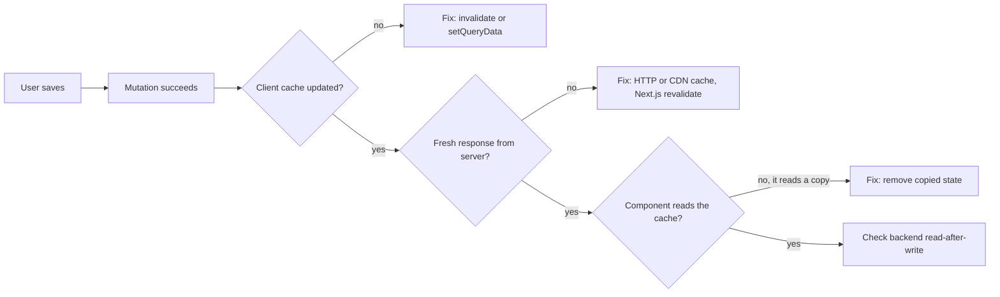
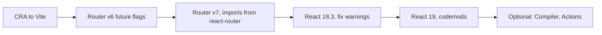

# React — Mixed Interview Questions

> This file is mixed, cross-topic interview practice for the whole React subject. Each topic document already has its own interview questions. Here the questions **combine** topics — hooks with closures and effects, Redux with TanStack Query and axios, the router with auth and interceptors, performance with context — the way a real interview moves from one area to the next. Use this file after you have studied the topic documents, and again in the days before an interview.

**Before this:** all eleven topic documents, starting with [React fundamentals](01-react-fundamentals-jsx-components-props-and-state.md) · How to structure a spoken answer: [How to explain technical answers](../11-coding-interviews/01-how-to-explain-technical-answers.md) · **Back to:** [React subject home](README.md)

## Table of contents

1. [All topic questions at a glance](#all-topic-questions-at-a-glance)
2. [Mixed and cross-topic questions](#mixed-and-cross-topic-questions)
   - [Output and render-count puzzles (Q1–Q6)](#q1-output-question-what-does-this-timer-log-and-show-after-three-seconds)
   - [Find the bug and code review (Q7–Q12)](#q7-find-the-bug-a-memo-list-re-renders-when-the-user-types-in-an-unrelated-input)
   - [Scenarios (Q13–Q20)](#q13-scenario-a-production-page-is-slow-how-do-you-investigate)
   - [Senior trade-offs (Q21–Q26)](#q21-redux-toolkit-zustand-or-tanstack-query-how-do-you-choose)
3. [Common React machine-coding prompts](#common-react-machine-coding-prompts)
4. [Rapid revision round](#rapid-revision-round)
5. [Summary](#summary)

> **Versions and verification.** React 19.3 (19.2 came out in October 2025, 19.3 in September 2026) with React 18 notes, React Compiler 1.0, Redux Toolkit 2, TanStack Query v5, axios 1.x, React Router v7 (v8 shipped in June 2026), React Hook Form 7, Zod 4, MSW 3 and Next.js 16. Every "what logs" and render-count answer in this file, and every machine-coding solution, was **run** with React 19.3.1, React Testing Library 16, TanStack Query 5.104, axios 1.20 and Vitest 5 in jsdom (development build, no Strict Mode unless the question says so).

## All topic questions at a glance

Every question from the eleven topic documents, in order. Use the list to find a question quickly, or to check that you can answer each one out loud in under a minute.

### [React Fundamentals: JSX, Components, Props and State](01-react-fundamentals-jsx-components-props-and-state.md)

- [Q1. What is React, and why would you use it?](01-react-fundamentals-jsx-components-props-and-state.md#q1-what-is-react-and-why-would-you-use-it)
- [Q2. Is React a library or a framework? How does it compare to Angular?](01-react-fundamentals-jsx-components-props-and-state.md#q2-is-react-a-library-or-a-framework-how-does-it-compare-to-angular)
- [Q3. What is JSX, and what does it compile to?](01-react-fundamentals-jsx-components-props-and-state.md#q3-what-is-jsx-and-what-does-it-compile-to)
- [Q4. Why must component names start with a capital letter?](01-react-fundamentals-jsx-components-props-and-state.md#q4-why-must-component-names-start-with-a-capital-letter)
- [Q5. What is the difference between a component, an element and an instance?](01-react-fundamentals-jsx-components-props-and-state.md#q5-what-is-the-difference-between-a-component-an-element-and-an-instance)
- [Q6. Why can't you write an `if` statement inside JSX?](01-react-fundamentals-jsx-components-props-and-state.md#q6-why-cant-you-write-an-if-statement-inside-jsx)
- [Q7. How does React protect against XSS? When is that protection not enough?](01-react-fundamentals-jsx-components-props-and-state.md#q7-how-does-react-protect-against-xss-when-is-that-protection-not-enough)
- [Q8. What is the difference between props and state?](01-react-fundamentals-jsx-components-props-and-state.md#q8-what-is-the-difference-between-props-and-state)
- [Q9. Why are props read-only? What if a child needs to change data?](01-react-fundamentals-jsx-components-props-and-state.md#q9-why-are-props-read-only-what-if-a-child-needs-to-change-data)
- [Q10. What is the `children` prop? How do you use composition?](01-react-fundamentals-jsx-components-props-and-state.md#q10-what-is-the-children-prop-how-do-you-use-composition)
- [Q11. How do you set default prop values in React 19?](01-react-fundamentals-jsx-components-props-and-state.md#q11-how-do-you-set-default-prop-values-in-react-19)
- [Q12. Output question: what does this log, and what does the button show after one click?](01-react-fundamentals-jsx-components-props-and-state.md#q12-output-question-what-does-this-log-and-what-does-the-button-show-after-one-click)
- [Q13. Output question: four variants of queued updates](01-react-fundamentals-jsx-components-props-and-state.md#q13-output-question-four-variants-of-queued-updates)
- [Q14. Why do we say state is a "snapshot"? What does this alert show?](01-react-fundamentals-jsx-components-props-and-state.md#q14-why-do-we-say-state-is-a-snapshot-what-does-this-alert-show)
- [Q15. Find the bug: the list does not update when I add an item.](01-react-fundamentals-jsx-components-props-and-state.md#q15-find-the-bug-the-list-does-not-update-when-i-add-an-item)
- [Q16. Find the bug: after saving the name, the email field disappears.](01-react-fundamentals-jsx-components-props-and-state.md#q16-find-the-bug-after-saving-the-name-the-email-field-disappears)
- [Q17. What are synthetic events, and how does React handle events?](01-react-fundamentals-jsx-components-props-and-state.md#q17-what-are-synthetic-events-and-how-does-react-handle-events)
- [Q18. Find the bug: the alert appears on page load, not on click.](01-react-fundamentals-jsx-components-props-and-state.md#q18-find-the-bug-the-alert-appears-on-page-load-not-on-click)
- [Q19. Output question: what does this show when the cart is empty?](01-react-fundamentals-jsx-components-props-and-state.md#q19-output-question-what-does-this-show-when-the-cart-is-empty)
- [Q20. What are the ways to render conditionally, and what happens to state when a component is hidden?](01-react-fundamentals-jsx-components-props-and-state.md#q20-what-are-the-ways-to-render-conditionally-and-what-happens-to-state-when-a-component-is-hidden)
- [Q21. Why do lists need keys?](01-react-fundamentals-jsx-components-props-and-state.md#q21-why-do-lists-need-keys)
- [Q22. Controlled vs uncontrolled inputs: which do you use and when?](01-react-fundamentals-jsx-components-props-and-state.md#q22-controlled-vs-uncontrolled-inputs-which-do-you-use-and-when)
- [Q23. Scenario: two sibling components need the same data. How do you share it?](01-react-fundamentals-jsx-components-props-and-state.md#q23-scenario-two-sibling-components-need-the-same-data-how-do-you-share-it)
- [Q24. What is prop drilling, and how do you avoid it?](01-react-fundamentals-jsx-components-props-and-state.md#q24-what-is-prop-drilling-and-how-do-you-avoid-it)
- [Q25. Composition vs inheritance in React?](01-react-fundamentals-jsx-components-props-and-state.md#q25-composition-vs-inheritance-in-react)
- [Q26. Function components vs class components: what is the difference today?](01-react-fundamentals-jsx-components-props-and-state.md#q26-function-components-vs-class-components-what-is-the-difference-today)
- [Q27. What does StrictMode do? Why does my component log twice?](01-react-fundamentals-jsx-components-props-and-state.md#q27-what-does-strictmode-do-why-does-my-component-log-twice)
- [Q28. Find the bug: why must rendering be pure?](01-react-fundamentals-jsx-components-props-and-state.md#q28-find-the-bug-why-must-rendering-be-pure)
- [Q29. Code review: what would you change in this component?](01-react-fundamentals-jsx-components-props-and-state.md#q29-code-review-what-would-you-change-in-this-component)
- [Q30. Scenario: should `fullName` or `filteredProducts` be stored in state?](01-react-fundamentals-jsx-components-props-and-state.md#q30-scenario-should-fullname-or-filteredproducts-be-stored-in-state)
- [Q31. One state object or several `useState` calls?](01-react-fundamentals-jsx-components-props-and-state.md#q31-one-state-object-or-several-usestate-calls)
- [Q32. Scenario: you are asked to build a small counter app live. What do you show?](01-react-fundamentals-jsx-components-props-and-state.md#q32-scenario-you-are-asked-to-build-a-small-counter-app-live-what-do-you-show)

### [Rendering, Reconciliation and Keys](02-rendering-reconciliation-and-keys.md)

- [Q1. What causes a React component to re-render?](02-rendering-reconciliation-and-keys.md#q1-what-causes-a-react-component-to-re-render)
- [Q2. Explain the render phase and the commit phase.](02-rendering-reconciliation-and-keys.md#q2-explain-the-render-phase-and-the-commit-phase)
- [Q3. Does a re-render always update the DOM?](02-rendering-reconciliation-and-keys.md#q3-does-a-re-render-always-update-the-dom)
- [Q4. What is the virtual DOM, and is it really faster?](02-rendering-reconciliation-and-keys.md#q4-what-is-the-virtual-dom-and-is-it-really-faster)
- [Q5. How does React's diffing algorithm work? Why is it O(n)?](02-rendering-reconciliation-and-keys.md#q5-how-does-reacts-diffing-algorithm-work-why-is-it-on)
- [Q6. What is React Fiber?](02-rendering-reconciliation-and-keys.md#q6-what-is-react-fiber)
- [Q7. Render count: how many times does each component render after one click?](02-rendering-reconciliation-and-keys.md#q7-render-count-how-many-times-does-each-component-render-after-one-click)
- [Q8. Render count: why does this memoized row still render every time?](02-rendering-reconciliation-and-keys.md#q8-render-count-why-does-this-memoized-row-still-render-every-time)
- [Q9. Render count: does `Expensive` re-render when the counter changes?](02-rendering-reconciliation-and-keys.md#q9-render-count-does-expensive-re-render-when-the-counter-changes)
- [Q10. Render count: context and `memo`](02-rendering-reconciliation-and-keys.md#q10-render-count-context-and-memo)
- [Q11. Render count: what happens when you set the same state value?](02-rendering-reconciliation-and-keys.md#q11-render-count-what-happens-when-you-set-the-same-state-value)
- [Q12. Why are keys important? Walk me through the index-key bug.](02-rendering-reconciliation-and-keys.md#q12-why-are-keys-important-walk-me-through-the-index-key-bug)
- [Q13. Is `key={Math.random()}` or `key={crypto.randomUUID()}` a good fix?](02-rendering-reconciliation-and-keys.md#q13-is-keymathrandom-or-keycryptorandomuuid-a-good-fix)
- [Q14. Scenario: an edit form still shows the previous user's data after selecting another user. How do you fix it?](02-rendering-reconciliation-and-keys.md#q14-scenario-an-edit-form-still-shows-the-previous-users-data-after-selecting-another-user-how-do-you-fix-it)
- [Q15. Output question: which counters keep their state when `flag` toggles?](02-rendering-reconciliation-and-keys.md#q15-output-question-which-counters-keep-their-state-when-flag-toggles)
- [Q16. Find the bug: the input loses focus and its text after every keystroke.](02-rendering-reconciliation-and-keys.md#q16-find-the-bug-the-input-loses-focus-and-its-text-after-every-keystroke)
- [Q17. Output question: how many renders do these handlers cause in React 18+ vs React 17?](02-rendering-reconciliation-and-keys.md#q17-output-question-how-many-renders-do-these-handlers-cause-in-react-18-vs-react-17)
- [Q18. What is `flushSync`, and when would you use it?](02-rendering-reconciliation-and-keys.md#q18-what-is-flushsync-and-when-would-you-use-it)
- [Q19. Output question: what does this log under StrictMode in development?](02-rendering-reconciliation-and-keys.md#q19-output-question-what-does-this-log-under-strictmode-in-development)
- [Q20. Output question: in what order do renders and effects run for a parent and two children?](02-rendering-reconciliation-and-keys.md#q20-output-question-in-what-order-do-renders-and-effects-run-for-a-parent-and-two-children)
- [Q21. Why does React re-render all children by default instead of checking props?](02-rendering-reconciliation-and-keys.md#q21-why-does-react-re-render-all-children-by-default-instead-of-checking-props)
- [Q22. Scenario: "The page re-renders too often." What do you do, step by step?](02-rendering-reconciliation-and-keys.md#q22-scenario-the-page-re-renders-too-often-what-do-you-do-step-by-step)
- [Q23. What do "move state down" and "lift content up" mean? Show code.](02-rendering-reconciliation-and-keys.md#q23-what-do-move-state-down-and-lift-content-up-mean-show-code)
- [Q24. Can you use keys outside of lists? What about Fragments?](02-rendering-reconciliation-and-keys.md#q24-can-you-use-keys-outside-of-lists-what-about-fragments)
- [Q25. Is calling `setState` during render allowed?](02-rendering-reconciliation-and-keys.md#q25-is-calling-setstate-during-render-allowed)
- [Q26. What happens to state, effects and DOM when a component unmounts?](02-rendering-reconciliation-and-keys.md#q26-what-happens-to-state-effects-and-dom-when-a-component-unmounts)
- [Q27. How does React decide between updating a DOM node and recreating it?](02-rendering-reconciliation-and-keys.md#q27-how-does-react-decide-between-updating-a-dom-node-and-recreating-it)
- [Q28. Design question: why does React use virtual DOM diffing instead of fine-grained signals like Angular or Solid?](02-rendering-reconciliation-and-keys.md#q28-design-question-why-does-react-use-virtual-dom-diffing-instead-of-fine-grained-signals-like-angular-or-solid)

### [Hooks in Depth](03-hooks-in-depth.md)

- [Q1. How do hooks work internally? Why do the rules of hooks exist?](03-hooks-in-depth.md#q1-how-do-hooks-work-internally-why-do-the-rules-of-hooks-exist)
- [Q2. Find the bug: this component crashes when `user` becomes available.](03-hooks-in-depth.md#q2-find-the-bug-this-component-crashes-when-user-becomes-available)
- [Q3. Output question: how many times are `readEager` and `readLazy` called?](03-hooks-in-depth.md#q3-output-question-how-many-times-are-readeager-and-readlazy-called)
- [Q4. Explain `useEffect`: when does it run, and what is the dependency array?](03-hooks-in-depth.md#q4-explain-useeffect-when-does-it-run-and-what-is-the-dependency-array)
- [Q5. Output question: in what order are these logs printed on mount, update and unmount?](03-hooks-in-depth.md#q5-output-question-in-what-order-are-these-logs-printed-on-mount-update-and-unmount)
- [Q6. Why does my effect run twice in development? How should I handle it?](03-hooks-in-depth.md#q6-why-does-my-effect-run-twice-in-development-how-should-i-handle-it)
- [Q7. Find the bug: the profile sometimes shows the wrong user.](03-hooks-in-depth.md#q7-find-the-bug-the-profile-sometimes-shows-the-wrong-user)
- [Q8. Find the bug: this effect runs in an infinite loop.](03-hooks-in-depth.md#q8-find-the-bug-this-effect-runs-in-an-infinite-loop)
- [Q9. "You might not need an effect": give examples of effects you would remove.](03-hooks-in-depth.md#q9-you-might-not-need-an-effect-give-examples-of-effects-you-would-remove)
- [Q10. Scenario: when should code go in an event handler and when in an effect?](03-hooks-in-depth.md#q10-scenario-when-should-code-go-in-an-event-handler-and-when-in-an-effect)
- [Q11. Why shouldn't you disable the `exhaustive-deps` lint rule?](03-hooks-in-depth.md#q11-why-shouldnt-you-disable-the-exhaustive-deps-lint-rule)
- [Q12. How do you run an effect only on updates, not on the first render?](03-hooks-in-depth.md#q12-how-do-you-run-an-effect-only-on-updates-not-on-the-first-render)
- [Q13. `useLayoutEffect` vs `useEffect`: what is the difference, and when do you use each?](03-hooks-in-depth.md#q13-uselayouteffect-vs-useeffect-what-is-the-difference-and-when-do-you-use-each)
- [Q14. `useRef` vs `useState`: what does this show after three clicks on "ref" and one on "force"?](03-hooks-in-depth.md#q14-useref-vs-usestate-what-does-this-show-after-three-clicks-on-ref-and-one-on-force)
- [Q15. Why should you not read or write `ref.current` during render?](03-hooks-in-depth.md#q15-why-should-you-not-read-or-write-refcurrent-during-render)
- [Q16. React 18 `forwardRef` vs React 19 ref as a prop: what changed?](03-hooks-in-depth.md#q16-react-18-forwardref-vs-react-19-ref-as-a-prop-what-changed)
- [Q17. When would you use `useImperativeHandle`?](03-hooks-in-depth.md#q17-when-would-you-use-useimperativehandle)
- [Q18. When do `useMemo` and `useCallback` actually help?](03-hooks-in-depth.md#q18-when-do-usememo-and-usecallback-actually-help)
- [Q19. Is `useCallback` useless if the child is not wrapped in `memo`?](03-hooks-in-depth.md#q19-is-usecallback-useless-if-the-child-is-not-wrapped-in-memo)
- [Q20. `useReducer` vs `useState`: when do you choose which? What does this render?](03-hooks-in-depth.md#q20-usereducer-vs-usestate-when-do-you-choose-which-what-does-this-render)
- [Q21. How does `useContext` work? What does each bold element show?](03-hooks-in-depth.md#q21-how-does-usecontext-work-what-does-each-bold-element-show)
- [Q22. What is `useId` for? Why not `Math.random()` or a counter?](03-hooks-in-depth.md#q22-what-is-useid-for-why-not-mathrandom-or-a-counter)
- [Q23. What is `useSyncExternalStore`, and why does it exist?](03-hooks-in-depth.md#q23-what-is-usesyncexternalstore-and-why-does-it-exist)
- [Q24. Output question: what does this timer show after five seconds?](03-hooks-in-depth.md#q24-output-question-what-does-this-timer-show-after-five-seconds)
- [Q25. Find the bug: the keyboard shortcut always uses the old value.](03-hooks-in-depth.md#q25-find-the-bug-the-keyboard-shortcut-always-uses-the-old-value)
- [Q26. What is `useEffectEvent`? What does this log?](03-hooks-in-depth.md#q26-what-is-useeffectevent-what-does-this-log)
- [Q27. Write `useDebouncedValue`. What does this search send?](03-hooks-in-depth.md#q27-write-usedebouncedvalue-what-does-this-search-send)
- [Q28. Write a `useFetch` hook. What are its limits?](03-hooks-in-depth.md#q28-write-a-usefetch-hook-what-are-its-limits)
- [Q29. Write `useLocalStorage`. How do you keep two tabs in sync?](03-hooks-in-depth.md#q29-write-uselocalstorage-how-do-you-keep-two-tabs-in-sync)
- [Q30. Write `usePrevious`. What is the bug in the common version?](03-hooks-in-depth.md#q30-write-useprevious-what-is-the-bug-in-the-common-version)
- [Q31. Two components call the same custom hook. Do they share state?](03-hooks-in-depth.md#q31-two-components-call-the-same-custom-hook-do-they-share-state)
- [Q32. Scenario: design the hooks for a chat room component.](03-hooks-in-depth.md#q32-scenario-design-the-hooks-for-a-chat-room-component)
- [Q33. Scenario: write `useOnClickOutside` for a dropdown.](03-hooks-in-depth.md#q33-scenario-write-useonclickoutside-for-a-dropdown)
- [Q34. Scenario: a junior asks "when should I write a custom hook?" What do you tell them?](03-hooks-in-depth.md#q34-scenario-a-junior-asks-when-should-i-write-a-custom-hook-what-do-you-tell-them)

### [React 18 and 19: Concurrent Features, Actions and Server Components](04-react-18-and-19-concurrent-features-and-server-components.md)

- [Q1. What is concurrent rendering in React 18?](04-react-18-and-19-concurrent-features-and-server-components.md#q1-what-is-concurrent-rendering-in-react-18)
- [Q2. What changes when you move from `ReactDOM.render` to `createRoot`?](04-react-18-and-19-concurrent-features-and-server-components.md#q2-what-changes-when-you-move-from-reactdomrender-to-createroot)
- [Q3. Explain `useTransition`. What renders happen when a tab is clicked?](04-react-18-and-19-concurrent-features-and-server-components.md#q3-explain-usetransition-what-renders-happen-when-a-tab-is-clicked)
- [Q4. `startTransition` vs `useTransition`: when do you use each?](04-react-18-and-19-concurrent-features-and-server-components.md#q4-starttransition-vs-usetransition-when-do-you-use-each)
- [Q5. What does `useDeferredValue` do? What renders happen when `q` changes?](04-react-18-and-19-concurrent-features-and-server-components.md#q5-what-does-usedeferredvalue-do-what-renders-happen-when-q-changes)
- [Q6. Transitions and deferred values vs debouncing: which do you use when?](04-react-18-and-19-concurrent-features-and-server-components.md#q6-transitions-and-deferred-values-vs-debouncing-which-do-you-use-when)
- [Q7. What is Suspense? How does a component "suspend"?](04-react-18-and-19-concurrent-features-and-server-components.md#q7-what-is-suspense-how-does-a-component-suspend)
- [Q8. Scenario: the initial JavaScript bundle is too big. How do you use code splitting in React?](04-react-18-and-19-concurrent-features-and-server-components.md#q8-scenario-the-initial-javascript-bundle-is-too-big-how-do-you-use-code-splitting-in-react)
- [Q9. Output question: what does the user see when switching tabs, with and without a transition?](04-react-18-and-19-concurrent-features-and-server-components.md#q9-output-question-what-does-the-user-see-when-switching-tabs-with-and-without-a-transition)
- [Q10. Find the bug: the component never stops showing "Loading".](04-react-18-and-19-concurrent-features-and-server-components.md#q10-find-the-bug-the-component-never-stops-showing-loading)
- [Q11. How do Suspense and error boundaries work together?](04-react-18-and-19-concurrent-features-and-server-components.md#q11-how-do-suspense-and-error-boundaries-work-together)
- [Q12. Explain streaming SSR and selective hydration.](04-react-18-and-19-concurrent-features-and-server-components.md#q12-explain-streaming-ssr-and-selective-hydration)
- [Q13. What are Actions in React 19?](04-react-18-and-19-concurrent-features-and-server-components.md#q13-what-are-actions-in-react-19)
- [Q14. Output question: what does this form log on an empty submit and then a valid submit?](04-react-18-and-19-concurrent-features-and-server-components.md#q14-output-question-what-does-this-form-log-on-an-empty-submit-and-then-a-valid-submit)
- [Q15. What is `useOptimistic`? What happens when the request fails?](04-react-18-and-19-concurrent-features-and-server-components.md#q15-what-is-useoptimistic-what-happens-when-the-request-fails)
- [Q16. `use` vs `useContext`: what is the difference?](04-react-18-and-19-concurrent-features-and-server-components.md#q16-use-vs-usecontext-what-is-the-difference)
- [Q17. Explain React Server Components. How are they different from SSR?](04-react-18-and-19-concurrent-features-and-server-components.md#q17-explain-react-server-components-how-are-they-different-from-ssr)
- [Q18. Find the bug: "useState is not a function" or "Event handlers cannot be passed to Client Component props".](04-react-18-and-19-concurrent-features-and-server-components.md#q18-find-the-bug-usestate-is-not-a-function-or-event-handlers-cannot-be-passed-to-client-component-props)
- [Q19. What does `'use client'` really mean? Is a Client Component rendered only in the browser?](04-react-18-and-19-concurrent-features-and-server-components.md#q19-what-does-use-client-really-mean-is-a-client-component-rendered-only-in-the-browser)
- [Q20. What are Server Functions (`'use server'`)? What security rules apply?](04-react-18-and-19-concurrent-features-and-server-components.md#q20-what-are-server-functions-use-server-what-security-rules-apply)
- [Q21. What is the React Compiler, and should we adopt it?](04-react-18-and-19-concurrent-features-and-server-components.md#q21-what-is-the-react-compiler-and-should-we-adopt-it)
- [Q22. What was removed in React 19? What breaks when you upgrade?](04-react-18-and-19-concurrent-features-and-server-components.md#q22-what-was-removed-in-react-19-what-breaks-when-you-upgrade)
- [Q23. Scenario: your team is on React 18. How do you plan the upgrade to React 19?](04-react-18-and-19-concurrent-features-and-server-components.md#q23-scenario-your-team-is-on-react-18-how-do-you-plan-the-upgrade-to-react-19)
- [Q24. What does React 19 do with title and meta tags inside components?](04-react-18-and-19-concurrent-features-and-server-components.md#q24-what-does-react-19-do-with-title-and-meta-tags-inside-components)
- [Q25. What is Activity, and how is it different from conditional rendering?](04-react-18-and-19-concurrent-features-and-server-components.md#q25-what-is-activity-and-how-is-it-different-from-conditional-rendering)
- [Q26. What is new in React 19.2 and 19.3?](04-react-18-and-19-concurrent-features-and-server-components.md#q26-what-is-new-in-react-192-and-193)
- [Q27. How did error handling change in React 19?](04-react-18-and-19-concurrent-features-and-server-components.md#q27-how-did-error-handling-change-in-react-19)
- [Q28. Scenario: a dashboard page loads slowly and freezes while filters change. Which React 18/19 features would you use?](04-react-18-and-19-concurrent-features-and-server-components.md#q28-scenario-a-dashboard-page-loads-slowly-and-freezes-while-filters-change-which-react-1819-features-would-you-use)

### [State Management: Context, Redux Toolkit and Zustand](05-state-management-context-redux-toolkit-and-zustand.md)

- [Q1. What kinds of state exist in a React app, and how do you decide where each one lives?](05-state-management-context-redux-toolkit-and-zustand.md#q1-what-kinds-of-state-exist-in-a-react-app-and-how-do-you-decide-where-each-one-lives)
- [Q2. What is the Context API, and is it a state management tool?](05-state-management-context-redux-toolkit-and-zustand.md#q2-what-is-the-context-api-and-is-it-a-state-management-tool)
- [Q3. Output question: how many times does each component render?](05-state-management-context-redux-toolkit-and-zustand.md#q3-output-question-how-many-times-does-each-component-render)
- [Q4. Find the bug: why do context consumers re-render when nothing in the context changed?](05-state-management-context-redux-toolkit-and-zustand.md#q4-find-the-bug-why-do-context-consumers-re-render-when-nothing-in-the-context-changed)
- [Q5. How do you fix Context performance problems in a large app?](05-state-management-context-redux-toolkit-and-zustand.md#q5-how-do-you-fix-context-performance-problems-in-a-large-app)
- [Q6. Explain Redux: store, actions, reducers and the data flow.](05-state-management-context-redux-toolkit-and-zustand.md#q6-explain-redux-store-actions-reducers-and-the-data-flow)
- [Q7. Why must reducers be pure? What breaks if they are not?](05-state-management-context-redux-toolkit-and-zustand.md#q7-why-must-reducers-be-pure-what-breaks-if-they-are-not)
- [Q8. Why is immutability so important in Redux and React?](05-state-management-context-redux-toolkit-and-zustand.md#q8-why-is-immutability-so-important-in-redux-and-react)
- [Q9. How does Immer work in Redux Toolkit?](05-state-management-context-redux-toolkit-and-zustand.md#q9-how-does-immer-work-in-redux-toolkit)
- [Q10. Find the bug in this slice.](05-state-management-context-redux-toolkit-and-zustand.md#q10-find-the-bug-in-this-slice)
- [Q11. What is Redux Toolkit, and what does configureStore add over plain createStore?](05-state-management-context-redux-toolkit-and-zustand.md#q11-what-is-redux-toolkit-and-what-does-configurestore-add-over-plain-createstore)
- [Q12. Walk me through createAsyncThunk. What happens when the request fails or is cancelled?](05-state-management-context-redux-toolkit-and-zustand.md#q12-walk-me-through-createasyncthunk-what-happens-when-the-request-fails-or-is-cancelled)
- [Q13. What is the difference between `reducers` and `extraReducers` in createSlice?](05-state-management-context-redux-toolkit-and-zustand.md#q13-what-is-the-difference-between-reducers-and-extrareducers-in-createslice)
- [Q14. What is Redux middleware? Write a logger and explain how thunk works.](05-state-management-context-redux-toolkit-and-zustand.md#q14-what-is-redux-middleware-write-a-logger-and-explain-how-thunk-works)
- [Q15. Thunks vs sagas vs the listener middleware: which do you use?](05-state-management-context-redux-toolkit-and-zustand.md#q15-thunks-vs-sagas-vs-the-listener-middleware-which-do-you-use)
- [Q16. How does `useSelector` decide when to re-render? What is wrong with this selector?](05-state-management-context-redux-toolkit-and-zustand.md#q16-how-does-useselector-decide-when-to-re-render-what-is-wrong-with-this-selector)
- [Q17. When do you need memoized selectors? Explain this selector bug.](05-state-management-context-redux-toolkit-and-zustand.md#q17-when-do-you-need-memoized-selectors-explain-this-selector-bug)
- [Q18. What does "normalizing state" mean? How does createEntityAdapter help?](05-state-management-context-redux-toolkit-and-zustand.md#q18-what-does-normalizing-state-mean-how-does-createentityadapter-help)
- [Q19. Should you store derived data in Redux, like a cart total?](05-state-management-context-redux-toolkit-and-zustand.md#q19-should-you-store-derived-data-in-redux-like-a-cart-total)
- [Q20. How do you type Redux with TypeScript?](05-state-management-context-redux-toolkit-and-zustand.md#q20-how-do-you-type-redux-with-typescript)
- [Q21. What is RTK Query, and how do tags and invalidation work?](05-state-management-context-redux-toolkit-and-zustand.md#q21-what-is-rtk-query-and-how-do-tags-and-invalidation-work)
- [Q22. createAsyncThunk, RTK Query or TanStack Query: how do you choose?](05-state-management-context-redux-toolkit-and-zustand.md#q22-createasyncthunk-rtk-query-or-tanstack-query-how-do-you-choose)
- [Q23. What can Redux DevTools do, and why does it need serializable state?](05-state-management-context-redux-toolkit-and-zustand.md#q23-what-can-redux-devtools-do-and-why-does-it-need-serializable-state)
- [Q24. How does Zustand work, and what are its pitfalls?](05-state-management-context-redux-toolkit-and-zustand.md#q24-how-does-zustand-work-and-what-are-its-pitfalls)
- [Q25. What is Jotai, and when would you choose atoms over a single store?](05-state-management-context-redux-toolkit-and-zustand.md#q25-what-is-jotai-and-when-would-you-choose-atoms-over-a-single-store)
- [Q26. Context vs Redux vs Zustand: how do you choose? Do we still need Redux?](05-state-management-context-redux-toolkit-and-zustand.md#q26-context-vs-redux-vs-zustand-how-do-you-choose-do-we-still-need-redux)
- [Q27. Code review: what would you change in this Redux code?](05-state-management-context-redux-toolkit-and-zustand.md#q27-code-review-what-would-you-change-in-this-redux-code)
- [Q28. Scenario: typing in a form re-renders the whole app. The form state is in a global store. What do you do?](05-state-management-context-redux-toolkit-and-zustand.md#q28-scenario-typing-in-a-form-re-renders-the-whole-app-the-form-state-is-in-a-global-store-what-do-you-do)
- [Q29. How would you migrate a legacy Redux app (switch reducers, connect, hand-written action types) to Redux Toolkit?](05-state-management-context-redux-toolkit-and-zustand.md#q29-how-would-you-migrate-a-legacy-redux-app-switch-reducers-connect-hand-written-action-types-to-redux-toolkit)
- [Q30. Compare Redux Toolkit with NgRx.](05-state-management-context-redux-toolkit-and-zustand.md#q30-compare-redux-toolkit-with-ngrx)
- [Q31. Where should API calls and other side effects live in a Redux app?](05-state-management-context-redux-toolkit-and-zustand.md#q31-where-should-api-calls-and-other-side-effects-live-in-a-redux-app)
- [Q32. How do you test reducers, selectors and thunks?](05-state-management-context-redux-toolkit-and-zustand.md#q32-how-do-you-test-reducers-selectors-and-thunks)

### [Data Fetching: axios and TanStack Query](06-data-fetching-axios-and-tanstack-query.md)

- [Q1. fetch or axios: which do you use and why?](06-data-fetching-axios-and-tanstack-query.md#q1-fetch-or-axios-which-do-you-use-and-why)
- [Q2. Output question: what does this code print?](06-data-fetching-axios-and-tanstack-query.md#q2-output-question-what-does-this-code-print)
- [Q3. How do you set up axios in a real project?](06-data-fetching-axios-and-tanstack-query.md#q3-how-do-you-set-up-axios-in-a-real-project)
- [Q4. What are interceptors? In what order do they run?](06-data-fetching-axios-and-tanstack-query.md#q4-what-are-interceptors-in-what-order-do-they-run)
- [Q5. How do you attach the auth token, and where do you keep it?](06-data-fetching-axios-and-tanstack-query.md#q5-how-do-you-attach-the-auth-token-and-where-do-you-keep-it)
- [Q6. Five requests fail with 401 because the token expired. Write the refresh logic.](06-data-fetching-axios-and-tanstack-query.md#q6-five-requests-fail-with-401-because-the-token-expired-write-the-refresh-logic)
- [Q7. Scenario: the refresh itself fails, or the user's session is revoked. What should happen?](06-data-fetching-axios-and-tanstack-query.md#q7-scenario-the-refresh-itself-fails-or-the-users-session-is-revoked-what-should-happen)
- [Q8. How do you handle API errors globally?](06-data-fetching-axios-and-tanstack-query.md#q8-how-do-you-handle-api-errors-globally)
- [Q9. Write a retry interceptor. Which requests should be retried?](06-data-fetching-axios-and-tanstack-query.md#q9-write-a-retry-interceptor-which-requests-should-be-retried)
- [Q10. How do you cancel requests with axios? What about CancelToken?](06-data-fetching-axios-and-tanstack-query.md#q10-how-do-you-cancel-requests-with-axios-what-about-canceltoken)
- [Q11. What is the difference between axios's `timeout` and an `AbortSignal.timeout`?](06-data-fetching-axios-and-tanstack-query.md#q11-what-is-the-difference-between-axioss-timeout-and-an-abortsignaltimeout)
- [Q12. How do you tell a network error from an HTTP error in axios?](06-data-fetching-axios-and-tanstack-query.md#q12-how-do-you-tell-a-network-error-from-an-http-error-in-axios)
- [Q13. How do you type axios calls in TypeScript? Is the generic enough?](06-data-fetching-axios-and-tanstack-query.md#q13-how-do-you-type-axios-calls-in-typescript-is-the-generic-enough)
- [Q14. Write a component that fetches data in useEffect correctly.](06-data-fetching-axios-and-tanstack-query.md#q14-write-a-component-that-fetches-data-in-useeffect-correctly)
- [Q15. Scenario: a search box sometimes shows results for an older query. Why, and how do you fix it?](06-data-fetching-axios-and-tanstack-query.md#q15-scenario-a-search-box-sometimes-shows-results-for-an-older-query-why-and-how-do-you-fix-it)
- [Q16. Scenario: in development every request is sent twice. Is that a bug?](06-data-fetching-axios-and-tanstack-query.md#q16-scenario-in-development-every-request-is-sent-twice-is-that-a-bug)
- [Q17. What problems does TanStack Query solve that useEffect fetching does not?](06-data-fetching-axios-and-tanstack-query.md#q17-what-problems-does-tanstack-query-solve-that-useeffect-fetching-does-not)
- [Q18. How do you design query keys?](06-data-fetching-axios-and-tanstack-query.md#q18-how-do-you-design-query-keys)
- [Q19. Explain staleTime vs gcTime. What are the defaults?](06-data-fetching-axios-and-tanstack-query.md#q19-explain-staletime-vs-gctime-what-are-the-defaults)
- [Q20. What is the difference between isPending, isLoading and isFetching?](06-data-fetching-axios-and-tanstack-query.md#q20-what-is-the-difference-between-ispending-isloading-and-isfetching)
- [Q21. Scenario: our API is hit every time a user switches browser tabs. Why, and what do you do?](06-data-fetching-axios-and-tanstack-query.md#q21-scenario-our-api-is-hit-every-time-a-user-switches-browser-tabs-why-and-what-do-you-do)
- [Q22. How do retries work in TanStack Query, and how do you customize them?](06-data-fetching-axios-and-tanstack-query.md#q22-how-do-retries-work-in-tanstack-query-and-how-do-you-customize-them)
- [Q23. How do you do dependent and parallel queries?](06-data-fetching-axios-and-tanstack-query.md#q23-how-do-you-do-dependent-and-parallel-queries)
- [Q24. How do you implement pagination and infinite scroll with TanStack Query?](06-data-fetching-axios-and-tanstack-query.md#q24-how-do-you-implement-pagination-and-infinite-scroll-with-tanstack-query)
- [Q25. How do mutations work, and when do you invalidate vs update the cache directly?](06-data-fetching-axios-and-tanstack-query.md#q25-how-do-mutations-work-and-when-do-you-invalidate-vs-update-the-cache-directly)
- [Q26. Implement an optimistic update with rollback in TanStack Query.](06-data-fetching-axios-and-tanstack-query.md#q26-implement-an-optimistic-update-with-rollback-in-tanstack-query)
- [Q27. How and why do you prefetch data?](06-data-fetching-axios-and-tanstack-query.md#q27-how-and-why-do-you-prefetch-data)
- [Q28. How do you use TanStack Query with Suspense?](06-data-fetching-axios-and-tanstack-query.md#q28-how-do-you-use-tanstack-query-with-suspense)
- [Q29. Scenario: after logout and login as a different user, the old user's data appears for a moment. Fix it.](06-data-fetching-axios-and-tanstack-query.md#q29-scenario-after-logout-and-login-as-a-different-user-the-old-users-data-appears-for-a-moment-fix-it)
- [Q30. TanStack Query vs SWR vs RTK Query: how do you choose?](06-data-fetching-axios-and-tanstack-query.md#q30-tanstack-query-vs-swr-vs-rtk-query-how-do-you-choose)
- [Q31. How do you structure API code in a large React app, and how do you handle 401s globally with TanStack Query?](06-data-fetching-axios-and-tanstack-query.md#q31-how-do-you-structure-api-code-in-a-large-react-app-and-how-do-you-handle-401s-globally-with-tanstack-query)
- [Q32. Code review: what is wrong with this data-fetching code?](06-data-fetching-axios-and-tanstack-query.md#q32-code-review-what-is-wrong-with-this-data-fetching-code)

### [Routing and Forms](07-routing-and-forms.md)

- [Q1. How does client-side routing work, and how is it different from server-side routing?](07-routing-and-forms.md#q1-how-does-client-side-routing-work-and-how-is-it-different-from-server-side-routing)
- [Q2. What are React Router v7's three modes, and which would you choose?](07-routing-and-forms.md#q2-what-are-react-router-v7s-three-modes-and-which-would-you-choose)
- [Q3. How do nested routes and Outlet work? What is an index route?](07-routing-and-forms.md#q3-how-do-nested-routes-and-outlet-work-what-is-an-index-route)
- [Q4. Route params vs search params: when do you use each? Output question about NavLink.](07-routing-and-forms.md#q4-route-params-vs-search-params-when-do-you-use-each-output-question-about-navlink)
- [Q5. Link, NavLink, useNavigate, Navigate and redirect: when do you use each?](07-routing-and-forms.md#q5-link-navlink-usenavigate-navigate-and-redirect-when-do-you-use-each)
- [Q6. How do you protect a route? Write it.](07-routing-and-forms.md#q6-how-do-you-protect-a-route-write-it)
- [Q7. How do you protect routes in data mode, and why is that better?](07-routing-and-forms.md#q7-how-do-you-protect-routes-in-data-mode-and-why-is-that-better)
- [Q8. How do you do role-based access in routes and in the UI?](07-routing-and-forms.md#q8-how-do-you-do-role-based-access-in-routes-and-in-the-ui)
- [Q9. How do you lazy-load routes? React.lazy vs route.lazy?](07-routing-and-forms.md#q9-how-do-you-lazy-load-routes-reactlazy-vs-routelazy)
- [Q10. What are loaders and actions, and how do they change data flow?](07-routing-and-forms.md#q10-what-are-loaders-and-actions-and-how-do-they-change-data-flow)
- [Q11. How do you handle 404 pages and route errors?](07-routing-and-forms.md#q11-how-do-you-handle-404-pages-and-route-errors)
- [Q12. After navigating, the new page opens scrolled to the middle. Why, and how do you fix it?](07-routing-and-forms.md#q12-after-navigating-the-new-page-opens-scrolled-to-the-middle-why-and-how-do-you-fix-it)
- [Q13. Scenario: where should the filter and sort state of a list page live?](07-routing-and-forms.md#q13-scenario-where-should-the-filter-and-sort-state-of-a-list-page-live)
- [Q14. Find the bug: the details page shows stale data when navigating from /users/1 to /users/2.](07-routing-and-forms.md#q14-find-the-bug-the-details-page-shows-stale-data-when-navigating-from-users1-to-users2)
- [Q15. Controlled vs uncontrolled inputs: which do you use, and when?](07-routing-and-forms.md#q15-controlled-vs-uncontrolled-inputs-which-do-you-use-and-when)
- [Q16. What validation strategy do you use, and when should errors appear?](07-routing-and-forms.md#q16-what-validation-strategy-do-you-use-and-when-should-errors-appear)
- [Q17. Scenario: a big form re-renders on every keystroke and typing lags. What do you do?](07-routing-and-forms.md#q17-scenario-a-big-form-re-renders-on-every-keystroke-and-typing-lags-what-do-you-do)
- [Q18. How does React Hook Form work, and why does it re-render less?](07-routing-and-forms.md#q18-how-does-react-hook-form-work-and-why-does-it-re-render-less)
- [Q19. How do you use a UI-library component (date picker, custom select) with React Hook Form?](07-routing-and-forms.md#q19-how-do-you-use-a-ui-library-component-date-picker-custom-select-with-react-hook-form)
- [Q20. How do you validate a form with Zod and React Hook Form? What changed in Zod 4?](07-routing-and-forms.md#q20-how-do-you-validate-a-form-with-zod-and-react-hook-form-what-changed-in-zod-4)
- [Q21. How do you validate dependent fields, like "confirm password" or "end date after start date"?](07-routing-and-forms.md#q21-how-do-you-validate-dependent-fields-like-confirm-password-or-end-date-after-start-date)
- [Q22. How do you build a form with a dynamic list of fields?](07-routing-and-forms.md#q22-how-do-you-build-a-form-with-a-dynamic-list-of-fields)
- [Q23. How do you implement async validation, like "is this username available"?](07-routing-and-forms.md#q23-how-do-you-implement-async-validation-like-is-this-username-available)
- [Q24. How do you show server-side validation errors in the form?](07-routing-and-forms.md#q24-how-do-you-show-server-side-validation-errors-in-the-form)
- [Q25. Explain React 19 form Actions: the action prop, useActionState and useFormStatus.](07-routing-and-forms.md#q25-explain-react-19-form-actions-the-action-prop-useactionstate-and-useformstatus)
- [Q26. React Hook Form or React 19 Actions: which would you use?](07-routing-and-forms.md#q26-react-hook-form-or-react-19-actions-which-would-you-use)
- [Q27. What makes a React form accessible?](07-routing-and-forms.md#q27-what-makes-a-react-form-accessible)
- [Q28. How do you warn users about unsaved changes before they leave the page?](07-routing-and-forms.md#q28-how-do-you-warn-users-about-unsaved-changes-before-they-leave-the-page)
- [Q29. How do you build a multi-step (wizard) form? Where does its state live?](07-routing-and-forms.md#q29-how-do-you-build-a-multi-step-wizard-form-where-does-its-state-live)
- [Q30. Machine coding: build a login page with validation, error handling and a redirect back after login.](07-routing-and-forms.md#q30-machine-coding-build-a-login-page-with-validation-error-handling-and-a-redirect-back-after-login)

### [React Performance Optimization](08-performance-optimization.md)

- [Q1. A React page is slow. How do you approach the problem?](08-performance-optimization.md#q1-a-react-page-is-slow-how-do-you-approach-the-problem)
- [Q2. How do you use the React DevTools Profiler? What does it show?](08-performance-optimization.md#q2-how-do-you-use-the-react-devtools-profiler-what-does-it-show)
- [Q3. Is a re-render bad? What is the difference between re-rendering and updating the DOM?](08-performance-optimization.md#q3-is-a-re-render-bad-what-is-the-difference-between-re-rendering-and-updating-the-dom)
- [Q4. What causes unnecessary re-renders in React?](08-performance-optimization.md#q4-what-causes-unnecessary-re-renders-in-react)
- [Q5. What does React.memo do, and how does it compare props?](08-performance-optimization.md#q5-what-does-reactmemo-do-and-how-does-it-compare-props)
- [Q6. Output question: how many times does each child render?](08-performance-optimization.md#q6-output-question-how-many-times-does-each-child-render)
- [Q7. Find the bug: why does React.memo not help here?](08-performance-optimization.md#q7-find-the-bug-why-does-reactmemo-not-help-here)
- [Q8. When should you use useMemo and useCallback, and when are they useless?](08-performance-optimization.md#q8-when-should-you-use-usememo-and-usecallback-and-when-are-they-useless)
- [Q9. Find the bug: a memoized callback sends old data](08-performance-optimization.md#q9-find-the-bug-a-memoized-callback-sends-old-data)
- [Q10. What does the second argument of React.memo do? When is it dangerous?](08-performance-optimization.md#q10-what-does-the-second-argument-of-reactmemo-do-when-is-it-dangerous)
- [Q11. What is state colocation? Show how it improves performance.](08-performance-optimization.md#q11-what-is-state-colocation-show-how-it-improves-performance)
- [Q12. Explain the "children as props" (lift content up) pattern.](08-performance-optimization.md#q12-explain-the-children-as-props-lift-content-up-pattern)
- [Q13. Scenario: "Our context causes the whole app to re-render." What do you do?](08-performance-optimization.md#q13-scenario-our-context-causes-the-whole-app-to-re-render-what-do-you-do)
- [Q14. Output question: which components re-render when the theme changes?](08-performance-optimization.md#q14-output-question-which-components-re-render-when-the-theme-changes)
- [Q15. Scenario: typing in a search input lags. Walk me through your fix.](08-performance-optimization.md#q15-scenario-typing-in-a-search-input-lags-walk-me-through-your-fix)
- [Q16. Debounce vs useDeferredValue vs useTransition — when do you use each?](08-performance-optimization.md#q16-debounce-vs-usedeferredvalue-vs-usetransition--when-do-you-use-each)
- [Q17. How does useTransition actually keep the UI responsive?](08-performance-optimization.md#q17-how-does-usetransition-actually-keep-the-ui-responsive)
- [Q18. Scenario: you need to show a list of 10,000 rows. What do you do?](08-performance-optimization.md#q18-scenario-you-need-to-show-a-list-of-10000-rows-what-do-you-do)
- [Q19. How does code splitting work with React.lazy and Suspense?](08-performance-optimization.md#q19-how-does-code-splitting-work-with-reactlazy-and-suspense)
- [Q20. Scenario: the JavaScript bundle is too big. How do you find and fix the cause?](08-performance-optimization.md#q20-scenario-the-javascript-bundle-is-too-big-how-do-you-find-and-fix-the-cause)
- [Q21. One component itself is slow to render. What can you do?](08-performance-optimization.md#q21-one-component-itself-is-slow-to-render-what-can-you-do)
- [Q22. Find the bug: why does this component render twice for every change?](08-performance-optimization.md#q22-find-the-bug-why-does-this-component-render-twice-for-every-change)
- [Q23. Do keys affect performance? When does a wrong key make things slow?](08-performance-optimization.md#q23-do-keys-affect-performance-when-does-a-wrong-key-make-things-slow)
- [Q24. What is the React Compiler, and does it make memo, useMemo and useCallback obsolete?](08-performance-optimization.md#q24-what-is-the-react-compiler-and-does-it-make-memo-usememo-and-usecallback-obsolete)
- [Q25. Code review: what performance problems do you see?](08-performance-optimization.md#q25-code-review-what-performance-problems-do-you-see)
- [Q26. Does Strict Mode make my app slower? Why do my render counts double?](08-performance-optimization.md#q26-does-strict-mode-make-my-app-slower-why-do-my-render-counts-double)
- [Q27. How do you measure React performance in production?](08-performance-optimization.md#q27-how-do-you-measure-react-performance-in-production)
- [Q28. How does automatic batching affect performance?](08-performance-optimization.md#q28-how-does-automatic-batching-affect-performance)
- [Q29. How do you optimize images in a React app?](08-performance-optimization.md#q29-how-do-you-optimize-images-in-a-react-app)
- [Q30. What is Activity in React 19.2, and how can it help performance?](08-performance-optimization.md#q30-what-is-activity-in-react-192-and-how-can-it-help-performance)
- [Q31. How do you prevent performance regressions in a team?](08-performance-optimization.md#q31-how-do-you-prevent-performance-regressions-in-a-team)
- [Q32. If you know Angular: how does React performance tuning compare to Angular's?](08-performance-optimization.md#q32-if-you-know-angular-how-does-react-performance-tuning-compare-to-angulars)

### [React Patterns, Architecture and TypeScript](09-patterns-architecture-and-typescript.md)

- [Q1. What is composition in React, and why does React prefer it over inheritance?](09-patterns-architecture-and-typescript.md#q1-what-is-composition-in-react-and-why-does-react-prefer-it-over-inheritance)
- [Q2. What are container and presentational components? Are they still relevant with hooks?](09-patterns-architecture-and-typescript.md#q2-what-are-container-and-presentational-components-are-they-still-relevant-with-hooks)
- [Q3. Why are custom hooks the main reuse pattern in React? Do two components using the same hook share state?](09-patterns-architecture-and-typescript.md#q3-why-are-custom-hooks-the-main-reuse-pattern-in-react-do-two-components-using-the-same-hook-share-state)
- [Q4. What is a higher-order component (HOC)? What problems does it have?](09-patterns-architecture-and-typescript.md#q4-what-is-a-higher-order-component-hoc-what-problems-does-it-have)
- [Q5. What are render props? When are they still useful?](09-patterns-architecture-and-typescript.md#q5-what-are-render-props-when-are-they-still-useful)
- [Q6. HOC vs render props vs custom hook — how do you choose?](09-patterns-architecture-and-typescript.md#q6-hoc-vs-render-props-vs-custom-hook--how-do-you-choose)
- [Q7. What are compound components? Build a Tabs component.](09-patterns-architecture-and-typescript.md#q7-what-are-compound-components-build-a-tabs-component)
- [Q8. How do you make the Tabs compound component accessible?](09-patterns-architecture-and-typescript.md#q8-how-do-you-make-the-tabs-compound-component-accessible)
- [Q9. How do you design a component that supports both controlled and uncontrolled use?](09-patterns-architecture-and-typescript.md#q9-how-do-you-design-a-component-that-supports-both-controlled-and-uncontrolled-use)
- [Q10. Design a reusable Modal component.](09-patterns-architecture-and-typescript.md#q10-design-a-reusable-modal-component)
- [Q11. Output question: does the parent's onClick fire when clicking inside a portal?](09-patterns-architecture-and-typescript.md#q11-output-question-does-the-parents-onclick-fire-when-clicking-inside-a-portal)
- [Q12. What is an error boundary? How do you write one?](09-patterns-architecture-and-typescript.md#q12-what-is-an-error-boundary-how-do-you-write-one)
- [Q13. My error boundary doesn't catch my async error. Why, and how do I fix it?](09-patterns-architecture-and-typescript.md#q13-my-error-boundary-doesnt-catch-my-async-error-why-and-how-do-i-fix-it)
- [Q14. Where should you place error boundaries in an application?](09-patterns-architecture-and-typescript.md#q14-where-should-you-place-error-boundaries-in-an-application)
- [Q15. forwardRef vs ref as a prop: what changed in React 19?](09-patterns-architecture-and-typescript.md#q15-forwardref-vs-ref-as-a-prop-what-changed-in-react-19)
- [Q16. When would you use useImperativeHandle?](09-patterns-architecture-and-typescript.md#q16-when-would-you-use-useimperativehandle)
- [Q17. How would you structure the folders of a large React application?](09-patterns-architecture-and-typescript.md#q17-how-would-you-structure-the-folders-of-a-large-react-application)
- [Q18. How do you separate UI, state and API logic in React?](09-patterns-architecture-and-typescript.md#q18-how-do-you-separate-ui-state-and-api-logic-in-react)
- [Q19. Design a reusable Button for a design system.](09-patterns-architecture-and-typescript.md#q19-design-a-reusable-button-for-a-design-system)
- [Q20. What are the accessibility basics you check in React components?](09-patterns-architecture-and-typescript.md#q20-what-are-the-accessibility-basics-you-check-in-react-components)
- [Q21. How do you type props and children in TypeScript? Should you use React.FC?](09-patterns-architecture-and-typescript.md#q21-how-do-you-type-props-and-children-in-typescript-should-you-use-reactfc)
- [Q22. How do you type events, useState and useRef?](09-patterns-architecture-and-typescript.md#q22-how-do-you-type-events-usestate-and-useref)
- [Q23. How do you write a generic component in TypeScript?](09-patterns-architecture-and-typescript.md#q23-how-do-you-write-a-generic-component-in-typescript)
- [Q24. How do you extend the props of a native element (ComponentProps)?](09-patterns-architecture-and-typescript.md#q24-how-do-you-extend-the-props-of-a-native-element-componentprops)
- [Q25. How do you use discriminated unions for component props?](09-patterns-architecture-and-typescript.md#q25-how-do-you-use-discriminated-unions-for-component-props)
- [Q26. How do you type context and reducers?](09-patterns-architecture-and-typescript.md#q26-how-do-you-type-context-and-reducers)
- [Q27. Find the bug: a HOC that breaks hooks rules and loses state](09-patterns-architecture-and-typescript.md#q27-find-the-bug-a-hoc-that-breaks-hooks-rules-and-loses-state)
- [Q28. Code review: how would you refactor this "god component"?](09-patterns-architecture-and-typescript.md#q28-code-review-how-would-you-refactor-this-god-component)
- [Q29. If you know Angular: how do React patterns map to Angular concepts?](09-patterns-architecture-and-typescript.md#q29-if-you-know-angular-how-do-react-patterns-map-to-angular-concepts)
- [Q30. What is the difference between ReactNode, ReactElement and JSX.Element?](09-patterns-architecture-and-typescript.md#q30-what-is-the-difference-between-reactnode-reactelement-and-jsxelement)

### [Testing React Applications](10-testing-react-applications.md)

- [Q1. What should you test in a React application?](10-testing-react-applications.md#q1-what-should-you-test-in-a-react-application)
- [Q2. What does the testing pyramid (or trophy) look like for a React app?](10-testing-react-applications.md#q2-what-does-the-testing-pyramid-or-trophy-look-like-for-a-react-app)
- [Q3. Jest or Vitest — what's the difference, and which would you choose?](10-testing-react-applications.md#q3-jest-or-vitest--whats-the-difference-and-which-would-you-choose)
- [Q4. What is the philosophy of React Testing Library, and how is it different from Enzyme?](10-testing-react-applications.md#q4-what-is-the-philosophy-of-react-testing-library-and-how-is-it-different-from-enzyme)
- [Q5. Explain getBy, queryBy and findBy. When do you use each?](10-testing-react-applications.md#q5-explain-getby-queryby-and-findby-when-do-you-use-each)
- [Q6. Which query should you use first? When is getByTestId acceptable?](10-testing-react-applications.md#q6-which-query-should-you-use-first-when-is-getbytestid-acceptable)
- [Q7. user-event or fireEvent — which do you use and why?](10-testing-react-applications.md#q7-user-event-or-fireevent--which-do-you-use-and-why)
- [Q8. Write a test for a login form.](10-testing-react-applications.md#q8-write-a-test-for-a-login-form)
- [Q9. How do you test asynchronous behavior? What are the rules for waitFor?](10-testing-react-applications.md#q9-how-do-you-test-asynchronous-behavior-what-are-the-rules-for-waitfor)
- [Q10. What does the "not wrapped in act(...)" warning mean, and how do you fix it?](10-testing-react-applications.md#q10-what-does-the-not-wrapped-in-act-warning-mean-and-how-do-you-fix-it)
- [Q11. Why is my test flaky? What are the common causes?](10-testing-react-applications.md#q11-why-is-my-test-flaky-what-are-the-common-causes)
- [Q12. How do you mock API calls? Why MSW instead of mocking axios or fetch?](10-testing-react-applications.md#q12-how-do-you-mock-api-calls-why-msw-instead-of-mocking-axios-or-fetch)
- [Q13. Write a test for a component that fetches data (loading, success, error).](10-testing-react-applications.md#q13-write-a-test-for-a-component-that-fetches-data-loading-success-error)
- [Q14. What MSW setup mistakes do you see in real projects?](10-testing-react-applications.md#q14-what-msw-setup-mistakes-do-you-see-in-real-projects)
- [Q15. How do you test a custom hook?](10-testing-react-applications.md#q15-how-do-you-test-a-custom-hook)
- [Q16. How do you test a component that uses TanStack Query?](10-testing-react-applications.md#q16-how-do-you-test-a-component-that-uses-tanstack-query)
- [Q17. How do you test components connected to Redux?](10-testing-react-applications.md#q17-how-do-you-test-components-connected-to-redux)
- [Q18. How do you test components that use React Router?](10-testing-react-applications.md#q18-how-do-you-test-components-that-use-react-router)
- [Q19. How do you set up a reusable custom render with all providers?](10-testing-react-applications.md#q19-how-do-you-set-up-a-reusable-custom-render-with-all-providers)
- [Q20. When would you use vi.mock (or jest.mock), and what are the pitfalls?](10-testing-react-applications.md#q20-when-would-you-use-vimock-or-jestmock-and-what-are-the-pitfalls)
- [Q21. How do you test components that use timers or debouncing?](10-testing-react-applications.md#q21-how-do-you-test-components-that-use-timers-or-debouncing)
- [Q22. How do you test a debounced search with fake timers?](10-testing-react-applications.md#q22-how-do-you-test-a-debounced-search-with-fake-timers)
- [Q23. What are snapshot tests good for, and what are their problems?](10-testing-react-applications.md#q23-what-are-snapshot-tests-good-for-and-what-are-their-problems)
- [Q24. How do you test accessibility in React?](10-testing-react-applications.md#q24-how-do-you-test-accessibility-in-react)
- [Q25. Playwright or Cypress? What should be covered by end-to-end tests?](10-testing-react-applications.md#q25-playwright-or-cypress-what-should-be-covered-by-end-to-end-tests)
- [Q26. What does code coverage tell you? What target would you set?](10-testing-react-applications.md#q26-what-does-code-coverage-tell-you-what-target-would-you-set)
- [Q27. How do you test error boundaries and error states?](10-testing-react-applications.md#q27-how-do-you-test-error-boundaries-and-error-states)
- [Q28. Find the bug: this test passes, but the feature is broken in the app](10-testing-react-applications.md#q28-find-the-bug-this-test-passes-but-the-feature-is-broken-in-the-app)
- [Q29. How do you test a form built with React Hook Form and Zod?](10-testing-react-applications.md#q29-how-do-you-test-a-form-built-with-react-hook-form-and-zod)
- [Q30. Code review: what is wrong with this test?](10-testing-react-applications.md#q30-code-review-what-is-wrong-with-this-test)
- [Q31. If you know Angular: how does React testing compare with Angular testing?](10-testing-react-applications.md#q31-if-you-know-angular-how-does-react-testing-compare-with-angular-testing)

### [Next.js Essentials for Interviews](11-nextjs-essentials-for-interviews.md)

- [Q1. Why would you use Next.js instead of plain React with Vite?](11-nextjs-essentials-for-interviews.md#q1-why-would-you-use-nextjs-instead-of-plain-react-with-vite)
- [Q2. What is the difference between the App Router and the Pages Router?](11-nextjs-essentials-for-interviews.md#q2-what-is-the-difference-between-the-app-router-and-the-pages-router)
- [Q3. Explain layouts, templates, loading.js, error.js and not-found.js.](11-nextjs-essentials-for-interviews.md#q3-explain-layouts-templates-loadingjs-errorjs-and-not-foundjs)
- [Q4. Why does useState not work in this component?](11-nextjs-essentials-for-interviews.md#q4-why-does-usestate-not-work-in-this-component)
- [Q5. How do Server and Client Components work together? What can you pass between them?](11-nextjs-essentials-for-interviews.md#q5-how-do-server-and-client-components-work-together-what-can-you-pass-between-them)
- [Q6. SSR vs SSG vs ISR in Next.js — how do you choose, and how do you get each?](11-nextjs-essentials-for-interviews.md#q6-ssr-vs-ssg-vs-isr-in-nextjs--how-do-you-choose-and-how-do-you-get-each)
- [Q7. How did caching change in Next.js 15 and 16? What are the defaults now?](11-nextjs-essentials-for-interviews.md#q7-how-did-caching-change-in-nextjs-15-and-16-what-are-the-defaults-now)
- [Q8. What is Partial Prerendering, and how does Suspense decide what is static?](11-nextjs-essentials-for-interviews.md#q8-what-is-partial-prerendering-and-how-does-suspense-decide-what-is-static)
- [Q9. How do you fetch data in the App Router? How do you avoid waterfalls?](11-nextjs-essentials-for-interviews.md#q9-how-do-you-fetch-data-in-the-app-router-how-do-you-avoid-waterfalls)
- [Q10. What are Server Actions? What security concerns do they have?](11-nextjs-essentials-for-interviews.md#q10-what-are-server-actions-what-security-concerns-do-they-have)
- [Q11. When do you use Route Handlers?](11-nextjs-essentials-for-interviews.md#q11-when-do-you-use-route-handlers)
- [Q12. What is proxy.ts (middleware), and what should and shouldn't it do?](11-nextjs-essentials-for-interviews.md#q12-what-is-proxyts-middleware-and-what-should-and-shouldnt-it-do)
- [Q13. What causes a hydration mismatch error, and how do you fix it?](11-nextjs-essentials-for-interviews.md#q13-what-causes-a-hydration-mismatch-error-and-how-do-you-fix-it)
- [Q14. How does streaming work with loading.js and Suspense in Next.js?](11-nextjs-essentials-for-interviews.md#q14-how-does-streaming-work-with-loadingjs-and-suspense-in-nextjs)
- [Q15. How do you optimize images and fonts in Next.js?](11-nextjs-essentials-for-interviews.md#q15-how-do-you-optimize-images-and-fonts-in-nextjs)
- [Q16. How do you handle SEO and metadata in the App Router?](11-nextjs-essentials-for-interviews.md#q16-how-do-you-handle-seo-and-metadata-in-the-app-router)
- [Q17. How do environment variables work in Next.js? What is NEXT_PUBLIC_?](11-nextjs-essentials-for-interviews.md#q17-how-do-environment-variables-work-in-nextjs-what-is-next_public_)
- [Q18. How do you deploy a Next.js app? What changes if you self-host?](11-nextjs-essentials-for-interviews.md#q18-how-do-you-deploy-a-nextjs-app-what-changes-if-you-self-host)
- [Q19. What is the difference between Link, useRouter and redirect?](11-nextjs-essentials-for-interviews.md#q19-what-is-the-difference-between-link-userouter-and-redirect)
- [Q20. What are parallel and intercepting routes?](11-nextjs-essentials-for-interviews.md#q20-what-are-parallel-and-intercepting-routes)
- [Q21. How do you handle authentication in a Next.js App Router app?](11-nextjs-essentials-for-interviews.md#q21-how-do-you-handle-authentication-in-a-nextjs-app-router-app)
- [Q22. What are the most common App Router mistakes you have seen?](11-nextjs-essentials-for-interviews.md#q22-what-are-the-most-common-app-router-mistakes-you-have-seen)
- [Q23. How does Next.js 16 relate to React 19 features?](11-nextjs-essentials-for-interviews.md#q23-how-does-nextjs-16-relate-to-react-19-features)
- [Q24. Scenario: a Next.js page is slow. How do you investigate?](11-nextjs-essentials-for-interviews.md#q24-scenario-a-nextjs-page-is-slow-how-do-you-investigate)
- [Q25. If you know Angular: how does Next.js compare with Angular SSR?](11-nextjs-essentials-for-interviews.md#q25-if-you-know-angular-how-does-nextjs-compare-with-angular-ssr)
- [Q26. What is next/dynamic, and when do you use ssr: false?](11-nextjs-essentials-for-interviews.md#q26-what-is-nextdynamic-and-when-do-you-use-ssr-false)

## Mixed and cross-topic questions

These questions combine two or more topics. Many start small ("what does this log?") and then move to design ("how would you structure this?"). For each one, answer out loud first, then compare with the answer here. Each question links to the topic documents that explain the parts in depth.

### Q1. Output question: what does this timer log and show after three seconds?

```jsx
function Timer() {
  const [count, setCount] = useState(0);
  useEffect(() => {
    const id = setInterval(() => {
      console.log('tick', count);
      setCount((c) => c + 1);
    }, 1000);
    return () => clearInterval(id);
  }, []);
  return <p>{count}</p>;
}
```

**What the interviewer is checking:** Closures inside effects, the dependency array, and the difference between reading state and updating it with an updater function.

**What to say (30–60 seconds):**
> "It logs `tick 0` three times, but the screen shows 3. The effect runs once, after the first render, because the dependency array is empty. The interval callback is a closure created in that first render, so `count` inside it is always 0 — that's a stale closure. The update still works because `setCount(c => c + 1)` doesn't read `count` from the closure: React passes the latest value to the updater. So the state is correct but the log is stale. If the callback needs the current value, I'd add `count` to the dependencies, keep it in a ref, or read it in `useEffectEvent`."

**Deeper explanation:** Verified: logs `['tick 0', 'tick 0', 'tick 0']`, screen `3`. Every render has its own `count` constant. The effect from render 1 captured render 1's `count`. The updater function avoids the problem for **writes**; for **reads** you need one of the fixes below. Theory: [Closures](../02-javascript/05-closures.md) and [Hooks — Stale closures](03-hooks-in-depth.md#stale-closures).

```jsx
// Fix for reads: keep the latest value in a ref
const countRef = useRef(count);
useEffect(() => { countRef.current = count; });   // after every render
// inside the interval: console.log('tick', countRef.current);
```

**Follow-up questions and how to answer them:**
- **"What if you write `setCount(count + 1)` instead?"** — Then the state also gets stuck: every tick sets `0 + 1`, so the screen shows 1 forever. The updater function is what saves this code.
- **"Why not just add `count` to the dependencies?"** — It is correct, but the interval is cleared and created again every second, so the timing restarts on each change. For a clock that is fine; for a 5-second polling interval that changes often it is not.

**Common mistakes / weak answers:** "It logs 0, 1, 2." Saying the screen shows 1 (that is the `setCount(count + 1)` version).

**Real-project example:** A chat "typing…" indicator logged an old user name from an interval; reading the name from a ref fixed the logs without restarting the interval.

### Q2. Output question: in what order do render, layout effect and effect run when an effect sets state?

```jsx
function App() {
  const [n, setN] = useState(0);
  const renders = useRef(0);
  renders.current++;
  console.log(`render n=${n} #${renders.current}`);
  useLayoutEffect(() => { console.log(`layout n=${n}`); });
  useEffect(() => {
    console.log(`effect n=${n}`);
    if (n < 2) setN(n + 1);
  }, [n]);
  return <p>{n}</p>;
}
```

**What the interviewer is checking:** The render → commit → layout effect → effect order, and what a state update inside an effect causes.

**What to say (30–60 seconds):**
> "It renders three times. The order is: render n=0, layout n=0, effect n=0; then render n=1, layout n=1, effect n=1; then render n=2, layout n=2, effect n=2, and it stops because of the `n < 2` check. In each cycle React renders, commits to the DOM, runs layout effects synchronously before the browser paints, and runs normal effects after that. Setting state inside the effect schedules another render, so each pass adds one full cycle. The ref counts renders without causing renders. In real code I'd avoid this chain — if a value can be computed from state, compute it during render instead of setting it in an effect."

**Deeper explanation:** Verified output: `render n=0 #1 | layout n=0 | effect n=0 | render n=1 #2 | layout n=1 | effect n=1 | render n=2 #3 | layout n=2 | effect n=2`. Without the `n < 2` check this would loop forever. The layout effect has **no** dependency array, so it runs after every commit. Effect timing is explained in [Hooks — useEffect: the mental model](03-hooks-in-depth.md#useeffect-the-mental-model) and [Rendering — Order of renders and effects](02-rendering-reconciliation-and-keys.md#order-of-renders-and-effects).

**Follow-up questions and how to answer them:**
- **"Does the user see n=0 or n=1 first?"** — With `useEffect`, the browser can paint `0` before the effect runs, so a fast flash is possible. A state update inside `useLayoutEffect` is applied before paint, so the user sees only the final value — at the cost of blocking paint.
- **"What changes under Strict Mode?"** — In development the component renders twice per pass and the effects run setup → cleanup → setup on mount, so the logs double. Production is unchanged. See [Fundamentals Q27](01-react-fundamentals-jsx-components-props-and-state.md#q27-what-does-strictmode-do-why-does-my-component-log-twice).

**Common mistakes / weak answers:** Putting all three layout logs first. Saying effects run before the DOM is updated.

**Real-project example:** A form copied props into state with three chained effects; replacing them with values computed during render removed two extra renders and a visible flicker.

### Q3. Output question: in what order do the logs appear after one click?

```jsx
function App() {
  const [n, setN] = useState(0);
  console.log('render', n);
  const onClick = () => {
    setN(n + 1);
    Promise.resolve().then(() => console.log('microtask', n));
    setTimeout(() => console.log('timeout', n), 0);
    console.log('sync', n);
  };
  return <button onClick={onClick}>{n}</button>;
}
```

**What the interviewer is checking:** State as a snapshot, the event loop, and when React actually re-renders after a click.

**What to say (30–60 seconds):**
> "After the click: `sync 0`, then `render 1`, then `microtask 0`, then `timeout 0`. All three callbacks print 0, because they are closures over this render's `n` — calling `setN` doesn't change the variable, it schedules a new render. The handler runs to the end first, so `sync 0` is first. React doesn't render inside the handler; it processes the update right after the handler, as a high-priority update. In React 19 that happens in a microtask React queued when `setN` was called, so it runs before my later promise callback. The timeout is a macrotask, so it's last. The button shows 1."

**Deeper explanation:** Verified in jsdom with `createRoot` and a real `click` event (no `act`): `sync 0 | (dispatch returns) | render 1 | microtask 0 | timeout 0`, DOM shows `1`. Two separate ideas are tested here:

1. **Snapshot:** every log shows `0`. See [Fundamentals — State is a snapshot](01-react-fundamentals-jsx-components-props-and-state.md#state-is-a-snapshot).
2. **Timing:** synchronous code → microtasks (in the order they were queued) → macrotasks. See [Event loop](../02-javascript/16-event-loop.md). The exact position of the render among microtasks is a React implementation detail; the safe statement is "after the handler, before the timeout".

**Follow-up questions and how to answer them:**
- **"How do I read the new value right after `setN`?"** — Compute it yourself (`const next = n + 1; setN(next); use(next)`), or put the logic in an effect that depends on `n`. If you need the updated **DOM**, use `flushSync`.
- **"Would React 17 behave differently?"** — The logs would still print 0, because the snapshot rule did not change. React 17 rendered at the very end of its own event handler, before any microtask. Either way the safe answer is the same: the render comes after the handler and before the timeout.

**Common mistakes / weak answers:** "microtask 1" or "timeout 1" (the closure still has 0). Saying React renders immediately inside `setN`.

**Real-project example:** Analytics code inside a `setTimeout` after `setFilter(next)` reported the old filter; passing `next` explicitly fixed it.

### Q4. Render count: how many renders does this async click handler cause?

```jsx
async function handleClick() {
  setA(1);
  setB(1);
  await saveDraft();      // any await
  setC(1);
  setD(1);
}
```

**What the interviewer is checking:** Automatic batching and how `await` splits batches.

**What to say (30–60 seconds):**
> "Two renders. React batches all updates that happen in the same synchronous piece of code, so A and B are one render. The `await` ends that piece of code — what comes after runs later, in a microtask — so C and D are a second batch and a second render. Since React 18 with `createRoot`, updates after an `await` are batched too, so it's two, not three. In React 17, the code after the `await` was not batched, so C and D would each render: three renders in total."

**Deeper explanation:** Verified in React 19.3: `render 1100 | render 1111` after one click (A, B, C, D printed as digits). The batching rules and the React 17/18 table are in [Rendering — Automatic batching and flushSync](02-rendering-reconciliation-and-keys.md#automatic-batching-and-flushsync).

**Follow-up questions and how to answer them:**
- **"How do you make it one render?"** — Do all updates after the `await`, or keep the related values in one `useReducer` and dispatch once. Showing a "saving…" state before the `await` is often a feature, though: the user sees progress.

**Common mistakes / weak answers:** "One render, because React batches everything" (ignores the `await`). "Four renders."

**Real-project example:** A form showed "Saving…" (first batch) and then the result and the cleared field (second batch); that two-step UI was the intended design.

### Q5. Render count: which components re-render when the context value changes?

```jsx
const CountContext = createContext(null);

function CountProvider({ children }) {
  const [count, setCount] = useState(0);
  return <CountContext value={{ count, setCount }}>{children}</CountContext>;
}
const Display = memo(function Display() {
  const { count } = useContext(CountContext);
  return <p>count {count}</p>;
});
const IncrementButton = memo(function IncrementButton() {
  const { setCount } = useContext(CountContext);
  return <button onClick={() => setCount((c) => c + 1)}>+</button>;
});
function Sidebar() { return <aside>…</aside>; }

function App() {
  return (
    <CountProvider>
      <Display />
      <IncrementButton />
      <Sidebar />
    </CountProvider>
  );
}
```

**What the interviewer is checking:** Context subscriptions, `memo`, the `children` pattern, and object identity in a provider value.

**What to say (30–60 seconds):**
> "After one click: the provider renders, `Display` renders, and `IncrementButton` renders too — even though it only uses `setCount`, which never changes. `App` and `Sidebar` don't render. `App` owns no state. `Sidebar` is passed as `children`: those elements were created by `App`, so they are the same objects and React skips them, even without `memo`. The button re-renders because the provider value is a new object `{ count, setCount }` on every render, and every consumer of a context re-renders when the value changes by `Object.is` — `memo` can't stop that. The fix is to split the setter into its own context, or memoize the value; then only `Display` renders."

**Deeper explanation:** Verified: after one click the renders were `Provider, Display, Button`. After splitting into `CountContext` (value `count`) and `SetCountContext` (value `setCount`), the renders were `Provider, Display`. Context performance is answered in full in [Performance Q13](08-performance-optimization.md#q13-scenario-our-context-causes-the-whole-app-to-re-render-what-do-you-do); the `children` trick is [Performance Q12](08-performance-optimization.md#q12-explain-the-children-as-props-lift-content-up-pattern).

**Follow-up questions and how to answer them:**
- **"Would `useMemo` on the value be enough here?"** — No. With `useMemo(() => ({ count, setCount }), [count])` the value still changes when `count` changes, and the button still reads that context. `useMemo` helps when the **provider** re-renders for another reason. Here you must split the context.
- **"What if `Sidebar` was rendered inside `CountProvider`'s own JSX instead of as children?"** — Then it would re-render on every count change, because its parent (the provider) rendered and created a new element.

**Common mistakes / weak answers:** "Only `Display`, because `IncrementButton` is memoized." Thinking `Sidebar` re-renders.

**Real-project example:** A cart context re-rendered every "Add to cart" button on the page whenever the cart changed; a separate dispatch context stopped all of them.

### Q6. Output question: why does the child still show 0 after the parent changes its prop?

```jsx
function Child({ initial }) {
  const [value] = useState(initial);
  return <p>child {value} / prop {initial}</p>;
}
function Parent() {
  const [n, setN] = useState(0);
  return (
    <>
      <button onClick={() => setN(n + 1)}>inc</button>
      <Child initial={n} />
      <Child key={n} initial={n} />
    </>
  );
}
```

**What the interviewer is checking:** That `useState`'s argument is only the initial value, and how `key` resets state.

**What to say (30–60 seconds):**
> "After two clicks the first child shows 'child 0 / prop 2' and the second shows 'child 2 / prop 2'. `useState(initial)` uses its argument only on the first render; later renders ignore it, so copying a prop into state freezes it. The second child has `key={n}`: when the key changes, React treats it as a different component, unmounts the old one and mounts a new one, so its state starts again from the new prop. In real code I'd first ask whether the state is needed at all — if the child only displays the value, it should just use the prop."

**Deeper explanation:** Verified: `child 0 / prop 2 || child 2 / prop 2`. Three correct designs: (1) no state, use the prop; (2) the state is a **draft** that should start from the prop — then `key` is the clean reset; (3) rename the prop to `initialValue` so the intent is clear. Keys as a reset tool: [Rendering Q14](02-rendering-reconciliation-and-keys.md#q14-scenario-an-edit-form-still-shows-the-previous-users-data-after-selecting-another-user-how-do-you-fix-it).

**Follow-up questions and how to answer them:**
- **"Why not sync the prop into state with an effect?"** — It renders twice (once with the old value, then again), it can overwrite the user's edits, and it is a second source of truth. See [Hooks Q9](03-hooks-in-depth.md#q9-you-might-not-need-an-effect-give-examples-of-effects-you-would-remove).
- **"What does a key change cost?"** — The whole subtree is unmounted and mounted again: effects run again and child state is lost. That is what you want for "edit another user", but not for every prop change.

**Common mistakes / weak answers:** "Both show 2." Adding `useEffect(() => setValue(initial), [initial])` as the first fix.

**Real-project example:** An "edit customer" panel kept the previous customer's draft after selecting another customer; `key={customer.id}` on the form fixed it.

### Q7. Find the bug: a memo list re-renders when the user types in an unrelated input.

```jsx
const ProductList = memo(function ProductList({ items, onSelect }) { /* 500 rows */ });

function Page({ products }) {
  const [note, setNote] = useState('');
  const [selectedId, setSelectedId] = useState(null);
  return (
    <>
      <input value={note} onChange={(e) => setNote(e.target.value)} />
      <ProductList
        items={products.filter((p) => p.inStock)}
        onSelect={(id) => setSelectedId(id)}
      />
    </>
  );
}
```

**What the interviewer is checking:** Why `memo` fails with new object and function props, and whether you know a structural fix as well as `useMemo`/`useCallback`.

**What to say (30–60 seconds):**
> "Every keystroke re-renders `Page`, and on each render `filter` returns a new array and the arrow function is a new function. `memo` compares props with `Object.is`, so both props look changed and the list renders every time — `memo` is doing nothing here. Two fixes. Structural: move the note input and its state into its own component, so typing doesn't re-render `Page` at all. Or stabilize the props: `useMemo` for the filtered array with `[products]` and `useCallback` for the handler. I'd measure with the Profiler first; if the React Compiler is enabled, it would memoize these automatically."

**Deeper explanation:** Verified after three keystrokes: list renders **3** with the bug, **0** with `useMemo` + `useCallback`, and **0** after moving the note input into a `NoteInput` component (no memoization needed). The rules are in [Performance Q7](08-performance-optimization.md#q7-find-the-bug-why-does-reactmemo-not-help-here) and [Performance Q11 — state colocation](08-performance-optimization.md#q11-what-is-state-colocation-show-how-it-improves-performance).

```jsx
const inStock = useMemo(() => products.filter((p) => p.inStock), [products]);
const handleSelect = useCallback((id) => setSelectedId(id), []);
<ProductList items={inStock} onSelect={handleSelect} />
```

**Follow-up questions and how to answer them:**
- **"Does `useCallback` matter if `ProductList` is not wrapped in `memo`?"** — No. Without `memo` the list re-renders whenever `Page` does. See [Hooks Q19](03-hooks-in-depth.md#q19-is-usecallback-useless-if-the-child-is-not-wrapped-in-memo).

**Common mistakes / weak answers:** "Add `memo`" (it is already there). Wrapping every function in `useCallback` without checking who compares it.

**Real-project example:** A price-comparison page lagged while typing a comment; moving the comment box into its own component removed 500 row renders per keystroke.

### Q8. Find the bug: the debounced search still sends a request for every letter.

```jsx
function Search({ onSearch }) {
  const [text, setText] = useState('');
  const debouncedSearch = debounce(onSearch, 300);
  return (
    <input
      value={text}
      onChange={(e) => {
        setText(e.target.value);
        debouncedSearch(e.target.value);
      }}
    />
  );
}
```

**What the interviewer is checking:** Closures and component identity over renders; a classic mix of JavaScript utilities with React rendering.

**What to say (30–60 seconds):**
> "The debounced function is created again on every render. Debounce works by keeping one timer inside a closure; each keystroke calls `setText`, the component re-renders, and the next keystroke uses a **new** debounced function with its own new timer. The old timers are never cleared, so every letter fires a request 300 ms later. The fix is to create the debounced function once — `useMemo(() => debounce(onSearch, 300), [onSearch])` or a ref — and cancel it on unmount. Even simpler: debounce the **value** with a `useDebouncedValue` hook and fetch in an effect, with an AbortController for old requests."

**Deeper explanation:** Verified with fake timers: typing `a`, `ab`, `abc` quickly called `onSearch` with `["a","ab","abc"]`; with `useMemo` it was called once with `["abc"]`. The hook version is [Hooks Q27](03-hooks-in-depth.md#q27-write-usedebouncedvalue-what-does-this-search-send); the full search component is machine-coding prompt 1 below.

**Follow-up questions and how to answer them:**
- **"`onSearch` comes from the parent as an inline function. What happens?"** — It is a new function on every parent render, so `useMemo(..., [onSearch])` recreates the debounced function anyway. Keep the latest `onSearch` in a ref (or `useEffectEvent`) and create the debounced function once.
- **"Debounce or `useDeferredValue`?"** — Debounce reduces **requests**; `useDeferredValue` keeps **rendering** responsive. For an API search, debounce. See [Performance Q16](08-performance-optimization.md#q16-debounce-vs-usedeferredvalue-vs-usetransition--when-do-you-use-each).

**Common mistakes / weak answers:** "Increase the delay." Saying debounce is broken.

**Real-project example:** A city search hit the API on every letter in production; the debounced function was created inside the component. Moving it to `useMemo` cut requests by about 80%.

### Q9. Find the bug: changing the filter does not load new data.

```jsx
function Todos({ status }) {
  const { data } = useQuery({
    queryKey: ['todos'],
    queryFn: () => api.get('/todos', { params: { status } }).then((r) => r.data),
  });
  return <TodoList todos={data ?? []} />;
}
```

**What the interviewer is checking:** That the query key is the cache identity and must contain every input of the query function.

**What to say (30–60 seconds):**
> "The query key is only `['todos']`, but the query function also depends on `status`. TanStack Query identifies cached data by the key, so when `status` changes from 'open' to 'done', the key is the same, the cached 'open' data is returned, and no new request starts. The rule is: everything the query function uses goes into the key — `['todos', { status }]`. Then each status has its own cache entry, changing the filter fetches automatically, and switching back is instant from cache. The ESLint plugin for TanStack Query has an `exhaustive-deps` rule that catches this."

**Deeper explanation:** Verified: after re-rendering with `status="done"`, the query function had still run **once** and the screen still showed `todos:open`. Query key design is in [Data fetching Q18](06-data-fetching-axios-and-tanstack-query.md#q18-how-do-you-design-query-keys).

```jsx
const todoKeys = {
  all: ['todos'],
  list: (filters) => ['todos', 'list', filters],
  detail: (id) => ['todos', 'detail', id],
};
useQuery({ queryKey: todoKeys.list({ status }), queryFn: () => fetchTodos({ status }) });
```

**Follow-up questions and how to answer them:**
- **"How do you avoid the empty list flashing while the new filter loads?"** — `placeholderData: keepPreviousData` keeps the old list visible (with `isPlaceholderData` to dim it) until the new data arrives.
- **"Where should `status` live?"** — In the URL search params, so reload, Back and shared links keep the filter. The component reads it with `useSearchParams` and puts it in the key. See [Routing Q13](07-routing-and-forms.md#q13-scenario-where-should-the-filter-and-sort-state-of-a-list-page-live).

**Common mistakes / weak answers:** "Call `refetch()` in a `useEffect` when `status` changes" — it fights the cache and still stores both filters under one key.

**Real-project example:** An orders page showed "open" orders under the "closed" tab until a full reload; adding the tab to the query key fixed it.

### Q10. Find the bug: every request runs the auth interceptor twice.

```jsx
function useAuthHeader(token) {
  useEffect(() => {
    api.interceptors.request.use((config) => {
      config.headers.Authorization = `Bearer ${token}`;
      return config;
    });
  }, [token]);
}
```

**What the interviewer is checking:** Effects that subscribe to something must clean up, Strict Mode's mount–unmount–mount check, and where axios setup belongs.

**What to say (30–60 seconds):**
> "The effect adds an interceptor but never removes it. In development, Strict Mode runs the effect twice on mount, so there are already two interceptors; and every time the token changes, another one is added, so old ones still run — possibly with an old token. The fix is to return a cleanup: `use` returns an id, and the cleanup calls `api.interceptors.request.eject(id)`. Better still, register interceptors once at module level, and read the token from a store or a getter at request time, so no effect is needed."

**Deeper explanation:** Verified under `<StrictMode>`: without cleanup the interceptor ran **2** times per request; with `eject` in the cleanup, **1** time. The once-only setup:

```js
// api.js — runs once when the module loads
export const api = axios.create({ baseURL: '/api', timeout: 10_000 });
api.interceptors.request.use((config) => {
  const token = authStore.getState().accessToken;   // read at request time, never stale
  if (token) config.headers.Authorization = `Bearer ${token}`;
  return config;
});
```

Interceptor details: [Data fetching Q4](06-data-fetching-axios-and-tanstack-query.md#q4-what-are-interceptors-in-what-order-do-they-run) and [Q5](06-data-fetching-axios-and-tanstack-query.md#q5-how-do-you-attach-the-auth-token-and-where-do-you-keep-it).

**Follow-up questions and how to answer them:**
- **"Is removing `<StrictMode>` a fix?"** — No. Strict Mode only made the bug visible early. In production the same leak happens on every token change or remount.
- **"How would you catch this in a test?"** — Render the component twice (or under Strict Mode), make one request with MSW, and assert the handler saw one `Authorization` header and the interceptor ran once.

**Common mistakes / weak answers:** Blaming Strict Mode. Putting interceptor setup inside a component without cleanup.

**Real-project example:** After a few logins in one session, a single request triggered four token refreshes; the cause was an interceptor added in a provider's effect on every login.

### Q11. Code review: what would you change in this product page?

```jsx
const AppContext = createContext();

export default function ProductsPage() {
  const [products, setProducts] = useState([]);
  const [search, setSearch] = useState('');
  const [filtered, setFiltered] = useState([]);

  useEffect(() => {
    fetch('/api/products').then((r) => r.json()).then(setProducts);
  }, []);

  useEffect(() => {
    setFiltered(products.filter((p) => p.name.includes(search)));
  }, [products, search]);

  return (
    <AppContext.Provider value={{ search, setSearch }}>
      <input value={search} onChange={(e) => setSearch(e.target.value)} />
      {filtered.map((p, i) => <ProductCard key={i} product={p} />)}
    </AppContext.Provider>
  );
}
```

**What the interviewer is checking:** Whether you can review across topics — data fetching, derived state, keys, context and UX states — and prioritize.

**What to say (30–60 seconds):**
> "I see five issues, most important first. One: fetching in an effect without loading, error or `response.ok` handling, no cancellation, and no caching — I'd use TanStack Query with a key like `['products']`. Two: `filtered` is derived state synced with an effect, which costs an extra render per keystroke and can be out of sync; compute it during render, with `useMemo` if the list is big. Three: `key={i}` breaks item state when the list is filtered; use `p.id`. Four: the context value is a new object every render and nobody here needs context — remove it, or memoize it if children really use it. Five: search is case-sensitive and not in the URL; I'd lowercase both sides and keep `search` in the search params so Back and reload keep it."

**Deeper explanation:** A corrected version:

```jsx
export default function ProductsPage() {
  const [searchParams, setSearchParams] = useSearchParams();
  const search = searchParams.get('q') ?? '';
  const { data: products = [], isPending, isError } = useQuery({
    queryKey: ['products'],
    queryFn: () => api.get('/products').then((r) => r.data),
  });
  const q = search.toLowerCase();
  const visible = products.filter((p) => p.name.toLowerCase().includes(q));

  if (isPending) return <Spinner />;
  if (isError) return <p role="alert">Could not load products.</p>;
  return (
    <>
      <input
        aria-label="Search products"
        value={search}
        onChange={(e) => setSearchParams({ q: e.target.value }, { replace: true })}
      />
      {visible.length === 0 && <p>No products match “{search}”.</p>}
      {visible.map((p) => <ProductCard key={p.id} product={p} />)}
    </>
  );
}
```

Related answers: derived state [Fundamentals Q30](01-react-fundamentals-jsx-components-props-and-state.md#q30-scenario-should-fullname-or-filteredproducts-be-stored-in-state), keys [Rendering Q12](02-rendering-reconciliation-and-keys.md#q12-why-are-keys-important-walk-me-through-the-index-key-bug), fetching [Data fetching Q17](06-data-fetching-axios-and-tanstack-query.md#q17-what-problems-does-tanstack-query-solve-that-useeffect-fetching-does-not).

**Follow-up questions and how to answer them:**
- **"`replace: true` — why?"** — So each keystroke does not add a history entry; Back goes to the previous page, not the previous letter.
- **"The list has 10,000 products. Now what?"** — Debounce the URL update or use `useDeferredValue(search)` for the filtering, and virtualize the list. See [Performance Q18](08-performance-optimization.md#q18-scenario-you-need-to-show-a-list-of-10000-rows-what-do-you-do).

**Common mistakes / weak answers:** Listing only style issues. Missing the derived-state effect. Not prioritizing.

**Real-project example:** In a review, the index key was the cause of a real bug: after filtering, a "favorite" star stayed on the wrong product.

### Q12. Find the bug: after editing a user, the list updates but the details page still shows the old name.

```jsx
// list:    useQuery({ queryKey: ['users'], ... })
// details: useQuery({ queryKey: ['user', id], ... })
const updateUser = useMutation({
  mutationFn: (user) => api.put(`/users/${user.id}`, user),
  onSuccess: () => queryClient.invalidateQueries({ queryKey: ['users'] }),
});
```

**What the interviewer is checking:** How invalidation matches keys (prefix matching) and how to design a key hierarchy.

**What to say (30–60 seconds):**
> "`invalidateQueries({ queryKey: ['users'] })` matches every key that **starts with** `['users']`. The details key is `['user', id]` — a different first element — so it is not invalidated and keeps showing the cached old name until something else triggers a refetch. The fix is a key hierarchy: `['users', 'list', filters]` and `['users', 'detail', id]`. Then invalidating `['users']` refreshes both. Even better for the details page: in `onSuccess`, write the returned user into the cache with `setQueryData(['users', 'detail', id], saved)`, so it updates instantly without a request."

**Deeper explanation:** Verified with a `QueryClient`: after `invalidateQueries({ queryKey: ['users'] })`, the queries `['users']`, `['users', 'list', { page: 1 }]` and `['users', 'detail', 7]` were invalidated; `['user', 7]` was **not**. Invalidation and direct cache updates: [Data fetching Q25](06-data-fetching-axios-and-tanstack-query.md#q25-how-do-mutations-work-and-when-do-you-invalidate-vs-update-the-cache-directly).

**Follow-up questions and how to answer them:**
- **"Invalidate or `setQueryData`?"** — `setQueryData` when the server returns the full updated object (no extra request). Invalidate when the change can affect other data you cannot easily compute, like sorted lists, counts or totals. Often both: set the detail, invalidate the lists.

**Common mistakes / weak answers:** "Call `refetch` on the details page." Setting `staleTime: 0` everywhere (it is already the default).

**Real-project example:** An admin app had keys written by hand in 40 places; moving to one `userKeys` factory fixed three "stale details" bugs at once.

### Q13. Scenario: a production page is slow. How do you investigate?

**What the interviewer is checking:** A method that covers network, server, bundle and rendering — and measurement before fixes.

**What to say (30–60 seconds):**
> "First I ask: slow how — slow to load, slow to respond to clicks, or slow while scrolling? Then I measure in production or a production build, not in dev mode. Real-user data first: which Core Web Vital is bad — LCP, INP or CLS — and on which devices. For a slow load I look at the network waterfall and the bundle: big JavaScript, render-blocking requests, slow API calls, missing caching, images without sizes. For slow interactions I record the Performance panel and the React Profiler to find long tasks and expensive renders. Then I fix the biggest cause — code splitting, caching, moving state down, virtualizing a list, or a transition — and measure again to prove it helped."

**Deeper explanation:** A symptom-to-cause map:

| Symptom | Likely cause | First tool | Typical fix |
| --- | --- | --- | --- |
| Blank screen for seconds (high LCP) | Big bundle, slow API, client-only rendering | Network panel, bundle analyzer | Route splitting, cache API data, SSR/streaming (Next.js) |
| Click or typing feels late (high INP) | Expensive re-renders, long tasks | React Profiler, Performance panel | Move state down, `memo`, `useTransition`, smaller components |
| Scrolling a list stutters | Thousands of DOM rows | Performance panel | Virtualization |
| Layout jumps (high CLS) | Images or ads without size, late fonts | Lighthouse, Web Vitals | Width/height, reserved space, `font-display` |
| Slow only after some time | Memory leak, growing caches, listeners not removed | Memory panel | Cleanups, bounded caches |

Full process: [Performance Q1](08-performance-optimization.md#q1-a-react-page-is-slow-how-do-you-approach-the-problem) and [Q27 — measuring in production](08-performance-optimization.md#q27-how-do-you-measure-react-performance-in-production); Web Vitals theory: [Web performance and Core Web Vitals](../05-frontend-engineering/05-web-performance-and-core-web-vitals.md); Next.js specifics: [Next.js Q24](11-nextjs-essentials-for-interviews.md#q24-scenario-a-nextjs-page-is-slow-how-do-you-investigate).

**Follow-up questions and how to answer them:**
- **"It is fast on your laptop. Now what?"** — Use CPU throttling (4× or 6×) and network throttling, test on a real mid-range phone, and look at field data by device type. Most users are not on a developer laptop.
- **"How do you stop it from getting slow again?"** — Bundle-size budgets in CI, Lighthouse CI on key pages, and Web Vitals dashboards with alerts. See [Performance Q31](08-performance-optimization.md#q31-how-do-you-prevent-performance-regressions-in-a-team).

**Common mistakes / weak answers:** "Add `useMemo` everywhere." Measuring in development. Fixing without a before/after number.

**Real-project example:** A dashboard had an LCP of 4.8 s on phones; the bundle analyzer showed a 600 KB chart library on the first route. Lazy-loading it and caching the API response brought LCP to 2.1 s.

### Q14. Scenario: users see stale data after they save a change. What do you check?

**What the interviewer is checking:** That "stale data" can come from several cache layers, and that you check them in order.

**What to say (30–60 seconds):**
> "I go through the caches from the component out to the server. One: the client cache — after the mutation, did we invalidate or update the right query keys? A key mismatch is the most frequent cause I have seen. Two: is the UI reading a copy — data copied into local state or Redux that never updates? Three: HTTP caching — `Cache-Control` headers, a service worker, or a CDN returning an old response. Four: on Next.js, the server cache — did the Server Action call `revalidatePath`, `revalidateTag` or `updateTag`? Five: the backend — replication lag or an eventually consistent read after a write. I reproduce it with the network tab open to see whether the stale data comes from a request or from memory."

**Deeper explanation:**



Related: [Q12 in this file](#q12-find-the-bug-after-editing-a-user-the-list-updates-but-the-details-page-still-shows-the-old-name), [Data fetching Q19 — staleTime vs gcTime](06-data-fetching-axios-and-tanstack-query.md#q19-explain-staletime-vs-gctime-what-are-the-defaults), [Next.js Q7 — caching](11-nextjs-essentials-for-interviews.md#q7-how-did-caching-change-in-nextjs-15-and-16-what-are-the-defaults-now).

**Follow-up questions and how to answer them:**
- **"Another user changed the data. How do we show it?"** — TanStack Query refetches stale data on window focus and reconnect by default. For live data, add polling (`refetchInterval`) or server push (WebSocket, Server-Sent Events) that invalidates the affected keys.
- **"We set `staleTime: Infinity` to reduce requests. Is that the cause?"** — It can be: data is never refetched automatically. Keep a long `staleTime` only for data that really does not change, and invalidate after every mutation that affects it.

**Common mistakes / weak answers:** "Reload the page after saving." Guessing one layer without checking the network tab.

**Real-project example:** Users saw old prices for up to a minute after an update; the API set `Cache-Control: max-age=60` on a GET that the CDN cached. Changing it to `no-store` for that endpoint fixed it.

### Q15. Scenario: the access token expires while ten requests are in flight. What should happen?

**What the interviewer is checking:** The refresh-token queue, avoiding refresh loops, and how the router and cache react when refresh fails.

**What to say (30–60 seconds):**
> "All ten get 401. Only the first one should start a refresh; the other nine wait for the same refresh promise. When the refresh succeeds, each original request is retried once with the new token. I mark retried requests with a flag like `_retry` so a second 401 doesn't loop, and I never retry the refresh call itself. If the refresh fails, I log the user out once: clear the token, clear the TanStack Query cache so no private data stays in memory, and redirect to login with the current location, so after login the user returns to the same page. In the UI, components just see a slightly slower request — they don't know a refresh happened."

**Deeper explanation:** The key part of the interceptor (the full, verified version with five parallel requests is in [Data fetching Q6](06-data-fetching-axios-and-tanstack-query.md#q6-five-requests-fail-with-401-because-the-token-expired-write-the-refresh-logic)):

```js
let refreshPromise = null;   // shared by all failing requests

api.interceptors.response.use(undefined, async (error) => {
  const original = error.config;
  if (error.response?.status !== 401 || original._retry || original.url === '/auth/refresh') {
    throw error;
  }
  original._retry = true;
  refreshPromise ??= refreshAccessToken().finally(() => { refreshPromise = null; });
  try {
    const token = await refreshPromise;              // ten requests, one refresh
    original.headers.Authorization = `Bearer ${token}`;
    return api(original);                            // retry once
  } catch (refreshError) {
    onSessionExpired();                              // see Q16: logout once, clear cache, redirect
    throw refreshError;
  }
});
```

**Follow-up questions and how to answer them:**
- **"Where do you store the tokens?"** — Access token in memory; refresh token in an `httpOnly`, `Secure`, `SameSite` cookie, so JavaScript (and XSS) cannot read it. See [Data fetching Q5](06-data-fetching-axios-and-tanstack-query.md#q5-how-do-you-attach-the-auth-token-and-where-do-you-keep-it).
- **"Should TanStack Query also retry 401s?"** — No. Let the interceptor handle 401; configure `retry` to skip 4xx errors, or the query retries three more times after the session is gone.

**Common mistakes / weak answers:** Each request calls refresh on its own (ten refreshes, and refresh-token rotation then logs the user out). No `_retry` flag (infinite loop).

**Real-project example:** A dashboard with twelve widgets logged users out every morning; with refresh-token rotation, the second of twelve parallel refreshes invalidated the first. The shared promise fixed it.

### Q16. Scenario: the session ends — the user logs out in another tab, or the refresh fails. How do the router, cache and store react?

**What the interviewer is checking:** Clean, single logout logic that touches every layer: tokens, server cache, client store, router and other tabs.

**What to say (30–60 seconds):**
> "I have one `onSessionExpired` function, and everything calls it: the axios interceptor when refresh fails, the logout button, and a `BroadcastChannel` listener for other tabs. It runs once even if many requests fail. It clears the in-memory token, calls `queryClient.clear()` so cached private data is gone, resets the client store, for example a Redux `logout` action that every slice handles, and navigates to `/login?from=<current path>` with `replace`, so Back doesn't return to the private page. Protected routes then redirect anyone who is not logged in. After the next login, the user goes back to `from` — but only if it's a same-site path, to avoid an open redirect."

**Deeper explanation:**

```js
let expired = false;
const channel = new BroadcastChannel('auth');

export function onSessionExpired({ broadcast = true } = {}) {
  if (expired) return;                         // many failing requests, one logout
  expired = true;
  tokenStore.clear();
  queryClient.clear();                         // remove all cached server data
  store.dispatch(loggedOut());                 // slices reset with extraReducers
  if (broadcast) channel.postMessage('logout');
  const from = location.pathname + location.search;
  router.navigate(`/login?from=${encodeURIComponent(from)}`, { replace: true });
}
channel.onmessage = (e) => { if (e.data === 'logout') onSessionExpired({ broadcast: false }); };
```

The `expired` flag is reset after a successful login. Route guards and the "redirect back" pattern are in [Routing Q6](07-routing-and-forms.md#q6-how-do-you-protect-a-route-write-it) and [Q7 — data mode guards](07-routing-and-forms.md#q7-how-do-you-protect-routes-in-data-mode-and-why-is-that-better); the old-user-data bug is [Data fetching Q29](06-data-fetching-axios-and-tanstack-query.md#q29-scenario-after-logout-and-login-as-a-different-user-the-old-users-data-appears-for-a-moment-fix-it).

**Follow-up questions and how to answer them:**
- **"Why `queryClient.clear()` and not `invalidateQueries()`?"** — Invalidation keeps the data and refetches it — with no session that fails, and the old user's data stays visible. `clear()` removes it.

**Common mistakes / weak answers:** Only removing the token. Navigating with `push` (Back shows the private page). Redirecting to any `from` URL, including other sites.

**Real-project example:** After logout on a shared office computer, the next user briefly saw the previous user's inbox from cache; adding `queryClient.clear()` to the logout function fixed it.

### Q17. Scenario: where does each kind of state live in an e-commerce app?

**What the interviewer is checking:** Matching each kind of state to the right tool instead of putting everything in one global store.

**What to say (30–60 seconds):**
> "I split by kind. Products, prices, orders and the user profile are server state — TanStack Query or RTK Query, called through one axios instance with interceptors. Filters, sort, page and search go in the URL so they survive reload and can be shared. The cart is client state that many components need and that must survive reload, so a small Zustand or Redux slice with persistence — or server state if carts are stored on the backend. Form values live in React Hook Form until submit. UI state like 'is this dropdown open' stays local with `useState`. Theme and locale go in context because they change rarely. The token lives in memory, not in the store's persisted part."

**Deeper explanation:**

| State | Example | Tool | Why |
| --- | --- | --- | --- |
| Server | products, orders | TanStack Query / RTK Query | Caching, refetch, invalidation |
| URL | `?category=shoes&page=2` | Router search params | Reload, Back, share |
| Global client | cart, feature flags | Zustand / Redux Toolkit | Selectors, persistence, DevTools |
| Form | checkout fields | React Hook Form + Zod | Validation, few re-renders |
| Local UI | dropdown open | `useState` | Nobody else needs it |
| Rarely changing | theme, locale, current user | Context | Simple, few updates |

Theory: [State management Q1](05-state-management-context-redux-toolkit-and-zustand.md#q1-what-kinds-of-state-exist-in-a-react-app-and-how-do-you-decide-where-each-one-lives) and [Components and state management](../05-frontend-engineering/06-components-and-state-management.md).

**Follow-up questions and how to answer them:**
- **"Why not keep products in Redux too?"** — Then you write caching, loading flags, refetch and invalidation by hand. A server-cache library does that; Redux stays small. If the app already uses Redux, RTK Query gives both in one store.

**Common mistakes / weak answers:** "Everything in Redux." Filters in component state (lost on reload). Copying query data into a store.

**Real-project example:** A shop moved products from a 2,000-line Redux setup to TanStack Query; the remaining Redux store held only the cart and UI flags.

### Q18. Scenario: errors happen in rendering, event handlers, requests and background refetches. Where does each one go?

**What the interviewer is checking:** That you know what error boundaries catch, and how axios, TanStack Query and the UI share error handling.

**What to say (30–60 seconds):**
> "Each kind of error has its own path. A render error — a component throws while rendering — goes to the nearest error boundary, which shows a fallback for that section. Errors in event handlers and in async code outside rendering are not caught by boundaries; I catch them in the handler and show a message, or put them in state. HTTP errors are normalized in one axios response interceptor into an app error with a message and status; 401 starts the refresh flow. With TanStack Query, a failed query gives `isError` for an inline message; with `throwOnError` or `useSuspenseQuery` it goes to the error boundary instead. Background refetch failures go to a global `QueryCache` `onError` that shows a toast, because the user still sees the old data. Everything unexpected is also reported to monitoring."

**Deeper explanation:**

| Where it happens | Caught by | User sees |
| --- | --- | --- |
| Rendering, lifecycle, `use()` rejection | Error boundary | Section fallback with "Try again" |
| Event handler | `try/catch` in the handler | Inline error or toast |
| React 19 Action (transition) | Nearest error boundary | Fallback (return expected errors as state instead) |
| HTTP error | axios interceptor → TanStack Query `error` | Inline message (first load) |
| Background refetch error | `QueryCache({ onError })` | Toast, old data stays |
| Unhandled promise | `window` `unhandledrejection` | Nothing; log it |

Details: [Patterns Q13 — async errors and boundaries](09-patterns-architecture-and-typescript.md#q13-my-error-boundary-doesnt-catch-my-async-error-why-and-how-do-i-fix-it) and [Data fetching Q8 — global error handling](06-data-fetching-axios-and-tanstack-query.md#q8-how-do-you-handle-api-errors-globally).

**Follow-up questions and how to answer them:**
- **"How does the user retry after a boundary fallback?"** — `react-error-boundary`'s `resetErrorBoundary`, combined with TanStack Query's `QueryErrorResetBoundary` so the failed query runs again.

**Common mistakes / weak answers:** "One error boundary at the root handles everything." Showing a full-page error for a failed background refetch.

**Real-project example:** One widget's bad API data crashed a whole dashboard; a boundary per widget plus a toast for refetch errors kept the rest of the page working.

### Q19. Scenario: show server validation errors from a mutation inside a React Hook Form form.

**What the interviewer is checking:** Connecting a form library, a mutation library and the API error shape.

**What to say (30–60 seconds):**
> "Client-side, Zod validates the shape before submit. The server still validates, and may return 422 with field errors, for example 'email already taken'. In the submit handler I call `mutateAsync`; if it throws and the response is 422, I loop over the field errors and call React Hook Form's `setError(field, { type: 'server', message })`, so each message appears under its field, exactly like a client error. For a general error I use `setError('root.server', …)` and show it above the button. The button uses the form's `isSubmitting`, so it's disabled while the request runs."

**Deeper explanation:**

```jsx
function SignupForm() {
  const { register, handleSubmit, setError, formState: { errors, isSubmitting } } =
    useForm({ resolver: zodResolver(signupSchema) });
  const signup = useMutation({ mutationFn: (data) => api.post('/signup', data) });

  async function onSubmit(data) {
    try {
      await signup.mutateAsync(data);
    } catch (err) {
      const fieldErrors = err.response?.status === 422 ? err.response.data.errors : null;
      if (fieldErrors) {
        for (const [field, message] of Object.entries(fieldErrors)) {
          setError(field, { type: 'server', message });
        }
      } else {
        setError('root.server', { message: 'Sign-up failed. Please try again.' });
      }
    }
  }

  return (
    <form onSubmit={handleSubmit(onSubmit)} noValidate>
      <label htmlFor="email">Email</label>
      <input id="email" {...register('email')} aria-invalid={!!errors.email} />
      {errors.email && <p role="alert">{errors.email.message}</p>}
      {errors.root?.server && <p role="alert">{errors.root.server.message}</p>}
      <button disabled={isSubmitting}>Sign up</button>
    </form>
  );
}
```

Form details: [Routing and forms Q24](07-routing-and-forms.md#q24-how-do-you-show-server-side-validation-errors-in-the-form); axios error shape: [Data fetching Q12](06-data-fetching-axios-and-tanstack-query.md#q12-how-do-you-tell-a-network-error-from-an-http-error-in-axios).

**Follow-up questions and how to answer them:**
- **"Why `mutateAsync` and not `mutate`?"** — `handleSubmit` waits for the returned promise, so `isSubmitting` stays true during the request, and `try/catch` gets the error in the same function.
- **"With React 19 Actions instead?"** — The action returns `{ errors }` as state from `useActionState` and the fields read `state.errors.email`. Return expected errors; don't throw them.

**Common mistakes / weak answers:** Only a toast "Something went wrong". Throwing away the user's input on error.

**Real-project example:** A registration form showed "Email already registered" as a toast that users missed; mapping it to the email field reduced repeated sign-up attempts.

### Q20. Scenario: tests pass locally but fail in CI. What do you look for?

**What the interviewer is checking:** Real experience with flaky React tests and their usual causes.

**What to say (30–60 seconds):**
> "I look for shared state and timing. Shared state: a `QueryClient` or store created once per file, so cached data leaks between tests — create them per test in a custom render. MSW handlers changed with `server.use` but not reset after each test. Timing: fixed `setTimeout` waits, `getBy` used for something that appears later instead of `findBy`, and TanStack Query's default retries making error tests slower than the timeout on a slow CI machine — set `retry: false` in tests. Order: tests that pass alone but fail in the full run point to leaked state. Environment: time zones, locale formatting and `Date.now()` — fix them with fake timers or a set time zone."

**Deeper explanation:** A checklist that removes most of these causes:

```js
// test/setup.js
beforeAll(() => server.listen({ onUnhandledRequest: 'error' }));
afterEach(() => server.resetHandlers());
afterAll(() => server.close());

// test/render.jsx
export function renderWithProviders(ui) {
  const queryClient = new QueryClient({ defaultOptions: { queries: { retry: false } } });
  const store = makeStore();                         // a new store for every test
  return render(
    <Provider store={store}>
      <QueryClientProvider client={queryClient}>{ui}</QueryClientProvider>
    </Provider>,
  );
}
```

More: [Testing Q11 — flaky tests](10-testing-react-applications.md#q11-why-is-my-test-flaky-what-are-the-common-causes), [Q14 — MSW mistakes](10-testing-react-applications.md#q14-what-msw-setup-mistakes-do-you-see-in-real-projects) and [Q30 — code review of a test](10-testing-react-applications.md#q30-code-review-what-is-wrong-with-this-test).

**Follow-up questions and how to answer them:**
- **"How do you reproduce a CI-only failure?"** — Run the full suite locally in the same order (`--sequence.shuffle` off/on), with CPU throttling or `--maxWorkers=1`, and the same `TZ` and Node version as CI.

**Common mistakes / weak answers:** "Increase the timeout." Marking the test as skipped.

**Real-project example:** A date-picker test failed only in CI because CI ran in UTC; setting `TZ=UTC` in the test script made local and CI runs match.

### Q21. Redux Toolkit, Zustand or TanStack Query: how do you choose?

**What the interviewer is checking:** That you know these tools solve **different** problems and can combine them.

**What to say (30–60 seconds):**
> "First I separate server state from client state. TanStack Query isn't a Redux replacement for everything — it's a server-cache library: fetching, caching, refetching, invalidation. So for data from the API I pick TanStack Query, or RTK Query if the app already uses Redux. For client state that many components share, I choose between Zustand and Redux Toolkit. Zustand is tiny, hook-based and has almost no boilerplate — good for small to medium apps. Redux Toolkit gives strict patterns, middleware, great DevTools with time travel, and RTK Query in the same store — good for large teams and complex client logic. A common modern stack is TanStack Query plus a small Zustand store, and often Context is enough for the rest."

**Deeper explanation:**

| Need | TanStack Query | Zustand | Redux Toolkit |
| --- | --- | --- | --- |
| Server data caching | Yes (main purpose) | No | With RTK Query |
| Shared client state | No | Yes | Yes |
| Boilerplate | Low | Very low | Medium |
| DevTools / time travel | Query devtools | Via middleware | Best |
| Strict structure for big teams | n/a | Light | Strong |
| Works outside React | `QueryClient` | `getState()` | `store.getState()` |

Full answers: [State management Q22](05-state-management-context-redux-toolkit-and-zustand.md#q22-createasyncthunk-rtk-query-or-tanstack-query-how-do-you-choose) and [Q26 — do we still need Redux?](05-state-management-context-redux-toolkit-and-zustand.md#q26-context-vs-redux-vs-zustand-how-do-you-choose-do-we-still-need-redux).

**Follow-up questions and how to answer them:**
- **"The team already has Redux with thunks for every API call. What do you do?"** — Don't rewrite. Add RTK Query for new endpoints, migrate old thunks one feature at a time, and delete the hand-written loading flags as you go.
- **"If you know Angular…"** — Redux Toolkit is close to NgRx (actions, reducers, selectors, effects → thunks/listeners). Zustand is closer to a service with a `BehaviorSubject` or a signal store.

**Common mistakes / weak answers:** "Redux is dead." "TanStack Query replaces Redux" without separating server and client state.

**Real-project example:** A team with 40 slices found that 30 of them were API caches; after moving those to TanStack Query, the remaining client state fit in one small Zustand store.

### Q22. Client-side React (Vite SPA) or Next.js for a new product?

**What the interviewer is checking:** Trade-off thinking about rendering, SEO, infrastructure and team skills — not loyalty to one tool.

**What to say (30–60 seconds):**
> "It depends on what the product needs. If it's behind a login — an admin panel, a dashboard, an internal tool — SEO doesn't matter and a Vite SPA is simpler: static hosting, no server to run, and one mental model. If public pages must be indexed and load fast on phones — marketing, e-commerce, content — I'd choose Next.js for server rendering, static generation, streaming, image optimization and Server Components that ship less JavaScript. The costs of Next.js are a server or a platform to run it, more concepts like caching modes and the server/client boundary, and framework upgrades. React Router v7 framework mode is another option if the team already uses React Router."

**Deeper explanation:** The decision comes down to two questions. Do public pages need search-engine indexing and a fast first load on phones? Can the team run and monitor a server (or pay for a platform)? If both answers are no, a SPA is simpler and cheaper. Theory: [Rendering strategies: CSR, SSR, SSG](../05-frontend-engineering/09-rendering-strategies-csr-ssr-ssg.md); Next.js specifics: [Next.js Q1](11-nextjs-essentials-for-interviews.md#q1-why-would-you-use-nextjs-instead-of-plain-react-with-vite) and [Q6](11-nextjs-essentials-for-interviews.md#q6-ssr-vs-ssg-vs-isr-in-nextjs--how-do-you-choose-and-how-do-you-get-each).

**Follow-up questions and how to answer them:**
- **"Can you mix them?"** — Yes. A Next.js marketing site and a separate SPA for the logged-in app is a common split. Or one Next.js app where the dashboard part is mostly Client Components.
- **"What about Create React App?"** — It was deprecated in February 2025. New apps start with Vite or a framework.

**Common mistakes / weak answers:** "Next.js is always better." "SPAs can't do SEO at all" (they can with prerendering, just not as well).

**Real-project example:** A B2B company built its customer portal as a Vite SPA on a CDN and its public product catalog in Next.js with ISR; each team kept the simpler model for its needs.

### Q23. React or Angular for a new project?

**What the interviewer is checking:** A fair comparison from someone who knows both, based on the project and the team.

**What to say (30–60 seconds):**
> "Both can build any app; the choice is about structure and the team. Angular is a full framework: routing, forms, HTTP, dependency injection, testing setup and a CLI are built in and opinionated, which keeps large enterprise teams consistent. With signals, standalone components and zoneless change detection, modern Angular is also much lighter than it used to be. React is a UI library: you choose the router, the data layer and the forms library, which gives flexibility and a huge ecosystem, plus frameworks like Next.js for server rendering. I'd pick Angular for a large, long-lived enterprise app with many teams and a team that already knows it; React for products that need flexibility, SSR with Next.js, React Native for mobile, or easier hiring."

**Deeper explanation:** The concepts map closely, so skills transfer: components ↔ components, props and `children` ↔ inputs and content projection, custom hooks ↔ services, Context ↔ dependency injection, Redux Toolkit ↔ NgRx, `useEffect` cleanup ↔ `ngOnDestroy`. The real difference is how much the framework decides for you. Comparisons by topic: [Fundamentals Q2](01-react-fundamentals-jsx-components-props-and-state.md#q2-is-react-a-library-or-a-framework-how-does-it-compare-to-angular), [Patterns Q29](09-patterns-architecture-and-typescript.md#q29-if-you-know-angular-how-do-react-patterns-map-to-angular-concepts), [Performance Q32](08-performance-optimization.md#q32-if-you-know-angular-how-does-react-performance-tuning-compare-to-angulars) and [Angular 16 subject](../06-angular-16/README.md).

**Follow-up questions and how to answer them:**
- **"What do you miss from Angular when you use React?"** — Built-in DI and a standard project structure. In React I recreate the structure with a feature-based folder layout, a service layer for API calls and clear conventions.
- **"What is easier in React?"** — Composition with plain functions and `children`, reuse with custom hooks, and fewer framework concepts for a small app.

**Common mistakes / weak answers:** "Angular is old." "React is faster." Answering without asking about team size and project type.

**Real-project example:** A bank kept Angular for its internal back-office apps (many teams, strict forms) but chose Next.js for its public site, where SEO and first load mattered most.

### Q24. With Server Components, do you still need TanStack Query or Redux?

**What the interviewer is checking:** Up-to-date understanding of where data loading moves in the App Router, and where client libraries still fit.

**What to say (30–60 seconds):**
> "Less than before, but often yes. In the Next.js App Router, most read-only data — product pages, lists, details — can be fetched directly in Server Components with `await`, cached on the server, and refreshed after mutations with Server Actions and revalidation. That removes a lot of client-side fetching and loading flags. I still use TanStack Query for highly interactive client data: infinite scroll, polling, live search, optimistic updates, or data that changes while the user stays on the page. And I still need client state — a Zustand store or context — for things like a cart drawer, multi-step UI or editor state. Redux makes sense mainly if the client side is complex."

**Deeper explanation:** You can combine them: prefetch in a Server Component, pass the cache to the client with `HydrationBoundary`, and let TanStack Query take over for refetching. React-level concepts: [React 18 and 19 Q17](04-react-18-and-19-concurrent-features-and-server-components.md#q17-explain-react-server-components-how-are-they-different-from-ssr); Next.js data loading: [Next.js Q9](11-nextjs-essentials-for-interviews.md#q9-how-do-you-fetch-data-in-the-app-router-how-do-you-avoid-waterfalls).

**Follow-up questions and how to answer them:**
- **"Can a Server Component use a Redux store?"** — No. Server Components have no context or hooks. Create the store in a Client Component provider; Server Components pass plain data to it as props.

**Common mistakes / weak answers:** "Server Components replace all state management." "You cannot use TanStack Query with Next.js."

**Real-project example:** A store's product pages moved to Server Components (no client fetching), while the cart and live stock badge stayed in TanStack Query with polling.

### Q25. Optimistic UI: `useOptimistic`, TanStack Query or RTK Query?

**What the interviewer is checking:** Knowing the three ways to show a change before the server confirms it, and choosing by where the data lives.

**What to say (30–60 seconds):**
> "All three show the change immediately and roll back if the request fails; the difference is where the data lives. `useOptimistic` is React 19's built-in hook: it shows a temporary value only while an Action is running, and when the Action ends React shows the real state again — good with Server Actions and forms, and no library. TanStack Query does it in its cache: in `onMutate` I cancel queries, save a snapshot, write the new value with `setQueryData`; in `onError` I restore the snapshot; in `onSettled` I invalidate. RTK Query does the same with `updateQueryData` in `onQueryStarted` and `patchResult.undo()`. So I use the one that matches the data source: Server Actions → `useOptimistic`; TanStack Query cache → its mutation callbacks; Redux → RTK Query."

**Deeper explanation:** Verified examples: [React 18 and 19 Q15 — `useOptimistic`](04-react-18-and-19-concurrent-features-and-server-components.md#q15-what-is-useoptimistic-what-happens-when-the-request-fails), [Data fetching Q26 — TanStack rollback](06-data-fetching-axios-and-tanstack-query.md#q26-implement-an-optimistic-update-with-rollback-in-tanstack-query), [State management Q21 — RTK Query](05-state-management-context-redux-toolkit-and-zustand.md#q21-what-is-rtk-query-and-how-do-tags-and-invalidation-work).

**Follow-up questions and how to answer them:**
- **"When should you not be optimistic?"** — When failure is common or costly: payments, stock that may run out, anything the user must not believe happened. Show a pending state instead.
- **"Why cancel queries in `onMutate`?"** — A refetch that started before the mutation could finish later and overwrite the optimistic value with old data.

**Common mistakes / weak answers:** Optimistic updates without rollback. Forgetting to refetch after success, so server-computed fields stay wrong.

**Real-project example:** A "like" button felt slow at 400 ms; an optimistic update with rollback made it instant, and the rare failures showed a small "Couldn't save" toast.

### Q26. How would you plan a migration from React 18, Create React App and React Router v6 to React 19, Vite and React Router v7?

**What the interviewer is checking:** Planning, risk control and up-to-date version facts.

**What to say (30–60 seconds):**
> "In small, separate steps, each released on its own. First the build tool: move from Create React App, which is deprecated, to Vite — environment variables change to `import.meta.env` with a `VITE_` prefix. Second the router: in v6, turn on the v7 future flags one by one and fix warnings; then upgrade to v7, which is mostly a drop-in, and change imports from `react-router-dom` to `react-router` — v8, released in June 2026, removes `react-router-dom` completely and needs React 19.2.7 or newer, so this prepares for it. Third React: upgrade to 18.3 first to see deprecation warnings, run the React 19 codemods for `propTypes`, string refs and `forwardRef`, update libraries, then switch to 19. Last, optional improvements: the React Compiler, Actions, ref as a prop. Tests and the error monitoring dashboard decide when each step is done."

**Deeper explanation:**



Details: [React 18 and 19 Q22 — what was removed](04-react-18-and-19-concurrent-features-and-server-components.md#q22-what-was-removed-in-react-19-what-breaks-when-you-upgrade), [Q23 — upgrade plan](04-react-18-and-19-concurrent-features-and-server-components.md#q23-scenario-your-team-is-on-react-18-how-do-you-plan-the-upgrade-to-react-19), [Routing Q2 — the three modes and v8](07-routing-and-forms.md#q2-what-are-react-router-v7s-three-modes-and-which-would-you-choose).

**Follow-up questions and how to answer them:**
- **"Which libraries usually block a React 19 upgrade?"** — Old UI kits or form libraries that use removed APIs (`findDOMNode`, string refs, legacy context) or have a peer dependency on React 18. Check them first.
- **"Would you go straight to React Router v8?"** — Only after React 19.2.7+ is in place, because v8 requires it. Going v6 → v7 first keeps each step small.

**Common mistakes / weak answers:** One big-bang upgrade of everything. Not knowing that CRA is deprecated.

**Real-project example:** A team did the migration in four releases over six weeks; the only production issue was an old date-picker that used `findDOMNode`, found in the React 18.3 warning step.

### Q27. Security review: what do you check in a React app?

**What the interviewer is checking:** Front-end security across rendering, tokens, dependencies and the server boundary.

**What to say (30–60 seconds):**
> "React escapes values in JSX, so the main XSS risks are the escape hatches: `dangerouslySetInnerHTML` without sanitizing with something like DOMPurify, `href` values from users that can be `javascript:` URLs, and injecting HTML through third-party widgets. For auth, I avoid long-lived tokens in `localStorage`; I prefer an `httpOnly` cookie for the refresh token and the access token in memory, with CSRF protection for cookie-based requests. Environment variables with `VITE_` or `NEXT_PUBLIC_` prefixes are public — no secrets there. With Next.js, every Server Action is a public endpoint, so it must authenticate, authorize and validate input. Plus dependency audits, a Content Security Policy, and keeping React and Next.js patched — the December 2025 Server Components vulnerabilities showed why."

**Deeper explanation:** Where to read more: [Fundamentals Q7 — XSS](01-react-fundamentals-jsx-components-props-and-state.md#q7-how-does-react-protect-against-xss-when-is-that-protection-not-enough), [React 18 and 19 Q20 — Server Functions](04-react-18-and-19-concurrent-features-and-server-components.md#q20-what-are-server-functions-use-server-what-security-rules-apply), [Next.js Q17 — environment variables](11-nextjs-essentials-for-interviews.md#q17-how-do-environment-variables-work-in-nextjs-what-is-next_public_).

```jsx
import DOMPurify from 'dompurify';
function Comment({ html }) {
  return <div dangerouslySetInnerHTML={{ __html: DOMPurify.sanitize(html) }} />;
}
const safeHref = (url) => (/^https?:\/\//i.test(url) ? url : '#');   // blocks javascript: URLs
```

**Follow-up questions and how to answer them:**
- **"Is hiding a button for non-admins enough?"** — No. The UI check is for convenience. The server must check permissions on every request and every Server Action.
- **"Does a CSP help a React app?"** — Yes. A strict CSP (no inline scripts, nonces for the ones you need) limits the damage of an XSS bug, even if one slips through.

**Common mistakes / weak answers:** "React prevents XSS, so we're safe." Putting API secrets in `VITE_` variables.

**Real-project example:** A profile page rendered a user's website link from the API; a `javascript:` URL executed code on click until the link was validated.

## Common React machine-coding prompts

In a machine-coding round you build a small, working feature in 45–90 minutes while explaining your choices. The general method — clarify, plan, build the smallest working version, then edge cases, accessibility and styling — and the **vanilla JavaScript** versions of these problems are in [Machine coding round](../11-coding-interviews/05-machine-coding-round.md). Here are compact React versions with hooks. Each solution below was run with React Testing Library (the behavior listed under "Checked" passed).

How to talk while you code, in every prompt:

1. **Say the state first:** "The state is the query and the request status; the filtered list is derived."
2. **Build the happy path, then add** loading, error and empty states.
3. **Name the edge cases** out loud even if time runs out: race conditions, fast typing, empty input, keyboard use.

### 1. Debounced search

**What they evaluate:** Debouncing a value, cancelling stale requests (race conditions), loading/error/empty states, and an accessible input.

```jsx
import { useEffect, useState } from 'react';

function useDebouncedValue(value, delay) {
  const [debounced, setDebounced] = useState(value);
  useEffect(() => {
    const id = setTimeout(() => setDebounced(value), delay);
    return () => clearTimeout(id);
  }, [value, delay]);
  return debounced;
}

function SearchUsers({ searchUsers }) {
  const [query, setQuery] = useState('');
  const debouncedQuery = useDebouncedValue(query.trim(), 300);
  const [state, setState] = useState({ status: 'idle', results: [], error: null });

  useEffect(() => {
    if (!debouncedQuery) { setState({ status: 'idle', results: [], error: null }); return; }
    const controller = new AbortController();
    setState((s) => ({ ...s, status: 'loading' }));
    searchUsers(debouncedQuery, controller.signal)
      .then((results) => setState({ status: 'success', results, error: null }))
      .catch((error) => {
        if (error.name !== 'AbortError') setState({ status: 'error', results: [], error });
      });
    return () => controller.abort(); // an older request can never overwrite a newer one
  }, [debouncedQuery, searchUsers]);

  return (
    <div>
      <label htmlFor="user-search">Search users</label>
      <input id="user-search" type="search" value={query} onChange={(e) => setQuery(e.target.value)} />
      {state.status === 'loading' && <p role="status">Searching…</p>}
      {state.status === 'error' && <p role="alert">Something went wrong. Try again.</p>}
      {state.status === 'success' && state.results.length === 0 && <p>No users found.</p>}
      <ul>
        {state.results.map((u) => <li key={u.id}>{u.name}</li>)}
      </ul>
    </div>
  );
}
```

**Checked:** typing `a`, `an`, `ann` quickly sent one request (`ann`); "Searching…" appeared, then the result; a query with no matches showed "No users found."

**Follow-ups:**
- **"Why abort in the cleanup?"** — When the query changes, the cleanup aborts the previous request, so a slow old response can never overwrite newer results.
- **"How would you add keyboard navigation of results?"** — Keep an `activeIndex` in state, handle ArrowUp/ArrowDown/Enter on the input, and use the combobox pattern (`role="combobox"`, `aria-activedescendant`, `role="listbox"`, `role="option"`).
- **"How would you do it with TanStack Query?"** — `useQuery({ queryKey: ['users', debouncedQuery], queryFn: ({ signal }) => searchUsers(debouncedQuery, signal), enabled: !!debouncedQuery, placeholderData: keepPreviousData })`. Caching, cancellation and races are handled for you.

### 2. Infinite scroll list

**What they evaluate:** `IntersectionObserver` with refs and effect cleanup, preventing duplicate loads, appending pages immutably, and "no more items"/error states.

```jsx
import { useCallback, useEffect, useRef, useState } from 'react';

function InfiniteList({ fetchPage }) {
  const [items, setItems] = useState([]);
  const [page, setPage] = useState(1);
  const [hasMore, setHasMore] = useState(true);
  const [loading, setLoading] = useState(false);
  const [error, setError] = useState(null);
  const sentinelRef = useRef(null);
  const loadingRef = useRef(false); // guards against two loads for the same page

  const loadMore = useCallback(async () => {
    if (loadingRef.current || !hasMore) return;
    loadingRef.current = true;
    setLoading(true);
    setError(null);
    try {
      const { items: next, hasMore: more } = await fetchPage(page);
      setItems((prev) => [...prev, ...next]);
      setHasMore(more);
      setPage((p) => p + 1);
    } catch (e) {
      setError(e);
    } finally {
      loadingRef.current = false;
      setLoading(false);
    }
  }, [fetchPage, page, hasMore]);

  useEffect(() => {
    const node = sentinelRef.current;
    if (!node) return;
    const observer = new IntersectionObserver((entries) => {
      if (entries[0].isIntersecting) loadMore();
    }, { rootMargin: '200px' }); // start loading a little before the end
    observer.observe(node);
    return () => observer.disconnect();
  }, [loadMore]);

  return (
    <div>
      <ul>{items.map((item) => <li key={item.id}>{item.title}</li>)}</ul>
      {loading && <p role="status">Loading…</p>}
      {error && <button onClick={loadMore}>Retry</button>}
      {hasMore ? <div ref={sentinelRef} aria-hidden="true" /> : <p>No more items.</p>}
    </div>
  );
}
```

**Checked:** two intersection events at the same time caused only **one** request (the `loadingRef` guard); after the last page, "No more items." was shown and no more requests were sent.

**Follow-ups:**
- **"Why a ref and not only the `loading` state for the guard?"** — Two observer callbacks can run before React re-renders with `loading = true`. A ref changes immediately.
- **"The list has 50,000 items after a while. Now what?"** — Virtualize it (TanStack Virtual, react-window), so only visible rows are in the DOM. See [Performance Q18](08-performance-optimization.md#q18-scenario-you-need-to-show-a-list-of-10000-rows-what-do-you-do).
- **"With TanStack Query?"** — `useInfiniteQuery` with `getNextPageParam`; the observer calls `fetchNextPage()` when `hasNextPage && !isFetchingNextPage`. See [Data fetching Q24](06-data-fetching-axios-and-tanstack-query.md#q24-how-do-you-implement-pagination-and-infinite-scroll-with-tanstack-query).

### 3. Todo list with filters

**What they evaluate:** `useReducer` for related updates, immutable updates, derived data (the visible list is computed, not stored), lazy initial state from `localStorage`, and stable keys.

```jsx
import { useEffect, useReducer, useState } from 'react';

function todosReducer(todos, action) {
  switch (action.type) {
    case 'added': return [...todos, { id: crypto.randomUUID(), text: action.text, done: false }];
    case 'toggled': return todos.map((t) => (t.id === action.id ? { ...t, done: !t.done } : t));
    case 'deleted': return todos.filter((t) => t.id !== action.id);
    case 'clearedDone': return todos.filter((t) => !t.done);
    default: throw new Error('Unknown action ' + action.type);
  }
}
const FILTERS = { all: () => true, active: (t) => !t.done, done: (t) => t.done };

function loadTodos() {
  try { return JSON.parse(localStorage.getItem('todos')) ?? []; } catch { return []; }
}

function TodoApp() {
  const [todos, dispatch] = useReducer(todosReducer, undefined, loadTodos); // lazy init: read storage once
  const [filter, setFilter] = useState('all');
  const [text, setText] = useState('');

  useEffect(() => { localStorage.setItem('todos', JSON.stringify(todos)); }, [todos]);

  const visible = todos.filter(FILTERS[filter]);   // derived, not stored in state
  const activeCount = todos.filter((t) => !t.done).length;

  function handleSubmit(e) {
    e.preventDefault();
    if (!text.trim()) return;
    dispatch({ type: 'added', text: text.trim() });
    setText('');
  }

  return (
    <section>
      <form onSubmit={handleSubmit}>
        <label htmlFor="new-todo">New todo</label>
        <input id="new-todo" value={text} onChange={(e) => setText(e.target.value)} />
        <button type="submit">Add</button>
      </form>
      <ul>
        {visible.map((t) => (
          <li key={t.id}>
            <label>
              <input type="checkbox" checked={t.done} onChange={() => dispatch({ type: 'toggled', id: t.id })} />
              {t.text}
            </label>
            <button aria-label={`Delete ${t.text}`} onClick={() => dispatch({ type: 'deleted', id: t.id })}>×</button>
          </li>
        ))}
      </ul>
      <p>{activeCount} items left</p>
      <div role="group" aria-label="Filter">
        {Object.keys(FILTERS).map((f) => (
          <button key={f} aria-pressed={filter === f} onClick={() => setFilter(f)}>{f}</button>
        ))}
      </div>
      <button onClick={() => dispatch({ type: 'clearedDone' })}>Clear completed</button>
    </section>
  );
}
```

**Checked:** add two todos, complete one → "1 items left"; the "active" filter hid the completed one; after a remount the todos were loaded from `localStorage`.

**Follow-ups:**
- **"Why is `visible` not in state?"** — It can be computed from `todos` and `filter`. Storing it would create a second source of truth that can get out of sync.
- **"Why the third argument to `useReducer`?"** — It is a lazy initializer: `loadTodos` runs only on the first render, not on every render.
- **"How would you add editing?"** — An `editingId` in state, an `'edited'` action, and an input that saves on Enter or blur and cancels on Escape.
- **"How would you put the filter in the URL?"** — `useSearchParams` from React Router: `?filter=active`. Then reload and sharing keep the filter.

### 4. Modal dialog

**What they evaluate:** Portals, focus management (move focus in, trap it, give it back), Escape and backdrop close, scroll lock, ARIA roles, and effect cleanup.

```jsx
import { useEffect, useId, useRef } from 'react';
import { createPortal } from 'react-dom';

function Modal({ open, onClose, title, children }) {
  const dialogRef = useRef(null);
  const titleId = useId();

  useEffect(() => {
    if (!open) return;
    const previouslyFocused = document.activeElement;
    dialogRef.current?.focus();
    const original = document.body.style.overflow;
    document.body.style.overflow = 'hidden';               // lock page scroll
    function onKeyDown(e) {
      if (e.key === 'Escape') onClose();
      if (e.key === 'Tab') trapFocus(e, dialogRef.current);
    }
    document.addEventListener('keydown', onKeyDown);
    return () => {
      document.removeEventListener('keydown', onKeyDown);
      document.body.style.overflow = original;
      previouslyFocused?.focus?.();                        // give focus back to the opener
    };
  }, [open, onClose]);

  if (!open) return null;
  return createPortal(
    <div className="backdrop" onMouseDown={(e) => { if (e.target === e.currentTarget) onClose(); }}>
      <div ref={dialogRef} role="dialog" aria-modal="true" aria-labelledby={titleId} tabIndex={-1}>
        <h2 id={titleId}>{title}</h2>
        {children}
        <button onClick={onClose}>Close</button>
      </div>
    </div>,
    document.body,
  );
}

function trapFocus(e, container) {
  const focusable = container.querySelectorAll('button, [href], input, select, textarea, [tabindex]:not([tabindex="-1"])');
  if (focusable.length === 0) return;
  const first = focusable[0];
  const last = focusable[focusable.length - 1];
  if (e.shiftKey && document.activeElement === first) { e.preventDefault(); last.focus(); }
  else if (!e.shiftKey && document.activeElement === last) { e.preventDefault(); first.focus(); }
}
```

**Checked:** opening moved focus into the dialog and locked page scroll; Escape closed it, gave focus back to the "Open" button and restored scrolling.

**Follow-ups:**
- **"Why a portal?"** — So the dialog is not clipped by a parent's `overflow: hidden` or trapped under a parent's `z-index`. React events still bubble to React parents through the portal. See [Patterns Q11](09-patterns-architecture-and-typescript.md#q11-output-question-does-the-parents-onclick-fire-when-clicking-inside-a-portal).
- **"Would you use the native `<dialog>` element?"** — Yes, in a real product: `dialog.showModal()` gives focus trapping, Escape handling and the backdrop for free. In an interview, building it by hand shows you understand what it does.
- **"Why `onMouseDown` on the backdrop instead of `onClick`?"** — If the user starts a text selection inside the dialog and releases the mouse outside, a `click` on the backdrop would close it by mistake.
- Full design discussion: [Patterns Q10 — design a reusable Modal](09-patterns-architecture-and-typescript.md#q10-design-a-reusable-modal-component).

### 5. Table with sort, filter and pagination

**What they evaluate:** Derived data with `useMemo`, the order filter → sort → paginate, keeping the page valid when the list shrinks, and `aria-sort`.

```jsx
import { useMemo, useState } from 'react';

function UsersTable({ users, pageSize = 5 }) {
  const [search, setSearch] = useState('');
  const [sort, setSort] = useState({ key: 'name', dir: 'asc' });
  const [page, setPage] = useState(1);

  const rows = useMemo(() => {
    const q = search.toLowerCase();
    const filtered = users.filter((u) => u.name.toLowerCase().includes(q) || u.email.toLowerCase().includes(q));
    const sign = sort.dir === 'asc' ? 1 : -1;
    return filtered.toSorted((a, b) => String(a[sort.key]).localeCompare(String(b[sort.key]), undefined, { numeric: true }) * sign);
  }, [users, search, sort]);

  const pageCount = Math.max(1, Math.ceil(rows.length / pageSize));
  const current = Math.min(page, pageCount);              // stay valid when a filter shrinks the list
  const pageRows = rows.slice((current - 1) * pageSize, current * pageSize);

  function toggleSort(key) {
    setSort((s) => ({ key, dir: s.key === key && s.dir === 'asc' ? 'desc' : 'asc' }));
    setPage(1);
  }
  const ariaSort = (key) => (sort.key === key ? (sort.dir === 'asc' ? 'ascending' : 'descending') : 'none');

  return (
    <div>
      <label htmlFor="table-search">Filter</label>
      <input id="table-search" value={search} onChange={(e) => { setSearch(e.target.value); setPage(1); }} />
      <table>
        <thead>
          <tr>
            {['name', 'email', 'age'].map((key) => (
              <th key={key} aria-sort={ariaSort(key)}>
                <button onClick={() => toggleSort(key)}>{key}</button>
              </th>
            ))}
          </tr>
        </thead>
        <tbody>
          {pageRows.map((u) => <tr key={u.id}><td>{u.name}</td><td>{u.email}</td><td>{u.age}</td></tr>)}
        </tbody>
      </table>
      {rows.length === 0 && <p>No matching users.</p>}
      <nav aria-label="Pagination">
        <button disabled={current === 1} onClick={() => setPage(current - 1)}>Previous</button>
        <span>Page {current} of {pageCount}</span>
        <button disabled={current === pageCount} onClick={() => setPage(current + 1)}>Next</button>
      </nav>
    </div>
  );
}
```

**Checked:** 12 users → "Page 1 of 3"; clicking "name" twice sorted descending (`User 12` first, numeric-aware); filtering "user 1" left 4 rows on "Page 1 of 1".

**Follow-ups:**
- **"Why reset to page 1 when the filter changes?"** — Otherwise the user can be on page 3 of a result that now has one page. The `Math.min` line also protects against that.
- **"The data is on the server and has 1 million rows."** — Move filter, sort and page into the request (`/users?q=&sort=name&dir=asc&page=2`), put them in the query key and the URL, and use `placeholderData: keepPreviousData` so the table does not flash.
- **"Why `toSorted`?"** — It returns a new array; `sort` would mutate the `users` prop.

### 6. Star rating

**What they evaluate:** A controlled component API (`value` + `onChange`), hover preview, and accessibility using native radio inputs (keyboard support for free).

```jsx
import { useState } from 'react';

function StarRating({ value, onChange, max = 5, name = 'rating' }) {
  const [hover, setHover] = useState(0);
  const shown = hover || value;
  return (
    <fieldset onMouseLeave={() => setHover(0)}>
      <legend>Rating</legend>
      {Array.from({ length: max }, (_, i) => i + 1).map((star) => (
        <label key={star} onMouseEnter={() => setHover(star)}>
          <input
            type="radio"
            name={name}
            value={star}
            checked={value === star}
            onChange={() => onChange(star)}
            aria-label={`${star} ${star === 1 ? 'star' : 'stars'}`}
            className="visually-hidden"
          />
          <span aria-hidden="true">{star <= shown ? '★' : '☆'}</span>
        </label>
      ))}
    </fieldset>
  );
}
```

**Checked:** clicking "4 stars" called `onChange(4)` and checked the fourth radio.

**Follow-ups:**
- **"Why radio inputs under the stars?"** — Arrow keys, focus, form submission and screen-reader announcements work without extra code. The visible stars are `aria-hidden`; the CSS class `visually-hidden` hides the inputs visually but keeps them accessible.
- **"How do you support half stars?"** — Ten radio inputs with values 0.5 to 5, and each star drawn as two halves.
- **"Read-only mode?"** — Render text like "Rated 4 out of 5" with stars as decoration, instead of disabled inputs.

### 7. OTP (one-time code) input

**What they evaluate:** Refs to many inputs, focus movement, Backspace and arrow keys, paste handling, and immutable array updates.

```jsx
import { useRef, useState } from 'react';

function OtpInput({ length = 6, onComplete }) {
  const [digits, setDigits] = useState(() => Array(length).fill(''));
  const inputsRef = useRef([]);

  function update(next) {
    setDigits(next);
    if (next.every((d) => d !== '')) onComplete(next.join(''));
  }
  function handleChange(i, e) {
    const digit = e.target.value.replace(/\D/g, '').slice(-1);  // keep the last typed digit only
    if (!digit) return;
    const next = digits.with(i, digit);
    update(next);
    inputsRef.current[i + 1]?.focus();
  }
  function handleKeyDown(i, e) {
    if (e.key === 'Backspace') {
      e.preventDefault();
      if (digits[i]) update(digits.with(i, ''));
      else if (i > 0) { inputsRef.current[i - 1].focus(); update(digits.with(i - 1, '')); }
    }
    if (e.key === 'ArrowLeft' && i > 0) inputsRef.current[i - 1].focus();
    if (e.key === 'ArrowRight' && i < length - 1) inputsRef.current[i + 1].focus();
  }
  function handlePaste(e) {
    e.preventDefault();
    const pasted = e.clipboardData.getData('text').replace(/\D/g, '').slice(0, length).split('');
    if (pasted.length === 0) return;
    const next = Array.from({ length }, (_, i) => pasted[i] ?? digits[i]);
    update(next);
    inputsRef.current[Math.min(pasted.length, length - 1)].focus();
  }

  return (
    <div role="group" aria-label="One-time code" onPaste={handlePaste}>
      {digits.map((d, i) => (
        <input
          key={i}                                   // fixed list that never reorders: index keys are fine
          ref={(el) => { inputsRef.current[i] = el; }}
          value={d}
          onChange={(e) => handleChange(i, e)}
          onKeyDown={(e) => handleKeyDown(i, e)}
          inputMode="numeric"
          autoComplete={i === 0 ? 'one-time-code' : 'off'}
          maxLength={2}
          aria-label={`Digit ${i + 1}`}
        />
      ))}
    </div>
  );
}
```

**Checked:** typing a digit moved focus to the next box; a letter was ignored; Backspace in an empty box moved back and cleared the previous digit; pasting `98-76` filled all four boxes and called `onComplete('9876')`.

**Follow-ups:**
- **"Why is `key={i}` fine here?"** — The list has a fixed length and never reorders, so index keys cannot mix up state.
- **"Why `autoComplete="one-time-code"`?"** — Phones can then offer the SMS code automatically.
- **"Why `digits.with(i, d)`?"** — `Array.prototype.with` returns a copy with one element changed, so state is never mutated.

### 8. Multi-step form (wizard)

**What they evaluate:** Where the state of all steps lives (in the parent, so Back keeps values), validation per step, accessible errors, and a review step.

```jsx
import { useState } from 'react';

const STEPS = [
  { title: 'Account', fields: ['email', 'password'] },
  { title: 'Profile', fields: ['name', 'city'] },
  { title: 'Review', fields: [] },
];
function validate(values, fields) {
  const errors = {};
  if (fields.includes('email') && !/^\S+@\S+\.\S+$/.test(values.email)) errors.email = 'Enter a valid email';
  if (fields.includes('password') && values.password.length < 8) errors.password = 'At least 8 characters';
  if (fields.includes('name') && !values.name.trim()) errors.name = 'Name is required';
  return errors;
}

function SignupWizard({ onSubmit }) {
  const [step, setStep] = useState(0);
  const [values, setValues] = useState({ email: '', password: '', name: '', city: '' });
  const [errors, setErrors] = useState({});
  const { title, fields } = STEPS[step];
  const isLast = step === STEPS.length - 1;

  function handleChange(e) {
    setValues((v) => ({ ...v, [e.target.name]: e.target.value }));
  }
  function next(e) {
    e.preventDefault();
    const stepErrors = validate(values, fields);
    setErrors(stepErrors);
    if (Object.keys(stepErrors).length > 0) return;
    if (isLast) onSubmit(values);
    else setStep((s) => s + 1);
  }

  return (
    <form onSubmit={next} noValidate>
      <p>Step {step + 1} of {STEPS.length}: {title}</p>
      {fields.map((field) => (
        <div key={field}>
          <label htmlFor={field}>{field}</label>
          <input
            id={field}
            name={field}
            type={field === 'password' ? 'password' : 'text'}
            value={values[field]}
            onChange={handleChange}
            aria-invalid={errors[field] ? 'true' : undefined}
            aria-describedby={errors[field] ? `${field}-error` : undefined}
          />
          {errors[field] && <p id={`${field}-error`} role="alert">{errors[field]}</p>}
        </div>
      ))}
      {isLast && <pre>{JSON.stringify({ ...values, password: '••••••••' }, null, 2)}</pre>}
      {step > 0 && <button type="button" onClick={() => setStep((s) => s - 1)}>Back</button>}
      <button type="submit">{isLast ? 'Create account' : 'Next'}</button>
    </form>
  );
}
```

**Checked:** "Next" with empty fields showed two errors; valid values moved to step 2; "Back" kept the email; the final submit called `onSubmit` with all values.

**Follow-ups:**
- **"Why not one component per step with its own state?"** — Each step would unmount when you move on and lose its values. Keeping values in the parent (or in one React Hook Form instance, or in the URL for the step number) solves that.
- **"With React Hook Form and Zod?"** — One `useForm` with one schema per step, and `trigger(stepFields)` before moving on. See [Routing and forms Q29](07-routing-and-forms.md#q29-how-do-you-build-a-multi-step-wizard-form-where-does-its-state-live).
- **"How do you stop users losing data on reload?"** — Save a draft to `sessionStorage` (never the password) and restore it with a lazy `useState` initializer.

## Rapid revision round

Short questions with one- or two-line answers. Read them out loud the day before the interview. Each one links to the document that explains it.

1. **What is JSX compiled to?** Calls to `jsx()` from `react/jsx-runtime` (older: `React.createElement`) that return plain element objects. [Fundamentals Q3](01-react-fundamentals-jsx-components-props-and-state.md#q3-what-is-jsx-and-what-does-it-compile-to)
2. **Props vs state?** Props come from the parent and are read-only; state belongs to the component and changes with a setter. [Fundamentals Q8](01-react-fundamentals-jsx-components-props-and-state.md#q8-what-is-the-difference-between-props-and-state)
3. **`setCount(count + 1)` three times in one click?** `count` goes up by 1 — each call uses the same snapshot. Use `setCount(c => c + 1)` to add 3. [Fundamentals Q12](01-react-fundamentals-jsx-components-props-and-state.md#q12-output-question-what-does-this-log-and-what-does-the-button-show-after-one-click)
4. **Why does `{items.length && <List />}` show 0?** `0` is a number, and React renders numbers. Use `items.length > 0 &&`. [Fundamentals Q19](01-react-fundamentals-jsx-components-props-and-state.md#q19-output-question-what-does-this-show-when-the-cart-is-empty)
5. **Does React escape values in JSX?** Yes, text is escaped; `dangerouslySetInnerHTML` and `javascript:` URLs are the gaps. [Fundamentals Q7](01-react-fundamentals-jsx-components-props-and-state.md#q7-how-does-react-protect-against-xss-when-is-that-protection-not-enough)
6. **What does Strict Mode do?** In development only: renders twice and runs effects setup → cleanup → setup to find impure code and missing cleanups. [Fundamentals Q27](01-react-fundamentals-jsx-components-props-and-state.md#q27-what-does-strictmode-do-why-does-my-component-log-twice)
7. **What causes a re-render?** Its state changes, its parent re-renders, or a context it reads changes. [Rendering Q1](02-rendering-reconciliation-and-keys.md#q1-what-causes-a-react-component-to-re-render)
8. **Render phase vs commit phase?** Render calls components and computes changes (pure, can be interrupted); commit applies them to the DOM and runs effects. [Rendering Q2](02-rendering-reconciliation-and-keys.md#q2-explain-the-render-phase-and-the-commit-phase)
9. **Does a re-render always change the DOM?** No. React changes only the DOM nodes whose output differs. [Rendering Q3](02-rendering-reconciliation-and-keys.md#q3-does-a-re-render-always-update-the-dom)
10. **Why is index-as-key a bug?** When items are inserted, removed or reordered, state and DOM stay with the position, not the item. [Rendering Q12](02-rendering-reconciliation-and-keys.md#q12-why-are-keys-important-walk-me-through-the-index-key-bug)
11. **How do you reset a component's state?** Give it a different `key`. [Rendering Q14](02-rendering-reconciliation-and-keys.md#q14-scenario-an-edit-form-still-shows-the-previous-users-data-after-selecting-another-user-how-do-you-fix-it)
12. **What is automatic batching?** Since React 18, all updates in the same tick are combined into one render — also in timeouts and promises. [Rendering Q17](02-rendering-reconciliation-and-keys.md#q17-output-question-how-many-renders-do-these-handlers-cause-in-react-18-vs-react-17)
13. **What is Fiber?** React's internal unit of work per component, which lets it split rendering, pause it and give updates priorities. [Rendering Q6](02-rendering-reconciliation-and-keys.md#q6-what-is-react-fiber)
14. **Why must hooks be called in the same order?** React stores hook state by call order; a condition would shift every slot. [Hooks Q1](03-hooks-in-depth.md#q1-how-do-hooks-work-internally-why-do-the-rules-of-hooks-exist)
15. **When does `useEffect` run?** After React commits and the browser can paint; again when a dependency changes; cleanup before the next run and on unmount. [Hooks Q4](03-hooks-in-depth.md#q4-explain-useeffect-when-does-it-run-and-what-is-the-dependency-array)
16. **`useLayoutEffect` vs `useEffect`?** Layout effects run before paint (for measuring the DOM) and block it; normal effects run after. [Hooks Q13](03-hooks-in-depth.md#q13-uselayouteffect-vs-useeffect-what-is-the-difference-and-when-do-you-use-each)
17. **How do you fix a fetch race in an effect?** Abort the old request (`AbortController`) or ignore its result in the cleanup. [Hooks Q7](03-hooks-in-depth.md#q7-find-the-bug-the-profile-sometimes-shows-the-wrong-user)
18. **What is a stale closure?** A callback that still sees values from an older render; fix with dependencies, an updater function, a ref or `useEffectEvent`. [Hooks Q24](03-hooks-in-depth.md#q24-output-question-what-does-this-timer-show-after-five-seconds)
19. **`useRef` vs `useState`?** Both keep a value between renders; changing a ref does not re-render. [Hooks Q14](03-hooks-in-depth.md#q14-useref-vs-usestate-what-does-this-show-after-three-clicks-on-ref-and-one-on-force)
20. **Do two components using the same custom hook share state?** No — hooks share logic, not data. [Hooks Q31](03-hooks-in-depth.md#q31-two-components-call-the-same-custom-hook-do-they-share-state)
21. **What is `useEffectEvent`?** A stable (React 19.2+) way for an effect to call the latest version of a function without adding it to the dependencies. [Hooks Q26](03-hooks-in-depth.md#q26-what-is-useeffectevent-what-does-this-log)
22. **What is concurrent rendering?** React can prepare a render in the background, pause it for urgent input and throw it away if it is outdated. [React 18 and 19 Q1](04-react-18-and-19-concurrent-features-and-server-components.md#q1-what-is-concurrent-rendering-in-react-18)
23. **`useTransition` vs `useDeferredValue`?** Transition: you own the setter; deferred value: you receive the value. Both mark work as non-urgent. [React 18 and 19 Q5](04-react-18-and-19-concurrent-features-and-server-components.md#q5-what-does-usedeferredvalue-do-what-renders-happen-when-q-changes)
24. **What does Suspense do?** Shows a fallback while something inside is loading (lazy code or data read with `use`). [React 18 and 19 Q7](04-react-18-and-19-concurrent-features-and-server-components.md#q7-what-is-suspense-how-does-a-component-suspend)
25. **What is a React 19 Action?** A function, often async, run in a transition; React tracks its pending state, errors and optimistic updates. [React 18 and 19 Q13](04-react-18-and-19-concurrent-features-and-server-components.md#q13-what-are-actions-in-react-19)
26. **Server Components vs SSR?** SSR renders HTML for the first load and still ships all component code; Server Components never ship their code to the browser. [React 18 and 19 Q17](04-react-18-and-19-concurrent-features-and-server-components.md#q17-explain-react-server-components-how-are-they-different-from-ssr)
27. **Is the React Compiler production-ready?** Yes, 1.0 is stable since October 2025; it memoizes automatically for code that follows the Rules of React. [React 18 and 19 Q21](04-react-18-and-19-concurrent-features-and-server-components.md#q21-what-is-the-react-compiler-and-should-we-adopt-it)
28. **What did React 19 remove?** `ReactDOM.render`, `propTypes` checks, `defaultProps` on function components, string refs, legacy context. [React 18 and 19 Q22](04-react-18-and-19-concurrent-features-and-server-components.md#q22-what-was-removed-in-react-19-what-breaks-when-you-upgrade)
29. **Why do context consumers ignore `memo`?** Context is a separate subscription; when the value changes, every reader renders. [State management Q4](05-state-management-context-redux-toolkit-and-zustand.md#q4-find-the-bug-why-do-context-consumers-re-render-when-nothing-in-the-context-changed)
30. **Why must reducers be pure?** Same input must give the same output, so time travel, tests and change detection by reference work. [State management Q7](05-state-management-context-redux-toolkit-and-zustand.md#q7-why-must-reducers-be-pure-what-breaks-if-they-are-not)
31. **How does Immer allow "mutating" code in `createSlice`?** You change a draft proxy; Immer records the changes and builds a new immutable state. [State management Q9](05-state-management-context-redux-toolkit-and-zustand.md#q9-how-does-immer-work-in-redux-toolkit)
32. **`createAsyncThunk` lifecycle?** It dispatches `pending`, then `fulfilled` or `rejected`, which you handle in `extraReducers`. [State management Q12](05-state-management-context-redux-toolkit-and-zustand.md#q12-walk-me-through-createasyncthunk-what-happens-when-the-request-fails-or-is-cancelled)
33. **When does `useSelector` re-render?** When the selected value changes by `===`; a selector that returns a new object each time re-renders on every action. [State management Q16](05-state-management-context-redux-toolkit-and-zustand.md#q16-how-does-useselector-decide-when-to-re-render-what-is-wrong-with-this-selector)
34. **RTK Query tags?** Queries `providesTags`, mutations `invalidatesTags`; matching queries refetch automatically. [State management Q21](05-state-management-context-redux-toolkit-and-zustand.md#q21-what-is-rtk-query-and-how-do-tags-and-invalidation-work)
35. **Does `fetch` reject on a 404?** No, only on network errors; check `response.ok`. axios rejects on non-2xx by default. [Data fetching Q1](06-data-fetching-axios-and-tanstack-query.md#q1-fetch-or-axios-which-do-you-use-and-why)
36. **Order of axios interceptors?** Request interceptors run in reverse order of adding; response interceptors in the order added. [Data fetching Q4](06-data-fetching-axios-and-tanstack-query.md#q4-what-are-interceptors-in-what-order-do-they-run)
37. **How do you cancel an axios request?** Pass an `AbortController` `signal`; `CancelToken` is deprecated. [Data fetching Q10](06-data-fetching-axios-and-tanstack-query.md#q10-how-do-you-cancel-requests-with-axios-what-about-canceltoken)
38. **Network error vs HTTP error in axios?** HTTP error: `error.response` exists; network error: only `error.request`. [Data fetching Q12](06-data-fetching-axios-and-tanstack-query.md#q12-how-do-you-tell-a-network-error-from-an-http-error-in-axios)
39. **`staleTime` vs `gcTime`?** `staleTime`: how long data counts as fresh (default 0). `gcTime`: how long unused data stays in memory (default 5 minutes). [Data fetching Q19](06-data-fetching-axios-and-tanstack-query.md#q19-explain-staletime-vs-gctime-what-are-the-defaults)
40. **`isPending` vs `isFetching`?** Pending: no data yet. Fetching: a request is running, including background refetches. [Data fetching Q20](06-data-fetching-axios-and-tanstack-query.md#q20-what-is-the-difference-between-ispending-isloading-and-isfetching)
41. **Optimistic update steps in TanStack Query?** `onMutate`: cancel, snapshot, set data; `onError`: restore; `onSettled`: invalidate. [Data fetching Q26](06-data-fetching-axios-and-tanstack-query.md#q26-implement-an-optimistic-update-with-rollback-in-tanstack-query)
42. **React Router v7's three modes?** Declarative (`<Routes>`), data (`createBrowserRouter` + loaders/actions), framework (Vite plugin, SSR). v8 (June 2026) removed `react-router-dom`. [Routing Q2](07-routing-and-forms.md#q2-what-are-react-router-v7s-three-modes-and-which-would-you-choose)
43. **Route params vs search params?** Params identify the resource (`/users/42`); search params hold filters, sort and page. [Routing Q4](07-routing-and-forms.md#q4-route-params-vs-search-params-when-do-you-use-each-output-question-about-navlink)
44. **How do you protect a route?** A guard route that waits for auth, then renders `<Outlet />` or `<Navigate to="/login" state={{ from }} replace />`; the server still checks. [Routing Q6](07-routing-and-forms.md#q6-how-do-you-protect-a-route-write-it)
45. **Why does React Hook Form re-render less?** It keeps values in the DOM through refs and re-renders only for the form state you read. [Routing Q18](07-routing-and-forms.md#q18-how-does-react-hook-form-work-and-why-does-it-re-render-less)
46. **Why does `useFormStatus` return `pending: false`?** It must be called in a child of the `<form>`, not in the component that renders it. [React 18 and 19 Q14](04-react-18-and-19-concurrent-features-and-server-components.md#q14-output-question-what-does-this-form-log-on-an-empty-submit-and-then-a-valid-submit)
47. **When does `React.memo` fail?** When a prop is a new object, array, function or JSX element on every render. [Performance Q7](08-performance-optimization.md#q7-find-the-bug-why-does-reactmemo-not-help-here)
48. **First step for a slow page?** Measure in a production build with the Profiler and Performance panel; find the cause before fixing. [Performance Q1](08-performance-optimization.md#q1-a-react-page-is-slow-how-do-you-approach-the-problem)
49. **10,000 rows?** Virtualize — render only the visible rows. [Performance Q18](08-performance-optimization.md#q18-scenario-you-need-to-show-a-list-of-10000-rows-what-do-you-do)
50. **What do error boundaries not catch?** Errors in event handlers, async code outside rendering, server-side rendering and the boundary itself. [Patterns Q13](09-patterns-architecture-and-typescript.md#q13-my-error-boundary-doesnt-catch-my-async-error-why-and-how-do-i-fix-it)
51. **HOC vs custom hook?** Prefer a custom hook for sharing logic; HOCs wrap components and hide where props come from. [Patterns Q6](09-patterns-architecture-and-typescript.md#q6-hoc-vs-render-props-vs-custom-hook--how-do-you-choose)
52. **What is a compound component?** A parent and children that share state through context, like `<Tabs>`, `<Tabs.List>`, `<Tabs.Panel>`. [Patterns Q7](09-patterns-architecture-and-typescript.md#q7-what-are-compound-components-build-a-tabs-component)
53. **`ReactNode` vs `ReactElement`?** `ReactNode` is anything renderable (use it for `children`); `ReactElement` is one JSX element object. [Patterns Q30](09-patterns-architecture-and-typescript.md#q30-what-is-the-difference-between-reactnode-reactelement-and-jsxelement)
54. **`getBy`, `queryBy`, `findBy`?** `getBy` throws if missing; `queryBy` returns `null` (to assert absence); `findBy` waits (async). [Testing Q5](10-testing-react-applications.md#q5-explain-getby-queryby-and-findby-when-do-you-use-each)
55. **Why MSW instead of mocking axios?** It mocks at the network level, so your real client, interceptors and hooks run in the test. [Testing Q12](10-testing-react-applications.md#q12-how-do-you-mock-api-calls-why-msw-instead-of-mocking-axios-or-fetch)
56. **What does the `act(...)` warning mean?** A state update happened that the test did not wait for; await the UI change with `findBy` or `waitFor`. [Testing Q10](10-testing-react-applications.md#q10-what-does-the-not-wrapped-in-act-warning-mean-and-how-do-you-fix-it)
57. **App Router: why does `useState` fail in `page.tsx`?** Pages are Server Components by default; move the interactive part into a `'use client'` component. [Next.js Q4](11-nextjs-essentials-for-interviews.md#q4-why-does-usestate-not-work-in-this-component)
58. **What is `proxy.ts`?** The Next.js 16 name for middleware: it runs before a route matches (redirects, rewrites, headers); not a full auth check. [Next.js Q12](11-nextjs-essentials-for-interviews.md#q12-what-is-proxyts-middleware-and-what-should-and-shouldnt-it-do)
59. **Cache Components in one line?** Next.js 16 caching with `'use cache'` + `cacheLife`; uncached work streams inside Suspense; on by default in new 16.4 projects. [Next.js Q7](11-nextjs-essentials-for-interviews.md#q7-how-did-caching-change-in-nextjs-15-and-16-what-are-the-defaults-now)
60. **Common hydration mismatch causes?** `Date.now()`, `Math.random()`, `typeof window` checks or locale formatting during render, and invalid HTML nesting. [Next.js Q13](11-nextjs-essentials-for-interviews.md#q13-what-causes-a-hydration-mismatch-error-and-how-do-you-fix-it)

## Summary

- **Most mixed questions come back to a few rules:** state is a snapshot per render; effects run after commit and need cleanups; `memo` and context compare by reference; the query key is the cache identity.
- **For output and render-count puzzles,** say the rule first ("each render has its own `count`"), then walk through the timeline step by step. Mention what changes under Strict Mode or in React 17.
- **For find-the-bug and code review,** name the most serious bug first, give the reason in one sentence, then the fix — and say how you would prevent it (lint rule, test, key factory).
- **For scenarios,** use a method: ask what "slow" or "stale" means, measure or reproduce, check the layers in order (component → client cache → HTTP/CDN → server), fix the biggest cause, measure again.
- **For auth and data,** keep one axios instance with interceptors, one shared refresh promise, one `onSessionExpired` function that clears the token, the query cache and the store, and redirects with `replace`.
- **For trade-offs,** separate server state from client state, choose by project and team (SPA vs Next.js, React vs Angular), and show you can combine tools.
- **Versions to say correctly:** React 19.3 (19.2 in October 2025), React Compiler 1.0 stable, React Router v7 with v8 since June 2026, TanStack Query v5, MSW 3, Next.js 16 with `proxy.ts` and Cache Components.
- **Machine coding:** state first, happy path, then loading/error/empty states, keyboard and screen-reader support, and edge cases said out loud.
