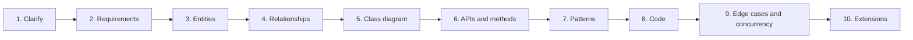
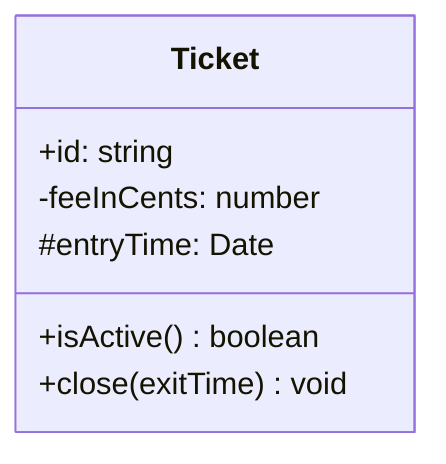
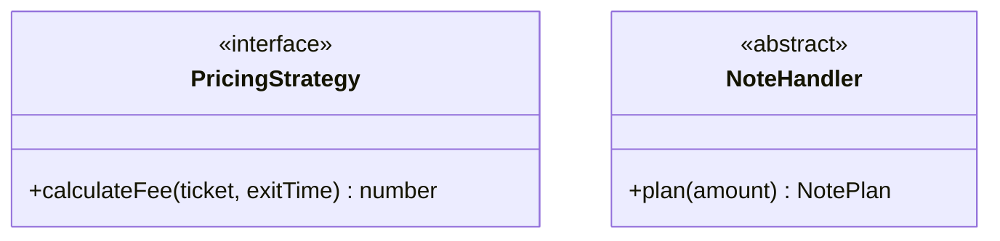
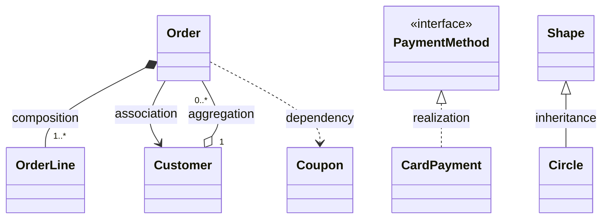
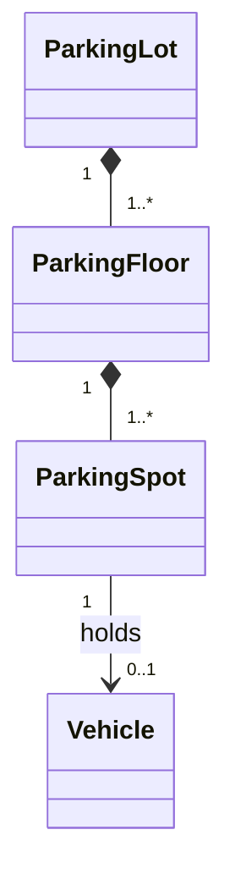
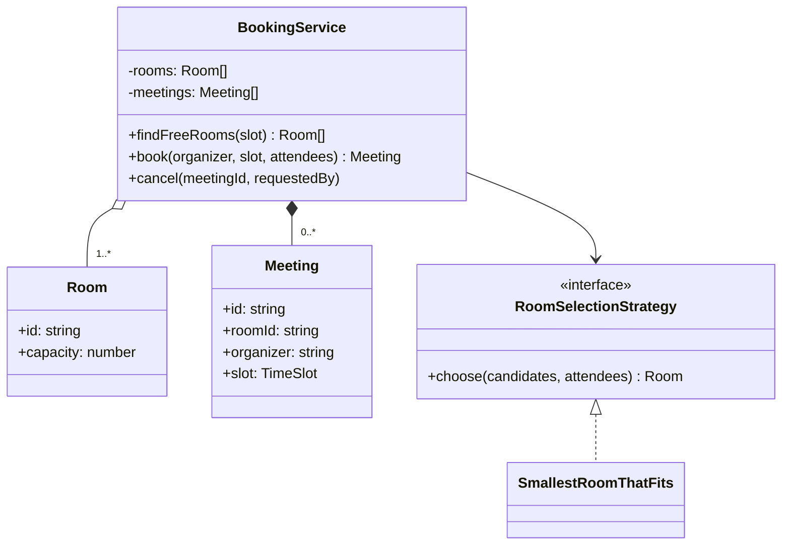

# How to Approach LLD Interviews

> A low-level design (LLD) round asks you to design the classes and code for a small system, such as a parking lot or a booking service, in 45–60 minutes. This chapter gives you a repeatable framework, teaches you to read and draw UML class diagrams, shows how to pick design patterns for good reasons, and explains what to say about concurrency when your language is JavaScript.

**Before this:** [OOP four pillars](../04-oop-solid-design-patterns/01-oop-four-pillars.md) · [SOLID principles](../04-oop-solid-design-patterns/03-solid-principles.md) · [How to explain technical answers](../11-coding-interviews/01-how-to-explain-technical-answers.md) · **Interview questions:** [jump to the interview section](#interview-questions)

## Table of contents

1. [What an LLD round is](#what-an-lld-round-is)
2. [LLD vs HLD](#lld-vs-hld)
3. [What interviewers evaluate](#what-interviewers-evaluate)
4. [The framework, step by step](#the-framework-step-by-step)
5. [Nouns to classes, verbs to methods](#nouns-to-classes-verbs-to-methods)
6. [Reading UML class diagrams](#reading-uml-class-diagrams)
7. [Choosing design patterns](#choosing-design-patterns)
8. [Writing clean TypeScript for LLD](#writing-clean-typescript-for-lld)
9. [A small worked example: meeting room booking](#a-small-worked-example-meeting-room-booking)
10. [Concurrency in LLD: JavaScript vs Java and C#](#concurrency-in-lld-javascript-vs-java-and-c)
11. [Common mistakes](#common-mistakes)
12. [Time plan for a 45–60 minute round](#time-plan-for-a-4560-minute-round)
13. [Interview questions](#interview-questions)
14. [Summary](#summary)
15. [References](#references)

---

## What an LLD round is

**Low-level design** (also called **object-oriented design**, **OOD**, or sometimes **machine coding** when you must write runnable code) is an interview round where you design the **inside** of a small system:

- Which **classes** and **interfaces** exist.
- What **data** each class holds and what **methods** it offers.
- How the classes **relate** (who owns whom, who calls whom).
- Which **design patterns** make the design easy to change.
- How the code behaves in **edge cases** and when many requests come at once.

Typical prompts:

| Prompt | What it really tests |
| --- | --- |
| [Parking lot](02-parking-lot.md) | Entities, Strategy for allocation and pricing, check-then-act races |
| [Elevator system](03-elevator-system.md) | Scheduling algorithm, state, Strategy for dispatch |
| [Vending machine and ATM](04-vending-machine-and-atm.md) | State pattern, money handling, failure paths |
| [Movie ticket booking](05-movie-ticket-booking.md) | Seat holds, timeouts, double booking, payments |
| [Splitwise](06-splitwise-expense-sharing.md) | Split strategies, balances, simplifying debts |
| [Rate limiter and LRU cache](07-rate-limiter-and-lru-cache.md) | Algorithms in clean classes |
| [Logger and notifications](08-logger-and-notification-system.md) | Chain of Responsibility, Observer, retries |

The round usually has three parts, though the order and weight vary by company:

1. **Requirements and design** (talking and drawing): about a third of the time.
2. **Code** (writing the core classes, sometimes runnable): about half the time.
3. **Follow-ups** (concurrency, extensions, testing): the rest.

Some companies want only a class diagram and method signatures. Others want working code that runs a demo. **Ask at the start:** "Do you want me to focus on the class design, or should I write runnable code?" This one question saves you from spending 30 minutes on the wrong thing.

## LLD vs HLD

**High-level design** (HLD, or "system design") and LLD are different rounds. Mixing them up is a common mistake: candidates start drawing load balancers when the interviewer wants classes, or write classes when the interviewer wants an architecture.

| | High-level design (HLD) | Low-level design (LLD) |
| --- | --- | --- |
| Question | "Design Twitter / a URL shortener" | "Design a parking lot / an LRU cache class" |
| Building blocks | Services, databases, caches, queues, load balancers | Classes, interfaces, methods, design patterns |
| Scale | Millions of users, many servers | One process; correctness and clean code |
| Diagrams | Boxes and arrows between services | UML class diagrams, sequence diagrams |
| Main trade-offs | Consistency vs availability, SQL vs NoSQL, cost | Coupling vs flexibility, which pattern, which data structure |
| Output | An architecture you could explain to a team | Code you could commit |

They meet in the middle. A good LLD answer mentions where the database would make an operation atomic (see the [movie booking](05-movie-ticket-booking.md#handling-concurrency-and-edge-cases) chapter). A good HLD answer can zoom into one service and show its classes. For HLD, start with [the system design interview approach](../09-system-design/01-system-design-interview-approach.md); the [URL shortener case study](../09-system-design/13-case-study-url-shortener.md) is a good example of where the two meet (its rate limiter is an LLD problem in [chapter 7](07-rate-limiter-and-lru-cache.md)).

**What to say if you are unsure which one they want:** "Should I focus on the object model and code for a single service, or on the overall architecture with services and storage?"

## What interviewers evaluate

There is no secret answer key. Interviewers look for signals like these:

| Signal | What good looks like |
| --- | --- |
| **Requirements** | You ask questions that change the design, state assumptions, and cut scope on purpose |
| **Modeling** | Classes match real concepts; each has one clear job; relationships are correct |
| **Abstraction** | Things that change are behind interfaces; things that don't change are simple |
| **Patterns with reasons** | You use a pattern because of a real need and can say the trade-off |
| **Code quality** | Readable names, small methods, encapsulation, no god class, types that prevent mistakes |
| **Correctness** | Edge cases, invalid input, failure paths, concurrency |
| **Communication** | You think out loud, check in with the interviewer, and adapt to hints |
| **Extensibility** | Follow-up changes touch few classes |

Notice that "used many patterns" is not on the list. Using the right two patterns with clear reasons is much better than using seven because you memorized them.

## The framework, step by step

Use the same steps for every problem. Having a fixed path calms nerves and makes sure you don't forget anything important.



### Step 1: Clarify (3–5 minutes)

The prompt is vague on purpose. Ask questions that **change the design**. A good question has an answer that would make you add, remove or change a class.

Useful question types:

- **Actors:** Who uses the system? (driver, attendant, admin)
- **Core use cases:** What are the 3–5 main actions? (park, pay, leave)
- **Variations:** What kinds of things exist? (vehicle types, seat types, coin types)
- **Rules:** What are the business rules? (which vehicle fits which spot, hold time, max seats)
- **Failure:** What happens when it goes wrong? (payment fails, machine has no change)
- **Concurrency:** Can two users act on the same thing at once? (two gates, two buyers)
- **Scope:** What is explicitly out? (reservations, reports, a UI)

If the interviewer says "you decide", **state an assumption out loud** and move on: "I'll assume three vehicle types and hourly pricing; I'll keep both behind interfaces so they're easy to change."

### Step 2: Requirements (2–3 minutes)

Write two short lists on the board:

- **Functional:** what the system does. Use verbs: "user can hold up to 6 seats", "seats are released after 5 minutes".
- **Non-functional:** qualities. For LLD these are usually: **correctness under concurrency**, **extensibility** (new types, new rules), **testability**, and sometimes **performance** of a key operation (O(1) cache lookup).

Also write **out of scope**. It protects your time and shows judgment.

### Step 3: Entities (3–5 minutes)

List the main **nouns** (see [the next section](#nouns-to-classes-verbs-to-methods)). For each, write one sentence: "`Ticket`: records which vehicle is in which spot and when it entered." If you can't write that sentence, the class probably shouldn't exist.

Mark which entities are:

- **Value objects:** small, immutable data with no identity (`Money`, `TimeSlot`, `Coin`).
- **Entities:** things with an identity that changes state over time (`Booking`, `ParkingSpot`).
- **Services:** classes that coordinate a use case (`BookingService`, `ParkingLot`).
- **Interfaces for variation:** things that will have several implementations (`PricingStrategy`, `PaymentGateway`).

### Step 4: Relationships (2–3 minutes)

For each pair of related classes, decide:

- **Is-a** (inheritance or interface implementation) or **has-a** (composition, aggregation, association)?
- **Multiplicity:** one-to-one, one-to-many, many-to-many?
- **Ownership:** does the part die with the whole (composition) or live on its own (aggregation)?

Prefer **has-a** (composition) over **is-a** (inheritance) unless the subclass truly behaves like a special version of the parent. See [composition vs inheritance](../04-oop-solid-design-patterns/02-composition-inheritance-and-mixins.md).

### Step 5: Class diagram (3–5 minutes)

Draw the main classes with their key fields and methods, and the relationships. Don't draw every getter. A diagram with 6–10 boxes is right for an interview. The [UML section](#reading-uml-class-diagrams) shows the notation.

### Step 6: APIs and methods (3 minutes)

Write the **public methods** of the main service first, with types. This is the contract:

```text
ParkingLot.park(vehicle: Vehicle): Ticket
ParkingLot.unpark(ticketId: string, payment: PaymentMethod): Receipt
ParkingLot.availability(): Map<floor, counts>
```

Think about what each method returns on failure: throw an error, or return a result object like `{ ok: false, reason }`? Pick one style and be consistent. A common rule: **expected business outcomes** (insufficient funds, seat taken) can be result values; **programming errors and invalid input** throw.

### Step 7: Patterns (2–3 minutes)

Look at the requirements and ask: **what will change?** Put each changing thing behind an interface, and name the pattern only if it really fits. See [choosing design patterns](#choosing-design-patterns).

### Step 8: Code (15–25 minutes)

Code in this order:

1. Value types and enums (as `as const` objects in TypeScript).
2. Entities with their invariants (rules they protect).
3. Interfaces for the changing parts, plus **one** implementation each.
4. The main service with the core use case (the happy path first).
5. A tiny `main()` that runs the main flow.
6. Then error handling and the second implementation of a strategy, if time allows.

Write **comments for the steps first** in a complex method ("1. validate, 2. reserve, 3. pay, 4. commit"), then fill them in. If time runs out, the interviewer still sees your plan.

### Step 9: Edge cases and concurrency (3–5 minutes)

Go through a short checklist out loud:

- Invalid input (negative amounts, unknown ids, duplicates).
- Empty and full states (no spots, sold out, no change).
- Failure in the middle (payment fails after reserving; hardware fails after charging).
- Repeated requests (double click, retry after timeout: **idempotency**).
- Two users on the same resource at once (**race conditions**).

### Step 10: Extensions (3–5 minutes)

The interviewer will ask "what if we add X?" A good design answers with "add one class" or "change one place". Practice saying: "That's a new `PricingStrategy` implementation; nothing else changes." That sentence is the payoff for the Open/Closed principle.

## Nouns to classes, verbs to methods

The simplest way to find classes is to read the problem statement and underline words:

- **Nouns** are candidate **classes or fields**.
- **Verbs** are candidate **methods**.
- **Adjectives and categories** ("small", "premium", "express") are often **types or enum values**, not subclasses.

Example prompt: "*Employees **book** meeting **rooms** for a **time slot**. A room has a **capacity**. The system should **find free rooms** and let the **organizer** **cancel** the **meeting**.*"

| Word | Kind | Becomes |
| --- | --- | --- |
| room | noun | class `Room` |
| capacity | noun (property of room) | field `Room.capacity` |
| time slot | noun (small value) | value type `TimeSlot { start, end }` |
| meeting | noun | class `Meeting` |
| organizer | noun (a role of an employee) | field `Meeting.organizer` (a user id), not a class yet |
| book | verb | method `BookingService.book(...)` |
| find free rooms | verb | method `BookingService.findFreeRooms(slot)` |
| cancel | verb | method `BookingService.cancel(meetingId, requestedBy)` |

Three rules keep this from going wrong:

1. **Not every noun is a class.** "System", "employee" and "organizer" may just be ids or roles. Make a class only if it has data **and** behavior worth grouping, or a rule to protect.
2. **Put each verb on the class that has the data it needs.** This is called the **information expert** principle. "Is this room free at 10:00?" needs all meetings, so it belongs to the service that holds the meetings, not to `Room`.
3. **Categories are usually data, not subclasses.** "Small, medium, large" spots differ in data (size), not in behavior. A `size` field beats three subclasses. See the [parking lot](02-parking-lot.md#1-vehicle-types-as-data-not-as-subclasses) for this exact decision.

You will see the full meeting room example as runnable code [later in this chapter](#a-small-worked-example-meeting-room-booking).

## Reading UML class diagrams

**UML** (Unified Modeling Language) is a standard way to draw software designs. In LLD rounds you need only one UML diagram well: the **class diagram**. (A **sequence diagram**, which shows calls over time, is a useful second one; every problem chapter has one in its walkthrough.)

### A class box



- The top part is the **name**, the middle part the **fields**, the bottom part the **methods**.
- `+` means **public**, `-` **private**, `#` **protected**.
- `name: type` for fields; `method(params) returnType` for methods.

Interfaces and abstract classes get an annotation:



### The six relationships

| Relationship | Meaning | Arrow in Mermaid | Example |
| --- | --- | --- | --- |
| **Association** | "knows / uses for a long time" | `A --> B` | `Ticket --> Vehicle` |
| **Dependency** | "uses briefly" (parameter, local variable) | `A ..> B` | `ParkingLot ..> PaymentMethod` |
| **Aggregation** | "has, but the part can live alone" (empty diamond) | `A o-- B` | `Team o-- Player` |
| **Composition** | "owns; the part dies with the whole" (filled diamond) | `A *-- B` | `Order *-- OrderLine` |
| **Inheritance** | "is a" (extends a class) | `Parent <\|-- Child` | `NoteHandler <\|-- NoteTray` |
| **Realization** | "implements an interface" | `Interface <\|.. Class` | `PricingStrategy <\|.. HourlyPricing` |

Here they are in one small diagram:



How to tell **composition** from **aggregation** in an interview: ask "if I delete the whole, should the part disappear too?" Delete an order: its order lines go too (composition). Delete a team: the players still exist (aggregation). Many interviewers accept a plain association arrow if you're unsure; correctness of the **multiplicity** and the **direction** matters more than the diamond shape.

### Multiplicity

Numbers at the ends of a line say **how many**:

| Notation | Meaning |
| --- | --- |
| `1` | exactly one |
| `0..1` | zero or one (optional) |
| `*` or `0..*` | any number |
| `1..*` | at least one |



Read it as sentences: "One parking lot has one or more floors. One floor has one or more spots. One spot holds zero or one vehicle."

### How much UML to draw in an interview

- Main classes (6–10), key fields, key public methods. Skip getters, setters and constructors.
- All interfaces and their main implementations (one or two).
- Relationships with multiplicity on the important ones.
- Generics like `Map<string, Ticket>` are fine; in Mermaid they are written `Map~string, Ticket~`.

Draw it **before** coding, and **update it** if the code changes the design. Interviewers notice when the diagram and code disagree.

## Choosing design patterns

Patterns are answers to recurring problems. Start from the **problem (the smell)**, never from the pattern. The pattern chapters in [04-oop-solid-design-patterns](../04-oop-solid-design-patterns/README.md) explain each pattern; here is how to pick one in an LLD round.

| Smell or requirement in the prompt | Pattern | Example in this subject |
| --- | --- | --- |
| "Several ways to do X, and the business will add more" | [Strategy](../04-oop-solid-design-patterns/08-behavioral-patterns.md#strategy) | Spot allocation, pricing, split types, dispatch |
| "Behavior depends on the current status; only some actions are allowed" | [State](../04-oop-solid-design-patterns/08-behavioral-patterns.md#state) (or a transition table) | Vending machine, ATM, order lifecycle |
| "When X happens, several other parts must react" | [Observer](../04-oop-solid-design-patterns/08-behavioral-patterns.md#observer) | Display boards, notifications, waitlists |
| "A request passes through steps; each may handle or pass it on" | [Chain of Responsibility](../04-oop-solid-design-patterns/08-behavioral-patterns.md#chain-of-responsibility) | ATM note trays, log levels, validation rules |
| "Actions must be queued, logged, undone or replayed" | [Command](../04-oop-solid-design-patterns/08-behavioral-patterns.md#command) | Elevator requests, undo in editors |
| "Creating the right object needs logic, or depends on input" | [Factory](../04-oop-solid-design-patterns/06-creational-patterns.md) | Creating a vehicle or a split from a type string |
| "An object needs many optional settings" | [Builder](../04-oop-solid-design-patterns/06-creational-patterns.md) | Building a complex search query or report |
| "Add features around an object without changing it" | [Decorator](../04-oop-solid-design-patterns/07-structural-patterns.md) | Pricing with surcharges and caps; logging around a service |
| "A tree of items treated the same as single items" | [Composite](../04-oop-solid-design-patterns/07-structural-patterns.md) | File system folders and files |
| "Wrap a third-party API with an interface we own" | [Adapter](../04-oop-solid-design-patterns/07-structural-patterns.md) | Payment provider SDKs |
| "A simple entry point to a complex subsystem" | [Facade](../04-oop-solid-design-patterns/07-structural-patterns.md) | `ParkingLot` as the single entry point |
| "There must be exactly one" | Usually **not Singleton**: one instance created at startup and injected | Lot, controller, logger |

### A word on Singleton

Singleton is the pattern candidates use most and justify least. "There is only one parking lot" is a fact about the **deployment**, not a reason to make the class prevent a second instance. Singletons are global state: tests can't create a fresh one, and dependencies become hidden. Create one instance in your startup code and pass it in through constructors. Mention Singleton only for truly process-wide, stateless things (configuration, a logger), and say the trade-off. More in [creational patterns](../04-oop-solid-design-patterns/06-creational-patterns.md).

### How to say it

A pattern statement has three parts: **the need, the pattern, the trade-off**.

> "Pricing rules will change often (need), so I'll put pricing behind a `PricingStrategy` interface (pattern). It adds one interface and one class per rule, but adding a weekend rate won't touch the parking logic (trade-off)."

And sometimes the best answer is **no pattern**:

> "I considered the State pattern for the elevator, but only one method depends on the state and the rules are short, so a status field is clearer. I'd switch if we add fire mode and emergency modes."

## Writing clean TypeScript for LLD

The design is judged through your code. These habits make TypeScript LLD code look professional.

### 1. Interfaces for what varies, classes for what holds state

Use `interface` for the contracts (`PricingStrategy`, `PaymentGateway`, `Clock`). Use classes for things with state and rules (`ParkingSpot`, `Booking`). Use plain `type`s for pure data (`Movie`, `TimeSlot`). See [interfaces and type aliases](../03-typescript/02-interfaces-and-type-aliases.md).

### 2. `as const` objects instead of `enum`

```ts
const SpotSize = { SMALL: 'SMALL', MEDIUM: 'MEDIUM', LARGE: 'LARGE' } as const;
type SpotSize = (typeof SpotSize)[keyof typeof SpotSize]; // 'SMALL' | 'MEDIUM' | 'LARGE'
```

This gives you a union type plus readable constants, works with Node.js's built-in type stripping, and plays well with `Record<SpotSize, ...>`, which forces you to handle every value. If the interviewer prefers `enum`, use it; just be consistent.

### 3. Dependency injection through constructors

Every dependency a class needs (clock, repository, payment gateway, strategy) comes in through the constructor, typed as an interface. No `new` of collaborators inside, no global imports of singletons, no `new Date()` deep in business logic.

```ts
interface Clock {
  now(): Date;
}
interface Notifier {
  send(to: string, message: string): void;
}

// ❌ Hidden dependencies: impossible to test "expired" without waiting, and it always sends real emails.
class HardWiredReminder {
  check(dueAt: Date, user: string): void {
    if (new Date() > dueAt) console.log(`(real email to ${user})`);
  }
}

// ✅ Dependencies come in through the constructor, as interfaces.
class Reminder {
  private readonly clock: Clock;
  private readonly notifier: Notifier;
  constructor(clock: Clock, notifier: Notifier) {
    this.clock = clock;
    this.notifier = notifier;
  }
  check(dueAt: Date, user: string): boolean {
    if (this.clock.now() <= dueAt) return false;
    this.notifier.send(user, `Your item was due at ${dueAt.toISOString()}`);
    return true;
  }
}

function main(): void {
  const sent: string[] = [];
  const fakeClock: Clock = { now: () => new Date('2026-05-02T00:00:00Z') };
  const fakeNotifier: Notifier = { send: (to, message) => sent.push(`${to}: ${message}`) };
  const reminder = new Reminder(fakeClock, fakeNotifier);
  console.log(reminder.check(new Date('2026-05-01T00:00:00Z'), 'ana'));
  console.log(reminder.check(new Date('2026-05-03T00:00:00Z'), 'raj'));
  console.log(sent);
  void HardWiredReminder;
}

main();
// true
// false
// [ 'ana: Your item was due at 2026-05-01T00:00:00.000Z' ]
```

The test needed no real time and sent no real email. That's the whole point of [dependency inversion and injection](../04-oop-solid-design-patterns/05-dependency-inversion-and-injection.md).

A note on style: these examples assign fields explicitly instead of using TypeScript's shorthand `constructor(private readonly clock: Clock)`. The shorthand (called **parameter properties**) is fine in most projects, but Node.js cannot run it with plain type stripping, and some teams avoid it for readability. Either is acceptable in an interview.

### 4. Encapsulation and immutability

Keep state `private`, expose **methods that protect the rules**, and never hand out your internal arrays or maps.

```ts
// ❌ Leaky: the getter returns the real array, so callers can change it.
class LeakyCart {
  private items: string[] = [];
  add(item: string): void {
    this.items.push(item);
  }
  getItems(): string[] {
    return this.items;
  }
}

// ✅ Safe: callers get a read-only copy; changes go through methods that check the rules.
class Cart {
  private readonly items: string[] = [];
  static readonly MAX_ITEMS = 3;
  add(item: string): void {
    if (this.items.length >= Cart.MAX_ITEMS) throw new Error('Cart is full');
    this.items.push(item);
  }
  getItems(): readonly string[] {
    return [...this.items];
  }
}

function main(): void {
  const leaky = new LeakyCart();
  leaky.add('book');
  leaky.getItems().push('free laptop'); // no rule can stop this
  console.log('leaky:', leaky.getItems());

  const cart = new Cart();
  cart.add('book');
  const view = cart.getItems();
  // view.push('free laptop'); // ❌ compile error: push does not exist on readonly string[]
  (view as string[]).push('free laptop'); // even if someone forces it, it is only a copy
  console.log('safe :', cart.getItems());
}

main();
// leaky: [ 'book', 'free laptop' ]
// safe : [ 'book' ]
```

Use `readonly` fields for things that never change after construction (ids, entry times), and `readonly T[]` return types for views. Value objects (`TimeSlot`, `Money`) should be fully immutable: create a new one instead of changing an old one.

### 5. No god classes

A **god class** knows and does everything: `ParkingSystem` with 40 methods that parks cars, calculates fees, prints receipts, talks to the card terminal and updates display boards. Signs: many unrelated fields, long methods with `switch` statements on types, and every change touching this one file.

Fix it by giving each responsibility its own small class and letting the service **coordinate** them: `ParkingLot` asks `SpotAllocationStrategy` for a spot, `PricingStrategy` for a fee, `PaymentMethod` for money. See [coupling and cohesion](../04-oop-solid-design-patterns/04-coupling-cohesion-and-design-principles.md).

### 6. Make invalid states hard to represent

- Use **discriminated unions** for results: `{ ok: true; balance: number } | { ok: false; reason: string }`. The caller cannot read `balance` without checking `ok`. See [unions and narrowing](../03-typescript/03-unions-narrowing-and-type-guards.md).
- Use `Record<Union, ...>` tables so adding a new type forces you to fill in every table.
- Store **money as integer cents**, never as floats.
- Prefer a single `status` field over several booleans (`isPaid`, `isCancelled`, `isExpired`) that can contradict each other.

### 7. Generics where they remove duplication

A `Repository<T>` interface or an `LRUCache<K, V>` class is a natural place for [generics](../03-typescript/05-generics.md). Don't add generics "just in case"; add them when two real types need the same code.

### 8. Small `main()` with fakes

End your code with a short demo that wires the real classes with fakes (fake clock, fake payment) and runs the main flow plus one failure. It proves the design works and gives you something to walk through.

## A small worked example: meeting room booking

Here is the framework applied quickly to a small prompt, so you can see each step produce something concrete.

**Prompt:** "Employees book meeting rooms for a time slot. Rooms have a capacity. Find free rooms, book the best one, and let the organizer cancel."

**Clarify (assumed answers):** single office; slots on the same day; pick the smallest room that fits so big rooms stay free; only the organizer can cancel; touching meetings (10–11 and 11–12) are allowed.

**Entities:** `Room` (id, capacity), `TimeSlot` (value: start, end), `Meeting` (id, room, organizer, slot, attendees), `RoomSelectionStrategy` (interface), `BookingService` (coordinates).

**The key rule:** two slots overlap when `a.start < b.end && b.start < a.end`. Saying this formula out loud, and testing the "touching edges" case, is a small detail that impresses interviewers.



The code (type-checked with `tsc --strict` and run with Node.js 22; the output comments are the real output):

```ts
// Nouns: room, meeting, organizer, time slot. Verbs: book, cancel, find free rooms.
type TimeSlot = { start: Date; end: Date };

function overlaps(a: TimeSlot, b: TimeSlot): boolean {
  return a.start < b.end && b.start < a.end; // touching edges (10:00-11:00 and 11:00-12:00) do not overlap
}

class Room {
  readonly id: string;
  readonly capacity: number;
  constructor(id: string, capacity: number) {
    this.id = id;
    this.capacity = capacity;
  }
}

class Meeting {
  readonly id: string;
  readonly roomId: string;
  readonly organizer: string;
  readonly slot: TimeSlot;
  readonly attendees: number;
  constructor(id: string, roomId: string, organizer: string, slot: TimeSlot, attendees: number) {
    this.id = id;
    this.roomId = roomId;
    this.organizer = organizer;
    this.slot = slot;
    this.attendees = attendees;
  }
}

// The part that changes: how we choose a room when several are free.
interface RoomSelectionStrategy {
  choose(candidates: readonly Room[], attendees: number): Room | null;
}

class SmallestRoomThatFits implements RoomSelectionStrategy {
  choose(candidates: readonly Room[], attendees: number): Room | null {
    const fitting = candidates.filter((r) => r.capacity >= attendees);
    fitting.sort((a, b) => a.capacity - b.capacity);
    return fitting[0] ?? null;
  }
}

class BookingService {
  private readonly rooms: readonly Room[];
  private readonly meetings: Meeting[] = [];
  private readonly selection: RoomSelectionStrategy;
  private nextId = 1;

  constructor(rooms: Room[], selection: RoomSelectionStrategy) {
    this.rooms = rooms;
    this.selection = selection;
  }

  findFreeRooms(slot: TimeSlot): Room[] {
    return this.rooms.filter(
      (room) => !this.meetings.some((m) => m.roomId === room.id && overlaps(m.slot, slot)),
    );
  }

  book(organizer: string, slot: TimeSlot, attendees: number): Meeting {
    if (slot.end <= slot.start) throw new Error('End must be after start');
    const room = this.selection.choose(this.findFreeRooms(slot), attendees);
    if (!room) throw new Error(`No free room for ${attendees} people`);
    const meeting = new Meeting(`MTG-${this.nextId++}`, room.id, organizer, slot, attendees);
    this.meetings.push(meeting); // find + push with no await in between
    return meeting;
  }

  cancel(meetingId: string, requestedBy: string): void {
    const index = this.meetings.findIndex((m) => m.id === meetingId);
    if (index === -1) throw new Error(`Unknown meeting ${meetingId}`);
    if (this.meetings[index]!.organizer !== requestedBy) throw new Error('Only the organizer can cancel');
    this.meetings.splice(index, 1);
  }
}

function at(hour: number): Date {
  return new Date(Date.UTC(2026, 0, 5, hour));
}

function main(): void {
  const service = new BookingService(
    [new Room('Big', 12), new Room('Small', 4), new Room('Medium', 8)],
    new SmallestRoomThatFits(),
  );
  const m1 = service.book('ana', { start: at(10), end: at(11) }, 3);
  console.log(m1.id, '->', m1.roomId);
  const m2 = service.book('raj', { start: at(10), end: at(11) }, 3);
  console.log(m2.id, '->', m2.roomId);
  const m3 = service.book('li', { start: at(11), end: at(12) }, 3);
  console.log(m3.id, '->', m3.roomId, '(10-11 and 11-12 do not overlap)');
  try {
    service.book('sam', { start: at(10), end: at(11) }, 20);
  } catch (e) {
    console.log('Error:', (e as Error).message);
  }
  try {
    service.cancel(m1.id, 'raj');
  } catch (e) {
    console.log('Error:', (e as Error).message);
  }
  service.cancel(m1.id, 'ana');
  console.log('Free at 10:', service.findFreeRooms({ start: at(10), end: at(11) }).map((r) => r.id).join(', '));
}

main();
// MTG-1 -> Small
// MTG-2 -> Medium
// MTG-3 -> Small (10-11 and 11-12 do not overlap)
// Error: No free room for 20 people
// Error: Only the organizer can cancel
// Free at 10: Big, Small
```

What to point out:

- The selection rule is a **strategy**: "biggest room", "nearest to my desk" or "prefer rooms with video" would be new classes.
- `findFreeRooms` is O(rooms × meetings). Fine for an office. For thousands of meetings, keep meetings **per room, sorted by start time**, and check only neighbours (binary search), or use an interval tree. Say it; don't build it unless asked.
- **Extensions:** recurring meetings (a `RecurrenceRule` that expands into slots), equipment requirements (a filter step before the strategy), notifications to attendees (Observer).

## Concurrency in LLD: JavaScript vs Java and C#

Almost every LLD problem has a "what if two users do this at the same time?" follow-up. Your answer depends on the language, and as a JavaScript/TypeScript developer you should explain the difference clearly.

### Java and C#: shared memory, many threads

In Java or C#, a web server runs requests on **many threads** that share the same objects. Two threads can run `if (spot.isFree()) spot.assign(car)` at the same moment, and both see `isFree() === true`. You protect shared state with:

- **Locks:** `synchronized` / `ReentrantLock` (Java), `lock` statement / `SemaphoreSlim` (C#).
- **Atomic operations:** `AtomicInteger`, `compareAndSet`, `Interlocked`.
- **Concurrent collections:** `ConcurrentHashMap`, `ConcurrentDictionary`.
- **Fine-grained locks** (one per floor or per seat) instead of one big lock, for better parallelism.

Interviewers from a Java background may expect you to name these. You can, even if you code in TypeScript.

### JavaScript: one thread, but not "no races"

Node.js runs your JavaScript on **one thread** with an event loop. Two facts follow:

1. **A synchronous block of code is atomic.** Nothing else runs in the middle of it. So "check and change" with no `await` between them is safe inside one process.
2. **Every `await` is a gap.** While you wait for a database, a payment provider or a timer, other requests run and can change the state you just checked.

```ts
const delay = (ms: number) => new Promise<void>((resolve) => setTimeout(resolve, ms));

class Wallet {
  balance = 100;

  // ✅ No await between check and change: atomic in Node.js.
  withdrawSync(amount: number): boolean {
    if (this.balance < amount) return false;
    this.balance -= amount;
    return true;
  }

  // ❌ An await between check and change: another call can run in the gap.
  async withdrawWithGap(amount: number): Promise<boolean> {
    if (this.balance < amount) return false;
    await delay(10); // e.g. a fraud check over the network
    this.balance -= amount;
    return true;
  }
}

async function main(): Promise<void> {
  const a = new Wallet();
  console.log([a.withdrawSync(80), a.withdrawSync(80)], 'balance', a.balance);

  const b = new Wallet();
  console.log(await Promise.all([b.withdrawWithGap(80), b.withdrawWithGap(80)]), 'balance', b.balance);
}

main();
// [ true, false ] balance 20
// [ true, true ] balance -60
```

The second wallet went to **−60**: both calls checked the balance before either subtracted. This is the **check-then-act race**, and it exists in JavaScript too.

And there's a third fact: real systems run **many Node.js processes** (cluster mode, several containers). Each has its own memory. An in-memory lock in one process does nothing for another. Then the **database** (or Redis) must make the operation atomic.

### What to say in the interview

A good structure for any "two users at once" question:

1. **Name the race:** "This is a check-then-act race: both requests check that the seat is free before either marks it."
2. **In-process fix:** "In Node.js, I keep the check and the change in one synchronous block, with no `await` between them; or I reserve first and undo on failure; or I serialize with a small mutex or a queue."
3. **Multi-process fix:** "With several servers, I let the database decide: a conditional update (`UPDATE ... WHERE status = 'FREE'`) and check the affected row count, or optimistic locking with a version column, or `SELECT ... FOR UPDATE` in a transaction. A unique constraint is the final safety net."
4. **Retries and duplicates:** "Requests can be retried, so operations that move money use an idempotency key."
5. **Java/C# equivalent (if useful):** "In Java I'd use a lock per seat or a `ConcurrentHashMap.compute`; the idea is the same."

Each problem chapter has a runnable race demo: [parking lot](02-parking-lot.md#handling-concurrency-and-edge-cases) (reserve-first and mutex), [elevator](03-elevator-system.md#handling-concurrency-and-edge-cases) (single writer with a command queue), [ATM](04-vending-machine-and-atm.md#handling-concurrency-and-edge-cases) (atomic debit, idempotency) and [movie booking](05-movie-ticket-booking.md#handling-concurrency-and-edge-cases) (optimistic locking, double click). For background on Node.js threads and processes, see [concurrency, worker threads and cluster](../07-nodejs-backend/12-concurrency-worker-threads-and-cluster.md).

## Common mistakes

| Mistake | Why it hurts | Do this instead |
| --- | --- | --- |
| Coding immediately | You solve the wrong problem | Spend 5 minutes clarifying and writing assumptions |
| Asking 20 questions | You burn time and look unsure | Ask the 4–6 questions that change the design |
| One subclass per category (`SmallSpot`, `MediumSpot`) | Classes with no behavior; rigid | A `size` field and a rules table |
| Deep inheritance trees | Fragile, hard to change | Composition and interfaces |
| A god class (`System` does everything) | Low cohesion, untestable | Small classes, one service that coordinates |
| Patterns everywhere | Complexity without benefit | Patterns only where something varies; say the trade-off |
| Singleton for "there is one" | Global state, hard to test | One instance created at startup and injected |
| `new Date()` and real SDKs inside logic | Untestable | Inject `Clock`, gateways and repositories |
| Floats for money | Rounding bugs | Integer cents |
| Public mutable fields and leaked arrays | Anyone can break the rules | Private state, methods that protect invariants, read-only copies |
| Ignoring failures | Lost money, stuck resources | Plan, then commit; compensate on failure; idempotency keys |
| "JavaScript is single-threaded so there are no races" | Wrong across `await` and across servers | Explain atomic sync blocks, await gaps and database atomicity |
| Silent coding | The interviewer can't follow or help | Think out loud; check in at each step |
| Diagram and code disagree | Looks careless | Update the diagram when the design changes |
| No demo or walkthrough | No proof the design works | A short `main()` or a traced example |

## Time plan for a 45–60 minute round

| Minutes (45 min round) | Minutes (60 min round) | Step | Output on the board |
| --- | --- | --- | --- |
| 0–5 | 0–6 | Clarify | Assumptions list |
| 5–8 | 6–10 | Requirements | Functional, non-functional, out of scope |
| 8–14 | 10–18 | Entities, relationships, class diagram | Diagram with 6–10 classes |
| 14–17 | 18–22 | APIs and patterns | Public method signatures; "X varies, so Strategy" notes |
| 17–35 | 22–45 | Code | Core classes, one strategy each, main flow, `main()` |
| 35–40 | 45–52 | Walkthrough, edge cases, concurrency | Traced flow, edge case list, race answer |
| 40–45 | 52–60 | Extensions and questions | "New X = one new class" answers |

If you fall behind, **cut breadth, not quality**: implement one strategy instead of two, and describe the rest. Never skip the walkthrough; it is your proof.

## Interview questions

These are questions about the LLD process itself. Each problem chapter has its own design-specific questions.

### Q1. How do you approach an LLD problem?

**What the interviewer is checking:** whether you have a structured method or jump into code.

**What to say (30–60 seconds):**
> I follow the same steps every time. First I clarify the scope with a few questions that change the design, and I write my assumptions down. Then I list functional and non-functional requirements, and what's out of scope. Next I find the entities from the nouns and draw a class diagram with the relationships. I write the public methods of the main service, then decide which parts will change and put those behind interfaces, using patterns only where they fit. Then I code the core flow with a small demo, and finish with edge cases, concurrency and extensions.

**Deeper explanation:** The framework is a safety net: under pressure, it keeps you from forgetting requirements or concurrency. It also gives the interviewer clear points to give hints.

**Follow-up questions and how to answer them:**
- *"What if I give you only 30 minutes?"* Shorter clarification, a smaller diagram, one strategy implementation, and I'd describe the rest instead of coding it.
- *"What if I stop you and want code now?"* Then I code the main service first and explain the diagram while coding.

**Common mistakes:** starting to code in the first minute; spending 20 minutes on requirements.

**Real-project example:** design reviews at work follow the same order: requirements, model, interfaces, risks.

### Q2. What is the difference between LLD and HLD?

**What the interviewer is checking:** that you understand which round you are in.

**What to say (30–60 seconds):**
> High-level design is about the architecture of a whole system: services, databases, caches, queues, and how it scales to many users. Low-level design is about the inside of one component: classes, interfaces, methods, patterns and correctness. HLD trade-offs are things like consistency vs availability; LLD trade-offs are coupling, extensibility and which data structure. They connect: in LLD I still mention where the database must make something atomic, and in HLD I can zoom into one service's classes.

**Deeper explanation:** See the comparison table in [LLD vs HLD](#lld-vs-hld).

**Follow-up questions and how to answer them:**
- *"Is a rate limiter LLD or HLD?"* Both: the algorithm and class design is LLD; where it runs (gateway, Redis, per region) is HLD.

**Common mistakes:** drawing load balancers in an LLD round.

**Real-project example:** an architecture document (HLD) and a code review of a new module (LLD) for the same feature.

### Q3. How do you find the classes for a problem?

**What the interviewer is checking:** modeling technique.

**What to say (30–60 seconds):**
> I underline nouns and verbs in the problem. Nouns are candidate classes or fields; verbs are candidate methods. Then I filter: a noun becomes a class only if it has data and behavior or a rule to protect; otherwise it's a field or a value type. I put each method on the class that has the data it needs. And categories like small, medium and large usually become a field, not subclasses.

**Deeper explanation:** Also look for **hidden** entities that the prompt implies but doesn't name: a `Ticket` in a parking lot, a `ShowSeat` in movie booking, a `Hold` with an expiry.

**Follow-up questions and how to answer them:**
- *"How do you know you have too many classes?"* If a class has no behavior and no rule, or if I can't describe its job in one sentence.

**Common mistakes:** a class for "System" or "Manager" that does everything.

**Real-project example:** domain modeling sessions with product managers start from the same nouns and verbs.

### Q4. Explain composition, aggregation and association in a class diagram.

**What the interviewer is checking:** UML basics.

**What to say (30–60 seconds):**
> All three are has-a relationships. Association is the general "knows about": a ticket refers to a vehicle. Aggregation is "has, but the part can live alone", drawn with an empty diamond: a team has players, and players exist without the team. Composition is "owns, and the part dies with the whole", with a filled diamond: an order owns its order lines. I decide by asking: if I delete the whole, should the parts disappear too?

**Deeper explanation:** In code, composition often means the whole creates the parts and never shares them; aggregation means the parts are passed in and may be shared.

**Follow-up questions and how to answer them:**
- *"And inheritance vs realization?"* Inheritance is "is a" with a solid line and hollow triangle (extends a class); realization is a dashed line with a hollow triangle (implements an interface).

**Common mistakes:** using inheritance for has-a relationships.

**Real-project example:** an ORM's cascade delete settings are the database version of composition.

### Q5. How do you decide which design pattern to use?

**What the interviewer is checking:** judgment, not memorization.

**What to say (30–60 seconds):**
> I start from the problem, not the pattern. I ask what will change. If there are several interchangeable ways to do something, like pricing, it's Strategy. If behavior depends on a status and only some actions are allowed, State. If several parts must react to an event, Observer. If a request passes through handlers, Chain of Responsibility. And I always say the trade-off: a pattern adds classes and indirection, so if something won't change, I keep it simple.

**Deeper explanation:** See the smell → pattern table in [choosing design patterns](#choosing-design-patterns).

**Follow-up questions and how to answer them:**
- *"Give an example where you decided not to use a pattern."* The elevator: a status field instead of State classes, because only one method depended on the state.

**Common mistakes:** listing patterns before understanding the problem; using Singleton by reflex.

**Real-project example:** payment providers behind an interface (Strategy/Adapter) so the business can switch providers.

### Q6. Why do you avoid Singleton, and when is it acceptable?

**What the interviewer is checking:** understanding of global state and testability.

**What to say (30–60 seconds):**
> A Singleton makes a class responsible for being the only instance and gives global access to it. That's hidden global state: tests share it and can't reset it, and dependencies are invisible in constructors. "There's one parking lot" is a deployment fact, so I create one instance at startup and inject it. Singleton can be fine for process-wide, mostly stateless things like configuration or a logger, and even then a module-level instance that tests can replace is usually better.

**Deeper explanation:** DI containers (Angular, NestJS) give you single instances without the Singleton pattern: the container manages the lifecycle.

**Follow-up questions and how to answer them:**
- *"Is a Node.js module export a Singleton?"* Effectively yes: modules are cached, so `export const lot = new ParkingLot()` is one instance. But other code can still construct its own for tests.

**Common mistakes:** saying "Singleton is always bad" with no reason.

**Real-project example:** Angular's `providedIn: 'root'` services are single instances managed by the injector.

### Q7. How do you make your LLD code testable?

**What the interviewer is checking:** dependency injection and design for testing.

**What to say (30–60 seconds):**
> I inject every dependency through the constructor, typed as an interface: clock, payment gateway, repositories, strategies. So in tests I pass a fake clock and a fake gateway, and I can test expiry or a declined card instantly. I keep business rules in small classes with no I/O, and I end my code with a small `main()` that exercises the main flow and a failure.

**Deeper explanation:** The `Reminder` example in [clean TypeScript](#3-dependency-injection-through-constructors) shows the difference between hard-wired and injected dependencies.

**Follow-up questions and how to answer them:**
- *"Do you mock or fake?"* For LLD, small hand-written fakes are clearer than mocking libraries.

**Common mistakes:** `new Date()` and SDK calls deep in business logic.

**Real-project example:** testing token expiry in auth code with a fake clock.

### Q8. What is a god class, and how do you avoid it?

**What the interviewer is checking:** cohesion and Single Responsibility.

**What to say (30–60 seconds):**
> A god class knows and does too much: one `ParkingSystem` class that allocates spots, computes fees, takes payments and updates displays. Every change touches it, and it's hard to test. I avoid it by giving each responsibility its own small class, and letting one service coordinate them by calling interfaces. A quick test: if I can't describe a class's job in one sentence without "and", it's doing too much.

**Deeper explanation:** See [coupling and cohesion](../04-oop-solid-design-patterns/04-coupling-cohesion-and-design-principles.md).

**Follow-up questions and how to answer them:**
- *"Isn't your service class also big?"* It coordinates, but the logic lives in the strategies and entities. Its methods are short sequences of calls.

**Common mistakes:** splitting into many classes with no clear jobs (the opposite problem).

**Real-project example:** "utils" files and "manager" classes that keep growing in real codebases.

### Q9. JavaScript is single-threaded. Do you need to worry about concurrency in LLD?

**What the interviewer is checking:** a precise understanding of the event loop and real deployments.

**What to say (30–60 seconds):**
> Yes, in two places. Inside one process, synchronous code is atomic, but every `await` is a gap where other requests run, so a check before an `await` can be stale after it. And in production there are many processes and servers with separate memory, so in-memory locks don't protect shared data. Inside a process I keep check-and-change synchronous or serialize with a queue; across processes I let the database make it atomic with a conditional update, a version check or row locks, plus idempotency keys for retries.

**Deeper explanation:** The `Wallet` demo in [concurrency in LLD](#concurrency-in-lld-javascript-vs-java-and-c) shows the balance going to −60 with an `await` between check and change.

**Follow-up questions and how to answer them:**
- *"What about worker threads?"* They have separate memory unless you use `SharedArrayBuffer` with `Atomics`; for LLD answers, the database is usually the right place for atomicity.

**Common mistakes:** "no threads, no races".

**Real-project example:** double-spend bugs in checkout code with an `await` between "check stock" and "decrement stock".

### Q10. How do you handle failures in the middle of an operation?

**What the interviewer is checking:** robustness thinking.

**What to say (30–60 seconds):**
> I order the steps so that nothing is lost at any failure point. First validate and plan, which changes nothing. Then do the step that's hard to undo, with an idempotency key so it's safe to retry. Then commit the local state. If a later step fails, I run a compensating action, like a refund or a reversal. And I only change state after the risky step has succeeded, so a failure leaves things as they were.

**Deeper explanation:** The ATM withdrawal (plan notes → debit with a transaction id → dispense → reverse on failure) and the movie booking (hold → charge → re-check → confirm or refund) are both built this way.

**Follow-up questions and how to answer them:**
- *"What if the compensating action fails?"* Record it durably (an outbox table) and retry until it succeeds; alert humans if it keeps failing.

**Common mistakes:** freeing resources before payment succeeds; retries without idempotency.

**Real-project example:** sagas in microservices for orders, payments and shipping.

### Q11. How do you show extensibility in your design?

**What the interviewer is checking:** Open/Closed in practice.

**What to say (30–60 seconds):**
> I identify the parts that will change and put them behind interfaces from the start: pricing, allocation, payment, notifications. Then when the interviewer asks for a new feature, I can say it's one new class and a change in the wiring code, and existing classes don't change. I also use `Record` tables over union types, so TypeScript tells me every place I must update when I add a new type.

**Deeper explanation:** Extensibility has a cost; I don't add interfaces for things that won't change. YAGNI ("you aren't gonna need it") balances Open/Closed.

**Follow-up questions and how to answer them:**
- *"What if the change doesn't fit your interfaces?"* Then I refactor: extract a new interface where the new variation appears. Good designs evolve.

**Common mistakes:** adding interfaces for everything "just in case".

**Real-project example:** adding a new payment provider by writing one adapter class.

### Q12. How do you communicate during an LLD round?

**What the interviewer is checking:** collaboration, a big part of the signal.

**What to say (30–60 seconds):**
> I think out loud and check in at each step: "Here's my scope; does that match what you want?" I explain decisions with the need, the choice and the trade-off. When I write code, I write step comments first so the plan is visible. If the interviewer gives a hint, I take it and adapt the design instead of defending my first idea. And I finish with a short walkthrough of one flow through the code.

**Deeper explanation:** See [how to explain technical answers](../11-coding-interviews/01-how-to-explain-technical-answers.md).

**Follow-up questions and how to answer them:**
- *"What if you disagree with the interviewer's suggestion?"* Explain the trade-off briefly and offer both; then go with their choice if they still prefer it.

**Common mistakes:** long silent coding; arguing over a hint.

**Real-project example:** design discussions in code reviews.

### Q13. How much should you draw, and in what notation?

**What the interviewer is checking:** practical UML use.

**What to say (30–60 seconds):**
> A class diagram with the 6 to 10 main classes, their key fields and public methods, interfaces marked, and relationships with multiplicity on the important ones. I skip getters and constructors. If the flow is tricky, I add a small sequence diagram for the main use case, or a state diagram if there's a lifecycle. Exact UML symbols matter less than clear boxes, correct directions and multiplicity.

**Deeper explanation:** See [reading UML class diagrams](#reading-uml-class-diagrams).

**Follow-up questions and how to answer them:**
- *"Do you draw everything before coding?"* The main structure, yes; then I update it if coding changes the design.

**Common mistakes:** a diagram with 30 boxes; no diagram at all.

**Real-project example:** design docs usually include one class or module diagram and one sequence diagram.

### Q14. How do you handle a requirement you didn't plan for, halfway through?

**What the interviewer is checking:** adaptability.

**What to say (30–60 seconds):**
> First I say how it affects the design: which classes change and which don't. If it fits an existing interface, it's a new implementation. If not, I find where the new variation lives and extract an interface there, then update the diagram. I keep the code working at each step rather than rewriting everything. If time is short, I describe the change and code only the key part.

**Deeper explanation:** Interviewers often add requirements on purpose to see if the design bends or breaks.

**Follow-up questions and how to answer them:**
- *"What if it breaks your main assumption?"* Say so honestly: "My design assumed one spot per vehicle; multi-spot trucks need `Ticket` to hold a list of spots and the allocation to be all-or-nothing."

**Common mistakes:** ignoring the new requirement, or panicking and restarting.

**Real-project example:** changing requirements mid-sprint.

## Summary

- An LLD round designs **classes, interfaces, methods and patterns** for one component; HLD designs **services, storage and scale**.
- Use a fixed framework: **clarify → requirements → entities → relationships → class diagram → APIs → patterns → code → edge cases and concurrency → extensions**.
- **Nouns → classes or fields, verbs → methods**; categories are usually **data**, not subclasses; put behavior where the data is.
- Know the UML relationships: **association, dependency, aggregation, composition, inheritance, realization**, plus **multiplicity**.
- Pick patterns from **smells**; state the **need, the pattern and the trade-off**; avoid Singleton by reflex.
- Clean TypeScript: interfaces for variation, `as const` objects, **constructor injection**, private state and read-only views, no god classes, money in cents, discriminated unions.
- Concurrency in JavaScript: synchronous blocks are atomic, **every `await` is a gap**, and **many processes** need database-level atomicity and idempotency.
- Manage time: cut breadth, not quality, and always finish with a walkthrough.

## References

- [Mermaid docs: Class diagrams](https://mermaid.js.org/syntax/classDiagram.html)
- [Mermaid docs: Sequence diagrams](https://mermaid.js.org/syntax/sequenceDiagram.html)
- [UML class diagram overview (Visual Paradigm)](https://www.visual-paradigm.com/guide/uml-unified-modeling-language/uml-class-diagram-tutorial/)
- [Refactoring Guru: Design patterns catalog](https://refactoring.guru/design-patterns/catalog)
- [Martin Fowler: Anemic Domain Model](https://martinfowler.com/bliki/AnemicDomainModel.html)
- [Martin Fowler: Tell, Don't Ask](https://martinfowler.com/bliki/TellDontAsk.html)
- [TypeScript Handbook: Classes](https://www.typescriptlang.org/docs/handbook/2/classes.html)
- [Node.js docs: Running TypeScript natively](https://nodejs.org/api/typescript.html)
- [Node.js docs: The Node.js event loop](https://nodejs.org/en/learn/asynchronous-work/event-loop-timers-and-nexttick)
