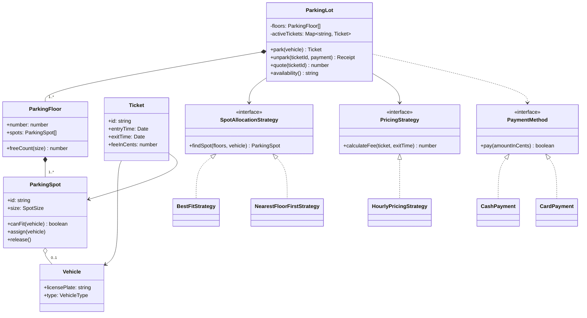
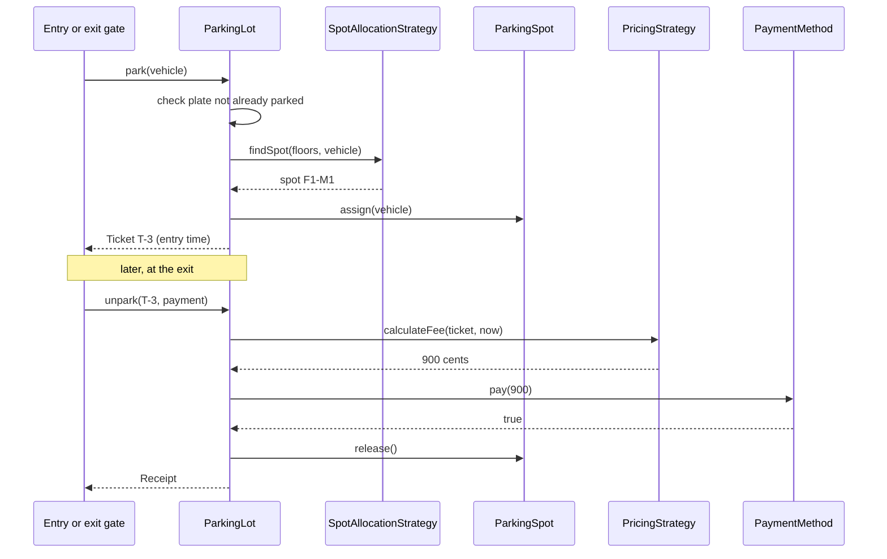

# Parking Lot

> Design the classes for a multi-floor parking lot: vehicles come in, get a spot and a ticket, and pay when they leave. This is the most common "first" LLD problem, and it is a clean way to show entities, the Strategy pattern, money handling and a small concurrency story.

**Before this:** [How to approach LLD interviews](01-how-to-approach-lld-interviews.md) · [SOLID principles](../04-oop-solid-design-patterns/03-solid-principles.md) · [Behavioral patterns (Strategy)](../04-oop-solid-design-patterns/08-behavioral-patterns.md#strategy) · **Interview questions:** [jump to the interview section](#interview-questions)

## Table of contents

1. [Problem](#problem)
2. [Clarifying questions](#clarifying-questions)
3. [Requirements](#requirements)
4. [Core entities and relationships](#core-entities-and-relationships)
5. [Design decisions and patterns](#design-decisions-and-patterns)
6. [Implementation](#implementation)
7. [Walkthrough](#walkthrough)
8. [Handling concurrency and edge cases](#handling-concurrency-and-edge-cases)
9. [Extensions](#extensions)
10. [How to present this in the interview](#how-to-present-this-in-the-interview)
11. [Interview questions](#interview-questions)
12. [Summary](#summary)
13. [References](#references)

---

## Problem

This is how an interviewer usually gives the prompt. It is short on purpose. They want to see if you ask good questions before you write code.

> "Design a parking lot. The lot has several floors. Each floor has parking spots of different sizes. Cars, motorcycles and trucks can park. When a vehicle enters, it gets a ticket. When it leaves, the driver pays a fee based on how long they stayed. Show me the classes and write the main code."

The words in this prompt already give us most of the classes: **lot**, **floor**, **spot**, **vehicle**, **ticket**, **fee**, **payment**. The verbs give us the methods: **enter / park**, **leave / unpark**, **pay**, **calculate fee**. (The [approach guide](01-how-to-approach-lld-interviews.md#nouns-to-classes-verbs-to-methods) explains this "nouns to classes, verbs to methods" trick.)

## Clarifying questions

Ask these in the first five minutes. Say your **assumed answer** out loud if the interviewer says "you decide". The goal is to make the problem small enough to finish in 45–60 minutes, while keeping the interesting parts.

| Question | Why it matters | Assumed answer |
| --- | --- | --- |
| Which vehicle types? | Decides how many types and how they map to spots | Motorcycle, car, truck. More may come later (electric car, bus) |
| Which spot sizes, and which vehicle fits which spot? | This is the core rule of the system | Small, medium, large. Motorcycle fits any spot, car fits medium or large, truck fits large only |
| Can a big vehicle take several small spots? | Makes allocation much harder | No. One vehicle, one spot (mention it as an extension) |
| How many entry and exit gates? | Several gates means concurrent requests | Several gates, so two cars can ask for a spot at the same moment |
| How is the fee calculated? | Pricing logic | Hourly rate per vehicle type, partial hours rounded up, minimum one hour |
| Which payment methods? | Payment abstraction | Cash and card now; others later |
| Do we need reservations or monthly passes? | Big scope increase | No, out of scope |
| Do we track the display boards ("Floor 1: 5 free")? | Needs availability queries | Yes, a simple count per floor and size |
| Is this one lot, or a chain of lots? | Multi-tenant design | One lot |
| Do we need persistence (a database)? | Changes the concurrency story | In-memory for the interview; I will explain how a database changes things |

You do not have to ask all ten. Pick the ones that change the design: **vehicle-to-spot rules**, **fee rules**, **number of gates** and **out-of-scope features**.

## Requirements

### Functional requirements

1. The lot has one or more **floors**; each floor has **spots** of size SMALL, MEDIUM or LARGE.
2. A **vehicle** (motorcycle, car, truck) enters. The system finds a free spot that fits, marks it taken and issues a **ticket** with the entry time.
3. If there is no fitting spot, entry is refused with a clear error.
4. The same vehicle (license plate) cannot be parked twice at the same time.
5. When the vehicle leaves, the system **calculates the fee**, takes **payment**, frees the spot and closes the ticket.
6. If payment fails, the spot stays taken and the ticket stays open (the gate stays closed).
7. Anyone can ask for **availability**: free spots per floor and per size.

### Non-functional requirements

- **Correctness under concurrency:** two gates must never give the same spot to two vehicles.
- **Extensibility:** new vehicle types, new spot-allocation rules, new pricing rules and new payment methods should be added with little change to existing code ([Open/Closed principle](../04-oop-solid-design-patterns/03-solid-principles.md)).
- **Testability:** time and payment must be replaceable in tests (a fake clock, a fake payment).
- **Money correctness:** store money as **integer cents**, never as floating-point numbers. `0.1 + 0.2` is `0.30000000000000004` in JavaScript, and nobody wants that on a receipt.

### Out of scope (say this out loud)

Reservations, monthly passes, electric charging, multi-spot vehicles, a real database and real payment gateways. Mentioning them shows you thought about them; leaving them out shows you can control scope.

## Core entities and relationships

| Entity | Responsibility (one sentence) |
| --- | --- |
| `Vehicle` | Holds the license plate and the vehicle type. Knows nothing about parking. |
| `ParkingSpot` | Knows its size and floor, whether it is free, and whether a vehicle fits. |
| `ParkingFloor` | A group of spots; can count free spots by size. |
| `Ticket` | Records which vehicle is in which spot, entry time, exit time and fee. |
| `SpotAllocationStrategy` | Interface: "given the floors and a vehicle, which spot?" |
| `PricingStrategy` | Interface: "given a ticket and an exit time, how much?" |
| `PaymentMethod` | Interface: "take this amount; did it work?" |
| `Clock` | Interface: "what time is it?" Lets tests control time. |
| `ParkingLot` | The service (sometimes called the **facade**): the only entry point for `park`, `unpark`, `quote` and `availability`. |

Relationships, in words:

- A `ParkingLot` **has** many `ParkingFloor`s, and a floor **has** many `ParkingSpot`s. These are **composition**: a spot does not exist without its floor.
- A `ParkingSpot` **holds** zero or one `Vehicle` at a time (association, multiplicity 0..1).
- A `Ticket` **refers to** one `Vehicle` and one `ParkingSpot`.
- `ParkingLot` **depends on** the three interfaces (`SpotAllocationStrategy`, `PricingStrategy`, `Clock`). It gets them through its constructor. This is [dependency injection](../04-oop-solid-design-patterns/05-dependency-inversion-and-injection.md).



How to read the arrows: `*--` is composition (filled diamond), `o--` is aggregation (empty diamond), `-->` is a normal association, `..>` is "uses" (a dependency, for example a method parameter), and `<|..` means "implements an interface". The [approach guide](01-how-to-approach-lld-interviews.md#reading-uml-class-diagrams) explains each one.

## Design decisions and patterns

Each decision below answers one question an interviewer may ask: "why did you do it like this?"

### 1. Vehicle types as data, not as subclasses

Many textbook answers create `class Car extends Vehicle`, `class Truck extends Vehicle`, and so on. Ask yourself: **does a car behave differently from a truck?** In this problem the only difference is *which spots it can use* and *how much it pays*. That is **data**, not behavior. So we use one `Vehicle` class with a `type` field, plus a lookup table:

```ts
const ALLOWED_SPOTS: Record<VehicleType, readonly SpotSize[]> = {
  MOTORCYCLE: ['SMALL', 'MEDIUM', 'LARGE'],
  CAR: ['MEDIUM', 'LARGE'],
  TRUCK: ['LARGE'],
};
```

Adding a `BUS` means one new key in `VehicleType`, one row here and one price. TypeScript will even **force** you to add the row and the price, because `Record<VehicleType, ...>` must contain every key. That is a nice thing to point out in the interview.

When would subclasses be right? If vehicle types really had different *behavior*, for example "an electric car must be connected to a charger after parking". Even then, prefer **composition** (a `ChargingRequirement` object) over a deep inheritance tree. See [composition vs inheritance](../04-oop-solid-design-patterns/02-composition-inheritance-and-mixins.md).

### 2. Strategy for spot allocation

"Which spot should this car get?" has several reasonable answers:

- **Nearest floor first** (drivers walk less).
- **Best fit** (smallest spot that fits, to keep big spots free for trucks).
- **Nearest to the exit / elevator**, **spread load across floors**, **reserved spots for disabled drivers**, and so on.

These rules change often and the business will argue about them. That is exactly the situation for the [Strategy pattern](../04-oop-solid-design-patterns/08-behavioral-patterns.md#strategy): one interface, many interchangeable implementations, chosen at construction time. The `ParkingLot` does not know which rule is used. In the demo below you will see that the two strategies give different results for the same cars.

### 3. Strategy for pricing

Pricing is the second thing that changes: hourly, flat daily rate, weekend rates, first 15 minutes free, lost-ticket penalty. So `PricingStrategy` is also an interface. The lot calls `calculateFee(ticket, exitTime)` and does not care how it works.

### 4. Payment behind an interface

Cash and card are different, and a "mobile wallet" will come next. `PaymentMethod` has a single `pay(amount)` method. The lot only needs to know "did it work?". This is the **Dependency Inversion Principle**: the high-level `ParkingLot` depends on an abstraction, not on a card terminal SDK.

### 5. Inject the clock

Fees depend on time. If the code calls `new Date()` directly, you cannot test "parked for 2.5 hours" without waiting 2.5 hours. A `Clock` interface with a `FakeClock` in tests fixes this. Interviewers like this detail because it shows you write testable code.

### 6. `ParkingLot` as the single entry point (a facade), not a Singleton

All gates talk to one `ParkingLot` object. It is tempting to make it a **Singleton** ("there is only one lot"). Avoid it:

- A Singleton is global state. Tests cannot create a fresh lot for each test.
- The business may later run several lots from one server.

Instead, create **one instance** at startup and pass it to whoever needs it (constructor injection). You get "only one" without the downsides. See [creational patterns: Singleton](../04-oop-solid-design-patterns/06-creational-patterns.md) for the full trade-off.

### 7. Encapsulate state changes

`ParkingSpot` keeps `vehicle` **private**. The only ways to change it are `assign()` and `release()`, and `assign()` checks the rule (`canFit`). Nobody outside can put a truck in a small spot by mistake. This is plain [encapsulation](../04-oop-solid-design-patterns/01-oop-four-pillars.md).

### 8. Change state only after payment succeeds

In `unpark()`, we calculate the fee, take payment, and **only then** close the ticket and free the spot. If payment fails, nothing has changed. This "do the risky step first, then commit" order is a small but important habit. It also matters for the concurrency section.

### Patterns summary

| Concern | Choice | Principle |
| --- | --- | --- |
| Which spot? | `SpotAllocationStrategy` (Strategy) | Open/Closed, Single Responsibility |
| How much? | `PricingStrategy` (Strategy) | Open/Closed |
| How to pay? | `PaymentMethod` interface | Dependency Inversion |
| Time | `Clock` interface | Testability, Dependency Inversion |
| Vehicle types | Data table instead of subclasses | Composition over inheritance, YAGNI |
| One lot object | Constructor injection, not Singleton | Avoid global state |

## Implementation

The code is built in five steps: value types, entities, interfaces with their implementations, the service, and a demo. Together the blocks below form **one runnable TypeScript file**. It was type-checked with `tsc --strict` and run with Node.js 22; the printed output in the demo comments is the real output.

A note on style: Node.js can run TypeScript files directly by **stripping the types**. That feature does not support `enum`, `namespace` or constructor "parameter properties" (`constructor(private x: number)`). So we use `as const` objects instead of enums, and we assign fields explicitly. This is also a good habit in modern TypeScript code bases.

### Step 1: value types

```ts
// ---------- Step 1: value types ----------
const VehicleType = {
  MOTORCYCLE: 'MOTORCYCLE',
  CAR: 'CAR',
  TRUCK: 'TRUCK',
} as const;
type VehicleType = (typeof VehicleType)[keyof typeof VehicleType];

const SpotSize = {
  SMALL: 'SMALL',
  MEDIUM: 'MEDIUM',
  LARGE: 'LARGE',
} as const;
type SpotSize = (typeof SpotSize)[keyof typeof SpotSize];

// Which spot sizes each vehicle type can use, smallest first.
const ALLOWED_SPOTS: Record<VehicleType, readonly SpotSize[]> = {
  MOTORCYCLE: ['SMALL', 'MEDIUM', 'LARGE'],
  CAR: ['MEDIUM', 'LARGE'],
  TRUCK: ['LARGE'],
};
```

`(typeof VehicleType)[keyof typeof VehicleType]` looks scary, but it only means "the union of the values": `'MOTORCYCLE' | 'CAR' | 'TRUCK'`. The same name is used for the object (a value) and the type; TypeScript keeps them apart. See [unions and narrowing](../03-typescript/03-unions-narrowing-and-type-guards.md).

### Step 2: entities

```ts
// ---------- Step 2: entities ----------
class Vehicle {
  readonly licensePlate: string;
  readonly type: VehicleType;
  constructor(licensePlate: string, type: VehicleType) {
    this.licensePlate = licensePlate;
    this.type = type;
  }
}

class ParkingSpot {
  readonly id: string;
  readonly floor: number;
  readonly size: SpotSize;
  private vehicle: Vehicle | null = null;

  constructor(id: string, floor: number, size: SpotSize) {
    this.id = id;
    this.floor = floor;
    this.size = size;
  }

  isFree(): boolean {
    return this.vehicle === null;
  }

  canFit(vehicle: Vehicle): boolean {
    return this.isFree() && ALLOWED_SPOTS[vehicle.type].includes(this.size);
  }

  assign(vehicle: Vehicle): void {
    if (!this.canFit(vehicle)) {
      throw new Error(`Spot ${this.id} cannot take ${vehicle.licensePlate}`);
    }
    this.vehicle = vehicle;
  }

  release(): void {
    this.vehicle = null;
  }
}

class ParkingFloor {
  readonly number: number;
  readonly spots: readonly ParkingSpot[];
  constructor(number: number, spots: ParkingSpot[]) {
    this.number = number;
    this.spots = spots;
  }

  freeCount(size: SpotSize): number {
    return this.spots.filter((s) => s.size === size && s.isFree()).length;
  }
}

class Ticket {
  readonly id: string;
  readonly vehicle: Vehicle;
  readonly spot: ParkingSpot;
  readonly entryTime: Date;
  exitTime: Date | null = null;
  feeInCents: number | null = null;

  constructor(id: string, vehicle: Vehicle, spot: ParkingSpot, entryTime: Date) {
    this.id = id;
    this.vehicle = vehicle;
    this.spot = spot;
    this.entryTime = entryTime;
  }

  isActive(): boolean {
    return this.exitTime === null;
  }
}
```

Notice what each class does **not** do. `Vehicle` does not know about spots. `ParkingSpot` does not know about money. `Ticket` does not calculate its own fee (pricing rules live in one place, the pricing strategy). Small classes with one job are easy to explain and easy to test.

### Step 3: interfaces and their implementations

```ts
// ---------- Step 3: interfaces for the parts that change ----------
interface Clock {
  now(): Date;
}

interface SpotAllocationStrategy {
  findSpot(floors: readonly ParkingFloor[], vehicle: Vehicle): ParkingSpot | null;
}

interface PricingStrategy {
  calculateFee(ticket: Ticket, exitTime: Date): number; // cents
}

interface PaymentMethod {
  readonly name: string;
  pay(amountInCents: number): boolean;
}

// Strategy A: lowest floor first; on that floor, the smallest spot that fits.
class NearestFloorFirstStrategy implements SpotAllocationStrategy {
  findSpot(floors: readonly ParkingFloor[], vehicle: Vehicle): ParkingSpot | null {
    for (const floor of floors) {
      for (const size of ALLOWED_SPOTS[vehicle.type]) {
        const spot = floor.spots.find((s) => s.size === size && s.canFit(vehicle));
        if (spot) return spot;
      }
    }
    return null;
  }
}

// Strategy B: smallest spot size first (on any floor), then the lowest floor.
// This keeps LARGE spots free for trucks.
class BestFitStrategy implements SpotAllocationStrategy {
  findSpot(floors: readonly ParkingFloor[], vehicle: Vehicle): ParkingSpot | null {
    for (const size of ALLOWED_SPOTS[vehicle.type]) {
      for (const floor of floors) {
        const spot = floor.spots.find((s) => s.size === size && s.canFit(vehicle));
        if (spot) return spot;
      }
    }
    return null;
  }
}

// Hourly price per vehicle type. Partial hours are rounded up; minimum one hour.
class HourlyPricingStrategy implements PricingStrategy {
  private readonly ratesInCents: Record<VehicleType, number>;
  constructor(ratesInCents: Record<VehicleType, number>) {
    this.ratesInCents = ratesInCents;
  }

  calculateFee(ticket: Ticket, exitTime: Date): number {
    const ms = exitTime.getTime() - ticket.entryTime.getTime();
    const hours = Math.max(1, Math.ceil(ms / (60 * 60 * 1000)));
    return hours * this.ratesInCents[ticket.vehicle.type];
  }
}

class CashPayment implements PaymentMethod {
  readonly name = 'cash';
  pay(amountInCents: number): boolean {
    console.log(`  [cash] received ${formatMoney(amountInCents)}`);
    return true;
  }
}

class CardPayment implements PaymentMethod {
  readonly name = 'card';
  private readonly limitInCents: number;
  constructor(limitInCents: number) {
    this.limitInCents = limitInCents;
  }
  pay(amountInCents: number): boolean {
    const ok = amountInCents <= this.limitInCents;
    console.log(`  [card] charge ${formatMoney(amountInCents)} -> ${ok ? 'approved' : 'declined'}`);
    return ok;
  }
}

function formatMoney(cents: number): string {
  return `$${(cents / 100).toFixed(2)}`;
}
```

The two allocation strategies differ only in the **order of the two loops**. That small difference matters a lot: "floor first" may put a car in the last large spot on floor 0 while medium spots are free on floor 1. The demo shows this.

The `CardPayment` here is a fake with a spending limit, so the demo can show a declined card. A real one would call a payment provider (and would be `async`; see the concurrency section).

### Step 4: the service

```ts
// ---------- Step 4: the service that ties it together ----------
type Receipt = {
  ticketId: string;
  licensePlate: string;
  hoursParked: number;
  feeInCents: number;
  paidWith: string;
};

class ParkingLot {
  private readonly floors: readonly ParkingFloor[];
  private readonly allocation: SpotAllocationStrategy;
  private readonly pricing: PricingStrategy;
  private readonly clock: Clock;
  private readonly activeTickets = new Map<string, Ticket>(); // ticketId -> ticket
  private readonly parkedPlates = new Set<string>();
  private nextTicketNumber = 1;

  constructor(
    floors: ParkingFloor[],
    allocation: SpotAllocationStrategy,
    pricing: PricingStrategy,
    clock: Clock,
  ) {
    this.floors = floors;
    this.allocation = allocation;
    this.pricing = pricing;
    this.clock = clock;
  }

  park(vehicle: Vehicle): Ticket {
    if (this.parkedPlates.has(vehicle.licensePlate)) {
      throw new Error(`${vehicle.licensePlate} is already parked`);
    }
    const spot = this.allocation.findSpot(this.floors, vehicle);
    if (!spot) {
      throw new Error(`No spot for ${vehicle.type} ${vehicle.licensePlate}`);
    }
    spot.assign(vehicle); // find + assign happen with no await in between
    const ticket = new Ticket(`T-${this.nextTicketNumber++}`, vehicle, spot, this.clock.now());
    this.activeTickets.set(ticket.id, ticket);
    this.parkedPlates.add(vehicle.licensePlate);
    return ticket;
  }

  quote(ticketId: string): number {
    return this.pricing.calculateFee(this.getActiveTicket(ticketId), this.clock.now());
  }

  unpark(ticketId: string, payment: PaymentMethod): Receipt {
    const ticket = this.getActiveTicket(ticketId);
    const exitTime = this.clock.now();
    const fee = this.pricing.calculateFee(ticket, exitTime);
    if (!payment.pay(fee)) {
      throw new Error(`Payment failed for ${ticketId}; the gate stays closed`);
    }
    // Only change state after the payment succeeded.
    ticket.exitTime = exitTime;
    ticket.feeInCents = fee;
    ticket.spot.release();
    this.activeTickets.delete(ticketId);
    this.parkedPlates.delete(ticket.vehicle.licensePlate);
    const hours = Math.max(1, Math.ceil((exitTime.getTime() - ticket.entryTime.getTime()) / 3_600_000));
    return {
      ticketId,
      licensePlate: ticket.vehicle.licensePlate,
      hoursParked: hours,
      feeInCents: fee,
      paidWith: payment.name,
    };
  }

  availability(): string {
    return this.floors
      .map((f) => `F${f.number}: S=${f.freeCount('SMALL')} M=${f.freeCount('MEDIUM')} L=${f.freeCount('LARGE')}`)
      .join(' | ');
  }

  private getActiveTicket(ticketId: string): Ticket {
    const ticket = this.activeTickets.get(ticketId);
    if (!ticket) throw new Error(`Unknown or already closed ticket ${ticketId}`);
    return ticket;
  }
}
```

Points to say while writing this:

- `activeTickets` is a `Map` for **O(1)** lookup by ticket id. `parkedPlates` is a `Set` to block a duplicate plate in O(1).
- `park()` finds and assigns the spot **without any `await` in between**. In single-threaded JavaScript this makes the "check then act" atomic. More on this in the [concurrency section](#handling-concurrency-and-edge-cases).
- `unpark()` changes state **only after payment** succeeds.
- `quote()` lets the exit screen show the price before the driver pays.

`availability()` scans all spots, which is O(number of spots). For a real lot with thousands of spots and a display board that refreshes every second, you would keep **counters** per floor and size and update them in `assign()` / `release()`. Mention this as an optimization; do not build it unless asked.

### Step 5: wiring and demo

```ts
// ---------- Step 5: building the lot and a demo ----------
class FakeClock implements Clock {
  private current: Date;
  constructor(start: string) {
    this.current = new Date(start);
  }
  now(): Date {
    return new Date(this.current.getTime());
  }
  advanceMinutes(minutes: number): void {
    this.current = new Date(this.current.getTime() + minutes * 60_000);
  }
}

function buildFloor(number: number, small: number, medium: number, large: number): ParkingFloor {
  const spots: ParkingSpot[] = [];
  const add = (count: number, size: SpotSize, prefix: string) => {
    for (let i = 1; i <= count; i++) spots.push(new ParkingSpot(`F${number}-${prefix}${i}`, number, size));
  };
  add(small, 'SMALL', 'S');
  add(medium, 'MEDIUM', 'M');
  add(large, 'LARGE', 'L');
  return new ParkingFloor(number, spots);
}

function buildLot(allocation: SpotAllocationStrategy, clock: Clock): ParkingLot {
  return new ParkingLot(
    [buildFloor(0, 1, 1, 1), buildFloor(1, 1, 2, 0)],
    allocation,
    new HourlyPricingStrategy({ MOTORCYCLE: 100, CAR: 300, TRUCK: 800 }),
    clock,
  );
}

function tryRun(action: () => void): void {
  try {
    action();
  } catch (e) {
    console.log('Error:', (e as Error).message);
  }
}

function main(): void {
  const clock = new FakeClock('2026-01-10T09:00:00Z');

  console.log('--- Strategy A: nearest floor first ---');
  const lotA = buildLot(new NearestFloorFirstStrategy(), clock);
  for (const plate of ['CAR-1', 'CAR-2']) {
    const t = lotA.park(new Vehicle(plate, VehicleType.CAR));
    console.log(`${t.id} ${plate} -> ${t.spot.id}`);
  }
  tryRun(() => lotA.park(new Vehicle('TRUCK-1', VehicleType.TRUCK)));

  console.log('--- Strategy B: best fit ---');
  const lot = buildLot(new BestFitStrategy(), clock);
  console.log('Start      ', lot.availability());
  const bike = lot.park(new Vehicle('BIKE-1', VehicleType.MOTORCYCLE));
  const car1 = lot.park(new Vehicle('CAR-1', VehicleType.CAR));
  const car2 = lot.park(new Vehicle('CAR-2', VehicleType.CAR));
  const truck = lot.park(new Vehicle('TRUCK-1', VehicleType.TRUCK));
  for (const t of [bike, car1, car2, truck]) {
    console.log(`${t.id} ${t.vehicle.licensePlate} -> ${t.spot.id}`);
  }
  console.log('After entry', lot.availability());

  tryRun(() => lot.park(new Vehicle('TRUCK-2', VehicleType.TRUCK)));
  tryRun(() => lot.park(new Vehicle('CAR-1', VehicleType.CAR)));

  clock.advanceMinutes(150); // 2.5 hours later
  console.log(`Quote for ${car1.id}: ${formatMoney(lot.quote(car1.id))}`);
  tryRun(() => lot.unpark(car1.id, new CardPayment(500)));
  const receipt = lot.unpark(car1.id, new CashPayment());
  console.log('Receipt:', JSON.stringify(receipt));
  console.log('After exit ', lot.availability());
  tryRun(() => lot.unpark(car1.id, new CashPayment()));
}

main();
// --- Strategy A: nearest floor first ---
// T-1 CAR-1 -> F0-M1
// T-2 CAR-2 -> F0-L1
// Error: No spot for TRUCK TRUCK-1
// --- Strategy B: best fit ---
// Start       F0: S=1 M=1 L=1 | F1: S=1 M=2 L=0
// T-1 BIKE-1 -> F0-S1
// T-2 CAR-1 -> F0-M1
// T-3 CAR-2 -> F1-M1
// T-4 TRUCK-1 -> F0-L1
// After entry F0: S=0 M=0 L=0 | F1: S=1 M=1 L=0
// Error: No spot for TRUCK TRUCK-2
// Error: CAR-1 is already parked
// Quote for T-2: $9.00
//   [card] charge $9.00 -> declined
// Error: Payment failed for T-2; the gate stays closed
//   [cash] received $9.00
// Receipt: {"ticketId":"T-2","licensePlate":"CAR-1","hoursParked":3,"feeInCents":900,"paidWith":"cash"}
// After exit  F0: S=0 M=1 L=0 | F1: S=1 M=1 L=0
// Error: Unknown or already closed ticket T-2
```

What the output proves:

- **Strategy A** put the second car into the only large spot (`F0-L1`), even though floor 1 had two free medium spots. The truck that came next was refused. **Strategy B** sent the second car to `F1-M1` and the truck got `F0-L1`. Same lot, same cars, different rule, and we changed **zero lines** of `ParkingLot`. This is the Open/Closed principle in action.
- 2.5 hours is rounded up to 3 hours: 3 × $3.00 = $9.00.
- A declined card leaves the ticket open; paying cash afterwards works.
- Closing the same ticket twice is rejected (protects against a double exit or a double charge).

## Walkthrough

Here is the **entry and exit flow** for one car, as a sequence diagram. Draw something like this in the interview after the class diagram; it proves the classes really work together.



The same flow as steps:

1. The entry gate reads the plate and calls `lot.park(vehicle)`.
2. The lot checks the plate is not already inside (`parkedPlates`).
3. The lot asks the allocation strategy for a spot. The strategy only **reads**; it does not change anything.
4. The lot calls `spot.assign(vehicle)`. The spot checks the size rule again (defense in depth).
5. The lot creates a ticket with the time from the clock and stores it.
6. At exit, the lot loads the active ticket, asks the pricing strategy for the fee, and calls `payment.pay(fee)`.
7. Only if payment returns `true`: set exit time and fee on the ticket, release the spot, remove the ticket from the active map.

## Handling concurrency and edge cases

### The race: two gates, one free spot

There are several entry gates. Imagine two cars arrive at the same moment and there is exactly **one** free medium spot. Both gates call `park()`. Can both cars get the same spot?

It depends on whether there is an **`await` between "find a free spot" (check) and "mark it taken" (act)**. This bug is called a **check-then-act race condition**.

JavaScript runs your code on **one thread**. A synchronous function runs from start to end without anything else running in the middle. So our `park()` above is safe: `findSpot()` and `assign()` run with no `await` between them. But real code often has an `await` in the middle (a call to a camera service, a database or a payment provider), and then other requests **can** run in the gap.

This small runnable program shows the bug and two fixes:

```ts
// A tiny model: one free spot, two cars arrive at the same moment.
type Spot = { id: string; plate: string | null };

const delay = (ms: number) => new Promise<void>((resolve) => setTimeout(resolve, ms));

// Pretend this is a call to a camera service or a database.
async function scanPlate(plate: string): Promise<string> {
  await delay(10);
  return plate;
}

// ❌ Check, then await, then act: another call can run during the await.
async function parkUnsafe(spots: Spot[], plate: string): Promise<string> {
  const spot = spots.find((s) => s.plate === null); // check
  if (!spot) return `${plate}: lot full`;
  await scanPlate(plate); // other code runs here
  spot.plate = plate; // act (the spot may already be taken!)
  return `${plate} -> ${spot.id}`;
}

// ✅ Fix 1: reserve synchronously first, then do the slow work.
async function parkReserveFirst(spots: Spot[], plate: string): Promise<string> {
  const spot = spots.find((s) => s.plate === null);
  if (!spot) return `${plate}: lot full`;
  spot.plate = plate; // check and act with no await between them
  try {
    await scanPlate(plate);
    return `${plate} -> ${spot.id}`;
  } catch (e) {
    spot.plate = null; // undo the reservation if the slow step fails
    throw e;
  }
}

// ✅ Fix 2: a small mutex so only one park() runs its critical section at a time.
class Mutex {
  private tail: Promise<void> = Promise.resolve();
  async runExclusive<T>(task: () => Promise<T>): Promise<T> {
    const previous = this.tail;
    let release!: () => void;
    this.tail = new Promise<void>((resolve) => (release = resolve));
    await previous;
    try {
      return await task();
    } finally {
      release();
    }
  }
}

async function main(): Promise<void> {
  const spotsA: Spot[] = [{ id: 'F0-M1', plate: null }];
  console.log('unsafe :', await Promise.all([parkUnsafe(spotsA, 'CAR-1'), parkUnsafe(spotsA, 'CAR-2')]));
  console.log('spot now holds:', spotsA[0]!.plate);

  const spotsB: Spot[] = [{ id: 'F0-M1', plate: null }];
  console.log('reserve:', await Promise.all([parkReserveFirst(spotsB, 'CAR-1'), parkReserveFirst(spotsB, 'CAR-2')]));

  const spotsC: Spot[] = [{ id: 'F0-M1', plate: null }];
  const mutex = new Mutex();
  const park = (plate: string) => mutex.runExclusive(() => parkUnsafe(spotsC, plate));
  console.log('mutex  :', await Promise.all([park('CAR-1'), park('CAR-2')]));
}

main();
// unsafe : [ 'CAR-1 -> F0-M1', 'CAR-2 -> F0-M1' ]
// spot now holds: CAR-2
// reserve: [ 'CAR-1 -> F0-M1', 'CAR-2: lot full' ]
// mutex  : [ 'CAR-1 -> F0-M1', 'CAR-2: lot full' ]
```

The unsafe version gave the **same spot to both cars**, and CAR-1's record was silently overwritten. Both fixes give the spot to one car and refuse the other.

- **Fix 1, reserve first:** make the check and the state change one synchronous step, then do the slow work. If the slow work fails, undo the reservation. This is the simplest fix in Node.js.
- **Fix 2, a mutex (lock):** let only one request at a time enter the critical section. It is simple, but it makes all gates wait for each other; with one lock per **floor** you get more parallelism.

### What changes with several servers or a database

If the lot's state lives in a **database** and several server processes handle the gates, an in-memory mutex no longer helps: each process has its own memory. Then the database must make the decision atomic. Two common ways:

```sql
-- Optimistic: "take the spot only if it is still free". Check the affected row count.
UPDATE parking_spots
SET    vehicle_plate = 'CAR-2', version = version + 1
WHERE  id = 'F0-M1' AND vehicle_plate IS NULL;
-- 1 row updated  -> you got the spot
-- 0 rows updated -> someone else got it first; try the next spot

-- Pessimistic: lock the row inside a transaction, then update it.
-- SELECT ... FROM parking_spots WHERE size = 'MEDIUM' AND vehicle_plate IS NULL
-- LIMIT 1 FOR UPDATE SKIP LOCKED;
```

A **unique constraint** on "active ticket per plate" also stops the same car from being parked twice, even if two gates race. In Java or C#, you would talk about `synchronized`, `ReentrantLock` or `lock` statements, and `ConcurrentHashMap`; the idea is the same. See [concurrency in Node.js](../07-nodejs-backend/12-concurrency-worker-threads-and-cluster.md) for the bigger picture.

**What to say in the interview:** "In Node.js, a synchronous check-and-assign is atomic because of the single thread, so I keep `findSpot` and `assign` together with no `await`. If the state moves to a database with many app servers, I make the database do the atomic step with a conditional update or `SELECT ... FOR UPDATE SKIP LOCKED`."

### Other edge cases

| Edge case | How the design handles it |
| --- | --- |
| Lot full for this vehicle type | `findSpot` returns `null`, `park` throws a clear error; the gate shows "FULL" |
| Same plate enters twice | `parkedPlates` set rejects it |
| Unknown or already-used ticket | `getActiveTicket` throws; prevents double exit or double charge |
| Payment declined | Nothing changes; the driver can try another method |
| Payment succeeds but the gate crashes before saving | In a real system, record the payment with an **idempotency key** (the ticket id) so a retry does not charge twice |
| Lost ticket | A `LostTicketPricing` strategy charges a full-day fee; the plate lets you find the entry time |
| Clock changes (daylight saving) | Store times in UTC (`Date` is UTC internally); compute durations with milliseconds |
| Exit time before entry time (bad clock) | Fee is at least one hour because of `Math.max(1, ...)`; also log a warning |
| Spot out of service | Add an `isActive` flag to `ParkingSpot`; `canFit` returns false when inactive |
| Money rounding | All money in integer cents; format only at the edge |

## Extensions

The good news: most follow-ups touch **one** class or add a new one. That is the payoff of the Strategy and interface decisions.

### New vehicle type (electric car, bus)

Add the key to `VehicleType`, a row to `ALLOWED_SPOTS` and a price to the rates. TypeScript gives a compile error until all three are done, because `Record<VehicleType, ...>` needs every key. No change to `ParkingLot`.

### Electric charging spots

Add a spot **feature** instead of a new size: `features: ReadonlySet<'EV_CHARGER' | 'DISABLED' | 'NEAR_EXIT'>`. An `EvFirstStrategy` prefers spots with a charger for electric cars. Pricing can add a charging fee by **wrapping** the base pricing (a [Decorator](../04-oop-solid-design-patterns/07-structural-patterns.md)):

```ts
class ChargingFeeDecorator implements PricingStrategy {
  private readonly inner: PricingStrategy;
  private readonly feePerHourInCents: number;
  constructor(inner: PricingStrategy, feePerHourInCents: number) {
    this.inner = inner;
    this.feePerHourInCents = feePerHourInCents;
  }
  calculateFee(ticket: Ticket, exitTime: Date): number {
    const base = this.inner.calculateFee(ticket, exitTime);
    const hours = Math.max(1, Math.ceil((exitTime.getTime() - ticket.entryTime.getTime()) / 3_600_000));
    return base + hours * this.feePerHourInCents;
  }
}
```

### New pricing rules

Weekend rates, "first 15 minutes free", a daily cap: each is a new `PricingStrategy` class, or a decorator around an existing one. A daily cap as a decorator is a classic: `Math.min(inner.calculateFee(...), capInCents)`.

### New payment method

Add `class WalletPayment implements PaymentMethod`. Nothing else changes. In production, payment is **asynchronous** (`pay(): Promise<PaymentResult>`), so `unpark` becomes `async`. Keep the order: pay first, then change state; and use the ticket id as an idempotency key.

### Multiple entry and exit gates, display boards

Gates are thin: an `EntryGate` has an id and calls `lot.park()`. Display boards want to be told when availability changes. Use the [Observer pattern](../04-oop-solid-design-patterns/08-behavioral-patterns.md#observer): the lot emits `spotTaken` and `spotReleased` events, and each `DisplayBoard` subscribes. The lot does not know how many boards exist.

### Reservations

Add a `Reservation` entity (plate, time window, spot size) and a spot state `RESERVED`. Allocation strategies skip reserved spots unless the plate matches. This is where a spot's state becomes more than "free or taken", and you may move to an explicit state field: `FREE | RESERVED | OCCUPIED | OUT_OF_SERVICE`.

### Persistence

Put the storage behind **repository** interfaces (`TicketRepository`, `SpotRepository`) and inject them like the strategies. The in-memory versions are used in tests; the SQL versions in production. The atomic "take this spot" step moves into the repository (the conditional `UPDATE` above).

### Multiple lots

Create several `ParkingLot` instances and a `ParkingLotRegistry` keyed by lot id. This is exactly why we did **not** make `ParkingLot` a Singleton.

## How to present this in the interview

### Minute-by-minute plan (45 minutes)

| Time | What you do |
| --- | --- |
| 0–5 | Clarify: vehicle and spot types, fit rules, fee rule, gates, out of scope. Write the assumptions down. |
| 5–8 | List requirements: park, unpark with fee and payment, availability; non-functional: no double allocation, extensible. |
| 8–15 | Entities and class diagram. Say which parts change (allocation, pricing, payment) and make them interfaces. |
| 15–20 | Explain the patterns: two strategies, payment interface, clock injection, no Singleton. |
| 20–35 | Code: value types, `ParkingSpot`, `Ticket`, interfaces, `ParkingLot.park` and `unpark`. Then one strategy and one pricing. |
| 35–40 | Walk through one car entering and leaving. Run the demo in your head (or for real). |
| 40–45 | Concurrency (check-then-act, reserve first, database conditional update) and extensions (new vehicle, EV, display board). |

If you only have 30 minutes of coding time, skip `NearestFloorFirstStrategy`, `quote()` and `availability()`; mention them instead.

### Spoken walkthrough script

> "Let me confirm scope first. Three vehicle types and three spot sizes; a motorcycle fits anywhere, a car needs medium or large, a truck needs large. One vehicle per spot. Hourly fee per vehicle type, rounded up. Several gates, so I need to think about two cars racing for one spot. Reservations and passes are out of scope.
>
> My main classes are `Vehicle`, `ParkingSpot`, `ParkingFloor`, `Ticket` and `ParkingLot`, which is the single entry point. The things that will change are how we choose a spot, how we price and how we take payment, so each is an interface: `SpotAllocationStrategy`, `PricingStrategy`, `PaymentMethod`. I also inject a `Clock` so I can test fees without waiting.
>
> I keep vehicle types as data, a table from type to allowed spot sizes, because they don't behave differently. `park` checks the plate isn't already inside, asks the strategy for a spot, assigns it and returns a ticket. `unpark` calculates the fee, takes payment, and only after payment succeeds it frees the spot and closes the ticket.
>
> For concurrency: in Node.js, finding and assigning the spot in one synchronous step is atomic. If there is an `await` in between, or if the data is in a database shared by several servers, I'd make the take-the-spot step atomic with a conditional update that only succeeds if the spot is still free.
>
> To extend: a new vehicle type is one row in the table, a new pricing rule is a new strategy or decorator, and display boards can subscribe to spot events with Observer."

## Interview questions

### Q1. Why did you not create a subclass for each vehicle type?

**What the interviewer is checking:** whether you use inheritance only when behavior really differs, and whether you know composition and data-driven design.

**What to say (30–60 seconds):**
> In this problem, a car and a truck don't behave differently. The only differences are which spots they can use and their hourly price, and that's data. So I have one `Vehicle` class with a `type` field and a lookup table from type to allowed spot sizes. Adding a new type is one row, and TypeScript forces me to add the price too because I use `Record<VehicleType, ...>`. If one type really had different behavior, say electric cars need a charger, I'd add that behavior through composition, not a deeper class tree.

**Deeper explanation:** Subclasses with no behavior are "empty classes"; they add files and `instanceof` checks without value. A data table is easy to read, to test and to load from configuration. The [composition vs inheritance](../04-oop-solid-design-patterns/02-composition-inheritance-and-mixins.md) chapter covers the general rule.

**Follow-up questions and how to answer them:**
- *"What if the interviewer insists on subclasses?"* Fine: an abstract `Vehicle` with `abstract allowedSpotSizes(): SpotSize[]`. It works; explain that it trades a table for polymorphism and gives the same result.
- *"Where would the table live in production?"* In configuration or a database table, so operations can change rules without a deploy.

**Common mistakes:** a deep tree like `Vehicle -> FourWheeler -> Car -> Sedan`; `switch (vehicle.constructor.name)` scattered across the code.

**Real-project example:** product categories in an e-commerce site are usually data (a category table), not one class per category.

### Q2. How do you decide which spot a vehicle gets? What if the business wants a different rule?

**What the interviewer is checking:** knowledge of the Strategy pattern and the Open/Closed principle, and whether you understand the trade-offs between rules.

**What to say (30–60 seconds):**
> The rule lives behind a `SpotAllocationStrategy` interface with one method, `findSpot(floors, vehicle)`. I implemented best fit: smallest size that fits, then lowest floor, so large spots stay free for trucks. A nearest-floor-first rule is another class. The lot gets the strategy in its constructor, so changing the rule means passing a different object; the lot's code doesn't change. In my demo, nearest-floor-first wasted the only large spot on a car and the truck was refused, while best fit handled both.

**Deeper explanation:** The strategy only **reads** the floors and returns a spot; the lot does the state change. This keeps the atomic step in one place. Strategies are small and easy to unit test with a hand-built floor list.

**Follow-up questions and how to answer them:**
- *"How do you pick the strategy at runtime?"* A small factory or configuration map: `{ bestFit: new BestFitStrategy(), nearest: new NearestFloorFirstStrategy() }`, selected by a config value.
- *"Can you combine rules?"* Yes: a `CompositeStrategy` that tries an `EvFirstStrategy` and falls back to `BestFitStrategy`, like a chain.
- *"What is the complexity?"* O(total spots) per search. To speed up, keep a free list (a set or queue) per size per floor, making the search O(floors).

**Common mistakes:** an `if/else` on a `mode` string inside `park()`; letting the strategy modify spots.

**Real-project example:** load balancers choose a server with pluggable strategies (round robin, least connections) in the same way.

### Q3. Two cars arrive at two gates at the same time and there is one free spot. What happens?

**What the interviewer is checking:** whether you can spot a check-then-act race and fix it, in Node.js and with a database.

**What to say (30–60 seconds):**
> That's a check-then-act race. If finding a free spot and marking it taken are separated by an `await`, both requests can see the spot as free and both take it. In Node.js a synchronous block runs without interruption, so I keep find-and-assign together with no `await`, or I reserve the spot first and undo the reservation if a later async step fails. If the state lives in a database with several servers, I make the database do it: an `UPDATE ... WHERE id = ? AND vehicle_plate IS NULL` and I check that exactly one row changed; if zero rows changed, I try the next spot.

**Deeper explanation:** See the runnable race demo above: the unsafe version assigned `F0-M1` to both cars. Locks (a mutex) also work but make requests wait for each other; per-floor locks reduce waiting. With databases, `SELECT ... FOR UPDATE SKIP LOCKED` lets concurrent transactions pick different free rows without blocking each other.

**Follow-up questions and how to answer them:**
- *"Optimistic or pessimistic locking?"* Optimistic (conditional update or a version column) when conflicts are rare, which is true for a big lot. Pessimistic row locks when conflicts are common, for example the last few spots on a busy day.
- *"What about Java?"* `synchronized` on the floor, or `ReentrantLock`, or an `AtomicReference` with compare-and-set on the spot. Same idea: make check-and-set one atomic step.

**Common mistakes:** saying "JavaScript is single-threaded so races are impossible" (they are possible across `await` and across processes); putting a lock around the whole lot forever.

**Real-project example:** reserving the last item in stock during checkout has the same race and the same fixes.

### Q4. How do you calculate the fee, and how do you test it?

**What the interviewer is checking:** clean money handling, Strategy for pricing, testable time.

**What to say (30–60 seconds):**
> Pricing is a `PricingStrategy`. The hourly one takes the duration in milliseconds, rounds up to whole hours with a minimum of one, and multiplies by the rate for the vehicle type. All money is in integer cents to avoid floating-point errors. Time comes from an injected `Clock`, so in tests I use a fake clock, advance it by 150 minutes and expect three hours, $9.00 for a car.

**Deeper explanation:** Never store `9.0` dollars as a float; `0.1 + 0.2 !== 0.3` in JavaScript. Format to `$9.00` only when displaying. Use UTC timestamps so daylight-saving changes don't break durations.

**Follow-up questions and how to answer them:**
- *"First 15 minutes free?"* A new strategy, or a decorator that returns 0 when the duration is under 15 minutes and otherwise calls the inner strategy.
- *"Daily maximum?"* A cap decorator: `Math.min(inner.calculateFee(t, exit), dailyCapInCents * days)`.

**Common mistakes:** calling `new Date()` inside the pricing code; using floats for money; putting pricing in `Ticket`.

**Real-project example:** ride-sharing and cloud billing both use pluggable pricing rules with injected clocks for testing.

### Q5. Why is `ParkingLot` not a Singleton?

**What the interviewer is checking:** whether you understand Singleton's downsides and know dependency injection.

**What to say (30–60 seconds):**
> There is one lot, but that doesn't mean the class must enforce it. A Singleton is global state: tests share it and can't start fresh, and it hides dependencies. If the business adds a second lot, the Singleton becomes a problem. So I create one instance at startup in the composition root and pass it into the gates through their constructors. I get a single instance without global access.

**Deeper explanation:** "Single instance" is a lifecycle decision that belongs to the wiring code (or a DI container such as Angular's `providedIn: 'root'` or NestJS providers), not to the class itself.

**Follow-up questions and how to answer them:**
- *"When is a Singleton acceptable?"* For stateless or truly process-wide things such as a logger or configuration, and even then, prefer a module-level instance you can replace in tests.

**Common mistakes:** `static getInstance()` everywhere; claiming Singleton is "always bad" without explaining why.

**Real-project example:** Node.js modules are cached, so `export const lot = new ParkingLot(...)` is already a single instance; tests can still construct their own.

### Q6. What happens if payment succeeds but the system crashes before the spot is freed?

**What the interviewer is checking:** failure thinking: ordering, idempotency, recovery.

**What to say (30–60 seconds):**
> Then we have a paid ticket that still looks active. On retry, we must not charge again. I'd send the ticket id as an idempotency key to the payment provider, so a second charge with the same key returns the first result. I'd also record "payment succeeded" for the ticket before releasing the spot, and a recovery job can finish tickets that are paid but not closed. The driver isn't stuck: the exit gate checks "is this ticket paid?" first.

**Deeper explanation:** In distributed systems you can't make "charge card" and "update database" one atomic step. You order the steps so each failure point is recoverable, and you make retries safe with idempotency keys.

**Follow-up questions and how to answer them:**
- *"What if the payment provider times out?"* The result is unknown. Query the provider with the idempotency key before retrying; do not assume failure.

**Common mistakes:** freeing the spot before payment; retrying a charge without an idempotency key.

**Real-project example:** Stripe and most payment APIs accept an `Idempotency-Key` header for exactly this.

### Q7. How would you show live availability on display boards at each floor?

**What the interviewer is checking:** Observer pattern, and performance thinking.

**What to say (30–60 seconds):**
> I'd keep counters of free spots per floor and size, updated in `assign` and `release`, so reading availability is O(1) instead of scanning all spots. Then the lot publishes an event like `availabilityChanged(floor, size, freeCount)` and each display board subscribes. That's the Observer pattern: the lot doesn't know how many boards exist or what they show.

**Deeper explanation:** Counters must change in the same synchronous step as the spot, or they drift. If boards are remote devices, the event goes over a message channel (WebSocket or MQTT), and boards should be able to request the full state on reconnect.

**Follow-up questions and how to answer them:**
- *"What if a board misses an event?"* Send absolute numbers (free count), not deltas (+1/-1), so the next event corrects it; plus a periodic full refresh.

**Common mistakes:** boards polling the lot every 100 ms; sending deltas that drift.

**Real-project example:** stock tickers and seat maps push absolute snapshots for the same reason.

### Q8. A truck needs three consecutive medium spots when no large spot is free. How does the design change?

**What the interviewer is checking:** whether your design bends without breaking under a harder requirement.

**What to say (30–60 seconds):**
> A ticket would reference a list of spots instead of one. The allocation strategy would return `ParkingSpot[]`, and a new strategy would look for N adjacent free spots in a row on the same floor, which means spots need a row and position. Assigning several spots must be all-or-nothing: if one is taken, release the others. The pricing and payment parts don't change.

**Deeper explanation:** The atomicity requirement grows from one spot to several. In memory, assign them in one synchronous loop; in a database, update them in one transaction with a condition that all are free, and check the row count equals N.

**Follow-up questions and how to answer them:**
- *"How do you find adjacent spots fast?"* Keep spots in position order per row and slide a window of size N; O(spots in the row).

**Common mistakes:** assigning spots one by one with awaits in between and leaving half-allocated trucks.

**Real-project example:** booking adjacent seats in a cinema is the same problem; see [movie ticket booking](05-movie-ticket-booking.md).

### Q9. How would you add persistence without rewriting the classes?

**What the interviewer is checking:** repository pattern, dependency inversion, and where atomicity moves.

**What to say (30–60 seconds):**
> I'd hide storage behind repository interfaces, like `SpotRepository` with `tryAssign(spotId, plate)` and `TicketRepository` with `save` and `findActive`. The lot depends on the interfaces. Tests use in-memory versions; production uses SQL. The important change is that the atomic step, taking a spot only if it's free, moves into the repository as a conditional update, because several servers share the database.

**Deeper explanation:** The domain classes stay mostly the same. Some teams keep entities as plain data and put rules in services; either is fine if you are consistent.

**Follow-up questions and how to answer them:**
- *"Would you still keep spots in memory?"* Possibly as a cache for the display boards, but the database is the source of truth for allocation.

**Common mistakes:** SQL queries inside entity classes; forgetting that in-memory locks don't work across servers.

**Real-project example:** any Node.js service with a `UserRepository` interface and Prisma or TypeORM behind it.

### Q10. What tests would you write for this design?

**What the interviewer is checking:** testing mindset.

**What to say (30–60 seconds):**
> Unit tests for each strategy with small hand-made floors: a car never gets a small spot, best fit keeps large spots for trucks. Pricing tests with a fake clock: 59 minutes is one hour, 61 minutes is two hours, zero minutes is one hour. Lot tests: duplicate plate is rejected, a declined payment leaves the spot taken, closing a ticket twice fails, full lot returns an error. And one concurrency test like my race demo: two parallel park calls for one spot, exactly one succeeds.

**Deeper explanation:** Because everything is injected, no test needs a real clock, a real card terminal or a database.

**Follow-up questions and how to answer them:**
- *"How do you test the race?"* Use an async fake that awaits, start two calls with `Promise.all`, and assert one success and one "full".

**Common mistakes:** only testing the happy path; using real time with `setTimeout` in tests.

**Real-project example:** the same fake clock trick is used for testing token expiry and rate limiters.

## Summary

- Clarify the **fit rules**, **fee rules**, **gates** and **out-of-scope** features first.
- Entities: `Vehicle`, `ParkingSpot`, `ParkingFloor`, `Ticket`, and `ParkingLot` as the single entry point.
- What changes goes behind interfaces: **allocation strategy**, **pricing strategy**, **payment method**, **clock**.
- Vehicle types are **data** (a table), not subclasses, because they don't behave differently.
- Money in **integer cents**; time from an injected **clock**.
- `unpark` changes state **only after payment**; use ticket ids as idempotency keys in real systems.
- Concurrency: keep **check-and-assign** in one synchronous step in Node.js; with a database, use a **conditional update** or row locks.
- Extensions (new vehicle, EV charging, display boards, persistence, multiple lots) touch one class or add a new one.

## References

- [Refactoring Guru: Strategy](https://refactoring.guru/design-patterns/strategy)
- [Refactoring Guru: Decorator](https://refactoring.guru/design-patterns/decorator)
- [Refactoring Guru: Observer](https://refactoring.guru/design-patterns/observer)
- [TypeScript Handbook: Object types and readonly](https://www.typescriptlang.org/docs/handbook/2/objects.html)
- [Node.js docs: Running TypeScript natively (type stripping)](https://nodejs.org/api/typescript.html)
- [PostgreSQL docs: SELECT ... FOR UPDATE and SKIP LOCKED](https://www.postgresql.org/docs/current/sql-select.html#SQL-FOR-UPDATE-SHARE)
- [Stripe docs: Idempotent requests](https://docs.stripe.com/api/idempotent_requests)
- [MDN: Number and floating-point precision](https://developer.mozilla.org/en-US/docs/Web/JavaScript/Reference/Global_Objects/Number)
