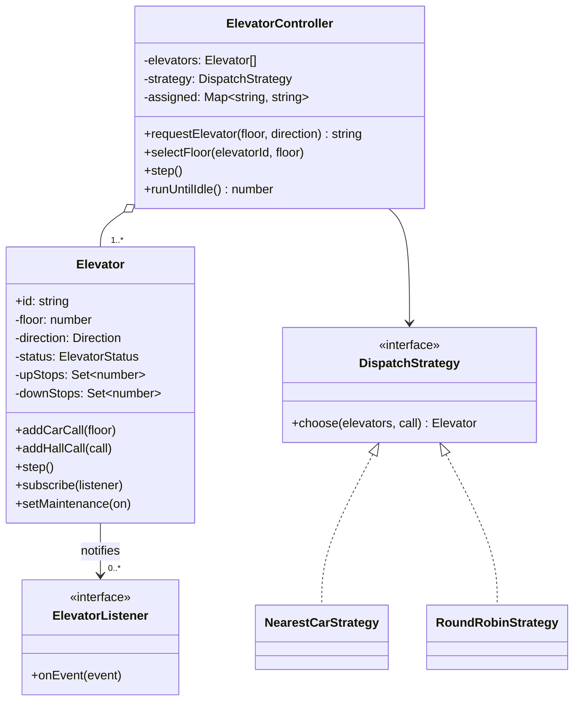
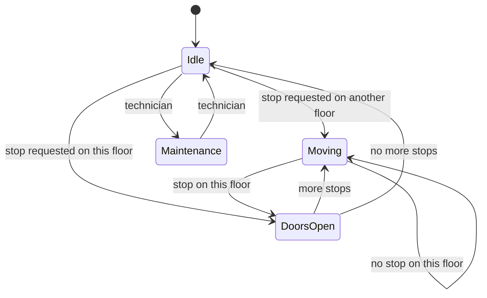
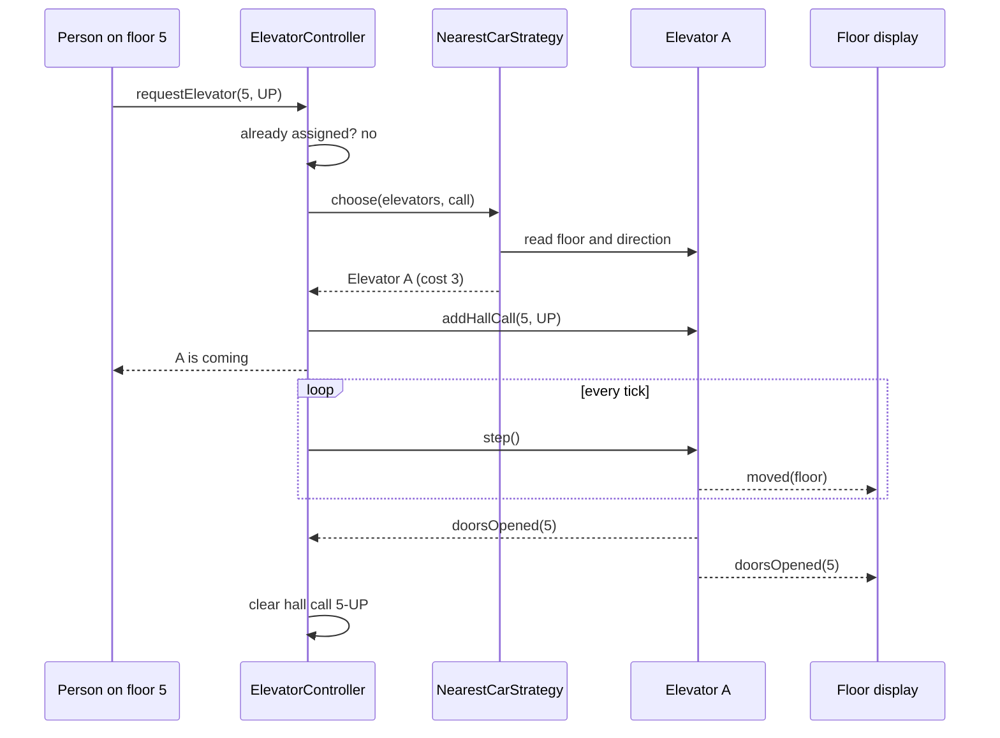

# Elevator System

> Design the classes for a building with several elevators: people call an elevator from a floor, choose a destination inside, and the system decides which car goes where. This problem tests state handling, a scheduling algorithm and the Strategy pattern, plus how you think about many requests arriving at once.

**Before this:** [How to approach LLD interviews](01-how-to-approach-lld-interviews.md) · [Parking lot](02-parking-lot.md) · [Behavioral patterns (Strategy, State, Observer)](../04-oop-solid-design-patterns/08-behavioral-patterns.md) · **Interview questions:** [jump to the interview section](#interview-questions)

## Table of contents

1. [Problem](#problem)
2. [Clarifying questions](#clarifying-questions)
3. [Requirements](#requirements)
4. [Core entities and relationships](#core-entities-and-relationships)
5. [Design decisions and patterns](#design-decisions-and-patterns)
6. [Implementation](#implementation)
7. [Walkthrough](#walkthrough)
8. [Handling concurrency and edge cases](#handling-concurrency-and-edge-cases)
9. [Extensions](#extensions)
10. [How to present this in the interview](#how-to-present-this-in-the-interview)
11. [Interview questions](#interview-questions)
12. [Summary](#summary)
13. [References](#references)

---

## Problem

> "Design an elevator system for a building with N floors and M elevators. People on a floor press UP or DOWN. Inside the elevator they press the number of the floor they want. The system should decide which elevator answers each call and in what order each elevator stops. Write the main classes and the scheduling logic."

Two kinds of requests appear in this prompt, and naming them correctly makes you sound experienced:

- A **hall call** (also called an *external request*): a person on floor 5 presses DOWN. We know the floor and the direction, but not the destination.
- A **car call** (an *internal request*): a person inside elevator A presses 1. It belongs to that elevator only.

The hard part is not the classes. It is the **scheduling**: which elevator takes a hall call (the **dispatch** decision) and in what order one elevator visits its stops (the **movement** algorithm).

## Clarifying questions

| Question | Why it matters | Assumed answer |
| --- | --- | --- |
| How many floors and elevators? Any basement floors? | Floor validation, data sizes | Floors 0–10, 2–4 elevators. Basements possible later (negative floors) |
| Do all elevators serve all floors? | Zoning changes dispatch | Yes for now; zoning is an extension |
| Do we simulate time, or control real motors? | Code shape | Simulate with a `step()` "tick": each tick a car moves one floor or opens its doors |
| What should the dispatcher optimize? | Strategy choice | Short waiting time; pick the car that can arrive soonest |
| Do we need capacity / weight limits? | Extra state | Mention it; not implemented |
| Maintenance mode, emergency stop, fire mode? | Extra states | Maintenance yes (car stops taking calls); emergency and fire as extensions |
| Do we need displays (current floor, direction)? | Observer | Yes, via events |
| Is there a destination dispatch panel (people type the floor in the lobby)? | Different model | No, classic UP/DOWN buttons |

Scope it out loud: "I will build the car, the dispatcher with a pluggable strategy, the LOOK movement algorithm inside each car, maintenance mode and events for displays. Weight limits, fire mode and zoning I will discuss as extensions."

## Requirements

### Functional requirements

1. A person on a floor can press UP or DOWN (hall call). The system assigns **one** elevator to the call.
2. Pressing the same hall button again does not create a second assignment.
3. A person inside a car can select a destination floor (car call).
4. Each car serves its stops in an efficient order: it keeps moving in one direction while it has stops in that direction, then turns around (the **LOOK** algorithm, explained below).
5. A car going UP does not stop for someone who wants to go DOWN, unless that is its last stop before turning.
6. Invalid floors are rejected.
7. A car can be put into **maintenance**; it then receives no new calls.
8. Displays and logs can listen to events: car moved, doors opened, car became idle.

### Non-functional requirements

- **Correctness with many simultaneous button presses:** no lost calls, no duplicate assignment, no corrupted state.
- **Extensibility:** new dispatch algorithms (nearest car, round robin, zoning, energy saving) without changing the controller ([Open/Closed](../04-oop-solid-design-patterns/03-solid-principles.md)).
- **Testability:** the simulation is deterministic: no real timers in the core logic.
- **Safety first:** in a real elevator, safety rules (doors closed before moving, overload) win over efficiency.

## Core entities and relationships

| Entity | Responsibility |
| --- | --- |
| `Elevator` | One car. Knows its floor, direction, status and its own stops. Decides its next move (LOOK). Emits events. |
| `HallCall` | A value: `{ floor, direction }`. |
| `Direction`, `ElevatorStatus` | Small value types (`UP/DOWN/IDLE`; `IDLE/MOVING/DOORS_OPEN/MAINTENANCE`). |
| `DispatchStrategy` | Interface: "for this hall call, which car?" |
| `NearestCarStrategy`, `RoundRobinStrategy` | Two implementations. |
| `ElevatorController` | The single entry point: receives hall calls and car calls, asks the strategy, tracks assigned calls, runs ticks. |
| `ElevatorEvent` and listeners | Observer: displays and logs subscribe to cars. |

Relationships:

- `ElevatorController` **has** many `Elevator`s (aggregation: cars exist on their own; the controller coordinates them).
- `ElevatorController` **uses** one `DispatchStrategy` (injected through the constructor).
- Each `Elevator` **notifies** zero or more listeners.



(In the code, a listener is just a function type, `(event) => void`. In the diagram it is drawn as an interface so the idea is clear.)

The states of one car, as a state diagram:



## Design decisions and patterns

### 1. Split the problem in two: dispatch and movement

Many candidates mix everything into one big `ElevatorSystem.run()` method. Split it:

- **Dispatch** (controller + strategy): "which car answers this hall call?" This is a **policy** that changes from building to building. So it is a [Strategy](../04-oop-solid-design-patterns/08-behavioral-patterns.md#strategy).
- **Movement** (inside `Elevator`): "in which order does this car visit its stops?" This is the car's own behavior. It belongs to the car, because the car owns its stops and its position (**information expert**: give the job to the object that has the data).

This split gives each class one reason to change ([Single Responsibility](../04-oop-solid-design-patterns/03-solid-principles.md)).

### 2. The movement algorithm: LOOK

Elevators have a classic algorithm borrowed from disk scheduling:

- **SCAN** ("the elevator algorithm"): go all the way up to the top floor, then all the way down, serving stops on the way.
- **LOOK**: like SCAN, but turn around at the **last requested stop**, not at the top floor. This is what real elevators do.

Rules we implement:

1. If the car is moving UP and has any stop above, keep going UP. Otherwise turn DOWN (and the other way round).
2. While going UP, stop at a floor if someone there wants to go UP (an *up stop*), or if this is the highest stop and someone there wants DOWN (we are about to turn anyway).
3. When idle, go toward the nearest stop.

We keep two sets, `upStops` and `downStops`. A hall call goes into the set of its direction. A car call goes into `upStops` if the floor is above us, `downStops` if below. A `Set` makes "is there a stop here?" O(1) and ignores duplicates for free.

Why not a simple FIFO queue ("serve requests in the order they came")? Because the car would zig-zag: requests for 9, 1, 8, 2 would make it travel 9 + 8 + 7 + 6 = 30 floors from floor 0. LOOK serves 1, 2, 8, 9 in 9 floors. Say this in the interview; it shows you thought about the algorithm, not just the classes.

### 3. Dispatch: a cost function

`NearestCarStrategy` computes a **cost** for each available car: how many floors it must travel before it can serve this call.

- Idle car: the distance.
- Car already moving toward the call, in the same direction as the call ("on the way"): the distance.
- Otherwise: it must finish its current run to its turn-around floor, then come back: `|here - turn| + |turn - callFloor|`.

The car with the lowest cost wins. This is simple, explainable and close to what is used in practice (real systems add more terms: number of stops on the way, load, energy).

`RoundRobinStrategy` is the second strategy, mostly to prove the interface works. It spreads calls evenly but ignores distance, so waiting times are worse.

### 4. State: an explicit status field, not State classes

The car has four states: `IDLE`, `MOVING`, `DOORS_OPEN`, `MAINTENANCE`. Should we use the [State pattern](../04-oop-solid-design-patterns/08-behavioral-patterns.md#state) with one class per state?

The trade-off: State classes help when **each state has many different methods with different behavior** (the vending machine in the [next chapter](04-vending-machine-and-atm.md) is a good fit). Here, only `step()` really depends on the state, and the rules are short. A status field plus a few `if`s is clearer. Say this out loud: "I considered the State pattern; I'd move to it if states multiply, for example fire mode, emergency stop, independent service mode."

### 5. Observer for displays and logs

Floor displays, the in-car display, a logger and tests all want to know "the car arrived at floor 5". The car should not know about any of them. So each car has `subscribe(listener)` and emits typed events (`moved`, `doorsOpened`, `idle`). The controller itself is also a listener: when doors open at a floor, it clears the hall call it assigned there, so the button light goes off and the button can be pressed again. See [Observer](../04-oop-solid-design-patterns/08-behavioral-patterns.md#observer).

The events are a **discriminated union** (`type: 'moved' | 'doorsOpened' | 'idle'`), so listeners get full type safety with a simple `if (event.type === ...)`. See [unions and narrowing](../03-typescript/03-unions-narrowing-and-type-guards.md).

### 6. Simulate time with ticks

A real controller reacts to sensors and timers. For an interview, a `step()` method that moves each car one floor (or opens its doors) is much easier to reason about and test: the same inputs always give the same output. Real time would be a thin wrapper: `setInterval(() => controller.step(), 1000)`.

### 7. The controller is not a Singleton, and not a god class

There is one controller per building, created at startup and injected. It **coordinates**; it does not move cars itself, and it does not contain the dispatch math. If the controller starts to calculate distances, the Strategy has leaked.

### Patterns summary

| Concern | Choice | Why |
| --- | --- | --- |
| Which car for a hall call | `DispatchStrategy` (Strategy) | Policy changes per building; Open/Closed |
| Order of stops inside a car | LOOK in `Elevator` | The car owns the data (information expert) |
| Car states | Status field + transition rules | Few states; State pattern only if they multiply |
| Displays, logs, controller bookkeeping | Observer (listeners + typed events) | Loose coupling |
| Time | `step()` ticks | Deterministic and testable |
| Many button presses | Single owner of state (see concurrency) | No races |

## Implementation

The blocks below form **one runnable TypeScript file** (type-checked with `tsc --strict`, run with Node.js 22; the output comments are the real output). As in the other chapters, we use `as const` objects instead of `enum` so Node.js can run the file directly.

### Step 1: value types and events

```ts
// ---------- Step 1: value types ----------
const Direction = {
  UP: 'UP',
  DOWN: 'DOWN',
  IDLE: 'IDLE',
} as const;
type Direction = (typeof Direction)[keyof typeof Direction];

const ElevatorStatus = {
  IDLE: 'IDLE',
  MOVING: 'MOVING',
  DOORS_OPEN: 'DOORS_OPEN',
  MAINTENANCE: 'MAINTENANCE',
} as const;
type ElevatorStatus = (typeof ElevatorStatus)[keyof typeof ElevatorStatus];

// A hall call: someone on a floor presses UP or DOWN.
type HallCall = { floor: number; direction: 'UP' | 'DOWN' };

// Events that displays, logs or tests can listen to (Observer).
type ElevatorEvent =
  | { type: 'moved'; elevatorId: string; floor: number; direction: Direction }
  | { type: 'doorsOpened'; elevatorId: string; floor: number }
  | { type: 'idle'; elevatorId: string; floor: number };
type ElevatorListener = (event: ElevatorEvent) => void;
```

### Step 2: the elevator car (with LOOK)

```ts
// ---------- Step 2: the elevator car ----------
class Elevator {
  readonly id: string;
  readonly minFloor: number;
  readonly maxFloor: number;
  private floor: number;
  private direction: Direction = Direction.IDLE;
  private status: ElevatorStatus = ElevatorStatus.IDLE;
  // Floors where we must stop while going up / while going down.
  private readonly upStops = new Set<number>();
  private readonly downStops = new Set<number>();
  private readonly listeners: ElevatorListener[] = [];

  constructor(id: string, minFloor: number, maxFloor: number, startFloor: number) {
    this.id = id;
    this.minFloor = minFloor;
    this.maxFloor = maxFloor;
    this.floor = startFloor;
  }

  get currentFloor(): number {
    return this.floor;
  }
  get currentDirection(): Direction {
    return this.direction;
  }
  get currentStatus(): ElevatorStatus {
    return this.status;
  }

  subscribe(listener: ElevatorListener): void {
    this.listeners.push(listener);
  }

  isAvailable(): boolean {
    return this.status !== ElevatorStatus.MAINTENANCE;
  }

  setMaintenance(on: boolean): void {
    if (on && this.hasStops()) throw new Error(`${this.id} still has stops to serve`);
    this.status = on ? ElevatorStatus.MAINTENANCE : ElevatorStatus.IDLE;
  }

  // A passenger inside presses a floor button (a car call).
  addCarCall(floor: number): void {
    this.validateFloor(floor);
    if (floor > this.floor) this.upStops.add(floor);
    else if (floor < this.floor) this.downStops.add(floor);
    else if (this.direction === Direction.DOWN) this.downStops.add(floor);
    else this.upStops.add(floor);
  }

  // The dispatcher assigns a hall call to this car.
  addHallCall(call: HallCall): void {
    this.validateFloor(call.floor);
    (call.direction === Direction.UP ? this.upStops : this.downStops).add(call.floor);
  }

  hasStops(): boolean {
    return this.upStops.size > 0 || this.downStops.size > 0;
  }

  pendingStops(): number[] {
    return [...new Set([...this.upStops, ...this.downStops])].sort((a, b) => a - b);
  }

  // One simulation tick: either open the doors here, or move one floor.
  step(): void {
    if (this.status === ElevatorStatus.MAINTENANCE) return;
    const wasBusy = this.status !== ElevatorStatus.IDLE; // doors were open or we were moving

    this.direction = this.chooseDirection();
    if (this.direction === Direction.IDLE) {
      this.status = ElevatorStatus.IDLE; // doors close, nothing to do
      if (wasBusy) this.emit({ type: 'idle', elevatorId: this.id, floor: this.floor });
      return;
    }
    if (this.shouldStopHere()) {
      this.openDoors();
      return;
    }
    this.floor += this.direction === Direction.UP ? 1 : -1;
    this.status = ElevatorStatus.MOVING;
    this.emit({ type: 'moved', elevatorId: this.id, floor: this.floor, direction: this.direction });
  }

  // LOOK algorithm: keep going in the current direction while there are stops ahead,
  // then turn around. When idle, go toward the nearest stop.
  private chooseDirection(): Direction {
    if (!this.hasStops()) return Direction.IDLE;
    const all = this.pendingStops();
    const above = all.some((f) => f > this.floor);
    const below = all.some((f) => f < this.floor);
    const here = all.includes(this.floor);
    if (this.direction === Direction.UP) return above || here ? Direction.UP : Direction.DOWN;
    if (this.direction === Direction.DOWN) return below || here ? Direction.DOWN : Direction.UP;
    if (here) return this.upStops.has(this.floor) ? Direction.UP : Direction.DOWN;
    const nearest = all.reduce((best, f) => (Math.abs(f - this.floor) < Math.abs(best - this.floor) ? f : best));
    return nearest > this.floor ? Direction.UP : Direction.DOWN;
  }

  // Stop if someone wants to go our way here, or if this is the last stop in our direction.
  private shouldStopHere(): boolean {
    const f = this.floor;
    if (this.direction === Direction.UP) {
      if (this.upStops.has(f)) return true;
      return this.downStops.has(f) && !this.pendingStops().some((s) => s > f);
    }
    if (this.downStops.has(f)) return true;
    return this.upStops.has(f) && !this.pendingStops().some((s) => s < f);
  }

  private openDoors(): void {
    const f = this.floor;
    const turning =
      this.direction === Direction.UP
        ? !this.pendingStops().some((s) => s > f)
        : !this.pendingStops().some((s) => s < f);
    if (this.direction === Direction.UP) this.upStops.delete(f);
    else this.downStops.delete(f);
    if (turning) {
      this.upStops.delete(f);
      this.downStops.delete(f);
    }
    this.status = ElevatorStatus.DOORS_OPEN;
    this.emit({ type: 'doorsOpened', elevatorId: this.id, floor: f });
  }

  private validateFloor(floor: number): void {
    if (!Number.isInteger(floor) || floor < this.minFloor || floor > this.maxFloor) {
      throw new Error(`Floor ${floor} does not exist`);
    }
    if (!this.isAvailable()) throw new Error(`${this.id} is in maintenance`);
  }

  private emit(event: ElevatorEvent): void {
    for (const listener of this.listeners) listener(event);
  }
}
```

Read `step()` slowly; it is the heart of the design:

1. In maintenance, do nothing.
2. Decide the direction with LOOK (`chooseDirection`). No stops means idle.
3. If we should stop on this floor, open the doors and finish this tick.
4. Otherwise move one floor and emit `moved`.

`openDoors()` has one subtle rule: when the car **turns around** at a floor (no more stops ahead), it clears both the up and the down stop there, because everyone waiting on that floor can get in now.

### Step 3: dispatch strategies

```ts
// ---------- Step 3: dispatch strategies ----------
interface DispatchStrategy {
  readonly name: string;
  choose(elevators: readonly Elevator[], call: HallCall): Elevator | null;
}

// Cost = how many floors the car must travel before it can serve this call.
function travelCost(e: Elevator, call: HallCall): number {
  const here = e.currentFloor;
  const dir = e.currentDirection;
  if (dir === Direction.IDLE) return Math.abs(here - call.floor);
  const onTheWay =
    (dir === Direction.UP && call.direction === Direction.UP && call.floor >= here) ||
    (dir === Direction.DOWN && call.direction === Direction.DOWN && call.floor <= here);
  if (onTheWay) return Math.abs(here - call.floor);
  // Otherwise the car finishes its current run first, then comes back.
  const stops = e.pendingStops();
  const turnFloor = dir === Direction.UP ? Math.max(here, ...stops) : Math.min(here, ...stops);
  return Math.abs(here - turnFloor) + Math.abs(turnFloor - call.floor);
}

class NearestCarStrategy implements DispatchStrategy {
  readonly name = 'nearest-car';
  choose(elevators: readonly Elevator[], call: HallCall): Elevator | null {
    let best: Elevator | null = null;
    let bestCost = Infinity;
    for (const e of elevators) {
      if (!e.isAvailable()) continue;
      const cost = travelCost(e, call);
      if (cost < bestCost) {
        best = e;
        bestCost = cost;
      }
    }
    return best;
  }
}

class RoundRobinStrategy implements DispatchStrategy {
  readonly name = 'round-robin';
  private next = 0;
  choose(elevators: readonly Elevator[], call: HallCall): Elevator | null {
    for (let i = 0; i < elevators.length; i++) {
      const e = elevators[(this.next + i) % elevators.length]!;
      if (e.isAvailable()) {
        this.next = (this.next + i + 1) % elevators.length;
        return e;
      }
    }
    return null;
  }
}
```

`travelCost` is a plain function, not a method of a strategy class, so other strategies (for example a future `ZoneStrategy`) can reuse it. Strategies only **read** car state; they never add stops. The controller does that. This keeps "who changes state" in one place.

### Step 4: the controller

```ts
// ---------- Step 4: the controller (the single entry point) ----------
class ElevatorController {
  private readonly elevators: readonly Elevator[];
  private readonly strategy: DispatchStrategy;
  private readonly assigned = new Map<string, string>(); // "5-DOWN" -> elevator id

  constructor(elevators: Elevator[], strategy: DispatchStrategy) {
    this.elevators = elevators;
    this.strategy = strategy;
    for (const e of elevators) {
      e.subscribe((event) => {
        if (event.type === 'doorsOpened') this.clearHallCalls(event.elevatorId, event.floor);
      });
    }
  }

  // Someone on a floor presses UP or DOWN.
  requestElevator(floor: number, direction: 'UP' | 'DOWN'): string {
    const key = `${floor}-${direction}`;
    const already = this.assigned.get(key);
    if (already) return already; // pressing the button twice does nothing new
    const elevator = this.strategy.choose(this.elevators, { floor, direction });
    if (!elevator) throw new Error('No elevator available');
    elevator.addHallCall({ floor, direction });
    this.assigned.set(key, elevator.id);
    return elevator.id;
  }

  // A passenger inside elevator `id` presses a floor button.
  selectFloor(elevatorId: string, floor: number): void {
    this.get(elevatorId).addCarCall(floor);
  }

  step(): void {
    for (const e of this.elevators) e.step();
  }

  runUntilIdle(maxTicks = 100): number {
    let ticks = 0;
    while (this.elevators.some((e) => e.hasStops() || e.currentStatus === ElevatorStatus.DOORS_OPEN)) {
      if (++ticks > maxTicks) throw new Error('Simulation did not finish');
      this.step();
    }
    return ticks;
  }

  status(): string {
    return this.elevators
      .map((e) => `${e.id}@${e.currentFloor} ${e.currentStatus} stops=[${e.pendingStops().join(',')}]`)
      .join(' | ');
  }

  get(elevatorId: string): Elevator {
    const e = this.elevators.find((x) => x.id === elevatorId);
    if (!e) throw new Error(`Unknown elevator ${elevatorId}`);
    return e;
  }

  private clearHallCalls(elevatorId: string, floor: number): void {
    for (const [key, id] of this.assigned) {
      if (id === elevatorId && key.startsWith(`${floor}-`)) this.assigned.delete(key);
    }
  }
}
```

The `assigned` map does two jobs: it makes a repeated button press **idempotent** (the same answer, no new work), and it remembers which car serves which hall call, which a display would use to light up "Elevator A is coming". `runUntilIdle` has a `maxTicks` guard so a bug can never cause an endless loop in a test.

### Step 5: demo

```ts
// ---------- Step 5: demo ----------
function logger(event: ElevatorEvent): void {
  if (event.type === 'doorsOpened') console.log(`  ${event.elevatorId}: doors open at ${event.floor}`);
  if (event.type === 'idle') console.log(`  ${event.elevatorId}: idle at ${event.floor}`);
}

function main(): void {
  const a = new Elevator('A', 0, 10, 0);
  const b = new Elevator('B', 0, 10, 8);
  for (const e of [a, b]) e.subscribe(logger);
  const controller = new ElevatorController([a, b], new NearestCarStrategy());

  console.log('Call 1 (floor 2, UP) ->', controller.requestElevator(2, 'UP'));
  console.log('Call 2 (floor 9, DOWN) ->', controller.requestElevator(9, 'DOWN'));
  console.log('Call 2 again ->', controller.requestElevator(9, 'DOWN'));
  console.log(controller.status());

  controller.step();
  controller.step();
  controller.step(); // A reaches 2 and opens; B reaches 9 and opens
  controller.selectFloor('A', 7); // passenger in A goes to 7
  controller.selectFloor('B', 1); // passenger in B goes to 1
  console.log('Call 3 (floor 5, UP) ->', controller.requestElevator(5, 'UP'));
  console.log(controller.status());

  const ticks = controller.runUntilIdle();
  console.log(`Finished in ${ticks} more ticks:`, controller.status());

  console.log('--- LOOK order inside one car ---');
  const c = new Elevator('C', 0, 10, 5);
  c.subscribe(logger);
  c.addCarCall(8);
  c.addCarCall(2);
  c.addCarCall(9);
  c.addHallCall({ floor: 6, direction: 'DOWN' });
  for (let i = 0; i < 30 && c.hasStops(); i++) c.step();

  console.log('--- Errors ---');
  try {
    controller.selectFloor('A', 42);
  } catch (e) {
    console.log('Error:', (e as Error).message);
  }
  const rr = new RoundRobinStrategy();
  const pick = () => rr.choose([a, b], { floor: 0, direction: 'UP' })?.id;
  console.log('Round robin picks:', [pick(), pick(), pick()].join(','));
  b.setMaintenance(true);
  console.log('Round robin with B in maintenance:', [pick(), pick()].join(','));
  console.log('Call 4 (floor 9, DOWN) with B in maintenance ->', controller.requestElevator(9, 'DOWN'));
}

main();
// Call 1 (floor 2, UP) -> A
// Call 2 (floor 9, DOWN) -> B
// Call 2 again -> B
// A@0 IDLE stops=[2] | B@8 IDLE stops=[9]
//   B: doors open at 9
//   A: doors open at 2
//   B: idle at 9
// Call 3 (floor 5, UP) -> A
// A@2 DOORS_OPEN stops=[5,7] | B@9 IDLE stops=[1]
//   A: doors open at 5
//   A: doors open at 7
//   A: idle at 7
//   B: doors open at 1
//   B: idle at 1
// Finished in 10 more ticks: A@7 IDLE stops=[] | B@1 IDLE stops=[]
// --- LOOK order inside one car ---
//   C: doors open at 8
//   C: doors open at 9
//   C: doors open at 6
//   C: doors open at 2
// --- Errors ---
// Error: Floor 42 does not exist
// Round robin picks: A,B,A
// Round robin with B in maintenance: A,A
// Call 4 (floor 9, DOWN) with B in maintenance -> A
```

What the output shows:

- **Call 1** goes to A (2 floors away) and **call 2** to B (1 floor away). Pressing call 2 again returns B without new work.
- **Call 3** (floor 5, UP) goes to A, which is at floor 2 and already heading UP to 7: floor 5 is "on the way" (cost 3). B is idle at 9 (cost 4), so A wins.
- A stops at 5 and then 7 in one smooth run. B goes down to 1.
- **LOOK inside car C:** C is at 5 with stops 8, 2, 9 and a DOWN call at 6. It goes up first (6 is nearest), **passes floor 6 without stopping** (that person wants DOWN, and we still have stops above), serves 8 and 9, turns, then serves 6 and 2. A FIFO queue would have zig-zagged.
- Round robin alternates A, B, A, and skips B when B is in maintenance. The nearest-car strategy also skips B.

## Walkthrough

The flow of **one hall call**, from the button press to the doors opening:



As steps:

1. The person presses UP on floor 5. The controller builds the key `5-UP` and checks the `assigned` map. Not assigned yet.
2. The controller asks the strategy. The strategy computes `travelCost` for each available car and returns the cheapest.
3. The controller adds the hall call to that car's `upStops` and records the assignment.
4. Each tick, the controller calls `step()` on every car. Car A moves one floor and emits `moved`; displays update.
5. At floor 5, `shouldStopHere()` is true, so A opens its doors and emits `doorsOpened`.
6. The controller hears the event and clears `5-UP`, so the hall button light goes off and a new press will create a new assignment.

## Handling concurrency and edge cases

### Many button presses at the same time

In a real building, dozens of buttons can be pressed in the same second, while cars are moving. If several threads changed car state directly, you could get lost stops or two cars assigned to the same call.

In Java or C#, you would protect each car's stop sets with a lock, or use concurrent collections, and make "check assigned, choose car, add stop" one critical section in the controller.

In Node.js (one thread), the simplest safe design is a **single owner of state**: every button press becomes a **command** in a queue, and only the tick loop applies commands and moves cars. This is the [Command pattern](../04-oop-solid-design-patterns/08-behavioral-patterns.md#command) plus a "single writer" rule (the same idea as an actor or an event loop). The code below reuses the classes from the implementation:

```ts
// Every button press becomes a command in one queue.
// Only tick() changes elevator state, so there is a single writer.
type Command =
  | { kind: 'hall'; floor: number; direction: 'UP' | 'DOWN' }
  | { kind: 'car'; elevatorId: string; floor: number };

class ElevatorSystemLoop {
  private readonly queue: Command[] = [];
  private readonly controller: ElevatorController;
  constructor(controller: ElevatorController) {
    this.controller = controller;
  }

  // Called by button panels, HTTP handlers, sockets... in any order, at any time.
  submit(command: Command): void {
    this.queue.push(command);
  }

  tick(): void {
    for (const command of this.queue.splice(0)) {
      try {
        if (command.kind === 'hall') this.controller.requestElevator(command.floor, command.direction);
        else this.controller.selectFloor(command.elevatorId, command.floor);
      } catch (e) {
        console.log('  rejected:', (e as Error).message);
      }
    }
    this.controller.step();
  }
}

function loopDemo(): void {
  const car = new Elevator('A', 0, 10, 0);
  car.subscribe(logger);
  const loop = new ElevatorSystemLoop(new ElevatorController([car], new NearestCarStrategy()));
  // Three panels press buttons "at the same time".
  loop.submit({ kind: 'hall', floor: 3, direction: 'UP' });
  loop.submit({ kind: 'hall', floor: 3, direction: 'UP' });
  loop.submit({ kind: 'car', elevatorId: 'A', floor: 99 });
  for (let i = 0; i < 6; i++) loop.tick();
  console.log('Stops left:', car.pendingStops());
}

loopDemo();
//   rejected: Floor 99 does not exist
//   A: doors open at 3
//   A: idle at 3
// Stops left: []
```

Why this works: commands can arrive from anywhere, but they only **change state inside `tick()`**, one after another. The duplicate UP press at floor 3 is absorbed by the `assigned` map. The bad floor is rejected without breaking the loop (one bad command must never stop the elevator system). Also, commands are applied **between** moves, so a car never sees half-updated stop sets.

**What to say:** "In Java I'd lock per elevator or make the controller methods synchronized. In Node.js I'd use a single writer: button presses become commands in a queue, and one loop applies them and moves the cars. It's simple, it's deterministic, and it's easy to replay for debugging."

### Edge cases

| Edge case | Handling |
| --- | --- |
| Floor that does not exist (42, -1, 2.5) | `validateFloor` rejects it; the button panel shows an error |
| Same hall button pressed many times | `assigned` map returns the same car; no new stop |
| Car call for the current floor | Added as a stop; doors open on the next tick |
| Person presses DOWN, but the assigned car arrives going UP | LOOK stops only if this is its last stop before turning; otherwise it passes, and stops on the way back |
| All cars in maintenance | Strategy returns `null`; controller throws "No elevator available"; the panel can show "out of service" |
| Putting a car with passengers into maintenance | `setMaintenance(true)` refuses while stops remain; a real system would first finish or hand over the stops |
| Car breaks down with hall calls assigned | Re-dispatch its hall calls to other cars (extension below); car calls are lost because the passengers are inside, so open doors at the nearest floor |
| Endless loop due to a bug | `runUntilIdle(maxTicks)` throws |
| Overweight | Add a `loadKg` and a `capacityKg`; do not close doors while overloaded; dispatcher skips full cars for hall calls |
| Starvation (a floor waits forever) | LOOK guarantees each floor is visited within one up-and-down sweep; the dispatcher can add "waiting time" to the cost |

## Extensions

### A new dispatch algorithm

For example **zoning**: cars A and B serve floors 0–20, cars C and D serve 21–40, all serve the lobby. Write `ZoneStrategy implements DispatchStrategy` that filters cars by zone and then uses `travelCost`. The controller does not change. You can also **compose** strategies: `new ZoneStrategy(zones, new NearestCarStrategy())` filters, then delegates.

### Peak-hour behavior

In the morning, most trips start in the lobby and go up. A `MorningPeakStrategy` can send idle cars back to the lobby. This is a policy, so it fits the strategy (or a small "idle policy" interface).

### Emergency and fire mode

Now states really multiply: `FIRE_RECALL` (all cars go to the ground floor and open doors), `EMERGENCY_STOP`, `INDEPENDENT_SERVICE`. Each mode changes how the car reacts to calls and ticks. This is where moving to the [State pattern](../04-oop-solid-design-patterns/08-behavioral-patterns.md#state) pays off: `IdleState`, `MovingState`, `FireRecallState`, each with `onTick()`, `onCarCall()`, `onHallCall()`. The controller gets a `triggerFireMode()` that switches every car's state.

### Re-dispatch when a car fails

Keep the hall calls per car in the controller (we already have `assigned`). When a car goes out of service, remove its hall calls and call `requestElevator` again for each one. The `assigned` map makes this straightforward.

### Destination dispatch

Some modern buildings have a keypad in the lobby: you type your floor and the screen says "go to car C". Now a hall call contains the destination, so the strategy can group people by destination. `HallCall` gets an optional `destination` field, and a `DestinationDispatchStrategy` uses it. The car code does not change.

### Real hardware

Replace the tick simulation with events from sensors: "arrived at floor", "doors closed". The car's logic becomes event-driven, but the decisions (`chooseDirection`, `shouldStopHere`) are the same pure rules. That's why it's good to keep them as small private methods.

## How to present this in the interview

### Minute-by-minute plan (45 minutes)

| Time | What you do |
| --- | --- |
| 0–5 | Clarify: floors, cars, hall vs car calls, what to optimize, maintenance, simulation with ticks. |
| 5–8 | Requirements, including "no duplicate assignment" and "efficient stop order". |
| 8–14 | Entities and class diagram; state diagram for one car. Split dispatch from movement. |
| 14–18 | Explain LOOK vs FIFO with a quick example (9, 1, 8, 2), and the cost function for dispatch. |
| 18–35 | Code: `Elevator` with `addCarCall`, `addHallCall`, `step`, `chooseDirection`, `shouldStopHere`; then `DispatchStrategy` and `ElevatorController`. |
| 35–40 | Walk through one hall call; trace the LOOK example. |
| 40–45 | Concurrency (single writer / locks), edge cases, extensions (zoning, fire mode with State pattern). |

### Spoken walkthrough script

> "There are two kinds of requests: hall calls from a floor with a direction, and car calls from inside a car with a destination. I'll split the problem into dispatch, which car answers a hall call, and movement, the order in which one car visits its stops.
>
> Dispatch is a policy that changes per building, so it's a `DispatchStrategy` interface. My default is nearest car with a cost function: distance if the car is idle or the call is on its way in the same direction; otherwise the distance to its turning point and back.
>
> Movement lives in the `Elevator` class because it owns the data. I use LOOK: keep going in the current direction while there are stops ahead, then turn around. I keep `upStops` and `downStops` as sets. Going up, I stop for up-calls, and for a down-call only if it's the last stop before turning.
>
> The controller is the single entry point. It remembers assigned hall calls so repeated presses don't create duplicates, and it listens for door-open events to clear them. Displays also listen to events. That's Observer.
>
> For concurrency, I'd use a single writer in Node.js: button presses become commands in a queue, and one tick loop applies them and moves the cars. In Java I'd use locks per car. For extensions: zoning is a new strategy, and fire mode is where I'd switch the car to the State pattern."

## Interview questions

### Q1. How does one elevator decide the order of its stops?

**What the interviewer is checking:** whether you know a real scheduling algorithm and can explain why it beats a naive queue.

**What to say (30–60 seconds):**
> I use the LOOK algorithm. The car keeps moving in its current direction while there are stops ahead, serving them on the way, and turns around at the last requested stop. Going up, it stops for people who want to go up, and for a down request only if it's the last stop before turning. A FIFO queue would zig-zag: from floor 0, requests 9, 1, 8, 2 cost 30 floors of travel with FIFO and 9 with LOOK. LOOK also avoids starvation, because every floor is visited within one sweep up and one sweep down.

**Deeper explanation:** SCAN goes to the end of the building before turning; LOOK turns at the last request. Shortest-seek-first (always the nearest stop) can starve far floors when new nearby requests keep arriving. In the code, `chooseDirection` and `shouldStopHere` implement LOOK in about 25 lines.

**Follow-up questions and how to answer them:**
- *"Why two sets instead of one?"* Because a stop at floor 6 for someone going DOWN should not stop a car going UP. The direction is part of the request.
- *"What data structure would you use for many floors?"* Two sorted structures (or heaps): a min-heap of up stops above us and a max-heap of down stops below us, so the next stop is O(log n). With 50 floors, a `Set` and a scan is fine.

**Common mistakes:** serving requests in arrival order; ignoring direction for hall calls.

**Real-project example:** disk schedulers used SCAN/LOOK for the same reason: fewer head movements.

### Q2. How do you choose which elevator answers a hall call?

**What the interviewer is checking:** Strategy pattern, and a sensible cost function.

**What to say (30–60 seconds):**
> It's a `DispatchStrategy` with one method, `choose(elevators, call)`. My default computes a cost per available car: the distance if it's idle or already moving toward the call in the same direction; otherwise the distance to where it turns around, plus the distance back. The cheapest car wins. Because it's a strategy, a building can use round robin, zoning or an energy-saving policy without changing the controller.

**Deeper explanation:** Real systems add terms: number of stops before reaching the caller (each stop costs about 10 seconds), current load, and how long the call has been waiting. You can make the cost a weighted sum and tune the weights.

**Follow-up questions and how to answer them:**
- *"Should a hall call ever be re-assigned?"* Yes, if conditions change (a car breaks down or gets full). Keep the assignment in the controller so you can move it.
- *"Ties?"* Take the first, or the one with fewer stops. Make it deterministic for tests.

**Common mistakes:** picking the nearest car by distance only, so a car right below you but going down for 10 floors wins.

**Real-project example:** taxi and ride-sharing dispatch uses the same "estimated time to pick-up" cost idea.

### Q3. Why did you not use the State pattern for the elevator?

**What the interviewer is checking:** whether you apply patterns with judgment, not by reflex.

**What to say (30–60 seconds):**
> I considered it. The State pattern pays off when each state reacts differently to many events. Here I have four states, and only `step()` really depends on them, with short rules. A status field is easier to read. If we add fire recall, emergency stop and independent service, each with different reactions to calls and ticks, I'd move to State classes, because then the `if`s would spread across every method.

**Deeper explanation:** Patterns are tools with costs: more classes, more indirection. Compare with the vending machine, where every action (insert coin, select, cancel) behaves differently in every state; that's a strong fit for State.

**Follow-up questions and how to answer them:**
- *"How would the State version look?"* An `ElevatorState` interface with `onTick(car)`, `onCarCall(car, floor)`, `onHallCall(car, call)`; the car delegates to `this.state` and states call `car.setState(next)`.

**Common mistakes:** forcing every pattern into the solution; or never mentioning State at all.

**Real-project example:** UI components often start with a status field and move to a state machine library (XState) when flows grow.

### Q4. Many people press buttons at the same time. How do you keep the state correct?

**What the interviewer is checking:** concurrency awareness in your language.

**What to say (30–60 seconds):**
> The danger is two updates interleaving: two presses both see "no car assigned" and both assign one, or a stop is added while the car is deciding where to go. In Java I'd make the controller's request handling a critical section with a lock, and protect each car's stop sets. In Node.js I'd use a single writer: every press becomes a command in a queue, and only the tick loop applies commands and moves cars. Duplicate presses are absorbed by the assigned-calls map, and a bad request is rejected without stopping the loop.

**Deeper explanation:** A single writer turns a concurrency problem into a sequencing problem. It also gives you a log of commands you can replay to reproduce a bug.

**Follow-up questions and how to answer them:**
- *"Isn't a single loop slow?"* Each command is microseconds of work; elevators move in seconds. It's far from a bottleneck.
- *"What if the controller runs on several servers?"* One building should have one active controller (leader election, with a standby). You don't want two brains moving the same cars.

**Common mistakes:** "JavaScript is single-threaded, so nothing can go wrong" without explaining where the risk would be.

**Real-project example:** Redis processes commands in one thread for the same reason: simple, correct ordering.

### Q5. How do you avoid a floor waiting forever (starvation)?

**What the interviewer is checking:** fairness thinking.

**What to say (30–60 seconds):**
> Inside one car, LOOK prevents starvation: every stop is served within one sweep in each direction. Across cars, starvation can happen if the dispatcher always prefers cars that are "almost there" for other calls. I'd add waiting time into the cost, so an old call gets cheaper and wins a car, and I'd set an upper limit after which the call gets the nearest idle car no matter what.

**Deeper explanation:** This is the same idea as "aging" in OS process schedulers.

**Follow-up questions and how to answer them:**
- *"How would you test it?"* A simulation with a stream of random calls; assert the maximum wait stays under a bound.

**Common mistakes:** saying "nearest first" without noticing it can starve far floors.

**Real-project example:** job queues with priorities use aging so low-priority jobs still run.

### Q6. How would you add zoning (some cars serve only some floors)?

**What the interviewer is checking:** Open/Closed and composition of strategies.

**What to say (30–60 seconds):**
> A `ZoneStrategy` that knows which cars serve which floors. It filters the cars that serve the call's floor and then delegates to another strategy, like nearest car, for the final choice. The controller doesn't change. Cars also need to reject car calls outside their zone, so each car gets an allowed floor set in its constructor.

**Deeper explanation:** Strategy plus delegation is a [Decorator](../04-oop-solid-design-patterns/07-structural-patterns.md)-like composition: the zone filter wraps the inner strategy.

**Follow-up questions and how to answer them:**
- *"The lobby is in every zone?"* Yes: zones are sets of floors, and they can overlap.

**Common mistakes:** adding `if (building.hasZones)` inside the controller.

**Real-project example:** skyscrapers have low-rise, mid-rise and high-rise banks of elevators.

### Q7. A car breaks down. What happens to its requests?

**What the interviewer is checking:** failure handling.

**What to say (30–60 seconds):**
> Hall calls assigned to it must be re-dispatched, otherwise people wait forever. Because the controller keeps the `assigned` map, I can find every hall call for that car, remove them and call `requestElevator` again for each. Car calls belong to passengers inside, so the safe action is to stop at the nearest floor and open the doors. Then I mark the car as out of service so the strategy skips it.

**Deeper explanation:** This is why the controller, not only the car, should remember assignments: the car may not be able to answer anymore.

**Follow-up questions and how to answer them:**
- *"How do you detect a breakdown?"* A heartbeat: if a car doesn't report within N seconds, mark it unavailable.

**Common mistakes:** losing calls silently.

**Real-project example:** worker pools re-queue jobs from a worker that stops sending heartbeats.

### Q8. How do floor displays know where the car is?

**What the interviewer is checking:** Observer and coupling.

**What to say (30–60 seconds):**
> Each car emits typed events: moved, doors opened, idle. Displays subscribe. The car doesn't know displays exist, so I can add a mobile app or a logger without touching it. The controller also subscribes, to clear hall calls when doors open. I used a discriminated union for the events, so each listener gets the correct fields after checking `event.type`.

**Deeper explanation:** Isolate listener errors in production (try/catch per listener) so a broken display can't break the elevator.

**Follow-up questions and how to answer them:**
- *"What if a display is slow?"* Listeners must be fast; slow work goes into a queue.

**Common mistakes:** the car calling `display.show()` directly.

**Real-project example:** Node's `EventEmitter` and DOM events are the same idea.

### Q9. How would you test this system?

**What the interviewer is checking:** testing mindset, determinism.

**What to say (30–60 seconds):**
> Because time is a `step()` call, everything is deterministic. I'd test LOOK on one car: start at 5 with stops 8, 2, 9 and a down call at 6, and assert the door-open order is 8, 9, 6, 2. I'd test the cost function directly with small cars in fixed positions. For the controller: duplicate presses give the same car, invalid floors throw, maintenance cars are skipped. And a long random simulation that checks every call is served within a bound.

**Deeper explanation:** Collecting events in an array through a listener is an easy way to assert behavior without peeking at private fields.

**Follow-up questions and how to answer them:**
- *"How do you test the real-time version?"* Keep the timer outside; test the logic with ticks, and only smoke-test the timer.

**Common mistakes:** tests that use `setTimeout` and real seconds.

**Real-project example:** game engines test logic with fixed-step updates for the same reason.

### Q10. What changes if people enter their destination in the lobby (destination dispatch)?

**What the interviewer is checking:** whether the design adapts to a different input model.

**What to say (30–60 seconds):**
> The hall call now has a destination. The strategy can group people going to nearby floors into the same car, which reduces stops. I'd add an optional `destination` to the call, a new `DestinationDispatchStrategy`, and when assigning I'd add both the pickup floor and the destination to the car's stops. The car's LOOK logic doesn't change.

**Deeper explanation:** This shows the value of splitting dispatch from movement: a big change in dispatch doesn't touch movement.

**Follow-up questions and how to answer them:**
- *"What does the person see?"* The controller returns the car id, and the lobby screen shows "go to car C".

**Common mistakes:** rewriting the whole system for this change.

**Real-project example:** destination dispatch is common in modern office towers.

## Summary

- Name the two request types: **hall calls** (floor + direction) and **car calls** (destination).
- Split **dispatch** (which car: Strategy) from **movement** (stop order: LOOK inside the car).
- **LOOK:** keep going while stops are ahead, then turn; stop for same-direction calls, or for the last stop before turning.
- Dispatch with a **cost function**: distance if idle or on the way; otherwise via the turning point.
- Car states as a **status field**; move to the **State pattern** when modes like fire recall arrive.
- **Observer** for displays and controller bookkeeping; events as a discriminated union.
- Concurrency: **single writer** loop with a command queue in Node.js; locks per car in Java/C#.
- Extensions (zoning, peak mode, destination dispatch, re-dispatch on failure) mostly add strategies.

## References

- [Wikipedia: Elevator algorithm (SCAN and LOOK)](https://en.wikipedia.org/wiki/Elevator_algorithm)
- [Refactoring Guru: Strategy](https://refactoring.guru/design-patterns/strategy)
- [Refactoring Guru: State](https://refactoring.guru/design-patterns/state)
- [Refactoring Guru: Observer](https://refactoring.guru/design-patterns/observer)
- [Refactoring Guru: Command](https://refactoring.guru/design-patterns/command)
- [TypeScript Handbook: Discriminated unions](https://www.typescriptlang.org/docs/handbook/2/narrowing.html#discriminated-unions)
- [Redis docs: Is Redis single-threaded?](https://redis.io/docs/latest/develop/get-started/faq/)
