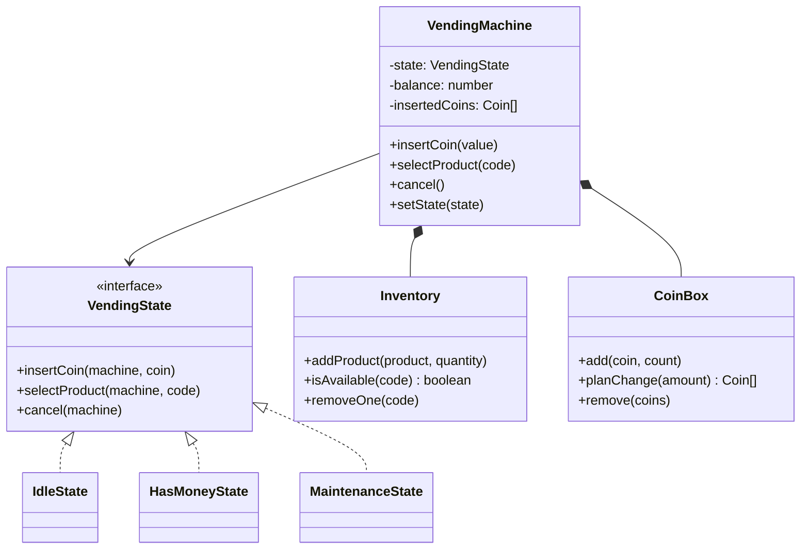
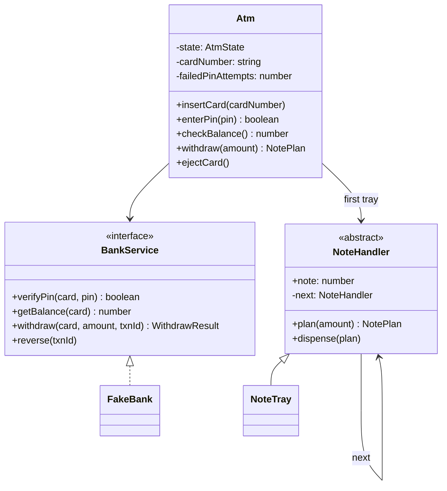
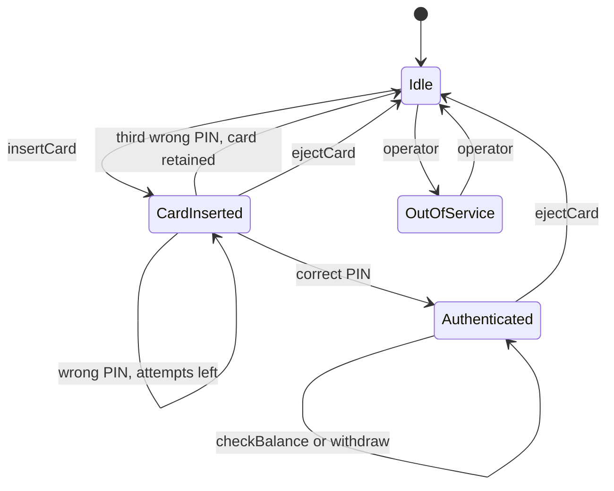
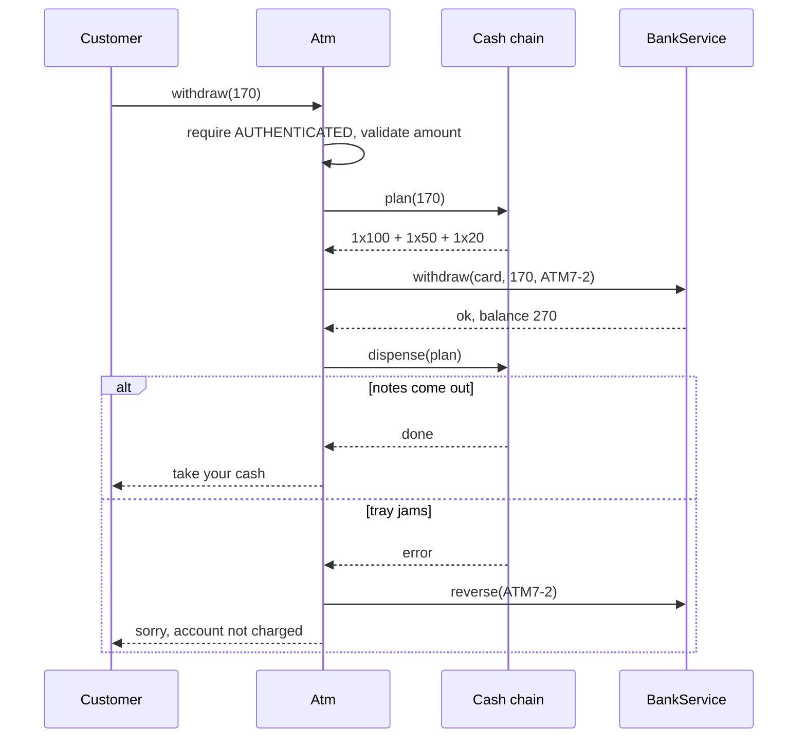

# Vending Machine and ATM

> Two classic "machine" problems in one chapter. Both are about **states** (what the machine may do right now) and **money** (never lose it, never create it). The vending machine is the textbook case for the State pattern; the ATM adds a bank behind an interface, a Chain of Responsibility for cash notes, and failure handling when hardware breaks after the money has moved.

**Before this:** [How to approach LLD interviews](01-how-to-approach-lld-interviews.md) · [Behavioral patterns: State and Chain of Responsibility](../04-oop-solid-design-patterns/08-behavioral-patterns.md#state) · [Parking lot](02-parking-lot.md) · **Interview questions:** [jump to the interview section](#interview-questions)

## Table of contents

1. [Problem](#problem)
2. [Clarifying questions](#clarifying-questions)
3. [Requirements](#requirements)
4. [Core entities and relationships](#core-entities-and-relationships)
5. [Design decisions and patterns](#design-decisions-and-patterns)
6. [Implementation](#implementation)
7. [Walkthrough](#walkthrough)
8. [Handling concurrency and edge cases](#handling-concurrency-and-edge-cases)
9. [Extensions](#extensions)
10. [How to present this in the interview](#how-to-present-this-in-the-interview)
11. [Interview questions](#interview-questions)
12. [Summary](#summary)
13. [References](#references)

---

## Problem

Interviewers give either one of these. Prepare both; they share most ideas.

**Vending machine:**

> "Design a vending machine. It sells products from slots. The customer inserts coins, selects a product, gets the product and change. They can cancel and get their money back. An operator can refill the machine. Write the classes and the main logic."

**ATM:**

> "Design an ATM. A customer inserts a card, enters a PIN, and can check the balance or withdraw cash. The ATM talks to the bank. It has a limited number of notes of each value. Write the classes."

What the interviewer is really looking for:

- Do you see that the machine's behavior **depends on its state** (you cannot select a product before paying; you cannot withdraw before entering a PIN)?
- Do you handle **money** carefully: exact change, refunds, no double debit, no lost cash when something fails halfway?

## Clarifying questions

### Vending machine

| Question | Why it matters | Assumed answer |
| --- | --- | --- |
| Which coins or notes are accepted? | Validation, change making | Coins of 5, 10, 25 and 100 cents. Notes and cards are extensions |
| Does the machine give change? | The hard part of the problem | Yes, using only the coins it really holds |
| What if it cannot give exact change? | Failure case | Refuse the sale, keep the customer's money in the machine, let them insert exact money or cancel |
| One product per transaction? | State flow | Yes. After a sale, the remaining balance comes back as change |
| Can the customer cancel? | Refund flow | Yes, at any time before the sale; they get back the coins they inserted |
| Is there an operator mode? | Extra state | Yes: maintenance (refill products and coins); customers cannot buy |
| Do we need concurrency? | One machine = one customer | No: one physical machine serves one customer at a time; but the inventory may be shared with a server later |

### ATM

| Question | Why it matters | Assumed answer |
| --- | --- | --- |
| Which operations? | Scope | Check balance, withdraw. Deposit and transfer are extensions |
| How many wrong PIN attempts? | Security state | Three; then the card is retained |
| Which note values, and is the stock limited? | Dispensing logic | 100, 50 and 20; limited count per tray |
| Who keeps the balance? | Responsibility | The bank, not the ATM. The ATM calls a bank service |
| What if cash fails to come out after the account was debited? | The key failure case | Reverse the transaction |
| Daily withdrawal limit? | Business rule | Mention; implement as an extension |
| Can the same account be used at two ATMs at the same time? | Concurrency | Yes, so the **bank** must make the debit atomic |

## Requirements

### Vending machine: functional

1. Accept valid coins; reject invalid ones immediately.
2. Show the balance inserted so far.
3. On product selection: check the product exists, is in stock, the balance is enough, and change can be made. Only then dispense the product and the change.
4. If any check fails, explain why and keep the money (the customer can add more or cancel).
5. Cancel returns the **same coins** the customer inserted.
6. Operator can enter maintenance (customers are refused, any open balance is refunded) and refill.

### ATM: functional

1. Insert card → enter PIN (max three attempts) → authenticated session.
2. Check balance (from the bank).
3. Withdraw: the amount must be a positive whole number that the machine can pay with its notes, and the bank must approve it.
4. If the cash dispenser fails after the bank debited the account, the debit is **reversed**.
5. Eject card ends the session. Operations outside a valid state are refused ("cannot withdraw while IDLE").
6. Operator can put the ATM out of service.

### Non-functional (both)

- **Money is never lost or created.** Every path either completes fully or leaves money where it was.
- **Integer money.** Cents for the vending machine, whole currency units for the ATM.
- **Extensibility:** new states (out of service, card payment), new note values, new payment methods.
- **Idempotency** for the bank: a retried withdrawal with the same transaction id must not debit twice.
- **Concurrency:** one machine serves one person, but bank accounts are shared by many ATMs (and by online banking).

## Core entities and relationships

### Vending machine

| Entity | Responsibility |
| --- | --- |
| `Product` | Code, name, price (a value object) |
| `Inventory` | Products per slot and quantity |
| `CoinBox` | Coins inside the machine; plans change using only coins in stock |
| `VendingState` | Interface: `insertCoin`, `selectProduct`, `cancel` |
| `IdleState`, `HasMoneyState`, `MaintenanceState` | Concrete states |
| `VendingMachine` | The **context**: holds the current state, balance and inserted coins; delegates actions to the state |



### ATM

| Entity | Responsibility |
| --- | --- |
| `BankService` | Interface to the bank: verify PIN, get balance, withdraw with a transaction id, reverse |
| `NoteHandler` | One link in the cash chain: a tray of one note value, plus a pointer to the next tray |
| `Atm` | Holds the session state (card, PIN attempts), checks which operations are allowed, coordinates bank and cash |



ATM states:



## Design decisions and patterns

### 1. Vending machine: the State pattern, and why it fits so well

Write the actions as rows and the states as columns, and look at the table:

| Action | Idle | HasMoney | Maintenance |
| --- | --- | --- | --- |
| insert coin | accept, go to HasMoney | accept, add to balance | refuse |
| select product | error: insert money first | try to sell | refuse |
| cancel | nothing | refund, go to Idle | nothing |

Every cell is different. If we put this in one class with `if (state === ...)` inside every method, each method grows a `switch`, and adding a state (for example `SoldOut`, or `CardPayment`) means editing every method. That is the exact smell the [State pattern](../04-oop-solid-design-patterns/08-behavioral-patterns.md#state) fixes: **one class per state**, each implementing all actions; the machine (the **context**) just delegates to the current state object.

Benefits to say out loud:

- Each state class is small and easy to read: "in HasMoney, cancel means refund".
- A new state is a **new class**; existing states change only where a transition into the new state is added (Open/Closed).
- Invalid actions are impossible by construction: `IdleState.selectProduct` always throws.

The trade-off: more classes, and the states need access to the machine's internals (here through public helper methods like `acceptCoin`, `trySell`, `refundAll`). Keep the business logic (change making, inventory) in the machine and its helpers, and keep the states thin: they decide **what is allowed** and **which state is next**.

### 2. ATM: the same idea, lighter form (a transition table)

For the ATM, I show a second way to model states: a `status` field plus a table of **allowed operations per state**, checked by one `require()` method. It is less code than State classes, and it works well when states differ mainly in *what is allowed*, not in *how* each action works.

Being able to show both and explain when you'd pick each is a strong interview signal:

- **State classes:** each state handles actions differently (vending machine).
- **Transition table:** states mostly allow or forbid actions; the action logic itself is the same (ATM).

### 3. Change making: plan first, then commit

Making change is not trivial. The machine has a **limited** number of each coin. Greedy (take the biggest coin that fits) works for standard coin systems with unlimited coins, but fails with limited stock: with one 25 and three 10s, greedy pays 30 cents as 25 + ... and then needs a 5 that does not exist, while 10 + 10 + 10 works. So `CoinBox.planChange` does a small **backtracking** search: try the most of the big coin first, and use fewer if the rest cannot be paid. With 4 coin types the search is tiny.

Even more important is the **order**: plan the change *before* removing anything. Only when the product is available, the balance is enough and the change plan exists do we change state: remove coins, remove the product, dispense. Either the sale fully happens, or nothing changes.

### 4. ATM cash: Chain of Responsibility

The dispenser is a chain of trays: 100 → 50 → 20. Each tray handles as much of the amount as it can and passes the rest to the next one. This is the classic [Chain of Responsibility](../04-oop-solid-design-patterns/08-behavioral-patterns.md#chain-of-responsibility) example. Adding a new note value means adding a link; no tray knows about the others except "next".

Same trap as with coins: pure greedy fails for $60 with 50s and 20s (50 + ? = stuck), but 3 × 20 works. So each handler tries the most notes first and **uses fewer if the rest of the chain cannot finish**. And again: **plan** first (`plan(amount)`, nothing moves), then **dispense** (`dispense(plan)`).

### 5. ATM: the bank behind an interface

The ATM does not own balances. It calls `BankService`, an interface. In tests we use `FakeBank`; in production, a client that talks to the bank's network. This is [dependency inversion](../04-oop-solid-design-patterns/05-dependency-inversion-and-injection.md) and it makes the scary failure paths (bank says no, dispenser jams) easy to test.

### 6. ATM: the order of steps in a withdrawal

This is the most important design decision in the ATM, and interviewers will ask about it:

1. **Validate** the amount and **plan** the notes. If the machine cannot pay, stop. No money has moved.
2. **Debit** the account at the bank with a unique **transaction id**.
3. **Dispense** the notes. If the hardware fails, **reverse** the transaction (a compensating action).

Why not dispense first? Because then a failure at the bank would give away free cash. Debit first, and have a reliable undo for the rare hardware failure. The transaction id makes retries **idempotent**: if the ATM's request times out and it retries with the same id, the bank does not debit twice.

### 7. What we did not use

- **Singleton:** not needed. One `VendingMachine` or `Atm` object per physical machine, created at startup.
- **Inheritance for products:** a `Product` is plain data, like vehicles in the [parking lot](02-parking-lot.md#1-vehicle-types-as-data-not-as-subclasses).

### Patterns summary

| Concern | Choice | Why |
| --- | --- | --- |
| Vending behavior per state | State pattern (one class per state) | Every action behaves differently in every state |
| ATM allowed operations | Transition table + `require()` | States differ mainly in what is allowed |
| Change for the customer | Plan with backtracking, then commit | Limited coins; all-or-nothing |
| Notes in the ATM | Chain of Responsibility with backtracking | Add note values without changing others |
| Bank | `BankService` interface (DIP) | Testable failures, swappable networks |
| Withdrawal safety | Plan → debit with txn id → dispense → reverse on failure | Money never lost, retries are safe |

## Implementation

There are **two runnable TypeScript programs**: the vending machine and the ATM. Each was type-checked with `tsc --strict` and run with Node.js 22, and the output comments are the real output. We use `as const` objects instead of `enum` so Node.js can run the files directly.

### Part A: vending machine

#### Step A1: money, products, inventory and the coin box

```ts
// ---------- Step 1: money and products ----------
const COINS = [100, 25, 10, 5] as const; // cents: dollar coin, quarter, dime, nickel
type Coin = (typeof COINS)[number];
type CoinCounts = Map<Coin, number>;

function isCoin(value: number): value is Coin {
  return (COINS as readonly number[]).includes(value);
}

function formatMoney(cents: number): string {
  return `$${(cents / 100).toFixed(2)}`;
}

type Product = { code: string; name: string; priceInCents: number };

class Inventory {
  private readonly slots = new Map<string, { product: Product; quantity: number }>();

  addProduct(product: Product, quantity: number): void {
    const slot = this.slots.get(product.code);
    if (slot) slot.quantity += quantity;
    else this.slots.set(product.code, { product, quantity });
  }

  get(code: string): Product {
    const slot = this.slots.get(code);
    if (!slot) throw new Error(`Unknown product ${code}`);
    return slot.product;
  }

  isAvailable(code: string): boolean {
    return (this.slots.get(code)?.quantity ?? 0) > 0;
  }

  removeOne(code: string): void {
    const slot = this.slots.get(code);
    if (!slot || slot.quantity === 0) throw new Error(`${code} is sold out`);
    slot.quantity -= 1;
  }
}

// Coins inside the machine. Making change uses only coins we really have.
class CoinBox {
  private readonly counts: CoinCounts = new Map(COINS.map((c) => [c, 0]));

  add(coin: Coin, count = 1): void {
    this.counts.set(coin, (this.counts.get(coin) ?? 0) + count);
  }

  // Returns the coins for `amount`, or null if exact change is impossible.
  // Small backtracking search: greedy alone can fail when some coins run out.
  planChange(amount: number): Coin[] | null {
    const result: Coin[] = [];
    const available = new Map(this.counts);
    const search = (remaining: number, index: number): boolean => {
      if (remaining === 0) return true;
      if (index >= COINS.length) return false;
      const coin = COINS[index]!;
      const maxUse = Math.min(Math.floor(remaining / coin), available.get(coin) ?? 0);
      for (let use = maxUse; use >= 0; use--) {
        for (let i = 0; i < use; i++) result.push(coin);
        if (search(remaining - use * coin, index + 1)) return true;
        result.length -= use;
      }
      return false;
    };
    return search(amount, 0) ? result : null;
  }

  remove(coins: Coin[]): void {
    for (const c of coins) this.counts.set(c, (this.counts.get(c) ?? 0) - 1);
  }
}
```

`isCoin` is a **type guard**: after `if (!isCoin(value)) throw ...`, TypeScript knows `value` is a `Coin` (`100 | 25 | 10 | 5`). See [type guards](../03-typescript/03-unions-narrowing-and-type-guards.md).

#### Step A2: the states

```ts
// ---------- Step 2: the State pattern ----------
interface VendingState {
  readonly name: string;
  insertCoin(machine: VendingMachine, coin: Coin): void;
  selectProduct(machine: VendingMachine, code: string): void;
  cancel(machine: VendingMachine): void;
}

class IdleState implements VendingState {
  readonly name = 'Idle';
  insertCoin(machine: VendingMachine, coin: Coin): void {
    machine.acceptCoin(coin);
    machine.setState(machine.hasMoneyState);
  }
  selectProduct(): void {
    throw new Error('Insert money first');
  }
  cancel(): void {
    // nothing to refund
  }
}

class HasMoneyState implements VendingState {
  readonly name = 'HasMoney';
  insertCoin(machine: VendingMachine, coin: Coin): void {
    machine.acceptCoin(coin);
  }
  selectProduct(machine: VendingMachine, code: string): void {
    machine.trySell(code); // stays in HasMoney if the sale is not possible
  }
  cancel(machine: VendingMachine): void {
    machine.refundAll();
    machine.setState(machine.idleState);
  }
}

class MaintenanceState implements VendingState {
  readonly name = 'Maintenance';
  insertCoin(): void {
    throw new Error('Out of service');
  }
  selectProduct(): void {
    throw new Error('Out of service');
  }
  cancel(): void {
    // nothing to refund: money is refused in this state
  }
}
```

Notice that a method that does not need the parameters can leave them out (`selectProduct(): void` in `IdleState`); TypeScript allows a method with fewer parameters to implement the interface.

#### Step A3: the machine (the context)

```ts
// ---------- Step 3: the machine (the context) ----------
type Output = { product: string | null; coins: Coin[] };

class VendingMachine {
  readonly idleState: VendingState = new IdleState();
  readonly hasMoneyState: VendingState = new HasMoneyState();
  readonly maintenanceState: VendingState = new MaintenanceState();

  private state: VendingState = this.idleState;
  private balance = 0; // money inserted by the current customer
  private insertedCoins: Coin[] = []; // so we can return the same coins on cancel
  private readonly inventory: Inventory;
  private readonly coinBox: CoinBox;
  private lastOutput: Output = { product: null, coins: [] };

  constructor(inventory: Inventory, coinBox: CoinBox) {
    this.inventory = inventory;
    this.coinBox = coinBox;
  }

  // Public API: every call is delegated to the current state.
  insertCoin(value: number): void {
    if (!isCoin(value)) throw new Error(`Rejected coin: ${value} cents`);
    this.state.insertCoin(this, value);
  }
  selectProduct(code: string): void {
    this.state.selectProduct(this, code);
  }
  cancel(): void {
    this.state.cancel(this);
  }

  // Admin operations
  startMaintenance(): void {
    if (this.balance > 0) this.refundAll();
    this.state = this.maintenanceState;
  }
  endMaintenance(): void {
    this.state = this.idleState;
  }

  // Used by the states
  setState(state: VendingState): void {
    this.state = state;
  }
  acceptCoin(coin: Coin): void {
    this.balance += coin;
    this.insertedCoins.push(coin);
    this.coinBox.add(coin);
  }
  refundAll(): void {
    this.coinBox.remove(this.insertedCoins);
    this.dispense(null, this.insertedCoins);
  }
  trySell(code: string): void {
    const product = this.inventory.get(code);
    if (!this.inventory.isAvailable(code)) throw new Error(`${product.name} is sold out`);
    if (this.balance < product.priceInCents) {
      throw new Error(`${product.name} costs ${formatMoney(product.priceInCents)}, inserted ${formatMoney(this.balance)}`);
    }
    const change = this.coinBox.planChange(this.balance - product.priceInCents);
    if (change === null) throw new Error('Cannot make change; please insert exact amount or cancel');
    // Every check passed: now change state in one go.
    this.coinBox.remove(change);
    this.inventory.removeOne(code);
    this.dispense(product.name, change);
  }

  get stateName(): string {
    return this.state.name;
  }
  get balanceInCents(): number {
    return this.balance;
  }
  takeOutput(): Output {
    const out = this.lastOutput;
    this.lastOutput = { product: null, coins: [] };
    return out;
  }

  private dispense(product: string | null, coins: Coin[]): void {
    this.lastOutput = { product, coins: [...coins] };
    this.balance = 0;
    this.insertedCoins = [];
    this.state = this.idleState;
  }
}
```

Three details worth pointing at:

- The state objects are created **once** and reused (they hold no data of their own). Some designs create a new state object on each transition; both are fine.
- Inserted coins go into the coin box immediately, so they can be used as change for this same sale. On cancel, the same coins come back out.
- `trySell` throws on every failed check **before** any state changes. That is the all-or-nothing rule in code.

#### Step A4: demo

```ts
// ---------- Step 4: demo ----------
function attempt(label: string, action: () => void): void {
  try {
    action();
    console.log(`${label}: ok`);
  } catch (e) {
    console.log(`${label}: ${(e as Error).message}`);
  }
}

function main(): void {
  const inventory = new Inventory();
  inventory.addProduct({ code: 'A1', name: 'Water', priceInCents: 70 }, 2);
  inventory.addProduct({ code: 'B2', name: 'Chips', priceInCents: 120 }, 1);
  const coins = new CoinBox();
  coins.add(25, 1);
  coins.add(10, 3); // no nickels!
  const vm = new VendingMachine(inventory, coins);

  attempt('select without money', () => vm.selectProduct('A1'));
  attempt('insert 3 cents', () => vm.insertCoin(3));
  vm.insertCoin(100);
  console.log('state:', vm.stateName, 'balance:', formatMoney(vm.balanceInCents));
  attempt('buy chips', () => vm.selectProduct('B2'));
  vm.insertCoin(25);
  attempt('buy chips (change 5)', () => vm.selectProduct('B2'));
  vm.cancel();
  console.log('refund:', JSON.stringify(vm.takeOutput()), 'state:', vm.stateName);

  vm.insertCoin(100);
  attempt('buy water (change 30)', () => vm.selectProduct('A1'));
  console.log('output:', JSON.stringify(vm.takeOutput()), 'state:', vm.stateName);

  vm.insertCoin(100);
  attempt('buy water (change 30 again)', () => vm.selectProduct('A1'));
  vm.cancel();
  console.log('refund:', JSON.stringify(vm.takeOutput()));

  for (const c of [25, 25, 10, 10]) vm.insertCoin(c);
  attempt('buy water (exact 70)', () => vm.selectProduct('A1'));
  console.log('output:', JSON.stringify(vm.takeOutput()));

  vm.insertCoin(100);
  attempt('buy water (sold out)', () => vm.selectProduct('A1'));
  vm.startMaintenance();
  console.log('refund on maintenance:', JSON.stringify(vm.takeOutput()), 'state:', vm.stateName);
  attempt('insert during maintenance', () => vm.insertCoin(25));
}

main();
// select without money: Insert money first
// insert 3 cents: Rejected coin: 3 cents
// state: HasMoney balance: $1.00
// buy chips: Chips costs $1.20, inserted $1.00
// buy chips (change 5): Cannot make change; please insert exact amount or cancel
// refund: {"product":null,"coins":[100,25]} state: Idle
// buy water (change 30): ok
// output: {"product":"Water","coins":[10,10,10]} state: Idle
// buy water (change 30 again): Cannot make change; please insert exact amount or cancel
// refund: {"product":null,"coins":[100]}
// buy water (exact 70): ok
// output: {"product":"Water","coins":[]}
// buy water (sold out): Water is sold out
// refund on maintenance: {"product":null,"coins":[100]} state: Maintenance
// insert during maintenance: Out of service
```

What the output proves:

- The `Idle` state refuses a selection; an invalid coin is rejected before it reaches any state.
- Chips need 5 cents change and the machine has no nickels, so the sale is refused, and cancel returns **the same coins** (`[100, 25]`).
- Water with $1.00 needs 30 cents change. The machine has one quarter and three dimes. Greedy would take the quarter and get stuck; the backtracking plan pays `[10, 10, 10]`.
- The next customer needs 30 cents change again, but the dimes are gone: refused, refunded. Exact money works.
- Starting maintenance refunds the open balance and then refuses coins.

### Part B: ATM

#### Step B1: the bank service

```ts
// ---------- Step 1: the bank behind an interface ----------
type WithdrawResult = { ok: true; balance: number } | { ok: false; reason: string };

interface BankService {
  verifyPin(cardNumber: string, pin: string): boolean;
  getBalance(cardNumber: string): number;
  // txnId makes the call idempotent: the same id never debits twice.
  withdraw(cardNumber: string, amount: number, txnId: string): WithdrawResult;
  reverse(txnId: string): void;
}

class FakeBank implements BankService {
  private readonly accounts = new Map<string, { pin: string; balance: number }>();
  private readonly transactions = new Map<string, { cardNumber: string; amount: number; reversed: boolean }>();

  openAccount(cardNumber: string, pin: string, balance: number): void {
    this.accounts.set(cardNumber, { pin, balance });
  }

  verifyPin(cardNumber: string, pin: string): boolean {
    return this.accounts.get(cardNumber)?.pin === pin;
  }

  getBalance(cardNumber: string): number {
    return this.account(cardNumber).balance;
  }

  withdraw(cardNumber: string, amount: number, txnId: string): WithdrawResult {
    const account = this.account(cardNumber);
    if (this.transactions.has(txnId)) return { ok: true, balance: account.balance }; // retry: no second debit
    if (account.balance < amount) return { ok: false, reason: 'Insufficient funds' };
    account.balance -= amount; // check and debit in one synchronous step
    this.transactions.set(txnId, { cardNumber, amount, reversed: false });
    return { ok: true, balance: account.balance };
  }

  reverse(txnId: string): void {
    const txn = this.transactions.get(txnId);
    if (!txn || txn.reversed) return; // reversing twice is harmless
    this.account(txn.cardNumber).balance += txn.amount;
    txn.reversed = true;
  }

  private account(cardNumber: string): { pin: string; balance: number } {
    const a = this.accounts.get(cardNumber);
    if (!a) throw new Error('Unknown account');
    return a;
  }
}
```

`WithdrawResult` is a **discriminated union**: the caller must check `ok` before reading `balance` or `reason`. Expected business failures ("insufficient funds") are returned as values; unexpected problems (unknown account) are thrown. Both `withdraw` and `reverse` are **idempotent**: calling them twice with the same id has the same effect as once. (In a real system, PINs are never compared in plain text; the bank checks an encrypted PIN block. The fake keeps it simple.)

#### Step B2: the cash dispenser chain

```ts
// ---------- Step 2: cash dispenser as a Chain of Responsibility ----------
type NotePlan = Map<number, number>; // note value -> how many

abstract class NoteHandler {
  readonly note: number;
  protected count: number;
  private readonly next: NoteHandler | null;

  constructor(note: number, count: number, next: NoteHandler | null) {
    this.note = note;
    this.count = count;
    this.next = next;
  }

  // Try to pay `amount` with this note and the rest of the chain.
  // Uses as many of this note as possible first, and fewer if the rest of the chain fails.
  plan(amount: number): NotePlan | null {
    if (amount === 0) return new Map();
    for (let use = Math.min(Math.floor(amount / this.note), this.count); use >= 0; use--) {
      const rest = amount - use * this.note;
      const restPlan = rest === 0 ? new Map<number, number>() : (this.next?.plan(rest) ?? null);
      if (restPlan) {
        if (use > 0) restPlan.set(this.note, use);
        return restPlan;
      }
    }
    return null;
  }

  dispense(plan: NotePlan): void {
    const use = plan.get(this.note) ?? 0;
    this.release(use);
    this.next?.dispense(plan);
  }

  total(): number {
    return this.note * this.count + (this.next?.total() ?? 0);
  }

  protected release(use: number): void {
    if (use > this.count) throw new Error(`Not enough ${this.note} notes`);
    this.count -= use;
  }
}

class NoteTray extends NoteHandler {}

// A tray whose motor jams once, to show the failure path.
class JammingNoteTray extends NoteHandler {
  private jamNextTime = true;
  protected override release(use: number): void {
    if (use > 0 && this.jamNextTime) {
      this.jamNextTime = false;
      throw new Error(`Tray ${this.note} jammed before any note left the machine`);
    }
    super.release(use);
  }
}
```

Here inheritance is used on purpose: `NoteHandler` is a small **template** with one overridable hook (`release`), and the test double `JammingNoteTray` overrides only that hook. That is the [Template Method](../04-oop-solid-design-patterns/08-behavioral-patterns.md#template-method) idea, and it is a fair use of inheritance because the subclass truly *is* a tray with different hardware behavior.

#### Step B3: the ATM

```ts
// ---------- Step 3: the ATM with an explicit state machine ----------
const AtmState = {
  IDLE: 'IDLE',
  CARD_INSERTED: 'CARD_INSERTED',
  AUTHENTICATED: 'AUTHENTICATED',
  OUT_OF_SERVICE: 'OUT_OF_SERVICE',
} as const;
type AtmState = (typeof AtmState)[keyof typeof AtmState];

// Which operation is allowed in which state (a transition table).
const ALLOWED: Record<AtmState, readonly string[]> = {
  IDLE: ['insertCard'],
  CARD_INSERTED: ['enterPin', 'ejectCard'],
  AUTHENTICATED: ['checkBalance', 'withdraw', 'ejectCard'],
  OUT_OF_SERVICE: [],
};

class Atm {
  private state: AtmState = AtmState.IDLE;
  private cardNumber: string | null = null;
  private failedPinAttempts = 0;
  private nextTxn = 1;
  private readonly bank: BankService;
  private readonly cash: NoteHandler;
  private readonly atmId: string;
  static readonly MAX_PIN_ATTEMPTS = 3;

  constructor(atmId: string, bank: BankService, cash: NoteHandler) {
    this.atmId = atmId;
    this.bank = bank;
    this.cash = cash;
  }

  get currentState(): AtmState {
    return this.state;
  }

  insertCard(cardNumber: string): void {
    this.require('insertCard');
    this.cardNumber = cardNumber;
    this.failedPinAttempts = 0;
    this.state = AtmState.CARD_INSERTED;
  }

  enterPin(pin: string): boolean {
    this.require('enterPin');
    if (this.bank.verifyPin(this.card(), pin)) {
      this.state = AtmState.AUTHENTICATED;
      return true;
    }
    this.failedPinAttempts++;
    if (this.failedPinAttempts >= Atm.MAX_PIN_ATTEMPTS) {
      this.endSession();
      throw new Error('Too many wrong PINs; card retained');
    }
    return false;
  }

  checkBalance(): number {
    this.require('checkBalance');
    return this.bank.getBalance(this.card());
  }

  withdraw(amount: number): NotePlan {
    this.require('withdraw');
    if (!Number.isInteger(amount) || amount <= 0) throw new Error('Invalid amount');
    // 1. Can the machine pay this amount with the notes it has? (no money moved yet)
    const plan = this.cash.plan(amount);
    if (!plan) throw new Error(`Cannot dispense ${amount} with available notes`);
    // 2. Debit the account. The txn id makes retries safe.
    const txnId = `${this.atmId}-${this.nextTxn++}`;
    const result = this.bank.withdraw(this.card(), amount, txnId);
    if (!result.ok) throw new Error(result.reason);
    // 3. Dispense. If the hardware fails, give the money back to the account.
    try {
      this.cash.dispense(plan);
    } catch (e) {
      this.bank.reverse(txnId);
      throw new Error(`${(e as Error).message}; transaction ${txnId} reversed`);
    }
    return plan;
  }

  ejectCard(): void {
    this.require('ejectCard');
    this.endSession();
  }

  setOutOfService(on: boolean): void {
    if (on && this.state !== AtmState.IDLE) this.endSession();
    this.state = on ? AtmState.OUT_OF_SERVICE : AtmState.IDLE;
  }

  private require(operation: string): void {
    if (!ALLOWED[this.state].includes(operation)) {
      throw new Error(`Cannot ${operation} while ${this.state}`);
    }
  }

  private card(): string {
    if (!this.cardNumber) throw new Error('No card');
    return this.cardNumber;
  }

  private endSession(): void {
    this.cardNumber = null;
    this.failedPinAttempts = 0;
    this.state = AtmState.IDLE;
  }
}
```

The `withdraw` method has the three numbered steps from the design section, and the comments say exactly that. In an interview, write the comments first, then fill in the code under each one. It shows your thinking even if you run out of time.

#### Step B4: demo

```ts
// ---------- Step 4: demo ----------
function show(plan: NotePlan): string {
  return [...plan.entries()].sort((a, b) => b[0] - a[0]).map(([note, n]) => `${n}x${note}`).join(' + ');
}

function attempt(label: string, action: () => unknown): void {
  try {
    const result = action();
    console.log(`${label}:`, result instanceof Map ? show(result) : result);
  } catch (e) {
    console.log(`${label}: ${(e as Error).message}`);
  }
}

function main(): void {
  const bank = new FakeBank();
  bank.openAccount('1111', '1234', 500);
  const tray20 = new NoteTray(20, 10, null);
  const tray50 = new NoteTray(50, 2, tray20);
  const tray100 = new JammingNoteTray(100, 1, tray50); // first tray in the chain
  const atm = new Atm('ATM7', bank, tray100);
  console.log('cash in machine:', tray100.total());

  attempt('balance before card', () => atm.checkBalance());
  atm.insertCard('1111');
  attempt('wrong PIN', () => atm.enterPin('0000'));
  attempt('right PIN', () => atm.enterPin('1234'));
  attempt('balance', () => atm.checkBalance());
  attempt('withdraw 60', () => atm.withdraw(60));
  attempt('withdraw 170 (tray jams)', () => atm.withdraw(170));
  attempt('balance after reversal', () => atm.checkBalance());
  attempt('withdraw 170', () => atm.withdraw(170));
  attempt('withdraw 15', () => atm.withdraw(15));
  attempt('withdraw 400', () => atm.withdraw(400));
  attempt('balance', () => atm.checkBalance());
  atm.ejectCard();
  console.log('cash in machine:', tray100.total(), 'state:', atm.currentState);

  atm.insertCard('1111');
  attempt('PIN 1', () => atm.enterPin('1'));
  attempt('PIN 2', () => atm.enterPin('2'));
  attempt('PIN 3', () => atm.enterPin('3'));
  console.log('state:', atm.currentState);

  console.log('retry with same txn id:', JSON.stringify(bank.withdraw('1111', 100, 'ATM7-1')));
}

main();
// cash in machine: 400
// balance before card: Cannot checkBalance while IDLE
// wrong PIN: false
// right PIN: true
// balance: 500
// withdraw 60: 3x20
// withdraw 170 (tray jams): Tray 100 jammed before any note left the machine; transaction ATM7-2 reversed
// balance after reversal: 440
// withdraw 170: 1x100 + 1x50 + 1x20
// withdraw 15: Cannot dispense 15 with available notes
// withdraw 400: Cannot dispense 400 with available notes
// balance: 270
// cash in machine: 170 state: IDLE
// PIN 1: false
// PIN 2: false
// PIN 3: Too many wrong PINs; card retained
// state: IDLE
// retry with same txn id: {"ok":true,"balance":270}
```

What the output proves:

- The transition table refuses `checkBalance` before a card is inserted.
- **$60** is paid as 3 × 20. Pure greedy would take a 50 first and get stuck at 10; the chain backtracks.
- The 100 tray **jams** after the bank debited $170: the transaction is reversed and the balance is back to 440. The retry succeeds.
- $15 can never be paid with 20/50/100 notes; $400 is more than the machine has left. Both are refused **before** the bank is called, so the account is untouched.
- Three wrong PINs end the session and retain the card.
- Retrying transaction `ATM7-1` (the earlier $60) does not debit again: the balance stays 270. That is idempotency.

## Walkthrough

The ATM withdrawal is the flow to draw in the interview, because it contains the failure handling:



And the vending machine sale, step by step:

1. `insertCoin(100)`: the machine validates the coin (type guard), then delegates to `IdleState.insertCoin`, which calls `acceptCoin` (balance 100, coin into the box) and switches to `HasMoneyState`.
2. `selectProduct('A1')`: delegated to `HasMoneyState.selectProduct`, which calls `trySell`.
3. `trySell` checks: product exists, in stock, balance ≥ price, and `planChange(30)` returns `[10, 10, 10]`.
4. All checks passed: remove the change coins from the box, remove one water from the inventory, dispense, reset the balance, back to `IdleState`.
5. If any check failed, an error is thrown and **nothing** changed: the machine stays in `HasMoneyState` with the same balance.

## Handling concurrency and edge cases

### One machine, one customer: no in-machine races

A physical vending machine or ATM serves one person at a time, and our methods are synchronous, so there are no races **inside** the machine. Say that clearly, and then move to where concurrency really exists.

### The real race: the same bank account at two ATMs

A couple shares an account with $100. Both withdraw $80 at the same second at two different ATMs. If the bank does "read balance → check → write balance" in two separate steps, both reads see $100, both checks pass, and the bank pays out $160. This is the classic **lost update**.

The fix belongs to the **bank**, not the ATM: the check and the debit must be one atomic step. In our `FakeBank`, `withdraw` checks and subtracts in one synchronous block. In a database:

```sql
-- Atomic conditional debit: succeeds only if the money is there.
UPDATE accounts
SET    balance = balance - 80
WHERE  account_id = 'A-1' AND balance >= 80;
-- 1 row updated  -> approved
-- 0 rows updated -> insufficient funds (the other ATM was first)
```

Plus a **unique constraint on the transaction id**, so a retried request cannot insert a second debit. In Java/C# you could also lock the account row (`SELECT ... FOR UPDATE`) inside a transaction. See [concurrency in Node.js](../07-nodejs-backend/12-concurrency-worker-threads-and-cluster.md) for why in-memory locks do not help across processes.

### Timeouts: the unknown result

The ATM sends `withdraw` to the bank and the network times out. Did the debit happen? **We don't know.** Never guess:

- Retry with the **same transaction id**. If the first one succeeded, the bank returns the same result without debiting again (the last line of the demo shows this).
- If retries keep failing, do not dispense, and send a reversal for that id later (reversal is also idempotent). The bank and ATM network reconcile at the end of the day.

### Change-making with limited coins

This small program shows why the vending machine does not use plain greedy:

```ts
// Greedy: always take the biggest coin that still fits and is in stock.
function greedyChange(amount: number, stock: Map<number, number>): number[] | null {
  const result: number[] = [];
  for (const coin of [...stock.keys()].sort((a, b) => b - a)) {
    let left = stock.get(coin) ?? 0;
    while (amount >= coin && left > 0) {
      result.push(coin);
      amount -= coin;
      left--;
    }
  }
  return amount === 0 ? result : null;
}

function main(): void {
  const stock = new Map([[25, 1], [10, 3], [5, 0]]);
  console.log('greedy 30:', greedyChange(30, stock)); // takes 25, then needs 5: fails
  console.log('greedy 35:', greedyChange(35, stock)); // 25 + 10 works
}

main();
// greedy 30: null
// greedy 35: [ 25, 10 ]
```

Our `planChange` returned `[10, 10, 10]` for the same stock. With only four coin types the backtracking search is tiny; for many denominations you would use dynamic programming (the "coin change" problem in [dynamic programming](../12-dsa/12-dynamic-programming.md); see also [when greedy fails](../12-dsa/13-greedy-algorithms.md#when-greedy-fails)).

### Edge cases table

| Edge case | Vending machine | ATM |
| --- | --- | --- |
| Invalid input | Unknown coin rejected before any state | Non-integer or negative amount rejected |
| Action in the wrong state | State class throws ("Insert money first") | `require()` throws ("Cannot withdraw while IDLE") |
| Not enough money | Message with price and balance; stay in HasMoney | Bank returns "Insufficient funds"; nothing dispensed |
| Cannot pay out exactly | Refuse the sale; customer adds exact money or cancels | Refuse before calling the bank |
| Sold out / machine empty | "sold out"; money stays for another choice | "Cannot dispense"; suggest a smaller amount |
| Hardware failure after money moved | Product stuck: refund (extension: drop sensor) | Reverse the bank transaction |
| Power failure in the middle | Persist balance and inserted coins; refund on restart | Bank reconciles using transaction ids |
| Customer walks away | Timeout: keep balance for the next customer? Usually refund to a coin cup | Timeout: eject card, then retain if not taken |
| Wrong PIN | — | Three attempts, then retain card |
| Duplicate request | — | Same transaction id = no double debit |

## Extensions

### Vending machine

- **Card or mobile payment:** add a `PaymentMethod` interface (`authorize(amount)`, `capture()`, `void()`), and a new state `AwaitingCardApproval`. The card flow is "authorize, dispense, then capture; void if dispensing fails", the same plan-then-commit idea as the ATM. Existing states barely change: that is the State pattern paying off.
- **Product drop sensor:** after dispensing, a sensor confirms the product fell. If not, refund automatically. New state `Dispensing` that waits for the sensor event.
- **Sold-out state:** if all slots are empty, switch to a `SoldOutState` that refuses coins up front.
- **Remote monitoring:** the machine emits `lowStock`, `lowCoins` and `sale` events (Observer); a server collects them to plan refills.
- **Pricing rules:** happy-hour discounts as a `PricingStrategy` (see the [parking lot](02-parking-lot.md#3-strategy-for-pricing)).

### ATM

- **Deposit and transfer:** new operations; add them to the transition table under `AUTHENTICATED` and to `BankService`. A deposit counts notes first, shows the total, asks the customer to confirm, then credits the bank.
- **Daily limits:** a rule checked before the bank call. Better, the bank enforces it, because the customer could use several ATMs.
- **Receipt printing, language selection, accessibility:** separate small components the ATM uses through interfaces.
- **More note values or a new currency:** add a `NoteTray` to the chain. Order the chain from the biggest to the smallest note.
- **Switch to State classes:** if the ATM grows many screens with different behavior (deposit counting, transfer confirmation, menus), move from the table to State classes, as in the vending machine.

## How to present this in the interview

### Minute-by-minute plan (45 minutes, one of the two problems)

| Time | Vending machine | ATM |
| --- | --- | --- |
| 0–5 | Clarify coins, change, cancel, maintenance | Clarify operations, PIN rules, notes, bank ownership of balance |
| 5–10 | Draw the action × state table; this justifies the State pattern | Draw the state diagram; choose a transition table |
| 10–15 | Class diagram: machine (context), states, inventory, coin box | Class diagram: Atm, BankService, note chain |
| 15–35 | Code: states, `trySell` with plan-then-commit, `planChange` | Code: `require()`, `enterPin`, `withdraw` with 3 steps, chain `plan`/`dispense` |
| 35–40 | Walk through a sale and a cancel | Walk through a withdrawal and the jam path |
| 40–45 | Edge cases (no change), extensions (card payment) | Concurrency (shared account), timeouts, idempotency |

### Spoken walkthrough script (vending machine)

> "The machine's behavior depends on its state. Let me draw actions against states: insert coin, select and cancel, against Idle, HasMoney and Maintenance. Every cell is different, so I'll use the State pattern: one class per state, and the machine delegates each action to its current state.
>
> The machine keeps the balance, the coins the customer inserted, the inventory and a coin box. Selling is all-or-nothing: I check the product, the stock, the balance, and I plan the change first using only coins I really have. Greedy can fail with limited coins, so I use a small backtracking search. Only when everything is OK do I remove the coins and the product.
>
> Cancel returns the exact coins inserted. Maintenance refunds any open balance and refuses coins. New payment methods become new states."

### Spoken walkthrough script (ATM)

> "The ATM doesn't own money balances; the bank does, behind a `BankService` interface. The ATM has a session state: idle, card inserted, authenticated, out of service. States differ mainly in which operations are allowed, so I use a transition table checked by one `require` method.
>
> A withdrawal has three steps. First, plan the notes with a chain of note trays, without moving anything. Second, debit the bank with a unique transaction id, so a retry can't debit twice. Third, dispense; if the hardware fails, reverse the transaction.
>
> The real concurrency issue is two ATMs withdrawing from one account at the same time. The bank must make check-and-debit atomic, for example with a conditional update that only succeeds if the balance is enough."

## Interview questions

### Q1. Why is the State pattern a good fit for a vending machine?

**What the interviewer is checking:** whether you can justify a pattern from the problem, not from memory.

**What to say (30–60 seconds):**
> Because every action behaves differently in every state. If I draw insert coin, select and cancel against Idle, HasMoney and Maintenance, all nine cells are different. With one class, each method would need a switch on the state, and every new state would touch every method. With the State pattern, each state is a small class implementing all actions, and the machine just delegates to the current state. A new state is a new class, and invalid actions are impossible by construction.

**Deeper explanation:** The states stay thin: they decide what's allowed and what's next. The money logic (`trySell`, `planChange`) stays in the machine and its helpers, so it isn't duplicated across states.

**Follow-up questions and how to answer them:**
- *"Who changes the state, the context or the state?"* Here the states call `machine.setState(...)`. Alternative: states return the next state and the machine assigns it. The second is easier to test because states become pure decisions.
- *"Should states be singletons?"* They hold no data, so one instance per machine (or shared) is fine.

**Common mistakes:** naming the pattern without showing the action × state table; putting all business logic into the states and duplicating it.

**Real-project example:** UI flows (checkout steps), order lifecycles and connection objects (connecting, open, closing) use the same idea.

### Q2. When would you use a transition table instead of State classes?

**What the interviewer is checking:** judgment and knowing more than one way.

**What to say (30–60 seconds):**
> When states differ mostly in what's allowed, not in how actions work. In my ATM, withdraw always does the same thing; the state only decides whether it's allowed. So a table from state to allowed operations, checked in one place, is less code and easy to read. If every state handled each action in a different way, like the vending machine, I'd use State classes.

**Deeper explanation:** A table also documents the rules in one glance and can be loaded from configuration. Libraries like XState formalize this with explicit transitions and guards.

**Follow-up questions and how to answer them:**
- *"How do you also restrict the next state?"* Use a table from `[state, event]` to `nextState`, and reject events with no entry.

**Common mistakes:** boolean flags (`isAuthenticated`, `hasCard`) that can contradict each other.

**Real-project example:** order status workflows in back-office systems are often a transition table in the database.

### Q3. How does your vending machine make change, and what if it can't?

**What the interviewer is checking:** algorithmic care and the all-or-nothing rule.

**What to say (30–60 seconds):**
> It plans the change before changing anything, using only the coins in the box. Greedy fails with limited stock: one quarter and three dimes can pay 30 cents as three dimes, but greedy takes the quarter and gets stuck. So I do a small backtracking search, trying the most of each big coin first. If no plan exists, the sale is refused and the customer can insert exact money or cancel. Nothing has moved, so nothing has to be undone.

**Deeper explanation:** With a few coin types, backtracking is instant. For many denominations, use dynamic programming over amounts with bounded counts.

**Follow-up questions and how to answer them:**
- *"Can you prefer fewer coins?"* The search tries the most big coins first, which usually gives few coins; for a true minimum use DP.
- *"Can you warn earlier?"* Yes: show "exact change only" when the coin box is low.

**Common mistakes:** giving the product first and then discovering change is impossible.

**Real-project example:** cashier systems and self-checkout machines have the same "exact change only" mode.

### Q4. Walk me through an ATM withdrawal. Why that order?

**What the interviewer is checking:** failure-aware ordering of side effects.

**What to say (30–60 seconds):**
> First I validate and plan the notes, which moves nothing. If the machine can't pay the amount, I stop before calling the bank. Second, I debit the bank with a unique transaction id. Third, I dispense. If dispensing fails, I reverse the transaction with the same id. I debit before dispensing because a free cash payout can't be undone, but a debit can be reversed. And the id makes both the debit and the reversal safe to retry.

**Deeper explanation:** This is a mini [saga](../09-system-design/02-scalability-and-core-building-blocks.md#distributed-transactions-the-saga-pattern): a sequence of steps with a compensating action for each step that can fail after earlier steps succeeded.

**Follow-up questions and how to answer them:**
- *"What if the reversal also fails?"* Store it in a durable outbox and retry until it succeeds; reconciliation at the end of the day is the last safety net.
- *"What if the customer doesn't take the cash?"* Real ATMs retract the notes after a timeout and reverse or flag the transaction.

**Common mistakes:** dispensing first; no transaction id; no compensation path.

**Real-project example:** e-commerce "reserve stock, charge card, ship" uses the same compensate-on-failure pattern.

### Q5. Two people withdraw from the same account at two ATMs at the same moment. What happens?

**What the interviewer is checking:** whether you place concurrency control in the right component.

**What to say (30–60 seconds):**
> Inside each ATM there's no race; one person uses it. The race is at the bank: two read-check-write sequences can both see $100 and both approve $80. The bank must make check-and-debit atomic. With SQL, an `UPDATE accounts SET balance = balance - 80 WHERE id = ? AND balance >= 80`, and check that one row changed. Or lock the row with `SELECT ... FOR UPDATE` inside a transaction. The ATM doesn't need locks; it just trusts the bank's answer.

**Deeper explanation:** Putting locks in the ATM wouldn't help, because the two ATMs are separate machines. Concurrency control belongs where the shared data lives.

**Follow-up questions and how to answer them:**
- *"Optimistic or pessimistic?"* The conditional update is effectively optimistic and very cheap; row locks are fine too because transactions are short.

**Common mistakes:** "use a mutex in the ATM class".

**Real-project example:** inventory decrement in online shops (`stock = stock - 1 WHERE stock > 0`).

### Q6. What is idempotency, and where does it appear in this design?

**What the interviewer is checking:** understanding of safe retries.

**What to say (30–60 seconds):**
> An operation is idempotent if doing it twice has the same effect as doing it once. Networks time out, so the ATM must be able to retry a withdrawal without knowing whether the first call worked. Each withdrawal has a transaction id; the bank stores it, and a second request with the same id returns the stored result without debiting again. The reversal is idempotent too: reversing twice changes the balance once. In my demo, retrying `ATM7-1` left the balance at 270.

**Deeper explanation:** In a database, enforce it with a unique constraint on the transaction id, not only with an `if` in code.

**Follow-up questions and how to answer them:**
- *"Who generates the id?"* The client (the ATM), before the first attempt, so all retries share it.

**Common mistakes:** generating a new id on every retry.

**Real-project example:** payment APIs accept an idempotency key header.

### Q7. Why is the cash dispenser a Chain of Responsibility, and what is the trap?

**What the interviewer is checking:** pattern use and algorithm awareness.

**What to say (30–60 seconds):**
> Each tray handles one note value and passes the remainder to the next tray. Adding a new note is adding a link; trays don't know each other. The trap is that greedy doesn't always work: $60 with 50s and 20s fails if you take a 50 first. So each handler tries the maximum number of its notes and, if the rest of the chain can't finish, tries one fewer. And I separate `plan` from `dispense`, so nothing physical happens until the whole amount is covered.

**Deeper explanation:** A classic chain hands the request to the next handler without coming back. Here the chain also returns a plan upward, which is a small but useful twist.

**Follow-up questions and how to answer them:**
- *"How would you prefer fewer notes, or keep small notes for later?"* That is a policy: plug a strategy into the planner.

**Common mistakes:** dispensing notes tray by tray as you go, then discovering you can't finish.

**Real-project example:** Express middleware and Angular HTTP interceptors are chains of handlers.

### Q8. How would you add card payment to the vending machine?

**What the interviewer is checking:** Open/Closed in practice with the State pattern.

**What to say (30–60 seconds):**
> I'd add a `PaymentMethod` interface with authorize, capture and void, and a new state, `AwaitingCardApproval`. From Idle, tapping a card moves there; when the authorization succeeds, I dispense and capture; if the product fails to drop, I void. Coin states don't change, apart from Idle getting a new transition. The money order is the same as the ATM: reserve, deliver, then finalize, with a compensation path.

**Deeper explanation:** Authorization is asynchronous, so the state must handle a "waiting" period and timeouts. That's a natural fit for a dedicated state.

**Follow-up questions and how to answer them:**
- *"What if the network is down?"* The card state refuses quickly and the machine falls back to coins only.

**Common mistakes:** adding `if (paymentType === 'card')` inside every existing state.

**Real-project example:** parking meters and transit gates accept coins and cards with this structure.

### Q9. How do you handle a PIN securely and limit attempts?

**What the interviewer is checking:** security awareness at the design level.

**What to say (30–60 seconds):**
> The ATM never stores or compares the PIN itself. It sends it, encrypted, to the bank, which verifies it. The ATM counts failed attempts per session and retains the card after three. The bank also counts failures per card, because someone could try at several ATMs. Logs never contain the PIN.

**Deeper explanation:** In real ATMs, the PIN is encrypted in the keypad hardware (a PIN block) and only the bank's hardware security module can decrypt it.

**Follow-up questions and how to answer them:**
- *"Where should the attempt counter live?"* Both: the ATM for the session, the bank for the card across all ATMs.

**Common mistakes:** storing the PIN in the `Atm` object; counting only per session.

**Real-project example:** login rate limiting per account plus per IP in web apps.

### Q10. How would you test these machines?

**What the interviewer is checking:** testability of the design.

**What to say (30–60 seconds):**
> Each state class can be tested alone: Idle refuses select, HasMoney refunds on cancel. `planChange` gets table tests with tricky stocks, like one quarter and three dimes for 30 cents. For the ATM, the fake bank and a jamming tray let me test the hard paths: insufficient funds, a jam after the debit with a reversal, three wrong PINs, and a retried transaction id. Everything is injected, so no real hardware or network is needed.

**Deeper explanation:** Test invariants too: after any sequence of actions, money in the coin box plus money returned equals the starting money plus money inserted minus sales.

**Follow-up questions and how to answer them:**
- *"How would you find unusual bugs?"* Property-based testing: random action sequences, then check the money invariant.

**Common mistakes:** only testing the happy path.

**Real-project example:** payment services test failure paths with fake gateways that fail on purpose.

## Summary

- Both machines are about **states** and **money**. Draw an action × state table first.
- **Vending machine:** State pattern; the machine (context) delegates to `IdleState`, `HasMoneyState`, `MaintenanceState`. States stay thin.
- **ATM:** a transition table of allowed operations is enough when states differ mainly in what is allowed.
- **Plan, then commit:** change and notes are planned with only the stock you really have (backtracking beats greedy), and state changes only after every check passes.
- **Withdrawal order:** plan notes → debit bank with a transaction id → dispense → reverse on failure.
- **Idempotency:** the same transaction id never debits twice; reversals are safe to repeat.
- **Concurrency** lives at the bank: make check-and-debit atomic (conditional update or row lock).
- Extensions (card payment, deposits, limits, new notes) add states, links or rules without rewriting the core.

## References

- [Refactoring Guru: State](https://refactoring.guru/design-patterns/state)
- [Refactoring Guru: Chain of Responsibility](https://refactoring.guru/design-patterns/chain-of-responsibility)
- [Refactoring Guru: Template Method](https://refactoring.guru/design-patterns/template-method)
- [TypeScript Handbook: Using type predicates](https://www.typescriptlang.org/docs/handbook/2/narrowing.html#using-type-predicates)
- [Wikipedia: Change-making problem](https://en.wikipedia.org/wiki/Change-making_problem)
- [Stripe docs: Idempotent requests](https://docs.stripe.com/api/idempotent_requests)
- [PostgreSQL docs: UPDATE](https://www.postgresql.org/docs/current/sql-update.html)
- [XState documentation](https://stately.ai/docs)
