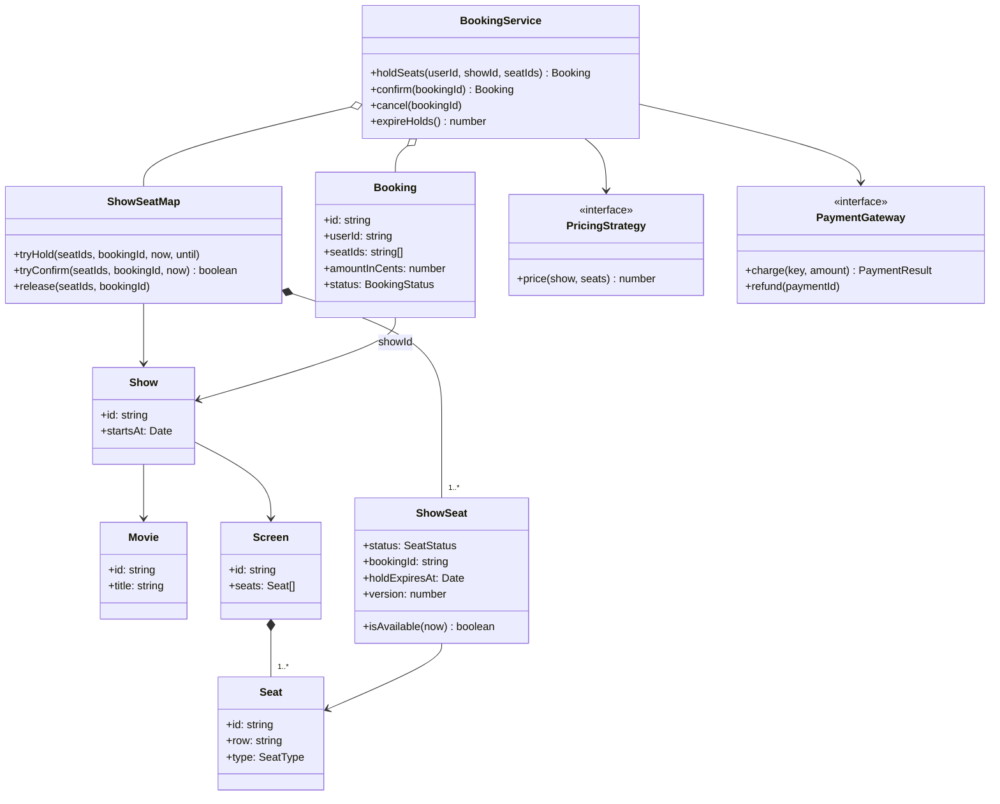
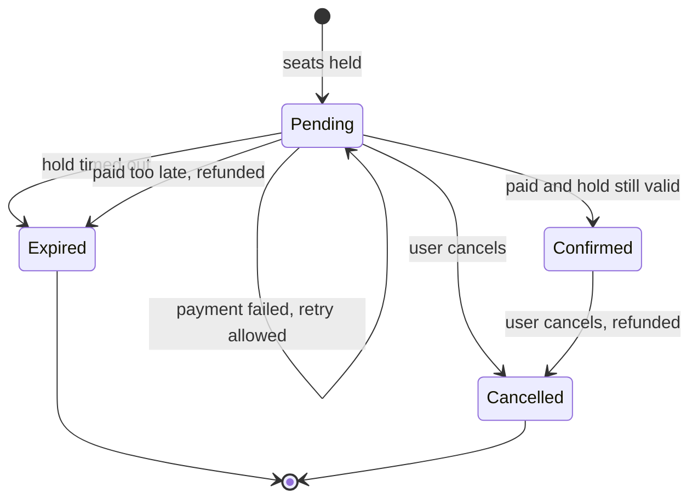
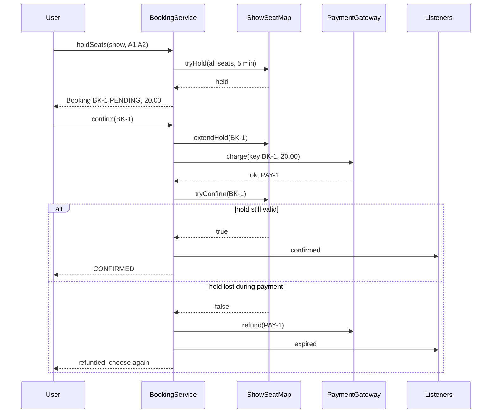

# Movie Ticket Booking

> Design the core of a movie ticket booking system (like BookMyShow or Fandango): users pick seats for a show, the seats are held for a few minutes, the user pays, and the booking is confirmed. The heart of this problem is **concurrency**: two people must never get the same seat, and a seat held by someone who walked away must come back.

**Before this:** [How to approach LLD interviews](01-how-to-approach-lld-interviews.md) · [Parking lot (check-then-act race)](02-parking-lot.md#handling-concurrency-and-edge-cases) · [Vending machine and ATM (payments, idempotency)](04-vending-machine-and-atm.md) · **Interview questions:** [jump to the interview section](#interview-questions)

## Table of contents

1. [Problem](#problem)
2. [Clarifying questions](#clarifying-questions)
3. [Requirements](#requirements)
4. [Core entities and relationships](#core-entities-and-relationships)
5. [Design decisions and patterns](#design-decisions-and-patterns)
6. [Implementation](#implementation)
7. [Walkthrough](#walkthrough)
8. [Handling concurrency and edge cases](#handling-concurrency-and-edge-cases)
9. [Extensions](#extensions)
10. [How to present this in the interview](#how-to-present-this-in-the-interview)
11. [Interview questions](#interview-questions)
12. [Summary](#summary)
13. [References](#references)

---

## Problem

> "Design a movie ticket booking system. There are cinemas with screens. Each screen has seats of different types. Movies are shown in shows (a movie on a screen at a time). A user selects a show, picks seats and pays. Two users must not book the same seat. Write the classes and the booking flow."

The interviewer will almost certainly push on one question: **"What happens when two users click the same seat at the same moment?"** Plan your design around a good answer to that, and the rest is regular modeling.

## Clarifying questions

| Question | Why it matters | Assumed answer |
| --- | --- | --- |
| Do we cover search (cities, movies, cinemas)? | Scope | Only a simple catalog; search is HLD territory |
| Is a seat chosen by the user, or assigned? | Seat model | The user chooses exact seats from a seat map |
| How long are seats held while the user pays? | Hold timeout | 5 minutes |
| Max seats per booking? | Validation, abuse | 6 |
| What happens if payment fails? | State flow | The hold stays until it expires; the user can retry |
| What if the user pays after the hold expired? | The tricky case | Do not confirm; refund the payment |
| Pricing? | Strategy | Price per seat type (regular, premium); dynamic pricing later |
| Cancellation and refunds? | Extra flow | Allowed before the show; full refund for now |
| Notifications? | Observer | Email/SMS on confirm, cancel, expiry |
| Single server or many? | Concurrency approach | Many servers sharing a database; I will show in-memory code and explain the database version |

Say the scope out loud: "I'll design catalog entities, the seat map per show, holds with timeouts, confirmation with payment, cancellation and notifications. Search, reviews and recommendations are out of scope."

## Requirements

### Functional requirements

1. The catalog has movies, cinemas, screens, seats (with a type) and shows.
2. A user can see the **seat map** of a show: available, held or booked.
3. A user can **hold** 1–6 seats. The hold is **all-or-nothing**: if any requested seat is not available, nothing is held.
4. A hold lasts 5 minutes. After that, the seats become available again automatically.
5. The user can **confirm** a held booking by paying. Confirmation succeeds only if the hold is still valid when the payment completes; otherwise the payment is refunded.
6. Confirming twice (double click, retry) never charges twice.
7. A user can **cancel** a booking; seats are released and a confirmed booking is refunded.
8. Users get **notifications** when a booking is confirmed, cancelled or expired.

### Non-functional requirements

- **No double booking, ever.** This is the most important correctness rule.
- **Fairness and freshness:** abandoned holds must come back quickly.
- **Extensibility:** new pricing rules, payment providers and notification channels without changing the booking logic.
- **Testability:** time and payments are injected; no real waiting in tests.
- **Scale hint:** popular shows get many concurrent requests at the moment tickets open. The design must stay correct under contention.

## Core entities and relationships

Separate **catalog** data (rarely changes) from **show-time state** (changes every second):

| Entity | Kind | Responsibility |
| --- | --- | --- |
| `Movie` | Catalog | Title, duration |
| `Screen` | Catalog | A room with a fixed list of `Seat`s |
| `Seat` | Catalog | Row, number, type. The *physical* seat |
| `Show` | Catalog | One movie, on one screen, at one time |
| `ShowSeat` | State | The seat *for one show*: status (AVAILABLE, HELD, BOOKED), booking id, hold expiry, version |
| `ShowSeatMap` | State | All `ShowSeat`s of one show; does the all-or-nothing hold and confirm |
| `Booking` | State | User, show, seats, amount, status (PENDING, CONFIRMED, CANCELLED, EXPIRED), payment id |
| `PricingStrategy` | Interface | Price for a set of seats in a show |
| `PaymentGateway` | Interface | Charge (with an idempotency key) and refund |
| `Clock` | Interface | Current time |
| `BookingService` | Service | The flows: hold, confirm, cancel, expire; emits events |

The key modeling idea: **a `Seat` is not booked; a `ShowSeat` is.** Seat A1 exists once in Screen 1, but it can be booked once **per show**. Candidates who put `isBooked` on `Seat` get stuck as soon as there are two shows.



The lifecycle of a booking:



## Design decisions and patterns

### 1. Two-phase booking: hold, then confirm

Payment takes time: the user types card details, maybe does 3-D Secure. If we only marked seats as booked after payment, two users could both pay for the same seat. If we marked them booked before payment, abandoned checkouts would block seats forever.

The standard answer is **two phases**:

1. **Hold** (reserve) the seats for a short time (5 minutes). Nobody else can take them.
2. **Confirm** after successful payment. If the user never pays, the hold **expires** and the seats return.

This is the same "reserve, then commit" idea as the ATM's plan-then-dispense, and it is what real ticketing sites do (you have seen the "your seats are held for 05:00" timer).

### 2. All-or-nothing holds

A family wants seats A1–A4 together. If A3 is taken, holding A1, A2 and A4 is useless and blocks other people. So `tryHold` **checks every seat first and only then** changes any of them. In the database version, the same rule becomes "one transaction; if any row fails, roll back".

### 3. Lazy expiry plus a background sweeper

How do held seats come back after 5 minutes? Two mechanisms, and you want **both**:

- **Lazy expiry:** a held seat with `holdExpiresAt <= now` is treated as available when anyone **reads** it. Correctness never depends on a timer running on time.
- **Sweeper:** a background job (`expireHolds`) runs every minute to mark old bookings `EXPIRED`, release the seats properly and notify the users.

Interviewers like this answer because it shows you know timers are unreliable (servers restart, jobs lag) and you never let correctness depend on them.

### 4. Re-check after every `await`

`confirm` calls the payment gateway, which is slow and asynchronous. While we wait, **other code runs**: the sweeper, other users, even the same user clicking again. So after the payment returns, we **check again** that the hold is still ours before booking the seats. If not, we refund. "Re-validate after await" is the single most important habit for correct async code.

### 5. Strategy for pricing, interface for payment, Observer for notifications

- **Pricing** changes often (weekend rates, dynamic pricing, coupons), so `PricingStrategy` is an interface ([Strategy](../04-oop-solid-design-patterns/08-behavioral-patterns.md#strategy)).
- **Payment** providers change; `PaymentGateway` hides them ([Dependency Inversion](../04-oop-solid-design-patterns/05-dependency-inversion-and-injection.md)). The `charge` method takes an **idempotency key** (the booking id), so retries never double-charge.
- **Notifications** (email, SMS, push, analytics) subscribe to booking events ([Observer](../04-oop-solid-design-patterns/08-behavioral-patterns.md#observer)). The booking service does not know who listens. A broken listener is caught, so it cannot break a booking.

### 6. Booking status as an explicit state machine

`Booking.status` moves only along the arrows in the state diagram above. A confirmed booking can be cancelled; an expired one cannot be confirmed. We check this at the start of each operation. With few transitions, a status field and guards are enough; a full [State pattern](../04-oop-solid-design-patterns/08-behavioral-patterns.md#state) would be over-engineering here (compare with the [vending machine](04-vending-machine-and-atm.md#1-vending-machine-the-state-pattern-and-why-it-fits-so-well)).

### 7. Why not lock the whole show?

A simple global lock ("only one booking at a time for this show") is correct but slow when 10,000 people try to buy tickets at 10:00 for a blockbuster. Seat-level atomic operations allow many bookings in parallel for **different** seats, and conflict only on the **same** seats. That's the trade-off to say out loud.

### Patterns summary

| Concern | Choice | Why |
| --- | --- | --- |
| Paying takes time | Hold, then confirm (two phases) | No double booking; abandoned seats return |
| Group of seats | All-or-nothing `tryHold` | No useless partial holds |
| Expired holds | Lazy expiry + sweeper | Correct even if the job is late |
| Async payment | Re-check after await; refund if lost | Other code runs during await |
| Double click | Share the running confirm; idempotency key | One charge, one result |
| Price | `PricingStrategy` | Rules change often |
| Payment provider | `PaymentGateway` interface | Swappable, testable |
| Notifications | Observer with error isolation | Loose coupling |

## Implementation

The blocks below form **one runnable TypeScript file** (type-checked with `tsc --strict`, run with Node.js 22; the output comments are the real output). The payment gateway is a fake that can decline a card or be slow, so the demo can show every failure path.

### Step 1: value types and catalog

```ts
// ---------- Step 1: value types and catalog entities ----------
const SeatType = { REGULAR: 'REGULAR', PREMIUM: 'PREMIUM' } as const;
type SeatType = (typeof SeatType)[keyof typeof SeatType];

const SeatStatus = { AVAILABLE: 'AVAILABLE', HELD: 'HELD', BOOKED: 'BOOKED' } as const;
type SeatStatus = (typeof SeatStatus)[keyof typeof SeatStatus];

const BookingStatus = {
  PENDING: 'PENDING', // seats held, waiting for payment
  CONFIRMED: 'CONFIRMED',
  CANCELLED: 'CANCELLED',
  EXPIRED: 'EXPIRED',
} as const;
type BookingStatus = (typeof BookingStatus)[keyof typeof BookingStatus];

type Movie = { id: string; title: string; durationMinutes: number };
type Seat = { id: string; row: string; number: number; type: SeatType };
type Screen = { id: string; name: string; seats: readonly Seat[] };
type Show = { id: string; movie: Movie; screen: Screen; startsAt: Date };
```

Catalog entities are plain **types**, not classes: they are data with no behavior. That's a deliberate choice; not everything needs to be a class.

### Step 2: seat state per show

```ts
// ---------- Step 2: per-show seat state (the part that changes under concurrency) ----------
class ShowSeat {
  readonly seat: Seat;
  status: SeatStatus = SeatStatus.AVAILABLE;
  bookingId: string | null = null;
  holdExpiresAt: Date | null = null;
  version = 0; // bumps on every change; useful for optimistic locking in a database

  constructor(seat: Seat) {
    this.seat = seat;
  }

  // A hold that has expired counts as available (lazy expiry).
  isAvailable(now: Date): boolean {
    if (this.status === SeatStatus.AVAILABLE) return true;
    return this.status === SeatStatus.HELD && this.holdExpiresAt !== null && this.holdExpiresAt <= now;
  }

  isHeldBy(bookingId: string, now: Date): boolean {
    return (
      this.status === SeatStatus.HELD &&
      this.bookingId === bookingId &&
      this.holdExpiresAt !== null &&
      this.holdExpiresAt > now
    );
  }

  set(status: SeatStatus, bookingId: string | null, holdExpiresAt: Date | null): void {
    this.status = status;
    this.bookingId = bookingId;
    this.holdExpiresAt = holdExpiresAt;
    this.version++;
  }
}

class ShowSeatMap {
  readonly show: Show;
  private readonly seats = new Map<string, ShowSeat>();

  constructor(show: Show) {
    this.show = show;
    for (const seat of show.screen.seats) this.seats.set(seat.id, new ShowSeat(seat));
  }

  get(seatId: string): ShowSeat {
    const s = this.seats.get(seatId);
    if (!s) throw new Error(`Seat ${seatId} does not exist in ${this.show.screen.name}`);
    return s;
  }

  // All-or-nothing: check every seat first, then hold every seat.
  // No await inside, so in Node.js nothing can run between the check and the change.
  tryHold(seatIds: readonly string[], bookingId: string, now: Date, until: Date): void {
    const seats = seatIds.map((id) => this.get(id));
    const taken = seats.filter((s) => !s.isAvailable(now)).map((s) => s.seat.id);
    if (taken.length > 0) throw new Error(`Seats not available: ${taken.join(', ')}`);
    for (const s of seats) s.set(SeatStatus.HELD, bookingId, until);
  }

  // Make sure the hold lasts at least until `until` (never shortens it).
  extendHold(seatIds: readonly string[], bookingId: string, now: Date, until: Date): boolean {
    const seats = seatIds.map((id) => this.get(id));
    if (!seats.every((s) => s.isHeldBy(bookingId, now))) return false;
    for (const s of seats) {
      const current = s.holdExpiresAt!;
      s.set(SeatStatus.HELD, bookingId, current > until ? current : until);
    }
    return true;
  }

  // Returns false if any seat is no longer held by this booking.
  tryConfirm(seatIds: readonly string[], bookingId: string, now: Date): boolean {
    const seats = seatIds.map((id) => this.get(id));
    if (!seats.every((s) => s.isHeldBy(bookingId, now))) return false;
    for (const s of seats) s.set(SeatStatus.BOOKED, bookingId, null);
    return true;
  }

  release(seatIds: readonly string[], bookingId: string): void {
    for (const s of seatIds.map((id) => this.get(id))) {
      if (s.bookingId === bookingId) s.set(SeatStatus.AVAILABLE, null, null);
    }
  }

  render(now: Date): string {
    const rows = new Map<string, string[]>();
    for (const s of this.seats.values()) {
      const mark = s.isAvailable(now) ? '.' : s.status === SeatStatus.BOOKED ? 'X' : 'h';
      rows.set(s.seat.row, [...(rows.get(s.seat.row) ?? []), `${s.seat.id}${mark}`]);
    }
    return [...rows.values()].map((r) => r.join(' ')).join(' | ');
  }
}
```

Points to say:

- Every method that changes seats follows the same shape: **validate all seats, then change all seats**, with no `await` in between. That's what makes each one atomic in Node.js.
- `release` only frees seats that still belong to **this** booking. If an expired hold was already taken by someone else, releasing must not free *their* seat. This is a classic bug.
- `version` is not needed in memory, but it is exactly the column you would use for optimistic locking in a database (see the concurrency section).

### Step 3: booking and the pluggable parts

```ts
// ---------- Step 3: booking entity and pluggable parts ----------
class Booking {
  readonly id: string;
  readonly userId: string;
  readonly showId: string;
  readonly seatIds: readonly string[];
  readonly amountInCents: number;
  status: BookingStatus = BookingStatus.PENDING;
  paymentId: string | null = null;

  constructor(id: string, userId: string, showId: string, seatIds: readonly string[], amountInCents: number) {
    this.id = id;
    this.userId = userId;
    this.showId = showId;
    this.seatIds = seatIds;
    this.amountInCents = amountInCents;
  }
}

interface Clock {
  now(): Date;
}

interface PricingStrategy {
  price(show: Show, seats: readonly Seat[]): number;
}

type PaymentResult = { ok: true; paymentId: string } | { ok: false; reason: string };

interface PaymentGateway {
  // idempotencyKey: the same key never charges twice
  charge(idempotencyKey: string, amountInCents: number): Promise<PaymentResult>;
  refund(paymentId: string): Promise<void>;
}

type BookingEvent = { type: 'confirmed' | 'cancelled' | 'expired'; booking: Booking };
type BookingListener = (event: BookingEvent) => void;

class SeatTypePricing implements PricingStrategy {
  private readonly prices: Record<SeatType, number>;
  constructor(prices: Record<SeatType, number>) {
    this.prices = prices;
  }
  price(_show: Show, seats: readonly Seat[]): number {
    return seats.reduce((sum, s) => sum + this.prices[s.type], 0);
  }
}
```

The price is calculated **once, at hold time**, and stored on the booking. If prices change while the user is paying, they still pay what they were shown. Say this if asked about pricing consistency.

### Step 4: the booking service

```ts
// ---------- Step 4: the booking service ----------
class BookingService {
  static readonly HOLD_MINUTES = 5;
  static readonly PAYMENT_GRACE_MINUTES = 2;
  static readonly MAX_SEATS = 6;

  private readonly seatMaps = new Map<string, ShowSeatMap>(); // showId -> seat map
  private readonly bookings = new Map<string, Booking>();
  private readonly listeners: BookingListener[] = [];
  private readonly confirming = new Map<string, Promise<Booking>>(); // bookingId -> running confirm
  private readonly clock: Clock;
  private readonly pricing: PricingStrategy;
  private readonly payments: PaymentGateway;
  private nextId = 1;

  constructor(clock: Clock, pricing: PricingStrategy, payments: PaymentGateway) {
    this.clock = clock;
    this.pricing = pricing;
    this.payments = payments;
  }

  addShow(show: Show): void {
    this.seatMaps.set(show.id, new ShowSeatMap(show));
  }

  subscribe(listener: BookingListener): void {
    this.listeners.push(listener);
  }

  // Step 1 of booking: hold the seats for a few minutes.
  holdSeats(userId: string, showId: string, seatIds: string[]): Booking {
    const map = this.seatMap(showId);
    if (seatIds.length === 0 || seatIds.length > BookingService.MAX_SEATS) {
      throw new Error(`Choose 1 to ${BookingService.MAX_SEATS} seats`);
    }
    if (new Set(seatIds).size !== seatIds.length) throw new Error('Duplicate seats in request');
    const now = this.clock.now();
    if (map.show.startsAt <= now) throw new Error('Show already started');

    const bookingId = `BK-${this.nextId}`;
    map.tryHold(seatIds, bookingId, now, addMinutes(now, BookingService.HOLD_MINUTES)); // throws if any seat is taken
    this.nextId++;
    const amount = this.pricing.price(map.show, seatIds.map((id) => map.get(id).seat));
    const booking = new Booking(bookingId, userId, showId, seatIds, amount);
    this.bookings.set(bookingId, booking);
    return booking;
  }

  // Step 2 of booking: pay and confirm.
  // A double click sends two confirm calls at once; they share one attempt.
  confirm(bookingId: string): Promise<Booking> {
    const running = this.confirming.get(bookingId);
    if (running) return running;
    const attempt = this.payAndConfirm(bookingId).finally(() => this.confirming.delete(bookingId));
    this.confirming.set(bookingId, attempt);
    return attempt;
  }

  private async payAndConfirm(bookingId: string): Promise<Booking> {
    const booking = this.booking(bookingId);
    if (booking.status === BookingStatus.CONFIRMED) return booking; // idempotent: clicking twice is fine
    if (booking.status !== BookingStatus.PENDING) throw new Error(`Booking ${bookingId} is ${booking.status}`);
    const map = this.seatMap(booking.showId);

    // Keep the seats while the payment runs, so they do not expire in the middle.
    const now = this.clock.now();
    if (!map.extendHold(booking.seatIds, bookingId, now, addMinutes(now, BookingService.PAYMENT_GRACE_MINUTES))) {
      this.expire(booking);
      throw new Error(`Hold for ${bookingId} expired; please choose seats again`);
    }

    const result = await this.payments.charge(bookingId, booking.amountInCents);
    if (!result.ok) throw new Error(`Payment failed: ${result.reason}; seats stay held until the hold expires`);

    // The await above let other code run. Check again before we commit.
    if (!map.tryConfirm(booking.seatIds, bookingId, this.clock.now())) {
      await this.payments.refund(result.paymentId);
      this.expire(booking);
      throw new Error(`Hold for ${bookingId} expired during payment; payment refunded`);
    }
    booking.status = BookingStatus.CONFIRMED;
    booking.paymentId = result.paymentId;
    this.emit({ type: 'confirmed', booking });
    return booking;
  }

  async cancel(bookingId: string): Promise<void> {
    const booking = this.booking(bookingId);
    if (booking.status === BookingStatus.CANCELLED) return;
    if (booking.status === BookingStatus.CONFIRMED && booking.paymentId) {
      await this.payments.refund(booking.paymentId);
    }
    this.seatMap(booking.showId).release(booking.seatIds, bookingId);
    booking.status = BookingStatus.CANCELLED;
    this.emit({ type: 'cancelled', booking });
  }

  // A background job can call this every minute; lazy expiry also protects us if it is late.
  expireHolds(): number {
    const now = this.clock.now();
    let count = 0;
    for (const booking of this.bookings.values()) {
      if (booking.status !== BookingStatus.PENDING) continue;
      const map = this.seatMap(booking.showId);
      if (!booking.seatIds.every((id) => map.get(id).isHeldBy(booking.id, now))) {
        this.expire(booking);
        count++;
      }
    }
    return count;
  }

  seatMapView(showId: string): string {
    return this.seatMap(showId).render(this.clock.now());
  }

  private expire(booking: Booking): void {
    this.seatMap(booking.showId).release(booking.seatIds, booking.id);
    booking.status = BookingStatus.EXPIRED;
    this.emit({ type: 'expired', booking });
  }

  private emit(event: BookingEvent): void {
    for (const listener of this.listeners) {
      try {
        listener(event);
      } catch {
        // a broken listener must not break a booking
      }
    }
  }

  private seatMap(showId: string): ShowSeatMap {
    const m = this.seatMaps.get(showId);
    if (!m) throw new Error(`Unknown show ${showId}`);
    return m;
  }

  private booking(bookingId: string): Booking {
    const b = this.bookings.get(bookingId);
    if (!b) throw new Error(`Unknown booking ${bookingId}`);
    return b;
  }
}

function addMinutes(date: Date, minutes: number): Date {
  return new Date(date.getTime() + minutes * 60_000);
}
```

Read `payAndConfirm` as a story with five checkpoints:

1. **Status guard:** already confirmed? Return it (idempotent). Expired or cancelled? Refuse.
2. **Extend the hold** a little (never shorten it) so a normal payment doesn't expire halfway. If the hold is already gone, expire the booking and stop: **no charge** was made.
3. **Charge** with the booking id as the idempotency key.
4. **Re-check** the hold after the `await`. If it was lost, **refund** and expire.
5. **Commit:** seats become BOOKED, booking becomes CONFIRMED, listeners are told.

`confirm` itself is a small wrapper: if a confirm for this booking is already running, return the **same promise**. This "single flight" trick matters; the concurrency section shows the bug it prevents.

### Step 5: fakes and demo

```ts
// ---------- Step 5: fakes and demo ----------
class FakeClock implements Clock {
  private current: Date;
  constructor(iso: string) {
    this.current = new Date(iso);
  }
  now(): Date {
    return new Date(this.current.getTime());
  }
  advance(minutes: number): void {
    this.current = addMinutes(this.current, minutes);
  }
}

class FakePaymentGateway implements PaymentGateway {
  private readonly charges = new Map<string, string>(); // idempotency key -> payment id
  private readonly clock: FakeClock;
  declineNext = false;
  minutesPerCharge = 0; // simulate a slow payment page
  constructor(clock: FakeClock) {
    this.clock = clock;
  }
  async charge(key: string, amount: number): Promise<PaymentResult> {
    this.clock.advance(this.minutesPerCharge);
    if (this.declineNext) {
      this.declineNext = false;
      return { ok: false, reason: 'card declined' };
    }
    const existing = this.charges.get(key);
    if (existing) return { ok: true, paymentId: existing };
    const paymentId = `PAY-${this.charges.size + 1}`;
    this.charges.set(key, paymentId);
    console.log(`  [payment] charged ${(amount / 100).toFixed(2)} for ${key} -> ${paymentId}`);
    return { ok: true, paymentId };
  }
  async refund(paymentId: string): Promise<void> {
    console.log(`  [payment] refunded ${paymentId}`);
  }
}

function buildScreen(): Screen {
  const seats: Seat[] = [];
  for (const [row, type] of [['A', SeatType.REGULAR], ['B', SeatType.PREMIUM]] as const) {
    for (let n = 1; n <= 4; n++) seats.push({ id: `${row}${n}`, row, number: n, type });
  }
  return { id: 'S1', name: 'Screen 1', seats };
}

async function attempt(label: string, action: () => unknown): Promise<void> {
  try {
    const result = await action();
    const text = result instanceof Booking ? `${result.id} ${result.status} $${(result.amountInCents / 100).toFixed(2)}` : 'ok';
    console.log(`${label}: ${text}`);
  } catch (e) {
    console.log(`${label}: ${(e as Error).message}`);
  }
}

async function main(): Promise<void> {
  const clock = new FakeClock('2026-03-01T18:00:00Z');
  const gateway = new FakePaymentGateway(clock);
  const service = new BookingService(clock, new SeatTypePricing({ REGULAR: 1000, PREMIUM: 1500 }), gateway);
  service.subscribe((e) => console.log(`  [notify] ${e.booking.userId}: booking ${e.booking.id} ${e.type}`));
  const movie: Movie = { id: 'M1', title: 'The Long Queue', durationMinutes: 120 };
  service.addShow({ id: 'SH1', movie, screen: buildScreen(), startsAt: new Date('2026-03-01T20:00:00Z') });

  let alice!: Booking;
  let bob!: Booking;
  await attempt('alice holds A1,A2', () => (alice = service.holdSeats('alice', 'SH1', ['A1', 'A2'])));
  await attempt('bob holds A2,A3', () => service.holdSeats('bob', 'SH1', ['A2', 'A3']));
  await attempt('bob holds A3,B1', () => (bob = service.holdSeats('bob', 'SH1', ['A3', 'B1'])));
  console.log('seats:', service.seatMapView('SH1'));

  await attempt('alice confirms', () => service.confirm(alice.id));
  await attempt('alice confirms again', () => service.confirm(alice.id));

  clock.advance(6); // bob went for coffee
  console.log('seats after 6 min:', service.seatMapView('SH1'));
  await attempt('bob confirms late', () => service.confirm(bob.id));

  let carol!: Booking;
  await attempt('carol holds A3', () => (carol = service.holdSeats('carol', 'SH1', ['A3'])));
  gateway.declineNext = true;
  await attempt('carol pays (declined)', () => service.confirm(carol.id));
  const [c1, c2] = await Promise.all([service.confirm(carol.id), service.confirm(carol.id)]); // double click
  console.log('carol double-click:', c1.status, c2.status, c1 === c2 ? '(same booking)' : '');

  let dave!: Booking;
  await attempt('dave holds B2,B3', () => (dave = service.holdSeats('dave', 'SH1', ['B2', 'B3'])));
  gateway.minutesPerCharge = 6; // slower than the remaining hold time
  await attempt('dave pays slowly', () => service.confirm(dave.id));
  gateway.minutesPerCharge = 0;

  await attempt('alice cancels', () => service.cancel(alice.id));
  await attempt('erin holds B4,B4', () => service.holdSeats('erin', 'SH1', ['B4', 'B4']));
  await attempt('erin holds Z9', () => service.holdSeats('erin', 'SH1', ['Z9']));
  await attempt('frank holds B4', () => service.holdSeats('frank', 'SH1', ['B4']));
  clock.advance(10); // frank closes the browser tab
  console.log('expired by background job:', service.expireHolds());
  console.log('seats at end:', service.seatMapView('SH1'));
}

main();
// alice holds A1,A2: BK-1 PENDING $20.00
// bob holds A2,A3: Seats not available: A2
// bob holds A3,B1: BK-2 PENDING $25.00
// seats: A1h A2h A3h A4. | B1h B2. B3. B4.
//   [payment] charged 20.00 for BK-1 -> PAY-1
//   [notify] alice: booking BK-1 confirmed
// alice confirms: BK-1 CONFIRMED $20.00
// alice confirms again: BK-1 CONFIRMED $20.00
// seats after 6 min: A1X A2X A3. A4. | B1. B2. B3. B4.
//   [notify] bob: booking BK-2 expired
// bob confirms late: Hold for BK-2 expired; please choose seats again
// carol holds A3: BK-3 PENDING $10.00
// carol pays (declined): Payment failed: card declined; seats stay held until the hold expires
//   [payment] charged 10.00 for BK-3 -> PAY-2
//   [notify] carol: booking BK-3 confirmed
// carol double-click: CONFIRMED CONFIRMED (same booking)
// dave holds B2,B3: BK-4 PENDING $30.00
//   [payment] charged 30.00 for BK-4 -> PAY-3
//   [payment] refunded PAY-3
//   [notify] dave: booking BK-4 expired
// dave pays slowly: Hold for BK-4 expired during payment; payment refunded
//   [payment] refunded PAY-1
//   [notify] alice: booking BK-1 cancelled
// alice cancels: ok
// erin holds B4,B4: Duplicate seats in request
// erin holds Z9: Seat Z9 does not exist in Screen 1
// frank holds B4: BK-5 PENDING $15.00
//   [notify] frank: booking BK-5 expired
// expired by background job: 1
// seats at end: A1. A2. A3X A4. | B1. B2. B3. B4.
```

What each part of the output proves (`.` available, `h` held, `X` booked):

- **All-or-nothing:** Bob asked for A2 and A3; A2 was held by Alice, so **neither** was held, and A3 stayed free for his next try.
- **Idempotent confirm:** Alice confirming again returns the same confirmed booking, with no second charge.
- **Lazy expiry:** after 6 minutes, Bob's seats show as available *before* any job ran; his late confirm is refused **without charging him**.
- **Payment failure:** Carol's declined card leaves her seats held; she can retry.
- **Double click:** two simultaneous confirms produce **one** charge (`PAY-2`) and the same booking.
- **Paid too late:** Dave's payment took 6 minutes. He was charged, the re-check found the hold gone, and he was **refunded** automatically.
- **Cancel:** refunds Alice's payment and frees A1 and A2.
- **Validation:** duplicate and unknown seats are rejected.
- **Sweeper:** Frank's abandoned hold is expired by the background job and he is notified.

## Walkthrough

The full booking flow, from seat selection to confirmation:



As steps:

1. The user picks seats on the seat map. The client calls `holdSeats(userId, showId, seatIds)`.
2. The service validates the request (1–6 seats, no duplicates, show not started).
3. `ShowSeatMap.tryHold` checks **every** seat is available, then marks them all HELD with an expiry 5 minutes from now.
4. The service prices the seats once and stores a PENDING booking. The client shows a 5-minute countdown.
5. The user pays. `confirm` extends the hold slightly, charges with the booking id as idempotency key, and waits.
6. After the payment returns, `tryConfirm` checks the hold again. If valid: seats become BOOKED, booking CONFIRMED, listeners send the email. If not: refund and expire.

## Handling concurrency and edge cases

### Race 1: two users click the same seat at the same time

**In one Node.js process,** `tryHold` is synchronous: it checks and changes all seats with no `await` in between, so it is atomic. The first request to run wins; the second sees the seat as HELD.

**With many servers and a database,** each server reads and writes the database with network delays in between, so "read, check, write" is no longer atomic. This runnable simulation shows the bug and the fix with **optimistic locking** (a version column):

```ts
// A fake database table with network delay, to show the race between two servers.
type SeatRow = { seatId: string; heldBy: string | null; version: number };

const delay = (ms: number) => new Promise<void>((resolve) => setTimeout(resolve, ms));

class FakeSeatTable {
  private readonly rows = new Map<string, SeatRow>();
  constructor(seatIds: string[]) {
    for (const seatId of seatIds) this.rows.set(seatId, { seatId, heldBy: null, version: 0 });
  }

  async read(seatId: string): Promise<SeatRow> {
    await delay(5);
    return { ...this.rows.get(seatId)! }; // a copy, like a row from a query
  }

  // UPDATE show_seats SET held_by = ? WHERE seat_id = ?
  async blindWrite(seatId: string, user: string): Promise<void> {
    await delay(5);
    const row = this.rows.get(seatId)!;
    row.heldBy = user;
    row.version++;
  }

  // UPDATE show_seats SET held_by = ?, version = version + 1
  // WHERE seat_id = ? AND version = ?        -> returns "rows updated" as a boolean
  async updateIfVersion(seatId: string, expectedVersion: number, user: string): Promise<boolean> {
    await delay(5);
    const row = this.rows.get(seatId)!;
    if (row.version !== expectedVersion) return false;
    row.heldBy = user;
    row.version++;
    return true;
  }

  owner(seatId: string): string | null {
    return this.rows.get(seatId)!.heldBy;
  }
}

// ❌ Read, check, write: both servers read "free" before either writes.
async function holdUnsafe(table: FakeSeatTable, seatId: string, user: string): Promise<string> {
  const row = await table.read(seatId);
  if (row.heldBy !== null) return `${user}: ${seatId} is taken`;
  await table.blindWrite(seatId, user);
  return `${user}: got ${seatId}`;
}

// ✅ Optimistic locking: the write succeeds only if nobody changed the row since we read it.
async function holdOptimistic(table: FakeSeatTable, seatId: string, user: string): Promise<string> {
  const row = await table.read(seatId);
  if (row.heldBy !== null) return `${user}: ${seatId} is taken`;
  const updated = await table.updateIfVersion(seatId, row.version, user);
  return updated ? `${user}: got ${seatId}` : `${user}: lost the race for ${seatId}`;
}

async function main(): Promise<void> {
  const t1 = new FakeSeatTable(['C7']);
  console.log(await Promise.all([holdUnsafe(t1, 'C7', 'alice'), holdUnsafe(t1, 'C7', 'bob')]));
  console.log('C7 owner:', t1.owner('C7'));

  const t2 = new FakeSeatTable(['C7']);
  console.log(await Promise.all([holdOptimistic(t2, 'C7', 'alice'), holdOptimistic(t2, 'C7', 'bob')]));
  console.log('C7 owner:', t2.owner('C7'));
}

main();
// [ 'alice: got C7', 'bob: got C7' ]
// C7 owner: bob
// [ 'alice: got C7', 'bob: lost the race for C7' ]
// C7 owner: alice
```

The unsafe version told **both** users they got C7, and Alice's hold was silently overwritten: a double booking. With the version check, Bob's update matches zero rows, and he gets a clear "lost the race" message.

The options in a real database, and when to use each:

| Technique | How | Good when |
| --- | --- | --- |
| **Optimistic locking** | `UPDATE ... WHERE seat_id = ? AND version = ?`, check rows updated | Conflicts are rare (most seats, most of the time) |
| **Conditional update** | `UPDATE ... SET status = 'HELD' WHERE id IN (...) AND (status = 'AVAILABLE' OR hold_expires_at < now())`, check rows updated = seats requested | Simple and fast; no version needed |
| **Pessimistic locking** | `SELECT ... FOR UPDATE` on the seat rows inside a transaction, then update | Hot shows where many users fight for the same seats |
| **Unique constraint** | A `booked_seats(show_id, seat_id)` table with a unique key | A last line of defense: the database refuses a second booking even if the code has a bug |
| **Distributed lock** (Redis `SET key value NX PX 300000`) | Lock per show-seat with a TTL | Holds in a cache layer; needs care with expiry and fencing |

For multi-seat holds in a database: do it in **one transaction**, update all seats with the condition, and if "rows updated" is not equal to the number of seats, **roll back**. That's all-or-nothing in SQL.

### Race 2: the same user double-clicks "Pay"

This one surprises people. Without the single-flight wrapper in `confirm`, two calls for the same booking both pass the "is it PENDING?" check (they both run before the first payment returns). Both charge (the idempotency key saves us from a double charge), then the first call books the seats, and the second call's re-check fails because the seats are no longer HELD; it then **refunds the payment and expires a booking that was actually confirmed**. We ran this exact scenario without the wrapper while preparing this chapter; Carol's booking ended up `EXPIRED` with her payment refunded.

Fixes, from simplest to strongest:

1. **Single flight** (what the code does): keep a map of running confirms; a second call gets the same promise.
2. **A `PAYMENT_IN_PROGRESS` status:** move the booking to it before charging, with a conditional update (`WHERE status = 'PENDING'`) so only one call can enter.
3. **Idempotency key at the payment provider**, so even two charges become one.

You want 2 and 3 when you have several servers, because the single-flight map lives in one process.

### Race 3: the hold expires while the user is paying

We cannot stop time while the bank's page loads. The design handles it in two ways: `extendHold` gives a short grace period when payment starts (never shortening the hold), and the **re-check after payment** refunds if the hold was lost anyway (Dave in the demo). Some systems instead put the seats in a "payment in progress" state that the sweeper does not touch until the payment provider answers or a longer timeout passes.

### Edge cases table

| Edge case | Handling |
| --- | --- |
| Request for 0 or more than 6 seats | Rejected before touching seats |
| Duplicate seat in one request (`B4, B4`) | Rejected (otherwise the price would count it twice) |
| Seat id that doesn't exist | Rejected with a clear message |
| Show already started | Holding refused |
| Payment declined | Booking stays PENDING; seats stay held until expiry; retry allowed |
| Payment provider times out | Unknown result: query the provider with the idempotency key before deciding; do not release seats blindly |
| Refund fails | Record it and retry from a durable queue (outbox); alert support if it keeps failing |
| Sweeper runs late or crashes | Lazy expiry keeps correctness; the sweeper only cleans up and notifies |
| Release of an expired hold that someone else already took | `release` only frees seats that still carry this booking id |
| Notification service is down | Listener errors are caught; the booking still succeeds; retries happen in the notification system |
| Cancel after the show started | Business rule: refuse, or allow with no refund (a `RefundPolicy` strategy) |
| Seat left alone between two booked seats ("orphan seat") | Optional rule some cinemas use; a `SeatSelectionRule` checked in `holdSeats` |

## Extensions

### Dynamic pricing and offers

Write `DemandBasedPricing implements PricingStrategy` (price rises as the show fills), or wrap the base pricing with decorators: `new WeekendSurcharge(new SeatTypePricing(...))`, `new CouponDiscount(...)`. The booking service does not change, because it only calls `pricing.price()`.

### New payment methods

Wallets, UPI, gift cards: each is a `PaymentGateway` implementation. For split payments (gift card + card), add a `CompositePaymentGateway` that charges each part and refunds the earlier parts if a later one fails.

### Notifications on many channels

Listeners for email, SMS and push subscribe to the same events. In production, the listener only puts a message on a queue; a separate notification service sends it with retries. See [real-time chat and notifications](../09-system-design/10-case-study-real-time-chat-and-notifications.md) for the HLD side.

### Waitlist for sold-out shows

When a hold expires or a booking is cancelled, the service emits `seatsReleased(showId, seatIds)`. A `WaitlistService` subscribes and offers the seats to the first person in line with a short **priority hold**. This is Observer again, and it needs no change to `BookingService` beyond the new event.

### Persistence and many servers

Move `ShowSeatMap` behind a `ShowSeatRepository` with methods like `tryHold(showId, seatIds, bookingId, until): Promise<boolean>`. The SQL implementation uses one transaction with a conditional update (or row locks) and checks the updated row count. The in-memory implementation stays for tests. The single-flight map becomes a `PAYMENT_IN_PROGRESS` status with a conditional update.

### Very hot shows (tickets open at 10:00)

At extreme load, the seat rows for one show become a hotspot. Common approaches: a **virtual waiting room** (let users in gradually), keeping the seat map of a hot show in Redis with atomic Lua scripts for holds, and pushing seat map changes to clients over WebSockets so they don't keep clicking taken seats. This is where LLD meets [system design](../09-system-design/01-system-design-interview-approach.md).

### Seat-type rules and accessibility

Wheelchair spaces with companion seats, couple seats that must be booked together: model them as `SeatSelectionRule`s (a list of small validators run in `holdSeats`), a Chain of Responsibility or simply an array of rule functions. New rule, new function; nothing else changes.

## How to present this in the interview

### Minute-by-minute plan (45–60 minutes)

| Time | What you do |
| --- | --- |
| 0–5 | Clarify: seat selection, hold time, payment failure, cancellation, single vs many servers. |
| 5–8 | Requirements. Put "no double booking" and "abandoned seats come back" at the top. |
| 8–15 | Entities and class diagram. Stress `Seat` (physical) vs `ShowSeat` (per show). Booking state diagram. |
| 15–20 | Two-phase design: hold with expiry, then confirm. Lazy expiry + sweeper. |
| 20–35 | Code: `ShowSeat`, `ShowSeatMap.tryHold` (all-or-nothing), `BookingService.holdSeats` and `confirm` with re-check after await. |
| 35–40 | Walkthrough of one booking; the "paid too late" path. |
| 40–50 | Concurrency: same seat from two servers (optimistic locking, conditional update, `FOR UPDATE`, unique constraint), double click, timeouts. |
| 50–60 | Extensions: dynamic pricing, waitlist, notifications, hot shows. |

### Spoken walkthrough script

> "The key distinction is between a physical seat and a show seat. Seat A1 exists once, but it's booked per show, so I have a `ShowSeat` with status available, held or booked, a booking id, a hold expiry and a version.
>
> Booking has two phases. First, hold: I check that every requested seat is available and only then mark them all held for five minutes, so it's all-or-nothing. Then confirm: the user pays, and after the payment returns I check again that the hold is still mine, because other code ran during the await. If it's still mine, I mark the seats booked; if not, I refund.
>
> Holds expire lazily: an expired hold reads as available, so correctness doesn't depend on a timer. A background job also cleans up and notifies users.
>
> In one Node process, the hold is atomic because there's no await between check and update. Across many servers, I'd let the database decide: a conditional update with a version or status check in one transaction, and I check the number of updated rows. A unique constraint on show and seat is the final safety net.
>
> Payments use the booking id as an idempotency key, and a double click shares one running confirm. Pricing is a strategy, and notifications are observers."

## Interview questions

### Q1. How do you prevent two users from booking the same seat?

**What the interviewer is checking:** the core concurrency answer, at both the code level and the database level.

**What to say (30–60 seconds):**
> I make "check the seat is free and mark it held" one atomic step. In a single Node.js process, that means no `await` between the check and the update; my `tryHold` checks all seats, then holds all seats, synchronously. With several servers and a database, I let the database do it: a conditional update like `UPDATE show_seats SET status = 'HELD' ... WHERE id IN (...) AND status = 'AVAILABLE'` in one transaction, and if the number of updated rows isn't the number of seats, I roll back. I'd also add a unique constraint on show and seat in the bookings table as the last safety net.

**Deeper explanation:** The bug is a check-then-act race. The simulation above shows both users "getting" seat C7 with a read-then-write, and only one with a version check. Pessimistic locking (`SELECT ... FOR UPDATE`) is the alternative when contention is high.

**Follow-up questions and how to answer them:**
- *"Optimistic or pessimistic?"* Optimistic for normal shows (conflicts are rare and retries are cheap). Pessimistic, or a queue, for hot shows where many users fight for the same seats.
- *"Would a Redis lock work?"* Yes, with a TTL per show-seat, but then Redis is the source of truth for holds, and you need care when locks expire. A database constraint still protects the final booking.

**Common mistakes:** "JavaScript is single-threaded, so it's fine" (not across servers or across awaits); locking the whole show.

**Real-project example:** inventory reservation in e-commerce checkouts uses the same conditional update.

### Q2. Why hold seats before payment instead of booking them directly?

**What the interviewer is checking:** understanding of the two-phase flow and its trade-offs.

**What to say (30–60 seconds):**
> Payment takes minutes. If I booked only after payment, two users could pay for the same seat and one would need a refund. If I booked before payment, people who leave the page would block seats forever. So I hold seats for a few minutes: nobody else can take them, and if the user doesn't pay, the hold expires and the seats come back. It's reserve-then-commit with a timeout.

**Deeper explanation:** The hold time is a business trade-off: too short and users get frustrated mid-payment; too long and abandoned holds make shows look sold out.

**Follow-up questions and how to answer them:**
- *"How do you show the timer?"* Return `holdExpiresAt` with the booking; the client counts down, but the server's clock decides.
- *"Can users extend the hold?"* Possibly once, as a product decision; the code would be `extendHold` with a maximum.

**Common mistakes:** no expiry at all; relying only on the client's timer.

**Real-project example:** airline seat selection and concert ticket sites hold seats during checkout.

### Q3. How do expired holds come back? What if your cron job stops?

**What the interviewer is checking:** robustness against unreliable timers.

**What to say (30–60 seconds):**
> I use lazy expiry: a held seat whose `holdExpiresAt` is in the past is treated as available whenever anyone reads it. So even if the background job is late or crashed, users can book those seats. The background job is still useful: it marks bookings as expired, cleans up and notifies users. But correctness never depends on it.

**Deeper explanation:** In SQL, the hold condition becomes `status = 'AVAILABLE' OR (status = 'HELD' AND hold_expires_at < now())`. In Redis, a key with a TTL disappears by itself.

**Follow-up questions and how to answer them:**
- *"Why not a `setTimeout` per hold?"* Timers are lost when the process restarts, and they don't work across servers. They also add memory per hold.

**Common mistakes:** a timer per booking in memory as the only mechanism.

**Real-project example:** session and cache expiry in Redis works the same way: lazy check on read plus active cleanup.

### Q4. The payment succeeded, but the hold expired during payment. What do you do?

**What the interviewer is checking:** whether you re-validate after async steps and handle money correctly.

**What to say (30–60 seconds):**
> After the payment returns, I check again that the seats are still held by this booking. If they are, I confirm. If not, I can't give the seats to this user, because someone else may already have them, so I refund the payment and tell the user to pick seats again. To make this rare, I extend the hold a little when payment starts. In my demo, Dave's slow payment got refunded automatically.

**Deeper explanation:** "Re-check after await" is the async version of check-then-act: any state you read before an `await` may be stale after it.

**Follow-up questions and how to answer them:**
- *"What if the seat is still free even though the hold expired?"* You could confirm anyway, as a friendlier policy, using the same atomic conditional update. My code is strict; both are defensible if you say why.

**Common mistakes:** confirming without re-checking; forgetting the refund.

**Real-project example:** hotel booking sites refund when a room is sold out between search and payment.

### Q5. A user double-clicks "Pay". What can go wrong, and how do you prevent it?

**What the interviewer is checking:** idempotency and in-process races.

**What to say (30–60 seconds):**
> Two confirm calls can run at the same time. Both see the booking as pending and both try to pay. The payment idempotency key prevents a double charge, but there's a nastier bug: the first call books the seats, and the second call's re-check fails, so it refunds and expires a confirmed booking. I reproduced exactly that. My fix in one process is single-flight: a map of running confirms, so the second click gets the same promise. With many servers, I'd add a `PAYMENT_IN_PROGRESS` status set with a conditional update, so only one request can start paying.

**Deeper explanation:** Idempotency has layers: client (disable the button), API (idempotency key header), service (status transition with a condition), payment provider (idempotency key).

**Follow-up questions and how to answer them:**
- *"Isn't disabling the button enough?"* No. Networks retry, users refresh, and mobile apps resend. The server must be safe on its own.

**Common mistakes:** relying only on the frontend; generating a new idempotency key per click.

**Real-project example:** Stripe's idempotency keys exist for exactly these retries.

### Q6. Why is `ShowSeat` separate from `Seat`?

**What the interviewer is checking:** modeling skill.

**What to say (30–60 seconds):**
> A `Seat` is physical: row, number, type. It's the same for every show in that screen. Whether it's booked depends on the show, so the status lives on `ShowSeat`, one per seat per show. If I put `isBooked` on `Seat`, the second show of the day would see the first show's bookings. Splitting them also separates data that rarely changes, the catalog, from data that changes every second.

**Deeper explanation:** In a database this is a `show_seats` table keyed by `(show_id, seat_id)`, created when a show is scheduled, or created lazily when a seat is first held.

**Follow-up questions and how to answer them:**
- *"Do you create all show seats upfront?"* For a few hundred seats per show, yes; it makes the seat map query simple.

**Common mistakes:** status on `Seat`; a `Show` holding a list of booked seat numbers with no per-seat state.

**Real-project example:** flight seat maps: aircraft seat layout vs seat availability per flight.

### Q7. How would you price tickets, and how would you add dynamic pricing?

**What the interviewer is checking:** Strategy and Decorator, and price consistency.

**What to say (30–60 seconds):**
> Pricing is a `PricingStrategy` with `price(show, seats)`. Today it's price per seat type. Dynamic pricing is another strategy that looks at how full the show is; weekend surcharges or coupons can wrap a base strategy as decorators. I calculate the price once at hold time and store it on the booking, so the user pays exactly what they saw, even if prices change during checkout.

**Deeper explanation:** The booking service never computes prices itself, so new rules don't touch the booking flow (Open/Closed).

**Follow-up questions and how to answer them:**
- *"Where do taxes and fees go?"* Another decorator, or a separate `FeeCalculator`, so the receipt can show each line.

**Common mistakes:** price logic inside `holdSeats`; recalculating at payment time.

**Real-project example:** airline fares use layered pricing rules and freeze the fare at booking.

### Q8. How do notifications work, and what if the email service is down?

**What the interviewer is checking:** Observer and failure isolation.

**What to say (30–60 seconds):**
> The booking service emits events: confirmed, cancelled, expired. Notification listeners subscribe. The service doesn't know about email or SMS. Each listener runs in a try/catch, so a broken email service can't break a booking. In production, the listener just puts a message on a queue, and the notification service retries delivery.

**Deeper explanation:** Emitting events after the state change is committed avoids telling users about bookings that then fail. With a database, use the outbox pattern: save the event in the same transaction as the booking.

**Follow-up questions and how to answer them:**
- *"What if the server crashes after confirming but before emitting?"* That's why the outbox exists: a separate process publishes saved events.

**Common mistakes:** sending the email inside the transaction; letting a listener exception bubble up.

**Real-project example:** order confirmation emails in e-commerce are sent from an outbox or queue.

### Q9. How does your design change for a blockbuster where 50,000 users open the seat map at 10:00?

**What the interviewer is checking:** whether you can connect LLD to scale concerns without losing correctness.

**What to say (30–60 seconds):**
> The class design stays, but the storage and traffic change. I'd put users through a virtual waiting room so only a manageable number select seats at once. Holds for that show could live in Redis with atomic scripts, with the database as the final record through a unique constraint. Seat map updates would be pushed over WebSockets so users don't click seats that are already gone. Optimistic locking would cause many retries under this contention, so I'd prefer atomic conditional operations or queuing per show.

**Deeper explanation:** Contention, not total traffic, is the problem: everyone wants the same few hundred rows. Spreading load doesn't help; controlling the arrival rate does.

**Follow-up questions and how to answer them:**
- *"How do you keep Redis and the database consistent?"* The database confirms with a unique constraint; if it rejects, release the Redis hold and tell the user.

**Common mistakes:** "add more servers" (they all fight over the same rows).

**Real-project example:** concert ticket platforms use waiting rooms and queues for big on-sales.

### Q10. How would you test this booking system?

**What the interviewer is checking:** testability and coverage of the failure paths.

**What to say (30–60 seconds):**
> Everything is injected: clock, pricing and payment gateway. With a fake clock I test expiry without waiting: hold, advance six minutes, the seat is available. With a fake gateway I test declined cards, slow payments that lose the hold and get refunded, and a double click with `Promise.all` that must produce one charge. I'd also test all-or-nothing holds, releasing only my own seats, and run a concurrency test against the real database with many parallel holds on the same seat, asserting exactly one wins.

**Deeper explanation:** The demo in this chapter is basically a list of these test cases.

**Follow-up questions and how to answer them:**
- *"How do you test the database race?"* Start N parallel transactions for the same seat in an integration test, and assert one success and N − 1 failures.

**Common mistakes:** only testing the happy path; tests that sleep for real minutes.

**Real-project example:** payment teams keep "chaos" fakes that decline, time out and duplicate on purpose.

## Summary

- Separate **catalog** (`Movie`, `Screen`, `Seat`, `Show`) from **per-show state** (`ShowSeat`, `Booking`). A seat is booked **per show**.
- Book in **two phases**: hold (5 minutes, all-or-nothing), then confirm after payment.
- **Lazy expiry** keeps correctness even when the background job is late; the sweeper cleans up and notifies.
- **Re-check after every `await`**; if the hold was lost during payment, refund.
- **Double click:** single-flight in one process, a `PAYMENT_IN_PROGRESS` status across servers, and an **idempotency key** at the payment provider.
- Across servers, let the **database** make holds atomic: conditional update or version check, row-count check, transaction for several seats, and a unique constraint as the safety net.
- Pricing is a **Strategy** (fixed at hold time), payment is an **interface**, notifications are **observers** with error isolation.
- Extensions (dynamic pricing, waitlist, hot shows) plug into these seams without rewriting the flow.

## References

- [PostgreSQL docs: Explicit locking and SELECT FOR UPDATE](https://www.postgresql.org/docs/current/explicit-locking.html)
- [PostgreSQL docs: Transaction isolation](https://www.postgresql.org/docs/current/transaction-iso.html)
- [Martin Fowler: Optimistic Offline Lock](https://martinfowler.com/eaaCatalog/optimisticOfflineLock.html)
- [Stripe docs: Idempotent requests](https://docs.stripe.com/api/idempotent_requests)
- [Redis docs: SET with NX and PX options](https://redis.io/docs/latest/commands/set/)
- [microservices.io: Transactional outbox pattern](https://microservices.io/patterns/data/transactional-outbox.html)
- [Refactoring Guru: Observer](https://refactoring.guru/design-patterns/observer)
- [Refactoring Guru: Strategy](https://refactoring.guru/design-patterns/strategy)
