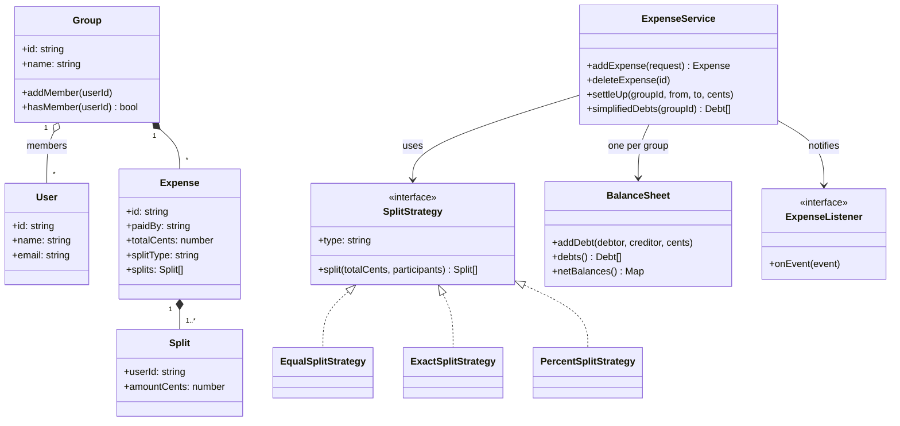
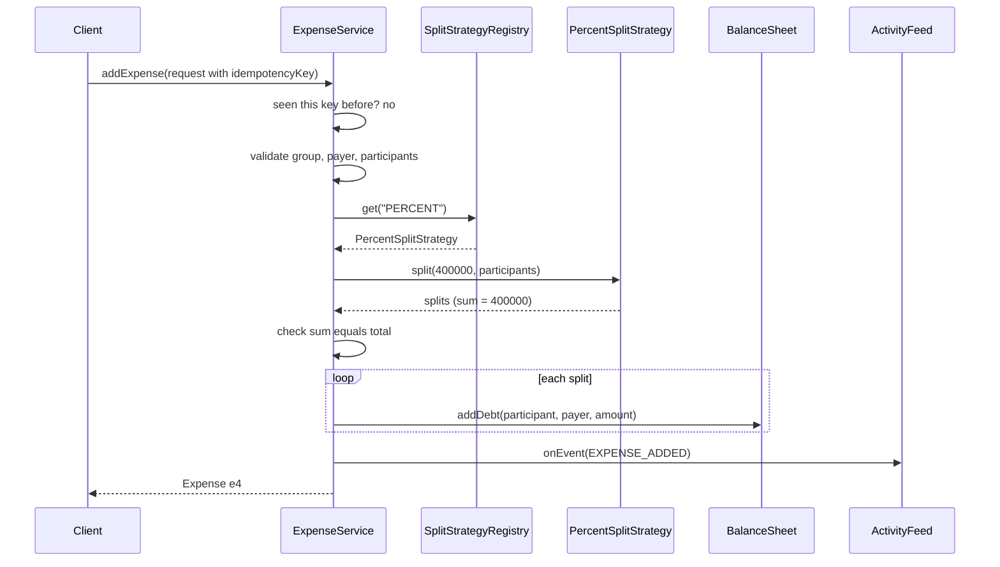

# Splitwise: Expense Sharing

> Design an app where friends add shared expenses, split them in different ways, see who owes whom, and settle up. This problem tests money handling, the Strategy pattern, a clean balance model and a small graph algorithm (debt simplification).

**Before this:** [How to approach LLD interviews](01-how-to-approach-lld-interviews.md) · [Behavioral patterns](../04-oop-solid-design-patterns/08-behavioral-patterns.md) · [SOLID principles](../04-oop-solid-design-patterns/03-solid-principles.md) · **Interview questions:** [jump to the interview section](#interview-questions)

## Table of contents

1. [Problem](#problem)
2. [Clarifying questions](#clarifying-questions)
3. [Requirements](#requirements)
4. [Core entities and relationships](#core-entities-and-relationships)
5. [Design decisions and patterns](#design-decisions-and-patterns)
6. [Implementation](#implementation)
7. [Walkthrough](#walkthrough)
8. [Handling concurrency and edge cases](#handling-concurrency-and-edge-cases)
9. [Extensions](#extensions)
10. [How to present this in the interview](#how-to-present-this-in-the-interview)
11. [Interview questions](#interview-questions)
12. [Summary](#summary)
13. [References](#references)

---

## Problem

The interviewer says:

> "Design an expense sharing application like Splitwise. Users can create groups and add expenses. One person pays, and the expense is split between some members — equally, by exact amounts, or by percentages. Users should see how much they owe or are owed, and who owes whom. They can settle up. Bonus: reduce the number of payments needed to settle a group. Write working code for the core."

This is a **low-level design (LLD)** problem. In LLD the interviewer wants classes, interfaces, methods and working code — not servers, databases and load balancers. (That is **high-level design**, covered in [the system design approach](../09-system-design/01-system-design-interview-approach.md).)

Splitwise looks simple, but it hides four traps that the interviewer is waiting to see you handle:

1. **Money and rounding.** 100.00 split three ways is not 33.33 × 3. One cent goes missing.
2. **Many split types.** Equal, exact and percentage today. Shares, adjustments and itemized bills tomorrow. A big `if/else` will not survive.
3. **The balance model.** If A owes B 50 and B owes A 20, the app must show "A owes B 30", not two separate debts.
4. **Debt simplification.** Four friends with ten small debts should settle with three payments, not ten.

---

## Clarifying questions

Ask questions for 3–5 minutes. Say your assumed answer out loud, so the interviewer can correct you. Here is a good set, with the answers we will assume.

| Question | Why you ask it | Assumed answer |
| --- | --- | --- |
| Is it only groups, or also one-to-one expenses between two friends? | Changes the main container of balances. | Groups only. A one-to-one expense is a group of two. |
| Which split types do we need? | Decides the strategies. | Equal, exact amount, percentage. Design so new types are easy to add. |
| Can more than one person pay for one expense? | Multi-payer makes the model harder. | One payer per expense. Discussed in [Extensions](#extensions). |
| One currency or many? | Currency conversion is a big topic on its own. | One currency per group. |
| How precise is money? | Rounding rules. | Two decimal places. We store **integer cents**. |
| Do we need debt simplification? | It is an algorithm, not just classes. | Yes, as a "bonus" method. |
| Can users edit or delete an expense? | Balances must be reversible. | Delete yes. Edit = delete + add again. |
| Do we need notifications? | Observer pattern. | Show an activity feed; real email/push is out of scope. |
| Persistence? Many servers? | Concurrency story. | In-memory for the interview. Explain what changes with a database. |
| Do we need user sign-up, login, friends lists? | Scope control. | No. Users already exist. |

> **Tip:** the single most valuable question is "how precise is money?". When you then say "I will store integer cents, never floating point", you show real-world experience in one sentence.

Why not floating point? Because JavaScript numbers are binary floating point, and some decimals cannot be stored exactly:

```ts
console.log(0.1 + 0.2);            // 0.30000000000000004
console.log(0.1 + 0.2 === 0.3);    // false
console.log((10 + 20) === 30);     // true  -> work in cents, add integers
```

Integers are exact up to `Number.MAX_SAFE_INTEGER` (about 9 × 10^15). That is 90 trillion in cents, which is enough for a shared dinner app. A banking system would use `bigint` or a decimal library.

---

## Requirements

### Functional requirements

1. Create users and groups; add members to a group.
2. Add an expense: description, payer, total amount, split type, participants.
3. Split types:
   - **Equal**: total divided equally; leftover cents go to the first participants.
   - **Exact**: each participant has an exact amount; amounts must add up to the total.
   - **Percentage**: each participant has a percent; percents must add up to 100.
4. Show **pairwise balances** ("Ben owes Asha 2966.66").
5. Show **net balance** per user ("Asha gets back 6866.66 in total").
6. **Settle up**: record a payment from one user to another.
7. **Delete** an expense (reverses its effect on balances).
8. **Simplify debts**: suggest the fewest practical payments to settle the group.
9. **Activity feed**: other parts of the app are told when an expense is added or settled.

### Non-functional requirements

- **Correctness of money**: the sum of splits always equals the total, to the cent. The sum of all net balances in a group is always zero.
- **Extensibility**: add a new split type without editing the expense service (Open/Closed Principle).
- **Idempotency**: if the mobile app retries "add expense" after a network timeout, the expense must not be added twice.
- **Concurrency**: two members adding expenses at the same time must not lose an update to the balances.
- **Testability**: no hidden globals; dependencies come in through constructors.
- **Performance**: reading balances should be fast (O(number of debts)), not a re-scan of every expense ever added.

---

## Core entities and relationships

Find the **nouns** in the problem; they are candidate classes. Then find the **verbs**; they become methods.

- **Nouns:** user, group, expense, split, balance, payment (settlement), split type.
- **Verbs:** add expense, split, settle, show balances, simplify, delete.

| Entity | Responsibility | Key fields |
| --- | --- | --- |
| `User` | A person. Pure data. | `id`, `name`, `email` |
| `Group` | A set of members who share expenses. | `id`, `name`, member ids |
| `Expense` | One bill, immutable after creation. | `id`, `groupId`, `paidBy`, `totalCents`, `splitType`, `splits` |
| `Split` | "This user's share of this expense." Value object. | `userId`, `amountCents` |
| `SplitStrategy` | Turns a total + participants into splits. | `type`, `split()` |
| `SplitStrategyRegistry` | Finds the strategy for a split type. | map of type → strategy |
| `BalanceSheet` | Who owes whom inside one group. | pairwise net amounts |
| `DebtSimplifier` | Turns net balances into a short payment list. | pure function |
| `ExpenseService` | The use cases: add, delete, settle, read. | repositories, sheets, listeners |
| `ExpenseListener` | Gets told about events (activity feed, notifications). | `onEvent()` |

A **value object** is a small object defined only by its values (like `Split` or a date). Two splits with the same user and amount are equal. It has no identity and should not change.



How to read it:

- `Group o-- User` is **aggregation**: a group *has* users, but users live on without the group.
- `Group *-- Expense` is **composition**: an expense belongs to exactly one group and makes no sense without it.
- `SplitStrategy <|.. EqualSplitStrategy` is **interface realization**: the class implements the interface.
- `-->` is a plain **association** ("uses" or "knows about").

---

## Design decisions and patterns

### Decision 1: store money as integer cents

All amounts are `number` values that are whole cents. We validate this with `Number.isInteger`. Formatting to "12.34" happens only at the edge (when printing). This one decision removes a whole class of bugs.

### Decision 2: Strategy pattern for split types

The split rule is the part that changes most. Equal, exact, percentage today; "by shares" (2:1:1) and "equal plus adjustment" tomorrow. Each rule becomes a class that implements one small interface:

```text
interface SplitStrategy {
  type: string
  split(totalCents, participants): Split[]
}
```

This is the [Strategy pattern](../04-oop-solid-design-patterns/08-behavioral-patterns.md#strategy): a family of interchangeable algorithms behind one interface. The `ExpenseService` does not know *how* splitting works; it only asks the strategy.

Why it matters (SOLID):

- **Single Responsibility:** the percentage rounding rule lives in one class. Nothing else changes when finance asks for a different rounding rule.
- **Open/Closed:** to add "by shares", you write a new class and register it. You do not edit `ExpenseService`. See [Open/Closed Principle](../04-oop-solid-design-patterns/03-solid-principles.md#o-openclosed-principle).
- **Liskov Substitution:** every strategy obeys the same contract: "returns splits whose amounts add up to the total, or throws a validation error". The service checks this contract after every call, so a buggy strategy cannot corrupt balances.

### Decision 3: a registry instead of a `switch`

We need to pick a strategy from a string like `"PERCENT"`. A `switch` inside the service would break Open/Closed again. Instead we use a small **registry** (a map from type to strategy). It is a simple form of the [Factory pattern](../04-oop-solid-design-patterns/06-creational-patterns.md#simple-factory-and-factory-method): you ask for a type, it gives you the right object.

### Decision 4: pairwise net balances, not a list of every debt

There are two common ways to store balances:

| Option | How it works | Good | Bad |
| --- | --- | --- | --- |
| Recompute from all expenses | Every read walks all expenses. | Always correct; simple writes. | Slow for big groups; O(expenses) per read. |
| **Pairwise net map** (our choice) | Key `"a\|b"` with `a < b`. Positive value = `a` owes `b`. | O(1) update, fast reads, A↔B debts cancel automatically. | Must update carefully on every write and delete. |

The pairwise key with sorted ids is the important trick. We never store both "A owes B 50" and "B owes A 20". We store one number: +30. Debts in opposite directions cancel by simple addition.

We also keep every `Expense` (the history). In a real system the expenses are the **source of truth** (an append-only ledger) and the balance map is a **derived view** that can always be rebuilt. That gives us a safety net if a bug ever corrupts the map.

### Decision 5: Observer for the activity feed

When an expense is added, many things may want to react: the activity feed, push notifications, an email digest, analytics. The service should not call each of them directly. It emits an event to a list of `ExpenseListener`s. That is the [Observer pattern](../04-oop-solid-design-patterns/08-behavioral-patterns.md#observer). The service depends only on the small `ExpenseListener` interface (Dependency Inversion).

### Decision 6: dependency injection through the constructor

`ExpenseService` receives its `SplitStrategyRegistry` in its constructor. Tests can pass a registry with a fake strategy. See [Dependency inversion and injection](../04-oop-solid-design-patterns/05-dependency-inversion-and-injection.md).

### Decision 7: no Singleton

It is tempting to make `ExpenseService` a Singleton ("there is only one"). Do not. A Singleton is a hidden global: tests share state, and you cannot run two groups of tests in parallel. Instead, create one instance at the start of the app (the **composition root**) and pass it where needed. Say this out loud in the interview; it shows you know the trade-off. See [Singleton](../04-oop-solid-design-patterns/06-creational-patterns.md#singleton).

### Decision 8: validation errors are a separate error type

A `ValidationError` means "the user sent bad input" (show it in the UI). Any other `Error` means "our code has a bug" (log it and alert). Keeping them apart lets the API layer map them to HTTP 400 vs 500.

### Patterns used — summary

| Pattern / principle | Where | Why |
| --- | --- | --- |
| Strategy | `SplitStrategy` and its three classes | Split rules change independently. |
| Simple Factory / Registry | `SplitStrategyRegistry` | Choose a strategy by name without `switch`. |
| Observer | `ExpenseListener`, `ActivityFeed` | Decouple side effects from the core. |
| Value object | `Split`, `Debt` | Small immutable data. |
| Dependency injection | `ExpenseService` constructor | Testable, no globals. |
| Greedy algorithm | `simplifyDebts` | Few payments to settle a group. |

---

## Implementation

We build it in seven steps: helpers → entities → strategies → balance sheet → simplifier → service → demo. The code blocks in this section together form **one runnable TypeScript file** (Node.js 22+ can run it directly with `node splitwise.ts`).

### Step 1: types, money helpers and errors

```ts
type UserId = string;
type GroupId = string;
type ExpenseId = string;

// "Bad input from the user" -> show it, HTTP 400. Any other Error is a bug.
class ValidationError extends Error {
  constructor(message: string) {
    super(message);
    this.name = 'ValidationError';
  }
}

// 123456 -> "1234.56", -5 -> "-0.05". Only used when printing.
function formatMoney(cents: number): string {
  const sign = cents < 0 ? '-' : '';
  const abs = Math.abs(cents);
  return `${sign}${Math.floor(abs / 100)}.${String(abs % 100).padStart(2, '0')}`;
}

function assertPositiveCents(cents: number, label: string): void {
  if (!Number.isInteger(cents) || cents <= 0) {
    throw new ValidationError(`${label} must be a positive whole number of cents`);
  }
}

// Predictable ids make the demo output stable. A real app would use UUIDs.
class IdGenerator {
  private counter = 0;
  private readonly prefix: string;

  constructor(prefix: string) {
    this.prefix = prefix;
  }

  next(): string {
    this.counter += 1;
    return `${this.prefix}${this.counter}`;
  }
}
```

Note that we do not use TypeScript `enum`s or constructor "parameter properties" (`constructor(private x: number)`). Node.js runs TypeScript by **stripping** the types, and those two features generate JavaScript code, so plain type stripping cannot run them. We use `as const` objects and explicit fields instead. This is also a common style in modern TypeScript codebases.

### Step 2: entities

```ts
class User {
  readonly id: UserId;
  readonly name: string;
  readonly email: string;

  constructor(id: UserId, name: string, email: string) {
    this.id = id;
    this.name = name;
    this.email = email;
  }
}

class Group {
  readonly id: GroupId;
  readonly name: string;
  private readonly memberIds = new Set<UserId>();

  constructor(id: GroupId, name: string, memberIds: readonly UserId[]) {
    this.id = id;
    this.name = name;
    for (const memberId of memberIds) this.memberIds.add(memberId);
  }

  addMember(userId: UserId): void {
    this.memberIds.add(userId);
  }

  hasMember(userId: UserId): boolean {
    return this.memberIds.has(userId);
  }

  get members(): UserId[] {
    return [...this.memberIds];
  }
}

// Value objects: plain readonly data.
interface Split {
  readonly userId: UserId;
  readonly amountCents: number;
}

interface Debt {
  readonly from: UserId;
  readonly to: UserId;
  readonly amountCents: number;
}

// The input for one participant. "value" means cents for EXACT
// and percent for PERCENT. EQUAL ignores it.
interface Participant {
  readonly userId: UserId;
  readonly value?: number;
}

const SplitType = {
  EQUAL: 'EQUAL',
  EXACT: 'EXACT',
  PERCENT: 'PERCENT',
} as const;

interface ExpenseProps {
  readonly id: ExpenseId;
  readonly groupId: GroupId;
  readonly description: string;
  readonly paidBy: UserId;
  readonly totalCents: number;
  readonly splitType: string;
  readonly splits: readonly Split[];
}

// Immutable. To "edit" an expense, delete it and add a new one.
class Expense {
  readonly id: ExpenseId;
  readonly groupId: GroupId;
  readonly description: string;
  readonly paidBy: UserId;
  readonly totalCents: number;
  readonly splitType: string;
  readonly splits: readonly Split[];

  constructor(props: ExpenseProps) {
    this.id = props.id;
    this.groupId = props.groupId;
    this.description = props.description;
    this.paidBy = props.paidBy;
    this.totalCents = props.totalCents;
    this.splitType = props.splitType;
    this.splits = Object.freeze([...props.splits]);
  }
}
```

The `Expense` constructor takes one **props object** instead of seven positional arguments. With seven arguments, it is easy to swap `paidBy` and `description` by mistake; with named fields, it is impossible.

`splitType` is a `string`, not a closed union like `'EQUAL' | 'EXACT' | 'PERCENT'`. This is on purpose: a new strategy registered later (for example `'SHARES'`) must be allowed without editing this type. `SplitType` only names the built-in ones.

### Step 3: split strategies (the Strategy pattern)

```ts
interface SplitStrategy {
  readonly type: string;
  // Must return splits that add up to totalCents, or throw ValidationError.
  split(totalCents: number, participants: readonly Participant[]): Split[];
}

// Gives leftover cents, one each, to the first participants.
// Example: 100 cents / 3 -> [34, 33, 33].
function distributeRemainder(baseAmounts: number[], remainderCents: number): number[] {
  return baseAmounts.map((amount, index) => (index < remainderCents ? amount + 1 : amount));
}

class EqualSplitStrategy implements SplitStrategy {
  readonly type = SplitType.EQUAL;

  split(totalCents: number, participants: readonly Participant[]): Split[] {
    const count = participants.length;
    const base = Math.floor(totalCents / count);
    const amounts = distributeRemainder(new Array<number>(count).fill(base), totalCents - base * count);
    return participants.map((p, i) => ({ userId: p.userId, amountCents: amounts[i] }));
  }
}

class ExactSplitStrategy implements SplitStrategy {
  readonly type = SplitType.EXACT;

  split(totalCents: number, participants: readonly Participant[]): Split[] {
    const splits = participants.map((p) => {
      const value = p.value;
      if (value === undefined || !Number.isInteger(value) || value < 0) {
        throw new ValidationError(`Exact split needs a whole, non-negative cent amount for ${p.userId}`);
      }
      return { userId: p.userId, amountCents: value };
    });
    const sum = splits.reduce((total, s) => total + s.amountCents, 0);
    if (sum !== totalCents) {
      throw new ValidationError(`Exact amounts add up to ${formatMoney(sum)}, but the total is ${formatMoney(totalCents)}`);
    }
    return splits;
  }
}

class PercentSplitStrategy implements SplitStrategy {
  readonly type = SplitType.PERCENT;

  split(totalCents: number, participants: readonly Participant[]): Split[] {
    const percents = participants.map((p) => {
      if (p.value === undefined || p.value < 0) {
        throw new ValidationError(`Percent split needs a non-negative percent for ${p.userId}`);
      }
      return p.value;
    });
    const totalPercent = percents.reduce((a, b) => a + b, 0);
    if (Math.abs(totalPercent - 100) > 1e-9) {
      throw new ValidationError(`Percents add up to ${totalPercent}, not 100`);
    }
    const base = percents.map((pct) => Math.floor((totalCents * pct) / 100));
    const remainder = totalCents - base.reduce((a, b) => a + b, 0);
    const amounts = distributeRemainder(base, remainder);
    return participants.map((p, i) => ({ userId: p.userId, amountCents: amounts[i] }));
  }
}

// A tiny registry (simple factory). New types are registered, not switch-cased.
class SplitStrategyRegistry {
  private readonly strategies = new Map<string, SplitStrategy>();

  register(strategy: SplitStrategy): this {
    this.strategies.set(strategy.type, strategy);
    return this;
  }

  get(type: string): SplitStrategy {
    const strategy = this.strategies.get(type);
    if (!strategy) throw new ValidationError(`Unknown split type: ${type}`);
    return strategy;
  }
}
```

Look at how rounding is handled. `Math.floor` first gives everybody a little too little. The **remainder** (a few cents) is then handed out one cent at a time. The result always adds up to the total exactly. The rule "first participants pay the extra cent" is simple and predictable; real apps sometimes give it to the payer or rotate it. Mention that the rule is a business decision, not a technical one.

### Step 4: the balance sheet

```ts
// Pairwise net balances for one group.
// Key "a|b" with a < b. Value > 0: a owes b. Value < 0: b owes a.
class BalanceSheet {
  private readonly pairs = new Map<string, number>();

  addDebt(debtor: UserId, creditor: UserId, cents: number): void {
    if (debtor === creditor || cents === 0) return;
    const [a, b, sign] = debtor < creditor ? [debtor, creditor, 1] : [creditor, debtor, -1];
    const key = `${a}|${b}`;
    const next = (this.pairs.get(key) ?? 0) + sign * cents;
    if (next === 0) this.pairs.delete(key);
    else this.pairs.set(key, next);
  }

  // How much debtor owes creditor right now (0 if nothing, negative if reversed).
  owes(debtor: UserId, creditor: UserId): number {
    if (debtor === creditor) return 0;
    const [a, b, sign] = debtor < creditor ? [debtor, creditor, 1] : [creditor, debtor, -1];
    return sign * (this.pairs.get(`${a}|${b}`) ?? 0);
  }

  debts(): Debt[] {
    const result: Debt[] = [];
    for (const [key, value] of this.pairs) {
      const [a, b] = key.split('|');
      result.push(value > 0 ? { from: a, to: b, amountCents: value } : { from: b, to: a, amountCents: -value });
    }
    return result.sort((x, y) => x.from.localeCompare(y.from) || x.to.localeCompare(y.to));
  }

  // Positive: this user should get money back. Negative: this user should pay.
  netBalances(): Map<UserId, number> {
    const net = new Map<UserId, number>();
    for (const debt of this.debts()) {
      net.set(debt.from, (net.get(debt.from) ?? 0) - debt.amountCents);
      net.set(debt.to, (net.get(debt.to) ?? 0) + debt.amountCents);
    }
    return net;
  }
}
```

One important detail: `addDebt` deletes the key when the value becomes exactly `0`. Without this, settled pairs would stay in the map forever and show up as "owes 0.00".

### Step 5: debt simplification

```ts
interface Party {
  readonly userId: UserId;
  amountCents: number;
}

// Greedy: the biggest debtor pays the biggest creditor, as much as possible.
// Gives at most (people - 1) payments. Pure function: easy to test.
function simplifyDebts(net: ReadonlyMap<UserId, number>): Debt[] {
  const byAmountThenId = (x: Party, y: Party) => y.amountCents - x.amountCents || x.userId.localeCompare(y.userId);
  const creditors: Party[] = [];
  const debtors: Party[] = [];
  for (const [userId, amount] of net) {
    if (amount > 0) creditors.push({ userId, amountCents: amount });
    if (amount < 0) debtors.push({ userId, amountCents: -amount });
  }
  creditors.sort(byAmountThenId);
  debtors.sort(byAmountThenId);

  const payments: Debt[] = [];
  let c = 0;
  let d = 0;
  while (c < creditors.length && d < debtors.length) {
    const pay = Math.min(creditors[c].amountCents, debtors[d].amountCents);
    payments.push({ from: debtors[d].userId, to: creditors[c].userId, amountCents: pay });
    creditors[c].amountCents -= pay;
    debtors[d].amountCents -= pay;
    if (creditors[c].amountCents === 0) c += 1;
    if (debtors[d].amountCents === 0) d += 1;
  }
  return payments;
}
```

Each loop step finishes at least one person (their amount becomes zero), so there are at most `n - 1` payments for `n` people. Sorting costs O(n log n). Finding the true **minimum** number of payments is NP-hard (it is related to the subset-sum problem), so real apps use a greedy approach like this one. Say so if the interviewer asks "is this optimal?".

### Step 6: events and the service

```ts
type ExpenseEvent =
  | { readonly type: 'EXPENSE_ADDED'; readonly expense: Expense }
  | { readonly type: 'EXPENSE_DELETED'; readonly expense: Expense }
  | { readonly type: 'SETTLED'; readonly groupId: GroupId; readonly from: UserId; readonly to: UserId; readonly amountCents: number };

interface ExpenseListener {
  onEvent(event: ExpenseEvent): void;
}

interface AddExpenseRequest {
  readonly groupId: GroupId;
  readonly description: string;
  readonly paidBy: UserId;
  readonly totalCents: number;
  readonly splitType: string;
  readonly participants: readonly Participant[];
  readonly idempotencyKey?: string;
}

class ExpenseService {
  private readonly users = new Map<UserId, User>();
  private readonly groups = new Map<GroupId, Group>();
  private readonly sheets = new Map<GroupId, BalanceSheet>();
  private readonly expenses = new Map<ExpenseId, Expense>();
  private readonly byIdempotencyKey = new Map<string, Expense>();
  private readonly listeners: ExpenseListener[] = [];
  private readonly expenseIds = new IdGenerator('e');
  private readonly strategies: SplitStrategyRegistry;

  constructor(strategies: SplitStrategyRegistry) {
    this.strategies = strategies;
  }

  subscribe(listener: ExpenseListener): void {
    this.listeners.push(listener);
  }

  addUser(user: User): void {
    this.users.set(user.id, user);
  }

  userName(userId: UserId): string {
    return this.users.get(userId)?.name ?? userId;
  }

  createGroup(id: GroupId, name: string, memberIds: readonly UserId[]): Group {
    for (const memberId of memberIds) this.requireUser(memberId);
    const group = new Group(id, name, memberIds);
    this.groups.set(id, group);
    this.sheets.set(id, new BalanceSheet());
    return group;
  }

  addExpense(request: AddExpenseRequest): Expense {
    // 1. Idempotency: the same retry returns the first result.
    if (request.idempotencyKey) {
      const existing = this.byIdempotencyKey.get(request.idempotencyKey);
      if (existing) return existing;
    }

    // 2. Validate everything BEFORE changing any state.
    const group = this.requireGroup(request.groupId);
    assertPositiveCents(request.totalCents, 'Total');
    this.requireMember(group, request.paidBy);
    if (request.participants.length === 0) throw new ValidationError('An expense needs at least one participant');
    const seen = new Set<UserId>();
    for (const p of request.participants) {
      this.requireMember(group, p.userId);
      if (seen.has(p.userId)) throw new ValidationError(`${p.userId} is listed twice`);
      seen.add(p.userId);
    }

    // 3. Split, then check that the strategy kept its contract.
    const splits = this.strategies.get(request.splitType).split(request.totalCents, request.participants);
    const sum = splits.reduce((total, s) => total + s.amountCents, 0);
    if (sum !== request.totalCents) {
      throw new Error(`Bug in ${request.splitType} strategy: splits add up to ${sum}, not ${request.totalCents}`);
    }

    // 4. Commit: store the expense and update the balance sheet.
    const expense = new Expense({
      id: this.expenseIds.next(),
      groupId: group.id,
      description: request.description,
      paidBy: request.paidBy,
      totalCents: request.totalCents,
      splitType: request.splitType,
      splits,
    });
    this.expenses.set(expense.id, expense);
    this.applyExpense(expense, 1);
    if (request.idempotencyKey) this.byIdempotencyKey.set(request.idempotencyKey, expense);

    // 5. Tell the listeners (activity feed, notifications...).
    this.emit({ type: 'EXPENSE_ADDED', expense });
    return expense;
  }

  deleteExpense(expenseId: ExpenseId): void {
    const expense = this.expenses.get(expenseId);
    if (!expense) throw new ValidationError(`Expense ${expenseId} not found`);
    this.applyExpense(expense, -1); // reverse its effect
    this.expenses.delete(expenseId);
    this.emit({ type: 'EXPENSE_DELETED', expense });
  }

  settleUp(groupId: GroupId, from: UserId, to: UserId, amountCents: number): void {
    const group = this.requireGroup(groupId);
    this.requireMember(group, from);
    this.requireMember(group, to);
    assertPositiveCents(amountCents, 'Payment');
    const sheet = this.sheetFor(groupId);
    const owed = sheet.owes(from, to);
    if (amountCents > owed) {
      throw new ValidationError(`${this.userName(from)} owes ${this.userName(to)} only ${formatMoney(Math.max(owed, 0))}`);
    }
    // Paying back a debt = the creditor now "owes" the debtor the same amount.
    sheet.addDebt(to, from, amountCents);
    this.emit({ type: 'SETTLED', groupId, from, to, amountCents });
  }

  debts(groupId: GroupId): Debt[] {
    return this.sheetFor(groupId).debts();
  }

  netBalances(groupId: GroupId): Map<UserId, number> {
    return this.sheetFor(groupId).netBalances();
  }

  simplifiedDebts(groupId: GroupId): Debt[] {
    return simplifyDebts(this.netBalances(groupId));
  }

  private applyExpense(expense: Expense, direction: 1 | -1): void {
    const sheet = this.sheetFor(expense.groupId);
    for (const split of expense.splits) {
      sheet.addDebt(split.userId, expense.paidBy, direction * split.amountCents);
    }
  }

  private emit(event: ExpenseEvent): void {
    for (const listener of this.listeners) {
      try {
        listener.onEvent(event);
      } catch (error) {
        // A broken listener must not undo or block the expense itself.
        console.error('Listener failed:', error);
      }
    }
  }

  private requireUser(userId: UserId): User {
    const user = this.users.get(userId);
    if (!user) throw new ValidationError(`Unknown user ${userId}`);
    return user;
  }

  private requireGroup(groupId: GroupId): Group {
    const group = this.groups.get(groupId);
    if (!group) throw new ValidationError(`Unknown group ${groupId}`);
    return group;
  }

  private requireMember(group: Group, userId: UserId): void {
    this.requireUser(userId);
    if (!group.hasMember(userId)) throw new ValidationError(`${this.userName(userId)} is not in ${group.name}`);
  }

  private sheetFor(groupId: GroupId): BalanceSheet {
    const sheet = this.sheets.get(groupId);
    if (!sheet) throw new ValidationError(`Unknown group ${groupId}`);
    return sheet;
  }
}
```

Three things to point out in the interview:

1. **Validate first, then mutate.** All checks run before the first write. If anything throws, the state is unchanged. This is the in-memory version of a database transaction.
2. **Trust, but verify the strategy.** After `split()`, the service checks that the splits add up to the total. A broken strategy causes a loud bug report, not silently wrong balances.
3. **The listener loop catches errors.** If the push-notification listener crashes, the expense is still saved and the other listeners still run.

### Step 7: an activity feed listener and the demo

```ts
class ActivityFeed implements ExpenseListener {
  private readonly nameOf: (userId: UserId) => string;

  constructor(nameOf: (userId: UserId) => string) {
    this.nameOf = nameOf;
  }

  onEvent(event: ExpenseEvent): void {
    if (event.type === 'EXPENSE_ADDED') {
      const e = event.expense;
      console.log(`[feed] ${this.nameOf(e.paidBy)} added "${e.description}" (${formatMoney(e.totalCents)}, ${e.splitType})`);
    } else if (event.type === 'EXPENSE_DELETED') {
      console.log(`[feed] "${event.expense.description}" was deleted`);
    } else {
      console.log(`[feed] ${this.nameOf(event.from)} paid ${this.nameOf(event.to)} ${formatMoney(event.amountCents)}`);
    }
  }
}

function printDebts(title: string, debts: readonly Debt[], nameOf: (id: UserId) => string): void {
  console.log(title);
  for (const d of debts) console.log(`  ${nameOf(d.from)} owes ${nameOf(d.to)} ${formatMoney(d.amountCents)}`);
}

function main(): void {
  // Composition root: build the object graph once, here.
  const registry = new SplitStrategyRegistry()
    .register(new EqualSplitStrategy())
    .register(new ExactSplitStrategy())
    .register(new PercentSplitStrategy());
  const service = new ExpenseService(registry);
  const name = (id: UserId) => service.userName(id);
  service.subscribe(new ActivityFeed(name));

  service.addUser(new User('u1', 'Asha', 'asha@example.com'));
  service.addUser(new User('u2', 'Ben', 'ben@example.com'));
  service.addUser(new User('u3', 'Chen', 'chen@example.com'));
  service.addUser(new User('u4', 'Dev', 'dev@example.com'));
  service.createGroup('g1', 'Goa trip', ['u1', 'u2', 'u3', 'u4']);

  // 1. Asha pays the hotel, split equally between four people.
  service.addExpense({
    groupId: 'g1', description: 'Hotel', paidBy: 'u1', totalCents: 1_200_000,
    splitType: SplitType.EQUAL, participants: [{ userId: 'u1' }, { userId: 'u2' }, { userId: 'u3' }, { userId: 'u4' }],
  });
  // 2. Ben pays 100.00 for dinner for three people: 33.34 + 33.33 + 33.33.
  const dinner = service.addExpense({
    groupId: 'g1', description: 'Dinner', paidBy: 'u2', totalCents: 10_000,
    splitType: SplitType.EQUAL, participants: [{ userId: 'u1' }, { userId: 'u2' }, { userId: 'u3' }],
  });
  console.log('Dinner splits:', dinner.splits.map((s) => `${name(s.userId)}=${formatMoney(s.amountCents)}`).join(', '));
  // 3. Chen pays the taxi; exact amounts.
  service.addExpense({
    groupId: 'g1', description: 'Taxi', paidBy: 'u3', totalCents: 150_000, splitType: SplitType.EXACT,
    participants: [{ userId: 'u1', value: 50_000 }, { userId: 'u3', value: 30_000 }, { userId: 'u4', value: 70_000 }],
  });
  // 4. Dev pays for scuba diving; split by percent. The phone sends an idempotency key.
  const scubaRequest: AddExpenseRequest = {
    groupId: 'g1', description: 'Scuba', paidBy: 'u4', totalCents: 400_000, splitType: SplitType.PERCENT,
    participants: [{ userId: 'u1', value: 40 }, { userId: 'u2', value: 30 }, { userId: 'u4', value: 30 }],
    idempotencyKey: 'phone-dev-42',
  };
  const first = service.addExpense(scubaRequest);
  const retry = service.addExpense(scubaRequest); // network retry: no second expense
  console.log(`Retry returned the same expense: ${first.id === retry.id} (${first.id})`);

  printDebts('Who owes whom:', service.debts('g1'), name);
  console.log('Net balances:');
  for (const [userId, cents] of service.netBalances('g1')) {
    console.log(`  ${name(userId)}: ${cents >= 0 ? 'gets back' : 'pays'} ${formatMoney(Math.abs(cents))}`);
  }
  printDebts('Simplified payments:', service.simplifiedDebts('g1'), name);

  // Bad input is rejected and changes nothing.
  try {
    service.addExpense({
      groupId: 'g1', description: 'Snacks', paidBy: 'u1', totalCents: 1_000, splitType: SplitType.PERCENT,
      participants: [{ userId: 'u2', value: 50 }, { userId: 'u3', value: 40 }],
    });
  } catch (error) {
    console.log(`Rejected: ${(error as Error).message}`);
  }

  // Settle up, then delete the dinner expense.
  service.settleUp('g1', 'u4', 'u3', 70_000);
  service.deleteExpense(dinner.id);
  printDebts('After settling and deleting dinner:', service.debts('g1'), name);
}

main();
```

Running it prints:

```text
[feed] Asha added "Hotel" (12000.00, EQUAL)
[feed] Ben added "Dinner" (100.00, EQUAL)
Dinner splits: Asha=33.34, Ben=33.33, Chen=33.33
[feed] Chen added "Taxi" (1500.00, EXACT)
[feed] Dev added "Scuba" (4000.00, PERCENT)
Retry returned the same expense: true (e4)
Who owes whom:
  Ben owes Asha 2966.66
  Ben owes Dev 1200.00
  Chen owes Asha 2500.00
  Chen owes Ben 33.33
  Dev owes Asha 1400.00
  Dev owes Chen 700.00
Net balances:
  Ben: pays 4133.33
  Asha: gets back 6866.66
  Dev: pays 900.00
  Chen: pays 1833.33
Simplified payments:
  Ben owes Asha 4133.33
  Chen owes Asha 1833.33
  Dev owes Asha 900.00
Rejected: Percents add up to 90, not 100
[feed] Dev paid Chen 700.00
[feed] "Dinner" was deleted
After settling and deleting dinner:
  Ben owes Asha 3000.00
  Ben owes Dev 1200.00
  Chen owes Asha 2500.00
  Dev owes Asha 1400.00
```

Check the numbers by hand once, because interviewers sometimes do:

- Hotel: each person's share is 3000.00. Ben, Chen and Dev each owe Asha 3000.00.
- Dinner: Asha owes Ben 33.34. That cancels against "Ben owes Asha 3000.00", leaving **Ben owes Asha 2966.66**. Chen owes Ben 33.33. Ben's own share is ignored (you cannot owe yourself).
- Taxi: Asha owes Chen 500.00, so "Chen owes Asha" drops to **2500.00**. Dev owes Chen **700.00**.
- Scuba: Asha owes Dev 1600.00, so "Dev owes Asha" drops to **1400.00**. Ben owes Dev **1200.00**.
- Net balances add up to zero: 6866.66 − 4133.33 − 900.00 − 1833.33 = 0. This is the **conservation invariant** of the system. It is a great property to assert in tests.
- Six pairwise debts become **three** simplified payments.

---

## Walkthrough

Here is the "add expense" flow, the heart of the system.



In words:

1. The client sends the request with an idempotency key (a unique id the phone creates once per "Save" tap).
2. The service returns the stored expense if it has seen that key before.
3. It validates the group, the payer and every participant — and does **not** change anything yet.
4. The registry hands back the strategy for `PERCENT`. The service does not know which class it is.
5. The strategy returns splits. The service checks that they add up to the total.
6. The expense is stored, and each split becomes a debt from the participant to the payer. The payer's own split is skipped by `addDebt` because `debtor === creditor`.
7. Listeners are told. The method returns the expense.

---

## Handling concurrency and edge cases

### Concurrency: the lost update

In our in-memory version, `addExpense` is **synchronous**. JavaScript runs one piece of code at a time on one thread, so nothing can run "in the middle" of `addExpense`. Two requests are handled one after the other. There is no race.

The race appears as soon as there is an `await` between **reading** a balance and **writing** it back. That happens when balances live in a database. Two requests read the same old value, both add to it, and the second write overwrites the first. This is called a **lost update**.

This program shows the bug and a fix, using a fake database with a small delay:

```ts
// A fake async database. Every call waits a little, like a network round trip.
const db = new Map<string, number>([['u2|u1', 0]]);
const hop = () => new Promise<void>((resolve) => setTimeout(resolve, 5));

async function read(key: string): Promise<number> {
  await hop();
  return db.get(key) ?? 0;
}
async function write(key: string, value: number): Promise<void> {
  await hop();
  db.set(key, value);
}

// ❌ read-modify-write with an await in the middle
async function addDebt(key: string, cents: number): Promise<void> {
  const current = await read(key);
  await write(key, current + cents);
}

// ✅ one-at-a-time per group: a tiny async lock built from a promise chain
class KeyedMutex {
  private readonly tails = new Map<string, Promise<void>>();

  async run<T>(key: string, task: () => Promise<T>): Promise<T> {
    const previous = this.tails.get(key) ?? Promise.resolve();
    let release!: () => void;
    const current = new Promise<void>((resolve) => (release = resolve));
    const tail = previous.then(() => current);
    this.tails.set(key, tail);
    await previous; // wait for everyone before us
    try {
      return await task();
    } finally {
      release();
      if (this.tails.get(key) === tail) this.tails.delete(key);
    }
  }
}

async function main(): Promise<void> {
  await Promise.all([addDebt('u2|u1', 1_000), addDebt('u2|u1', 2_000)]);
  console.log('Without a lock:', db.get('u2|u1')); // one update is lost

  db.set('u2|u1', 0);
  const mutex = new KeyedMutex();
  await Promise.all([
    mutex.run('g1', () => addDebt('u2|u1', 1_000)),
    mutex.run('g1', () => addDebt('u2|u1', 2_000)),
  ]);
  console.log('With a per-group lock:', db.get('u2|u1'));
}

main();
```

Output:

```text
Without a lock: 2000
With a per-group lock: 3000
```

An in-process lock only works for **one** Node.js process. With several servers, you need the database to protect you. Explain these options, from simplest to most flexible:

1. **Atomic update in SQL.** Do not read then write. Let the database do the math: `UPDATE balances SET amount_cents = amount_cents + $1 WHERE group_id = $2 AND pair_key = $3`. The row lock inside the database makes it safe. Insert the expense and update the balances in **one transaction**, so they never disagree.
2. **Append-only ledger.** Never update a balance row at all. Insert one ledger row per split (`debtor, creditor, amount, expense_id`). Inserts do not conflict with each other. Balances are `SUM(amount) GROUP BY pair`, cached in a table or recomputed. This is how accounting systems work, and it gives a full audit trail for free.
3. **Optimistic locking** for edits. Each expense has a `version` number. "Update expense 7 where version = 3". If another user already edited it, zero rows change and the app shows "this expense was changed by someone else, reload". See [race conditions in async Node.js code](../07-nodejs-backend/12-concurrency-worker-threads-and-cluster.md#race-conditions-in-async-nodejs-code).
4. **Idempotency keys** with a unique index in the database, so a retried request cannot create a second row even when two retries arrive at the same time.

### Edge cases and how the design handles them

| Edge case | What happens |
| --- | --- |
| 100.00 split 3 ways | 33.34 + 33.33 + 33.33. Sum is exact. |
| Percents like 15.46 + 48.59 + 35.95 | Allowed. The sum check uses a tiny tolerance (`1e-9`) because in JavaScript `15.46 + 48.59 + 35.95` is `100.00000000000001`, not exactly 100. |
| Percents add up to 90 | `ValidationError`, nothing is stored. |
| Exact amounts do not add up | `ValidationError` with both numbers in the message. |
| Payer is not a participant (a gift) | Fine. Every participant owes the payer their full split. |
| Payer is the only participant | Expense is stored; balances do not change. |
| Same user listed twice | `ValidationError`. |
| Amount is 0, negative or `12.5` cents | `ValidationError` from `assertPositiveCents`. |
| Unknown split type | `ValidationError` from the registry. |
| Paying back more than you owe | `ValidationError` ("owes only ..."). A real app may allow it and show a reversed debt; it is a product decision. |
| Deleting an expense after settling | Balances can flip direction (B now owes A instead of A owing B). That is correct accounting. |
| A user leaves the group | Block it while their net balance is not zero. |
| A listener throws | Caught and logged; the expense is still saved. |
| Huge amounts | Integers are exact up to 2^53 − 1 cents. For more, use `bigint`. |

---

## Extensions

### A new split type: shares

"Ben had two drinks, Asha and Chen had one each. Split 2:1:1." With the Strategy pattern this is one new class plus one `register` call. Nothing else changes. That is the **Open/Closed Principle** in action.

```ts
// Builds on the Implementation code above.
class SharesSplitStrategy implements SplitStrategy {
  readonly type = 'SHARES';

  split(totalCents: number, participants: readonly Participant[]): Split[] {
    const shares = participants.map((p) => {
      if (p.value === undefined || !Number.isInteger(p.value) || p.value <= 0) {
        throw new ValidationError(`Shares split needs a positive whole number of shares for ${p.userId}`);
      }
      return p.value;
    });
    const totalShares = shares.reduce((a, b) => a + b, 0);
    const base = shares.map((s) => Math.floor((totalCents * s) / totalShares));
    const amounts = distributeRemainder(base, totalCents - base.reduce((a, b) => a + b, 0));
    return participants.map((p, i) => ({ userId: p.userId, amountCents: amounts[i] }));
  }
}

const registry = new SplitStrategyRegistry()
  .register(new EqualSplitStrategy())
  .register(new SharesSplitStrategy()); // the only new line in the composition root
const service = new ExpenseService(registry);
service.addUser(new User('u1', 'Asha', 'a@example.com'));
service.addUser(new User('u2', 'Ben', 'b@example.com'));
service.addUser(new User('u3', 'Chen', 'c@example.com'));
service.createGroup('g1', 'Friday drinks', ['u1', 'u2', 'u3']);
const drinks = service.addExpense({
  groupId: 'g1', description: 'Drinks', paidBy: 'u1', totalCents: 1_000, splitType: 'SHARES',
  participants: [{ userId: 'u1', value: 1 }, { userId: 'u2', value: 2 }, { userId: 'u3', value: 1 }],
});
console.log(drinks.splits.map((s) => `${service.userName(s.userId)}=${formatMoney(s.amountCents)}`).join(', '));
```

Output:

```text
Asha=2.50, Ben=5.00, Chen=2.50
```

### More follow-ups and how the design changes

| Follow-up | Change |
| --- | --- |
| **Several payers** for one bill | `Expense` gets `payments: { userId, amountCents }[]` instead of `paidBy`. For each user, `net = paid − share`. Then split the net amounts into pairwise debts with the same greedy matching as `simplifyDebts`, or keep only net balances per user. Strategies do not change: they still produce shares. |
| **Multiple currencies** | Store `currency` on every expense and keep **one balance sheet per currency**. Convert only when the user asks to "settle in INR", using the exchange rate of that moment, and save the rate on the settlement. Never mix currencies in one number. |
| **One-to-one expenses** (no group) | Treat them as a hidden group of two. All code stays the same. |
| **Persistence** | Add `ExpenseRepository` and `LedgerRepository` interfaces. The service depends on the interfaces; an in-memory version is used in tests and a SQL version in production. See [repository and service layer](../04-oop-solid-design-patterns/09-patterns-in-real-javascript-apps.md#repository-and-service-layer). |
| **Notifications, email digests** | New `ExpenseListener` classes. The service does not change. In production, publish events to a queue so slow email sending does not slow down the request. |
| **Undo** | Delete is already reversible math. For a full undo stack, model actions as Command objects with `execute()` and `undo()`. See [Command](../04-oop-solid-design-patterns/08-behavioral-patterns.md#command). |
| **Recurring expenses** (rent every month) | A `RecurringExpense` template plus a scheduler that calls `addExpense` with an idempotency key like `rent-2026-11`, so a scheduler retry cannot double-charge. |
| **Itemized bill** (each person picks items) | A new strategy whose input is items with owners; tax and tip are split proportionally. Still one class. |

---

## How to present this in the interview

### A 45-minute plan

| Minutes | What you do |
| --- | --- |
| 0–5 | Clarifying questions. Say out loud: groups only, three split types, one payer, one currency, integer cents. |
| 5–10 | Entities and the class diagram: `User`, `Group`, `Expense`, `Split`, `SplitStrategy`, `BalanceSheet`, `ExpenseService`. |
| 10–15 | Design decisions: Strategy for splits, pairwise net balances, Observer for the feed, no Singleton. |
| 15–35 | Code: strategies first (they are the interesting part), then balance sheet, then service, then a tiny demo. |
| 35–40 | Edge cases: rounding, validation-before-mutation, idempotency, lost updates. |
| 40–45 | Debt simplification and extensions (shares, multi-payer, currencies). |

If the interviewer wants code early, skip the long diagram and write `SplitStrategy` and `EqualSplitStrategy` first. They show the most design skill in the least code.

### A short spoken walkthrough

> "I'll store all money as integer cents, because floating point loses cents. The core entities are User, Group, Expense and Split. An expense is immutable; to edit, we delete and re-add.
>
> The part that changes most is how an expense is split, so I'll use the Strategy pattern: a `SplitStrategy` interface with equal, exact and percent implementations, picked from a registry by name. Adding a 'shares' split later is one new class — the service does not change. Each strategy must return splits that add up to the total; the service double-checks that.
>
> For balances, each group has a balance sheet with one signed number per pair of users, so A-owes-B and B-owes-A cancel automatically. Net balance per user is derived from it, and the net balances always sum to zero.
>
> For settling, I use a greedy algorithm: the biggest debtor pays the biggest creditor. That needs at most n minus one payments. The true minimum is NP-hard, so greedy is the practical choice.
>
> For reliability: I validate everything before changing state, use idempotency keys for retries, and in a database I'd use atomic updates or an append-only ledger to avoid lost updates."

---

## Interview questions

### Q1. Why do you store money as integer cents?

**What the interviewer is checking:** whether you know that floating point cannot represent most decimal fractions exactly, and whether you have handled real money before.

**What to say (30–60 seconds):**
> "JavaScript numbers are binary floating point, so 0.1 plus 0.2 is not exactly 0.3. If I store 33.33 as a float and add many of them, cents appear or disappear, and the group's balances stop adding up to zero. So I store every amount as a whole number of cents. Integer math is exact up to about 9 times 10 to the 15. I only convert to '12.34' when I display it. If the amounts could be bigger, or we needed fractions of a cent, I'd use `bigint` or a decimal library."

**Deeper explanation:** A float stores numbers as a binary fraction. 0.1 in binary is a repeating fraction, like 1/3 in decimal, so it is rounded. Each operation can add a tiny error. For money, tiny errors break equality checks (`sum === total`) and show as "you owe 0.00" bugs. Integer cents make every addition exact. Rounding then happens in exactly one place — inside the split strategy — under a rule you choose.

**Follow-up questions and how to answer them:**
- *"What about currencies with three decimals, like the Kuwaiti dinar?"* — Store amounts in the currency's **minor unit** and keep the number of decimals per currency (ISO 4217 lists it). The code works with "minor units", not specifically cents.
- *"Why not `toFixed(2)` everywhere?"* — `toFixed` is for display. It returns a string and rounds in surprising ways for some values. Using it in calculations just moves the problem.

**Common mistakes:** using `parseFloat` on user input and storing the float; rounding at many places instead of one; comparing floats with `===`.

**Real-project example:** payment providers such as Stripe take amounts in the smallest currency unit (for example `amount: 1999` for 19.99), for exactly this reason.

### Q2. How would you add a new split type, like "by shares"?

**What the interviewer is checking:** the Open/Closed Principle, and whether your design really allows extension without edits.

**What to say (30–60 seconds):**
> "Split rules are behind a `SplitStrategy` interface with one method, `split(total, participants)`. I'd write a `SharesSplitStrategy` class that turns shares into cents and hands out the leftover cents, then register it in the registry at startup. The `ExpenseService` does not change, and neither do the other strategies, so I can't break them. The service also checks that every strategy's splits add up to the total, so a bug in the new strategy fails loudly."

**Deeper explanation:** Open/Closed means "open for extension, closed for modification". The registry is what makes it real: without it, the service would need a `switch` on the type and you would edit it for every new type. Also note that `splitType` is a `string`, not a closed union, so the type system does not force an edit either.

**Follow-up questions and how to answer them:**
- *"Isn't a registry overkill for three types?"* — It is a `Map` and two methods. The `switch` alternative is not shorter, and it touches the service each time. If the interviewer prefers a `switch`, I'd say that is fine for a first version, and I'd refactor when the third or fourth type arrives.
- *"How does the client know which types exist?"* — Add `registry.types()` and expose it in an API, so the UI can build its dropdown from the server.

**Common mistakes:** putting `if (type === 'PERCENT')` inside the service; making each strategy update balances itself (now strategies have two responsibilities).

**Real-project example:** payment methods, shipping-cost calculators and tax rules in e-commerce are built the same way: one interface, many registered implementations.

### Q3. How do you store balances, and why that way?

**What the interviewer is checking:** data modeling, and whether you thought about reads vs writes.

**What to say (30–60 seconds):**
> "Each group has a balance sheet: a map from a pair of users to one signed number. The key is the two ids sorted, so A-B and B-A are the same key. Positive means the first owes the second. Adding an expense adds each participant's share to their pair with the payer, so opposite debts cancel automatically. Reads are fast because I don't scan all expenses. I also keep every expense as the source of truth, so the balance sheet can always be rebuilt if it gets out of sync."

**Deeper explanation:** Three options exist. (1) Recompute from expenses on every read: always correct, slow. (2) Pairwise net map: O(1) per split on write, fast reads. (3) Only a net balance per user: smallest, but you lose "who owes whom" and can only show simplified payments. Option 2 gives both the pairwise view and the net view (the net view is derived).

**Follow-up questions and how to answer them:**
- *"How big can the map get?"* — At most n(n−1)/2 pairs for n members. A group of 50 is 1,225 entries. Small.
- *"Why delete zero entries?"* — Otherwise "Ben owes Asha 0.00" rows pile up, and `debts()` returns noise.

**Common mistakes:** storing both A→B and B→A rows and forgetting to net them; not having a source of truth to rebuild from.

**Real-project example:** banks keep an append-only transaction ledger (source of truth) and a separate "current balance" (derived and cached). Same idea.

### Q4. Explain debt simplification. Is your algorithm optimal?

**What the interviewer is checking:** algorithm thinking and honesty about complexity.

**What to say (30–60 seconds):**
> "First I compute each person's net balance: what they paid minus what they owe. Who paid whom no longer matters, only the net. Then I sort creditors and debtors by amount and repeatedly let the biggest debtor pay the biggest creditor as much as possible. Each step settles at least one person, so there are at most n minus one payments. It runs in O(n log n). It is not always the true minimum — finding the minimum is NP-hard, because it requires finding subgroups whose balances add up to zero. Greedy is the practical choice."

**Deeper explanation:** A counter-example: net balances +8, +5, +2, +1 (creditors) and −10, −6 (debtors). Greedy matches biggest with biggest: the −10 pays 8 to the +8 and 2 to the +5; the −6 pays 3 to the +5, 2 to the +2 and 1 to the +1. That is **5 payments**. The best answer notices two zero-sum subgroups: {−10, +8, +2} and {−6, +5, +1}. A subgroup of k people needs k − 1 payments, so the total is 2 + 2 = **4 payments**. In general the minimum is "people minus the largest number of zero-sum subgroups". Finding those subgroups is the hard part: O(2^n) with bitmask dynamic programming. That is fine for 10 people and hopeless for 100.

**Follow-up questions and how to answer them:**
- *"Why use a heap?"* — If you re-insert partially paid people, a max-heap keeps "biggest" lookups O(log n). Sorting once with two pointers, as in my code, also works because amounts only go down.
- *"Is it fair that Ben now pays Asha even though he never owed her directly?"* — The total each person pays or receives is the same. Splitwise shows this as a user setting ("simplify group debts"), because some users prefer direct debts.

**Common mistakes:** claiming greedy is optimal; forgetting that net balances must sum to zero (assert it); simplifying with floats.

**Real-project example:** Splitwise exposes this as a "simplify debts" option for groups; clearing houses in finance do the same thing at large scale (netting).

### Q5. How do you handle rounding when 100.00 is split three ways?

**What the interviewer is checking:** attention to detail and invariants.

**What to say (30–60 seconds):**
> "I floor every share first: 33.33 each, which is 99.99. One cent is left. I hand out leftover cents one by one to the first participants, so the result is 33.34, 33.33, 33.33, and it always adds up exactly. Who gets the extra cent is a business rule — first participant, the payer, or random — so I keep it in one helper. After every split, the service checks that the sum equals the total."

**Deeper explanation:** The leftover is always less than the number of participants (for equal splits) because each floor loses less than one cent. For percent and shares splits, the same "floor, then distribute the remainder" approach works. A fairer variant is the **largest remainder method**: give the extra cents to the people whose exact share had the biggest fractional part.

**Follow-up questions and how to answer them:**
- *"What if the same person always gets the extra cent?"* — Over many expenses that adds up. Rotate the starting index, or use largest remainder.
- *"What about tax and tip on an itemized bill?"* — Split them proportionally to each person's subtotal, with the same remainder rule.

**Common mistakes:** `Math.round` on each share (can over- or under-shoot the total); dropping the lost cent.

**Real-project example:** invoice line-item tax rounding in accounting software uses these exact "allocate remainder" helpers.

### Q6. Two group members add expenses at the same moment. What can go wrong?

**What the interviewer is checking:** concurrency awareness in a JavaScript context.

**What to say (30–60 seconds):**
> "In my in-memory version, nothing: `addExpense` is synchronous, and JavaScript runs one function to completion before the next starts. The danger appears with a database, when I read a balance, await, and write it back. Two requests can read the same old value, and one update is lost. I'd avoid read-modify-write entirely: an atomic `amount = amount + x` update inside a transaction with the expense insert, or an append-only ledger where each split is a new row and balances are sums. Inside one process I could also serialize work per group with an async lock, but that does not help across servers."

**Deeper explanation:** See the runnable lost-update demo in [Handling concurrency and edge cases](#handling-concurrency-and-edge-cases). The ledger approach is the most robust: inserts never conflict, and the history is an audit trail.

**Follow-up questions and how to answer them:**
- *"What about editing the same expense at the same time?"* — Optimistic locking with a `version` column. The second editor gets "changed by someone else, reload".
- *"Would you use a distributed lock (Redis)?"* — Only if the database cannot do it. Locks add failure modes (expiry while still working). Atomic database operations are simpler.

**Common mistakes:** saying "Node is single-threaded, so there are no races" (async gaps create them); locking the whole table.

**Real-project example:** inventory counts and wallet balances have the same lost-update risk; production systems use `UPDATE ... SET stock = stock - 1 WHERE stock > 0` style atomic updates.

### Q7. The phone app times out and retries "add expense". How do you avoid duplicates?

**What the interviewer is checking:** idempotency, a real-world API concern.

**What to say (30–60 seconds):**
> "The client creates a unique idempotency key once per 'Save' tap and sends it with every retry. The server stores the key with the created expense. If the key comes again, it returns the stored expense instead of creating a new one. In a database, I'd put a unique index on the key so two retries arriving at the same time can't both insert."

**Deeper explanation:** A timeout does not tell the client whether the server processed the request. Without idempotency, "retry" means "maybe create twice". The key must come from the client (the server cannot tell two real identical dinners from a retry). Keys can expire after 24 hours.

**Follow-up questions and how to answer them:**
- *"What if the retry has a different body with the same key?"* — Reject it with an error (HTTP 422). Stripe's API does the same.
- *"Where else do you need this?"* — Settle-up payments, recurring expenses created by a scheduler, and queue consumers.

**Common mistakes:** generating the key on the server; using the description + amount as the key (real duplicates are allowed).

**Real-project example:** Stripe's `Idempotency-Key` header works exactly this way.

### Q8. How do you edit or delete an expense?

**What the interviewer is checking:** reversibility and immutability.

**What to say (30–60 seconds):**
> "Expenses are immutable. Delete applies the same splits with a minus sign, which exactly reverses the effect on the balance sheet. Edit is delete plus add, in one transaction, so balances are never half-updated. Keeping the old version also gives us history — 'Asha changed the amount from 100 to 120' — which users expect in a money app."

**Deeper explanation:** Because balances are sums, reversing an expense is just subtracting what it added. With a ledger, you don't even delete: you insert reversing entries, like accountants do. Mutating an expense in place would require knowing the old splits anyway, so immutability is simpler.

**Follow-up questions and how to answer them:**
- *"What if someone already settled up based on the old amount?"* — Balances may flip direction after the edit; that is correct. Notify the affected members.
- *"Soft delete or hard delete?"* — Soft delete (a `deletedAt` flag) for audit and undo.

**Common mistakes:** recomputing every balance from scratch on edit; forgetting to reverse the old splits.

**Real-project example:** accounting systems never edit posted entries; they post a reversing entry and a new one.

### Q9. How would you support several payers on one bill?

**What the interviewer is checking:** whether your model bends without breaking.

**What to say (30–60 seconds):**
> "I'd change `paidBy` into a list of payments. For each person, net equals what they paid minus their share. The split strategies don't change: they still compute shares. Then I turn the per-person nets of this expense into debts — the people with negative nets owe the ones with positive nets — using the same greedy matching I use for simplification, and add those debts to the balance sheet."

**Deeper explanation:** Single-payer is just the special case where one person's payment equals the total. Validation adds one rule: the payments must add up to the total.

**Follow-up questions and how to answer them:**
- *"Does the balance sheet change?"* — No. It still receives `addDebt(debtor, creditor, cents)` calls.
- *"How do you reverse a multi-payer expense?"* — Store the debts the expense produced, and apply them with a minus sign.

**Common mistakes:** duplicating the expense once per payer.

**Real-project example:** a restaurant bill paid with two cards is a two-payer expense.

### Q10. Why did you not make `ExpenseService` a Singleton?

**What the interviewer is checking:** whether you know the cost of the Singleton pattern.

**What to say (30–60 seconds):**
> "A Singleton is a global with a nice name. Every test would share the same state, so tests leak into each other and can't run in parallel. Callers would also hide their dependency on it. Instead, I create one instance in the composition root — in `main` here — and pass it to whoever needs it. I still have only one instance in production, but it's a choice of the wiring code, not a rule baked into the class."

**Deeper explanation:** "Only one instance" is a **lifetime** decision. DI containers (Angular, NestJS) give you singletons by default without the Singleton pattern's static access. See [lifetimes: singleton, scoped and transient](../04-oop-solid-design-patterns/05-dependency-inversion-and-injection.md#lifetimes-singleton-scoped-and-transient).

**Follow-up questions and how to answer them:**
- *"When is a Singleton OK?"* — For truly global, stateless or read-only things: a configuration object loaded once, a logger. Even then, inject it.

**Common mistakes:** using `static getInstance()` and then calling it deep inside other classes.

**Real-project example:** in NestJS, services are singletons by default because the container creates one, yet tests create fresh instances easily.

### Q11. How would you test this design?

**What the interviewer is checking:** whether your design is testable and whether you think in invariants.

**What to say (30–60 seconds):**
> "Strategies are pure, so I test them with tables of inputs and outputs: 100 split three ways, percents that don't add up, zero participants. For the service, I check invariants after random sequences of operations: the splits of every expense add up to its total, and net balances in a group always sum to zero. I test that a rejected request changes nothing, that a retried idempotency key returns the same expense, and that delete exactly reverses add. `simplifyDebts` gets a test that applying its payments brings everyone to zero."

**Deeper explanation:** "Invariant" tests (also called property-based tests) are strong here: generate random expenses, apply them, then check the rules that must always be true. Libraries like fast-check do this in JavaScript.

**Follow-up questions and how to answer them:**
- *"How do you test listeners?"* — Subscribe a fake listener that records events; assert the list.
- *"How do you test the lost-update fix?"* — Use a fake async repository with delays, start two operations with `Promise.all`, and assert the final sum.

**Common mistakes:** only testing the happy path; testing private methods instead of behavior.

**Real-project example:** financial code reviews often require an invariant test like "debits equal credits".

### Q12. How would this design change for multiple currencies?

**What the interviewer is checking:** whether you avoid mixing units.

**What to say (30–60 seconds):**
> "Each expense stores its currency, and I keep one balance sheet per group per currency. I never add euros to rupees in one number. When users want to settle everything in one currency, I convert at that moment using a rate service, and I save the rate on the settlement record so the history stays explainable."

**Deeper explanation:** Exchange rates change daily. Converting at expense time makes balances depend on old rates; converting at settlement time is clearer. A `Money` value object (`{ amountMinor, currency }`) with an `add` method that throws on mismatched currencies prevents mistakes at compile time and runtime.

**Follow-up questions and how to answer them:**
- *"Where does the rate come from?"* — An injected `ExchangeRateProvider` interface, so tests can use fixed rates.

**Common mistakes:** a single `amount` field with an implicit currency.

**Real-project example:** travel apps show "you owe 20 EUR and 1,500 INR" separately until the user chooses to convert.

---

## Summary

- Store money as **integer cents**; format only for display. Rounding happens in one place: "floor, then hand out the remainder".
- Split rules use the **Strategy pattern** behind a registry, so a new split type is one new class (Open/Closed).
- The service **verifies the strategy contract** (splits add up to the total) and **validates before mutating**.
- Balances are a **pairwise signed map** per group; opposite debts cancel automatically; net balances always sum to zero.
- **Debt simplification** is a greedy match of biggest debtor and biggest creditor: at most n − 1 payments, O(n log n), not always the true minimum (that problem is NP-hard).
- Side effects go through **Observer** listeners; errors in listeners do not break the core.
- No Singleton: build the object graph in a **composition root** and inject dependencies.
- With a database: use **atomic updates or an append-only ledger** to avoid lost updates, **idempotency keys** for retries and **optimistic locking** for edits.

## References

- MDN — Number.MAX_SAFE_INTEGER: https://developer.mozilla.org/en-US/docs/Web/JavaScript/Reference/Global_Objects/Number/MAX_SAFE_INTEGER
- MDN — BigInt: https://developer.mozilla.org/en-US/docs/Web/JavaScript/Reference/Global_Objects/BigInt
- What Every Computer Scientist Should Know About Floating-Point Arithmetic (Goldberg): https://docs.oracle.com/cd/E19957-01/806-3568/ncg_goldberg.html
- Stripe — Idempotent requests: https://docs.stripe.com/api/idempotent_requests
- Stripe — Currencies and minor units: https://docs.stripe.com/currencies
- Refactoring Guru — Strategy: https://refactoring.guru/design-patterns/strategy
- Refactoring Guru — Observer: https://refactoring.guru/design-patterns/observer
- Martin Fowler — Money pattern: https://martinfowler.com/eaaCatalog/money.html
- PostgreSQL — Explicit locking and concurrency control: https://www.postgresql.org/docs/current/explicit-locking.html
- Node.js — Running TypeScript natively: https://nodejs.org/api/typescript.html
