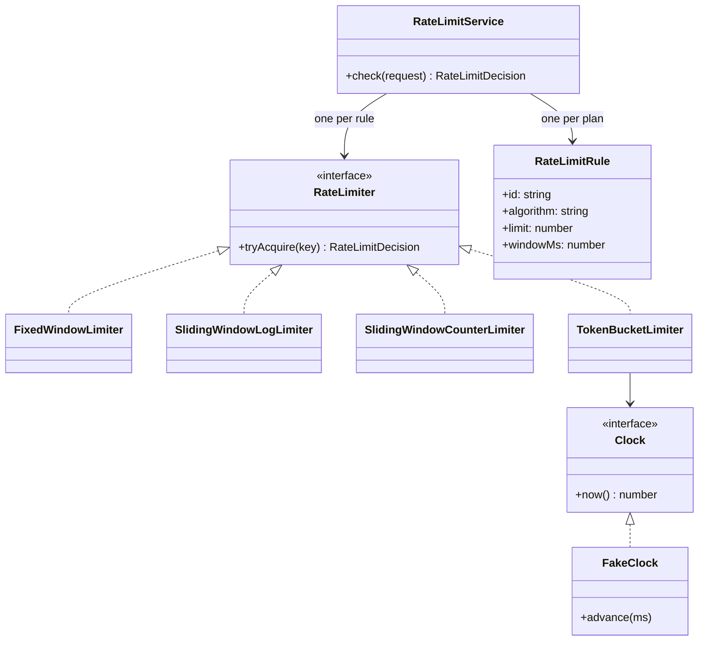
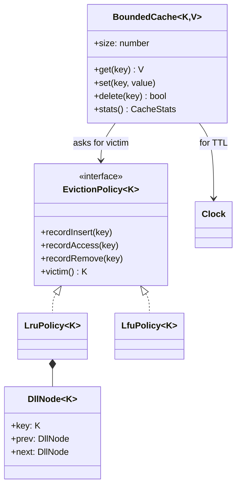
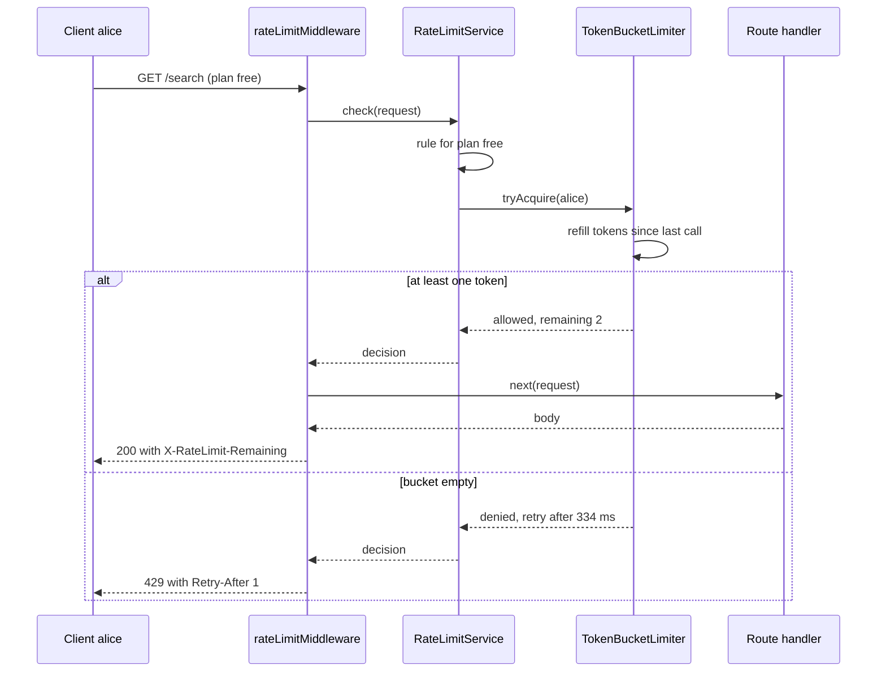

# Rate Limiter and LRU Cache

> Two classic "design a component" problems that often come together, because both are small, stateful building blocks of every backend. You will design a rate limiter with four pluggable algorithms and an injectable clock, and a cache with O(1) operations, pluggable eviction (LRU and LFU) and TTL.

**Before this:** [How to approach LLD interviews](01-how-to-approach-lld-interviews.md) · [Caching in Node.js](../07-nodejs-backend/11-caching.md) · [Behavioral patterns](../04-oop-solid-design-patterns/08-behavioral-patterns.md) · **Interview questions:** [jump to the interview section](#interview-questions)

## Table of contents

1. [Problem](#problem)
2. [Clarifying questions](#clarifying-questions)
3. [Requirements](#requirements)
4. [Core entities and relationships](#core-entities-and-relationships)
5. [Design decisions and patterns](#design-decisions-and-patterns)
6. [Implementation](#implementation)
7. [Walkthrough](#walkthrough)
8. [Handling concurrency and edge cases](#handling-concurrency-and-edge-cases)
9. [Extensions](#extensions)
10. [How to present this in the interview](#how-to-present-this-in-the-interview)
11. [Interview questions](#interview-questions)
12. [Summary](#summary)
13. [References](#references)

---

## Problem

This document covers two prompts. In a real interview you usually get one of them; sometimes the second one comes as a follow-up ("now the limiter keeps state for millions of clients — how do you stop it from eating all the memory?").

**Part A — rate limiter:**

> "Design a rate limiter for our API. Each client may make at most N requests per time window. Different plans (free, pro) have different limits. When a client is over the limit, return HTTP 429 with a hint about when to retry. Make it easy to switch the algorithm. Write the code."

**Part B — LRU cache:**

> "Design an in-memory cache with a fixed capacity. `get` and `put` must be O(1). When the cache is full, evict the least recently used entry. Then: how would you support other eviction policies, like LFU, and entries that expire after a time-to-live?"

Some quick definitions:

- **Rate limiter:** a component that counts requests per client and rejects them after a limit. It protects servers from overload and abuse, and enforces paid plan limits.
- **HTTP 429 Too Many Requests:** the standard status code for "slow down". The `Retry-After` header tells the client how many seconds to wait.
- **Cache:** a fast store that keeps copies of data so you do not recompute or refetch it.
- **Eviction:** removing an entry to make space.
- **LRU (Least Recently Used):** evict the entry nobody has touched for the longest time.
- **LFU (Least Frequently Used):** evict the entry with the fewest uses.
- **TTL (time to live):** an entry expires after a fixed time, even if there is space.

---

## Clarifying questions

### Rate limiter

| Question | Why you ask it | Assumed answer |
| --- | --- | --- |
| Limit per what — user, API key, IP address? | Decides the key. | Per client id (API key). The key function is pluggable. |
| One server or many? | In-memory vs shared store (Redis). | Design in memory first, explain the distributed version. |
| Hard limit or are short bursts OK? | Chooses the algorithm. | Configurable: we implement four algorithms. |
| Different limits per plan or per endpoint? | Rules model. | Per plan: free = 3 per second, pro = 10 per second. |
| What happens over the limit? | API contract. | Reject with 429, `Retry-After`, `X-RateLimit-Remaining`. No queueing. |
| If the limiter itself fails, allow or block? | Fail-open vs fail-closed. | Fail open (allow) for normal APIs; discussed later. |
| Precision needed? | Exact vs approximate algorithms. | Approximate is fine if memory is much lower. |

### LRU cache

| Question | Why you ask it | Assumed answer |
| --- | --- | --- |
| Capacity in number of entries or in bytes? | Size accounting. | Number of entries. Bytes is an extension. |
| Do `get` and `put` both count as "use"? | Defines recency. | Yes. |
| Does `put` on an existing key count as use? | Edge case. | Yes, and it updates the value. |
| Is TTL needed? | Expiry logic. | Yes, optional, per cache. |
| Other policies? | Extensibility. | LFU must be pluggable. |
| Called from async code? | Stampede and races. | Yes; add `getOrLoad` that shares in-flight loads. |
| Do we need to know about evictions? | Hooks. | Yes: an `onEvict` callback (for metrics or closing resources). |

> **Tip:** for any "design a component" question, ask **"how do I get the current time?"** in your head. If the answer is `Date.now()` inside the class, your code is hard to test. Inject a clock.

---

## Requirements

### Functional requirements

**Rate limiter**

1. `tryAcquire(key)` returns a decision: allowed or not, remaining requests, and how long to wait.
2. Four algorithms: fixed window counter, sliding window log, sliding window counter, token bucket.
3. Rules per plan (limit, window, algorithm), chosen at runtime from the request.
4. An HTTP-style middleware that returns 429 with headers.

**Cache**

1. `get(key)`, `set(key, value)`, `delete(key)`, `size` — all O(1) on average.
2. Fixed capacity; when full, evict one entry chosen by the **eviction policy**.
3. Two policies: LRU and LFU. Adding a third (for example FIFO) must not change the cache class.
4. Optional TTL per cache; expired entries are never returned.
5. `onEvict(key, value, reason)` callback; hit and miss statistics.

### Non-functional requirements

- **O(1) hot path:** limiter and cache calls happen on every request. No scans over all keys.
- **Bounded memory:** state per key must be small and must not grow forever.
- **Deterministic tests:** time is injected, so tests do not sleep.
- **Thread/async safety:** correct when many requests arrive at once (discussed for one process and for many servers).
- **Extensible:** new algorithms and policies plug in through interfaces.

---

## Core entities and relationships

### Rate limiter

| Entity | Responsibility |
| --- | --- |
| `Clock` | Gives the current time. `SystemClock` for real use, `FakeClock` for tests. |
| `RateLimiter` (interface) | `tryAcquire(key): RateLimitDecision`. |
| `FixedWindowLimiter`, `SlidingWindowLogLimiter`, `SlidingWindowCounterLimiter`, `TokenBucketLimiter` | The four algorithms. Each keeps its own per-key state. |
| `RateLimitRule` | Configuration: algorithm, limit, window. |
| `createLimiter()` | Factory: builds a limiter from a rule. |
| `RateLimitService` | Picks the rule for a request and asks the right limiter. |
| `rateLimitMiddleware` | Turns a decision into an HTTP response (200 or 429 with headers). |



### Cache

| Entity | Responsibility |
| --- | --- |
| `BoundedCache<K, V>` | Stores entries, enforces capacity and TTL, counts hits and misses, calls `onEvict`. |
| `EvictionPolicy<K>` (interface) | Tracks usage and chooses the victim. Knows nothing about values. |
| `LruPolicy<K>` | Doubly linked list + map. Victim = tail (least recently used). |
| `LfuPolicy<K>` | Frequency buckets + map. Victim = oldest key with the lowest count. |
| `DllNode<K>` | One node of the doubly linked list. |



---

## Design decisions and patterns

### Decision 1: inject the clock

Every algorithm here depends on time. If the code calls `Date.now()` directly, a test of "the window resets after one second" has to really wait one second, and it becomes flaky on a slow CI machine. With a `Clock` interface, tests use a `FakeClock` and call `clock.advance(1000)`. This is **dependency injection** of a very small dependency, and interviewers like it because it shows testing experience. See [DI for testability](../04-oop-solid-design-patterns/05-dependency-inversion-and-injection.md#di-for-testability).

### Decision 2: Strategy pattern for the algorithm and the eviction policy

- The rate limiter algorithms all answer one question: "may this key do one more request now?" They share the `RateLimiter` interface. The service does not care which one it uses. That is the [Strategy pattern](../04-oop-solid-design-patterns/08-behavioral-patterns.md#strategy).
- The cache separates **storage** (keys → values, capacity, TTL) from **eviction** (which key goes next). The cache holds an `EvictionPolicy` and asks it for a victim. LRU and LFU are two strategies. A FIFO policy would be a third class; `BoundedCache` does not change (Open/Closed).

This split also follows **Single Responsibility**: the linked list logic lives only in `LruPolicy`; the TTL logic lives only in `BoundedCache`.

### Decision 3: a factory with a closed `switch` for algorithms

In the Splitwise design we used a registry so new split types can be added without edits. Here we use a simple factory function with a `switch`. Why the difference? The four rate-limiting algorithms are a **small, stable, well-known set**, and every one needs different parameters. A `switch` with an exhaustive check (TypeScript fails to compile if a case is missing) is clearer. Being able to explain *why* you chose a simpler form is better than using the same pattern everywhere. See [Factory](../04-oop-solid-design-patterns/06-creational-patterns.md#simple-factory-and-factory-method).

### Decision 4: one limiter instance per rule, state per key inside

A limiter object holds a `Map` from key to that key's state (a counter, a list of timestamps, or a token count). We create one limiter per rule, lazily, and reuse it. We do **not** create one limiter object per client.

### Decision 5: the cache entry stores only the value and the expiry time

The eviction policy keeps its own bookkeeping (list nodes or frequency counts). The cache keeps `{ value, expiresAt }`. Two maps with the same keys cost a little memory but keep each class simple. The classic single-class LRU (map of key → list node that holds the value) is shown too, because many interviewers expect exactly that.

### Decision 6: Proxy and Decorator thinking

A rate limiter in front of a service, or a cache in front of a slow repository, is the [Proxy](../04-oop-solid-design-patterns/07-structural-patterns.md#proxy) idea: same interface, extra control. Wrapping a function with "check the limiter first" is a [Decorator](../04-oop-solid-design-patterns/07-structural-patterns.md#decorator). Mention this when you place the components in the larger system.

### Patterns used — summary

| Pattern / principle | Where | Why |
| --- | --- | --- |
| Strategy | `RateLimiter` algorithms, `EvictionPolicy` | Swap the algorithm without changing callers. |
| Factory | `createLimiter(rule, clock)` | Build the right limiter from configuration. |
| Dependency injection | `Clock` everywhere | Deterministic tests, no sleeping. |
| Proxy / Decorator | middleware, `getOrLoad` | Add control in front of a call. |
| Observer (callback form) | `onEvict` | Let callers react to evictions. |
| Single Responsibility | cache vs policy | Storage and eviction change for different reasons. |

---

## Implementation

All code blocks in this section form **one runnable TypeScript file**. Part A builds the rate limiter; Part B builds the cache; the last block runs both demos.

### Part A, step 1: the clock

```ts
interface Clock {
  now(): number; // milliseconds
}

class SystemClock implements Clock {
  now(): number {
    return Date.now();
  }
}

// Tests and demos move time by hand. No sleeping, no flaky tests.
class FakeClock implements Clock {
  private time: number;

  constructor(start = 0) {
    this.time = start;
  }

  now(): number {
    return this.time;
  }

  set(ms: number): void {
    this.time = ms;
  }

  advance(ms: number): void {
    this.time += ms;
  }
}
```

### Part A, step 2: the limiter contract

```ts
interface RateLimitDecision {
  readonly allowed: boolean;
  readonly remaining: number; // requests left right now (rounded down)
  readonly retryAfterMs: number; // 0 when allowed
}

interface RateLimiter {
  tryAcquire(key: string): RateLimitDecision;
}

function allow(remaining: number): RateLimitDecision {
  return { allowed: true, remaining: Math.max(0, Math.floor(remaining)), retryAfterMs: 0 };
}

function deny(retryAfterMs: number): RateLimitDecision {
  return { allowed: false, remaining: 0, retryAfterMs: Math.max(1, Math.ceil(retryAfterMs)) };
}
```

### Part A, step 3: four algorithms

**Fixed window counter.** Split time into windows (0–999 ms, 1000–1999 ms, ...). Count requests per key in the current window. Simple and tiny (one number per key), but a client can send `2 × limit` requests around a window boundary: `limit` at the end of one window and `limit` at the start of the next.

```ts
interface WindowState {
  windowStart: number;
  count: number;
}

class FixedWindowLimiter implements RateLimiter {
  private readonly state = new Map<string, WindowState>();
  private readonly limit: number;
  private readonly windowMs: number;
  private readonly clock: Clock;

  constructor(limit: number, windowMs: number, clock: Clock) {
    this.limit = limit;
    this.windowMs = windowMs;
    this.clock = clock;
  }

  tryAcquire(key: string): RateLimitDecision {
    const now = this.clock.now();
    const windowStart = now - (now % this.windowMs);
    let s = this.state.get(key);
    if (!s || s.windowStart !== windowStart) {
      s = { windowStart, count: 0 };
      this.state.set(key, s);
    }
    if (s.count >= this.limit) return deny(windowStart + this.windowMs - now);
    s.count += 1;
    return allow(this.limit - s.count);
  }
}
```

**Sliding window log.** Keep the timestamp of every accepted request in the last window. A new request is allowed if fewer than `limit` timestamps are newer than `now - window`. Exact, no boundary problem, but memory is O(limit) per key — bad for "10,000 per hour".

```ts
class SlidingWindowLogLimiter implements RateLimiter {
  private readonly logs = new Map<string, number[]>();
  private readonly limit: number;
  private readonly windowMs: number;
  private readonly clock: Clock;

  constructor(limit: number, windowMs: number, clock: Clock) {
    this.limit = limit;
    this.windowMs = windowMs;
    this.clock = clock;
  }

  tryAcquire(key: string): RateLimitDecision {
    const now = this.clock.now();
    const log = this.logs.get(key) ?? [];
    // Drop timestamps that left the window. The log is sorted, so we cut from the front.
    let firstInside = 0;
    while (firstInside < log.length && log[firstInside] <= now - this.windowMs) firstInside += 1;
    if (firstInside > 0) log.splice(0, firstInside);
    this.logs.set(key, log);

    if (log.length >= this.limit) return deny(log[0] + this.windowMs - now);
    log.push(now);
    return allow(this.limit - log.length);
  }
}
```

**Sliding window counter.** A cheap approximation of the log. Keep two counters: the previous window and the current window. Estimate the requests in the last `window` ms as `previous × (part of the previous window still inside) + current`. Two numbers per key, and the boundary burst is mostly smoothed out.

```ts
interface TwoWindowState {
  windowStart: number;
  previousCount: number;
  currentCount: number;
}

class SlidingWindowCounterLimiter implements RateLimiter {
  private readonly state = new Map<string, TwoWindowState>();
  private readonly limit: number;
  private readonly windowMs: number;
  private readonly clock: Clock;

  constructor(limit: number, windowMs: number, clock: Clock) {
    this.limit = limit;
    this.windowMs = windowMs;
    this.clock = clock;
  }

  tryAcquire(key: string): RateLimitDecision {
    const now = this.clock.now();
    const windowStart = now - (now % this.windowMs);
    let s = this.state.get(key);
    if (!s) {
      s = { windowStart, previousCount: 0, currentCount: 0 };
      this.state.set(key, s);
    } else if (s.windowStart !== windowStart) {
      // Moved to the next window: current becomes previous. If we skipped a whole window, previous is 0.
      const nextWindow = s.windowStart + this.windowMs;
      s.previousCount = windowStart === nextWindow ? s.currentCount : 0;
      s.currentCount = 0;
      s.windowStart = windowStart;
    }
    const elapsedFraction = (now - windowStart) / this.windowMs;
    const estimate = s.previousCount * (1 - elapsedFraction) + s.currentCount;
    if (estimate + 1 > this.limit) return deny(windowStart + this.windowMs - now);
    s.currentCount += 1;
    return allow(this.limit - estimate - 1);
  }
}
```

**Token bucket.** Each key has a bucket that holds up to `capacity` tokens and refills at a steady rate. A request takes one token. A full bucket allows a short burst (up to `capacity`), and the long-term rate is the refill rate. We do not need a timer: when a request comes, we add the tokens earned since the last request ("lazy refill").

```ts
interface BucketState {
  tokens: number;
  lastRefill: number;
}

class TokenBucketLimiter implements RateLimiter {
  private readonly buckets = new Map<string, BucketState>();
  private readonly capacity: number;
  private readonly refillPerMs: number;
  private readonly clock: Clock;

  constructor(capacity: number, refillPerSecond: number, clock: Clock) {
    this.capacity = capacity;
    this.refillPerMs = refillPerSecond / 1000;
    this.clock = clock;
  }

  tryAcquire(key: string): RateLimitDecision {
    const now = this.clock.now();
    const b = this.buckets.get(key) ?? { tokens: this.capacity, lastRefill: now };
    b.tokens = Math.min(this.capacity, b.tokens + (now - b.lastRefill) * this.refillPerMs);
    b.lastRefill = now;
    this.buckets.set(key, b);
    if (b.tokens < 1) return deny((1 - b.tokens) / this.refillPerMs);
    b.tokens -= 1;
    return allow(b.tokens);
  }
}
```

(A **leaky bucket** is the mirror image: requests go into a queue that drains at a fixed rate. It smooths traffic perfectly but adds waiting instead of rejecting. Mention it; you rarely need to code it.)

### Part A, step 4: rules, factory, service and middleware

```ts
const Algorithm = {
  FIXED_WINDOW: 'FIXED_WINDOW',
  SLIDING_LOG: 'SLIDING_LOG',
  SLIDING_COUNTER: 'SLIDING_COUNTER',
  TOKEN_BUCKET: 'TOKEN_BUCKET',
} as const;
type Algorithm = (typeof Algorithm)[keyof typeof Algorithm];

interface RateLimitRule {
  readonly id: string;
  readonly algorithm: Algorithm;
  readonly limit: number; // max requests per window (token bucket: capacity)
  readonly windowMs: number; // token bucket refills `limit` tokens per window
}

function createLimiter(rule: RateLimitRule, clock: Clock): RateLimiter {
  switch (rule.algorithm) {
    case Algorithm.FIXED_WINDOW:
      return new FixedWindowLimiter(rule.limit, rule.windowMs, clock);
    case Algorithm.SLIDING_LOG:
      return new SlidingWindowLogLimiter(rule.limit, rule.windowMs, clock);
    case Algorithm.SLIDING_COUNTER:
      return new SlidingWindowCounterLimiter(rule.limit, rule.windowMs, clock);
    case Algorithm.TOKEN_BUCKET:
      return new TokenBucketLimiter(rule.limit, (rule.limit * 1000) / rule.windowMs, clock);
    default: {
      const unreachable: never = rule.algorithm; // compile error if a case is missing
      throw new Error(`Unknown algorithm ${String(unreachable)}`);
    }
  }
}

interface ApiRequest {
  readonly clientId: string;
  readonly plan: string;
  readonly path: string;
}

class RateLimitService {
  private readonly limiters = new Map<string, RateLimiter>();
  private readonly rulesByPlan: ReadonlyMap<string, RateLimitRule>;
  private readonly defaultRule: RateLimitRule;
  private readonly clock: Clock;

  constructor(rulesByPlan: ReadonlyMap<string, RateLimitRule>, defaultRule: RateLimitRule, clock: Clock) {
    this.rulesByPlan = rulesByPlan;
    this.defaultRule = defaultRule;
    this.clock = clock;
  }

  check(request: ApiRequest): RateLimitDecision & { readonly rule: RateLimitRule } {
    const rule = this.rulesByPlan.get(request.plan) ?? this.defaultRule;
    let limiter = this.limiters.get(rule.id);
    if (!limiter) {
      limiter = createLimiter(rule, this.clock);
      this.limiters.set(rule.id, limiter);
    }
    return { ...limiter.tryAcquire(request.clientId), rule };
  }
}

interface HttpResponse {
  readonly status: number;
  readonly headers: Readonly<Record<string, string>>;
  readonly body: string;
}

// A framework-free middleware: check the limiter, then call the real handler.
function rateLimitMiddleware(service: RateLimitService) {
  return (request: ApiRequest, next: (request: ApiRequest) => string): HttpResponse => {
    const decision = service.check(request);
    const headers: Record<string, string> = {
      'X-RateLimit-Limit': String(decision.rule.limit),
      'X-RateLimit-Remaining': String(decision.remaining),
    };
    if (!decision.allowed) {
      headers['Retry-After'] = String(Math.ceil(decision.retryAfterMs / 1000)); // seconds, per HTTP spec
      return { status: 429, headers, body: 'Too Many Requests' };
    }
    return { status: 200, headers, body: next(request) };
  };
}
```

The `default` branch assigns `rule.algorithm` to a variable of type `never`. If someone adds a fifth algorithm to `Algorithm` and forgets a `case`, TypeScript reports an error at this line. This is called an **exhaustiveness check**. See [unions and narrowing](../03-typescript/03-unions-narrowing-and-type-guards.md).

### Part B, step 1: the eviction policy contract and LRU

The classic LRU trick is **a hash map plus a doubly linked list**:

- The map finds a key's list node in O(1).
- The list keeps keys in order of use: head = most recently used, tail = least recently used.
- "Use" a key: unlink its node and put it at the head. O(1), because a doubly linked node knows both neighbours.
- Evict: take the tail. O(1).

```ts
interface EvictionPolicy<K> {
  recordInsert(key: K): void;
  recordAccess(key: K): void;
  recordRemove(key: K): void;
  victim(): K | undefined; // which key to evict next (does not remove it)
}

class DllNode<K> {
  readonly key: K;
  prev: DllNode<K> | null = null;
  next: DllNode<K> | null = null;

  constructor(key: K) {
    this.key = key;
  }
}

class LruPolicy<K> implements EvictionPolicy<K> {
  private readonly nodes = new Map<K, DllNode<K>>();
  private head: DllNode<K> | null = null; // most recently used
  private tail: DllNode<K> | null = null; // least recently used

  recordInsert(key: K): void {
    const node = new DllNode(key);
    this.nodes.set(key, node);
    this.pushFront(node);
  }

  recordAccess(key: K): void {
    const node = this.nodes.get(key);
    if (!node || node === this.head) return;
    this.unlink(node);
    this.pushFront(node);
  }

  recordRemove(key: K): void {
    const node = this.nodes.get(key);
    if (!node) return;
    this.unlink(node);
    this.nodes.delete(key);
  }

  victim(): K | undefined {
    return this.tail?.key;
  }

  // Keys from most to least recently used. O(n); for debugging and demos only.
  order(): K[] {
    const keys: K[] = [];
    for (let n = this.head; n; n = n.next) keys.push(n.key);
    return keys;
  }

  private pushFront(node: DllNode<K>): void {
    node.prev = null;
    node.next = this.head;
    if (this.head) this.head.prev = node;
    this.head = node;
    if (!this.tail) this.tail = node;
  }

  private unlink(node: DllNode<K>): void {
    if (node.prev) node.prev.next = node.next;
    else this.head = node.next;
    if (node.next) node.next.prev = node.prev;
    else this.tail = node.prev;
    node.prev = null;
    node.next = null;
  }
}
```

### Part B, step 2: LFU in O(1)

LFU needs "the key with the lowest use count, and among those the oldest". The O(1) trick:

- `counts`: key → how many times it was used.
- `buckets`: count → a `Set` of keys with that count. A JavaScript `Set` keeps **insertion order**, so the first key in a bucket is the oldest one.
- `minCount`: the smallest count that has keys. On insert it becomes 1. On access, if the key's old bucket becomes empty and it was the minimum, the minimum goes up by one.

```ts
class LfuPolicy<K> implements EvictionPolicy<K> {
  private readonly counts = new Map<K, number>();
  private readonly buckets = new Map<number, Set<K>>();
  private minCount = 0;

  recordInsert(key: K): void {
    this.counts.set(key, 1);
    this.bucket(1).add(key);
    this.minCount = 1;
  }

  recordAccess(key: K): void {
    const count = this.counts.get(key);
    if (count === undefined) return;
    const oldBucket = this.bucket(count);
    oldBucket.delete(key);
    if (oldBucket.size === 0) {
      this.buckets.delete(count);
      if (this.minCount === count) this.minCount = count + 1;
    }
    this.counts.set(key, count + 1);
    this.bucket(count + 1).add(key);
  }

  recordRemove(key: K): void {
    const count = this.counts.get(key);
    if (count === undefined) return;
    const b = this.bucket(count);
    b.delete(key);
    this.counts.delete(key);
    if (b.size === 0) {
      this.buckets.delete(count);
      // Rare path (explicit delete of the last minimum key): find the new minimum.
      if (this.minCount === count) this.minCount = this.buckets.size ? Math.min(...this.buckets.keys()) : 0;
    }
  }

  victim(): K | undefined {
    const b = this.buckets.get(this.minCount);
    return b ? b.values().next().value : undefined;
  }

  private bucket(count: number): Set<K> {
    let b = this.buckets.get(count);
    if (!b) {
      b = new Set<K>();
      this.buckets.set(count, b);
    }
    return b;
  }
}
```

### Part B, step 3: the bounded cache with TTL

```ts
type EvictionReason = 'capacity' | 'expired';

interface CacheOptions<K, V> {
  readonly capacity: number;
  readonly policy: EvictionPolicy<K>;
  readonly clock: Clock;
  readonly ttlMs?: number; // undefined = never expires
  readonly onEvict?: (key: K, value: V, reason: EvictionReason) => void;
}

interface CacheStats {
  readonly hits: number;
  readonly misses: number;
  readonly evictions: number;
}

interface CacheEntry<V> {
  value: V;
  expiresAt: number; // Infinity when there is no TTL
}

class BoundedCache<K, V> {
  private readonly entries = new Map<K, CacheEntry<V>>();
  private readonly options: CacheOptions<K, V>;
  private hits = 0;
  private misses = 0;
  private evictions = 0;

  constructor(options: CacheOptions<K, V>) {
    if (!Number.isInteger(options.capacity) || options.capacity < 1) {
      throw new RangeError('capacity must be a positive integer');
    }
    this.options = options;
  }

  get size(): number {
    return this.entries.size;
  }

  get(key: K): V | undefined {
    const entry = this.entries.get(key);
    if (!entry) {
      this.misses += 1;
      return undefined;
    }
    if (this.isExpired(entry)) {
      this.remove(key, entry, 'expired'); // lazy expiry: checked on read
      this.misses += 1;
      return undefined;
    }
    this.options.policy.recordAccess(key);
    this.hits += 1;
    return entry.value;
  }

  set(key: K, value: V): void {
    const expiresAt = this.options.ttlMs === undefined ? Infinity : this.options.clock.now() + this.options.ttlMs;
    const existing = this.entries.get(key);
    if (existing) {
      existing.value = value;
      existing.expiresAt = expiresAt;
      this.options.policy.recordAccess(key);
      return;
    }
    if (this.entries.size >= this.options.capacity) this.evictOne();
    this.entries.set(key, { value, expiresAt });
    this.options.policy.recordInsert(key);
  }

  delete(key: K): boolean {
    if (!this.entries.has(key)) return false;
    this.entries.delete(key);
    this.options.policy.recordRemove(key);
    return true;
  }

  stats(): CacheStats {
    return { hits: this.hits, misses: this.misses, evictions: this.evictions };
  }

  private evictOne(): void {
    const victim = this.options.policy.victim();
    if (victim === undefined) return;
    const entry = this.entries.get(victim);
    if (entry) this.remove(victim, entry, this.isExpired(entry) ? 'expired' : 'capacity');
  }

  private remove(key: K, entry: CacheEntry<V>, reason: EvictionReason): void {
    this.entries.delete(key);
    this.options.policy.recordRemove(key);
    this.evictions += 1;
    this.options.onEvict?.(key, entry.value, reason);
  }

  private isExpired(entry: CacheEntry<V>): boolean {
    return this.options.clock.now() >= entry.expiresAt;
  }
}
```

Notice what `BoundedCache` does **not** know: it has no idea whether eviction is LRU or LFU. It only calls the four policy methods at the right moments. That is what makes LFU, FIFO or a random policy a drop-in change.

### Part B, step 4: the classic single-class LRU

Many interviewers ask for "LRU cache, LeetCode style" and expect one class. In JavaScript, a `Map` remembers insertion order, so deleting and re-inserting a key moves it to the end. The first key in the map is then the least recently used one. Both `get` and `put` stay O(1):

```ts
class SimpleLruCache<K, V> {
  private readonly map = new Map<K, V>();
  private readonly capacity: number;

  constructor(capacity: number) {
    this.capacity = capacity;
  }

  get(key: K): V | undefined {
    if (!this.map.has(key)) return undefined;
    const value = this.map.get(key) as V;
    this.map.delete(key); // move to the "most recent" end
    this.map.set(key, value);
    return value;
  }

  put(key: K, value: V): void {
    if (this.map.has(key)) this.map.delete(key);
    else if (this.map.size >= this.capacity) {
      const oldest = this.map.keys().next().value as K; // first key = least recently used
      this.map.delete(oldest);
    }
    this.map.set(key, value);
  }

  keys(): K[] {
    return [...this.map.keys()]; // least -> most recently used
  }
}
```

Say clearly in the interview: "This works because of a JavaScript guarantee about `Map` order. In Java I would use `LinkedHashMap` with access order, or write the linked list myself — which is what `LruPolicy` above does." Many interviewers then ask you to write the linked-list version anyway, to see that you can. Other ready-made versions live in [EventEmitter, LRU cache and Observable](../11-coding-interviews/04-javascript-polyfills-and-implementations.md#eventemitter-lru-cache-and-observable) and in [linked lists](../12-dsa/07-linked-lists.md).

### The demo

```ts
function demoAlgorithms(): void {
  console.log('--- 5 requests per 1000 ms; a burst just before and just after t=1000 ---');
  const times = [900, 920, 940, 960, 980, 1000, 1020, 1040, 1060, 1080, 1950];
  const algorithms: Algorithm[] = [Algorithm.FIXED_WINDOW, Algorithm.SLIDING_LOG, Algorithm.SLIDING_COUNTER, Algorithm.TOKEN_BUCKET];
  for (const algorithm of algorithms) {
    const clock = new FakeClock();
    const limiter = createLimiter({ id: algorithm, algorithm, limit: 5, windowMs: 1000 }, clock);
    const marks = times.map((t) => {
      clock.set(t);
      return limiter.tryAcquire('client-1').allowed ? 'Y' : 'n';
    });
    const allowed = marks.filter((m) => m === 'Y').length;
    console.log(`${algorithm.padEnd(16)} ${marks.slice(0, 5).join('')} ${marks.slice(5, 10).join('')} ${marks[10]}  allowed=${allowed}`);
  }
}

function demoMiddleware(): void {
  console.log('--- Middleware: free plan = token bucket 3 per second ---');
  const clock = new FakeClock(0);
  const free: RateLimitRule = { id: 'free', algorithm: Algorithm.TOKEN_BUCKET, limit: 3, windowMs: 1000 };
  const pro: RateLimitRule = { id: 'pro', algorithm: Algorithm.SLIDING_COUNTER, limit: 10, windowMs: 1000 };
  const service = new RateLimitService(new Map([['free', free], ['pro', pro]]), free, clock);
  const handle = rateLimitMiddleware(service);
  const handler = (req: ApiRequest) => `hello ${req.clientId}`;

  for (let i = 1; i <= 4; i += 1) {
    const res = handle({ clientId: 'alice', plan: 'free', path: '/search' }, handler);
    console.log(`alice #${i}: ${res.status} remaining=${res.headers['X-RateLimit-Remaining']}${res.headers['Retry-After'] ? ` retry-after=${res.headers['Retry-After']}s` : ''}`);
  }
  const bob = handle({ clientId: 'bob', plan: 'free', path: '/search' }, handler);
  console.log(`bob   #1: ${bob.status} (separate bucket per client)`);
  clock.advance(400); // 0.4 s * 3 tokens/s = 1.2 tokens earned
  const later = handle({ clientId: 'alice', plan: 'free', path: '/search' }, handler);
  console.log(`alice after 400 ms: ${later.status} ${later.body}`);
}

function demoCaches(): void {
  console.log('--- Same accesses, different policies (capacity 3) ---');
  for (const [name, policy] of [['LRU', new LruPolicy<string>()], ['LFU', new LfuPolicy<string>()]] as const) {
    const cache = new BoundedCache<string, number>({
      capacity: 3,
      policy,
      clock: new FakeClock(),
      onEvict: (key, value, reason) => console.log(`  ${name} evicted ${key}=${value} (${reason})`),
    });
    cache.set('a', 1);
    cache.set('b', 2);
    cache.set('c', 3);
    cache.get('a');
    cache.get('a');
    cache.get('b');
    cache.get('c'); // recency: c, b, a   frequency: a=3, b=2, c=2
    cache.set('d', 4);
    console.log(`  ${name}: size=${cache.size}, has a? ${cache.get('a') !== undefined}, has b? ${cache.get('b') !== undefined}`);
  }

  console.log('--- TTL ---');
  const clock = new FakeClock();
  const sessions = new BoundedCache<string, string>({
    capacity: 100,
    policy: new LruPolicy<string>(),
    clock,
    ttlMs: 1_000,
    onEvict: (key, _value, reason) => console.log(`  evicted ${key} (${reason})`),
  });
  sessions.set('token-1', 'alice');
  clock.advance(999);
  console.log(`  at 999 ms: ${sessions.get('token-1')}`);
  clock.advance(1);
  console.log(`  at 1000 ms: ${sessions.get('token-1')}`);
  console.log('  stats:', JSON.stringify(sessions.stats()));

  console.log('--- Simple Map-based LRU ---');
  const simple = new SimpleLruCache<number, string>(2);
  simple.put(1, 'one');
  simple.put(2, 'two');
  simple.get(1);
  simple.put(3, 'three'); // evicts 2
  console.log(`  keys (oldest first): ${simple.keys().join(', ')}`);
}

function main(): void {
  demoAlgorithms();
  demoMiddleware();
  demoCaches();
}

main();
```

Running it prints:

```text
--- 5 requests per 1000 ms; a burst just before and just after t=1000 ---
FIXED_WINDOW     YYYYY YYYYY n  allowed=10
SLIDING_LOG      YYYYY nnnnn Y  allowed=6
SLIDING_COUNTER  YYYYY nnnnn Y  allowed=6
TOKEN_BUCKET     YYYYY nnnnn Y  allowed=6
--- Middleware: free plan = token bucket 3 per second ---
alice #1: 200 remaining=2
alice #2: 200 remaining=1
alice #3: 200 remaining=0
alice #4: 429 remaining=0 retry-after=1s
bob   #1: 200 (separate bucket per client)
alice after 400 ms: 200 hello alice
--- Same accesses, different policies (capacity 3) ---
  LRU evicted a=1 (capacity)
  LRU: size=3, has a? false, has b? true
  LFU evicted b=2 (capacity)
  LFU: size=3, has a? true, has b? false
--- TTL ---
  at 999 ms: alice
  evicted token-1 (expired)
  at 1000 ms: undefined
  stats: {"hits":1,"misses":1,"evictions":1}
--- Simple Map-based LRU ---
  keys (oldest first): 1, 3
```

How to read the first block of output:

- **Fixed window** allows all 10 requests in 180 ms, because 5 fall in window 0–999 and 5 in window 1000–1999. This is the **boundary burst** problem: the real rate briefly doubles.
- **Sliding log** is exact: the second burst is inside one second of the first, so it is rejected. At 1950 ms the request at 900 has left the window, so one more is allowed.
- **Sliding counter** gives the same result here with only two numbers per key. At t=1020 the estimate is `5 × 0.98 + 0 = 4.9`, and one more request would make 5.9, which is over the limit.
- **Token bucket** starts full (5 tokens), spends them in the first burst, and earns only about 0.5 tokens by t=1080. By 1950 it has earned enough for one more.

The cache block shows the difference between policies on the same accesses: LRU evicts `a` (touched longest ago), LFU evicts `b` (lowest count, and older than `c` among the count-2 keys).

---

## Walkthrough

### One request through the rate limiter



### One `set` on a full LRU cache

1. `set('d', 4)`: the key is new and `size === capacity`.
2. The cache calls `policy.victim()`. `LruPolicy` returns `tail.key`, which is `a`.
3. The cache removes `a` from its own map, calls `policy.recordRemove('a')` (which unlinks the tail node), and calls `onEvict('a', 1, 'capacity')`.
4. The cache stores `d` and calls `policy.recordInsert('d')`, which puts a new node at the head.
5. Every step is a map lookup or a pointer change: O(1).

---

## Handling concurrency and edge cases

### Inside one Node.js process

Every `tryAcquire`, `get` and `set` above is **synchronous**. JavaScript runs one function to completion before it starts another, so two requests can never interleave inside `tryAcquire`. There is no lock and no race. In Java or C#, the same class would need a `synchronized` block, a `ReentrantLock` or atomic counters, because many threads could run `tryAcquire` at the same time. Say this in the interview; it shows you know both worlds.

Races come back the moment you put an `await` between reading the state and writing it — which is exactly what happens when the state moves to a shared store like Redis.

### Many servers: the shared counter race

With three API servers, each in-memory limiter sees only a third of the traffic, so a client gets three times the limit. The usual fix is a shared store (Redis). But a naive "get, compare, set" over the network is a **check-then-act race**:

```ts
// A shared store (think Redis) whose calls take a network round trip.
class FakeRemoteStore {
  private readonly data = new Map<string, number>();

  private hop(): Promise<void> {
    return new Promise((resolve) => setTimeout(resolve, 5));
  }

  async get(key: string): Promise<number> {
    await this.hop();
    return this.data.get(key) ?? 0;
  }

  async set(key: string, value: number): Promise<void> {
    await this.hop();
    this.data.set(key, value);
  }

  // ✅ Like Redis INCR: read + write happen as ONE step inside the store.
  async incr(key: string): Promise<number> {
    await this.hop();
    const value = (this.data.get(key) ?? 0) + 1;
    this.data.set(key, value);
    return value;
  }
}

const LIMIT = 5;

// ❌ check-then-act across an await
async function unsafeAllow(store: FakeRemoteStore, key: string): Promise<boolean> {
  const count = await store.get(key);
  if (count >= LIMIT) return false;
  await store.set(key, count + 1);
  return true;
}

// ✅ atomic increment, then compare
async function safeAllow(store: FakeRemoteStore, key: string): Promise<boolean> {
  return (await store.incr(key)) <= LIMIT;
}

async function main(): Promise<void> {
  // Ten requests from alice arrive at the same moment on different servers.
  const ten = Array.from({ length: 10 });
  const storeA = new FakeRemoteStore();
  const unsafe = await Promise.all(ten.map(() => unsafeAllow(storeA, 'alice')));
  console.log('unsafe allowed:', unsafe.filter(Boolean).length, 'of 10');

  const storeB = new FakeRemoteStore();
  const safe = await Promise.all(ten.map(() => safeAllow(storeB, 'alice')));
  console.log('atomic allowed:', safe.filter(Boolean).length, 'of 10');
}

main();
```

Output:

```text
unsafe allowed: 10 of 10
atomic allowed: 5 of 10
```

All ten unsafe calls read `0` before any of them writes, so all ten pass. With an atomic increment, exactly five pass. In real Redis:

- **Fixed window:** `INCR rate:alice:<window>` then `EXPIRE` on the first increment. Both can be sent together in a `MULTI` transaction or a small Lua script.
- **Token bucket or sliding log:** the read, refill math and write must happen together, so put them in a **Lua script** (Redis runs a script atomically) or use a sorted set (`ZADD`, `ZREMRANGEBYSCORE`, `ZCARD`) inside `MULTI`.
- **Latency:** a Redis round trip on every request costs about a millisecond. Some systems keep a small local token budget per server and sync with Redis in batches — less exact, much faster.

### Cache stampede: many misses for the same key at once

If 100 requests miss the cache for the same key at the same moment, all 100 call the database. This is a **cache stampede** (or "thundering herd"). The fix is to share the in-flight load: the first miss starts the load and stores the promise; the others wait on the same promise.

```ts
// Builds on the Implementation code above.
class LoadingCache<K, V> {
  private readonly inFlight = new Map<K, Promise<V>>();
  private readonly cache: BoundedCache<K, V>;
  private readonly loader: (key: K) => Promise<V>;

  constructor(cache: BoundedCache<K, V>, loader: (key: K) => Promise<V>) {
    this.cache = cache;
    this.loader = loader;
  }

  async get(key: K): Promise<V> {
    const cached = this.cache.get(key);
    if (cached !== undefined) return cached;
    const pending = this.inFlight.get(key);
    if (pending) return pending; // join the load that is already running

    const promise = this.loader(key)
      .then((value) => {
        this.cache.set(key, value); // only successful results are cached
        return value;
      })
      .finally(() => this.inFlight.delete(key));
    this.inFlight.set(key, promise);
    return promise;
  }
}

async function demoStampede(): Promise<void> {
  let databaseCalls = 0;
  const loadUser = async (id: string): Promise<string> => {
    databaseCalls += 1;
    await new Promise((resolve) => setTimeout(resolve, 10));
    return `user-${id}`;
  };
  const users = new LoadingCache<string, string>(
    new BoundedCache({ capacity: 100, policy: new LruPolicy<string>(), clock: new SystemClock(), ttlMs: 60_000 }),
    loadUser,
  );
  const results = await Promise.all(Array.from({ length: 5 }, () => users.get('42')));
  console.log(results.join(', '));
  console.log('database calls:', databaseCalls);
  await users.get('42');
  console.log('database calls after a cached read:', databaseCalls);
}

demoStampede();
```

Output:

```text
user-42, user-42, user-42, user-42, user-42
database calls: 1
database calls after a cached read: 1
```

Note the `.finally` — if the load fails, the in-flight entry is removed and the error is **not** cached, so the next request tries again. Across many servers, the same idea needs a short distributed lock or "stale-while-revalidate". See [when caches fail: stampede, penetration and avalanche](../07-nodejs-backend/11-caching.md#when-caches-fail-stampede-penetration-and-avalanche).

### Edge cases

| Edge case | How the design handles it |
| --- | --- |
| Limit of 0 | Every request is denied. Validate rules at startup if 0 is a mistake. |
| Clock goes backwards (NTP correction) | Token bucket: `now - lastRefill` becomes negative and tokens go down. Guard with `Math.max(0, now - lastRefill)` or use a monotonic clock (`performance.now()`). |
| Millions of distinct keys (IP addresses) | Limiter maps grow forever. Store per-key state in a `BoundedCache` with LRU + TTL of one window: idle keys disappear. |
| Rate-limit store (Redis) is down | Choose **fail-open** (allow, log, alert) for normal APIs, **fail-closed** (deny) for login or payment endpoints where abuse is costly. |
| `Retry-After` precision | The header is in whole seconds, so round **up**; never send `0`. |
| Cache capacity 1 | Works: every new key evicts the only entry. Capacity 0 is rejected in the constructor. |
| `set` on an existing key | Updates the value and the TTL, counts as an access, never evicts. |
| Value `undefined` stored in the cache | `get` cannot tell "missing" from "stored undefined". Either forbid it or add `has()`. |
| Expired entries nobody reads | Lazy expiry leaves them in memory until evicted. Add a periodic sweep, or let capacity eviction pick expired entries first. |
| LFU "cache pollution" | An entry used 1,000 times last week stays forever. Use **aging** (halve all counts periodically) or a windowed LFU. |
| Async loader throws | Not cached; `inFlight` entry removed; next call retries. |

---

## Extensions

### A new eviction policy without touching the cache

FIFO evicts the oldest inserted key, ignoring reads. It is one small class:

```ts
// Builds on the Implementation code above.
class FifoPolicy<K> implements EvictionPolicy<K> {
  private readonly order = new Set<K>(); // Set keeps insertion order

  recordInsert(key: K): void {
    this.order.add(key);
  }

  recordAccess(_key: K): void {
    // FIFO ignores reads
  }

  recordRemove(key: K): void {
    this.order.delete(key);
  }

  victim(): K | undefined {
    return this.order.values().next().value;
  }
}

const fifo = new BoundedCache<string, number>({
  capacity: 2,
  policy: new FifoPolicy<string>(),
  clock: new FakeClock(),
  onEvict: (key) => console.log(`FIFO evicted ${key}`),
});
fifo.set('a', 1);
fifo.set('b', 2);
fifo.get('a'); // would save "a" under LRU, but not under FIFO
fifo.set('c', 3);
```

Output:

```text
FIFO evicted a
```

### More follow-ups

| Follow-up | Change |
| --- | --- |
| **Distributed rate limiting** | Move limiter state to Redis behind a `RateLimitStore` interface with atomic operations (Lua script). The algorithms keep the same `RateLimiter` interface; the service does not change. |
| **Different limits per endpoint** | Rule lookup by `(plan, route)`; key becomes `${ruleId}:${clientId}`. A request can be checked against several rules (per second **and** per day). |
| **Weighted requests** | `tryAcquire(key, cost)`: an export costs 10 tokens, a read costs 1. Token bucket handles this naturally. |
| **Queue instead of reject** | Leaky bucket: put requests in a queue drained at a fixed rate; reject only when the queue is full. |
| **Bounded limiter memory** | Replace each limiter's `Map` with a `BoundedCache` (LRU, TTL = window). The two parts of this document combine. |
| **Capacity in bytes** | The cache tracks `totalBytes` and a `sizeOf(value)` function; evict in a loop until the new entry fits. |
| **Write-through / write-behind** | Wrap a repository: write to the database and the cache together (write-through), or write to the cache and flush later (write-behind). See [caching patterns](../07-nodejs-backend/11-caching.md#caching-patterns). |
| **Thread-safe in Java/C#** | Use `ConcurrentHashMap` with per-key atomic state, or a lock around the linked list. LRU lists are hard to make lock-free; libraries like Caffeine use buffered, batched updates. |
| **Metrics** | Hit ratio from `stats()`; count 429s per plan; alert when the hit ratio drops. |

---

## How to present this in the interview

### A 45-minute plan (one of the two problems)

**Rate limiter**

| Minutes | What you do |
| --- | --- |
| 0–5 | Clarify: key, limits per plan, one or many servers, reject vs queue, fail-open or fail-closed. |
| 5–10 | Interface first: `tryAcquire(key): { allowed, remaining, retryAfterMs }`. Inject a `Clock`. |
| 10–15 | Compare the four algorithms in a small table (memory, accuracy, bursts). Pick token bucket or sliding counter. |
| 15–30 | Code the chosen algorithm, the factory and the service. Add a second algorithm if time allows. |
| 30–35 | Middleware: 429, `Retry-After`, headers. |
| 35–45 | Distributed version (Redis + atomic ops), memory bounds, fail-open, a test with `FakeClock`. |

**LRU cache**

| Minutes | What you do |
| --- | --- |
| 0–5 | Clarify: capacity unit, what counts as use, TTL, other policies. |
| 5–10 | Explain map + doubly linked list and why each operation is O(1). |
| 10–25 | Code the linked-list LRU (or `LruPolicy` + cache). Test with a small sequence. |
| 25–35 | Refactor to `EvictionPolicy`; add LFU (frequency buckets). |
| 35–45 | TTL with an injected clock, `getOrLoad` stampede protection, thread safety in other languages. |

### A short spoken walkthrough

> "For the rate limiter, the core interface is `tryAcquire(key)`, returning allowed, remaining and retry-after. Time comes from an injected clock, so my tests don't sleep. There are four common algorithms. Fixed window is one counter per key but allows double bursts at the boundary. Sliding log is exact but stores every timestamp. Sliding counter approximates the log with two counters. Token bucket allows controlled bursts and is what I'd pick by default. They're strategies behind one interface, built by a small factory from a rule, and the service picks the rule by plan. In one Node process each call is synchronous, so there's no race. Across servers I'd use Redis with atomic operations — INCR or a Lua script — because get-then-set over the network lets bursts through.
>
> For the cache, a hash map plus a doubly linked list gives O(1) get and put: the map finds the node, the list keeps recency order, and eviction takes the tail. I separate the cache from the eviction policy, so LFU — with frequency buckets and a min-count pointer — is a new class, not a rewrite. TTL is checked lazily on read with the same injected clock. For async loads I share the in-flight promise so a hundred misses cause one database call."

---

## Interview questions

### Q1. Compare the rate-limiting algorithms. Which one would you choose?

**What the interviewer is checking:** whether you know the trade-offs, not just one algorithm's name.

**What to say (30–60 seconds):**
> "Fixed window keeps one counter per key per window. It's tiny, but a client can send double the limit around the window boundary. Sliding log stores every timestamp, so it's exact, but memory grows with the limit. Sliding window counter keeps two counters and weights the previous window, which is a good approximation at almost no cost. Token bucket keeps a token count and a timestamp; it allows short bursts up to the bucket size and enforces the average rate. For a public API I'd pick token bucket, because bursts are normal for real clients. If the requirement is 'never more than N in any window', I'd use sliding counter or sliding log."

**Deeper explanation:**

| Algorithm | Memory per key | Accuracy | Bursts |
| --- | --- | --- | --- |
| Fixed window | 2 numbers | Up to 2× at boundaries | Uncontrolled at boundaries |
| Sliding log | O(limit) timestamps | Exact | None beyond limit |
| Sliding counter | 3 numbers | Approximate (assumes even spread in the previous window) | Mostly smoothed |
| Token bucket | 2 numbers | Exact average rate | Allowed up to capacity |
| Leaky bucket | queue | Exact output rate | Queued, not rejected |

**Follow-up questions and how to answer them:**
- *"What do Stripe, GitHub or AWS use?"* — Many API gateways document token-bucket-style limits (a rate plus a burst). I wouldn't claim one company's internals without a source; the token bucket is the common default.
- *"Can you combine algorithms?"* — Yes: a token bucket per second to absorb bursts, plus a fixed window per day for quotas.

**Common mistakes:** only knowing fixed window; saying sliding log is "best" without mentioning memory; forgetting that token bucket needs no timer (lazy refill).

**Real-project example:** login endpoints often use a strict sliding window per IP and per username, while normal API traffic uses a token bucket per API key.

### Q2. Why do you inject a clock instead of calling `Date.now()`?

**What the interviewer is checking:** testability and dependency injection in practice.

**What to say (30–60 seconds):**
> "Time is an input to every algorithm here. If the class calls `Date.now()` itself, a test for 'the window resets after one second' must really wait, and it can fail on a slow CI machine. With a `Clock` interface, production uses the system clock and tests use a fake clock that I move forward by hand. The tests become instant and deterministic. It's the same idea as injecting a repository: depend on an interface, not on a global."

**Deeper explanation:** Hidden dependencies on time, randomness and the network are the main causes of flaky tests. Jest's fake timers can also mock `Date.now()`, but an explicit `Clock` makes the dependency visible in the constructor and works in any test runner.

**Follow-up questions and how to answer them:**
- *"Which real clock?"* — `Date.now()` is wall-clock time and can jump when the system time is corrected. For measuring intervals inside one process, `performance.now()` is monotonic (never goes back). Across servers you need wall-clock time.

**Common mistakes:** `setTimeout`-based tests; refilling tokens with a `setInterval` per key (millions of timers).

**Real-project example:** session expiry, token refresh and retry backoff code all become testable the same way.

### Q3. How do you make the rate limiter work across many servers?

**What the interviewer is checking:** distributed state and atomicity.

**What to say (30–60 seconds):**
> "Per-server memory doesn't work: with three servers a client gets three times the limit, and a load balancer may send them anywhere. I'd keep the counters in a shared store like Redis. The important part is atomicity: get, compare and set as separate network calls is a race, and a burst slips through. For fixed window I use INCR and EXPIRE, which are atomic. For token bucket or sliding log I run the whole read-refill-write logic in a Lua script, which Redis executes atomically. I'd also decide what happens if Redis is down — usually fail open with an alert."

**Deeper explanation:** The runnable demo in [Handling concurrency and edge cases](#handling-concurrency-and-edge-cases) shows 10 of 10 requests getting through with get-then-set, and exactly 5 with an atomic increment. For very high traffic, each server can take a batch of tokens from Redis and spend them locally, trading exactness for fewer round trips.

**Follow-up questions and how to answer them:**
- *"What about Redis Cluster?"* — Keep all keys of one client on one shard (hash tags like `{alice}`), so one script touches one shard.
- *"Can I avoid Redis?"* — Sticky routing (same client → same server) plus local limits. It breaks when servers scale up or down.

**Common mistakes:** "use a distributed lock" for every request (slow, and locks can expire mid-operation); forgetting key expiry, so Redis fills up.

**Real-project example:** API gateways (Kong, Envoy with a rate-limit service, NGINX with shared memory zones) implement exactly these patterns.

### Q4. Fail-open or fail-closed when the limiter's store is unavailable?

**What the interviewer is checking:** production judgment.

**What to say (30–60 seconds):**
> "It depends on what the limiter protects. For normal API traffic, I'd fail open: allow the request, log it and alert, because blocking every customer due to a Redis outage is worse than a short period without limits. For login, password reset, OTP or payment endpoints, I'd fail closed, because the limiter is a security control against brute force. I'd make it a per-rule setting, and add a timeout so a slow Redis can't slow down every request."

**Deeper explanation:** A local in-memory limiter can be the fallback: when Redis is down, each server enforces `limit / numberOfServers`. This keeps some protection without a hard dependency.

**Follow-up questions and how to answer them:**
- *"How do you detect it?"* — Count limiter errors and timeouts as a metric; alert on a rate, not on single errors.

**Common mistakes:** not deciding at all (the default is whatever the exception does — often a 500 for every request).

**Real-project example:** many teams wrap the Redis call in a circuit breaker so a broken store is skipped quickly instead of timing out on each request.

### Q5. The limiter stores state per IP address. How do you stop memory from growing forever?

**What the interviewer is checking:** bounded memory, and connecting the two halves of this document.

**What to say (30–60 seconds):**
> "Each key's state is only useful for one window. So I store it in a bounded cache with LRU eviction and a TTL equal to the window. Idle keys expire on their own, and if a flood of new IPs arrives, the least recently seen ones are evicted first. Evicting a key only resets that client's counter, which errs on the side of allowing — acceptable for most APIs. In Redis, I set an expiry on every key for the same reason."

**Deeper explanation:** An attacker using many random IPs is exactly the case where unbounded maps crash a server (out-of-memory). The cache capacity becomes a known upper bound on memory.

**Follow-up questions and how to answer them:**
- *"Could eviction let an attacker reset their own counter?"* — Only by pushing it out with many other keys, which costs them far more requests than they save. For strict cases, use Redis with TTL instead of an LRU.

**Common mistakes:** a plain `Map` that is never cleaned; a `setInterval` that scans millions of keys and blocks the event loop.

**Real-project example:** NGINX's `limit_req_zone` uses a fixed-size shared memory zone and drops old entries when it is full.

### Q6. Explain how your LRU cache is O(1) for both `get` and `put`.

**What the interviewer is checking:** data structure fundamentals.

**What to say (30–60 seconds):**
> "Two structures work together. A hash map from key to a node gives O(1) lookup. A doubly linked list keeps nodes in recency order: head is the most recently used, tail is the least. On get, I find the node through the map, unlink it — constant time because it knows its neighbours — and put it at the head. On put of a new key when full, I remove the tail node and its map entry, then insert the new node at the head. Every step is a map operation or a few pointer changes."

**Deeper explanation:** In JavaScript, a `Map` alone also works, because it keeps insertion order: delete and re-set a key to make it the newest; `map.keys().next()` gives the oldest. That is O(1) on average too. Interviewers usually accept it if you explain why, and then may ask for the linked-list version.

**Follow-up questions and how to answer them:**
- *"Why not an array?"* — Moving an item to the front of an array is O(n).
- *"What about sentinel nodes?"* — A dummy head and tail remove the `null` checks in `unlink` and `pushFront`. Nice to mention; my version uses nullable pointers instead.

**Common mistakes:** forgetting to update the map on eviction; forgetting the case where the key already exists in `put`; moving the node on `put` but not on `get`.

**Real-project example:** browser caches, database buffer pools and CDN edge caches use LRU or close variants.

### Q7. Why a doubly linked list and not a singly linked list?

**What the interviewer is checking:** whether you understand *why* the structure works.

**What to say (30–60 seconds):**
> "To remove a node from the middle of a list, I need to change its previous node's `next` pointer. In a singly linked list, finding the previous node means walking from the head — O(n). A doubly linked node stores `prev`, so unlinking is O(1). The same goes for removing the tail: with only `next` pointers, I can't find the new tail without walking the list."

**Deeper explanation:** The map gives you the node itself, not its predecessor. The `prev` pointer is the price of O(1) removal: one extra reference per entry.

**Follow-up questions and how to answer them:**
- *"Could the map store the previous node instead?"* — It's possible but fragile: every move changes several predecessors, so map entries go stale.

**Common mistakes:** saying "doubly linked is faster" without explaining which operation needs it.

**Real-project example:** the Linux kernel's page cache lists and many LRU implementations use doubly linked lists for exactly this reason.

### Q8. How would you support LFU and other policies without rewriting the cache?

**What the interviewer is checking:** separation of concerns, Strategy pattern, Open/Closed.

**What to say (30–60 seconds):**
> "I split the cache into storage and eviction. The cache stores values, enforces capacity and TTL. An `EvictionPolicy` interface has four methods: record insert, record access, record remove, and pick a victim. LRU implements it with a linked list. LFU implements it with a map from key to count, a map from count to an insertion-ordered set of keys, and a pointer to the minimum count — all O(1). A FIFO policy is a dozen lines. The cache class never changes."

**Deeper explanation:** The policy works only with keys, never values. That keeps it reusable (the same `LruPolicy` could order database connections in a pool). The LFU minimum count only moves up by one on access; it is recomputed only in the rare case of an explicit delete.

**Follow-up questions and how to answer them:**
- *"What's the weakness of LFU?"* — Old popular keys never leave. Fix with aging (divide counts periodically) or use a modern policy such as W-TinyLFU (used by the Caffeine library).

**Common mistakes:** a `switch (policyName)` inside `get` and `put`; LFU with a heap (O(log n)) when O(1) was asked.

**Real-project example:** Redis offers `allkeys-lru`, `allkeys-lfu` and other `maxmemory-policy` options — the same idea at the configuration level.

### Q9. How do you implement TTL? Lazy or active expiry?

**What the interviewer is checking:** practical trade-offs.

**What to say (30–60 seconds):**
> "Each entry stores `expiresAt`. On every get, if the clock is past it, I delete the entry and return a miss — that's lazy expiry, and it means a caller can never see a stale value. The weakness is that entries nobody reads stay in memory. So I add one of two things: a periodic sweep that removes a small batch of expired entries, or eviction that prefers expired entries. Redis does both: lazy checks plus a background job that samples random keys with expiry."

**Deeper explanation:** One `setTimeout` per entry is the naive approach; it costs a timer per key and keeps the process alive. A sweep with a limited batch size avoids long pauses on the event loop.

**Follow-up questions and how to answer them:**
- *"Should `get` extend the TTL?"* — That's "sliding expiration" (used for sessions). Make it an option; for data caches, a fixed TTL bounds staleness.

**Common mistakes:** checking expiry only in a background job (stale reads between sweeps); using `Date.now()` directly.

**Real-project example:** session stores use sliding TTL; product catalog caches use fixed TTL plus explicit invalidation on update.

### Q10. A hundred requests miss the cache for the same key at the same time. What happens and how do you fix it?

**What the interviewer is checking:** cache stampede awareness in async code.

**What to say (30–60 seconds):**
> "Without protection, all hundred go to the database — a cache stampede. Inside one Node process, I keep a map of in-flight promises: the first miss starts the load and stores the promise, and the others await the same promise. When it finishes, the value is cached and the entry is removed. If the load fails, I don't cache the error, so the next request retries. Across servers I'd add a short Redis lock or serve the stale value while one request refreshes it."

**Deeper explanation:** See the runnable `LoadingCache` demo: five concurrent gets, one database call. Another trick is **jittered TTLs** (add a random few seconds), so many keys created together don't expire together.

**Follow-up questions and how to answer them:**
- *"What about keys that don't exist at all?"* — That's cache penetration; cache the "not found" result briefly, or use a Bloom filter.

**Common mistakes:** caching the rejected promise forever; forgetting to delete the in-flight entry.

**Real-project example:** DataLoader in GraphQL servers batches and de-duplicates loads per request in the same way.

### Q11. How would you make the LRU cache thread-safe in Java or C#?

**What the interviewer is checking:** whether you can move between JavaScript's model and multi-threaded runtimes.

**What to say (30–60 seconds):**
> "In Node.js, my cache needs no locks because the methods are synchronous and run on one thread. In Java or C#, many threads can call get at once, and get modifies the list, so even reads must be protected. The simple answer is one lock around every operation — correct, but a bottleneck. Better: split the cache into segments, each with its own lock, by key hash. Production libraries like Caffeine record accesses in buffers and apply them to the LRU order in batches, so reads rarely block."

**Deeper explanation:** A read-write lock does not help much here, because LRU `get` is a write (it moves the node). That surprises many candidates.

**Follow-up questions and how to answer them:**
- *"Is Node.js ever multi-threaded here?"* — Only if you share memory with worker threads (`SharedArrayBuffer` and `Atomics`). Normally each worker has its own cache copy. See [worker threads](../07-nodejs-backend/12-concurrency-worker-threads-and-cluster.md#worker-threads).

**Common mistakes:** saying a `ConcurrentHashMap` alone makes LRU thread-safe (the list still is not).

**Real-project example:** Guava's cache uses segmented locking; Caffeine uses buffered access recording.

### Q12. Where should the rate limiter live in a real system?

**What the interviewer is checking:** placing an LLD component in a bigger picture.

**What to say (30–60 seconds):**
> "At more than one level. A coarse per-IP limit at the edge — the CDN or API gateway — stops floods before they reach my servers. Plan-based limits per API key need business data, so they live in the gateway with a shared store or in application middleware like the one I wrote. Some limits are per resource inside the app, like 'five password resets per account per hour'. The class design stays the same; only the key and the store change."

**Deeper explanation:** Limits at the edge are cheap and protect capacity; limits in the app are precise and protect business rules. See the [URL shortener case study](../09-system-design/13-case-study-url-shortener.md) for rate limiting in a full system design.

**Follow-up questions and how to answer them:**
- *"How does the client know its limits?"* — Response headers (`X-RateLimit-Limit`, `X-RateLimit-Remaining`, `Retry-After`) and documentation.

**Common mistakes:** only limiting in the frontend; limiting per server instead of per client.

**Real-project example:** public APIs such as GitHub's return remaining-quota headers on every response, so well-behaved clients slow down before they hit 429.

---

## Summary

- **Rate limiter interface:** `tryAcquire(key) → { allowed, remaining, retryAfterMs }`. Inject the `Clock`.
- **Four algorithms:** fixed window (tiny, boundary bursts), sliding log (exact, memory-heavy), sliding counter (cheap approximation), token bucket (bursts plus average rate; a good default).
- Algorithms are **strategies** built by a small **factory** from configuration; the service picks a rule per plan; middleware maps decisions to **429 + Retry-After**.
- One Node process: synchronous methods mean no race. Many servers: shared store with **atomic operations** (INCR, Lua). Decide **fail-open vs fail-closed** per rule.
- **LRU in O(1):** hash map + doubly linked list. In JavaScript a `Map`'s insertion order gives a short version.
- Separate **cache storage** from the **eviction policy**: LRU, LFU (frequency buckets + min pointer) and FIFO plug in without touching the cache.
- **TTL:** store `expiresAt`, check lazily on read, sweep or evict expired entries; use the injected clock.
- Protect against **stampedes** by sharing in-flight promises, and keep limiter memory bounded with an LRU + TTL store.

## References

- IETF RFC 6585 — 429 Too Many Requests: https://www.rfc-editor.org/rfc/rfc6585#section-4
- MDN — Retry-After header: https://developer.mozilla.org/en-US/docs/Web/HTTP/Headers/Retry-After
- IETF draft — RateLimit header fields for HTTP: https://datatracker.ietf.org/doc/draft-ietf-httpapi-ratelimit-headers/
- Cloudflare blog — How we built rate limiting capable of scaling to millions of domains: https://blog.cloudflare.com/counting-things-a-lot-of-different-things/
- Redis — INCR command (rate limiter pattern): https://redis.io/docs/latest/commands/incr/
- Redis — Key eviction policies: https://redis.io/docs/latest/develop/reference/eviction/
- NGINX — limit_req module: https://nginx.org/en/docs/http/ngx_http_limit_req_module.html
- LeetCode 146 — LRU Cache: https://leetcode.com/problems/lru-cache/
- LeetCode 460 — LFU Cache: https://leetcode.com/problems/lfu-cache/
- Caffeine — Design (W-TinyLFU, concurrency): https://github.com/ben-manes/caffeine/wiki/Design
- MDN — Map (insertion order): https://developer.mozilla.org/en-US/docs/Web/JavaScript/Reference/Global_Objects/Map
- MDN — performance.now(): https://developer.mozilla.org/en-US/docs/Web/API/Performance/now
- GraphQL DataLoader: https://github.com/graphql/dataloader
