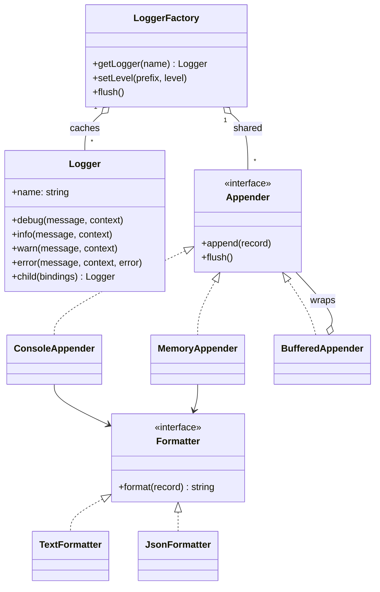
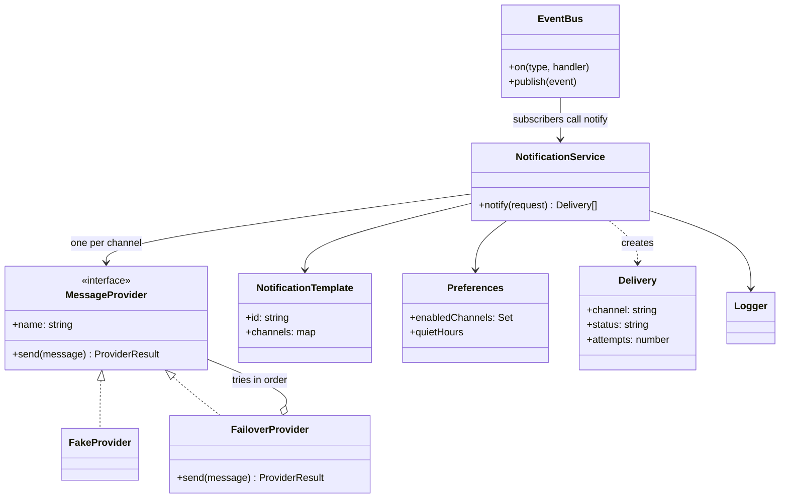
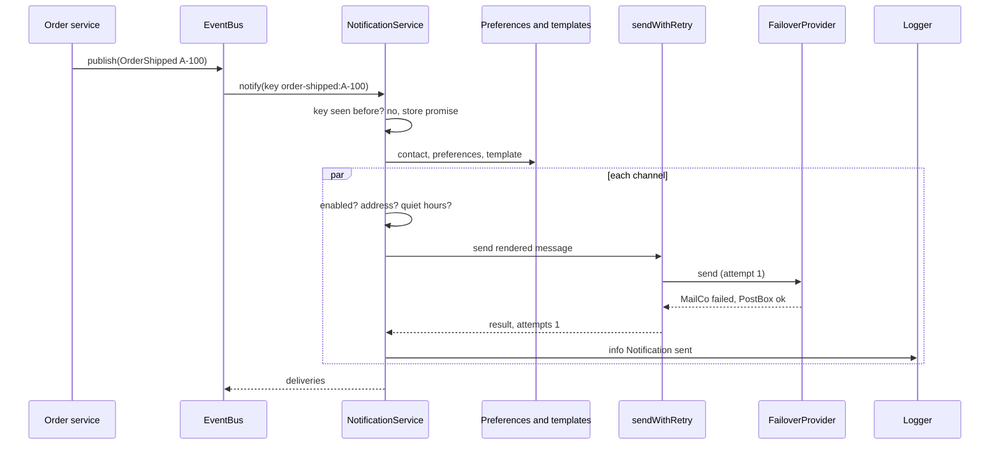

# Logger and Notification System

> Two "infrastructure" LLD problems that every backend team builds or configures: a logging library (levels, formatters, appenders, child loggers, redaction) and a notification service (email, SMS and push through pluggable providers, with templates, user preferences, retries, failover and idempotency).

**Before this:** [How to approach LLD interviews](01-how-to-approach-lld-interviews.md) · [Behavioral patterns](../04-oop-solid-design-patterns/08-behavioral-patterns.md) · [Structural patterns](../04-oop-solid-design-patterns/07-structural-patterns.md) · **Interview questions:** [jump to the interview section](#interview-questions)

## Table of contents

1. [Problem](#problem)
2. [Clarifying questions](#clarifying-questions)
3. [Requirements](#requirements)
4. [Core entities and relationships](#core-entities-and-relationships)
5. [Design decisions and patterns](#design-decisions-and-patterns)
6. [Implementation](#implementation)
7. [Walkthrough](#walkthrough)
8. [Handling concurrency and edge cases](#handling-concurrency-and-edge-cases)
9. [Extensions](#extensions)
10. [How to present this in the interview](#how-to-present-this-in-the-interview)
11. [Interview questions](#interview-questions)
12. [Summary](#summary)
13. [References](#references)

---

## Problem

You will usually get one of these prompts. They appear together here because they share ideas (pluggable outputs, formatting, failures that must not break the caller), and the notification service in this document uses the logger from the first part.

**Part A — logger:**

> "Design a logging library like log4j, Winston or Pino. It should support log levels, multiple outputs (console, file, remote), different formats (plain text, JSON), and per-module configuration. Logging must never crash the application. Write the core classes."

**Part B — notification system:**

> "Design a notification system. Other services say 'notify user X that their order shipped'. We send it by email, SMS and push, using templates. Users can opt out of channels. Providers fail sometimes: retry, and fail over to a backup provider. The same notification must not be sent twice. Write the code for the core."

A few terms:

- **Log level:** how important a log message is: `DEBUG` < `INFO` < `WARN` < `ERROR`. A logger set to `INFO` ignores `DEBUG` messages.
- **Appender** (also called **transport** or **sink**): where log lines go — console, file, a log server.
- **Formatter:** turns a log record into text (plain or JSON).
- **Structured logging:** logging key-value fields (`orderId=42`) instead of only a sentence, so tools can search and filter.
- **Channel:** a way to reach a user (email, SMS, push).
- **Provider:** a company or API that delivers a channel (an email API, an SMS gateway, a push service).
- **Idempotency key:** a unique id for one logical notification, so a retry or duplicate event does not send it twice.

---

## Clarifying questions

### Logger

| Question | Why you ask it | Assumed answer |
| --- | --- | --- |
| Which levels? | Level model. | `DEBUG`, `INFO`, `WARN`, `ERROR`. |
| Which outputs? | Appender interface. | Console and an in-memory one for tests; file and remote as extensions. |
| Which formats? | Formatter interface. | Text for developers, JSON for production. |
| Per-module levels? | Configuration model. | Yes: `payments` at `DEBUG`, everything else at `INFO`, changeable at runtime. |
| Request context (request id, user id)? | Child loggers. | Yes: `logger.child({ requestId })`. |
| Sensitive data? | Redaction. | Mask fields like `password`, `cardNumber`. |
| Sync or async writes? | Performance and loss on crash. | Buffered appender for slow outputs; `ERROR` flushes immediately. |

### Notification system

| Question | Why you ask it | Assumed answer |
| --- | --- | --- |
| Which channels? | Channel model. | Email, SMS, push. In-app as an extension. |
| Who triggers notifications? | API vs events. | Other services publish domain events (`OrderShipped`); we also expose `notify()`. |
| Templates? Languages? | Rendering. | One template per type with a version per channel; `{{name}}` placeholders. One language. |
| User preferences? | Filtering. | Users can turn off channels. Quiet hours (no non-critical messages at night). |
| Delivery guarantees? | Retries and idempotency. | At-least-once from the queue; we must de-duplicate so the user sees it once. |
| Provider failures? | Retry and failover. | Retry transient errors with backoff; switch to a backup provider. |
| Scale? | Queues and workers. | Design the classes for one process; explain queues and workers for scale. |
| Tracking? | Delivery status. | Store a status per channel: `SENT`, `FAILED`, `SKIPPED`, `DEFERRED`. |

---

## Requirements

### Functional requirements

**Logger**

1. `debug`, `info`, `warn`, `error` methods with a message and optional structured context.
2. Levels per logger name with prefix matching (`payments.refunds` inherits from `payments`), changeable at runtime.
3. Several appenders per logger, each with its own formatter and minimum level.
4. `child(bindings)` returns a logger that adds fields (like `requestId`) to every record.
5. Processors run before appenders: for example, redact secret fields.
6. A buffered appender that writes in batches and flushes immediately on `ERROR`.

**Notification system**

1. `notify(request)` sends one notification to one user over all channels the template supports.
2. Skip channels the user turned off or has no address for.
3. Defer non-critical messages during the user's quiet hours.
4. Render templates with data; fail clearly on a missing variable.
5. Retry transient provider errors with exponential backoff; do not retry permanent errors (invalid phone number).
6. Fail over to a backup provider for the same channel.
7. Idempotency: the same key never sends twice, even if two calls arrive at the same time.
8. Record a delivery status per channel and log the outcome.
9. Turn domain events into notifications through an event bus.

### Non-functional requirements

- **Logging never throws** into business code, and costs almost nothing when a level is disabled.
- **No secrets in logs.**
- **Extensible:** new appenders, formatters, channels and providers without changing core classes.
- **Resilient:** one failing channel does not stop the others; a slow provider does not block the caller forever.
- **Testable:** time, sleeping and providers are injected; no real network in tests.

---

## Core entities and relationships

### Logger

| Entity | Responsibility |
| --- | --- |
| `LogRecord` | One log event: time, level, logger name, message, context, error. Value object. |
| `Logger` | API used by application code. Builds records, checks the level, runs processors, sends to appenders. |
| `LoggerFactory` | Creates and caches loggers by name; holds levels per name prefix and the shared appenders. |
| `Formatter` (interface) | `TextFormatter`, `JsonFormatter`. |
| `Appender` (interface) | `ConsoleAppender`, `MemoryAppender`, `BufferedAppender` (wraps another appender). |
| `RecordProcessor` | A function that changes or drops a record (redaction, sampling). |



### Notification system

| Entity | Responsibility |
| --- | --- |
| `NotificationRequest` | Who, which template, which data, priority, idempotency key. |
| `UserContact`, `Preferences` | Addresses per channel; enabled channels and quiet hours. |
| `NotificationTemplate` | Subject and body per channel with `{{placeholders}}`. |
| `MessageProvider` (interface) | Sends one message through one external provider. |
| `FailoverProvider` | A provider made of several providers; tries them in order. |
| `RetryPolicy` + `sendWithRetry` | Exponential backoff for transient errors. |
| `NotificationService` | Orchestrates: preferences → render → send → record → log. |
| `Delivery` | Result per channel: status, attempts, detail. |
| `EventBus` | Delivers domain events to subscribers (Observer / Pub-Sub). |



---

## Design decisions and patterns

### Logger decisions

**1. Separate "what happened" from "how it looks" from "where it goes".** A `Logger` creates a `LogRecord`. A `Formatter` turns it into text. An `Appender` writes the text somewhere. Each part changes for a different reason: the operations team changes the output (Single Responsibility), and you add a new output without touching the logger (Open/Closed). Formatters are a [Strategy](../04-oop-solid-design-patterns/08-behavioral-patterns.md#strategy).

**2. Fan-out to appenders is the Observer idea.** The logger does not know what the appenders do; it gives each one the record. One broken appender is caught so it cannot stop the others or crash the app.

**3. `BufferedAppender` is a [Decorator](../04-oop-solid-design-patterns/07-structural-patterns.md#decorator).** It implements `Appender` and wraps another `Appender`, adding batching. The wrapped appender does not change, and you can stack decorators (buffered + filtered + retrying).

**4. Processors form a small pipeline.** Each processor gets a record and returns a changed record or `null` (drop it). Redaction, sampling and enrichment are processors. This is the [middleware pipeline](../04-oop-solid-design-patterns/09-patterns-in-real-javascript-apps.md#middleware-pipeline) idea, close to Chain of Responsibility.

**5. Is the `LoggerFactory` a Singleton?** This is one of the few places where a single shared instance is reasonable: logging is a cross-cutting concern (it is used everywhere), and all modules must share the same configuration and outputs. Most libraries expose a default instance. But do not hide it behind `static getInstance()` inside your classes. Create it in the composition root, export it from one module, and let classes receive a `Logger` in their constructor. Tests then pass a logger with a `MemoryAppender` and read what was logged. See [Singleton](../04-oop-solid-design-patterns/06-creational-patterns.md#singleton) for the trade-offs.

**6. Cheap when disabled.** `isEnabled(level)` is checked first, before building any record. For expensive messages, callers can write `if (log.isEnabled('DEBUG')) log.debug(...)`.

**7. Child loggers instead of passing ids around.** `logger.child({ requestId })` returns a logger that adds `requestId` to every record. It shares appenders and configuration with its parent; it only adds fields. This is how Pino and Winston work.

### The classic alternative: Chain of Responsibility per level

Some interviewers ask specifically for a logger "using Chain of Responsibility": a chain of handlers, one per level, each deciding whether to handle the message and passing it on. Know this version too:

```ts
// Each handler writes messages at or above its own level, then passes them on.
abstract class LevelHandler {
  private next: LevelHandler | null = null;
  protected readonly level: number;

  constructor(level: number) {
    this.level = level;
  }

  setNext(next: LevelHandler): LevelHandler {
    this.next = next;
    return next;
  }

  handle(level: number, message: string): void {
    if (level >= this.level) this.write(message);
    this.next?.handle(level, message);
  }

  protected abstract write(message: string): void;
}

class ConsoleHandler extends LevelHandler {
  protected write(message: string): void {
    console.log(`console: ${message}`);
  }
}

class AlertHandler extends LevelHandler {
  protected write(message: string): void {
    console.log(`page the on-call engineer: ${message}`);
  }
}

const DEBUG = 10;
const ERROR = 40;
const chain = new ConsoleHandler(DEBUG);
chain.setNext(new AlertHandler(ERROR));
chain.handle(DEBUG, 'cache miss for user 7');
chain.handle(ERROR, 'payment provider timeout');
```

Output:

```text
console: cache miss for user 7
console: payment provider timeout
page the on-call engineer: payment provider timeout
```

Our main design uses a list of appenders, each with a minimum level. It gives the same behavior with less coupling (appenders do not know about each other). Say both in the interview: "The chain is the textbook answer; a list of appenders with level filters is what real libraries do." See [Chain of Responsibility](../04-oop-solid-design-patterns/08-behavioral-patterns.md#chain-of-responsibility).

### Notification decisions

**1. Providers behind an interface (Strategy + Adapter).** `MessageProvider` has one method, `send(message)`. Each real provider has a different API; a small class **adapts** it to our interface ([Adapter](../04-oop-solid-design-patterns/07-structural-patterns.md#adapter)). The service picks the provider by channel. Switching email vendor is a configuration change.

**2. Failover is a Composite.** `FailoverProvider` *is* a `MessageProvider` and *contains* several providers. The service does not know whether it talks to one provider or a chain of three. That is the [Composite](../04-oop-solid-design-patterns/07-structural-patterns.md#composite) idea, and the try-next behavior is Chain of Responsibility.

**3. Two error types decide retry behavior.** `TransientError` (timeout, HTTP 503, rate limited) → retry with backoff. `PermanentError` (invalid phone number, unsubscribed address) → stop at once; retrying only wastes money and may get you blocked.

**4. Exponential backoff with an injected `sleep`.** The delay doubles each attempt (100 ms, 200 ms, 400 ms...) up to a cap. Real systems add **jitter** (a random part) so many clients do not retry at the same moment. Injecting `sleep` makes tests instant.

**5. Event bus between business services and notifications.** The order service should not call the notification service directly or know about templates. It publishes `OrderShipped`. A subscriber maps the event to a notification. This is [Observer / Pub-Sub](../04-oop-solid-design-patterns/09-patterns-in-real-javascript-apps.md#pubsub-event-bus) and keeps the order service free of notification logic.

**6. Idempotency with in-flight promises.** We store the **promise** of the result under the idempotency key before sending. A duplicate that arrives during sending gets the same promise. This closes the race where two duplicates both see "not sent yet".

**7. Facade.** `NotificationService.notify()` hides preferences, templates, providers, retries and logging behind one method — a [Facade](../04-oop-solid-design-patterns/07-structural-patterns.md#facade).

### Patterns used — summary

| Pattern / principle | Where | Why |
| --- | --- | --- |
| Strategy | `Formatter`, `MessageProvider` | Swap formats and vendors. |
| Decorator | `BufferedAppender` | Add batching without changing appenders. |
| Observer / Pub-Sub | appenders fan-out, `EventBus` | Decouple producers from consumers. |
| Pipeline / Chain of Responsibility | processors, `FailoverProvider` | Ordered steps that can stop or pass on. |
| Composite | `FailoverProvider` | Many providers look like one. |
| Adapter | each real provider | Fit vendor APIs to one interface. |
| Facade | `NotificationService.notify` | One simple entry point. |
| Dependency injection | clock, sleep, providers, logger | Deterministic tests. |

---

## Implementation

All code blocks in this section form **one runnable TypeScript file**. Part A builds the logger, Part B builds the notification system on top of it, and the last block runs both demos.

### Part A, step 1: clock, levels and the log record

```ts
interface Clock {
  now(): number;
}

class FakeClock implements Clock {
  private time: number;

  constructor(start: number) {
    this.time = start;
  }

  now(): number {
    return this.time;
  }

  set(ms: number): void {
    this.time = ms;
  }
}

const LogLevel = { DEBUG: 10, INFO: 20, WARN: 30, ERROR: 40 } as const;
type LevelName = keyof typeof LogLevel;

interface LogRecord {
  readonly timestamp: number;
  readonly level: LevelName;
  readonly logger: string;
  readonly message: string;
  readonly context: Readonly<Record<string, unknown>>;
  readonly error?: Error;
}
```

`LogLevel` maps names to numbers, so "is DEBUG enabled when the level is INFO?" is a number comparison: `10 >= 20` is false.

### Part A, step 2: formatters

```ts
interface Formatter {
  format(record: LogRecord): string;
}

class TextFormatter implements Formatter {
  format(r: LogRecord): string {
    const fields = Object.entries(r.context)
      .map(([key, value]) => `${key}=${typeof value === 'string' ? value : JSON.stringify(value)}`)
      .join(' ');
    const error = r.error ? ` error="${r.error.message}"` : '';
    return `${new Date(r.timestamp).toISOString()} ${r.level.padEnd(5)} [${r.logger}] ${r.message}${fields ? ` ${fields}` : ''}${error}`;
  }
}

class JsonFormatter implements Formatter {
  format(r: LogRecord): string {
    return JSON.stringify({
      time: new Date(r.timestamp).toISOString(),
      level: r.level,
      logger: r.logger,
      msg: r.message,
      ...r.context,
      ...(r.error ? { error: { name: r.error.name, message: r.error.message } } : {}),
    });
  }
}
```

### Part A, step 3: appenders

```ts
interface Appender {
  append(record: LogRecord): void;
  flush(): void;
}

function meetsLevel(record: LogRecord, minLevel: LevelName): boolean {
  return LogLevel[record.level] >= LogLevel[minLevel];
}

class ConsoleAppender implements Appender {
  private readonly formatter: Formatter;
  private readonly minLevel: LevelName;

  constructor(formatter: Formatter, minLevel: LevelName = 'DEBUG') {
    this.formatter = formatter;
    this.minLevel = minLevel;
  }

  append(record: LogRecord): void {
    // Real code would send WARN/ERROR to stderr. One stream keeps this demo's output in order.
    if (meetsLevel(record, this.minLevel)) console.log(this.formatter.format(record));
  }

  flush(): void {}
}

// For tests: keeps formatted lines in memory so a test can assert on them.
class MemoryAppender implements Appender {
  readonly lines: string[] = [];
  private readonly formatter: Formatter;
  private readonly minLevel: LevelName;

  constructor(formatter: Formatter, minLevel: LevelName = 'DEBUG') {
    this.formatter = formatter;
    this.minLevel = minLevel;
  }

  append(record: LogRecord): void {
    if (meetsLevel(record, this.minLevel)) this.lines.push(this.formatter.format(record));
  }

  flush(): void {}
}

// Decorator: collects records and passes them on in batches.
// ERROR records flush at once, so the most important lines are not lost in a crash.
class BufferedAppender implements Appender {
  private buffer: LogRecord[] = [];
  private readonly target: Appender;
  private readonly batchSize: number;
  flushCount = 0;

  constructor(target: Appender, batchSize: number) {
    this.target = target;
    this.batchSize = batchSize;
  }

  append(record: LogRecord): void {
    this.buffer.push(record);
    if (this.buffer.length >= this.batchSize || record.level === 'ERROR') this.flush();
  }

  flush(): void {
    if (this.buffer.length === 0) return;
    const batch = this.buffer;
    this.buffer = [];
    for (const record of batch) this.target.append(record);
    this.target.flush();
    this.flushCount += 1;
  }
}
```

In a real library, the buffered target would write the whole batch with **one** file write or **one** HTTP request to a log server. That is where the speed comes from: fewer system calls and network round trips.

### Part A, step 4: processors, the logger and the factory

```ts
// Returns a changed record, or null to drop it.
type RecordProcessor = (record: LogRecord) => LogRecord | null;

function redactKeys(keys: readonly string[]): RecordProcessor {
  const secret = new Set(keys.map((k) => k.toLowerCase()));
  return (record) => {
    const context: Record<string, unknown> = {};
    for (const [key, value] of Object.entries(record.context)) {
      context[key] = secret.has(key.toLowerCase()) ? '[REDACTED]' : value;
    }
    return { ...record, context };
  };
}

// Everything that all loggers from one factory share.
interface LoggerShared {
  readonly appenders: readonly Appender[];
  readonly processors: readonly RecordProcessor[];
  readonly clock: Clock;
  readonly levelFor: (loggerName: string) => LevelName;
}

class Logger {
  readonly name: string;
  private readonly shared: LoggerShared;
  private readonly bindings: Readonly<Record<string, unknown>>;

  constructor(name: string, shared: LoggerShared, bindings: Readonly<Record<string, unknown>> = {}) {
    this.name = name;
    this.shared = shared;
    this.bindings = bindings;
  }

  isEnabled(level: LevelName): boolean {
    return LogLevel[level] >= LogLevel[this.shared.levelFor(this.name)];
  }

  debug(message: string, context: Record<string, unknown> = {}): void {
    this.log('DEBUG', message, context);
  }

  info(message: string, context: Record<string, unknown> = {}): void {
    this.log('INFO', message, context);
  }

  warn(message: string, context: Record<string, unknown> = {}): void {
    this.log('WARN', message, context);
  }

  error(message: string, context: Record<string, unknown> = {}, error?: Error): void {
    this.log('ERROR', message, context, error);
  }

  // Same outputs and configuration, plus extra fields on every record.
  child(bindings: Record<string, unknown>): Logger {
    return new Logger(this.name, this.shared, { ...this.bindings, ...bindings });
  }

  private log(level: LevelName, message: string, context: Record<string, unknown>, error?: Error): void {
    if (!this.isEnabled(level)) return; // cheap exit before any work
    let record: LogRecord | null = {
      timestamp: this.shared.clock.now(),
      level,
      logger: this.name,
      message,
      context: { ...this.bindings, ...context },
      error,
    };
    for (const process of this.shared.processors) {
      record = process(record);
      if (!record) return;
    }
    for (const appender of this.shared.appenders) {
      try {
        appender.append(record);
      } catch {
        // Logging must never crash the application. A real library would count these failures.
      }
    }
  }
}

interface LoggerFactoryOptions {
  readonly rootLevel: LevelName;
  readonly appenders: readonly Appender[];
  readonly processors?: readonly RecordProcessor[];
  readonly clock: Clock;
}

class LoggerFactory {
  private readonly loggers = new Map<string, Logger>();
  private readonly levels = new Map<string, LevelName>();
  private readonly shared: LoggerShared;
  private rootLevel: LevelName;

  constructor(options: LoggerFactoryOptions) {
    this.rootLevel = options.rootLevel;
    this.shared = {
      appenders: options.appenders,
      processors: options.processors ?? [],
      clock: options.clock,
      levelFor: (name) => this.levelFor(name),
    };
  }

  getLogger(name: string): Logger {
    let logger = this.loggers.get(name);
    if (!logger) {
      logger = new Logger(name, this.shared);
      this.loggers.set(name, logger);
    }
    return logger;
  }

  // "payments" also applies to "payments.refunds". Changes apply at once, even to existing loggers.
  setLevel(prefix: string, level: LevelName): void {
    if (prefix === '') this.rootLevel = level;
    else this.levels.set(prefix, level);
  }

  flush(): void {
    for (const appender of this.shared.appenders) appender.flush();
  }

  private levelFor(name: string): LevelName {
    let best: string | undefined;
    for (const prefix of this.levels.keys()) {
      const matches = name === prefix || name.startsWith(`${prefix}.`);
      if (matches && (!best || prefix.length > best.length)) best = prefix;
    }
    return best ? (this.levels.get(best) as LevelName) : this.rootLevel;
  }
}
```

`levelFor` loops over the configured prefixes on every call. There are usually only a handful, so this is fine. If there were many, you would cache the resolved level per logger name and clear the cache in `setLevel`.

### Part B, step 1: channels, errors and providers

```ts
const Channel = { EMAIL: 'EMAIL', SMS: 'SMS', PUSH: 'PUSH' } as const;
type Channel = (typeof Channel)[keyof typeof Channel];

interface OutgoingMessage {
  readonly channel: Channel;
  readonly to: string;
  readonly subject?: string;
  readonly body: string;
}

interface ProviderResult {
  readonly provider: string;
  readonly providerMessageId: string;
}

// Worth retrying: timeouts, HTTP 429/503.
class TransientError extends Error {
  constructor(message: string) {
    super(message);
    this.name = 'TransientError';
  }
}

// Never retry: invalid address, blocked number, bad request.
class PermanentError extends Error {
  constructor(message: string) {
    super(message);
    this.name = 'PermanentError';
  }
}

interface MessageProvider {
  readonly name: string;
  send(message: OutgoingMessage): Promise<ProviderResult>;
}

type Outcome = 'ok' | 'transient' | 'permanent';

// Stands in for a real vendor adapter. `decide` scripts what happens on each call.
class FakeProvider implements MessageProvider {
  readonly name: string;
  private calls = 0;
  private readonly decide: (message: OutgoingMessage, call: number) => Outcome;

  constructor(name: string, decide: (message: OutgoingMessage, call: number) => Outcome = () => 'ok') {
    this.name = name;
    this.decide = decide;
  }

  async send(message: OutgoingMessage): Promise<ProviderResult> {
    this.calls += 1;
    const outcome = this.decide(message, this.calls);
    if (outcome === 'transient') throw new TransientError(`${this.name}: service unavailable`);
    if (outcome === 'permanent') throw new PermanentError(`${this.name}: invalid recipient ${message.to}`);
    return { provider: this.name, providerMessageId: `${this.name.toLowerCase()}-${this.calls}` };
  }
}

// Composite: looks like one provider, tries several in order.
class FailoverProvider implements MessageProvider {
  readonly name: string;
  private readonly providers: readonly MessageProvider[];

  constructor(name: string, providers: readonly MessageProvider[]) {
    this.name = name;
    this.providers = providers;
  }

  async send(message: OutgoingMessage): Promise<ProviderResult> {
    let lastError: unknown = new TransientError(`${this.name}: no providers configured`);
    for (const provider of this.providers) {
      try {
        return await provider.send(message);
      } catch (error) {
        if (error instanceof PermanentError) throw error; // a bad address is bad everywhere
        lastError = error;
      }
    }
    throw lastError;
  }
}
```

### Part B, step 2: retries with exponential backoff

```ts
interface RetryPolicy {
  readonly maxAttempts: number;
  readonly baseDelayMs: number;
  readonly maxDelayMs: number;
}

type Sleep = (ms: number) => Promise<void>;

// attempt 1 -> base, 2 -> 2x base, 3 -> 4x base ... capped at maxDelayMs.
// Production code adds random jitter so many clients do not retry at the same moment.
function backoffDelay(policy: RetryPolicy, attempt: number): number {
  return Math.min(policy.maxDelayMs, policy.baseDelayMs * 2 ** (attempt - 1));
}

async function sendWithRetry(
  provider: MessageProvider,
  message: OutgoingMessage,
  policy: RetryPolicy,
  sleep: Sleep,
): Promise<{ result: ProviderResult; attempts: number }> {
  for (let attempt = 1; ; attempt += 1) {
    try {
      return { result: await provider.send(message), attempts: attempt };
    } catch (error) {
      const retryable = error instanceof TransientError && attempt < policy.maxAttempts;
      if (!retryable) {
        throw Object.assign(error instanceof Error ? error : new Error(String(error)), { attempts: attempt });
      }
      await sleep(backoffDelay(policy, attempt));
    }
  }
}
```

### Part B, step 3: users, templates and the notification service

```ts
interface UserContact {
  readonly userId: string;
  readonly name: string;
  readonly email?: string;
  readonly phone?: string;
  readonly pushToken?: string;
}

interface Preferences {
  readonly enabledChannels: ReadonlySet<Channel>;
  readonly quietHours?: { readonly startHour: number; readonly endHour: number }; // UTC, e.g. 22 -> 7
}

interface NotificationTemplate {
  readonly id: string;
  readonly channels: Partial<Record<Channel, { readonly subject?: string; readonly body: string }>>;
}

const Priority = { CRITICAL: 'CRITICAL', NORMAL: 'NORMAL' } as const;
type Priority = (typeof Priority)[keyof typeof Priority];

interface NotificationRequest {
  readonly idempotencyKey: string;
  readonly userId: string;
  readonly templateId: string;
  readonly data: Readonly<Record<string, string>>;
  readonly priority: Priority;
}

const DeliveryStatus = { SENT: 'SENT', FAILED: 'FAILED', SKIPPED: 'SKIPPED', DEFERRED: 'DEFERRED' } as const;
type DeliveryStatus = (typeof DeliveryStatus)[keyof typeof DeliveryStatus];

interface Delivery {
  readonly channel: Channel;
  readonly status: DeliveryStatus;
  readonly attempts: number;
  readonly detail: string;
}

function renderTemplate(text: string, data: Readonly<Record<string, string>>): string {
  return text.replace(/\{\{(\w+)\}\}/g, (_match, key: string) => {
    const value = data[key];
    if (value === undefined) throw new Error(`Missing template variable "${key}"`);
    return value;
  });
}

function addressFor(contact: UserContact, channel: Channel): string | undefined {
  if (channel === Channel.EMAIL) return contact.email;
  if (channel === Channel.SMS) return contact.phone;
  return contact.pushToken;
}

function isQuietHour(prefs: Preferences, nowMs: number): boolean {
  if (!prefs.quietHours) return false;
  const hour = new Date(nowMs).getUTCHours();
  const { startHour, endHour } = prefs.quietHours;
  return startHour <= endHour ? hour >= startHour && hour < endHour : hour >= startHour || hour < endHour;
}

interface NotificationDeps {
  readonly contacts: ReadonlyMap<string, UserContact>;
  readonly preferences: ReadonlyMap<string, Preferences>;
  readonly templates: ReadonlyMap<string, NotificationTemplate>;
  readonly providers: ReadonlyMap<Channel, MessageProvider>;
  readonly retry: RetryPolicy;
  readonly sleep: Sleep;
  readonly clock: Clock;
  readonly logger: Logger;
}

class NotificationService {
  // Idempotency: key -> the promise of the result. Stored BEFORE sending,
  // so a duplicate that arrives while we are still sending waits for the same work.
  private readonly byKey = new Map<string, Promise<Delivery[]>>();
  private readonly deps: NotificationDeps;

  constructor(deps: NotificationDeps) {
    this.deps = deps;
  }

  notify(request: NotificationRequest): Promise<Delivery[]> {
    const existing = this.byKey.get(request.idempotencyKey);
    if (existing) {
      this.deps.logger.info('Duplicate notification ignored', { key: request.idempotencyKey });
      return existing;
    }
    const work = this.process(request);
    this.byKey.set(request.idempotencyKey, work);
    work.catch(() => this.byKey.delete(request.idempotencyKey)); // unexpected crash: allow a retry later
    return work;
  }

  private async process(request: NotificationRequest): Promise<Delivery[]> {
    const contact = this.deps.contacts.get(request.userId);
    const template = this.deps.templates.get(request.templateId);
    if (!contact || !template) throw new Error(`Unknown user or template: ${request.userId}/${request.templateId}`);
    const prefs = this.deps.preferences.get(request.userId) ?? { enabledChannels: new Set(Object.values(Channel)) };
    const channels = Object.keys(template.channels) as Channel[];
    // Channels are independent: send them in parallel, one failure does not stop the others.
    return Promise.all(channels.map((channel) => this.deliver(channel, request, contact, prefs, template)));
  }

  private async deliver(
    channel: Channel,
    request: NotificationRequest,
    contact: UserContact,
    prefs: Preferences,
    template: NotificationTemplate,
  ): Promise<Delivery> {
    const log = this.deps.logger.child({ key: request.idempotencyKey, channel });
    if (!prefs.enabledChannels.has(channel)) return { channel, status: DeliveryStatus.SKIPPED, attempts: 0, detail: 'user turned this channel off' };
    const to = addressFor(contact, channel);
    if (!to) return { channel, status: DeliveryStatus.SKIPPED, attempts: 0, detail: 'no address' };
    if (request.priority !== Priority.CRITICAL && isQuietHour(prefs, this.deps.clock.now())) {
      return { channel, status: DeliveryStatus.DEFERRED, attempts: 0, detail: 'quiet hours' };
    }
    const provider = this.deps.providers.get(channel);
    if (!provider) return { channel, status: DeliveryStatus.FAILED, attempts: 0, detail: 'no provider configured' };

    const content = template.channels[channel];
    if (!content) return { channel, status: DeliveryStatus.SKIPPED, attempts: 0, detail: 'no template for channel' };
    const data = { name: contact.name, ...request.data };
    let message: OutgoingMessage;
    try {
      message = {
        channel,
        to,
        subject: content.subject === undefined ? undefined : renderTemplate(content.subject, data),
        body: renderTemplate(content.body, data),
      };
    } catch (error) {
      log.error('Template rendering failed', {}, error as Error);
      return { channel, status: DeliveryStatus.FAILED, attempts: 0, detail: (error as Error).message };
    }

    try {
      const { result, attempts } = await sendWithRetry(provider, message, this.deps.retry, this.deps.sleep);
      log.info('Notification sent', { provider: result.provider, attempts });
      return { channel, status: DeliveryStatus.SENT, attempts, detail: `via ${result.provider}` };
    } catch (error) {
      const err = error as Error & { attempts?: number };
      log.warn('Notification failed', { attempts: err.attempts ?? 1, reason: err.message });
      return { channel, status: DeliveryStatus.FAILED, attempts: err.attempts ?? 1, detail: err.message };
    }
  }
}
```

### Part B, step 4: the event bus

```ts
type DomainEvent =
  | { readonly type: 'OrderShipped'; readonly orderId: string; readonly userId: string; readonly trackingUrl: string }
  | { readonly type: 'PasswordChanged'; readonly userId: string; readonly changeId: string };

type Handler<T extends DomainEvent['type']> = (event: Extract<DomainEvent, { type: T }>) => Promise<void>;

class EventBus {
  private readonly handlers = new Map<string, Array<(event: DomainEvent) => Promise<void>>>();
  private readonly logger: Logger;

  constructor(logger: Logger) {
    this.logger = logger;
  }

  on<T extends DomainEvent['type']>(type: T, handler: Handler<T>): void {
    const list = this.handlers.get(type) ?? [];
    list.push(handler as (event: DomainEvent) => Promise<void>);
    this.handlers.set(type, list);
  }

  async publish(event: DomainEvent): Promise<void> {
    const list = this.handlers.get(event.type) ?? [];
    const results = await Promise.allSettled(list.map((handler) => handler(event)));
    for (const r of results) {
      if (r.status === 'rejected') this.logger.error('Event handler failed', { type: event.type }, r.reason as Error);
    }
  }
}
```

The bus uses `Promise.allSettled`, so one failing subscriber does not hide the results of the others, and the error is logged instead of being lost.

### The demo

```ts
function demoLogger(): LoggerFactory {
  console.log('--- Logger ---');
  const clock = new FakeClock(Date.UTC(2026, 9, 30, 10, 0, 0));
  const json = new MemoryAppender(new JsonFormatter(), 'WARN');
  const factory = new LoggerFactory({
    rootLevel: 'INFO',
    appenders: [new ConsoleAppender(new TextFormatter()), json],
    processors: [redactKeys(['password', 'cardNumber'])],
    clock,
  });
  factory.setLevel('payments', 'DEBUG');

  const orders = factory.getLogger('orders');
  orders.debug('not printed: orders is at INFO');
  const requestLog = orders.child({ requestId: 'req-7' });
  requestLog.info('Order placed', { orderId: 42, total: 1999 });
  requestLog.warn('Stock is low', { sku: 'MUG-1', left: 2 });

  const refunds = factory.getLogger('payments.refunds');
  refunds.debug('Refund requested', { orderId: 42, cardNumber: '4242424242424242' });
  refunds.error('Refund failed', { orderId: 42 }, new Error('gateway timeout'));

  factory.setLevel('payments', 'ERROR'); // runtime change, existing loggers follow it
  refunds.info('not printed: payments is now at ERROR');

  console.log(`JSON appender (WARN+) captured ${json.lines.length} lines; first: ${json.lines[0]}`);

  const sink = new MemoryAppender(new TextFormatter());
  const buffered = new BufferedAppender(sink, 3);
  const batchLog = new LoggerFactory({ rootLevel: 'DEBUG', appenders: [buffered], clock }).getLogger('batch');
  for (let i = 1; i <= 4; i += 1) batchLog.info(`event ${i}`);
  console.log(`buffered: ${sink.lines.length} written, ${buffered.flushCount} flush(es) so far`);
  batchLog.error('boom');
  console.log(`after ERROR: ${sink.lines.length} written, ${buffered.flushCount} flushes`);
  return factory;
}

async function demoNotifications(): Promise<void> {
  console.log('--- Notifications ---');
  const clock = new FakeClock(Date.UTC(2026, 9, 30, 10, 0, 0)); // 10:00 UTC
  const factory = new LoggerFactory({
    rootLevel: 'INFO',
    appenders: [new ConsoleAppender(new TextFormatter())],
    clock,
  });
  const sleeps: number[] = [];
  const sleep: Sleep = async (ms) => {
    sleeps.push(ms); // record instead of waiting
  };

  const providers = new Map<Channel, MessageProvider>([
    [Channel.EMAIL, new FailoverProvider('email', [new FakeProvider('MailCo', () => 'transient'), new FakeProvider('PostBox')])],
    [Channel.SMS, new FakeProvider('TextFast', (m, call) => (m.to.startsWith('+000') ? 'permanent' : call <= 2 ? 'transient' : 'ok'))],
    [Channel.PUSH, new FakeProvider('PushHub')],
  ]);
  const service = new NotificationService({
    contacts: new Map<string, UserContact>([
      ['u1', { userId: 'u1', name: 'Asha', email: 'asha@example.com', phone: '+911234567890', pushToken: 'device-1' }],
      ['u2', { userId: 'u2', name: 'Ben', email: 'ben@example.com', phone: '+000111' }],
    ]),
    preferences: new Map<string, Preferences>([
      ['u1', { enabledChannels: new Set([Channel.EMAIL, Channel.SMS, Channel.PUSH]), quietHours: { startHour: 22, endHour: 7 } }],
      ['u2', { enabledChannels: new Set([Channel.EMAIL, Channel.SMS]) }],
    ]),
    templates: new Map<string, NotificationTemplate>([
      ['order-shipped', {
        id: 'order-shipped',
        channels: {
          EMAIL: { subject: 'Order {{orderId}} shipped', body: 'Hi {{name}}, track it here: {{trackingUrl}}' },
          SMS: { body: 'Order {{orderId}} shipped: {{trackingUrl}}' },
          PUSH: { body: 'Your order is on the way!' },
        },
      }],
      ['password-changed', {
        id: 'password-changed',
        channels: {
          EMAIL: { subject: 'Your password was changed', body: 'Hi {{name}}, if this was not you, reset it now.' },
          SMS: { body: 'Your password was changed.' },
          PUSH: { body: 'Password changed' },
        },
      }],
    ]),
    providers,
    retry: { maxAttempts: 3, baseDelayMs: 100, maxDelayMs: 1_000 },
    sleep,
    clock,
    logger: factory.getLogger('notifications'),
  });

  // Business services publish events; this subscriber turns them into notifications.
  const bus = new EventBus(factory.getLogger('events'));
  const print = (who: string, deliveries: Delivery[]) => {
    for (const d of deliveries) console.log(`  ${who} ${d.channel.padEnd(5)} ${d.status.padEnd(8)} attempts=${d.attempts} ${d.detail}`);
  };
  bus.on('OrderShipped', async (e) => {
    const deliveries = await service.notify({
      idempotencyKey: `order-shipped:${e.orderId}`, userId: e.userId, templateId: 'order-shipped',
      data: { orderId: e.orderId, trackingUrl: e.trackingUrl }, priority: Priority.NORMAL,
    });
    print(e.userId, deliveries);
  });
  bus.on('PasswordChanged', async (e) => {
    const deliveries = await service.notify({
      idempotencyKey: `password-changed:${e.changeId}`, userId: e.userId, templateId: 'password-changed',
      data: {}, priority: Priority.CRITICAL,
    });
    print(e.userId, deliveries);
  });

  const shipped: DomainEvent = { type: 'OrderShipped', orderId: 'A-100', userId: 'u1', trackingUrl: 'https://track.example/A-100' };
  await bus.publish(shipped);
  console.log(`  backoff sleeps: ${sleeps.join(', ')} ms`);

  console.log('Same event delivered twice by the queue:');
  await bus.publish(shipped);

  console.log('Critical message to Ben (push turned off, bad phone number):');
  await bus.publish({ type: 'PasswordChanged', userId: 'u2', changeId: 'pc-1' });

  console.log('Normal message to Asha at 23:00 UTC (quiet hours):');
  clock.set(Date.UTC(2026, 9, 30, 23, 0, 0));
  await bus.publish({ type: 'OrderShipped', orderId: 'A-101', userId: 'u1', trackingUrl: 'https://track.example/A-101' });
}

async function main(): Promise<void> {
  demoLogger();
  await demoNotifications();
}

main();
```

Running it prints:

```text
--- Logger ---
2026-10-30T10:00:00.000Z INFO  [orders] Order placed requestId=req-7 orderId=42 total=1999
2026-10-30T10:00:00.000Z WARN  [orders] Stock is low requestId=req-7 sku=MUG-1 left=2
2026-10-30T10:00:00.000Z DEBUG [payments.refunds] Refund requested orderId=42 cardNumber=[REDACTED]
2026-10-30T10:00:00.000Z ERROR [payments.refunds] Refund failed orderId=42 error="gateway timeout"
JSON appender (WARN+) captured 2 lines; first: {"time":"2026-10-30T10:00:00.000Z","level":"WARN","logger":"orders","msg":"Stock is low","requestId":"req-7","sku":"MUG-1","left":2}
buffered: 3 written, 1 flush(es) so far
after ERROR: 5 written, 2 flushes
--- Notifications ---
2026-10-30T10:00:00.000Z INFO  [notifications] Notification sent key=order-shipped:A-100 channel=PUSH provider=PushHub attempts=1
2026-10-30T10:00:00.000Z INFO  [notifications] Notification sent key=order-shipped:A-100 channel=EMAIL provider=PostBox attempts=1
2026-10-30T10:00:00.000Z INFO  [notifications] Notification sent key=order-shipped:A-100 channel=SMS provider=TextFast attempts=3
  u1 EMAIL SENT     attempts=1 via PostBox
  u1 SMS   SENT     attempts=3 via TextFast
  u1 PUSH  SENT     attempts=1 via PushHub
  backoff sleeps: 100, 200 ms
Same event delivered twice by the queue:
2026-10-30T10:00:00.000Z INFO  [notifications] Duplicate notification ignored key=order-shipped:A-100
  u1 EMAIL SENT     attempts=1 via PostBox
  u1 SMS   SENT     attempts=3 via TextFast
  u1 PUSH  SENT     attempts=1 via PushHub
Critical message to Ben (push turned off, bad phone number):
2026-10-30T10:00:00.000Z WARN  [notifications] Notification failed key=password-changed:pc-1 channel=SMS attempts=1 reason=TextFast: invalid recipient +000111
2026-10-30T10:00:00.000Z INFO  [notifications] Notification sent key=password-changed:pc-1 channel=EMAIL provider=PostBox attempts=1
  u2 EMAIL SENT     attempts=1 via PostBox
  u2 SMS   FAILED   attempts=1 TextFast: invalid recipient +000111
  u2 PUSH  SKIPPED  attempts=0 user turned this channel off
Normal message to Asha at 23:00 UTC (quiet hours):
  u1 EMAIL DEFERRED attempts=0 quiet hours
  u1 SMS   DEFERRED attempts=0 quiet hours
  u1 PUSH  DEFERRED attempts=0 quiet hours
```

What the output shows:

- `orders.debug(...)` printed nothing: `orders` uses the root level `INFO`.
- The child logger added `requestId=req-7` to both of its lines without the caller passing it.
- `payments.refunds` inherited `DEBUG` from the `payments` prefix, and the card number was replaced by `[REDACTED]` **before** any appender saw it.
- After `setLevel('payments', 'ERROR')`, the existing `refunds` logger followed the new level at once.
- The JSON appender has its own minimum level (`WARN`), so it captured only two lines.
- The buffered appender wrote 3 lines in one flush, kept the 4th in its buffer, and flushed immediately when an `ERROR` arrived.
- Email: `MailCo` failed, `FailoverProvider` moved to `PostBox`. SMS: two transient errors, then success on attempt 3, with backoff sleeps of 100 and 200 ms. Push: sent at once. The three channels ran in parallel, which is why the log lines finish in a different order than the channels are listed.
- The duplicate event did not send anything again; it returned the first result.
- Ben's SMS failed with a **permanent** error after one attempt — no pointless retries. His push channel is turned off.
- At 23:00 UTC Asha is in quiet hours, so the normal-priority message is `DEFERRED`. A `CRITICAL` message would still go out.

---

## Walkthrough

### One notification, from event to delivery



### One log call

1. `requestLog.info('Order placed', { orderId: 42 })`.
2. `isEnabled('INFO')`: the factory finds the longest matching prefix for `orders` (none), so the root level `INFO` applies. Enabled.
3. A `LogRecord` is built with the clock's time and the merged fields `{ requestId, orderId, total }`.
4. Processors run in order; `redactKeys` copies the context and masks secret keys.
5. Each appender gets the record inside `try/catch`. The console appender formats it as text; the JSON appender ignores it because its own minimum is `WARN`.

---

## Handling concurrency and edge cases

### Logger

**Is logging thread-safe in Node.js?** Each log call is synchronous and finishes before the next one starts, so records never interleave inside the logger. Writing to the output is the hard part:

- Whether writing to `process.stdout` is synchronous depends on the platform and on the target (file, terminal or pipe); the Node.js docs list the cases under "A note on process I/O". When it is synchronous, a very chatty process blocks the event loop on slow output. That is why fast loggers like Pino keep formatting cheap and can move the writing to a worker thread ("transports").
- **Buffering trades safety for speed.** If the process crashes, buffered lines are lost. Mitigations: flush on `ERROR`, flush on a timer (for example every second), and flush on `process.on('beforeExit')` and on shutdown signals.
- **Several processes writing one file** (cluster mode) can interleave or corrupt lines. Standard practice: every process writes to **stdout**, and the platform (Docker, systemd, a log agent) collects and ships the lines.
- In **Java or C#**, many threads call the logger at once, so appenders need locks or a lock-free queue. Log4j 2 offers "async loggers" built on a ring buffer for this reason.

**Edge cases:**

| Edge case | Handling |
| --- | --- |
| An appender throws (disk full) | Caught in `Logger.log`; the app keeps running. Count failures and expose them as a metric. |
| Context has circular objects | `JSON.stringify` throws. Use a safe serializer, or catch and log `[unserializable]`. |
| Huge messages | Truncate fields above a size limit; log the original size. |
| Secrets in a field name you did not expect | Redaction by key name is a safety net, not a guarantee. Also avoid logging whole request bodies. |
| Log level changed at runtime | Takes effect immediately, because loggers ask the factory each time. |
| Expensive message building at DEBUG | Check `isEnabled('DEBUG')` first, or pass a function that is only called when enabled. |

### Notification system

**Duplicate requests at the same time.** The idempotency map stores the **promise** before any `await`. Two calls with the same key that arrive together both see the stored promise, so only one send happens:

```ts
// Builds on the Implementation code above.
async function demoConcurrentDuplicates(): Promise<void> {
  let providerCalls = 0;
  const slowPush: MessageProvider = {
    name: 'SlowPush',
    send: async () => {
      providerCalls += 1;
      await new Promise((resolve) => setTimeout(resolve, 20));
      return { provider: 'SlowPush', providerMessageId: 'p-1' };
    },
  };
  const clock = new FakeClock(Date.UTC(2026, 9, 30, 12, 0, 0));
  const service = new NotificationService({
    contacts: new Map([['u1', { userId: 'u1', name: 'Asha', pushToken: 'device-1' }]]),
    preferences: new Map(),
    templates: new Map([['ping', { id: 'ping', channels: { PUSH: { body: 'Hello {{name}}' } } }]]),
    providers: new Map<Channel, MessageProvider>([[Channel.PUSH, slowPush]]),
    retry: { maxAttempts: 1, baseDelayMs: 0, maxDelayMs: 0 },
    sleep: async () => {},
    clock,
    logger: new LoggerFactory({ rootLevel: 'ERROR', appenders: [], clock }).getLogger('quiet'),
  });
  const request: NotificationRequest = {
    idempotencyKey: 'ping:1', userId: 'u1', templateId: 'ping', data: {}, priority: Priority.NORMAL,
  };
  const [a, b] = await Promise.all([service.notify(request), service.notify(request)]);
  console.log(`same result object: ${a === b}, provider calls: ${providerCalls}`);
}

demoConcurrentDuplicates();
```

Output:

```text
same result object: true, provider calls: 1
```

This in-memory map works for one process. With several workers, store the key in the database with a **unique constraint** (`INSERT ... ON CONFLICT DO NOTHING`), and only the worker whose insert succeeded sends the message.

**Other concurrency and reliability concerns:**

- **Never send inside the business transaction.** If the order service sends the email and then its database commit fails, the customer gets an email for an order that does not exist. Use the **outbox pattern**: write the event to an `outbox` table in the same transaction as the order; a separate process publishes it. See [the outbox pattern](../07-nodejs-backend/13-background-jobs-and-queues.md#the-outbox-pattern).
- **Queues deliver at least once.** A worker can crash after sending and before acknowledging, so the message comes again. Idempotency keys turn "at least once" into "effectively once" for the user. See [delivery guarantees and idempotent consumers](../07-nodejs-backend/13-background-jobs-and-queues.md#delivery-guarantees-and-idempotent-consumers).
- **Retries inside a request vs in a queue.** Our `sendWithRetry` waits in-process, which is fine for short backoffs. For long ones (minutes), put the job back on a queue with a delay, and after the last attempt move it to a **dead-letter queue** for inspection.
- **Provider rate limits.** SMS and email APIs limit requests per second. Put a rate limiter (token bucket) in front of each provider, and treat HTTP 429 as a transient error. See [Rate limiter and LRU cache](07-rate-limiter-and-lru-cache.md).
- **Ordering.** "Order shipped" must not arrive before "order confirmed". Partition the queue by user id so one user's messages are processed in order, or include a sequence number and drop older updates.

**Edge cases:**

| Edge case | Handling |
| --- | --- |
| User opted out of every channel | All deliveries `SKIPPED`; nothing sent. |
| Missing template variable | Rendering throws; that channel is `FAILED` with a clear reason; others still send. |
| Invalid phone number | `PermanentError`: no retries, `FAILED` after one attempt. Mark the number invalid so we stop trying. |
| All providers down | Retries run out; `FAILED` with the last error. A queue-based version re-queues with a delay. |
| Quiet hours across midnight (22:00–07:00) | `isQuietHour` handles `startHour > endHour`. |
| Time zones | We use UTC for brevity. Real code stores the user's IANA time zone (for example `Asia/Kolkata`) and converts with `Intl.DateTimeFormat`. |
| Critical message during quiet hours | Sent anyway; opt-out of a channel is still respected. |
| Push token expired | The push service returns "unregistered": treat as permanent and delete the token. |
| A subscriber of the event bus throws | `Promise.allSettled` keeps other subscribers running; the error is logged. |

---

## Extensions

### A timeout decorator for slow providers

A provider that hangs for 30 seconds holds the request (and a worker) for 30 seconds. Wrap it with a timeout. Because the wrapper is itself a `MessageProvider`, it composes with failover and retries without changing them:

```ts
// Builds on the Implementation code above.
class TimeoutProvider implements MessageProvider {
  readonly name: string;
  private readonly inner: MessageProvider;
  private readonly timeoutMs: number;

  constructor(inner: MessageProvider, timeoutMs: number) {
    this.name = inner.name;
    this.inner = inner;
    this.timeoutMs = timeoutMs;
  }

  send(message: OutgoingMessage): Promise<ProviderResult> {
    return new Promise((resolve, reject) => {
      const timer = setTimeout(
        () => reject(new TransientError(`${this.name}: no answer after ${this.timeoutMs} ms`)),
        this.timeoutMs,
      );
      this.inner.send(message).then(
        (result) => { clearTimeout(timer); resolve(result); },
        (error) => { clearTimeout(timer); reject(error); },
      );
    });
  }
}

async function demoTimeout(): Promise<void> {
  const hanging: MessageProvider = {
    name: 'SlowMail',
    send: () => new Promise((resolve) => setTimeout(() => resolve({ provider: 'SlowMail', providerMessageId: 's-1' }), 200)),
  };
  const email = new FailoverProvider('email', [new TimeoutProvider(hanging, 50), new FakeProvider('PostBox')]);
  const result = await email.send({ channel: Channel.EMAIL, to: 'asha@example.com', body: 'Hi' });
  console.log(`delivered via ${result.provider}`);
}

demoTimeout();
```

Output:

```text
delivered via PostBox
```

### More follow-ups

| Follow-up | Change |
| --- | --- |
| **New channel (WhatsApp, in-app, Slack)** | Add the channel name, an address lookup and a provider adapter. To avoid editing `addressFor`, replace it with a registry of channel definitions `{ channel, addressOf(contact), provider }`. |
| **Scale to millions per day** | `notify()` only validates and enqueues one job per channel. Separate worker pools per channel consume the queues, so a slow SMS vendor does not delay push. See [background jobs and queues](../07-nodejs-backend/13-background-jobs-and-queues.md). |
| **Deferred messages** | Store `DEFERRED` jobs with a `sendAt` time (the end of quiet hours); a scheduler re-queues them. |
| **Digest / batching** | "You have 5 new comments" instead of 5 pushes: collect events per user for N minutes, then send one. |
| **Delivery receipts** | Providers call a webhook with "delivered", "bounced", "opened". Update the delivery status; mark bounced addresses invalid. |
| **Localization** | Template key becomes `(templateId, channel, locale)`, with a fallback to the default locale. |
| **A/B testing templates** | Template versions with a weight; record which version was sent. |
| **File appender for the logger** | A `FileAppender` that opens a write stream once and rotates by size or date. Usually unnecessary in containers: write to stdout. |
| **Remote log shipping** | `BufferedAppender` around an `HttpAppender` that posts batches; on failure, drop the oldest lines rather than grow memory without limit. |
| **Correlation across services** | Put a `traceId` in the child logger and pass it in message headers, so logs from the API, the queue and the worker can be joined (OpenTelemetry does this). |

---

## How to present this in the interview

### A 45-minute plan

**Logger**

| Minutes | What you do |
| --- | --- |
| 0–5 | Clarify levels, outputs, formats, per-module config, async or sync. |
| 5–10 | Draw `Logger` → `LogRecord` → `Formatter` + `Appender`; mention the factory and child loggers. |
| 10–30 | Code levels, the record, two formatters, two appenders, the logger with `isEnabled`, and the factory with prefix levels. |
| 30–38 | Redaction processor, buffered appender (Decorator), "logging never throws". |
| 38–45 | Concurrency (stdout, worker thread, Java async loggers), Singleton discussion, Chain of Responsibility alternative. |

**Notification system**

| Minutes | What you do |
| --- | --- |
| 0–5 | Clarify channels, triggers, preferences, guarantees, scale. |
| 5–12 | Entities and diagram: request, template, preferences, provider interface, service, delivery. |
| 12–30 | Code provider interface, failover, retry with backoff, service with preference checks and rendering. |
| 30–38 | Idempotency (promise map; unique constraint in a database), event bus, outbox. |
| 38–45 | Scaling with queues per channel, rate limits per provider, dead-letter queue, delivery receipts. |

### A short spoken walkthrough

> "For the logger, I separate three things: the logger creates a record, a formatter turns it into text, and an appender writes it somewhere. Each logger has a name, and levels are configured by name prefix, so I can turn on DEBUG for payments only, at runtime. Child loggers add fields like a request id to every line. Processors run before the appenders, for example to redact card numbers. Appenders are called inside try/catch because logging must never crash the app. For slow outputs I wrap an appender in a buffered decorator that flushes in batches, and immediately on ERROR.
>
> For notifications, other services publish events, and a subscriber calls `notify` with an idempotency key. The service loads the user's contacts, preferences and the template, then handles each channel in parallel: skip if the user turned it off or has no address, defer during quiet hours unless it's critical, render the template, and send through a provider interface. Retries use exponential backoff for transient errors only. Failover is a composite provider that tries the backup vendor. The idempotency map stores the promise before sending, so concurrent duplicates don't double-send. At scale, `notify` just enqueues jobs per channel, and the database's unique constraint replaces the in-memory map."

---

## Interview questions

### Q1. Walk me through the main classes of your logger and why they are separate.

**What the interviewer is checking:** separation of concerns and whether you can justify each class.

**What to say (30–60 seconds):**
> "There are three jobs. The logger is the API that application code calls; it checks the level and builds a log record with the time, level, name, message and fields. A formatter turns a record into text — plain text for developers, JSON for production. An appender writes text somewhere — console, file, a log server. They change for different reasons: developers call the logger, the platform team picks the format and the destination. So I can add an HTTP appender or switch to JSON without touching the logger or any calling code. A factory creates named loggers and holds the shared configuration."

**Deeper explanation:** This is the same design as log4j (Logger, Layout, Appender) and Winston (logger, format, transport). Formatters and appenders are strategies; the appender list is a fan-out like Observer.

**Follow-up questions and how to answer them:**
- *"Why is the formatter inside the appender and not the logger?"* — Different outputs need different formats: text on the console and JSON to the log server, from the same record.
- *"What's in a log record?"* — Timestamp, level, logger name, message, structured context, optional error. Immutable.

**Common mistakes:** one `Logger` class with `if (format === 'json')` and `if (output === 'file')`; formatting the string before checking the level.

**Real-project example:** in production, apps write JSON lines to stdout and a log agent ships them to Elasticsearch, Loki or Datadog, where fields like `orderId` are searchable.

### Q2. How do per-module log levels work, and how do you change them at runtime?

**What the interviewer is checking:** configuration design and hierarchical names.

**What to say (30–60 seconds):**
> "Loggers have dotted names like `payments.refunds`. The factory keeps a map from name prefix to level. To find a logger's level, I pick the longest matching prefix — `payments.refunds` matches `payments` — and fall back to the root level. Loggers don't store their level; they ask the factory on each call, so a runtime change like 'turn on DEBUG for payments for ten minutes' applies immediately to every existing logger."

**Deeper explanation:** The lookup is a loop over a few prefixes. If it ever shows up in a profile, cache the resolved level per name and clear the cache when `setLevel` is called. The runtime change can be triggered by an admin endpoint or a config service.

**Follow-up questions and how to answer them:**
- *"Can one appender have a different level?"* — Yes, each appender has its own minimum: console gets DEBUG, the paging alert appender gets only ERROR.

**Common mistakes:** copying the level into each logger at creation (runtime changes don't apply); requiring a restart to change levels.

**Real-project example:** log4j's logger hierarchy and Spring Boot's `logging.level.com.example.payments=DEBUG` follow the same prefix rule.

### Q3. Should the logger be a Singleton?

**What the interviewer is checking:** nuanced judgment about a pattern often called an anti-pattern.

**What to say (30–60 seconds):**
> "Logging is one of the few places where one shared instance makes sense: it's used everywhere, and all modules must share the same configuration and outputs. So I'd have one logger factory per process. But I wouldn't implement it as a class with a static `getInstance()` called from deep inside business code. I'd create it in the composition root and inject a named logger into each class. That gives me one instance in production and a fresh logger with an in-memory appender in each test."

**Deeper explanation:** The problem with Singleton is not 'one instance' — it's hidden global access. Hidden access makes tests share state and hides dependencies. A module-level default logger is a pragmatic middle ground many libraries choose; injecting it keeps classes testable.

**Follow-up questions and how to answer them:**
- *"What about libraries? Should a library log?"* — A library should accept a logger from the application (or emit events) instead of creating its own global one.

**Common mistakes:** "Singletons are always bad"; or the opposite, making every service a Singleton because the logger is one.

**Real-project example:** NestJS and Angular register services as one instance per container by default — singleton lifetime without the Singleton pattern.

### Q4. How do you make logging fast and keep it from blocking the app?

**What the interviewer is checking:** performance awareness in Node.js.

**What to say (30–60 seconds):**
> "First, exit early: check the level before building anything, so disabled DEBUG logs cost almost nothing. Second, keep formatting cheap — JSON.stringify of a small object is fast; avoid building huge strings. Third, batch slow outputs: a buffered appender writes many lines with one call. Fourth, move the writing off the main thread if needed — Pino can send lines to a worker thread. In containers, writing to stdout and letting an agent ship logs is fastest and simplest. The trade-off of buffering is losing lines on a crash, so I flush on ERROR, on a timer, and on shutdown."

**Deeper explanation:** In Node.js, blocking the event loop delays every request. Logging inside a hot loop at DEBUG level in production is a common cause of slowdowns.

**Follow-up questions and how to answer them:**
- *"What about sampling?"* — For very high-volume INFO logs, keep 1 in 100 with a processor; never sample ERROR.

**Common mistakes:** synchronous file writes per line; `JSON.stringify` of whole request objects at INFO.

**Real-project example:** Pino's documentation focuses on low overhead and recommends transports in worker threads for heavier processing.

### Q5. How do you keep secrets and personal data out of logs?

**What the interviewer is checking:** security awareness.

**What to say (30–60 seconds):**
> "Several layers. First, don't log whole request bodies or user objects; log ids. Second, a redaction processor runs before every appender and masks known keys like password, token, authorization and cardNumber, case-insensitively. Third, log fields, not string-concatenated messages, so redaction can see the keys. Fourth, restrict who can read logs and set a retention period. Redaction by key name is a safety net, not a guarantee."

**Deeper explanation:** Logs are often copied to many systems (search, backups, vendors), so a leaked token in a log is hard to remove. Pino has built-in `redact` paths; Winston can use a custom format.

**Follow-up questions and how to answer them:**
- *"What if a secret is inside the message string?"* — Key-based redaction can't see it. Some teams add pattern-based scanning (for example card-number regexes), but the real fix is not putting secrets in messages.

**Common mistakes:** redacting in only one appender; logging `req.headers` including `Authorization`.

**Real-project example:** PCI DSS rules for card data forbid storing full card numbers in logs.

### Q6. Why structured (JSON) logs instead of plain text?

**What the interviewer is checking:** operational experience.

**What to say (30–60 seconds):**
> "With plain text, finding all errors for order 42 means writing a regex that breaks when someone changes the sentence. With JSON, `orderId` is a real field, so I can filter, group and build dashboards on it. It also makes child-logger fields like requestId and traceId searchable across services. I still use a readable text formatter locally — the same records, a different formatter."

**Deeper explanation:** Structured logging moves the "parsing" from search time to write time. Message strings stay constant ("Order placed"), which makes counting events easy.

**Follow-up questions and how to answer them:**
- *"Isn't JSON bigger?"* — A bit, but compression and the time saved during incidents outweigh it.

**Common mistakes:** putting variable data inside the message (`"Order 42 placed by u1"`) instead of fields.

**Real-project example:** Elasticsearch/Kibana, Loki and cloud log services index JSON fields automatically.

### Q7. How do you make sure a user doesn't get the same notification twice?

**What the interviewer is checking:** idempotency and at-least-once delivery.

**What to say (30–60 seconds):**
> "Duplicates come from retries and from queues that deliver at least once. Every notification gets an idempotency key that comes from the business event — like `order-shipped:A-100` — not a random id. In one process, I store the promise of the result under that key before sending, so even two concurrent duplicates send once. Across workers, I insert the key into a table with a unique constraint before sending; only the worker whose insert succeeds sends. The provider call itself can also get the key if the provider supports idempotency."

**Deeper explanation:** There is still a tiny window: the worker sends, then crashes before recording success. On retry, it sees the key "in progress". You either accept a rare duplicate (most teams do for push and email) or use providers that de-duplicate by key. True exactly-once delivery across an external API is not possible; you aim for "effectively once".

**Follow-up questions and how to answer them:**
- *"Why not de-duplicate by message content?"* — Two real, identical messages are possible (two orders with the same text). The key must identify the event.
- *"How long do you keep keys?"* — Longer than the maximum retry window, for example 7 days, then expire.

**Common mistakes:** checking "already sent?" and then sending, with an `await` between (race); generating a new random key on each retry.

**Real-project example:** payment APIs and email services accept idempotency keys or message ids for exactly this reason.

### Q8. Describe your retry strategy.

**What the interviewer is checking:** resilience patterns and their trade-offs.

**What to say (30–60 seconds):**
> "Only transient errors are retried — timeouts, 503s, 429s. Permanent errors like an invalid phone number fail immediately; retrying wastes money and can get our sender blocked. Delays grow exponentially — 100, 200, 400 milliseconds — with a cap, and with random jitter in production so thousands of failed messages don't retry at the same moment. After the maximum attempts, the delivery is marked failed and, in a queue-based system, moved to a dead-letter queue. Long waits happen in the queue, not in memory."

**Deeper explanation:** Exponential backoff gives an overloaded provider time to recover. Jitter avoids synchronized retry storms. A **circuit breaker** can stop calling a provider entirely for a while after many failures and send traffic straight to the backup.

**Follow-up questions and how to answer them:**
- *"Retry first or fail over first?"* — For a provider that is clearly down, fail over immediately; for a single timeout, one quick retry is fine. My code fails over inside each attempt, then retries the whole chain.
- *"How do you test it without waiting?"* — Inject `sleep` and record the delays, as in the demo.

**Common mistakes:** retrying everything; retrying with no delay; infinite retries.

**Real-project example:** AWS SDKs retry throttling errors with exponential backoff and jitter by default.

### Q9. How do you add a new email vendor, or a new channel?

**What the interviewer is checking:** Open/Closed in practice, and honesty about where the design is not fully open.

**What to say (30–60 seconds):**
> "A new vendor is easy: write an adapter that implements `MessageProvider` — one `send` method — and put it in the provider map or inside the failover chain. Nothing else changes. A new channel, like WhatsApp, touches a bit more in my version: the channel list and the address lookup. To make that open too, I'd replace `addressFor` with a registry of channel definitions, each knowing how to find the address and which provider to use."

**Deeper explanation:** Admitting that a part of your design still needs edits, and showing how to fix it, is stronger than claiming everything is perfectly extensible.

**Follow-up questions and how to answer them:**
- *"How do you roll out a new vendor safely?"* — Put it second in the failover chain first, then route a small percentage of traffic to it, then make it primary.

**Common mistakes:** `if (vendor === 'X')` inside the service.

**Real-project example:** companies switch SMS vendors per country for price and deliverability; the adapter pattern makes that configuration.

### Q10. How would this design change to send millions of notifications a day?

**What the interviewer is checking:** moving from LLD to HLD thinking.

**What to say (30–60 seconds):**
> "The classes stay; the wiring changes. `notify` validates, checks idempotency and preferences, then enqueues one job per channel instead of sending. Separate worker pools consume each channel's queue, so a slow SMS vendor doesn't delay push. Each worker uses the same retry and failover code, with a rate limiter per provider. Delivery status is stored in a database; vendors' webhooks update it. Failed jobs go to a dead-letter queue. Events come from other services through an outbox, so we never miss or invent events."

**Deeper explanation:** See the [real-time chat and notifications case study](../09-system-design/10-case-study-real-time-chat-and-notifications.md) for the system design view, including push delivery.

**Follow-up questions and how to answer them:**
- *"What about a marketing blast to 10 million users?"* — Separate low-priority queue, so it never delays password resets; throttle to the vendor's limits.

**Common mistakes:** one queue for all channels and priorities.

**Real-project example:** BullMQ or RabbitMQ in Node.js stacks; Kafka or SQS at larger scale.

### Q11. How do preferences, quiet hours and priority interact?

**What the interviewer is checking:** business rules and their order.

**What to say (30–60 seconds):**
> "For each channel, in order: if the user turned the channel off, skip it. If we have no address, skip it. If it's quiet hours for the user and the message isn't critical, defer it until quiet hours end. Then render and send. Critical messages, like a password change, ignore quiet hours but still respect turned-off channels — and for security alerts we usually require at least one channel the user can't disable, like email."

**Deeper explanation:** The order matters for reporting: "skipped because opted out" and "deferred" are different statuses with different follow-ups. Marketing messages also need legal consent rules (unsubscribe links, country-specific SMS rules).

**Follow-up questions and how to answer them:**
- *"Where do you store quiet hours?"* — With the user's IANA time zone; convert "now" to the user's local hour before comparing.

**Common mistakes:** applying quiet hours in server time; dropping deferred messages instead of scheduling them.

**Real-project example:** mobile apps commonly let users choose channels per notification category (orders, promotions, security).

### Q12. Why publish events instead of calling the notification service directly?

**What the interviewer is checking:** coupling between services, and reliability.

**What to say (30–60 seconds):**
> "If the order service calls `notify` directly, it must know templates and channels, and a slow notification service slows down order shipping. With an event like `OrderShipped`, the order service just states a fact. Notifications, analytics and loyalty points can all subscribe without the order service changing. To publish reliably, I'd use the outbox pattern: the event row is written in the same database transaction as the order update, and a relay publishes it."

**Deeper explanation:** The event bus in the code is in-process Observer. Across services it becomes a message broker. The subscriber that maps events to notifications is the only place that knows both worlds. See [Pub/Sub event bus](../04-oop-solid-design-patterns/09-patterns-in-real-javascript-apps.md#pubsub-event-bus).

**Follow-up questions and how to answer them:**
- *"What if the notification fails? Does the order fail?"* — No. Shipping happened; the notification is retried independently. That is the point of decoupling.

**Common mistakes:** sending the email inside the order's database transaction.

**Real-project example:** e-commerce platforms emit order lifecycle events consumed by email, SMS, analytics and warehouse systems.

---

## Summary

- **Logger** = record + formatter + appender, created by a factory with **prefix-based levels** that change at runtime. Child loggers add context fields.
- **Processors** (redaction, sampling) run before appenders; appenders are called in `try/catch` so **logging never crashes the app**.
- `BufferedAppender` is a **Decorator** that batches writes and flushes on `ERROR`; buffering trades crash safety for speed.
- Chain of Responsibility per level is the textbook answer; a list of appenders with level filters is what real libraries do.
- One shared logger factory is reasonable, but **inject** loggers instead of calling a static Singleton.
- **Notifications:** preferences → address → quiet hours → render → send with retry → record status → log. Channels run in parallel and fail independently.
- Providers are **adapters** behind `MessageProvider`; failover is a **composite**; timeouts are a **decorator**.
- Retry **only transient errors**, with exponential backoff, a cap and jitter. Permanent errors fail at once.
- **Idempotency key** from the business event; store the in-flight promise (one process) or a unique row (many workers).
- At scale: **outbox** → broker → **queue per channel** → workers with rate limits → dead-letter queue → delivery webhooks.

## References

- Pino — documentation (redaction, transports): https://getpino.io/
- Winston — README (formats and transports): https://github.com/winstonjs/winston
- Apache Log4j 2 — Architecture: https://logging.apache.org/log4j/2.x/manual/architecture.html
- Apache Log4j 2 — Async loggers: https://logging.apache.org/log4j/2.x/manual/async.html
- Node.js — A note on process I/O: https://nodejs.org/api/process.html#a-note-on-process-io
- The Twelve-Factor App — Logs: https://12factor.net/logs
- OWASP — Logging Cheat Sheet: https://cheatsheetseries.owasp.org/cheatsheets/Logging_Cheat_Sheet.html
- OpenTelemetry — Logs: https://opentelemetry.io/docs/concepts/signals/logs/
- AWS Architecture Blog — Exponential backoff and jitter: https://aws.amazon.com/blogs/architecture/exponential-backoff-and-jitter/
- Microservices.io — Transactional outbox: https://microservices.io/patterns/data/transactional-outbox.html
- Firebase Cloud Messaging — Managing registration tokens: https://firebase.google.com/docs/cloud-messaging/manage-tokens
- Refactoring Guru — Chain of Responsibility: https://refactoring.guru/design-patterns/chain-of-responsibility
- Refactoring Guru — Decorator: https://refactoring.guru/design-patterns/decorator
