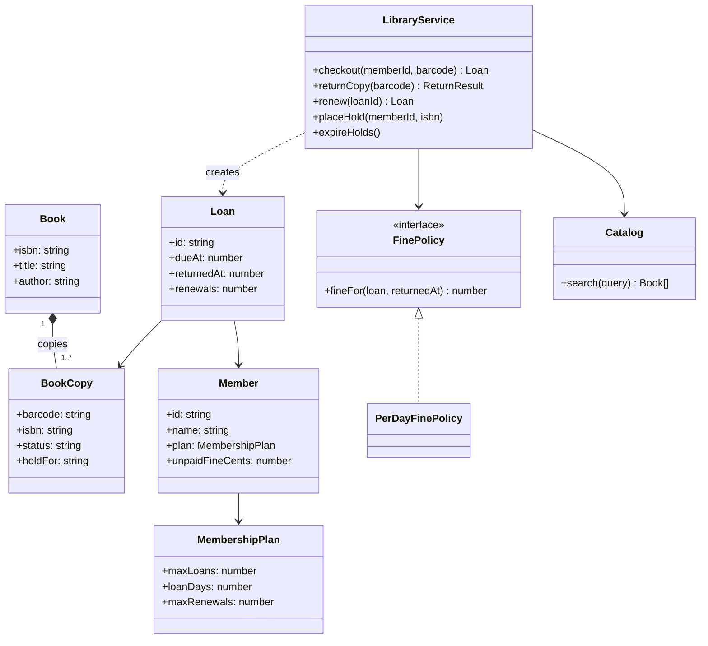
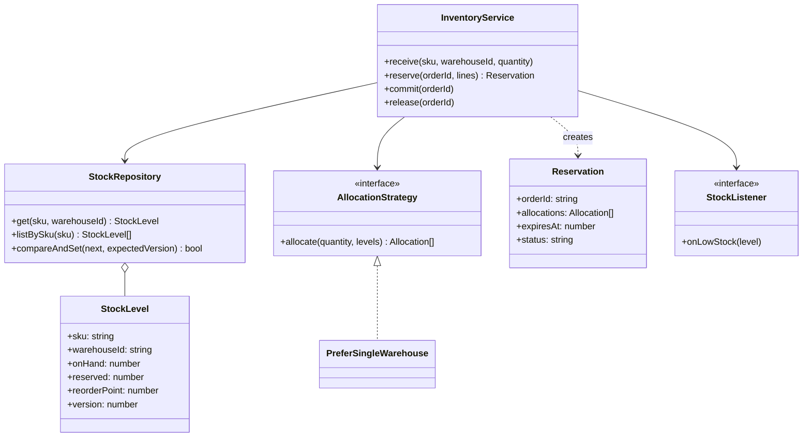
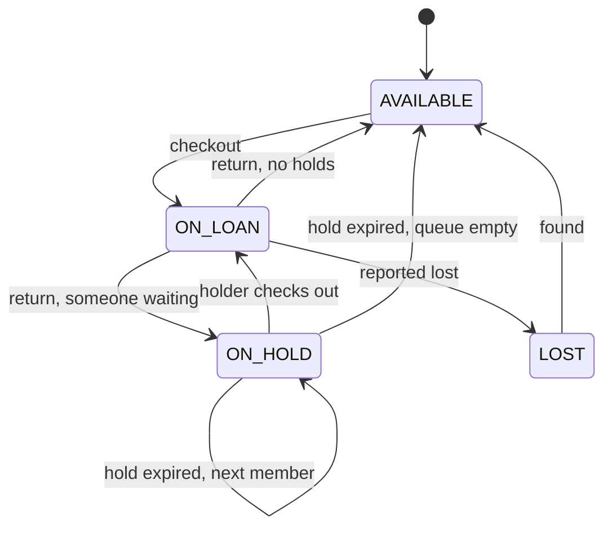
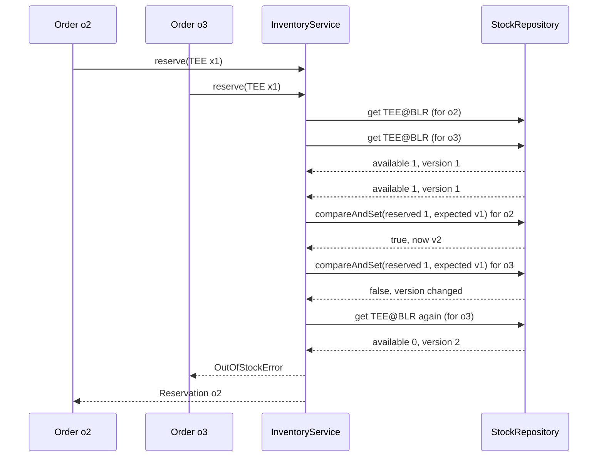

# Library and Inventory Management

> Two "manage physical things" LLD problems with the same core: items that can be counted, reserved and handed out, rules about who may take what and for how long, and races when two people want the last one. You will design a library system (books, copies, loans, holds, fines) and an inventory service (stock per warehouse, reservations, allocation, low-stock alerts) with optimistic locking.

**Before this:** [How to approach LLD interviews](01-how-to-approach-lld-interviews.md) · [Behavioral patterns](../04-oop-solid-design-patterns/08-behavioral-patterns.md) · [Race conditions in async Node.js code](../07-nodejs-backend/12-concurrency-worker-threads-and-cluster.md#race-conditions-in-async-nodejs-code) · **Interview questions:** [jump to the interview section](#interview-questions)

## Table of contents

1. [Problem](#problem)
2. [Clarifying questions](#clarifying-questions)
3. [Requirements](#requirements)
4. [Core entities and relationships](#core-entities-and-relationships)
5. [Design decisions and patterns](#design-decisions-and-patterns)
6. [Implementation](#implementation)
7. [Walkthrough](#walkthrough)
8. [Handling concurrency and edge cases](#handling-concurrency-and-edge-cases)
9. [Extensions](#extensions)
10. [How to present this in the interview](#how-to-present-this-in-the-interview)
11. [Interview questions](#interview-questions)
12. [Summary](#summary)
13. [References](#references)

---

## Problem

**Part A — library management:**

> "Design a library management system. The library has books, and several physical copies of each. Members search the catalog, borrow copies, return them and renew loans. Different member types have different limits. Late returns are fined. If all copies are out, a member can place a hold and is told when a copy is ready. Write the core classes."

**Part B — inventory management:**

> "Design the inventory part of an online shop. Products are stored in several warehouses. When a customer checks out, reserve stock so we never sell more than we have. When the order ships, remove the stock; if it is cancelled, release it. Choose which warehouse fulfils each order. Alert the purchasing team when stock is low. Two customers may try to buy the last item at the same time."

Both are about **countable things with a lifecycle**. The library tracks individual items (each copy has a barcode). The inventory tracks quantities (12 mugs in Bangalore). That difference — **identity vs quantity** — is the most important modeling decision, and a good interview answer says it out loud.

Terms used below:

- **Book (title)** vs **copy**: "Clean Code" is one book; the library may own three copies, each with its own barcode.
- **Loan:** one copy lent to one member, with a due date.
- **Hold (reservation):** a member's place in the queue for a book whose copies are all out.
- **SKU (stock keeping unit):** a product id, like `MUG-BLUE-350ML`.
- **On hand / reserved / available:** on hand = physically in the warehouse; reserved = promised to orders not yet shipped; available = on hand − reserved.
- **Optimistic locking:** read a record with its version number; when saving, succeed only if the version has not changed; otherwise retry.

---

## Clarifying questions

### Library

| Question | Why you ask it | Assumed answer |
| --- | --- | --- |
| One branch or many? | Location model. | One branch. Many is an extension. |
| Member types and limits? | Policy objects. | Student: 2 books, 14 days, 1 renewal. Faculty: 5 books, 28 days, 2 renewals. |
| How are fines calculated? | Strategy. | 0.50 per day late after 1 grace day, capped at 10.00. Paid at the desk (out of scope). |
| Can members borrow with unpaid fines? | Validation rule. | Not if unpaid fines are above 5.00. |
| Holds: how long does a ready copy wait? | Expiry. | 3 days, then it goes to the next member in the queue. |
| Can you renew if others are waiting? | Rule. | No. |
| Search by what? | Indexing. | Title words, author, ISBN. |
| Librarian features (add/remove books, lost copies)? | Scope. | Add books and copies; mark lost as an extension. |

### Inventory

| Question | Why you ask it | Assumed answer |
| --- | --- | --- |
| Track quantities or individual items (serial numbers)? | Model choice. | Quantities per SKU per warehouse. |
| When is stock reserved — cart or checkout? | Reservation lifetime. | At checkout; a reservation expires after 15 minutes if payment does not complete. |
| Can one order be split across warehouses? | Allocation. | Prefer one warehouse; split if no single warehouse can fill it. |
| Multi-item orders: all-or-nothing? | Transactions. | Yes: either every line is reserved, or none. |
| Concurrency: many app servers? | Locking approach. | Yes. We use optimistic locking with versions. |
| Low-stock alerts: threshold per SKU? | Observer + config. | A reorder point per SKU. |
| Returns and damaged goods? | Scope. | Extension. |

---

## Requirements

### Functional requirements

**Library**

1. Add books and copies; search by title words, author or ISBN.
2. Check out a copy to a member, respecting member limits and unpaid fines.
3. Return a copy; compute a fine if late.
4. Renew a loan if renewals remain and nobody is waiting.
5. Place a hold when no copy is available; when a copy comes back, hold it for the first member in the queue and notify them.
6. Expire holds that were not picked up in time.
7. List overdue loans.

**Inventory**

1. Receive stock into a warehouse.
2. Reserve all lines of an order (all-or-nothing), using a pluggable allocation strategy.
3. Commit a reservation when the order ships (stock leaves the building).
4. Release a reservation when the order is cancelled or the reservation expires.
5. Emit a low-stock event when available stock drops to the reorder point or below.

### Non-functional requirements

- **Correctness under concurrency:** never lend one copy twice; never reserve more than is available.
- **Auditability:** loans and stock movements are records, not just changed numbers.
- **Extensibility:** new member types, fine rules and allocation strategies without editing the services.
- **Testability:** time is injected (due dates, hold expiry, reservation expiry).

---

## Core entities and relationships

### Library

| Entity | Responsibility |
| --- | --- |
| `Book` | Catalog data: ISBN, title, author. |
| `BookCopy` | One physical item: barcode, ISBN, status (`AVAILABLE`, `ON_LOAN`, `ON_HOLD`, `LOST`), hold owner. |
| `MembershipPlan` | Limits: max loans, loan days, max renewals. |
| `Member` | A person with a plan and unpaid fines. |
| `Loan` | Copy + member + issued / due / returned dates + renewals. |
| `FinePolicy` (interface) | Fine for a late loan. `PerDayFinePolicy` implements it. |
| `Catalog` | Books, copies and a search index. |
| `HoldQueue` | FIFO queue of members per ISBN. |
| `LibraryService` | Use cases: checkout, return, renew, place hold, expire holds. |
| `LibraryListener` | Gets "hold ready" events (Observer). |



### Inventory

| Entity | Responsibility |
| --- | --- |
| `StockLevel` | One SKU in one warehouse: on hand, reserved, reorder point, **version**. |
| `StockRepository` | Reads stock levels and saves them with **compare-and-set** on the version. |
| `AllocationStrategy` (interface) | Decides which warehouses fill a line. |
| `PreferSingleWarehouse` | One warehouse if possible (fewer parcels), else split by most available. |
| `Reservation` | Order id, allocations per line, expiry time, status. |
| `InventoryService` | Use cases: receive, reserve, commit, release, expire. |
| `StockListener` | Gets low-stock events. |



---

## Design decisions and patterns

### Decision 1: identity vs quantity

A library copy has an identity: it can be damaged, lost, or on loan to Asha. So each copy is an object with a barcode and a status. Inventory units of the same SKU are interchangeable, so we store **counts**. Modeling 10,000 mugs as 10,000 objects would be slow and pointless. If the interviewer adds "track serial numbers for laptops", inventory moves towards the library model for that product type.

### Decision 2: a small state machine for copy status

A copy moves between statuses, and only some moves are legal: `ON_LOAN → AVAILABLE` is fine, `LOST → ON_LOAN` is not. We keep a table of allowed transitions and check every change against it. This gives most of the benefit of the [State pattern](../04-oop-solid-design-patterns/08-behavioral-patterns.md#state) with very little code. If each status had very different behavior (different methods, different rules), we would move to full State classes.



### Decision 3: Strategy for rules that change

- **Fines** (`FinePolicy`): per day with a grace period and cap today; "no fines for children" or "double fines for reference books" tomorrow.
- **Membership plans** are plain data objects (`MembershipPlan`). A new member type is a new object, not a new class. Use data when only numbers differ; use a strategy class when the *logic* differs.
- **Allocation** (`AllocationStrategy`): "fewest parcels", "nearest warehouse to the customer", "cheapest shipping". Each is a class behind one interface.

See [Strategy](../04-oop-solid-design-patterns/08-behavioral-patterns.md#strategy) and the [Open/Closed Principle](../04-oop-solid-design-patterns/03-solid-principles.md#o-openclosed-principle).

### Decision 4: Observer for "hold ready" and "low stock"

The library service should not send emails, and the inventory service should not create purchase orders. They emit events to listeners. The [Observer pattern](../04-oop-solid-design-patterns/08-behavioral-patterns.md#observer) keeps notification and purchasing logic out of the core, and connects naturally to the notification system from [Logger and notification system](08-logger-and-notification-system.md).

### Decision 5: Repository with compare-and-set for stock

The inventory service never changes stock directly. It reads a `StockLevel` (with its `version`), computes the new values, and asks the repository to save **only if the version is still the same**. If another request changed the row in between, the save fails and the service re-reads and tries again. This is **optimistic locking**. It works across many servers when the repository is a database (`UPDATE ... WHERE version = $expected`). See [repository and service layer](../04-oop-solid-design-patterns/09-patterns-in-real-javascript-apps.md#repository-and-service-layer).

Why optimistic and not a lock? Most of the time, two orders do not touch the same SKU in the same millisecond. Optimistic locking costs nothing when there is no conflict and only retries when there is. Pessimistic locks (`SELECT ... FOR UPDATE`) make every request wait, even when there is no conflict. For a few "hot" items (a flash sale), an atomic conditional update is even better; see [Handling concurrency and edge cases](#handling-concurrency-and-edge-cases).

### Decision 6: reservations as records, with compensation

An order with three lines needs three stock changes. Our in-memory repository has no multi-row transactions, so `reserve` applies the lines one by one and, if a later line fails, **undoes** the earlier ones (a "compensating action"). In a SQL database you would put all lines in one transaction instead. Both approaches give **all-or-nothing** behavior. Reservations are stored with an expiry time, so abandoned checkouts give stock back.

### Decision 7: services as facades, entities stay small

`LibraryService` and `InventoryService` are the only entry points ([Facade](../04-oop-solid-design-patterns/07-structural-patterns.md#facade)). Entities hold data and protect their own small invariants (a copy checks its transitions). Cross-entity rules ("a member may not exceed their plan's max loans") live in the service, because they involve more than one entity.

### Patterns used — summary

| Pattern / principle | Where | Why |
| --- | --- | --- |
| State (table form) | `BookCopy` transitions | Only legal status changes. |
| Strategy | `FinePolicy`, `AllocationStrategy` | Rules that change independently. |
| Observer | `LibraryListener`, `StockListener` | Keep notifications and purchasing out of the core. |
| Repository | `StockRepository` | Hide storage; enable compare-and-set. |
| Optimistic locking | `version` on `StockLevel` | Safe concurrent updates without waiting. |
| Facade | `LibraryService`, `InventoryService` | One entry point per use case. |
| Dependency injection | clock, policies, repository, listeners | Deterministic tests. |

---

## Implementation

All code blocks in this section form **one runnable TypeScript file**. Part A builds the library, Part B the inventory service, and the last block runs both demos.

### Shared: clock, errors and money

```ts
const DAY_MS = 24 * 60 * 60 * 1000;

interface Clock {
  now(): number;
}

class FakeClock implements Clock {
  private time: number;

  constructor(start: number) {
    this.time = start;
  }

  now(): number {
    return this.time;
  }

  advance(ms: number): void {
    this.time += ms;
  }
}

class DomainError extends Error {
  constructor(message: string) {
    super(message);
    this.name = 'DomainError';
  }
}

function formatMoney(cents: number): string {
  return `${Math.floor(cents / 100)}.${String(cents % 100).padStart(2, '0')}`;
}

function formatDay(ms: number): string {
  return new Date(ms).toISOString().slice(0, 10);
}
```

### Part A, step 1: catalog entities and the copy state machine

```ts
class Book {
  readonly isbn: string;
  readonly title: string;
  readonly author: string;

  constructor(isbn: string, title: string, author: string) {
    this.isbn = isbn;
    this.title = title;
    this.author = author;
  }
}

const CopyStatus = { AVAILABLE: 'AVAILABLE', ON_LOAN: 'ON_LOAN', ON_HOLD: 'ON_HOLD', LOST: 'LOST' } as const;
type CopyStatus = (typeof CopyStatus)[keyof typeof CopyStatus];

const ALLOWED_TRANSITIONS: Readonly<Record<CopyStatus, readonly CopyStatus[]>> = {
  AVAILABLE: ['ON_LOAN', 'LOST'],
  ON_LOAN: ['AVAILABLE', 'ON_HOLD', 'LOST'],
  ON_HOLD: ['ON_LOAN', 'AVAILABLE', 'ON_HOLD'],
  LOST: ['AVAILABLE'],
};

interface HoldInfo {
  readonly memberId: string;
  readonly expiresAt: number;
}

class BookCopy {
  readonly barcode: string;
  readonly isbn: string;
  private _status: CopyStatus = CopyStatus.AVAILABLE;
  private _hold: HoldInfo | null = null;

  constructor(barcode: string, isbn: string) {
    this.barcode = barcode;
    this.isbn = isbn;
  }

  get status(): CopyStatus {
    return this._status;
  }

  get hold(): HoldInfo | null {
    return this._hold;
  }

  // The only way to change status: illegal moves throw.
  moveTo(next: CopyStatus, hold: HoldInfo | null = null): void {
    if (!ALLOWED_TRANSITIONS[this._status].includes(next)) {
      throw new DomainError(`Copy ${this.barcode} cannot go from ${this._status} to ${next}`);
    }
    this._status = next;
    this._hold = next === CopyStatus.ON_HOLD ? hold : null;
  }
}
```

The fields `_status` and `_hold` are private, and the getters are read-only. Outside code can read the status but can only change it through `moveTo`, which checks the table. This is **encapsulation** doing real work: an illegal state is impossible to reach from outside.

### Part A, step 2: members, loans and the fine policy

```ts
interface MembershipPlan {
  readonly name: string;
  readonly maxLoans: number;
  readonly loanDays: number;
  readonly maxRenewals: number;
}

const Plans = {
  STUDENT: { name: 'Student', maxLoans: 2, loanDays: 14, maxRenewals: 1 },
  FACULTY: { name: 'Faculty', maxLoans: 5, loanDays: 28, maxRenewals: 2 },
} as const satisfies Record<string, MembershipPlan>;

class Member {
  readonly id: string;
  readonly name: string;
  readonly plan: MembershipPlan;
  unpaidFineCents = 0;

  constructor(id: string, name: string, plan: MembershipPlan) {
    this.id = id;
    this.name = name;
    this.plan = plan;
  }
}

class Loan {
  readonly id: string;
  readonly barcode: string;
  readonly memberId: string;
  readonly issuedAt: number;
  dueAt: number;
  renewals = 0;
  returnedAt: number | null = null;

  constructor(id: string, barcode: string, memberId: string, issuedAt: number, dueAt: number) {
    this.id = id;
    this.barcode = barcode;
    this.memberId = memberId;
    this.issuedAt = issuedAt;
    this.dueAt = dueAt;
  }

  get isOpen(): boolean {
    return this.returnedAt === null;
  }
}

interface FinePolicy {
  fineFor(loan: Loan, returnedAt: number): number; // cents
}

class PerDayFinePolicy implements FinePolicy {
  private readonly centsPerDay: number;
  private readonly graceDays: number;
  private readonly capCents: number;

  constructor(centsPerDay: number, graceDays: number, capCents: number) {
    this.centsPerDay = centsPerDay;
    this.graceDays = graceDays;
    this.capCents = capCents;
  }

  fineFor(loan: Loan, returnedAt: number): number {
    const daysLate = Math.ceil((returnedAt - loan.dueAt) / DAY_MS);
    if (daysLate <= this.graceDays) return 0;
    return Math.min(this.capCents, daysLate * this.centsPerDay);
  }
}
```

`as const satisfies Record<string, MembershipPlan>` checks that every plan has the right shape **and** keeps the exact values. A new plan, like "Alumni", is one more object. No new class is needed, because only the numbers differ.

The fine policy counts **all** late days once the grace period is over (return 3 days late with 1 grace day → 3 days of fines). Some libraries subtract the grace days. That is a business rule, and it lives in one class, so changing it is a one-line edit.

### Part A, step 3: the catalog with a search index

```ts
class Catalog {
  private readonly books = new Map<string, Book>();
  private readonly copies = new Map<string, BookCopy>();
  private readonly copiesByIsbn = new Map<string, BookCopy[]>();
  private readonly wordIndex = new Map<string, Set<string>>(); // word -> ISBNs

  addBook(book: Book): void {
    this.books.set(book.isbn, book);
    for (const word of Catalog.words(`${book.title} ${book.author}`)) {
      const isbns = this.wordIndex.get(word) ?? new Set<string>();
      isbns.add(book.isbn);
      this.wordIndex.set(word, isbns);
    }
  }

  addCopy(copy: BookCopy): void {
    if (!this.books.has(copy.isbn)) throw new DomainError(`Unknown ISBN ${copy.isbn}`);
    this.copies.set(copy.barcode, copy);
    const list = this.copiesByIsbn.get(copy.isbn) ?? [];
    list.push(copy);
    this.copiesByIsbn.set(copy.isbn, list);
  }

  book(isbn: string): Book | undefined {
    return this.books.get(isbn);
  }

  copy(barcode: string): BookCopy | undefined {
    return this.copies.get(barcode);
  }

  copiesOf(isbn: string): readonly BookCopy[] {
    return this.copiesByIsbn.get(isbn) ?? [];
  }

  // Every word of the query must match (AND search). An exact ISBN also matches.
  search(query: string): Book[] {
    const exact = this.books.get(query.trim());
    if (exact) return [exact];
    const words = Catalog.words(query);
    if (words.length === 0) return [];
    let result: string[] | null = null;
    for (const word of words) {
      const isbns = this.wordIndex.get(word) ?? new Set<string>();
      result = result === null ? [...isbns] : result.filter((isbn) => isbns.has(isbn));
    }
    return (result ?? []).map((isbn) => this.books.get(isbn) as Book);
  }

  private static words(text: string): string[] {
    return text.toLowerCase().split(/[^a-z0-9]+/).filter((w) => w.length > 0);
  }
}
```

The **inverted index** (word → set of ISBNs) makes search fast: we look up each query word instead of scanning every book. It is the same idea a search engine uses, in miniature. A real library would use a database's full-text search or a search engine.

### Part A, step 4: the library service

```ts
type LibraryEvent =
  | { readonly type: 'HOLD_READY'; readonly memberId: string; readonly barcode: string; readonly title: string; readonly expiresAt: number }
  | { readonly type: 'HOLD_EXPIRED'; readonly memberId: string; readonly barcode: string };

interface LibraryListener {
  onEvent(event: LibraryEvent): void;
}

interface ReturnResult {
  readonly loan: Loan;
  readonly fineCents: number;
  readonly heldFor: string | null;
}

class LibraryService {
  private readonly members = new Map<string, Member>();
  private readonly loans = new Map<string, Loan>();
  private readonly openLoanByBarcode = new Map<string, Loan>();
  private readonly holdQueues = new Map<string, string[]>(); // ISBN -> member ids (FIFO)
  private readonly heldCopies = new Set<BookCopy>(); // copies currently ON_HOLD
  private readonly listeners: LibraryListener[] = [];
  private nextLoanId = 1;
  private readonly catalog: Catalog;
  private readonly finePolicy: FinePolicy;
  private readonly clock: Clock;
  private readonly holdDays: number;
  private readonly maxUnpaidFineCents: number;

  constructor(catalog: Catalog, finePolicy: FinePolicy, clock: Clock, holdDays = 3, maxUnpaidFineCents = 500) {
    this.catalog = catalog;
    this.finePolicy = finePolicy;
    this.clock = clock;
    this.holdDays = holdDays;
    this.maxUnpaidFineCents = maxUnpaidFineCents;
  }

  subscribe(listener: LibraryListener): void {
    this.listeners.push(listener);
  }

  addMember(member: Member): void {
    this.members.set(member.id, member);
  }

  checkout(memberId: string, barcode: string): Loan {
    const member = this.requireMember(memberId);
    const copy = this.requireCopy(barcode);
    if (member.unpaidFineCents > this.maxUnpaidFineCents) {
      throw new DomainError(`${member.name} has unpaid fines of ${formatMoney(member.unpaidFineCents)}`);
    }
    if (this.openLoansOf(memberId).length >= member.plan.maxLoans) {
      throw new DomainError(`${member.name} already has ${member.plan.maxLoans} books (${member.plan.name} limit)`);
    }
    if (copy.status === CopyStatus.ON_HOLD && copy.hold?.memberId !== memberId) {
      throw new DomainError(`Copy ${barcode} is on hold for ${this.nameOf(copy.hold?.memberId)}`);
    }
    if (copy.status !== CopyStatus.AVAILABLE && copy.status !== CopyStatus.ON_HOLD) {
      throw new DomainError(`Copy ${barcode} is ${copy.status}`);
    }

    this.heldCopies.delete(copy); // no-op unless it was on hold for this member
    copy.moveTo(CopyStatus.ON_LOAN);
    const now = this.clock.now();
    const loan = new Loan(`L${this.nextLoanId++}`, barcode, memberId, now, now + member.plan.loanDays * DAY_MS);
    this.loans.set(loan.id, loan);
    this.openLoanByBarcode.set(barcode, loan);
    return loan;
  }

  returnCopy(barcode: string): ReturnResult {
    const copy = this.requireCopy(barcode);
    const loan = this.openLoanByBarcode.get(barcode);
    if (!loan) throw new DomainError(`Copy ${barcode} is not on loan`);

    const now = this.clock.now();
    loan.returnedAt = now;
    this.openLoanByBarcode.delete(barcode);
    const fineCents = this.finePolicy.fineFor(loan, now);
    this.requireMember(loan.memberId).unpaidFineCents += fineCents;

    const heldFor = this.giveToNextInQueue(copy);
    if (!heldFor) copy.moveTo(CopyStatus.AVAILABLE);
    return { loan, fineCents, heldFor };
  }

  renew(loanId: string): Loan {
    const loan = this.loans.get(loanId);
    if (!loan || !loan.isOpen) throw new DomainError(`Loan ${loanId} is not open`);
    const member = this.requireMember(loan.memberId);
    const copy = this.requireCopy(loan.barcode);
    if (loan.renewals >= member.plan.maxRenewals) throw new DomainError(`No renewals left for loan ${loanId}`);
    if (this.clock.now() > loan.dueAt) throw new DomainError(`Loan ${loanId} is overdue; return it first`);
    if ((this.holdQueues.get(copy.isbn) ?? []).length > 0) {
      throw new DomainError(`Cannot renew: other members are waiting for this book`);
    }
    loan.renewals += 1;
    loan.dueAt += member.plan.loanDays * DAY_MS;
    return loan;
  }

  placeHold(memberId: string, isbn: string): number {
    const member = this.requireMember(memberId);
    const copies = this.catalog.copiesOf(isbn);
    if (copies.length === 0) throw new DomainError(`No copies of ${isbn}`);
    if (copies.some((c) => c.status === CopyStatus.AVAILABLE)) {
      throw new DomainError('A copy is available now; borrow it instead of placing a hold');
    }
    const queue = this.holdQueues.get(isbn) ?? [];
    if (queue.includes(memberId)) throw new DomainError(`${member.name} is already in the queue`);
    queue.push(memberId);
    this.holdQueues.set(isbn, queue);
    return queue.length; // position in the queue
  }

  // Called by a scheduler (for example once an hour).
  expireHolds(): void {
    const now = this.clock.now();
    for (const copy of [...this.heldCopies]) {
      const hold = copy.hold;
      if (!hold || hold.expiresAt > now) continue;
      this.heldCopies.delete(copy);
      this.emit({ type: 'HOLD_EXPIRED', memberId: hold.memberId, barcode: copy.barcode });
      const next = this.giveToNextInQueue(copy);
      if (!next) copy.moveTo(CopyStatus.AVAILABLE);
    }
  }

  overdueLoans(): Loan[] {
    const now = this.clock.now();
    return [...this.openLoanByBarcode.values()].filter((loan) => loan.dueAt < now);
  }

  nameOf(memberId: string | undefined): string {
    return (memberId && this.members.get(memberId)?.name) || 'unknown';
  }

  // Puts the copy ON_HOLD for the first member in the queue. Returns that member id, or null.
  private giveToNextInQueue(copy: BookCopy): string | null {
    const queue = this.holdQueues.get(copy.isbn) ?? [];
    const memberId = queue.shift();
    if (!memberId) return null;
    const expiresAt = this.clock.now() + this.holdDays * DAY_MS;
    copy.moveTo(CopyStatus.ON_HOLD, { memberId, expiresAt });
    this.heldCopies.add(copy);
    const title = this.catalog.book(copy.isbn)?.title ?? copy.isbn;
    this.emit({ type: 'HOLD_READY', memberId, barcode: copy.barcode, title, expiresAt });
    return memberId;
  }

  private openLoansOf(memberId: string): Loan[] {
    return [...this.openLoanByBarcode.values()].filter((loan) => loan.memberId === memberId);
  }

  private emit(event: LibraryEvent): void {
    for (const listener of this.listeners) listener.onEvent(event);
  }

  private requireMember(id: string): Member {
    const member = this.members.get(id);
    if (!member) throw new DomainError(`Unknown member ${id}`);
    return member;
  }

  private requireCopy(barcode: string): BookCopy {
    const copy = this.catalog.copy(barcode);
    if (!copy) throw new DomainError(`Unknown copy ${barcode}`);
    return copy;
  }
}
```

Points worth saying out loud:

- **All checks before the first change.** `checkout` validates the member, fines, limits and copy status first, then changes the copy, then creates the loan.
- **The copy protects itself.** Even if the service forgot a check, `moveTo` would refuse an illegal transition.
- **Indexes for the hot paths.** `openLoanByBarcode` answers "who has this copy?" in O(1) on every return.

### Part B, step 1: stock levels and a repository with compare-and-set

```ts
interface StockLevel {
  readonly sku: string;
  readonly warehouseId: string;
  readonly onHand: number;
  readonly reserved: number;
  readonly reorderPoint: number;
  readonly version: number;
}

function available(level: StockLevel): number {
  return level.onHand - level.reserved;
}

// Stands in for a database table. Every call is async, like a real query,
// so two requests can interleave between "read" and "write".
class InMemoryStockRepository {
  private readonly rows = new Map<string, StockLevel>();
  conflicts = 0;

  async get(sku: string, warehouseId: string): Promise<StockLevel | undefined> {
    await Promise.resolve(); // pretend network round trip
    return this.rows.get(`${sku}@${warehouseId}`);
  }

  async listBySku(sku: string): Promise<StockLevel[]> {
    await Promise.resolve();
    return [...this.rows.values()].filter((row) => row.sku === sku);
  }

  async insert(level: StockLevel): Promise<void> {
    await Promise.resolve();
    const key = `${level.sku}@${level.warehouseId}`;
    if (this.rows.has(key)) throw new DomainError(`${key} already exists`);
    this.rows.set(key, level);
  }

  // Save only if nobody changed the row since we read it.
  // SQL: UPDATE stock SET ..., version = version + 1 WHERE sku = $1 AND warehouse_id = $2 AND version = $3
  async compareAndSet(next: StockLevel, expectedVersion: number): Promise<boolean> {
    await Promise.resolve();
    const key = `${next.sku}@${next.warehouseId}`;
    const current = this.rows.get(key);
    if (!current || current.version !== expectedVersion) {
      this.conflicts += 1;
      return false;
    }
    this.rows.set(key, { ...next, version: expectedVersion + 1 });
    return true;
  }
}
```

### Part B, step 2: the allocation strategy

```ts
interface Allocation {
  readonly warehouseId: string;
  readonly quantity: number;
}

interface AllocationStrategy {
  // Returns how to split `quantity` across warehouses, or null if there is not enough stock.
  allocate(quantity: number, levels: readonly StockLevel[]): Allocation[] | null;
}

// One parcel if possible (in priority order, e.g. nearest first); otherwise split, biggest stock first.
class PreferSingleWarehouse implements AllocationStrategy {
  private readonly priority: readonly string[];

  constructor(priority: readonly string[]) {
    this.priority = priority;
  }

  allocate(quantity: number, levels: readonly StockLevel[]): Allocation[] | null {
    const rank = (warehouseId: string) => {
      const index = this.priority.indexOf(warehouseId);
      return index === -1 ? Number.MAX_SAFE_INTEGER : index;
    };
    const byPriority = [...levels].sort((a, b) => rank(a.warehouseId) - rank(b.warehouseId));
    const single = byPriority.find((level) => available(level) >= quantity);
    if (single) return [{ warehouseId: single.warehouseId, quantity }];

    const byStock = levels
      .filter((level) => available(level) > 0)
      .sort((a, b) => available(b) - available(a) || rank(a.warehouseId) - rank(b.warehouseId));
    const plan: Allocation[] = [];
    let left = quantity;
    for (const level of byStock) {
      const take = Math.min(left, available(level));
      plan.push({ warehouseId: level.warehouseId, quantity: take });
      left -= take;
      if (left === 0) return plan;
    }
    return null;
  }
}
```

### Part B, step 3: reservations and the inventory service

```ts
const ReservationStatus = { ACTIVE: 'ACTIVE', COMMITTED: 'COMMITTED', RELEASED: 'RELEASED' } as const;
type ReservationStatus = (typeof ReservationStatus)[keyof typeof ReservationStatus];

interface OrderLine {
  readonly sku: string;
  readonly quantity: number;
}

interface ReservedLine {
  readonly sku: string;
  readonly warehouseId: string;
  readonly quantity: number;
}

class Reservation {
  readonly orderId: string;
  readonly lines: readonly ReservedLine[];
  readonly expiresAt: number;
  status: ReservationStatus = ReservationStatus.ACTIVE;

  constructor(orderId: string, lines: readonly ReservedLine[], expiresAt: number) {
    this.orderId = orderId;
    this.lines = lines;
    this.expiresAt = expiresAt;
  }
}

class OutOfStockError extends DomainError {
  constructor(message: string) {
    super(message);
    this.name = 'OutOfStockError';
  }
}

interface StockListener {
  onLowStock(level: StockLevel): void;
}

class InventoryService {
  private readonly reservations = new Map<string, Reservation>();
  private readonly repo: InMemoryStockRepository;
  private readonly strategy: AllocationStrategy;
  private readonly clock: Clock;
  private readonly listeners: readonly StockListener[];
  private readonly reservationTtlMs: number;
  private readonly maxAttempts = 5;

  constructor(
    repo: InMemoryStockRepository,
    strategy: AllocationStrategy,
    clock: Clock,
    listeners: readonly StockListener[],
    reservationTtlMs = 15 * 60 * 1000,
  ) {
    this.repo = repo;
    this.strategy = strategy;
    this.clock = clock;
    this.listeners = listeners;
    this.reservationTtlMs = reservationTtlMs;
  }

  async receive(sku: string, warehouseId: string, quantity: number, reorderPoint = 0): Promise<void> {
    InventoryService.assertQuantity(quantity);
    const existing = await this.repo.get(sku, warehouseId);
    if (!existing) {
      await this.repo.insert({ sku, warehouseId, onHand: quantity, reserved: 0, reorderPoint, version: 1 });
      return;
    }
    await this.adjust(sku, warehouseId, (level) => ({ ...level, onHand: level.onHand + quantity }));
  }

  // All lines or nothing. Safe to call twice with the same orderId.
  async reserve(orderId: string, lines: readonly OrderLine[]): Promise<Reservation> {
    const existing = this.reservations.get(orderId);
    if (existing && existing.status === ReservationStatus.ACTIVE) return existing;
    for (const line of lines) InventoryService.assertQuantity(line.quantity);

    for (let attempt = 1; attempt <= this.maxAttempts; attempt += 1) {
      const done: ReservedLine[] = [];
      let lostRace = false;
      for (const line of lines) {
        const levels = await this.repo.listBySku(line.sku);
        const plan = this.strategy.allocate(line.quantity, levels);
        if (!plan) {
          await this.undo(done);
          const total = levels.reduce((sum, level) => sum + available(level), 0);
          throw new OutOfStockError(`Not enough ${line.sku}: wanted ${line.quantity}, available ${total}`);
        }
        for (const part of plan) {
          const ok = await this.adjust(line.sku, part.warehouseId, (level) =>
            available(level) >= part.quantity ? { ...level, reserved: level.reserved + part.quantity } : null,
          );
          if (!ok) {
            lostRace = true; // someone took the stock after we planned: start over with fresh data
            break;
          }
          done.push({ sku: line.sku, warehouseId: part.warehouseId, quantity: part.quantity });
        }
        if (lostRace) break;
      }
      if (!lostRace) {
        const reservation = new Reservation(orderId, done, this.clock.now() + this.reservationTtlMs);
        this.reservations.set(orderId, reservation);
        return reservation;
      }
      await this.undo(done);
    }
    throw new DomainError(`Could not reserve order ${orderId}: too much contention, try again`);
  }

  // The order shipped: stock physically leaves the warehouse.
  async commit(orderId: string): Promise<void> {
    const reservation = this.requireActive(orderId);
    for (const line of reservation.lines) {
      await this.adjust(line.sku, line.warehouseId, (level) => ({
        ...level,
        onHand: level.onHand - line.quantity,
        reserved: level.reserved - line.quantity,
      }));
    }
    reservation.status = ReservationStatus.COMMITTED;
  }

  // The order was cancelled or payment never finished: give the stock back.
  async release(orderId: string): Promise<void> {
    const reservation = this.requireActive(orderId);
    await this.undo(reservation.lines);
    reservation.status = ReservationStatus.RELEASED;
  }

  // Called by a scheduler every minute.
  async expireReservations(): Promise<string[]> {
    const now = this.clock.now();
    const expired = [...this.reservations.values()].filter(
      (r) => r.status === ReservationStatus.ACTIVE && r.expiresAt <= now,
    );
    for (const reservation of expired) await this.release(reservation.orderId);
    return expired.map((r) => r.orderId);
  }

  async stockOf(sku: string): Promise<StockLevel[]> {
    return this.repo.listBySku(sku);
  }

  // Optimistic update: read, compute, compare-and-set; on conflict, re-read and try again.
  // `change` returns null when the business rule no longer holds (e.g. not enough stock).
  private async adjust(
    sku: string,
    warehouseId: string,
    change: (level: StockLevel) => StockLevel | null,
  ): Promise<boolean> {
    for (let attempt = 1; attempt <= this.maxAttempts; attempt += 1) {
      const current = await this.repo.get(sku, warehouseId);
      if (!current) throw new DomainError(`No stock row for ${sku}@${warehouseId}`);
      const next = change(current);
      if (!next) return false;
      if (next.onHand < 0 || next.reserved < 0 || next.reserved > next.onHand) {
        throw new Error(`Bug: invalid stock for ${sku}@${warehouseId}`); // invariant check
      }
      if (await this.repo.compareAndSet(next, current.version)) {
        this.checkLowStock(current, next);
        return true;
      }
    }
    throw new DomainError(`Too many conflicts updating ${sku}@${warehouseId}`);
  }

  private async undo(lines: readonly ReservedLine[]): Promise<void> {
    for (const line of lines) {
      await this.adjust(line.sku, line.warehouseId, (level) => ({ ...level, reserved: level.reserved - line.quantity }));
    }
  }

  // Fire only when we CROSS the reorder point, not on every change below it.
  private checkLowStock(before: StockLevel, after: StockLevel): void {
    if (available(before) > after.reorderPoint && available(after) <= after.reorderPoint) {
      for (const listener of this.listeners) listener.onLowStock(after);
    }
  }

  private requireActive(orderId: string): Reservation {
    const reservation = this.reservations.get(orderId);
    if (!reservation || reservation.status !== ReservationStatus.ACTIVE) {
      throw new DomainError(`No active reservation for ${orderId}`);
    }
    return reservation;
  }

  private static assertQuantity(quantity: number): void {
    if (!Number.isInteger(quantity) || quantity <= 0) throw new DomainError('Quantity must be a positive whole number');
  }
}
```

Read `adjust` slowly; it is the heart of Part B:

1. Read the row **with its version**.
2. Compute the new row with a pure function (`change`). If the business rule fails (not enough stock), stop.
3. Check invariants: never negative, never reserve more than on hand.
4. Save with compare-and-set. If someone else saved first, the version is different, the save fails, and we loop: read again, decide again.

### The demo

```ts
function demoLibrary(): void {
  console.log('--- Library ---');
  const clock = new FakeClock(Date.UTC(2026, 10, 2));
  const catalog = new Catalog();
  catalog.addBook(new Book('978-0132350884', 'Clean Code', 'Robert C. Martin'));
  catalog.addBook(new Book('978-0134757599', 'Refactoring', 'Martin Fowler'));
  catalog.addBook(new Book('978-0201633610', 'Design Patterns', 'Gamma, Helm, Johnson, Vlissides'));
  catalog.addCopy(new BookCopy('CC-1', '978-0132350884'));
  catalog.addCopy(new BookCopy('RF-1', '978-0134757599'));
  catalog.addCopy(new BookCopy('RF-2', '978-0134757599'));
  catalog.addCopy(new BookCopy('DP-1', '978-0201633610'));

  const library = new LibraryService(catalog, new PerDayFinePolicy(50, 1, 1_000), clock);
  library.subscribe({
    onEvent: (e) => {
      if (e.type === 'HOLD_READY') console.log(`[notify] ${library.nameOf(e.memberId)}: "${e.title}" (${e.barcode}) is ready until ${formatDay(e.expiresAt)}`);
      else console.log(`[notify] ${library.nameOf(e.memberId)}: your hold on ${e.barcode} expired`);
    },
  });
  library.addMember(new Member('m1', 'Asha', Plans.STUDENT));
  library.addMember(new Member('m2', 'Ben', Plans.FACULTY));
  library.addMember(new Member('m3', 'Chen', Plans.STUDENT));

  console.log('search "martin":', catalog.search('martin').map((b) => b.title).join(', '));
  console.log('search "clean martin":', catalog.search('clean martin').map((b) => b.title).join(', '));

  const loan = library.checkout('m1', 'CC-1');
  console.log(`Asha borrowed CC-1, due ${formatDay(loan.dueAt)}`);
  library.checkout('m1', 'RF-1');
  const attempt = (label: string, action: () => unknown) => {
    try {
      action();
      console.log(`${label}: ok`);
    } catch (error) {
      console.log(`${label}: ${(error as Error).message}`);
    }
  };
  attempt('Asha borrows DP-1', () => library.checkout('m1', 'DP-1'));
  console.log(`Ben places a hold on Clean Code: position ${library.placeHold('m2', '978-0132350884')}`);
  console.log(`Chen places a hold on Clean Code: position ${library.placeHold('m3', '978-0132350884')}`);
  attempt('Asha renews CC-1', () => library.renew(loan.id));

  clock.advance(17 * DAY_MS); // 3 days late
  console.log(`Overdue on ${formatDay(clock.now())}: ${library.overdueLoans().map((l) => l.barcode).join(', ')}`);
  const result = library.returnCopy('CC-1');
  console.log(`Asha returned CC-1: fine ${formatMoney(result.fineCents)}, now held for ${library.nameOf(result.heldFor ?? undefined)}`);
  attempt('Asha borrows CC-1 again', () => library.checkout('m1', 'CC-1'));

  clock.advance(4 * DAY_MS); // Ben never comes
  library.expireHolds();
  const chenLoan = library.checkout('m3', 'CC-1');
  console.log(`Chen borrowed CC-1, due ${formatDay(chenLoan.dueAt)}`);
}

async function demoInventory(): Promise<void> {
  console.log('--- Inventory ---');
  const clock = new FakeClock(Date.UTC(2026, 10, 2, 9, 0));
  const repo = new InMemoryStockRepository();
  const inventory = new InventoryService(repo, new PreferSingleWarehouse(['BLR', 'DEL']), clock, [
    { onLowStock: (l) => console.log(`[purchasing] low stock: ${l.sku}@${l.warehouseId} available=${available(l)} (reorder point ${l.reorderPoint})`) },
  ]);
  const show = async (sku: string) => {
    const rows = await inventory.stockOf(sku);
    console.log(`  ${sku}: ${rows.map((r) => `${r.warehouseId} onHand=${r.onHand} reserved=${r.reserved} v${r.version}`).join(' | ')}`);
  };

  await inventory.receive('MUG', 'BLR', 3, 1);
  await inventory.receive('MUG', 'DEL', 2, 1);
  await inventory.receive('TEE', 'BLR', 1, 0);

  const o1 = await inventory.reserve('o1', [{ sku: 'MUG', quantity: 4 }]);
  console.log(`o1 reserved: ${o1.lines.map((l) => `${l.quantity}x${l.sku}@${l.warehouseId}`).join(', ')}`);
  await show('MUG');

  console.log('o2 and o3 try to buy the last TEE at the same time:');
  const results = await Promise.allSettled([
    inventory.reserve('o2', [{ sku: 'TEE', quantity: 1 }]),
    inventory.reserve('o3', [{ sku: 'TEE', quantity: 1 }]),
  ]);
  results.forEach((r, i) => console.log(`  o${i + 2}: ${r.status === 'fulfilled' ? 'reserved' : (r.reason as Error).message}`));
  console.log(`  version conflicts detected and retried: ${repo.conflicts}`);

  try {
    await inventory.reserve('o4', [{ sku: 'MUG', quantity: 1 }, { sku: 'TEE', quantity: 1 }]);
  } catch (error) {
    console.log(`o4 (MUG + TEE): ${(error as Error).message}; MUG line was rolled back:`);
  }
  await show('MUG');

  await inventory.commit('o1');
  await inventory.release('o2'); // customer cancelled
  console.log('After shipping o1 and cancelling o2:');
  await show('MUG');
  await show('TEE');

  await inventory.reserve('o5', [{ sku: 'TEE', quantity: 1 }]);
  clock.advance(16 * 60 * 1000); // payment never completed
  console.log(`Expired reservations: ${(await inventory.expireReservations()).join(', ')}`);
  await show('TEE');
}

async function main(): Promise<void> {
  demoLibrary();
  await demoInventory();
}

main();
```

Running it prints:

```text
--- Library ---
search "martin": Clean Code, Refactoring
search "clean martin": Clean Code
Asha borrowed CC-1, due 2026-11-16
Asha borrows DP-1: Asha already has 2 books (Student limit)
Ben places a hold on Clean Code: position 1
Chen places a hold on Clean Code: position 2
Asha renews CC-1: Cannot renew: other members are waiting for this book
Overdue on 2026-11-19: CC-1, RF-1
[notify] Ben: "Clean Code" (CC-1) is ready until 2026-11-22
Asha returned CC-1: fine 1.50, now held for Ben
Asha borrows CC-1 again: Copy CC-1 is on hold for Ben
[notify] Ben: your hold on CC-1 expired
[notify] Chen: "Clean Code" (CC-1) is ready until 2026-11-26
Chen borrowed CC-1, due 2026-12-07
--- Inventory ---
[purchasing] low stock: MUG@BLR available=0 (reorder point 1)
[purchasing] low stock: MUG@DEL available=1 (reorder point 1)
o1 reserved: 3xMUG@BLR, 1xMUG@DEL
  MUG: BLR onHand=3 reserved=3 v2 | DEL onHand=2 reserved=1 v2
o2 and o3 try to buy the last TEE at the same time:
[purchasing] low stock: TEE@BLR available=0 (reorder point 0)
  o2: reserved
  o3: Not enough TEE: wanted 1, available 0
  version conflicts detected and retried: 1
o4 (MUG + TEE): Not enough TEE: wanted 1, available 0; MUG line was rolled back:
  MUG: BLR onHand=3 reserved=3 v2 | DEL onHand=2 reserved=1 v4
After shipping o1 and cancelling o2:
  MUG: BLR onHand=0 reserved=0 v3 | DEL onHand=1 reserved=0 v5
  TEE: BLR onHand=1 reserved=0 v3
[purchasing] low stock: TEE@BLR available=0 (reorder point 0)
Expired reservations: o5
  TEE: BLR onHand=1 reserved=0 v5
```

What the output shows:

- Search is an AND over words: "martin" matches two authors; "clean martin" narrows it to one book.
- Asha, a student, hits her limit of 2 books. Her renewal is refused because Ben and Chen are waiting.
- Returning 3 days late with 1 grace day gives 3 × 0.50 = 1.50. The copy goes straight to `ON_HOLD` for Ben (first in the queue), and the listener "notifies" him. Asha cannot take it.
- Ben does not pick it up within 3 days, so `expireHolds` moves the hold to Chen.
- Inventory: no warehouse has 4 mugs, so `o1` is split: 3 from BLR (most stock) and 1 from DEL. Both warehouses cross their reorder point and purchasing is alerted **once each**.
- `o2` and `o3` race for the last T-shirt. Both read version 1; `o2` saves first; `o3`'s compare-and-set fails (1 conflict), it re-reads, sees 0 available, and gets a clean "out of stock" error. Stock is never oversold.
- `o4` reserved a mug, then failed on the T-shirt, and the mug reservation was **undone**: DEL is back to `reserved=1` (the version went up twice: reserve, then undo).
- Shipping `o1` reduces both on-hand and reserved; cancelling `o2` returns the T-shirt.
- `o5` was never paid; after 15 minutes the reservation expired and the T-shirt is available again.

---

## Walkthrough

### Reserving the last unit while another order competes



### Returning a book that someone is waiting for

1. `returnCopy('CC-1')`: find the open loan through `openLoanByBarcode` (O(1)).
2. Close the loan, ask `FinePolicy` for the fine, add it to the member's unpaid total.
3. Look at the hold queue for this ISBN. Ben is first: `moveTo(ON_HOLD, { memberId: 'm2', expiresAt })`.
4. Emit `HOLD_READY`; the listener sends Ben a message.
5. Later, only Ben can check out `CC-1`. If he does not come within 3 days, `expireHolds` emits `HOLD_EXPIRED` and gives the copy to the next member, or makes it `AVAILABLE` if the queue is empty.

---

## Handling concurrency and edge cases

### Library: two desks lend the same copy

In our in-memory code, `checkout` is synchronous: it reads the copy status and changes it with no `await` in between, so two calls cannot interleave. With a database and several servers, two librarians scanning the same barcode at the same moment can both read `AVAILABLE`. Fixes:

- **Conditional update:** `UPDATE copies SET status = 'ON_LOAN' WHERE barcode = $1 AND status = 'AVAILABLE'`. If it changes 0 rows, someone else won. The check and the change happen in one atomic statement.
- **Unique constraint as a safety net:** a partial unique index "at most one open loan per barcode" (`WHERE returned_at IS NULL`). Even a buggy code path cannot create two open loans.
- **Member limits** have the same race (two desks lend Asha her 2nd and 3rd book at once). Lock the member row (`SELECT ... FOR UPDATE`) during checkout, or keep an `open_loans` counter on the member with a conditional update `WHERE open_loans < max_loans`.

### Inventory: optimistic locking vs an atomic conditional update

Optimistic locking (shown above) works well when conflicts are rare. During a flash sale, thousands of buyers hit the same row, most compare-and-sets fail, and the retries waste work. For one hot row, an **atomic conditional update** is better: the database checks and changes the number in one step, and nobody retries.

This standalone program shows the difference with 100 buyers and 10 units:

```ts
// A tiny async "database" with one stock row.
const row = { available: 10, version: 1 };
const tick = () => Promise.resolve();

// Optimistic: read the version, then compare-and-set. Losers re-read and retry.
async function buyOptimistic(stats: { attempts: number }): Promise<boolean> {
  for (;;) {
    stats.attempts += 1;
    await tick();
    const seen = { ...row };
    if (seen.available === 0) return false;
    await tick();
    if (row.version === seen.version) {
      row.available = seen.available - 1;
      row.version += 1;
      return true;
    }
  }
}

// Atomic: like UPDATE stock SET available = available - 1 WHERE sku = $1 AND available >= 1
async function buyAtomic(stats: { attempts: number }): Promise<boolean> {
  stats.attempts += 1;
  await tick();
  if (row.available < 1) return false;
  row.available -= 1;
  return true;
}

async function run(name: string, buy: (stats: { attempts: number }) => Promise<boolean>): Promise<void> {
  row.available = 10;
  row.version = 1;
  const stats = { attempts: 0 };
  const results = await Promise.all(Array.from({ length: 100 }, () => buy(stats)));
  const sold = results.filter(Boolean).length;
  console.log(`${name}: sold ${sold}, left ${row.available}, database round trips ${stats.attempts}`);
}

async function main(): Promise<void> {
  await run('optimistic', buyOptimistic);
  await run('atomic    ', buyAtomic);
}

main();
```

Output:

```text
optimistic: sold 10, left 0, database round trips 1045
atomic    : sold 10, left 0, database round trips 100
```

Both are **correct** — exactly 10 sold — but optimistic locking needed about ten times more round trips under heavy contention. Rule of thumb to say in the interview:

| Situation | Choice |
| --- | --- |
| Normal traffic, many SKUs, rare conflicts | Optimistic locking (version column). |
| One hot row (flash sale) | Atomic conditional update, or a Redis counter with `DECR` and a check. |
| Complex multi-row logic that must not interleave | Pessimistic lock (`SELECT ... FOR UPDATE`) inside a short transaction, always locking rows in the same order (sorted by SKU) to avoid deadlocks. |
| Extreme scale | Queue the orders per SKU and process them one by one; or pre-split stock into buckets. |

See [race conditions in async Node.js code](../07-nodejs-backend/12-concurrency-worker-threads-and-cluster.md#race-conditions-in-async-nodejs-code) and [databases](../07-nodejs-backend/10-databases.md) for transactions and isolation levels.

### Edge cases

| Edge case | Handling |
| --- | --- |
| Member returns a book that is not on loan | `DomainError("not on loan")`. |
| Copy marked lost while a member waits | `ON_LOAN → LOST`; the hold queue stays, and the next returned copy of the same ISBN serves it. |
| Member places two holds on the same book | Rejected ("already in the queue"). |
| Hold placed while a copy is available | Rejected; borrow it instead. (Some libraries allow holds for pickup at another branch.) |
| Hold holder never comes | `expireHolds` (run by a scheduler) moves it on. |
| Unpaid fines over the limit | Checkout refused until paid. |
| Renewing an overdue loan | Refused; return first (and pay the fine). |
| Reserve quantity 0, negative or 1.5 | `DomainError`. |
| Same order reserved twice (retry) | Returns the existing active reservation (idempotent). |
| Commit or release twice | Second call fails: reservation is no longer `ACTIVE`. Status checks make these operations safe to retry only once — in production, make them idempotent too. |
| Payment succeeds after the reservation expired | The order service must try to reserve again; if stock is gone, refund. This is why the TTL should be longer than the payment timeout. |
| Stock count goes negative because of a bug | `adjust` checks the invariants before saving and throws. |
| Low-stock alert spam | Alerts fire only when available stock **crosses** the reorder point, not on every change below it. |

---

## Extensions

### A new allocation strategy: nearest warehouse to the customer

Allocation is a strategy, so "ship from the closest warehouse" is a new class; `InventoryService` is unchanged:

```ts
// Builds on the Implementation code above.
class NearestWarehouseFirst implements AllocationStrategy {
  private readonly distanceKm: ReadonlyMap<string, number>;

  constructor(distanceKm: ReadonlyMap<string, number>) {
    this.distanceKm = distanceKm;
  }

  allocate(quantity: number, levels: readonly StockLevel[]): Allocation[] | null {
    const distance = (id: string) => this.distanceKm.get(id) ?? Number.MAX_SAFE_INTEGER;
    const plan: Allocation[] = [];
    let left = quantity;
    for (const level of [...levels].sort((a, b) => distance(a.warehouseId) - distance(b.warehouseId))) {
      const take = Math.min(left, available(level));
      if (take > 0) plan.push({ warehouseId: level.warehouseId, quantity: take });
      left -= take;
      if (left === 0) return plan;
    }
    return null;
  }
}

async function demoNearest(): Promise<void> {
  const clock = new FakeClock(0);
  const repo = new InMemoryStockRepository();
  // A customer in Delhi: DEL is 10 km away, BLR is 2,100 km away.
  const strategy = new NearestWarehouseFirst(new Map([['DEL', 10], ['BLR', 2_100]]));
  const inventory = new InventoryService(repo, strategy, clock, []);
  await inventory.receive('MUG', 'BLR', 5);
  await inventory.receive('MUG', 'DEL', 2);
  const r = await inventory.reserve('o9', [{ sku: 'MUG', quantity: 3 }]);
  console.log(r.lines.map((l) => `${l.quantity}x${l.sku}@${l.warehouseId}`).join(', '));
}

demoNearest();
```

Output:

```text
2xMUG@DEL, 1xMUG@BLR
```

In a real system the strategy would receive the customer's address per order. That means the `allocate` signature gains a context parameter (`{ quantity, levels, destination }`). Changing an interface is cheap while it has two implementations and expensive with twenty, so think about the parameters early — a good point to raise.

### More follow-ups

| Follow-up | Change |
| --- | --- |
| **Multiple library branches** | `BookCopy` gets `branchId`; holds can choose a pickup branch; a transfer moves a copy between branches (a new status `IN_TRANSIT`). |
| **E-books** | No physical copies: an e-book has a **license count**. That is the inventory model (a quantity with reservations), not the copy model. A nice way to show you see the shared idea. |
| **Faculty get priority in hold queues** | Replace the FIFO array with a priority queue ordered by (plan priority, time placed). Only `placeHold` and `giveToNextInQueue` change. |
| **Different fine rules per book type** | A `FinePolicy` per category in a map, or a composite policy that picks by category. |
| **Lost and damaged items** | `LOST` status plus a replacement fee from a `ReplacementPolicy`. Inventory gets "adjustments" with a reason code (damaged, stolen, count correction). |
| **Persistence and audit** | Store every stock change as a movement row (`+5 received`, `-1 shipped`) — an append-only ledger. The current level is a cached sum, so you can always explain a number. |
| **Expiry dates (food, medicine)** | Track stock per batch with an expiry date and allocate **first-expired, first-out** (FEFO) — another allocation strategy. |
| **Transfers between warehouses** | A transfer is a reservation at the source plus an incoming quantity at the destination that becomes on-hand when it arrives. |
| **Notifications** | Connect `LibraryListener` and `StockListener` to the notification service from [Logger and notification system](08-logger-and-notification-system.md). |
| **Serial numbers** | For laptops, each unit has an identity again: move that product type to the copy-style model. |

---

## How to present this in the interview

### A 45-minute plan

**Library**

| Minutes | What you do |
| --- | --- |
| 0–5 | Clarify member types and limits, fines, holds, renewals, search. |
| 5–12 | Entities: `Book` vs `BookCopy` (say why), `Member`, `MembershipPlan`, `Loan`, `FinePolicy`; draw the copy state diagram. |
| 12–30 | Code `BookCopy.moveTo`, `Loan`, `PerDayFinePolicy`, then `checkout`, `returnCopy`, `placeHold`. |
| 30–38 | Renew, hold expiry, search index. |
| 38–45 | Concurrency (conditional update, unique index), extensions (branches, e-books, priority holds). |

**Inventory**

| Minutes | What you do |
| --- | --- |
| 0–5 | Clarify: quantities vs serials, when to reserve, splitting orders, multi-line all-or-nothing. |
| 5–10 | On hand / reserved / available; `StockLevel` with `version`. |
| 10–30 | Code the repository's compare-and-set, `adjust`, `reserve` with compensation, `commit`, `release`. |
| 30–38 | Allocation strategy, reservation expiry, low-stock events. |
| 38–45 | Optimistic vs atomic vs pessimistic; flash sales; ledger of movements. |

### A short spoken walkthrough

> "For the library, the key modeling decision is Book versus BookCopy: a book is catalog data, a copy is a physical item with a barcode and a status. The copy's status changes only through `moveTo`, which checks a table of allowed transitions, so illegal states are impossible. Member types are data — max loans, loan days, renewals — and fines are a strategy because the logic changes. Checkout validates everything first: fines, limits, and whether a held copy belongs to this member. On return, if someone is waiting, the copy goes on hold for the first member in the queue and a listener notifies them; a scheduler expires holds nobody picks up.
>
> For inventory, I store counts, not items: on hand, reserved, and available as the difference. Every row has a version. Each change reads the row, computes the new values, and saves with compare-and-set; if someone else saved first, it re-reads and decides again — so two buyers can never both get the last unit. A multi-line order reserves line by line and undoes earlier lines if a later one fails; in SQL, that's one transaction. Which warehouse ships is a strategy. Reservations expire if payment doesn't complete, and low-stock events fire only when crossing the reorder point. For flash sales I'd switch the hot row to an atomic conditional decrement."

---

## Interview questions

### Q1. Why do you separate `Book` and `BookCopy`?

**What the interviewer is checking:** modeling skill — the difference between a type of thing and an instance of it.

**What to say (30–60 seconds):**
> "A book is catalog information: ISBN, title, author. A copy is a physical item with a barcode, a status and a history. The library can own five copies of one book, and each can be on loan to a different member, on hold, or lost. If I put status on Book, I couldn't say 'copy 2 is lost but copy 3 is available'. Loans point to copies; holds point to books, because a member waits for any copy of the title."

**Deeper explanation:** This "type vs instance" split appears everywhere: a product vs a stock unit, a flight vs a seat on that flight, a movie vs a show. Some designs call the copy `BookItem`. Holds on the book (not a copy) are what make "first copy back goes to the first person waiting" possible.

**Follow-up questions and how to answer them:**
- *"Why not one class with a `copies` count?"* — That works for inventory where units are interchangeable, but a library must know which physical copy each member has, for returns, damage and fines.
- *"Where do editions go?"* — Each edition has its own ISBN, so it's a separate Book; a `Work` entity can group editions for search.

**Common mistakes:** one `Book` class with `isAvailable`; loans pointing to the book instead of the copy.

**Real-project example:** library standards (MARC records vs item records) and e-commerce (product vs SKU vs serial number) both make this split.

### Q2. Two requests try to take the same last item at the same time. How do you prevent both from succeeding?

**What the interviewer is checking:** concurrency, the central risk in both problems.

**What to say (30–60 seconds):**
> "The bug is check-then-act: both requests read 'available', then both write. In a single Node process with synchronous code, it can't happen because nothing interleaves. Once there's a database and an await between read and write, it can. I make the check and the change atomic: for a library copy, `UPDATE ... SET status = 'ON_LOAN' WHERE status = 'AVAILABLE'`, and check that one row changed. For inventory, I use a version column and compare-and-set — the second writer's version is stale, so it re-reads and sees zero available. A unique index on open loans per copy is a safety net."

**Deeper explanation:** The runnable demo shows `o2` and `o3` racing for one T-shirt: one wins, the other gets a clean out-of-stock error after one retry. Atomicity can come from the database statement, a version check, or a lock; what matters is that no one can act on stale data.

**Follow-up questions and how to answer them:**
- *"What isolation level do you need?"* — With a conditional update or a version check, the default Read Committed is enough, because the check happens in the write itself.
- *"What if it's Redis instead of SQL?"* — `DECR` with a check, or a Lua script, or `WATCH`/`MULTI` (optimistic in Redis).

**Common mistakes:** "Node is single-threaded, so no races"; checking availability in one query and updating in another without a condition.

**Real-project example:** overselling during sales is a classic production incident; the fix is nearly always a conditional update or a version check.

### Q3. Optimistic or pessimistic locking — which do you choose?

**What the interviewer is checking:** trade-offs, not slogans.

**What to say (30–60 seconds):**
> "Optimistic locking assumes conflicts are rare: read with a version, save only if the version is unchanged, retry otherwise. No one waits, so it's fast when conflicts are rare. Pessimistic locking takes a lock when reading — `SELECT ... FOR UPDATE` — so others wait. It's better when conflicts are frequent or the logic is long, but it holds connections and can deadlock. For one very hot row, like a flash-sale item, I'd use an atomic conditional update instead of either, because optimistic retries explode: in my demo, 100 buyers for 10 units needed over a thousand round trips with optimistic locking and 100 with an atomic update."

**Deeper explanation:** Deadlocks happen when two transactions lock the same rows in different orders. Always lock in a fixed order (for example by SKU) and keep transactions short. Optimistic locking also needs a retry limit, so a heavily contended row fails fast instead of looping.

**Follow-up questions and how to answer them:**
- *"Where does the version number live?"* — A column incremented on every update; ORMs like TypeORM (`@VersionColumn`) and Entity Framework (concurrency tokens) support it.
- *"How do you show a conflict to a user editing a form?"* — Send the version with the form; if the save fails, show 'this was changed by someone else' and the new data.

**Common mistakes:** retrying forever; holding a pessimistic lock while calling an external API.

**Real-project example:** admin screens (editing a product description) use optimistic locking; stock decrements use conditional updates.

### Q4. How do holds work, and how do you keep them fair?

**What the interviewer is checking:** queue design and time-based rules.

**What to say (30–60 seconds):**
> "Each book has a FIFO queue of member ids. A hold is only allowed when no copy is available, and a member can't be in the queue twice. When a copy is returned, it doesn't go back to the shelf — it goes on hold for the first member, with an expiry date, and we notify them. Only that member can check it out. A scheduler runs `expireHolds`: if the member didn't come in time, the copy moves to the next member or back to available. Renewals are blocked while people are waiting, so one member can't keep a popular book forever."

**Deeper explanation:** Fairness rules are policy: FIFO by default; priority for faculty is a priority queue keyed by (priority, time placed). The time-based parts use the injected clock, so tests can jump forward days instantly, as in the demo.

**Follow-up questions and how to answer them:**
- *"What if the member cancels the hold?"* — Remove them from the queue; if a copy is already held for them, run the same logic as expiry.
- *"Why a scheduler and not a timer per hold?"* — Timers vanish on restart; a periodic job reading expiry dates from storage survives restarts.

**Common mistakes:** putting returned copies back to `AVAILABLE` and letting whoever comes first take them; forgetting expiry.

**Real-project example:** public library systems hold items on a "holds shelf" for a fixed number of days and send a pickup notice.

### Q5. How would you add a new member type or a new fine rule?

**What the interviewer is checking:** when to use data and when to use a strategy class.

**What to say (30–60 seconds):**
> "Member types differ only in numbers — max loans, loan days, renewals — so they're data: a `MembershipPlan` object. A new 'Alumni' plan is one more object in configuration, no code change. Fines can differ in logic — grace periods, caps, no fines for children, per-category rates — so `FinePolicy` is an interface. A new rule is a new class; the library service doesn't change. I don't create a class per member type, because that would be inheritance for data."

**Deeper explanation:** "Replace conditional with polymorphism" is useful when behavior differs; for differences in values, a table is simpler and can live in a database so the business can change it.

**Follow-up questions and how to answer them:**
- *"What if fines depend on both member type and book category?"* — A policy that looks up a rate in a table keyed by (plan, category), or a composite policy that delegates by category.

**Common mistakes:** `class StudentMember extends Member` with overridden getters for numbers; `if (member.type === 'STUDENT')` scattered across services.

**Real-project example:** SaaS pricing plans are almost always data (limits per plan), with strategy classes only for genuinely different billing logic.

### Q6. When do you reserve inventory — when the item is added to the cart, or at checkout?

**What the interviewer is checking:** product thinking and resource lifetimes.

**What to say (30–60 seconds):**
> "Usually at checkout, with a short expiry. Reserving at add-to-cart lets people block stock they never buy — carts are abandoned all the time. At checkout, I reserve for, say, 15 minutes, which covers payment. If payment succeeds, the order commits the reservation when it ships; if it fails or times out, the reservation is released and the stock returns. For limited drops — concert tickets, sneakers — reserving at an earlier step with a visible countdown can be the right product choice."

**Deeper explanation:** The reservation TTL must be longer than the payment provider's timeout; otherwise a payment can succeed after the stock was released. If that still happens, the order service tries to reserve again and refunds if the stock is gone.

**Follow-up questions and how to answer them:**
- *"Who releases expired reservations?"* — A scheduled job (`expireReservations`), plus a release when payment fails.
- *"Why not just decrement on-hand at checkout?"* — Then you can't tell 'in the building' from 'promised'. Warehouse staff need on-hand; the shop needs available.

**Common mistakes:** no expiry (stock leaks forever); expiry shorter than payment time.

**Real-project example:** ticketing sites show "your seats are held for 10 minutes" — a reservation with a TTL.

### Q7. An order has three lines from two warehouses. How do you make the reservation all-or-nothing?

**What the interviewer is checking:** transactions and compensation.

**What to say (30–60 seconds):**
> "In one SQL database, I'd do all the conditional updates in one transaction and roll back if any fails. In my in-memory version, or across services where there's no shared transaction, I reserve line by line and keep a list of what I've done; if a later line fails, I undo the earlier ones — a compensating action. If a line fails because another order took the stock between planning and reserving, I undo and retry the whole reservation with fresh data, a few times at most."

**Deeper explanation:** Compensation is the idea behind the **saga** pattern in microservices: a sequence of local steps, each with an undo step. Undo must itself be safe to retry. In the demo, `o4` reserves a mug, fails on the T-shirt, and the mug reservation is undone.

**Follow-up questions and how to answer them:**
- *"What if the process crashes between steps?"* — Store the reservation as 'pending' first; a recovery job finds old pending reservations and undoes their lines. This is why reservations are records.

**Common mistakes:** reserving lines independently and leaving partial reservations; forgetting that undo can fail too.

**Real-project example:** e-commerce checkout orchestrators reserve stock, authorize payment and create shipments as a saga with compensations.

### Q8. How do you decide which warehouse ships an order?

**What the interviewer is checking:** Strategy pattern applied to a real business choice.

**What to say (30–60 seconds):**
> "It's a strategy, because the business will change its mind. My default prefers a single warehouse in priority order, so the customer gets one parcel; if none can fill the line, it splits, taking from the biggest stock first. Another strategy picks the nearest warehouse to the customer. Others minimize shipping cost or keep stock balanced. The inventory service just calls `allocate` and reserves what it returns."

**Deeper explanation:** In real systems allocation considers the whole order (all lines together) to minimize parcels, which is an optimization problem. A per-line greedy strategy is a sensible interview answer; say that whole-order optimization is the next step.

**Follow-up questions and how to answer them:**
- *"What does the strategy need to know?"* — Quantity, stock levels, and for distance-based choices the destination. Pass a context object so adding inputs doesn't break every implementation.

**Common mistakes:** hard-coding "always ship from the main warehouse"; splitting every order even when one warehouse could ship it all.

**Real-project example:** order management systems call this "sourcing" or "fulfillment routing" and make it configurable per region.

### Q9. How do you implement low-stock alerts without spamming the purchasing team?

**What the interviewer is checking:** Observer pattern plus an eye for operational noise.

**What to say (30–60 seconds):**
> "After every successful stock change, I compare available stock before and after with the SKU's reorder point. I emit an event only when it crosses the threshold — from above to at-or-below — not on every change while it stays low. Listeners decide what to do: notify purchasing, create a draft purchase order, or update a dashboard. The inventory service doesn't know about any of them."

**Deeper explanation:** This is **edge-triggered** (on the transition) rather than **level-triggered** (while the condition holds). Monitoring systems use the same idea for alerts. Because the event fires after a successful compare-and-set, a failed attempt never sends an alert.

**Follow-up questions and how to answer them:**
- *"What about a daily summary?"* — A separate job that queries all SKUs below their reorder point; events are for immediate reaction.
- *"How is the reorder point chosen?"* — Typically expected daily sales × supplier lead time + safety stock; it's data per SKU and warehouse.

**Common mistakes:** sending an alert on every sale below the threshold; putting the email code inside the inventory service.

**Real-project example:** retail replenishment systems generate purchase suggestions from exactly these reorder-point crossings.

### Q10. How does your catalog search work, and how would it scale?

**What the interviewer is checking:** data structures for lookup, and knowing when to hand off to a real tool.

**What to say (30–60 seconds):**
> "I keep an inverted index: each lowercase word from titles and authors maps to the set of ISBNs that contain it. A query splits into words, looks each one up, and intersects the sets, so 'clean martin' returns only books that contain both words. An exact ISBN is a direct map lookup. That's fast for a library's catalog in memory. For a large catalog or fuzzy matching, typo tolerance and ranking, I'd use the database's full-text search or a search engine like Elasticsearch, and keep the same `search` method signature."

**Deeper explanation:** Intersecting from the smallest set first makes queries faster. Stemming ("refactor" vs "refactoring") and stop words ("the") are the next improvements. See the [autocomplete search case study](../09-system-design/11-case-study-autocomplete-search.md) for prefix search at scale.

**Follow-up questions and how to answer them:**
- *"How do you keep the index in sync?"* — Update it in `addBook`; with a search engine, publish a 'book changed' event and index asynchronously.

**Common mistakes:** scanning every book with `includes` on each search; forgetting case-insensitivity.

**Real-project example:** PostgreSQL `tsvector` full-text search is often enough for catalogs of this size.

### Q11. How would you test the inventory service's concurrency?

**What the interviewer is checking:** whether you can prove correctness, not just claim it.

**What to say (30–60 seconds):**
> "I make the repository async, like a real database, and start many reservations at once with `Promise.all` or `allSettled`. Then I assert invariants: the number of successful reservations never exceeds the stock, available never goes negative, reserved never exceeds on-hand, and failed attempts left no partial reservations. I also count version conflicts to prove the race actually happened in the test. For the real database, an integration test runs the same scenario against a test database with several connections."

**Deeper explanation:** A race test that never produces a conflict proves nothing. The demo prints `version conflicts detected and retried: 1` to show the race really occurred. Randomized tests (many runs, random order sizes) catch more interleavings.

**Follow-up questions and how to answer them:**
- *"How do you test expiry?"* — Inject a fake clock, reserve, advance 16 minutes, call `expireReservations`, assert stock returned.

**Common mistakes:** testing only sequential calls; mocking the repository so completely that no interleaving is possible.

**Real-project example:** teams often add a "concurrent checkout" integration test after their first overselling incident.

### Q12. How would you model e-books, or several library branches?

**What the interviewer is checking:** whether you see the shared structure between the two problems.

**What to say (30–60 seconds):**
> "E-books have no physical copies; the library buys a number of licenses, say five concurrent loans. That's the inventory model: a count with reservations, not copies with barcodes. So I'd give e-books a license pool with total and in-use counts and the same conditional update to borrow. For several branches, copies get a branch id, holds get a pickup branch, and moving a copy between branches is a transfer with an in-transit status — very similar to moving stock between warehouses."

**Deeper explanation:** Recognizing that "copies" and "stock counts" are two ends of the same spectrum — identity vs quantity — lets you reuse designs. The choice depends on whether individual units matter.

**Follow-up questions and how to answer them:**
- *"Do holds change for e-books?"* — The queue logic stays; the 'copy becomes available' trigger is a license being returned or expiring automatically at the due date.

**Common mistakes:** creating fake BookCopy objects for e-book licenses.

**Real-project example:** library e-book platforms lend licenses with a fixed number of simultaneous loans and automatic return at the due date.

---

## Summary

- Decide **identity vs quantity** first: library copies are objects with barcodes; inventory units are counts per SKU per warehouse.
- `BookCopy` status changes only through a **transition table**; illegal states cannot be reached.
- Member plans are **data**; fine rules and allocation are **strategies**. Use classes when logic differs, data when only numbers differ.
- Holds are a **FIFO queue per book**; a returned copy goes **on hold** for the first member with an expiry; a scheduler moves expired holds on.
- Inventory tracks **on hand, reserved, available**; reservations have a **TTL**, and commit/release finish them.
- Every stock change is **read → compute → compare-and-set** with a version; conflicts re-read and re-decide. Multi-line orders are **all-or-nothing** through compensation (or one SQL transaction).
- Under heavy contention prefer an **atomic conditional update**; use pessimistic locks for long multi-row logic, in a fixed order.
- Low-stock events fire on **crossing** the reorder point; listeners (Observer) handle purchasing and notifications.

## References

- Martin Fowler — Optimistic Offline Lock: https://martinfowler.com/eaaCatalog/optimisticOfflineLock.html
- Martin Fowler — Pessimistic Offline Lock: https://martinfowler.com/eaaCatalog/pessimisticOfflineLock.html
- PostgreSQL — Explicit locking (row-level locks, deadlocks): https://www.postgresql.org/docs/current/explicit-locking.html
- PostgreSQL — Partial indexes: https://www.postgresql.org/docs/current/indexes-partial.html
- PostgreSQL — Full text search: https://www.postgresql.org/docs/current/textsearch.html
- Microservices.io — Saga pattern: https://microservices.io/patterns/data/saga.html
- Microsoft Learn — Compensating Transaction pattern: https://learn.microsoft.com/en-us/azure/architecture/patterns/compensating-transaction
- TypeORM — Entities (version column): https://typeorm.io/docs/entity/entities/
- Redis — Transactions (WATCH for optimistic locking): https://redis.io/docs/latest/develop/interact/transactions/
- Refactoring Guru — State: https://refactoring.guru/design-patterns/state
- Refactoring Guru — Strategy: https://refactoring.guru/design-patterns/strategy
- TypeScript Handbook — The satisfies operator (TypeScript 4.9 release notes): https://www.typescriptlang.org/docs/handbook/release-notes/typescript-4-9.html
