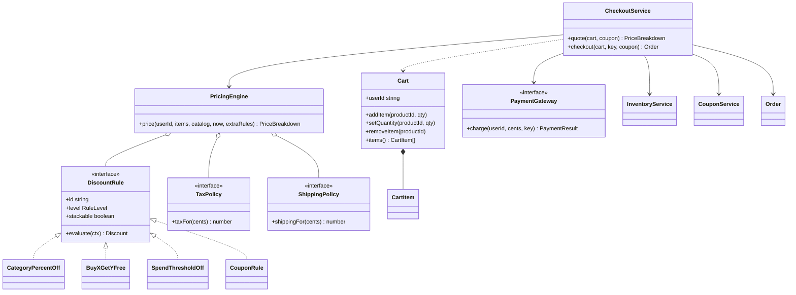
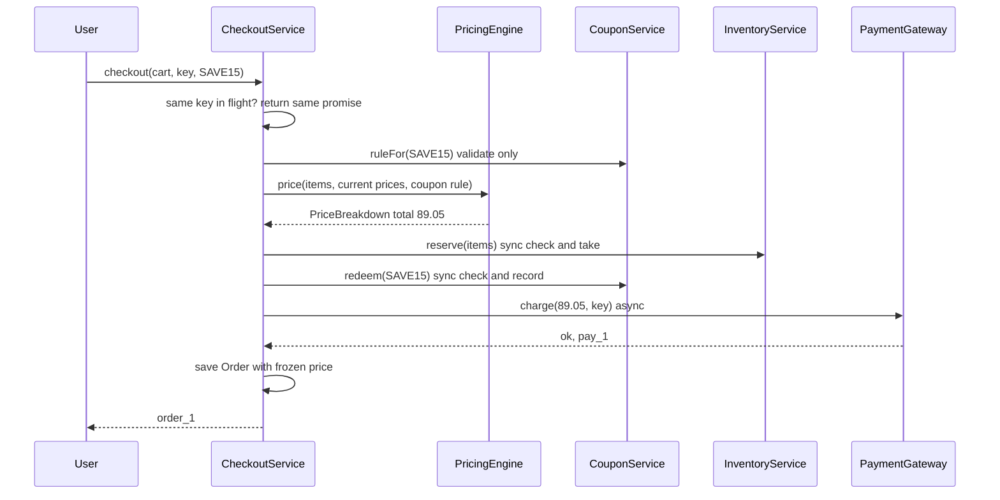

# Shopping Cart, Pricing and Discounts

> In this document you will design the cart and checkout of an online shop: products, a cart, a pricing engine with stackable and exclusive discounts, coupons, tax, shipping, stock reservation and payment. It is a useful LLD problem because the "simple" part (add to cart) is easy, and the real test is how you keep the pricing rules open for change and the checkout safe under races.

**Before this:** [How to approach LLD interviews](01-how-to-approach-lld-interviews.md) · [Behavioral patterns (Strategy, Chain of Responsibility)](../04-oop-solid-design-patterns/08-behavioral-patterns.md) · [SOLID principles](../04-oop-solid-design-patterns/03-solid-principles.md) · **Interview questions:** [jump to the interview section](#interview-questions)

## Table of contents

1. [Problem](#problem)
2. [Clarifying questions](#clarifying-questions)
3. [Requirements](#requirements)
4. [Core entities and relationships](#core-entities-and-relationships)
5. [Design decisions and patterns](#design-decisions-and-patterns)
6. [Implementation](#implementation)
7. [Walkthrough](#walkthrough)
8. [Handling concurrency and edge cases](#handling-concurrency-and-edge-cases)
9. [Extensions](#extensions)
10. [How to present this in the interview](#how-to-present-this-in-the-interview)
11. [Interview questions](#interview-questions)
12. [Summary](#summary)
13. [References](#references)

---

## Problem

The interviewer says something like this:

> "Design the shopping cart and checkout for an e-commerce site. Users add products to a cart, change quantities and remove items. The shop runs promotions: percentage off a category, buy-two-get-one-free, a fixed amount off big orders, and coupon codes. Show the user a price breakdown with subtotal, discounts, tax, shipping and total. At checkout, take payment and create an order. Marketing adds new kinds of promotions every month, so the design must make that easy."

The last sentence is the real hint. The interviewer wants to see whether adding a new promotion means **adding a class** or **editing a giant `if/else` block**. Everything else (cart, checkout, stock) is there to see if you think about money, correctness and races.

This is a **low-level design** (LLD) round: we design classes, interfaces and their methods, and write real code. We do not design databases, load balancers or microservices here. For the big-picture version of an online shop, see the [e-commerce system design case study](../09-system-design/08-case-study-ecommerce-application.md).

---

## Clarifying questions

Spend the first 3–5 minutes asking questions. You cannot design a pricing engine well until you know how discounts combine. Here are good questions with the answers we will assume.

| Question | Why it matters | Assumed answer |
|---|---|---|
| Is the cart for logged-in users only, or also guests? | Decides the cart key (user ID vs session ID). | Logged-in users only. Guest carts are an extension. |
| Which promotion types do we need now? | Gives the first concrete rules. | Category percentage off, buy X get Y free, fixed amount off over a spend threshold, coupon codes (percent or flat). |
| Can discounts combine ("stack")? | This is the hardest rule in the whole problem. | Item-level promotions stack. Cart-level promotions can be marked **exclusive**; from the exclusive ones, only the single best one applies. |
| In what order are discounts applied? | 10% off and then $10 off is not the same as $10 off and then 10% off. | Item-level first, then cart-level on the reduced amount. |
| Is tax on the price before or after discounts? | Changes the total. | After discounts, one flat rate (8%). Real tax by region is an extension. |
| How is shipping charged? | Another rule that can change. | Free over $50 after discounts, otherwise $5.99. |
| What currency? | Rounding and formatting. | One currency (USD). All money in integer **cents**. |
| Coupon rules? | Validation logic. | Expiry date, minimum spend, total use limit, optional one-use-per-user. |
| Do we reserve stock when the item is added to the cart, or at checkout? | Changes the inventory model a lot. | At checkout. Adding to cart does not hold stock. |
| What happens if the price changes while the item sits in the cart? | Correctness and trust. | Always re-price at checkout with current prices. The order keeps a frozen copy of the price it was sold at. |
| Do we build the real payment gateway? | Scope. | No. A `PaymentGateway` interface with a fake implementation. |
| Is this one process in memory, or do we need persistence? | Scope for 45–60 minutes. | In memory, single process. We discuss persistence and multiple servers as extensions. |

Saying the assumed answers out loud is important. If the interviewer disagrees ("no, coupons always stack"), you change one rule, not the whole design.

---

## Requirements

### Functional requirements

1. A user can **add** a product to the cart, **change** its quantity, and **remove** it.
2. The system can **quote** the cart: a line for each product, subtotal, a list of applied discounts with descriptions, tax, shipping and total.
3. Support these promotion rules: **category percent off**, **buy X get Y free**, **spend threshold amount off**, and **coupons** (percent or flat, with expiry, minimum spend, use limits).
4. Stackable discounts add up. From the exclusive discounts at one level, only the biggest applies.
5. The total can never go below zero.
6. **Checkout**: re-price the cart, reserve stock, redeem the coupon, charge the payment, and create an order with a frozen price snapshot. If payment fails, give the stock and the coupon back.
7. A double-clicked "Pay" button must not create two orders.

### Non-functional requirements

- **Extensibility:** a new promotion type must be a new class, with no change to the pricing engine (the Open/Closed Principle).
- **Correctness of money:** integer cents, one clear rounding rule, no floating-point surprises.
- **Concurrency safety:** two users buying the last item must not both succeed (no overselling). A single-use coupon must not be used twice.
- **Testability:** time (for coupon expiry), payment and tax must be injectable, so tests are fast and deterministic.
- **Explainability:** every discount has an ID and a human description, so support staff can answer "why did I pay this price?".

---

## Core entities and relationships

Find the nouns in the problem first. Then decide which ones are **data** (plain objects) and which ones have **behavior** (classes).

| Entity | What it is | Data or behavior |
|---|---|---|
| `Product` | ID, name, category, price in cents. | Data (read-only interface). |
| `Catalog` | Looks up products by ID. Later this is a repository backed by a database. | Behavior (a small service). |
| `Cart` | A user's chosen products and quantities. | Behavior: it guards its own rules (quantity must be 1–99). |
| `CartItem` | One product ID and a quantity. | Data. |
| `PricedLine` | A cart item joined with its product and price. | Data, created during pricing. |
| `PricingContext` | Everything a rule needs to decide: lines, subtotal, running total, user, time. | Data. |
| `DiscountRule` | Interface. One promotion type. | Behavior (Strategy). |
| `Discount` | The result of one rule: rule ID, description, amount. | Data. |
| `Coupon` | A code with its value and limits. | Data. |
| `CouponService` | Validates and redeems coupons. | Behavior. |
| `TaxPolicy`, `ShippingPolicy` | Interfaces for tax and shipping calculation. | Behavior (Strategy). |
| `PricingEngine` | Runs all rules in the right order and builds the breakdown. | Behavior. |
| `PriceBreakdown` | The final quote. | Data (immutable). |
| `InventoryService` | Stock counts; reserve and release. | Behavior. |
| `PaymentGateway` | Interface to charge money. | Behavior (an adapter to a real provider). |
| `Order` | The saved result of a checkout, with a frozen price. | Data. |
| `CheckoutService` | Coordinates the checkout steps. | Behavior (an application service). |

Notice what is **not** an entity: there is no `Discount` subclass per product, and no `PercentOffTshirtRule`. Rules are configured with data (`new CategoryPercentOff("clothing-sale", "clothing", 10)`). Classes are for **kinds** of behavior; data is for **instances**.



How to read it: `<|..` means "implements this interface". `o--` is **aggregation**: the engine uses rules that are created outside it and can live without it. `*--` is **composition**: cart items belong to the cart and die with it. `-->` is a plain association (a field), and `..>` is a dependency (used as a parameter). The [approach doc](01-how-to-approach-lld-interviews.md) explains this notation in detail.

---

## Design decisions and patterns

### Decision 1: money is integer cents

`0.1 + 0.2` is `0.30000000000000004` in JavaScript, because numbers are binary floating point. If you store `$19.99` as `19.99` and add many lines, the total can end with a strange `...0001`. Instead, store every amount as an **integer number of cents** (`1999`). Integers up to 2^53 are exact in JavaScript, which is far more than any cart needs.

Rounding still happens when you take a percentage: 15% of 9,700 cents is 1,455 (exact), but 15% of 9,701 is 1,455.15. We use **one** helper, `percentOf`, that rounds with `Math.round`. Having one place for rounding means one place to change if finance says "always round down discounts".

### Decision 2: each promotion is a Strategy

The pricing engine must not know about specific promotions. It only knows the `DiscountRule` interface:

```text
evaluate(ctx: PricingContext): Discount | null
```

Each promotion type is one class: `CategoryPercentOff`, `BuyXGetYFree`, `SpendThresholdOff`, `CouponRule`. This is the **Strategy pattern**: interchangeable algorithms behind one interface. Adding "free gift over $200" next month means writing one new class and adding it to the rule list. The engine does not change. That is the **Open/Closed Principle** (open for extension, closed for modification), and it is exactly what the interviewer's last sentence asked for. See [Strategy](../04-oop-solid-design-patterns/08-behavioral-patterns.md#strategy) and [Open/Closed](../04-oop-solid-design-patterns/03-solid-principles.md).

Why `Discount | null` and not a number? Because a discount needs a **description** for the receipt and a **rule ID** for support and analytics. A plain number loses that information.

### Decision 3: the combination policy lives in the engine, not in the rules

Each rule answers only one question: "if I applied, how much would I take off?" The rule does **not** decide whether it can combine with other rules. That decision is a separate policy, and it lives in one place (`PricingEngine.pickDiscounts`):

1. Run all **item-level** rules first. All of them stack.
2. Then run **cart-level** rules on the reduced total. Stackable cart rules all apply. From the **exclusive** ones (`stackable: false`), only the biggest one applies.
3. Cap every discount so the running total never goes below zero.

Why split it like this? Because combination rules change for business reasons ("Black Friday: coupons now stack with everything"). If each rule contained "I cannot combine with X and Y", one business change would touch many classes. Keeping the policy in one method follows the **Single Responsibility Principle**: rules calculate, the engine combines.

This step-by-step pipeline (item rules, then cart rules, then tax, then shipping) is a simple form of **Chain of Responsibility** / pipeline: each stage receives the running total from the stage before. In bigger systems each stage becomes its own class. See [Chain of Responsibility](../04-oop-solid-design-patterns/08-behavioral-patterns.md#chain-of-responsibility).

### Decision 4: tax and shipping are also strategies

`TaxPolicy` and `ShippingPolicy` are interfaces with one method each. Today we have `FlatRateTax(8)` and `FreeShippingOver(5000, 599)`. Tomorrow we can have `RegionalTax` or `WeightBasedShipping` without touching the engine. These are small, focused interfaces, which follows the **Interface Segregation Principle**.

### Decision 5: coupons are rules that are created per request

A coupon is just a discount rule that is only active when the user typed the code. So `CouponService.ruleFor(code, user, now)` validates the code and returns a `CouponRule`. The engine treats it like any other rule. The coupon is **exclusive** by default, so the "best exclusive discount" policy decides between the coupon and "$10 off over $90". The user automatically gets the better one, which is what most shops want.

Two different operations on coupons:

- `ruleFor` **only checks** (used for showing a quote; can be called many times).
- `redeem` **checks and records the use** in one synchronous step (used only at checkout).

Splitting read from write keeps quoting free of side effects. A quote is just a calculation, so you can call it on every cart change.

### Decision 6: the checkout service is an orchestrator, with dependencies injected

`CheckoutService` does not calculate prices or count stock itself. It **coordinates**: re-price, reserve, redeem, charge, save. Each dependency (catalog, pricing engine, inventory, coupons, payment gateway, clock) comes in through the constructor. This is **dependency injection**: in tests we pass a fake payment gateway and a fixed clock, so tests do not call a real bank and do not depend on today's date. See [Dependency inversion and injection](../04-oop-solid-design-patterns/05-dependency-inversion-and-injection.md).

### Decision 7: what we did NOT use, and why

- **No Singleton.** It is tempting to make `PricingEngine.getInstance()`. But a singleton is a hidden global: tests cannot replace it, and two stores with different rules could not exist in one process. We create one instance at startup and pass it in. That gives "one instance" without the downsides. See [Singleton trade-offs](../04-oop-solid-design-patterns/06-creational-patterns.md).
- **No inheritance tree of carts** (`GuestCart extends Cart`, `PremiumCart extends Cart`). The cart's job is to hold items. Differences in pricing belong in rules, not in cart subclasses. Prefer composition. See [Composition over inheritance](../04-oop-solid-design-patterns/02-composition-inheritance-and-mixins.md).
- **No Decorator chain for discounts** (`new TenPercent(new FiveOff(basePrice))`). Decorators can model stacking, but they make "only the best exclusive discount" and "explain each discount" hard. A list of rules plus one combination policy is simpler to read and to test.

| Problem in this design | Pattern / principle | Benefit |
|---|---|---|
| Many promotion types, more coming | Strategy (`DiscountRule`) | New promotion = new class (Open/Closed). |
| How promotions combine | One policy method in the engine | Business changes in one place (SRP). |
| Item rules, then cart rules, then tax, then shipping | Pipeline / Chain of Responsibility | Clear order, easy to insert a stage. |
| Tax and shipping vary by country or carrier | Strategy (`TaxPolicy`, `ShippingPolicy`) | Swap without touching the engine. |
| Real payment provider | Adapter behind `PaymentGateway` | Swap Stripe for another provider; fake in tests. |
| Time-based rules (coupon expiry) | Injected `Clock` | Deterministic tests. |
| Double-clicked Pay button | Idempotency key | One order per key. |

---

## Implementation

We build the code in the same order you would in the interview: data first, then the cart, then rules, then the engine, then checkout, then a demo. All the blocks below form **one runnable TypeScript file**. It runs with Node.js 22 (`node cart.ts`, which strips the types) and passes `tsc --strict`. We avoid `enum` and constructor parameter properties so that Node can run the file directly; we use `as const` objects instead.

### Step 1: money and products

```ts
// ---------- Step 1: money and products ----------
// Money is always an integer number of cents. Never use floats for money.
type Cents = number;

function formatCents(cents: Cents): string {
  const sign = cents < 0 ? "-" : "";
  return `${sign}$${(Math.abs(cents) / 100).toFixed(2)}`;
}

function percentOf(amount: Cents, percent: number): Cents {
  return Math.round((amount * percent) / 100);
}

interface Product {
  readonly id: string;
  readonly name: string;
  readonly category: string;
  readonly priceCents: Cents;
}

class Catalog {
  private readonly products = new Map<string, Product>();

  add(product: Product): void {
    if (!Number.isInteger(product.priceCents) || product.priceCents < 0) {
      throw new Error(`Invalid price for ${product.id}`);
    }
    this.products.set(product.id, product);
  }

  get(productId: string): Product {
    const product = this.products.get(productId);
    if (!product) throw new Error(`Unknown product: ${productId}`);
    return product;
  }

  updatePrice(productId: string, priceCents: Cents): void {
    this.products.set(productId, { ...this.get(productId), priceCents });
  }
}
```

`Cents` is a type alias. It is still a `number` at runtime, but it makes every signature say "this is money in cents". `updatePrice` replaces the product with a **new object** instead of changing it. That matters later: an old order that holds the old product data is not changed by accident.

### Step 2: the cart

```ts
// ---------- Step 2: the cart ----------
interface CartItem {
  readonly productId: string;
  readonly quantity: number;
}

class Cart {
  readonly userId: string;
  private readonly quantities = new Map<string, number>();

  constructor(userId: string) {
    this.userId = userId;
  }

  addItem(productId: string, quantity = 1): void {
    this.assertValidQuantity(quantity);
    const current = this.quantities.get(productId) ?? 0;
    this.quantities.set(productId, current + quantity);
  }

  setQuantity(productId: string, quantity: number): void {
    if (quantity === 0) {
      this.quantities.delete(productId);
      return;
    }
    this.assertValidQuantity(quantity);
    this.quantities.set(productId, quantity);
  }

  removeItem(productId: string): void {
    this.quantities.delete(productId);
  }

  items(): readonly CartItem[] {
    return [...this.quantities].map(([productId, quantity]) => ({ productId, quantity }));
  }

  isEmpty(): boolean {
    return this.quantities.size === 0;
  }

  clear(): void {
    this.quantities.clear();
  }

  private assertValidQuantity(quantity: number): void {
    if (!Number.isInteger(quantity) || quantity <= 0 || quantity > 99) {
      throw new Error(`Quantity must be a whole number from 1 to 99, got ${quantity}`);
    }
  }
}
```

Design notes:

- The cart stores **product IDs and quantities only**, not prices. Prices belong to the catalog and can change. If the cart stored a price, you would show stale prices and maybe charge them.
- The `Map` is private. Callers get a **copy** from `items()`, so nobody can change the cart without going through its validation. This is **encapsulation**.
- Adding the same product twice increases the quantity. It does not create two lines.

### Step 3: the pricing context and discount rules

```ts
// ---------- Step 3: pricing context and discount rules (Strategy) ----------
interface PricedLine {
  readonly productId: string;
  readonly name: string;
  readonly category: string;
  readonly unitPriceCents: Cents;
  readonly quantity: number;
  readonly lineTotalCents: Cents;
}

interface PricingContext {
  readonly userId: string;
  readonly lines: readonly PricedLine[];
  readonly subtotalCents: Cents;
  // Total after the discounts already applied. Cart-level rules use this.
  readonly runningTotalCents: Cents;
  readonly now: Date;
}

interface Discount {
  readonly ruleId: string;
  readonly description: string;
  readonly amountCents: Cents;
}

const RuleLevel = { ITEM: "ITEM", CART: "CART" } as const;
type RuleLevel = (typeof RuleLevel)[keyof typeof RuleLevel];

interface DiscountRule {
  readonly id: string;
  readonly level: RuleLevel;
  // Stackable rules add up. From the non-stackable ones, only the best one wins.
  readonly stackable: boolean;
  evaluate(ctx: PricingContext): Discount | null;
}

class CategoryPercentOff implements DiscountRule {
  readonly id: string;
  readonly level = RuleLevel.ITEM;
  readonly stackable = true;
  private readonly category: string;
  private readonly percent: number;

  constructor(id: string, category: string, percent: number) {
    this.id = id;
    this.category = category;
    this.percent = percent;
  }

  evaluate(ctx: PricingContext): Discount | null {
    const base = ctx.lines
      .filter((line) => line.category === this.category)
      .reduce((sum, line) => sum + line.lineTotalCents, 0);
    if (base === 0) return null;
    return {
      ruleId: this.id,
      description: `${this.percent}% off ${this.category}`,
      amountCents: percentOf(base, this.percent),
    };
  }
}

class BuyXGetYFree implements DiscountRule {
  readonly id: string;
  readonly level = RuleLevel.ITEM;
  readonly stackable = true;
  private readonly productId: string;
  private readonly buy: number;
  private readonly free: number;

  constructor(id: string, productId: string, buy: number, free: number) {
    this.id = id;
    this.productId = productId;
    this.buy = buy;
    this.free = free;
  }

  evaluate(ctx: PricingContext): Discount | null {
    const line = ctx.lines.find((l) => l.productId === this.productId);
    if (!line) return null;
    const groups = Math.floor(line.quantity / (this.buy + this.free));
    const freeUnits = groups * this.free;
    if (freeUnits === 0) return null;
    return {
      ruleId: this.id,
      description: `Buy ${this.buy} get ${this.free} free: ${line.name}`,
      amountCents: freeUnits * line.unitPriceCents,
    };
  }
}

class SpendThresholdOff implements DiscountRule {
  readonly id: string;
  readonly level = RuleLevel.CART;
  readonly stackable: boolean;
  private readonly thresholdCents: Cents;
  private readonly offCents: Cents;

  constructor(id: string, thresholdCents: Cents, offCents: Cents, stackable: boolean) {
    this.id = id;
    this.thresholdCents = thresholdCents;
    this.offCents = offCents;
    this.stackable = stackable;
  }

  evaluate(ctx: PricingContext): Discount | null {
    if (ctx.runningTotalCents < this.thresholdCents) return null;
    return {
      ruleId: this.id,
      description: `${formatCents(this.offCents)} off orders over ${formatCents(this.thresholdCents)}`,
      amountCents: this.offCents,
    };
  }
}
```

Points to say out loud while you write this:

- `RuleLevel` is an `as const` object plus a union type. It behaves like an enum (`RuleLevel.ITEM`) but is plain JavaScript, so it works with Node's type stripping. See [Unions and narrowing](../03-typescript/03-unions-narrowing-and-type-guards.md).
- Every rule receives a **read-only context** and returns a result. Rules never change the cart or each other. That makes each rule a pure function of its input, which is very easy to unit test: build a context, call `evaluate`, check the number.
- "Buy 2 get 1 free" with 7 mugs: groups of 3 → 2 groups → 2 free mugs. With 2 mugs: 0 groups → no discount. The `Math.floor` handles both.
- The category rule calculates the percentage on the **sum of the lines**, not on each unit, so it rounds once. Rounding per unit can lose or add a cent per line.

### Step 4: coupons

```ts
// ---------- Step 4: coupons ----------
type CouponValue =
  | { readonly kind: "PERCENT"; readonly percent: number }
  | { readonly kind: "FLAT"; readonly offCents: Cents };

interface Coupon {
  readonly code: string;
  readonly value: CouponValue;
  readonly minSpendCents: Cents;
  readonly expiresAt: Date;
  readonly maxUses: number;
  readonly onePerUser: boolean;
}

class CouponError extends Error {
  readonly reason: string;
  constructor(reason: string, message: string) {
    super(message);
    this.name = "CouponError";
    this.reason = reason;
  }
}

class CouponRule implements DiscountRule {
  readonly id: string;
  readonly level = RuleLevel.CART;
  readonly stackable = false;
  private readonly coupon: Coupon;

  constructor(coupon: Coupon) {
    this.id = `coupon:${coupon.code}`;
    this.coupon = coupon;
  }

  evaluate(ctx: PricingContext): Discount | null {
    if (ctx.runningTotalCents < this.coupon.minSpendCents) return null;
    const value = this.coupon.value;
    const amountCents =
      value.kind === "PERCENT" ? percentOf(ctx.runningTotalCents, value.percent) : value.offCents;
    return { ruleId: this.id, description: `Coupon ${this.coupon.code}`, amountCents };
  }
}

class CouponService {
  private readonly coupons = new Map<string, Coupon>();
  private readonly uses = new Map<string, number>();
  private readonly usedBy = new Map<string, Set<string>>();

  register(coupon: Coupon): void {
    this.coupons.set(coupon.code, coupon);
  }

  // Validation that does not change state. Used for showing prices.
  ruleFor(code: string, userId: string, now: Date): CouponRule {
    const coupon = this.coupons.get(code);
    if (!coupon) throw new CouponError("NOT_FOUND", `Coupon ${code} does not exist`);
    if (now >= coupon.expiresAt) throw new CouponError("EXPIRED", `Coupon ${code} has expired`);
    if ((this.uses.get(code) ?? 0) >= coupon.maxUses) {
      throw new CouponError("USED_UP", `Coupon ${code} has no uses left`);
    }
    if (coupon.onePerUser && this.usedBy.get(code)?.has(userId)) {
      throw new CouponError("ALREADY_USED", `You already used coupon ${code}`);
    }
    return new CouponRule(coupon);
  }

  // Check and record the use in one synchronous step, so no other code can run in between.
  redeem(code: string, userId: string, now: Date): void {
    this.ruleFor(code, userId, now);
    this.uses.set(code, (this.uses.get(code) ?? 0) + 1);
    const users = this.usedBy.get(code) ?? new Set<string>();
    users.add(userId);
    this.usedBy.set(code, users);
  }

  // Undo a redeem when payment fails.
  release(code: string, userId: string): void {
    this.uses.set(code, Math.max(0, (this.uses.get(code) ?? 0) - 1));
    this.usedBy.get(code)?.delete(userId);
  }
}
```

`CouponValue` is a **discriminated union**: the `kind` field tells TypeScript which shape we have, so inside `value.kind === "PERCENT"` it knows `value.percent` exists. A percent coupon cannot accidentally have `offCents`. Invalid states are impossible to write.

`CouponError` carries a machine-readable `reason` (`EXPIRED`, `USED_UP`, ...). The UI can show a friendly message per reason, and analytics can count them, without parsing error text.

### Step 5: tax and shipping strategies

```ts
// ---------- Step 5: tax and shipping strategies ----------
interface TaxPolicy {
  taxFor(taxableCents: Cents): Cents;
}

class FlatRateTax implements TaxPolicy {
  private readonly percent: number;
  constructor(percent: number) {
    this.percent = percent;
  }
  taxFor(taxableCents: Cents): Cents {
    return percentOf(taxableCents, this.percent);
  }
}

interface ShippingPolicy {
  shippingFor(totalAfterDiscountsCents: Cents): Cents;
}

class FreeShippingOver implements ShippingPolicy {
  private readonly thresholdCents: Cents;
  private readonly feeCents: Cents;
  constructor(thresholdCents: Cents, feeCents: Cents) {
    this.thresholdCents = thresholdCents;
    this.feeCents = feeCents;
  }
  shippingFor(totalAfterDiscountsCents: Cents): Cents {
    return totalAfterDiscountsCents >= this.thresholdCents ? 0 : this.feeCents;
  }
}
```

### Step 6: the pricing engine

```ts
// ---------- Step 6: the pricing engine ----------
interface PriceBreakdown {
  readonly lines: readonly PricedLine[];
  readonly subtotalCents: Cents;
  readonly discounts: readonly Discount[];
  readonly discountTotalCents: Cents;
  readonly taxCents: Cents;
  readonly shippingCents: Cents;
  readonly totalCents: Cents;
}

class PricingEngine {
  private readonly rules: readonly DiscountRule[];
  private readonly tax: TaxPolicy;
  private readonly shipping: ShippingPolicy;

  constructor(rules: readonly DiscountRule[], tax: TaxPolicy, shipping: ShippingPolicy) {
    this.rules = rules;
    this.tax = tax;
    this.shipping = shipping;
  }

  price(
    userId: string,
    items: readonly CartItem[],
    catalog: Catalog,
    now: Date,
    extraRules: readonly DiscountRule[] = [],
  ): PriceBreakdown {
    const lines: PricedLine[] = items.map((item) => {
      const product = catalog.get(item.productId);
      return {
        productId: product.id,
        name: product.name,
        category: product.category,
        unitPriceCents: product.priceCents,
        quantity: item.quantity,
        lineTotalCents: product.priceCents * item.quantity,
      };
    });
    const subtotalCents = lines.reduce((sum, line) => sum + line.lineTotalCents, 0);

    const allRules = [...this.rules, ...extraRules];
    const discounts: Discount[] = [];
    let running = subtotalCents;
    // Item-level rules first, then cart-level rules on the reduced total.
    for (const level of [RuleLevel.ITEM, RuleLevel.CART]) {
      const ctx: PricingContext = { userId, lines, subtotalCents, runningTotalCents: running, now };
      const levelRules = allRules.filter((rule) => rule.level === level);
      for (const discount of this.pickDiscounts(levelRules, ctx)) {
        // Never discount more than what is left. The total cannot go below zero.
        const amountCents = Math.min(discount.amountCents, running);
        if (amountCents <= 0) continue;
        discounts.push({ ...discount, amountCents });
        running -= amountCents;
      }
    }

    const discountTotalCents = subtotalCents - running;
    const taxCents = this.tax.taxFor(running);
    const shippingCents = this.shipping.shippingFor(running);
    return {
      lines,
      subtotalCents,
      discounts,
      discountTotalCents,
      taxCents,
      shippingCents,
      totalCents: running + taxCents + shippingCents,
    };
  }

  // All stackable discounts apply. From the exclusive ones, only the biggest applies.
  private pickDiscounts(rules: readonly DiscountRule[], ctx: PricingContext): Discount[] {
    const stackable: Discount[] = [];
    let bestExclusive: Discount | null = null;
    for (const rule of rules) {
      const discount = rule.evaluate(ctx);
      if (!discount || discount.amountCents <= 0) continue;
      if (rule.stackable) stackable.push(discount);
      else if (!bestExclusive || discount.amountCents > bestExclusive.amountCents) {
        bestExclusive = discount;
      }
    }
    return bestExclusive ? [...stackable, bestExclusive] : stackable;
  }
}
```

Read the engine slowly, because this is the heart of the design:

1. **Join** cart items with catalog data to build `PricedLine`s. This is where current prices come in.
2. **Item level:** evaluate every item rule with the same context, choose discounts with the combination policy, subtract them.
3. **Cart level:** build a new context whose `runningTotalCents` already includes the item discounts, then do the same.
4. **Clamp:** `Math.min(discount.amountCents, running)` makes a "$10 off" on a $6 cart take only $6.
5. **Tax and shipping** on the discounted amount.

Notice that the engine has **no** `if (rule instanceof BuyXGetYFree)`. It only calls the interface. That is how you know the Strategy pattern is used correctly.

### Step 7: inventory, payment and orders

```ts
// ---------- Step 7: inventory, payment and orders ----------
class OutOfStockError extends Error {
  constructor(productId: string) {
    super(`Out of stock: ${productId}`);
    this.name = "OutOfStockError";
  }
}

class InventoryService {
  private readonly available = new Map<string, number>();

  setStock(productId: string, quantity: number): void {
    this.available.set(productId, quantity);
  }

  stockOf(productId: string): number {
    return this.available.get(productId) ?? 0;
  }

  // All-or-nothing. Check every item first, then take them all.
  // The method is synchronous, so in Node.js nothing else can run in the middle.
  reserve(items: readonly CartItem[]): void {
    for (const item of items) {
      if (this.stockOf(item.productId) < item.quantity) throw new OutOfStockError(item.productId);
    }
    for (const item of items) {
      this.available.set(item.productId, this.stockOf(item.productId) - item.quantity);
    }
  }

  release(items: readonly CartItem[]): void {
    for (const item of items) {
      this.available.set(item.productId, this.stockOf(item.productId) + item.quantity);
    }
  }
}

type PaymentResult =
  | { readonly ok: true; readonly paymentId: string }
  | { readonly ok: false; readonly reason: string };

interface PaymentGateway {
  charge(userId: string, amountCents: Cents, idempotencyKey: string): Promise<PaymentResult>;
}

class FakePaymentGateway implements PaymentGateway {
  private counter = 0;
  private readonly declinedUsers: ReadonlySet<string>;

  constructor(declinedUsers: readonly string[] = []) {
    this.declinedUsers = new Set(declinedUsers);
  }

  async charge(userId: string, amountCents: Cents): Promise<PaymentResult> {
    await new Promise((resolve) => setTimeout(resolve, 10)); // pretend network call
    if (this.declinedUsers.has(userId)) return { ok: false, reason: "Card declined" };
    this.counter += 1;
    return { ok: true, paymentId: `pay_${this.counter}` };
  }
}

const OrderStatus = { PAID: "PAID", CANCELLED: "CANCELLED" } as const;
type OrderStatus = (typeof OrderStatus)[keyof typeof OrderStatus];

interface Order {
  readonly id: string;
  readonly userId: string;
  readonly items: readonly CartItem[];
  // A frozen copy of the prices at checkout. Later price changes do not touch old orders.
  readonly price: PriceBreakdown;
  readonly couponCode: string | null;
  readonly paymentId: string;
  readonly status: OrderStatus;
}
```

The payment gateway returns a **result object** for an expected failure (card declined) instead of throwing. A declined card is a normal business outcome, not a bug. Exceptions are for unexpected problems (network down, bug). The union type `PaymentResult` forces the caller to check `ok` before reading `paymentId`.

`FakePaymentGateway.charge` takes fewer parameters than the interface. TypeScript allows this: a function that ignores extra arguments is still compatible.

### Step 8: the checkout service

```ts
// ---------- Step 8: checkout service ----------
interface Clock {
  now(): Date;
}

class CheckoutService {
  private readonly catalog: Catalog;
  private readonly pricing: PricingEngine;
  private readonly inventory: InventoryService;
  private readonly coupons: CouponService;
  private readonly payments: PaymentGateway;
  private readonly clock: Clock;
  private readonly orders = new Map<string, Order>();
  // Same idempotency key -> same result. Protects against double clicks.
  private readonly inFlight = new Map<string, Promise<Order>>();
  private orderCounter = 0;

  constructor(
    catalog: Catalog,
    pricing: PricingEngine,
    inventory: InventoryService,
    coupons: CouponService,
    payments: PaymentGateway,
    clock: Clock,
  ) {
    this.catalog = catalog;
    this.pricing = pricing;
    this.inventory = inventory;
    this.coupons = coupons;
    this.payments = payments;
    this.clock = clock;
  }

  quote(cart: Cart, couponCode?: string): PriceBreakdown {
    const now = this.clock.now();
    const extra = couponCode ? [this.coupons.ruleFor(couponCode, cart.userId, now)] : [];
    return this.pricing.price(cart.userId, cart.items(), this.catalog, now, extra);
  }

  checkout(cart: Cart, idempotencyKey: string, couponCode?: string): Promise<Order> {
    const existing = this.inFlight.get(idempotencyKey);
    if (existing) return existing;
    const attempt = this.doCheckout(cart, idempotencyKey, couponCode);
    this.inFlight.set(idempotencyKey, attempt);
    // A failed attempt may be retried with the same key.
    attempt.catch(() => this.inFlight.delete(idempotencyKey));
    return attempt;
  }

  private async doCheckout(cart: Cart, idempotencyKey: string, couponCode?: string): Promise<Order> {
    if (cart.isEmpty()) throw new Error("Cart is empty");
    const items = cart.items(); // snapshot: later cart edits do not change this order
    const now = this.clock.now();

    // 1. Price again with current prices. Never trust a price the client sends.
    const price = this.quote(cart, couponCode);

    // 2. Reserve stock and redeem the coupon synchronously, before any await.
    this.inventory.reserve(items);
    try {
      if (couponCode) this.coupons.redeem(couponCode, cart.userId, now);
    } catch (error) {
      this.inventory.release(items);
      throw error;
    }

    // 3. Charge. This is the slow, async part.
    const result = await this.payments.charge(cart.userId, price.totalCents, idempotencyKey);
    if (!result.ok) {
      // 4a. Compensate: give back what we took.
      this.inventory.release(items);
      if (couponCode) this.coupons.release(couponCode, cart.userId);
      throw new Error(`Payment failed: ${result.reason}`);
    }

    // 4b. Save the order with a frozen price snapshot.
    this.orderCounter += 1;
    const order: Order = {
      id: `order_${this.orderCounter}`,
      userId: cart.userId,
      items,
      price,
      couponCode: couponCode ?? null,
      paymentId: result.paymentId,
      status: OrderStatus.PAID,
    };
    this.orders.set(order.id, order);
    cart.clear();
    return order;
  }
}
```

The order of steps in `doCheckout` is deliberate:

1. **Re-price on the server.** The client may show a price from ten minutes ago, or a hacked client may send any number. The server always calculates the price itself.
2. **Reserve before charging.** If we charged first and then found no stock, we would have to refund. Reserving first means we only charge when we can deliver.
3. **Reserve and redeem synchronously, before the first `await`.** In Node.js, code between two `await`s runs without interruption. So "check stock and decrement" cannot be interleaved with another checkout. This is the single-threaded version of a lock. More in [concurrency](#handling-concurrency-and-edge-cases).
4. **Compensate on failure.** If payment fails, release the stock and the coupon. This "undo the earlier steps" idea is called a **compensating action**; in distributed systems a chain of them is called a **saga**.

The `checkout` wrapper stores the **promise** per idempotency key. A second call with the same key, even while the first is still waiting for payment, gets the same promise and therefore the same order.

### Step 9: the demo

```ts
// ---------- Step 9: demo ----------
function printBreakdown(b: PriceBreakdown): void {
  for (const line of b.lines) {
    console.log(`  ${line.quantity} x ${line.name} @ ${formatCents(line.unitPriceCents)} = ${formatCents(line.lineTotalCents)}`);
  }
  console.log(`  Subtotal: ${formatCents(b.subtotalCents)}`);
  for (const d of b.discounts) console.log(`  - ${d.description}: -${formatCents(d.amountCents)}`);
  console.log(`  Tax: ${formatCents(b.taxCents)}  Shipping: ${formatCents(b.shippingCents)}`);
  console.log(`  Total: ${formatCents(b.totalCents)}`);
}

async function main(): Promise<void> {
  const catalog = new Catalog();
  catalog.add({ id: "tshirt", name: "T-shirt", category: "clothing", priceCents: 2000 });
  catalog.add({ id: "jeans", name: "Jeans", category: "clothing", priceCents: 5000 });
  catalog.add({ id: "mug", name: "Coffee mug", category: "kitchen", priceCents: 800 });

  const inventory = new InventoryService();
  inventory.setStock("tshirt", 10);
  inventory.setStock("jeans", 1);
  inventory.setStock("mug", 20);

  const coupons = new CouponService();
  coupons.register({
    code: "SAVE15",
    value: { kind: "PERCENT", percent: 15 },
    minSpendCents: 5000,
    expiresAt: new Date("2026-12-31T00:00:00Z"),
    maxUses: 100,
    onePerUser: true,
  });
  coupons.register({
    code: "OLD10",
    value: { kind: "FLAT", offCents: 1000 },
    minSpendCents: 0,
    expiresAt: new Date("2026-01-01T00:00:00Z"),
    maxUses: 100,
    onePerUser: false,
  });

  const pricing = new PricingEngine(
    [
      new CategoryPercentOff("clothing-sale", "clothing", 10),
      new BuyXGetYFree("mug-3for2", "mug", 2, 1),
      new SpendThresholdOff("big-spender", 9000, 1000, false),
    ],
    new FlatRateTax(8),
    new FreeShippingOver(5000, 599),
  );

  const clock: Clock = { now: () => new Date("2026-10-30T10:00:00Z") };
  const checkout = new CheckoutService(
    catalog, pricing, inventory, coupons, new FakePaymentGateway(["dave"]), clock,
  );

  console.log("1) Quote without coupon");
  const alice = new Cart("alice");
  alice.addItem("tshirt", 2);
  alice.addItem("jeans");
  alice.addItem("mug", 3);
  printBreakdown(checkout.quote(alice));

  console.log("2) Quote with SAVE15 (best exclusive cart discount wins)");
  printBreakdown(checkout.quote(alice, "SAVE15"));

  console.log("3) Expired coupon");
  try {
    checkout.quote(alice, "OLD10");
  } catch (error) {
    if (error instanceof CouponError) console.log(`  ${error.reason}: ${error.message}`);
  }

  console.log("4) Checkout, with a double click (same idempotency key)");
  const [first, second] = await Promise.all([
    checkout.checkout(alice, "alice-key-1", "SAVE15"),
    checkout.checkout(alice, "alice-key-1", "SAVE15"),
  ]);
  console.log(`  ${first.id} paid ${formatCents(first.price.totalCents)} with ${first.paymentId}; same order twice: ${first === second}`);
  console.log(`  Jeans left: ${inventory.stockOf("jeans")}, cart empty: ${alice.isEmpty()}`);

  console.log("5) Price change does not touch the old order");
  catalog.updatePrice("tshirt", 2500);
  console.log(`  Old order still says T-shirt @ ${formatCents(first.price.lines[0].unitPriceCents)}`);

  console.log("6) Two buyers race for the last unit");
  inventory.setStock("jeans", 1);
  const bob = new Cart("bob");
  bob.addItem("jeans");
  const carol = new Cart("carol");
  carol.addItem("jeans");
  const results = await Promise.allSettled([
    checkout.checkout(bob, "bob-key-1"),
    checkout.checkout(carol, "carol-key-1"),
  ]);
  results.forEach((r, i) => {
    const who = i === 0 ? "bob" : "carol";
    console.log(`  ${who}: ${r.status === "fulfilled" ? `got ${r.value.id}` : (r.reason as Error).message}`);
  });

  console.log("7) Payment fails, stock is given back");
  const dave = new Cart("dave");
  dave.addItem("mug", 2);
  try {
    await checkout.checkout(dave, "dave-key-1");
  } catch (error) {
    console.log(`  ${(error as Error).message}; mugs left: ${inventory.stockOf("mug")}`);
  }
}

main().catch((error: unknown) => console.error(error));

// Output:
// 1) Quote without coupon
//   2 x T-shirt @ $20.00 = $40.00
//   1 x Jeans @ $50.00 = $50.00
//   3 x Coffee mug @ $8.00 = $24.00
//   Subtotal: $114.00
//   - 10% off clothing: -$9.00
//   - Buy 2 get 1 free: Coffee mug: -$8.00
//   - $10.00 off orders over $90.00: -$10.00
//   Tax: $6.96  Shipping: $0.00
//   Total: $93.96
// 2) Quote with SAVE15 (best exclusive cart discount wins)
//   2 x T-shirt @ $20.00 = $40.00
//   1 x Jeans @ $50.00 = $50.00
//   3 x Coffee mug @ $8.00 = $24.00
//   Subtotal: $114.00
//   - 10% off clothing: -$9.00
//   - Buy 2 get 1 free: Coffee mug: -$8.00
//   - Coupon SAVE15: -$14.55
//   Tax: $6.60  Shipping: $0.00
//   Total: $89.05
// 3) Expired coupon
//   EXPIRED: Coupon OLD10 has expired
// 4) Checkout, with a double click (same idempotency key)
//   order_1 paid $89.05 with pay_1; same order twice: true
//   Jeans left: 0, cart empty: true
// 5) Price change does not touch the old order
//   Old order still says T-shirt @ $20.00
// 6) Two buyers race for the last unit
//   bob: got order_2
//   carol: Out of stock: jeans
// 7) Payment fails, stock is given back
//   Payment failed: Card declined; mugs left: 17
```

Check the numbers by hand once, because interviewers sometimes ask "walk me through this total":

- Subtotal: 2 × $20 + $50 + 3 × $8 = $114.00.
- Item level: 10% of clothing ($90) = $9.00; buy 2 get 1 free on 3 mugs = 1 free mug = $8.00. Running total: $97.00.
- Cart level, quote 1: only "$10 off over $90" qualifies. Running total $87.00. Tax 8% = $6.96. Shipping free (over $50). Total $93.96.
- Cart level, quote 2: the coupon gives 15% of $97.00 = $14.55, which beats $10.00. Both are exclusive, so only the coupon applies. Running total $82.45, tax $6.60 (8% of 8,245 cents is 659.6, rounded to 660), total $89.05.
- In case 7, mugs left is 17: Alice bought 3 of 20, and Dave's 2 were reserved and then released when his card was declined.

---

## Walkthrough

Here is the checkout flow for Alice with coupon `SAVE15`. This is the flow to draw if the interviewer says "walk me through checkout".



Step by step:

1. **Idempotency check.** If a request with the same key is already running or done, return the same promise. The double click in demo case 4 hits this path.
2. **Validate the coupon** without using it. Expired, used up or unknown codes fail here with a clear `CouponError`.
3. **Price on the server** with current catalog prices: item rules, then cart rules, then tax and shipping.
4. **Reserve stock** for all items, all-or-nothing, with no `await` in the middle.
5. **Redeem the coupon.** If this fails (for example, the last use was just taken), release the stock and stop.
6. **Charge** the payment. This is the only slow, asynchronous step.
7. On success, **save the order** with a copy of the price breakdown and **clear the cart**. On failure, **release** stock and coupon.

---

## Handling concurrency and edge cases

### Overselling the last item

This is the most important race in this problem. Two buyers, one pair of jeans. The bug is a **check-then-act** race: you check stock, then wait for something slow, then write. Between the check and the write, the other request also checks and also sees "1 left".

JavaScript runs your code on one thread, so many people think races cannot happen in Node.js. They can. Every `await` is a point where other requests run. Here is the bug and the fix side by side:

```ts
// ❌ Check, then await, then write: both buyers pass the check.
const stock = new Map<string, number>([["jeans", 1]]);
const slowPayment = (): Promise<void> => new Promise((resolve) => setTimeout(resolve, 10));

async function buyBroken(user: string): Promise<string> {
  if ((stock.get("jeans") ?? 0) < 1) return `${user}: out of stock`;
  await slowPayment(); // the other buyer runs here and also passes the check
  stock.set("jeans", (stock.get("jeans") ?? 0) - 1);
  return `${user}: bought`;
}

// ✅ Check and take in one synchronous step, then await. Give it back on failure.
async function buyFixed(user: string, paymentFails = false): Promise<string> {
  const left = stock.get("jeans") ?? 0;
  if (left < 1) return `${user}: out of stock`;
  stock.set("jeans", left - 1); // no await between the check and the write
  try {
    await slowPayment();
    if (paymentFails) throw new Error("declined");
    return `${user}: bought`;
  } catch {
    stock.set("jeans", (stock.get("jeans") ?? 0) + 1); // compensate
    return `${user}: payment failed, stock returned`;
  }
}

async function demo(): Promise<void> {
  console.log(await Promise.all([buyBroken("bob"), buyBroken("carol")]));
  console.log("stock after broken version:", stock.get("jeans"));

  stock.set("jeans", 1);
  console.log(await Promise.all([buyFixed("bob"), buyFixed("carol")]));
  console.log("stock after fixed version:", stock.get("jeans"));

  stock.set("jeans", 1);
  console.log(await buyFixed("dave", true), "| stock:", stock.get("jeans"));
}

demo().catch((error: unknown) => console.error(error));

// Output:
// [ 'bob: bought', 'carol: bought' ]
// stock after broken version: -1
// [ 'bob: bought', 'carol: out of stock' ]
// stock after fixed version: 0
// dave: payment failed, stock returned | stock: 1
```

The broken version sold two pairs of jeans and left stock at **-1**. The fixed version takes the stock **before** the `await`, so the second buyer sees 0.

**What to say about real systems with many servers.** The synchronous trick only works inside one Node.js process. With several servers sharing a database, the "check and take" must happen **inside the database in one statement**, for example a conditional update:

```text
UPDATE inventory
SET available = available - 2
WHERE product_id = 'jeans' AND available >= 2;
-- 1 row updated  -> reserved
-- 0 rows updated -> not enough stock
```

The database makes this single statement atomic. Other options: `SELECT ... FOR UPDATE` (a row lock, pessimistic), or a `version` column (optimistic, see next section). In Java or C#, inside one process, you would use a `synchronized` block, a `lock`, or an atomic counter. The idea is the same in every language: **the check and the write must be one atomic step.** See [Concurrency in Node.js](../07-nodejs-backend/12-concurrency-worker-threads-and-cluster.md).

### The same cart edited from two devices

Alice has the cart open on her phone and on her laptop. Both read the cart, both change it, both save. Without protection, the second save silently overwrites the first (a **lost update**). The fix is **optimistic concurrency control**: every stored cart has a `version`. A write says "I read version 3". If the stored version is no longer 3, the write is rejected and the client re-reads and merges.

```ts
// Optimistic concurrency: every write says which version it read.
interface StoredCart {
  readonly version: number;
  readonly items: ReadonlyMap<string, number>;
}

class VersionConflictError extends Error {}

class CartStore {
  private carts = new Map<string, StoredCart>();

  read(userId: string): StoredCart {
    return this.carts.get(userId) ?? { version: 0, items: new Map() };
  }

  // Write only if nobody else wrote since we read. Otherwise the caller must re-read.
  write(userId: string, expectedVersion: number, items: ReadonlyMap<string, number>): StoredCart {
    const current = this.read(userId);
    if (current.version !== expectedVersion) {
      throw new VersionConflictError(`expected v${expectedVersion}, found v${current.version}`);
    }
    const next = { version: current.version + 1, items };
    this.carts.set(userId, next);
    return next;
  }
}

const store = new CartStore();
const phone = store.read("alice"); // both devices read version 0
const laptop = store.read("alice");

store.write("alice", phone.version, new Map([["mug", 1]]));
console.log("phone saved, version is now", store.read("alice").version);

try {
  store.write("alice", laptop.version, new Map([["jeans", 1]]));
} catch (error) {
  console.log("laptop rejected:", (error as Error).message);
  const fresh = store.read("alice"); // re-read, merge, try again
  const merged = new Map([...fresh.items, ["jeans", 1]]);
  store.write("alice", fresh.version, merged);
  console.log("laptop retried:", [...store.read("alice").items.keys()], "version", store.read("alice").version);
}

// Output:
// phone saved, version is now 1
// laptop rejected: expected v0, found v1
// laptop retried: [ 'mug', 'jeans' ] version 2
```

Optimistic locking is a good fit for carts because conflicts are rare. You pay nothing in the normal case and only retry when a conflict really happens. Pessimistic locking (lock the cart while editing) would block one device for no good reason.

### A single-use coupon used twice

Same race as stock: two checkouts with a one-use code. Our `redeem` checks and records in one synchronous call, so the second call fails with `USED_UP` or `ALREADY_USED`. In a database, use a unique constraint on `(coupon_code, user_id)` for one-per-user coupons, and a conditional update (`uses = uses + 1 WHERE uses < max_uses`) for global limits.

### Double click and network retries

The browser may send "Pay" twice, or a mobile client may retry after a timeout even though the first request worked. The client creates an **idempotency key** (a random ID per checkout attempt) and sends it with every retry. The server remembers the result per key. We also pass the key to the payment provider, so even the bank charges only once. Demo case 4 shows two calls with the same key returning the same order.

### Other edge cases to mention

| Edge case | How the design handles it |
|---|---|
| Quantity 0, negative, decimal, or 1,000 | `Cart.assertValidQuantity` rejects it; `setQuantity(id, 0)` removes the line. |
| Product deleted from the catalog while in the cart | `Catalog.get` throws during pricing. In a real UI, mark the line "no longer available" and price the rest. |
| Discounts larger than the total | `Math.min(amount, running)` clamps each discount; the total never goes below zero. |
| Coupon minimum spend checked before or after other discounts? | After item discounts (it uses `runningTotalCents`). Say this rule out loud; it is a business decision. |
| Coupon expires between quote and checkout | Checkout validates again with the current time; the user sees a clear error. |
| Payment fails | Stock and coupon are released (compensating actions). |
| Payment succeeded but saving the order crashed | Discussed in [Q10](#q10-payment-succeeded-but-saving-the-order-failed-what-now). Create the order as `PENDING` before charging, and reconcile. |
| Rounding error across lines | One rounding function; spread cart discounts with the largest remainder method (see [Q3](#q3-why-store-money-as-integer-cents-and-how-do-you-handle-rounding)). |
| Empty cart checkout | `doCheckout` throws "Cart is empty". |

---

## Extensions

The real test of a design is what happens when requirements change. Here are likely follow-ups and how the design absorbs them.

### A new promotion type

"Members get an extra 5% off." With the Strategy design this is one new class. The engine, the cart and the checkout do not change:

```ts
// Add to the implementation: a new promotion type, with zero changes to the engine.
class MemberPercentOff implements DiscountRule {
  readonly id = "members-5";
  readonly level = RuleLevel.CART;
  readonly stackable = true;
  private readonly members: ReadonlySet<string>;

  constructor(memberIds: readonly string[]) {
    this.members = new Set(memberIds);
  }

  evaluate(ctx: PricingContext): Discount | null {
    if (!this.members.has(ctx.userId)) return null;
    return {
      ruleId: this.id,
      description: "Member 5% off",
      amountCents: percentOf(ctx.runningTotalCents, 5),
    };
  }
}

const shop = new Catalog();
shop.add({ id: "mug", name: "Coffee mug", category: "kitchen", priceCents: 800 });
const engine = new PricingEngine(
  [new MemberPercentOff(["erin"])],
  new FlatRateTax(0),
  new FreeShippingOver(0, 0),
);
for (const user of ["erin", "frank"]) {
  const quote = engine.price(user, [{ productId: "mug", quantity: 5 }], shop, new Date());
  console.log(user, formatCents(quote.totalCents), quote.discounts.map((d) => d.description));
}

// Output:
// erin $38.00 [ 'Member 5% off' ]
// frank $40.00 []
```

This is the Open/Closed Principle in action: we **added** code and **changed** nothing.

### Marketing wants to create promotions without a deploy

Store rule **definitions** as data (JSON in a database, edited from an admin screen) and build rule objects with a **Factory**:

```ts
// Add to the implementation: build rules from configuration data (a simple Factory).
type RuleConfig =
  | { type: "categoryPercent"; id: string; category: string; percent: number }
  | { type: "buyXGetY"; id: string; productId: string; buy: number; free: number }
  | { type: "spendThreshold"; id: string; thresholdCents: number; offCents: number; stackable: boolean };

function createRule(config: RuleConfig): DiscountRule {
  switch (config.type) {
    case "categoryPercent":
      return new CategoryPercentOff(config.id, config.category, config.percent);
    case "buyXGetY":
      return new BuyXGetYFree(config.id, config.productId, config.buy, config.free);
    case "spendThreshold":
      return new SpendThresholdOff(config.id, config.thresholdCents, config.offCents, config.stackable);
  }
}

// In a real app this JSON comes from an admin screen or a database.
const json = `[
  { "type": "categoryPercent", "id": "winter", "category": "clothing", "percent": 20 },
  { "type": "spendThreshold", "id": "over50", "thresholdCents": 5000, "offCents": 500, "stackable": true }
]`;
const rules = (JSON.parse(json) as RuleConfig[]).map(createRule);
console.log(rules.map((rule) => `${rule.id} (${rule.level})`));

// Output:
// [ 'winter (ITEM)', 'over50 (CART)' ]
```

New **parameters** (20% instead of 10%, a new category) need no deploy. A new **kind** of rule still needs one new class and one new `case`. In production, validate the JSON at runtime (for example with a schema library) instead of the `as RuleConfig[]` cast, because data from outside can be wrong. See [Runtime validation](../03-typescript/11-runtime-validation-and-type-safe-apis.md). Also add `startsAt` / `endsAt` to each rule so promotions switch on and off by time.

### Other follow-ups

| Follow-up | Change to the design |
|---|---|
| Guest carts | Key the cart by a session ID. On login, **merge** the guest cart into the user cart (sum quantities, cap at 99). |
| Multiple currencies | Make money a value object `{ amount, currency }`; never add two different currencies; convert once at checkout with a stored rate. |
| Tax by region and product type | New `TaxPolicy` implementation: `RegionalTax` that receives the shipping address and per-line tax category. Allocate cart discounts to lines first (largest remainder) so each line's tax is correct. |
| Shipping by weight or carrier | New `ShippingPolicy` implementations; maybe let the user pick one, which is just choosing a strategy at runtime. |
| Gift cards | Not a discount: a gift card is a **payment method**. Model it as a second `PaymentGateway` (or a split payment), so tax is still on the full price. |
| Hold stock in the cart during a flash sale | A **soft reservation** with an expiry time (for example 10 minutes). A background job releases expired holds. |
| Persistence | Put `Catalog`, `CouponService`, `InventoryService`, carts and orders behind repository interfaces. The services do not change, only the constructor arguments. |
| Audit "why did I pay this?" | The order already stores every `Discount` with rule ID and description. Also store the rule version. |
| Price rules A/B test | Choose the rule list per user bucket; the engine does not care where the list came from. |

---

## How to present this in the interview

### A 45-minute plan

| Minutes | What you do |
|---|---|
| 0–5 | Clarifying questions. Most important: how discounts combine, the order of application, when stock is reserved. Write the assumed answers on the board. |
| 5–8 | Requirements: functional list and the three non-functional ones (open for new promotions, money correctness, no overselling). |
| 8–14 | Entities and class diagram. Point at `DiscountRule` and say "this is the extension point". |
| 14–18 | Design decisions: Strategy for rules, combination policy in one place, cents, injected clock and gateway. |
| 18–35 | Code: `Cart`, `DiscountRule` + two rules, `PricingEngine.price`, then `CheckoutService.checkout`. Skip boilerplate; say "the other rules follow the same shape". |
| 35–40 | Run through one example by hand (subtotal → item discounts → cart discount → tax → total). |
| 40–45 | Concurrency (last item, double click) and one or two extensions. |

If time is short, the **must-haves** are: the `DiscountRule` interface, the engine loop with the combination policy, money in cents, and the overselling fix. Checkout details can be described in words.

### A short spoken walkthrough

> "I split the problem into three parts: the cart, which only holds product IDs and quantities; the pricing engine, which turns a cart into a price breakdown; and checkout, which turns a quote into a paid order.
>
> For pricing, every promotion implements one interface, `DiscountRule`, with `evaluate(context)` that returns a discount with a description, or null. The engine doesn't know any specific promotion, so adding one is a new class. That's the Strategy pattern and the Open/Closed Principle.
>
> How promotions combine is a separate policy, in one method: item-level rules first, all stacking; then cart-level rules on the reduced total, where stackable ones add up and from the exclusive ones only the best wins. Every discount is clamped so the total can't go negative. All money is integer cents with one rounding helper.
>
> Checkout re-prices on the server, reserves stock and redeems the coupon atomically before any await, then charges. If payment fails, it releases both. An idempotency key makes a double click return the same order. In one Node process, 'atomic' means no await between check and write; with many servers I'd use a conditional update in the database."

---

## Interview questions

### Q1. Why did you model discounts with the Strategy pattern instead of one big function with if/else?

**What the interviewer is checking:** that you can connect a pattern to a concrete change requirement, and that you understand the Open/Closed Principle in practice, not just its name.

**What to say (30–60 seconds):**
> "The requirement said marketing adds new promotion types every month. With one big function, every new promotion means editing the same function, and every edit risks breaking the existing promotions. So I put each promotion type behind one interface, `DiscountRule`, with an `evaluate` method that gets a read-only context and returns a discount or null. The engine only knows the interface. A new promotion is a new class plus one line in the configuration. Each rule is also tiny and pure, so I can unit test it with one context object. The one thing I keep out of the rules is how they combine; that's a single policy in the engine."

**Deeper explanation:** A long `if (type === "percent") ... else if (type === "bogo") ...` chain has two problems. First, it mixes many reasons to change in one place (violates the Single Responsibility Principle). Second, its tests grow together: to test the new rule you run through all the old branches. With Strategy, each rule is a closed unit. The `switch` does not disappear completely: it moves to **one** place, the factory that builds rules from configuration. That is fine, because the factory only creates objects; it does not calculate prices.

**Follow-up questions and how to answer them:**
- *"Isn't this over-engineering for three rules?"* — If the interviewer had said "only these three rules, forever", a function per rule in a map would be enough. The interface costs very little, and the problem statement explicitly says new rules arrive monthly, so the extension point pays off quickly.
- *"Could a rule be just a function instead of a class?"* — Yes. In TypeScript, `type DiscountRule = (ctx) => Discount | null` works. I used classes because rules also carry metadata (`id`, `level`, `stackable`) and configuration. Both are the Strategy pattern.
- *"Where is the `switch` now?"* — In `createRule`, the factory that turns config into objects. That is the only place that knows all rule types.

**Common mistakes:** putting stacking logic inside every rule ("I cannot combine with coupon X"); using `instanceof` checks in the engine, which defeats the pattern; creating one subclass per **product** instead of per **kind** of rule.

**Real-project example:** Commerce platforms such as Magento and Shopify scripts model "cart price rules" as configured conditions plus actions. The engine runs a list of rules; merchants create new ones from an admin screen.

### Q2. How do discounts stack, and in which order do you apply them?

**What the interviewer is checking:** whether you noticed that order changes the result, and whether you make the policy explicit instead of accidental.

**What to say (30–60 seconds):**
> "Order matters: 10% off and then $10 off is not the same as $10 off and then 10% off. So I made the order explicit. Item-level rules run first and all of them stack. Cart-level rules then run on the reduced total. Stackable cart rules add up; from the exclusive ones, like coupons and the 'spend $90, save $10' offer, only the biggest one applies, so the customer automatically gets the best deal. Each discount is clamped so the total can't go below zero. This policy lives in one method, because it's a business decision that will change."

**Deeper explanation:** There are several common policies: "apply all", "best single discount", "best per group", "priority order with stop flags". The design supports changing the policy without touching rules, because rules only report what they would take off. With the numbers from the demo: after item discounts the running total is $97.00; the coupon would take $14.55 and the threshold offer $10.00; only $14.55 applies. If both were stackable, both would apply and the coupon would be calculated on $97.00 because all rules in a level see the same context.

**Follow-up questions and how to answer them:**
- *"What if the business wants 'coupon applies before the threshold offer'?"* — Add a `priority` field and run cart rules in priority order, giving each one the running total after the previous one. It is a small change in the engine only.
- *"Should percentage coupons apply before or after tax?"* — Before tax, almost always. Tax is calculated on what the customer actually pays for the goods.
- *"Best exclusive discount: what if two are equal?"* — Pick a stable tie-breaker (the first in configuration order), so the same cart always gives the same receipt.

**Common mistakes:** not asking about stacking at all; letting the order depend on the order of an array that someone may reorder; letting a discount make the total negative.

**Real-project example:** Retailers often have "not combinable with other offers" in the coupon fine print. That sentence is exactly the `stackable: false` flag plus the "best exclusive wins" policy.

### Q3. Why store money as integer cents, and how do you handle rounding?

**What the interviewer is checking:** basic money correctness, and whether you know that rounding errors add up across lines.

**What to say (30–60 seconds):**
> "JavaScript numbers are binary floating point, so 0.1 plus 0.2 isn't exactly 0.3. If I store dollars as decimals and add many lines, I can get totals off by a fraction of a cent, which then shows up as a one-cent mismatch with the payment provider. So all amounts are integers in the smallest unit, cents. Rounding only happens when I take a percentage, and I do it in one helper so the rule is consistent. When I need to spread a cart discount across lines, for refunds or per-line tax, I use the largest remainder method so the parts always add up exactly to the total."

**Deeper explanation:** Rounding each line separately can lose cents. Spreading $10.00 over three equal lines gives 333.33 each; rounding each gives 333 + 333 + 333 = 999, one cent short. The largest remainder method floors every share, then gives the leftover cents to the shares with the biggest fractional parts:

```ts
// Split a cart-level discount across lines (needed for refunds and per-line tax).
// Largest remainder method: the parts always add up exactly to the total.
function allocate(totalCents: number, weights: readonly number[]): number[] {
  const weightSum = weights.reduce((a, b) => a + b, 0);
  const exact = weights.map((w) => (totalCents * w) / weightSum);
  const parts = exact.map(Math.floor);
  let leftover = totalCents - parts.reduce((a, b) => a + b, 0);
  const byRemainder = exact
    .map((value, index) => ({ index, remainder: value - Math.floor(value) }))
    .sort((a, b) => b.remainder - a.remainder);
  for (const { index } of byRemainder) {
    if (leftover === 0) break;
    parts[index] += 1;
    leftover -= 1;
  }
  return parts;
}

// $10.00 off spread over three lines worth $10, $10 and $10.
console.log(allocate(1000, [1000, 1000, 1000]));
// Naive rounding of each share: 333 + 333 + 333 = 999, one cent is lost.
console.log([1000, 1000, 1000].map((w) => Math.round((1000 * w) / 3000)));

// Output:
// [ 334, 333, 333 ]
// [ 333, 333, 333 ]
```

**Follow-up questions and how to answer them:**
- *"Why not use a decimal library?"* — That is also valid, especially for currencies with three decimals or for interest calculations. Integer minor units are simpler and enough for a cart. Either way, never use plain floats.
- *"Which rounding mode?"* — `Math.round` is "half up" for positive numbers. Some finance teams want "half to even" (banker's rounding) or "always round discounts down". Keep it in one helper so it is a one-line change.
- *"What about currencies without cents, like the Japanese yen?"* — Store the minor-unit exponent per currency (2 for USD, 0 for JPY) and format with it.

**Common mistakes:** using `toFixed(2)` for calculations (it is for display and returns a string); rounding at each step instead of once; forgetting that refunds need per-line amounts.

**Real-project example:** Stripe's API takes amounts as integers in the smallest currency unit (`amount: 1999` for $19.99) for exactly this reason.

### Q4. Two users try to buy the last item at the same time. How do you prevent overselling?

**What the interviewer is checking:** that you recognize a check-then-act race, know it exists even in single-threaded Node.js, and know the multi-server answer.

**What to say (30–60 seconds):**
> "The bug is check-then-act: read stock, wait for payment, then decrement. Between the check and the write, the other request runs and also sees one item. In Node.js the danger point is every `await`. Inside one process, I make check-and-decrement one synchronous step and do it before the payment call, then release the stock if payment fails. With several servers that's not enough, so I push the atomic step into the database: a conditional update like 'decrement where available is at least the quantity', and I check how many rows changed. Zero rows means out of stock."

**Deeper explanation:** Three database strategies: (1) **atomic conditional update**, simple and fast, best for counters; (2) **pessimistic lock** with `SELECT ... FOR UPDATE` inside a transaction, which blocks other buyers until commit, good when you must read several rows and decide; (3) **optimistic locking** with a version column, where you retry on conflict, good when conflicts are rare. For very hot items (a flash sale), even row locks become a bottleneck; then you might keep the counter in Redis with an atomic `DECRBY` or queue the purchases. The demo in this document shows the broken version ending with stock at -1.

**Follow-up questions and how to answer them:**
- *"Why reserve before payment and not after?"* — If you charge first and then find no stock, you must refund, which is slow and annoys the customer. Reserving first means you only charge when you can deliver.
- *"What if the server crashes after reserving but before payment?"* — The reservation leaks. Store reservations with an expiry time and a background job that releases expired ones.
- *"How would Java do it in memory?"* — A `synchronized` method, a `ReentrantLock`, or an `AtomicInteger` with compare-and-set. Same idea: make check and write atomic.

**Common mistakes:** saying "Node is single-threaded, so there are no races"; checking stock in the UI only; decrementing after payment without a guard.

**Real-project example:** Ticketing and sneaker-drop sites hold stock for a few minutes after "add to cart" or "checkout start", with a visible countdown. That is the reservation-with-expiry pattern.

### Q5. The user clicks "Pay" twice, or the app retries after a timeout. How do you avoid charging twice?

**What the interviewer is checking:** knowledge of idempotency, and that it must work end to end, including the payment provider.

**What to say (30–60 seconds):**
> "I use an idempotency key. The client generates one random key per checkout attempt and sends it with every retry of that attempt. The server stores the result per key: if the same key comes again, it returns the stored result instead of running checkout again. In my code I even store the in-flight promise, so a second click while the first is still waiting gets the same promise. I also pass the key to the payment provider, so that if my server retries the charge, the bank still charges once."

**Deeper explanation:** Disabling the button helps the user experience but is not enough: networks retry, users refresh, mobile apps resend after a timeout. The server must be safe on its own. In a multi-server system the key-to-result map lives in the database with a **unique constraint** on the key, so two servers cannot both start the same checkout. Failed attempts may be retried with the same key; in the code, a failed promise is removed from the map.

**Follow-up questions and how to answer them:**
- *"How long do you keep keys?"* — Long enough to cover retries, often 24 hours. Then delete them.
- *"What if the same key comes with a different cart?"* — Store a hash of the request with the key; if it differs, reject with an error. This catches client bugs.
- *"Who generates the key, client or server?"* — The client, because only the client knows that two requests are "the same attempt".

**Common mistakes:** relying only on disabling the button; generating the key on the server per request (then every retry gets a new key); not passing the key to the payment provider.

**Real-project example:** Stripe supports an `Idempotency-Key` header on POST requests; repeating the request with the same key returns the first result.

### Q6. A product's price changed while it was sitting in the cart. What happens?

**What the interviewer is checking:** that the cart does not store prices, and that orders keep a snapshot.

**What to say (30–60 seconds):**
> "The cart stores only product IDs and quantities, never prices, so every quote uses the current catalog price. At checkout I re-price on the server, and if the total differs from what the user last saw, the UI should show the new total and ask them to confirm. Once an order is placed, it stores a frozen copy of the price breakdown, so later price changes never change past orders, receipts or refunds. In my demo I change the T-shirt price after the order and the order still says $20."

**Deeper explanation:** There are two different "prices": the **live** price (catalog, changes any time) and the **historical** price (what the customer agreed to pay). Mixing them causes bugs like refunds at the wrong amount. The order is a historical record, so it copies data instead of referencing the catalog. `Catalog.updatePrice` creates a new product object instead of mutating, which keeps old references safe too.

**Follow-up questions and how to answer them:**
- *"Should the client send the price it saw?"* — It can send it as `expectedTotal` so the server can detect a change and ask the user to confirm. The server never **uses** the client's number to charge.
- *"What about a price that drops?"* — Same flow; the customer pays the lower current price.

**Common mistakes:** storing `price` in `CartItem`; letting orders reference live product rows; trusting the price from the request body.

**Real-project example:** Large online shops show "The price of an item in your cart has changed" banners. That is the re-price-and-confirm step.

### Q7. When should stock be reserved: when adding to the cart or at checkout?

**What the interviewer is checking:** trade-off thinking, not one "right" answer.

**What to say (30–60 seconds):**
> "It depends on the business. Reserving on add-to-cart guarantees the item to the user, but carts are often abandoned, so stock gets locked for nothing and real buyers see 'out of stock'. Reserving at checkout keeps stock available, but the user may find out at the last step that the item is gone. For a normal shop I reserve at checkout, which is what I built. For limited drops or event tickets, I'd do a short soft reservation with an expiry, like 10 minutes, and release it automatically."

**Deeper explanation:** A soft reservation is a record `{ productId, quantity, userId, expiresAt }`. Available stock is `total - active reservations - sold`. A background job (or lazy check on read) removes expired reservations. This adds a scheduler, which is a small [task scheduler](13-pub-sub-and-task-scheduler.md) problem by itself.

**Follow-up questions and how to answer them:**
- *"What if the user is still on the payment page when the hold expires?"* — Extend the hold when payment starts, or re-check at the final step and fail cleanly.
- *"How do you show 'only 2 left'?"* — From available stock; accept that it is approximate under heavy load.

**Common mistakes:** choosing one option without naming the downside; forgetting to release holds.

**Real-project example:** Cinema and concert ticket sites hold your seats for a few minutes with a timer during checkout.

### Q8. How would you add "buy a laptop, get a mouse at 50% off"?

**What the interviewer is checking:** whether your extension point really works for a rule that looks at several lines.

**What to say (30–60 seconds):**
> "It's a new `DiscountRule` class, `BundleDiscount`, configured with the trigger product, the target product and the percentage. In `evaluate` it finds both lines in the context; the number of discounted mice is the minimum of laptop quantity and mouse quantity, and the discount is that many mice at 50%. It's item-level and stackable, or exclusive if the business says so. The engine, cart and checkout don't change. If marketing needs to create bundles without deploys, I add a `bundle` type to the rule factory."

**Deeper explanation:** The context gives every rule all lines, which is why multi-line rules are possible. If rules only received one line at a time, bundles would be impossible without changing the interface. This is a good point to say: "I designed the context to be the whole cart for this reason."

**Follow-up questions and how to answer them:**
- *"Can the mouse get both the bundle and the category discount?"* — Only if both are stackable. If the business says one discount per unit, the policy must track which units are already discounted; I would add a `consumedUnits` map to the context, an engine change made once.
- *"Free gift instead of 50% off?"* — A rule that returns a discount equal to the gift's price, and the checkout adds the gift line. Or model gifts as a separate "add item" action.

**Common mistakes:** changing the engine for every new rule; forgetting quantity limits (one mouse per laptop).

**Real-project example:** Electronics retailers commonly offer accessory bundles like this; they are configured as rule records, not code.

### Q9. How would you test the pricing engine?

**What the interviewer is checking:** testability built into the design.

**What to say (30–60 seconds):**
> "Most tests are unit tests of single rules: build a context, call `evaluate`, check the amount and that it returns null when it shouldn't apply, like two mugs for buy-2-get-1. Then a few engine tests for the policy: stacking, best exclusive wins, clamping at zero, and the order item-then-cart. Time is injected through a clock, so coupon expiry tests don't depend on today's date. Payment is an interface, so checkout tests use a fake that can decline. And I'd add a property-based test: for random carts, the total is never negative and the discounts never exceed the subtotal."

**Deeper explanation:** The design choices that make this easy: rules are pure functions of their input; the engine receives rules, tax and shipping through its constructor; `CheckoutService` receives every dependency. No test needs a database, a network, or a fake timer. A **golden test** (a known cart with a known receipt, like the demo) catches accidental changes in rounding.

**Follow-up questions and how to answer them:**
- *"How do you test the race condition?"* — Start two checkouts with `Promise.all` against a gateway that waits, and assert one fails with out-of-stock and the final stock is 0, exactly like demo case 6.
- *"What do you mock?"* — Only the edges: payment, clock, maybe the catalog. Never mock the rules inside an engine test; use real ones.

**Common mistakes:** only end-to-end tests; using `new Date()` inside rules; testing private methods.

**Real-project example:** Teams often keep a table of "cart → expected receipt" cases written with the finance team and run it in CI.

### Q10. Payment succeeded but saving the order failed. What now?

**What the interviewer is checking:** failure thinking across steps that cannot share one transaction.

**What to say (30–60 seconds):**
> "The payment provider and my database can't be in one transaction, so I design for this. I create the order first with status `PENDING_PAYMENT`, then charge with the order ID as the idempotency key, then mark it `PAID`. If the process crashes after the charge, the order exists as pending. A reconciliation job asks the payment provider about pending orders, and webhooks from the provider also update the status. Because the key is the order ID, retrying the charge never charges twice. In my interview code I save after the charge to keep it short, and I'd say this out loud."

**Deeper explanation:** This is the general problem of keeping two systems consistent without a distributed transaction. The tools are: write your own intent first (pending record), use idempotent calls, listen to the other system's events (webhooks), and run a periodic reconciliation. If the order can never be completed (for example stock was lost), refund with a compensating action.

**Follow-up questions and how to answer them:**
- *"What is the outbox pattern?"* — Write the order and an "event to publish" row in the same database transaction; a separate process publishes the event. It avoids "saved the order but never sent the email".
- *"Who wins if the webhook and the reconciliation job both update the order?"* — Make the update idempotent: `PENDING → PAID` only if still pending.

**Common mistakes:** assuming the steps are atomic; retrying the charge without an idempotency key.

**Real-project example:** Payment providers recommend handling the `payment succeeded` webhook as the source of truth instead of relying only on the browser's redirect back to your site.

### Q11. Should the PricingEngine be a Singleton?

**What the interviewer is checking:** whether you use Singleton by habit or by reason.

**What to say (30–60 seconds):**
> "I'd create one instance at startup and inject it, but I wouldn't make it a Singleton class with `getInstance`. A Singleton is a global: tests can't replace it with one configured with different rules, and I couldn't run two stores with different rule sets in one process. The engine also has no expensive shared resource that requires exactly one instance. With dependency injection I get 'one instance in production' as a configuration choice, not a hard rule in the class."

**Deeper explanation:** A Singleton is justified when there must be exactly one of something for correctness, such as a connection pool or a hardware device driver, and even then a DI container usually manages the "one". See [creational patterns](../04-oop-solid-design-patterns/06-creational-patterns.md).

**Follow-up questions and how to answer them:**
- *"What about the rule list changing at runtime?"* — Build a new engine with the new rules and swap the reference atomically. Because engines are immutable, in-flight quotes keep using the old one safely.

**Common mistakes:** making every service a Singleton; confusing "one instance" with "Singleton pattern".

**Real-project example:** In NestJS and Angular, services are singletons **by DI scope**, not by a static `getInstance` method.

### Q12. What would change if this ran on many servers with a database?

**What the interviewer is checking:** that you can map the in-memory design onto a real deployment without redesigning the classes.

**What to say (30–60 seconds):**
> "The classes stay the same; the storage behind them changes. Carts, coupons, inventory and orders move behind repository interfaces backed by a database. Anything I made atomic with 'no await between check and write' becomes atomic in the database: conditional updates for stock and coupon counters, unique constraints for one-per-user coupons and idempotency keys, and a version column for carts. Pricing stays stateless, so any server can price any cart. Rules are loaded from the database and cached with a short expiry."

**Deeper explanation:** The pricing engine is pure and stateless, which makes it easy to scale. All the shared mutable state is in four places: carts, inventory, coupon usage, idempotency keys. Each gets one clear concurrency strategy. For the bigger architecture (services, caches, queues), see the [e-commerce system design case study](../09-system-design/08-case-study-ecommerce-application.md).

**Follow-up questions and how to answer them:**
- *"Where do carts live?"* — Often in a fast key-value store with a TTL for guest carts, and in the database for logged-in users.
- *"Do rules need to be the same on every server?"* — Yes, otherwise two quotes differ. Version the rule set and include the version in the order.

**Common mistakes:** keeping in-memory maps and adding more servers; redesigning everything instead of swapping storage.

**Real-project example:** This is the step from a machine-coding answer to a production system: same domain classes, different repositories.

---

## Summary

- A shopping cart LLD is really a **pricing** and **checkout correctness** problem. The cart only holds product IDs and quantities.
- **Money is integer cents.** One rounding helper. Spread cart discounts across lines with the largest remainder method.
- Every promotion implements **`DiscountRule`** (Strategy). The engine knows only the interface, so new promotions are new classes (Open/Closed).
- **How discounts combine is one explicit policy** in the engine: item-level first and stacking, then cart-level on the reduced total, best exclusive discount wins, clamp at zero.
- Coupons are rules created per request: **validate** for quotes, **redeem** (check and record atomically) at checkout.
- Tax, shipping and payment are **injected interfaces**, as is the clock, so tests are fast and deterministic.
- Checkout: **re-price on the server → reserve stock and redeem coupon atomically → charge → save order with a frozen price**; on failure, compensate.
- Races exist in Node.js at every `await`. Make check-and-write one step. With many servers, use conditional updates, unique constraints and version columns.
- An **idempotency key** makes double clicks and retries safe, end to end including the payment provider.

---

## References

- [Refactoring Guru: Strategy](https://refactoring.guru/design-patterns/strategy)
- [Refactoring Guru: Chain of Responsibility](https://refactoring.guru/design-patterns/chain-of-responsibility)
- [Martin Fowler: Money pattern](https://martinfowler.com/eaaCatalog/money.html)
- [MDN: Number.MAX_SAFE_INTEGER](https://developer.mozilla.org/en-US/docs/Web/JavaScript/Reference/Global_Objects/Number/MAX_SAFE_INTEGER)
- [Stripe docs: Idempotent requests](https://docs.stripe.com/api/idempotent_requests)
- [Stripe docs: Zero-decimal currencies and amounts in the smallest unit](https://docs.stripe.com/currencies#zero-decimal)
- [PostgreSQL docs: Explicit locking (SELECT FOR UPDATE)](https://www.postgresql.org/docs/current/explicit-locking.html)
- [Microsoft: Saga pattern](https://learn.microsoft.com/en-us/azure/architecture/patterns/saga)
- [Node.js docs: TypeScript type stripping](https://nodejs.org/api/typescript.html)
- [TypeScript Handbook: Narrowing (discriminated unions)](https://www.typescriptlang.org/docs/handbook/2/narrowing.html)
