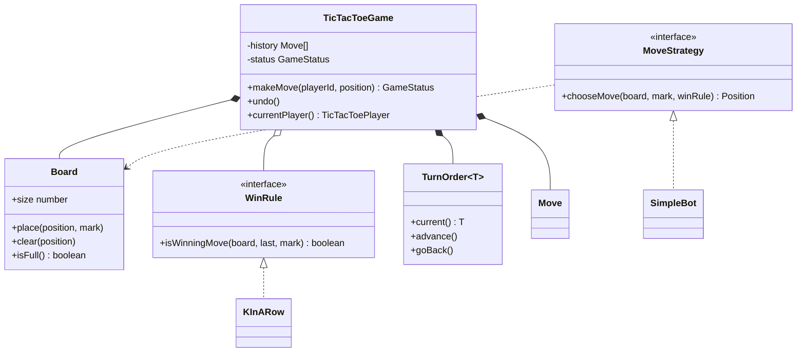
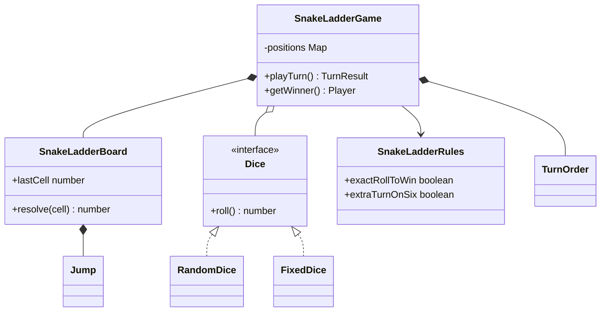
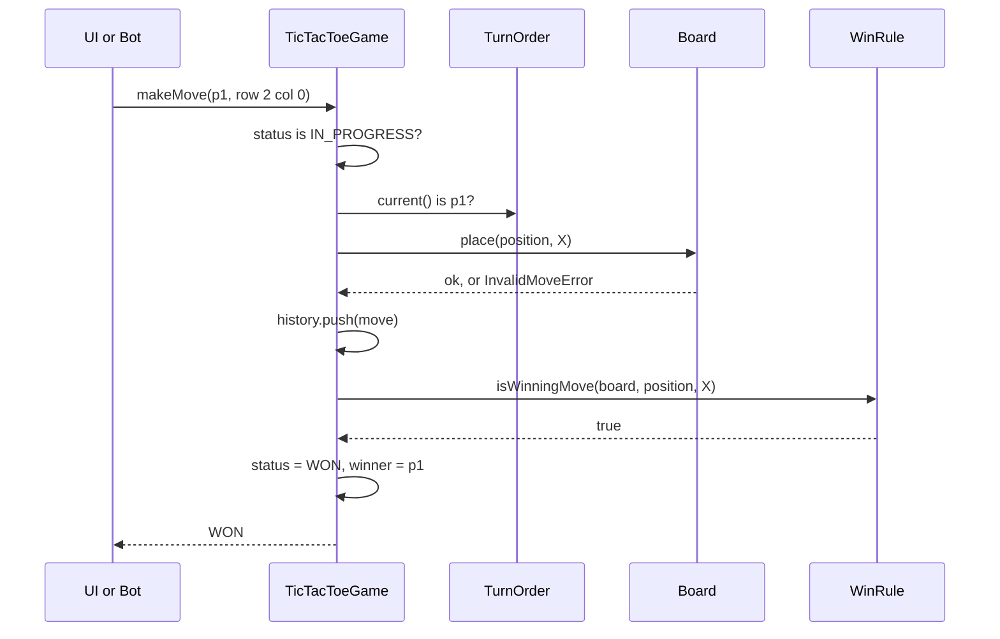

# Tic-Tac-Toe and Snake and Ladder

> In this document you will design two classic board games, tic-tac-toe and snake and ladder, with clean classes, pluggable rules and testable randomness. Game problems look easy, so the interviewer judges you on the details: turn validation, win detection, separation of rules from state, deterministic tests and how easily the game grows (bigger boards, bots, online play).

**Before this:** [How to approach LLD interviews](01-how-to-approach-lld-interviews.md) · [Behavioral patterns (Strategy, Command, State)](../04-oop-solid-design-patterns/08-behavioral-patterns.md) · [Composition and inheritance](../04-oop-solid-design-patterns/02-composition-inheritance-and-mixins.md) · **Interview questions:** [jump to the interview section](#interview-questions)

## Table of contents

1. [Problem](#problem)
2. [Clarifying questions](#clarifying-questions)
3. [Requirements](#requirements)
4. [Core entities and relationships](#core-entities-and-relationships)
5. [Design decisions and patterns](#design-decisions-and-patterns)
6. [Implementation](#implementation)
7. [Walkthrough](#walkthrough)
8. [Handling concurrency and edge cases](#handling-concurrency-and-edge-cases)
9. [Extensions](#extensions)
10. [How to present this in the interview](#how-to-present-this-in-the-interview)
11. [Interview questions](#interview-questions)
12. [Summary](#summary)
13. [References](#references)

---

## Problem

You may get either game, or one of them with "and how would your design change for the other one?". The prompts sound like this:

> **Tic-tac-toe:** "Design a tic-tac-toe game for two players on a 3×3 board. Players take turns placing X and O. The first player with three in a row (row, column or diagonal) wins. If the board is full and nobody has won, it is a draw. Later we may want bigger boards, a computer opponent, and online play."

> **Snake and ladder:** "Design a snake and ladder game. The board has 100 cells, some snakes (which take you down) and some ladders (which take you up). Two or more players roll a die in turns and move forward. The first player to reach cell 100 wins. Rules vary between families, so make them configurable."

Both are **turn-based games**. They share players and turn order, but differ in almost everything else: tic-tac-toe has player **choice** and a 2D grid; snake and ladder has **no choice at all** (only dice) and a 1D track. Designing both in one document shows a useful skill: reuse what is really shared (by composition), and do not force a shared base class where the games are different.

This is a **low-level design** round: classes, interfaces, methods and working code. There is no server architecture here, except where we discuss online play.

---

## Clarifying questions

### Tic-tac-toe

| Question | Why it matters | Assumed answer |
|---|---|---|
| Only 3×3, or N×N? | Decides if the win check can be hard-coded. | Build N×N with "K in a row" configurable; demo 3×3 with K=3. |
| Two players only? | Turn order and marks. | Two players, X and O. The design allows more marks. |
| Who moves first? | Turn order. | The first player in the list (X). |
| Human vs human, or also a computer player? | Need for a move strategy. | Both. A simple bot now, a perfect bot as an extension. |
| Do we need undo? | Need to keep move history. | Yes, undo the last move. |
| Is there a UI? | Scope. | No. A console render is enough; the UI calls our API. |
| Online play? | Concurrency. | Discuss only: server-authoritative game with move numbers. |

### Snake and ladder

| Question | Why it matters | Assumed answer |
|---|---|---|
| Board size? | Last cell and validation. | Configurable; 100 by default. |
| How many dice? | Range of a roll. | Configurable (1 or 2). |
| Must you roll the exact number to land on the last cell? | A common house rule. | Configurable: `exactRollToWin`. If true, an overshoot means you stay. |
| Extra turn on a six? | Another house rule. | Configurable: `extraTurnOnSix`. |
| Can a ladder end on a snake's head? | Chains and cycles. | No. The board rejects chains, which also prevents infinite loops. |
| Do we stop at the first winner or rank all players? | Game end condition. | Stop at the first winner. Ranking is an extension. |
| Can two players share a cell? | Some versions send the other player home. | Yes, they can share. "Capture" is an extension. |
| Do we need to replay a game? | Testability. | Yes: dice are injected, and the random dice accept a seed. |

Say the assumed answers out loud and write them down. If the interviewer has a different rule in mind ("overshoot bounces back"), you know exactly where it goes: in the rules object.

---

## Requirements

### Functional requirements

**Tic-tac-toe**

1. Create a game with two players, a board of size N and a "K in a row" win rule.
2. `makeMove(playerId, position)`: reject moves that are out of turn, outside the board, on a taken cell, or after the game is over.
3. After each move, detect **win** or **draw**.
4. `undo()` the last move, including a winning move.
5. Support different kinds of players: scripted/human input and computer bots.

**Snake and ladder**

1. Create a board with a last cell, snakes and ladders; reject invalid boards (snake going up, jump starting on cell 1 or the last cell, two jumps from one cell, chains).
2. Players take turns; each turn rolls the dice, moves, and follows a snake or ladder.
3. Configurable rules: exact roll to win, extra turn on a six.
4. Report what happened on each turn (roll, from, to, ladder/snake/overshoot/win), so a UI or log can show it.
5. Detect the winner and stop.

### Non-functional requirements

- **Testability and determinism:** dice and bots are injected. A test can force any dice sequence; a random game can be replayed from a seed.
- **Extensibility:** new board sizes, new win rules, new bot strategies and new house rules without rewriting the game classes.
- **Correctness:** invalid moves never change the state (validate first, then write).
- **Concurrency (online play):** the server is the single source of truth; duplicate or stale moves are rejected.
- **Simplicity:** no class hierarchy deeper than needed; plain data for players and moves.

---

## Core entities and relationships

### Shared

| Entity | Responsibility |
|---|---|
| `Player` | ID and name. Plain data. |
| `TurnOrder<T>` | Round-robin over players: `current()`, `advance()`, `goBack()`. Generic, used by both games. |
| `GameStatus` | `IN_PROGRESS`, `WON`, `DRAW`. |
| `InvalidMoveError` | A clear error for rule violations. |

### Tic-tac-toe

| Entity | Responsibility |
|---|---|
| `Board` | N×N cells. Validates and places marks, clears cells for undo, renders. Knows **nothing** about winning. |
| `WinRule` (interface) | "Did this move win?" `KInARow` implements it. |
| `TicTacToeGame` | Owns the board, turn order, history and status. Enforces turns and game-over. |
| `Move` | Player ID + position. Stored in history for undo. |
| `MoveStrategy` (interface) | "Which move should this player make?" `SimpleBot`, and later `MinimaxBot`. |



### Snake and ladder

| Entity | Responsibility |
|---|---|
| `SnakeLadderBoard` | Last cell and a map of **jumps** (snakes and ladders). Validates the layout. `resolve(cell)` returns where you really end. |
| `Jump` | `from` and `to`. A snake is a jump down, a ladder is a jump up. |
| `Dice` (interface) | `roll()`. `RandomDice` (with optional seed) and `FixedDice` (for tests). |
| `SnakeLadderRules` | House rules as data: `exactRollToWin`, `extraTurnOnSix`. |
| `SnakeLadderGame` | Positions, turn order, winner. `playTurn()` returns a `TurnResult`. |
| `TurnResult` | What happened in one turn. Plain data for the UI or a log. |



A key modelling decision is visible here: **there are no `Snake` and `Ladder` classes**. Both are just a `Jump` from one cell to another. They have no different behavior, only a different direction, which the board checks when it is created. Creating two classes with the same behavior is a common over-design in this problem. The same thinking says: there is no `Cell` class either, because a cell has no behavior; a number is enough.

---

## Design decisions and patterns

### Decision 1: the board stores state; the rules live elsewhere

The tic-tac-toe `Board` only knows cells: place, clear, is it full, what is empty. It does not know what "winning" means. Winning is a `WinRule`. Why? Because "three in a row on 3×3", "four in a row on 6×6", and "five in a row (Gomoku)" all use the same board with a different rule. If `Board` had `checkWinner()` inside, every variant would need a new board class. This is the **Single Responsibility Principle**: the board changes when storage changes; the rule changes when the game's rules change. See [SOLID](../04-oop-solid-design-patterns/03-solid-principles.md).

### Decision 2: win rule and move choice are strategies

Two places vary independently, so both are **Strategy** interfaces:

- `WinRule.isWinningMove(board, last, mark)`: `KInARow(k)` today; other rules later.
- `MoveStrategy.chooseMove(board, mark, winRule)`: `SimpleBot` (win, block, center, first free) today; `MinimaxBot` (perfect play) as an extension.

The game does not ask "is this player a bot?". The **caller** (a console loop, a UI, a server) asks a strategy for a move and then calls `makeMove`. This keeps the game class focused on rules and state. See [Strategy](../04-oop-solid-design-patterns/08-behavioral-patterns.md#strategy).

### Decision 3: check only the lines through the last move

A naive win check scans the whole board after each move: O(N²). But only the lines that pass through the **last** move can have changed. `KInARow` walks from the last move in the 4 directions (horizontal, vertical, two diagonals) and counts equal marks on both sides. That is O(K) per move, independent of board size. For classic N-in-a-row there is even an O(1) trick with counters per row, column and diagonal ([Q2](#q2-how-do-you-check-for-a-winner-efficiently)).

### Decision 4: undo with a move history (Command-style)

Every accepted move is stored as a `Move` object in `history`. `undo()` pops the last move and reverses it: clear the cell, move the turn back (only if the game was still running, because after a win or draw the turn did not advance), and reset the status. Storing actions as objects that can be reversed is the idea behind the **Command** pattern. Here we store data and the game knows how to reverse it; a full Command pattern would give each command its own `execute`/`undo`. For one kind of move, the simpler version is enough. See [Command](../04-oop-solid-design-patterns/08-behavioral-patterns.md#command).

### Decision 5: validate first, then change state

`makeMove` checks game-over, then turn, then calls `board.place`, which checks bounds and occupancy **before** writing. Only after all checks pass does anything change. An invalid move leaves the game exactly as it was. This matters for online play: a rejected request must have no side effects.

### Decision 6: randomness is injected

`SnakeLadderGame` receives a `Dice` object. Production code passes `RandomDice`; tests pass `FixedDice([3, 6, 5])` to force an exact story ("roll 3, climb the ladder"). `RandomDice` itself accepts a random function, so we can pass a **seeded** generator and replay a full game. Hidden `Math.random()` calls inside game logic are the number one reason game code is hard to test. This is **dependency injection** at its simplest. See [Dependency injection](../04-oop-solid-design-patterns/05-dependency-inversion-and-injection.md).

### Decision 7: house rules are data, not subclasses

"Exact roll to win" and "extra turn on six" are booleans in a `SnakeLadderRules` object. We do **not** create `ExactRollSnakeLadderGame extends SnakeLadderGame`, because rules combine: with two booleans you would need four subclasses, with five rules thirty-two. When a rule becomes complex (for example "three sixes in a row lose the turn"), it can become a small strategy object, still passed in.

### Decision 8: share by composition, not by a base class

Both games need turn order, so `TurnOrder<T>` is a small generic class that each game **has**. We do not create `abstract class BoardGame` with a template `play()` method, because the loops are different: tic-tac-toe waits for a player's choice, snake and ladder rolls dice; tic-tac-toe can draw, snake and ladder cannot; one has undo, the other does not. A base class here would be mostly `abstract` methods and special cases. Share the **pieces** that are really the same. See [Composition over inheritance](../04-oop-solid-design-patterns/02-composition-inheritance-and-mixins.md) and [generics](../03-typescript/05-generics.md).

| Problem | Pattern / principle | Benefit |
|---|---|---|
| Different win conditions (3×3, Gomoku) | Strategy (`WinRule`) | New variant = new rule or new config, same board and game. |
| Human, simple bot, perfect bot | Strategy (`MoveStrategy`) | Swap players without touching the game. |
| Undo | Command-style history | Reverse the last move exactly. |
| Random dice in tests | Dependency injection (`Dice`) | Deterministic tests and replays. |
| House rules | Configuration object | Rules combine without a subclass explosion. |
| Shared turn order | Composition + generics | Reuse without a forced base class. |
| Snakes and ladders | One `Jump` value type | No duplicate classes with identical behavior. |

---

## Implementation

We build both games in one runnable TypeScript file: shared pieces first, then tic-tac-toe (board → win rule → game → bots), then snake and ladder (dice → board → game), then a demo. The file runs with Node.js 22 (`node games.ts`) and passes `tsc --strict`. We use `as const` objects instead of `enum` so that Node's type stripping can run it.

### Step 1: shared pieces

```ts
// ---------- Step 1: shared pieces ----------
interface Player {
  readonly id: string;
  readonly name: string;
}

// Round-robin turn order. Both games use it (composition, not a base class).
class TurnOrder<T> {
  private readonly items: T[];
  private index = 0;

  constructor(items: readonly T[]) {
    if (items.length < 2) throw new Error("Need at least 2 players");
    this.items = [...items];
  }

  current(): T {
    return this.items[this.index];
  }

  advance(): void {
    this.index = (this.index + 1) % this.items.length;
  }

  goBack(): void {
    this.index = (this.index - 1 + this.items.length) % this.items.length;
  }
}

const GameStatus = { IN_PROGRESS: "IN_PROGRESS", WON: "WON", DRAW: "DRAW" } as const;
type GameStatus = (typeof GameStatus)[keyof typeof GameStatus];

class InvalidMoveError extends Error {
  constructor(message: string) {
    super(message);
    this.name = "InvalidMoveError";
  }
}
```

`TurnOrder<T>` is generic, so it works with `TicTacToePlayer` (which has a mark) and with plain `Player`. It copies the input array, so a caller cannot change the order from outside. It refuses fewer than two players, which removes a whole class of edge cases ("a game with one player never ends") at construction time.

### Step 2: the tic-tac-toe board

```ts
// ---------- Step 2: tic-tac-toe board ----------
type Mark = "X" | "O";

interface Position {
  readonly row: number;
  readonly col: number;
}

class Board {
  readonly size: number;
  private readonly cells: (Mark | null)[][];
  private filled = 0;

  constructor(size: number) {
    if (!Number.isInteger(size) || size < 3) throw new Error("Board size must be at least 3");
    this.size = size;
    this.cells = Array.from({ length: size }, () => Array<Mark | null>(size).fill(null));
  }

  isInside(pos: Position): boolean {
    return pos.row >= 0 && pos.row < this.size && pos.col >= 0 && pos.col < this.size;
  }

  get(pos: Position): Mark | null {
    return this.cells[pos.row][pos.col];
  }

  place(pos: Position, mark: Mark): void {
    if (!this.isInside(pos)) throw new InvalidMoveError(`(${pos.row},${pos.col}) is outside the board`);
    if (this.get(pos) !== null) throw new InvalidMoveError(`(${pos.row},${pos.col}) is already taken`);
    this.cells[pos.row][pos.col] = mark;
    this.filled += 1;
  }

  clear(pos: Position): void {
    if (this.get(pos) === null) return;
    this.cells[pos.row][pos.col] = null;
    this.filled -= 1;
  }

  isFull(): boolean {
    return this.filled === this.size * this.size;
  }

  emptyCells(): Position[] {
    const result: Position[] = [];
    for (let row = 0; row < this.size; row++) {
      for (let col = 0; col < this.size; col++) {
        if (this.cells[row][col] === null) result.push({ row, col });
      }
    }
    return result;
  }

  render(): string {
    return this.cells.map((r) => r.map((c) => c ?? ".").join(" ")).join("\n");
  }
}
```

Notes:

- `Array.from({ length: size }, () => Array(size).fill(null))` creates a **new** inner array per row. A common bug is `Array(size).fill(Array(size).fill(null))`, which puts the **same** row object in every row, so placing one mark changes a whole column.
- `filled` is a counter, so `isFull()` is O(1) instead of scanning the board.
- `place` validates bounds and occupancy and throws `InvalidMoveError` **before** writing.

### Step 3: the win rule

```ts
// ---------- Step 3: win rule (Strategy) ----------
interface WinRule {
  // Called after a move. Only lines through the last move can have changed.
  isWinningMove(board: Board, last: Position, mark: Mark): boolean;
}

// K marks in a row in any direction. K = board size is classic tic-tac-toe.
class KInARow implements WinRule {
  private readonly k: number;
  private static readonly DIRECTIONS: readonly Position[] = [
    { row: 0, col: 1 }, // horizontal
    { row: 1, col: 0 }, // vertical
    { row: 1, col: 1 }, // diagonal
    { row: 1, col: -1 }, // anti-diagonal
  ];

  constructor(k: number) {
    this.k = k;
  }

  isWinningMove(board: Board, last: Position, mark: Mark): boolean {
    return KInARow.DIRECTIONS.some((d) => {
      const count = 1 + this.countFrom(board, last, d, mark) + this.countFrom(board, last, { row: -d.row, col: -d.col }, mark);
      return count >= this.k;
    });
  }

  private countFrom(board: Board, start: Position, step: Position, mark: Mark): number {
    let count = 0;
    let pos = { row: start.row + step.row, col: start.col + step.col };
    while (board.isInside(pos) && board.get(pos) === mark) {
      count += 1;
      pos = { row: pos.row + step.row, col: pos.col + step.col };
    }
    return count;
  }
}
```

For each of the 4 directions we count equal marks forward and backward from the last move, plus 1 for the move itself. If any direction reaches `k`, the move wins. With `k = 3` on 3×3 this is classic tic-tac-toe; with `k = 5` on 15×15 it is Gomoku. The rule is O(k) per move because it never looks further than the run of equal marks.

### Step 4: the tic-tac-toe game

```ts
// ---------- Step 4: the tic-tac-toe game ----------
interface TicTacToePlayer extends Player {
  readonly mark: Mark;
}

interface Move {
  readonly playerId: string;
  readonly position: Position;
}

class TicTacToeGame {
  private readonly board: Board;
  private readonly winRule: WinRule;
  private readonly turns: TurnOrder<TicTacToePlayer>;
  private readonly history: Move[] = [];
  private status: GameStatus = GameStatus.IN_PROGRESS;
  private winner: TicTacToePlayer | null = null;

  constructor(players: readonly TicTacToePlayer[], board: Board, winRule: WinRule) {
    if (new Set(players.map((p) => p.mark)).size !== players.length) {
      throw new Error("Each player needs a different mark");
    }
    this.turns = new TurnOrder(players);
    this.board = board;
    this.winRule = winRule;
  }

  makeMove(playerId: string, position: Position): GameStatus {
    if (this.status !== GameStatus.IN_PROGRESS) throw new InvalidMoveError("Game is over");
    const player = this.turns.current();
    if (player.id !== playerId) throw new InvalidMoveError(`Not your turn, it is ${player.name}'s turn`);

    this.board.place(position, player.mark); // throws on invalid cell, before any state change
    this.history.push({ playerId, position });

    if (this.winRule.isWinningMove(this.board, position, player.mark)) {
      this.status = GameStatus.WON;
      this.winner = player;
    } else if (this.board.isFull()) {
      this.status = GameStatus.DRAW;
    } else {
      this.turns.advance();
    }
    return this.status;
  }

  // Command-style undo: every move is stored, so we can reverse the last one.
  undo(): void {
    const last = this.history.pop();
    if (!last) throw new InvalidMoveError("Nothing to undo");
    this.board.clear(last.position);
    if (this.status === GameStatus.IN_PROGRESS) this.turns.goBack();
    this.status = GameStatus.IN_PROGRESS;
    this.winner = null;
  }

  currentPlayer(): TicTacToePlayer {
    return this.turns.current();
  }

  getStatus(): GameStatus {
    return this.status;
  }

  getWinner(): TicTacToePlayer | null {
    return this.winner;
  }

  // Read-only access for bots and the UI.
  view(): Board {
    return this.board;
  }
}
```

Read `makeMove` as a checklist: game over? → right player? → valid cell (inside `place`)? → write → win? → draw? → next turn. The order matters: we check the win **before** the draw, because the last move can fill the board **and** win, and then it is a win.

`undo` handles a subtle case. After a normal move, the turn moved to the other player, so undo must move it back. After a winning or drawing move, the turn did **not** move, so undo must not move it back. The `if (this.status === GameStatus.IN_PROGRESS)` check, done before resetting the status, handles both.

`view()` returns the board so bots and a UI can read it. In a stricter design you would return a read-only interface (only `get`, `emptyCells`, `render`), so callers cannot call `place` and skip the game's rules. The bot below uses `place` and `clear` for "what if" checks and always undoes them.

### Step 5: move strategies

```ts
// ---------- Step 5: move strategies (who decides the next move) ----------
interface MoveStrategy {
  chooseMove(board: Board, mark: Mark, winRule: WinRule): Position;
}

// Win if possible, else block the opponent, else take the center, else the first free cell.
class SimpleBot implements MoveStrategy {
  chooseMove(board: Board, mark: Mark, winRule: WinRule): Position {
    const opponent: Mark = mark === "X" ? "O" : "X";
    const free = board.emptyCells();
    const winning = (m: Mark) =>
      free.find((pos) => {
        board.place(pos, m);
        const wins = winRule.isWinningMove(board, pos, m);
        board.clear(pos);
        return wins;
      });
    const center = { row: Math.floor(board.size / 2), col: Math.floor(board.size / 2) };
    return winning(mark) ?? winning(opponent) ?? (board.get(center) === null ? center : free[0]);
  }
}
```

`SimpleBot` is a **heuristic**: win now if possible, otherwise block the opponent's winning cell, otherwise take the center, otherwise the first free cell. It is short and good enough for a demo, but it does not see **forks** (one move that creates two threats at once). The demo shows Bot O beating Bot X with a fork. A perfect player uses minimax; see [Extensions](#extensions).

### Step 6: snake and ladder

```ts
// ---------- Step 6: snake and ladder ----------
interface Dice {
  roll(): number;
}

// A small seeded random number generator (mulberry32), so games can be replayed.
function seededRandom(seed: number): () => number {
  let a = seed >>> 0;
  return () => {
    a = (a + 0x6d2b79f5) >>> 0;
    let t = a;
    t = Math.imul(t ^ (t >>> 15), t | 1);
    t ^= t + Math.imul(t ^ (t >>> 7), t | 61);
    return ((t ^ (t >>> 14)) >>> 0) / 4294967296;
  };
}

class RandomDice implements Dice {
  private readonly count: number;
  private readonly random: () => number;

  constructor(count: number, random: () => number = Math.random) {
    this.count = count;
    this.random = random;
  }

  roll(): number {
    let total = 0;
    for (let i = 0; i < this.count; i++) total += 1 + Math.floor(this.random() * 6);
    return total;
  }
}

// For tests and demos: returns the given values in order.
class FixedDice implements Dice {
  private readonly values: readonly number[];
  private index = 0;

  constructor(values: readonly number[]) {
    this.values = values;
  }

  roll(): number {
    if (this.index >= this.values.length) throw new Error("FixedDice ran out of values");
    return this.values[this.index++];
  }
}

interface Jump {
  readonly from: number;
  readonly to: number;
}

class SnakeLadderBoard {
  readonly lastCell: number;
  private readonly jumps = new Map<number, number>();

  constructor(lastCell: number, snakes: readonly Jump[], ladders: readonly Jump[]) {
    this.lastCell = lastCell;
    for (const s of snakes) {
      if (s.to >= s.from) throw new Error(`Snake ${s.from}->${s.to} must go down`);
      this.addJump(s);
    }
    for (const l of ladders) {
      if (l.to <= l.from) throw new Error(`Ladder ${l.from}->${l.to} must go up`);
      this.addJump(l);
    }
    // No chains: a jump may not end where another jump starts. This also rules out cycles.
    for (const to of this.jumps.values()) {
      if (this.jumps.has(to)) throw new Error(`Cell ${to} is both a jump end and a jump start`);
    }
  }

  private addJump(jump: Jump): void {
    if (jump.from <= 1 || jump.from >= this.lastCell || jump.to < 1 || jump.to > this.lastCell) {
      throw new Error(`Jump ${jump.from}->${jump.to} is outside the playable cells`);
    }
    if (this.jumps.has(jump.from)) throw new Error(`Two jumps start at cell ${jump.from}`);
    this.jumps.set(jump.from, jump.to);
  }

  // Where a token really ends after landing on a cell.
  resolve(cell: number): number {
    return this.jumps.get(cell) ?? cell;
  }
}

interface SnakeLadderRules {
  readonly exactRollToWin: boolean; // overshooting the last cell means you stay
  readonly extraTurnOnSix: boolean;
}

interface TurnResult {
  readonly player: Player;
  readonly roll: number;
  readonly from: number;
  readonly to: number;
  readonly note: string;
}

class SnakeLadderGame {
  private readonly board: SnakeLadderBoard;
  private readonly dice: Dice;
  private readonly rules: SnakeLadderRules;
  private readonly turns: TurnOrder<Player>;
  private readonly positions = new Map<string, number>();
  private winner: Player | null = null;

  constructor(players: readonly Player[], board: SnakeLadderBoard, dice: Dice, rules: SnakeLadderRules) {
    this.turns = new TurnOrder(players);
    this.board = board;
    this.dice = dice;
    this.rules = rules;
    for (const p of players) this.positions.set(p.id, 0); // 0 = not on the board yet
  }

  playTurn(): TurnResult {
    if (this.winner) throw new InvalidMoveError("Game is over");
    const player = this.turns.current();
    const from = this.positions.get(player.id) ?? 0;
    const roll = this.dice.roll();
    let target = from + roll;
    let note = "";

    if (target > this.board.lastCell) {
      if (this.rules.exactRollToWin) {
        target = from;
        note = "overshoot, stays";
      } else {
        target = this.board.lastCell;
      }
    }
    const to = this.board.resolve(target);
    if (to > target) note = `ladder ${target}->${to}`;
    if (to < target) note = `snake ${target}->${to}`;
    this.positions.set(player.id, to);

    if (to === this.board.lastCell) {
      this.winner = player;
      note = note ? `${note}, WINS` : "WINS";
    } else if (!(this.rules.extraTurnOnSix && roll === 6)) {
      this.turns.advance();
    } else {
      note = note ? `${note}, extra turn` : "extra turn";
    }
    return { player, roll, from, to, note };
  }

  getWinner(): Player | null {
    return this.winner;
  }

  positionOf(playerId: string): number {
    return this.positions.get(playerId) ?? 0;
  }
}
```

Points worth saying while you write this:

- **Dice are an interface.** `FixedDice` makes tests exact. `RandomDice` takes a random function, so passing `seededRandom(42)` replays the same game every time. `mulberry32` is a tiny, well-known seeded generator; it is fine for games, not for security.
- **Snakes and ladders are both `Jump`s** in one map. The constructor checks direction (snakes go down, ladders go up), range (no jump from cell 1 or the last cell), duplicates, and **chains**: a jump may not end where another starts. Forbidding chains also makes cycles impossible, so `resolve` is a single map lookup and can never loop forever.
- **Position 0 means "not on the board yet"**, so rolling a 3 from the start lands on cell 3.
- **`playTurn` returns a `TurnResult`** instead of printing. The game does not know about the console. A UI, a log or a test reads the result. This keeps the game class reusable.
- The turn advances **unless** the player won or rolled a six with the extra-turn rule on.

### Step 7: the demo

```ts
// ---------- Step 7: demo ----------
function main(): void {
  console.log("=== Tic-tac-toe ===");
  const alice: TicTacToePlayer = { id: "p1", name: "Alice", mark: "X" };
  const bob: TicTacToePlayer = { id: "p2", name: "Bob", mark: "O" };
  const game = new TicTacToeGame([alice, bob], new Board(3), new KInARow(3));

  game.makeMove("p1", { row: 1, col: 1 });
  for (const [playerId, pos] of [
    ["p1", { row: 0, col: 0 }], // wrong turn
    ["p2", { row: 1, col: 1 }], // taken
    ["p2", { row: 3, col: 0 }], // outside
  ] as const) {
    try {
      game.makeMove(playerId, pos);
    } catch (error) {
      console.log(`Rejected: ${(error as Error).message}`);
    }
  }
  game.makeMove("p2", { row: 0, col: 0 });
  game.makeMove("p1", { row: 0, col: 2 });
  game.makeMove("p2", { row: 2, col: 2 });
  const status = game.makeMove("p1", { row: 2, col: 0 });
  console.log(game.view().render());
  console.log(`Status: ${status}, winner: ${game.getWinner()?.name}`);

  game.undo();
  console.log(`After undo: ${game.getStatus()}, next: ${game.currentPlayer().name}`);

  console.log("--- Bot vs bot ---");
  const winRule = new KInARow(3);
  const botGame = new TicTacToeGame(
    [{ id: "b1", name: "Bot X", mark: "X" }, { id: "b2", name: "Bot O", mark: "O" }],
    new Board(3),
    winRule,
  );
  const bot = new SimpleBot();
  while (botGame.getStatus() === GameStatus.IN_PROGRESS) {
    const player = botGame.currentPlayer();
    botGame.makeMove(player.id, bot.chooseMove(botGame.view(), player.mark, winRule));
  }
  console.log(botGame.view().render());
  console.log(`Status: ${botGame.getStatus()}, winner: ${botGame.getWinner()?.name}`);

  console.log("=== Snake and ladder ===");
  const board = new SnakeLadderBoard(
    30,
    [{ from: 17, to: 4 }, { from: 27, to: 9 }],
    [{ from: 3, to: 22 }, { from: 11, to: 26 }],
  );
  const players: Player[] = [{ id: "a", name: "Asha" }, { id: "r", name: "Ravi" }];
  const scripted = new SnakeLadderGame(
    players,
    board,
    new FixedDice([3, 6, 5, 5, 6, 1, 2, 3, 4]),
    { exactRollToWin: true, extraTurnOnSix: true },
  );
  while (!scripted.getWinner()) {
    const t = scripted.playTurn();
    console.log(`${t.player.name} rolls ${t.roll}: ${t.from} -> ${t.to}${t.note ? ` (${t.note})` : ""}`);
  }

  console.log("--- Seeded random game, 100 cells, two dice ---");
  const bigBoard = new SnakeLadderBoard(
    100,
    [{ from: 99, to: 54 }, { from: 70, to: 55 }, { from: 52, to: 42 }, { from: 25, to: 2 }],
    [{ from: 6, to: 24 }, { from: 11, to: 40 }, { from: 60, to: 85 }, { from: 46, to: 90 }],
  );
  const randomGame = new SnakeLadderGame(
    players,
    bigBoard,
    new RandomDice(2, seededRandom(42)),
    { exactRollToWin: false, extraTurnOnSix: false },
  );
  let turnCount = 0;
  while (!randomGame.getWinner()) {
    randomGame.playTurn();
    turnCount += 1;
  }
  console.log(`${randomGame.getWinner()?.name} wins after ${turnCount} turns; Asha at ${randomGame.positionOf("a")}, Ravi at ${randomGame.positionOf("r")}`);

  try {
    new SnakeLadderBoard(30, [{ from: 22, to: 5 }], [{ from: 3, to: 22 }]);
  } catch (error) {
    console.log(`Invalid board: ${(error as Error).message}`);
  }
}

main();

// Output:
// === Tic-tac-toe ===
// Rejected: Not your turn, it is Bob's turn
// Rejected: (1,1) is already taken
// Rejected: (3,0) is outside the board
// O . X
// . X .
// X . O
// Status: WON, winner: Alice
// After undo: IN_PROGRESS, next: Alice
// --- Bot vs bot ---
// O X X
// X X .
// O O O
// Status: WON, winner: Bot O
// === Snake and ladder ===
// Asha rolls 3: 0 -> 22 (ladder 3->22)
// Ravi rolls 6: 0 -> 6 (extra turn)
// Ravi rolls 5: 6 -> 26 (ladder 11->26)
// Asha rolls 5: 22 -> 9 (snake 27->9)
// Ravi rolls 6: 26 -> 26 (overshoot, stays, extra turn)
// Ravi rolls 1: 26 -> 9 (snake 27->9)
// Asha rolls 2: 9 -> 26 (ladder 11->26)
// Ravi rolls 3: 9 -> 12
// Asha rolls 4: 26 -> 30 (WINS)
// --- Seeded random game, 100 cells, two dice ---
// Ravi wins after 8 turns; Asha at 29, Ravi at 100
// Invalid board: Cell 22 is both a jump end and a jump start
```

What the output shows:

- Three invalid moves are rejected with clear messages, and the board is unchanged.
- Alice wins on the anti-diagonal (0,2), (1,1), (2,0). Undo reopens the game and gives the turn back to Alice.
- `SimpleBot` vs `SimpleBot`: O sets up a fork (two threats at (1,0) and (2,2)); X can block only one.
- Snake and ladder with forced dice shows every rule: a ladder (3→22), an extra turn on six, a ladder (11→26), a snake (27→9), an overshoot with the exact-roll rule (26 + 6 > 30, stays, but still gets the extra turn for the six), and a win on an exact 4.
- The seeded random game always gives the same result, which is what you want in a test.
- The invalid board is rejected because cell 22 is the end of a ladder and the start of a snake.

---

## Walkthrough

### One tic-tac-toe move

This is the flow when a player taps a cell. The same flow works for a console, a browser UI or a server.



1. The UI (or a bot strategy) decides a position and calls `makeMove(playerId, position)`.
2. The game rejects the move if the game is over or it is not this player's turn.
3. The board rejects the move if the cell is outside or taken. Nothing has changed yet.
4. The move is written to the board and the history.
5. The win rule checks only the lines through this cell.
6. If it is a win, the status becomes `WON` and the turn does not advance. Otherwise, if the board is full, it is a `DRAW`. Otherwise, the turn advances.
7. The new status goes back to the caller, which can render the board.

### One snake and ladder turn

1. `playTurn()` gets the current player and their position (0 if not on the board).
2. Roll the injected dice; `target = from + roll`.
3. If `target` is past the last cell: with `exactRollToWin`, stay; otherwise stop at the last cell.
4. `board.resolve(target)` follows a ladder or snake if one starts there (one lookup, no chains).
5. Save the new position. If it is the last cell, set the winner.
6. Advance the turn, unless the player won or rolled a six with `extraTurnOnSix`.
7. Return a `TurnResult` describing the turn.

---

## Handling concurrency and edge cases

### Local games have no concurrency problem

A local game runs in one thread and every method is synchronous. Two `makeMove` calls cannot interleave. Say this clearly in the interview; it shows you understand when concurrency matters and when it does not.

### Online games: the server is the referee

Concurrency appears when two clients play over a network. Problems:

- **Double tap:** the same move is sent twice.
- **Stale client:** a client sends a move based on an old view of the board (its network was slow).
- **Two moves at once:** both players send a move for the same turn.
- **Cheating:** a client sends a move out of turn or for another player.

The standard answer is a **server-authoritative** design: clients only send **intentions**; the server holds the only real game state, validates every move and broadcasts the result. Each request carries the **move number** the client expects (like a version number in optimistic locking). If the game has already moved on, the request is stale and is rejected. The client then reloads the state.

```ts
// Online play: the server owns the game. Each client sends the move number it expects.
interface MoveRequest {
  readonly playerId: string;
  readonly cell: number; // 0..8
  readonly expectedMoveNumber: number;
}

class GameRoom {
  private readonly cells: (string | null)[] = Array(9).fill(null);
  private readonly players: readonly string[];
  private moveNumber = 0;

  constructor(players: readonly string[]) {
    this.players = players;
  }

  // Synchronous from check to write, so two requests cannot interleave inside it.
  handle(req: MoveRequest): string {
    if (req.expectedMoveNumber !== this.moveNumber) {
      return `${req.playerId}: rejected, stale (expected move ${req.expectedMoveNumber}, game is at ${this.moveNumber})`;
    }
    const turnOf = this.players[this.moveNumber % this.players.length];
    if (req.playerId !== turnOf) return `${req.playerId}: rejected, not your turn`;
    if (this.cells[req.cell] !== null) return `${req.playerId}: rejected, cell taken`;
    this.cells[req.cell] = req.playerId;
    this.moveNumber += 1;
    return `${req.playerId}: accepted cell ${req.cell}, now at move ${this.moveNumber}`;
  }
}

const room = new GameRoom(["alice", "bob"]);
// Alice double-taps: the same move arrives twice. Bob's client is one move behind.
const incoming: MoveRequest[] = [
  { playerId: "alice", cell: 4, expectedMoveNumber: 0 },
  { playerId: "alice", cell: 4, expectedMoveNumber: 0 },
  { playerId: "bob", cell: 0, expectedMoveNumber: 1 },
  { playerId: "bob", cell: 8, expectedMoveNumber: 1 },
];
for (const req of incoming) console.log(room.handle(req));

// Output:
// alice: accepted cell 4, now at move 1
// alice: rejected, stale (expected move 0, game is at 1)
// bob: accepted cell 0, now at move 2
// bob: rejected, stale (expected move 1, game is at 2)
```

In Node.js, one game room's `handle` is synchronous, so the check and the write cannot be interleaved. With many servers, put each game room on **one** server (route by game ID, for example with consistent hashing), or store the game in a database and use the move number as the version in a conditional update. In Java or C#, use a lock per game room. The playerId must come from the **authenticated session**, not from the request body, or a player could send moves for the opponent.

For snake and ladder, the server must also **roll the dice**. If the client rolls, a cheater sends "6" every time. Server-side dice with a logged seed also make disputes easy to replay.

### Edge cases to mention

| Edge case | Handling |
|---|---|
| Move after the game is over | `InvalidMoveError("Game is over")`. |
| Out-of-turn move | Rejected with whose turn it is. |
| Cell outside or taken | Rejected by `Board.place` before any change. |
| Last move fills the board **and** wins | Check win before draw, so it is a win. |
| Undo with empty history | `InvalidMoveError("Nothing to undo")`. |
| Undo after a win | Status back to `IN_PROGRESS`; turn is **not** moved back, because it never advanced. |
| Two players choose the same mark | The constructor rejects it. |
| Fewer than two players | `TurnOrder` rejects it. |
| Snake that goes up, ladder that goes down | Rejected by the board. |
| Jump from cell 1 or the last cell | Rejected (you could never start, or never win). |
| Ladder ends on a snake head (chain) | Rejected; this also prevents cycles and infinite loops. |
| Overshooting the last cell | Depends on `exactRollToWin`: stay, or stop at the last cell. |
| Fixed dice run out (test bug) | `FixedDice` throws a clear error instead of returning `undefined`. |
| A game that never ends (only possible with odd house rules) | Add a max-turns limit in the game loop and end as a draw. |

---

## Extensions

### A perfect computer player

Because players' choices are a `MoveStrategy`, a perfect player is just another class. **Minimax** tries every possible move, assumes the opponent always plays its best answer, and scores outcomes (+10 for a win, -10 for a loss, 0 for a draw, adjusted by depth so faster wins score higher). On 3×3 the full game tree is small enough to search completely, and two perfect players always draw:

```ts
// Add to the implementation: a perfect player (minimax) as just another MoveStrategy.
class MinimaxBot implements MoveStrategy {
  chooseMove(board: Board, mark: Mark, winRule: WinRule): Position {
    let best: Position | null = null;
    let bestScore = -Infinity;
    for (const pos of board.emptyCells()) {
      board.place(pos, mark);
      const score = this.score(board, pos, mark, mark, winRule, 0);
      board.clear(pos);
      if (score > bestScore) {
        bestScore = score;
        best = pos;
      }
    }
    if (!best) throw new Error("No moves left");
    return best;
  }

  // Score of the position after `justMoved` played `last`, seen by `me`.
  private score(board: Board, last: Position, justMoved: Mark, me: Mark, winRule: WinRule, depth: number): number {
    if (winRule.isWinningMove(board, last, justMoved)) return justMoved === me ? 10 - depth : depth - 10;
    if (board.isFull()) return 0;
    const next: Mark = justMoved === "X" ? "O" : "X";
    const scores = board.emptyCells().map((pos) => {
      board.place(pos, next);
      const s = this.score(board, pos, next, me, winRule, depth + 1);
      board.clear(pos);
      return s;
    });
    return next === me ? Math.max(...scores) : Math.min(...scores);
  }
}

const rule = new KInARow(3);
const perfect = new TicTacToeGame(
  [{ id: "m1", name: "Minimax X", mark: "X" }, { id: "m2", name: "Minimax O", mark: "O" }],
  new Board(3),
  rule,
);
const minimax = new MinimaxBot();
while (perfect.getStatus() === GameStatus.IN_PROGRESS) {
  const p = perfect.currentPlayer();
  perfect.makeMove(p.id, minimax.chooseMove(perfect.view(), p.mark, rule));
}
console.log(perfect.view().render());
console.log(`Status: ${perfect.getStatus()}`);

// Output:
// X X O
// O O X
// X O X
// Status: DRAW
```

Nothing in `TicTacToeGame`, `Board` or `KInARow` changed. For bigger boards the tree explodes, so you add **alpha-beta pruning** and a depth limit with a heuristic score.

### Bigger boards and K-in-a-row

A 6×6 board where 4 in a row wins is only configuration:

```ts
// Add to the implementation: a bigger board with 4-in-a-row is only configuration.
const big = new TicTacToeGame(
  [{ id: "x", name: "Xena", mark: "X" }, { id: "o", name: "Omar", mark: "O" }],
  new Board(6),
  new KInARow(4),
);
const script: [string, number, number][] = [
  ["x", 2, 1], ["o", 0, 0], ["x", 3, 2], ["o", 0, 1], ["x", 4, 3], ["o", 0, 2], ["x", 1, 0],
];
let result: GameStatus = GameStatus.IN_PROGRESS;
for (const [id, row, col] of script) result = big.makeMove(id, { row, col });
console.log(big.view().render());
console.log(`${result}: ${big.getWinner()?.name}`);

// Output:
// O O O . . .
// X . . . . .
// . X . . . .
// . . X . . .
// . . . X . .
// . . . . . .
// WON: Xena
```

Xena's last move (1,0) is at the **end** of the diagonal, not in the middle. `KInARow` counts both directions from the last move, so it finds the four marks (1,0), (2,1), (3,2), (4,3).

### Other follow-ups

| Follow-up | Change |
|---|---|
| Three players with marks X, O, Δ | Widen `Mark` to a string; the game already supports N players via `TurnOrder`. `SimpleBot`'s "opponent" becomes "any other mark". |
| Redo | Keep a second stack: `undo` pushes to it, `redo` pops from it, any new move clears it. |
| Replay a finished game | The move history **is** the replay. Store it with the game ID. |
| Show events to spectators | Add listeners (Observer): the game emits `MOVE_MADE`, `GAME_WON`; the UI and network layer subscribe. |
| Timer per move | A clock is injected; a timeout means a random move or a loss. |
| Snake and ladder: rank all players | Do not stop at the first winner; remove winners from `TurnOrder` and continue until one player is left. |
| Snake and ladder: special cells (skip a turn, roll again) | Replace the jump map with a `CellEffect` interface (`apply(player, game)`); a jump is one kind of effect. This is a small Strategy per cell. |
| Snake and ladder: "three sixes in a row lose the turn" | Turn the rules object into a `TurnPolicy` strategy that decides "advance or not" from the recent rolls. |
| Snake and ladder: overshoot bounces back | Replace the `exactRollToWin` boolean with an `overshoot` rule that is one of `stay`, `stopAtEnd` or `bounce`; bounce means `last - (target - last)`. |
| Save and load | Both games are plain data (board cells, positions, history, turn index), so they serialize to JSON easily. Keep dice seeds for replays. |

---

## How to present this in the interview

### A 45-minute plan (one game in depth, the other discussed)

| Minutes | What you do |
|---|---|
| 0–4 | Clarify: board size, K in a row, players and bots, undo; for snake and ladder: exact roll, extra six, chains. |
| 4–7 | Requirements, and say that validation-before-write and testable randomness are your non-functional focus. |
| 7–12 | Entities and class diagram: `Board`, `WinRule`, `TicTacToeGame`, `TurnOrder`, `MoveStrategy`. Point out what is **not** a class (cell, snake vs ladder). |
| 12–16 | Decisions: board vs rules, Strategy for win rule and bots, O(K) win check, undo history. |
| 16–34 | Code: `Board.place`, `KInARow.isWinningMove`, `TicTacToeGame.makeMove` and `undo`. Run one game by hand. |
| 34–40 | Snake and ladder sketch: `Jump`, `Dice` interface, `playTurn`. Show how `FixedDice` makes a test exact. |
| 40–45 | Online play (server-authoritative, move numbers) and one extension (minimax or bigger boards). |

If the interviewer only asked for one game, spend the saved time on more edge cases and tests.

### A short spoken walkthrough

> "I separate state from rules. The `Board` only stores cells and validates placement; it doesn't know what winning means. Winning is a `WinRule` strategy; I implemented `KInARow`, which checks only the four lines through the last move, so it's O(K) per move and the same class handles 3×3 tic-tac-toe and bigger K-in-a-row games.
>
> `TicTacToeGame` owns the board, a `TurnOrder` and a move history. `makeMove` validates everything before writing: game over, whose turn, cell valid. Then it checks win before draw, because the last move can do both. The history gives me undo.
>
> Players' decisions are a `MoveStrategy`: a simple bot now, minimax later, without touching the game.
>
> For snake and ladder, snakes and ladders are both just jumps in one map, validated so there are no chains or cycles. The dice are injected, so tests use fixed rolls and random games can be replayed from a seed. House rules are a config object, not subclasses.
>
> Both games share `TurnOrder` by composition. I didn't force a common base class because their loops are different. For online play, the server owns the game and each move carries the expected move number, so duplicates and stale moves are rejected."

---

## Interview questions

### Q1. Walk me through your class design for tic-tac-toe. Why these classes?

**What the interviewer is checking:** whether your classes have clear, single responsibilities, and whether you can justify each one instead of listing nouns.

**What to say (30–60 seconds):**
> "I have four main pieces. `Board` stores the N-by-N cells and validates placement; that's all it knows. `WinRule` is an interface that answers 'did this move win?', and `KInARow` implements it. `TicTacToeGame` owns a board, a win rule, a `TurnOrder` and a move history, and it's the only class that enforces the game's rules: whose turn, game over, win or draw. Then `MoveStrategy` is how a player chooses a move, so bots are pluggable. I didn't create a `Cell` class because a cell has no behavior, and I didn't put win checking in the board, because then every variant would need a new board."

**Deeper explanation:** The test for a class is "what is its one reason to change?". `Board` changes if storage changes (say, a sparse map for a huge board). `KInARow` changes if the winning condition changes. `TicTacToeGame` changes if the turn rules change. `SimpleBot` changes if the AI changes. Four reasons, four classes. A single `TicTacToe` class with everything inside works for a 3×3 demo but mixes all four.

**Follow-up questions and how to answer them:**
- *"Is `Player` a class?"* — It is plain data (ID, name, mark). The behavior of choosing a move lives in a `MoveStrategy`, which a human UI or a bot provides. That keeps "who the player is" separate from "how they decide".
- *"Why does the game not call the bot itself?"* — The game is a referee; it should not care who decides the move. The caller loop asks a strategy for a move, then calls `makeMove`. This makes the game reusable for a UI, a server, and tests.

**Common mistakes:** a god class with board, rules, I/O and AI together; printing inside the game logic; a `Cell` class with only a getter and setter.

**Real-project example:** Game engines and chess libraries separate the board representation, move generation, rule validation and the engine that searches for moves. The same split makes each part testable.

### Q2. How do you check for a winner efficiently?

**What the interviewer is checking:** that you do not rescan the whole board, and that you know at least one optimization.

**What to say (30–60 seconds):**
> "Only lines through the last move can change, so I only check those: from the last move I count equal marks in both directions along the row, the column and the two diagonals. That's O(K) per move instead of O(N²). For classic N-in-a-row on N-by-N there's an even faster O(1) trick: keep a counter per row, per column and for the two diagonals, for each player. When a player's counter for a line reaches N, they win."

**Deeper explanation:** Here is the counter version. Each move updates at most four counters:

```ts
// O(1) win check for N-in-a-row on an N x N board: count marks per row, column and diagonal.
class CountingWinChecker {
  private readonly n: number;
  private readonly rows: Map<string, number[]> = new Map();
  private readonly cols: Map<string, number[]> = new Map();
  private readonly diag = new Map<string, number>();
  private readonly anti = new Map<string, number>();

  constructor(n: number) {
    this.n = n;
  }

  // Returns true if this move wins. Each move updates at most 4 counters.
  record(mark: string, row: number, col: number): boolean {
    const rows = this.rows.get(mark) ?? Array<number>(this.n).fill(0);
    const cols = this.cols.get(mark) ?? Array<number>(this.n).fill(0);
    this.rows.set(mark, rows);
    this.cols.set(mark, cols);
    rows[row] += 1;
    cols[col] += 1;
    if (row === col) this.diag.set(mark, (this.diag.get(mark) ?? 0) + 1);
    if (row + col === this.n - 1) this.anti.set(mark, (this.anti.get(mark) ?? 0) + 1);
    return (
      rows[row] === this.n ||
      cols[col] === this.n ||
      this.diag.get(mark) === this.n ||
      this.anti.get(mark) === this.n
    );
  }
}

const checker = new CountingWinChecker(3);
const moves: [string, number, number][] = [["X", 0, 0], ["O", 1, 0], ["X", 1, 1], ["O", 2, 0], ["X", 2, 2]];
for (const [mark, row, col] of moves) {
  console.log(`${mark} at (${row},${col}) wins: ${checker.record(mark, row, col)}`);
}

// Output:
// X at (0,0) wins: false
// O at (1,0) wins: false
// X at (1,1) wins: false
// O at (2,0) wins: false
// X at (2,2) wins: true
```

The counter trick only works when K equals N (a full row). For K < N (Gomoku), use the "walk from the last move" approach in `KInARow`. Counters also need to be decremented on undo.

**Follow-up questions and how to answer them:**
- *"Which one would you use?"* — `KInARow`, because it supports both variants with one class and O(K) is already tiny. I'd mention the counter trick as an optimization for a fixed N-in-a-row.
- *"How do you detect a draw early?"* — A line is "dead" when it contains both marks. If every line is dead, nobody can win, so it is a draw before the board is full. It is an optional improvement.

**Common mistakes:** scanning all rows, columns and diagonals after every move and calling it fine without mentioning the cost; hard-coding the eight 3×3 lines, which breaks for N×N.

**Real-project example:** Connect Four implementations check from the last dropped disc in four directions, the same idea as `KInARow`.

### Q3. How did you implement undo, and what is tricky about it?

**What the interviewer is checking:** that you think through state transitions, not just "pop the last move".

**What to say (30–60 seconds):**
> "Every accepted move is stored in a history stack. Undo pops the last move, clears that cell, resets the status and winner, and moves the turn back. The tricky part is the turn: after a normal move the turn advanced, so undo must go back; after a winning or drawing move the turn did not advance, so undo must not go back. I check the status before resetting it. If I used the counter-based win checker, undo would also have to decrement the counters."

**Deeper explanation:** This is a Command-style design: actions are stored as data and can be reversed. An alternative is the **Memento** approach: store a full snapshot of the board before each move and restore it. For 9 cells, snapshots are cheap and simpler to get right; for a big board or a long game, storing moves is cheaper. Redo uses a second stack that is cleared whenever a new move is made. See [Command and Memento](../04-oop-solid-design-patterns/08-behavioral-patterns.md#memento).

**Follow-up questions and how to answer them:**
- *"Should undo be allowed in online play?"* — Only with the opponent's agreement, as a request/accept flow. The server applies it, and the move number still increases so stale clients are detected.
- *"Undo for snake and ladder?"* — Possible, but you must also restore the dice state, or the replay is not the same. In practice, it is usually not a requirement.

**Common mistakes:** forgetting to reset status and winner; always moving the turn back; mutating history from outside the game.

**Real-project example:** Chess apps keep the move list (in a standard notation) for undo, replay and analysis; the same list is the game record.

### Q4. Why did you model snakes and ladders as one `Jump` type instead of two classes?

**What the interviewer is checking:** whether you create classes for behavior or just for nouns.

**What to say (30–60 seconds):**
> "A snake and a ladder do exactly the same thing: if you land on cell A, you move to cell B. The only difference is the direction, which is a validation rule when the board is created. Two classes with identical behavior would just duplicate code. So both are a `Jump` with `from` and `to`, stored in one map from start cell to end cell. Resolving a landing is one map lookup. If later a cell needs different behavior, like 'skip a turn', I would introduce a `CellEffect` interface, and a jump becomes one implementation of it."

**Deeper explanation:** A class is justified when it adds behavior or protects an invariant. Here the invariant ("snakes go down") is checked once in the board constructor. Keeping data simple also makes it easy to load boards from JSON. When real behavior variety appears, introduce the abstraction at that moment, not before ("you aren't gonna need it", YAGNI). See [Design principles](../04-oop-solid-design-patterns/04-coupling-cohesion-and-design-principles.md).

**Follow-up questions and how to answer them:**
- *"What if the UI needs to draw snakes and ladders differently?"* — The UI can tell them apart by direction (`to < from` is a snake). Or add a `kind` field to `Jump` for display only.
- *"How do you look up jumps quickly?"* — A `Map<number, number>` from start to end, O(1).

**Common mistakes:** `abstract class BoardEntity` with `Snake` and `Ladder` subclasses that each have one identical method; a `Cell` class with nullable `snake` and `ladder` fields.

**Real-project example:** Board game engines usually describe boards as data files (cells, connections, effects) and keep one engine that interprets them.

### Q5. How do you make a game with dice testable?

**What the interviewer is checking:** dependency injection and deterministic tests.

**What to say (30–60 seconds):**
> "I never call `Math.random()` inside the game. The game receives a `Dice` interface in its constructor. In production it's `RandomDice`, in tests it's `FixedDice`, which returns a list of values I choose, so I can write a test like 'roll 3 lands on the ladder at 3 and ends on 22'. `RandomDice` also takes the random function as a parameter, so I can pass a seeded generator and replay an entire random game, which is great for reproducing bug reports."

**Deeper explanation:** This is the same idea as injecting a clock for time-based code. Anything non-deterministic (time, randomness, network) goes behind an interface at the edge of the system. The core logic becomes a pure function of its inputs and is trivial to test. The demo shows `FixedDice([3, 6, 5, 5, 6, 1, 2, 3, 4])` producing a ladder, an extra turn, a snake, an overshoot and a win, every time.

**Follow-up questions and how to answer them:**
- *"Is `Math.random()` good enough for a real-money game?"* — No. It is not cryptographically secure. Use `crypto.getRandomValues()` or `crypto.randomInt()` on the server, and log what was rolled for audits.
- *"How would you test fairness of `RandomDice`?"* — Roll many times with a fixed seed and check that each face appears roughly 1/6 of the time; a chi-squared test if you want to be formal.

**Common mistakes:** mocking `Math.random` globally in tests; tests that pass "most of the time"; rolling dice on the client in online play.

**Real-project example:** Many game studios record the random seed with each match so they can replay a reported bug exactly.

### Q6. Why not create an abstract `BoardGame` base class for both games?

**What the interviewer is checking:** judgment about inheritance versus composition.

**What to say (30–60 seconds):**
> "I looked for what's really shared: players and turn order. That's a small generic `TurnOrder` class that both games use by composition. The game loops themselves are different: tic-tac-toe waits for a choice and can draw, snake and ladder rolls dice and can't draw; one has undo, the other has house rules. A base class would be mostly abstract methods plus special cases for each child, which is a sign the abstraction is wrong. If we later add many turn-based games with the same lifecycle, I'd consider a shared interface like `TurnBasedGame` with `start`, `status` and `winner`, still without forcing an implementation."

**Deeper explanation:** Inheritance couples the child to the parent's implementation; a change in the base class can break every game. Composition lets each game pick the pieces it needs. A shared **interface** (not a base class) is useful if a lobby or match-making service needs to treat all games the same way. See [Composition, inheritance and mixins](../04-oop-solid-design-patterns/02-composition-inheritance-and-mixins.md).

**Follow-up questions and how to answer them:**
- *"When would Template Method fit?"* — If many games share the exact same loop (setup → while not over: take turn → announce winner) and differ only in small steps. Then the base class owns the loop and children fill in `takeTurn`. It fits a family of dice games better than these two.

**Common mistakes:** inheritance only to reuse a `players` field; an abstract `move()` method that one game cannot implement meaningfully.

**Real-project example:** Game platforms that host many games usually define a common interface for the lobby (join, start, finish, result) and leave game rules to separate modules.

### Q7. How would you build a computer player?

**What the interviewer is checking:** the Strategy pattern for behavior, and some algorithm awareness.

**What to say (30–60 seconds):**
> "A computer player is a `MoveStrategy`: given the board and its mark, return a position. The simple version uses rules: win if you can, block the opponent's win, take the center, else take any free cell. It loses to forks. A perfect player uses minimax: try every move, assume the opponent plays its best reply, score wins and losses, and pick the best. On 3-by-3 the whole tree is small, and two minimax bots always draw. For bigger boards I'd add alpha-beta pruning and a depth limit."

**Deeper explanation:** The important design point is that bots do not need special support in the game. They read the board, decide, and call the same `makeMove` as humans, so they cannot cheat or skip validation. The demo shows `SimpleBot` losing to a fork; the extension shows `MinimaxBot` producing a draw.

**Follow-up questions and how to answer them:**
- *"How do you add difficulty levels?"* — Different strategies (easy = random, medium = SimpleBot, hard = minimax), or minimax with a chance of picking a random move.
- *"Bots for snake and ladder?"* — There is no choice in snake and ladder, so no strategy is needed. That's a good sign the two games should not share a forced structure.

**Common mistakes:** `if (player.isBot)` branches inside `makeMove`; a bot that writes to the board directly.

**Real-project example:** Chess engines plug into chess GUIs through a standard protocol; the GUI asks the engine for a move and plays it like a human move.

### Q8. How would you make tic-tac-toe playable online?

**What the interviewer is checking:** server authority, concurrency and cheating prevention.

**What to say (30–60 seconds):**
> "The server owns the game. Clients send only intentions: 'player P wants cell C, and I believe we're at move number M'. The server checks the move number like a version: if the game has moved on, the request is stale and rejected, which also handles double taps. Then it validates the turn and the cell using the same game class, applies the move, and broadcasts the new state to both clients, for example over WebSockets. The player ID comes from the authenticated connection, not from the request body. All requests for one game go to one server, or the game state is updated with a version check in the database."

**Deeper explanation:** The `GameRoom` snippet in this document shows the move-number check rejecting a duplicate tap and a stale move. Clients may show the move immediately (optimistic UI) and roll back if the server rejects it. For real-time delivery see [real-time communication](../09-system-design/04-api-styles-and-real-time-communication.md).

**Follow-up questions and how to answer them:**
- *"What if a player disconnects?"* — Keep the game for a timeout; if they don't come back, they forfeit. Store the game state so a reconnect can load it.
- *"How do you scale to many games?"* — Games are independent, so shard by game ID. Each game is tiny; one server can hold many thousands of rooms in memory.

**Common mistakes:** trusting the client's board; rolling dice on the client; no protection against duplicate requests.

**Real-project example:** Online board game sites run the rules on the server and send state updates to clients; the client is only a view.

### Q9. What edge cases would you test for snake and ladder?

**What the interviewer is checking:** thoroughness, and that your board validation is real.

**What to say (30–60 seconds):**
> "For the board: a snake going up, a ladder going down, a jump starting on cell 1 or the last cell, two jumps from the same cell, and a chain where a ladder ends on a snake head; all must be rejected. For the game: landing exactly on the last cell wins; overshooting either stays or stops at the end depending on the rule; a six gives an extra turn only if the rule is on, and also when the six overshoots; nobody can play after the game is over. I'd write these with `FixedDice`, so each test tells a precise story."

**Deeper explanation:** The chain rule deserves a sentence: if chains were allowed, a ladder 3→22 and a snake 22→3 would make `resolve` loop forever. Rejecting chains at construction time removes the risk completely, so the runtime code stays a single lookup. Validation at construction is a good habit: an object that exists is always valid.

**Follow-up questions and how to answer them:**
- *"What if the interviewer wants chains allowed?"* — Then `resolve` follows jumps in a loop with a visited set, and the constructor rejects cycles (a graph cycle check).
- *"Property-based tests?"* — For random seeds, check invariants: positions are always between 0 and the last cell, exactly one winner, the game ends within a turn limit.

**Common mistakes:** validating nothing; testing only with random dice; forgetting the "six + overshoot" combination.

**Real-project example:** Board configurations in real games are often loaded from content files written by designers, so validation on load catches their mistakes before players see them.

### Q10. How would you support more than two players and rankings in snake and ladder?

**What the interviewer is checking:** whether the design bends easily.

**What to say (30–60 seconds):**
> "More players already works, because `TurnOrder` is round-robin over any list of at least two. For rankings, instead of stopping at the first winner, I record the finish order and remove finished players from the turn order. The game ends when one player is left, who gets last place. `TurnOrder` needs a `remove` method that keeps the current index correct, which is the only tricky part."

**Deeper explanation:** Removing the current player from a round-robin list is a classic off-by-one bug. If you remove the item at the current index, the next player has slid into that index, so you must **not** advance. If you remove an item before the current index, you must decrement the index. Writing a test for both cases is worth mentioning.

**Follow-up questions and how to answer them:**
- *"What about teams?"* — A team is a group of players sharing a position or a score; `TurnOrder` can cycle over teams, and each team picks which member rolls.

**Common mistakes:** a hard-coded `currentPlayer = currentPlayer === 0 ? 1 : 0`, which only works for two players.

**Real-project example:** Party games and racing games often rank all players by finish order instead of stopping at the first winner.

---

## Summary

- Both games are turn-based, but only **turn order** is really shared. Share it by **composition** (`TurnOrder<T>`), not by a forced base class.
- **Separate state from rules:** `Board` stores and validates cells; `WinRule` decides winning; `TicTacToeGame` enforces turns and status.
- Check only lines through the **last move**: O(K) per move with `KInARow`; O(1) counters are possible for full-row N-in-a-row.
- **Validate before writing**, and check **win before draw**.
- **Undo** with a move history; careful with the turn after a winning move.
- Players' decisions are a **`MoveStrategy`**: simple bot, minimax bot, or human input, all through the same `makeMove`.
- In snake and ladder, snakes and ladders are one **`Jump`** type; the board rejects invalid layouts and **chains**, so resolution is one lookup.
- **Inject the dice** (and a seed) for deterministic tests and replays. House rules are **configuration**, not subclasses.
- Online play: the **server is the referee**, moves carry the expected move number, the server rolls the dice, and the player ID comes from the session.

---

## References

- [Refactoring Guru: Strategy](https://refactoring.guru/design-patterns/strategy)
- [Refactoring Guru: Command](https://refactoring.guru/design-patterns/command)
- [Refactoring Guru: Memento](https://refactoring.guru/design-patterns/memento)
- [Wikipedia: Minimax](https://en.wikipedia.org/wiki/Minimax)
- [Wikipedia: Alpha-beta pruning](https://en.wikipedia.org/wiki/Alpha%E2%80%93beta_pruning)
- [Wikipedia: Snakes and ladders](https://en.wikipedia.org/wiki/Snakes_and_ladders)
- [MDN: Crypto.getRandomValues()](https://developer.mozilla.org/en-US/docs/Web/API/Crypto/getRandomValues)
- [Node.js docs: crypto.randomInt()](https://nodejs.org/api/crypto.html#cryptorandomintmin-max-callback)
- [TypeScript Handbook: Generics](https://www.typescriptlang.org/docs/handbook/2/generics.html)
- [Node.js docs: TypeScript type stripping](https://nodejs.org/api/typescript.html)
