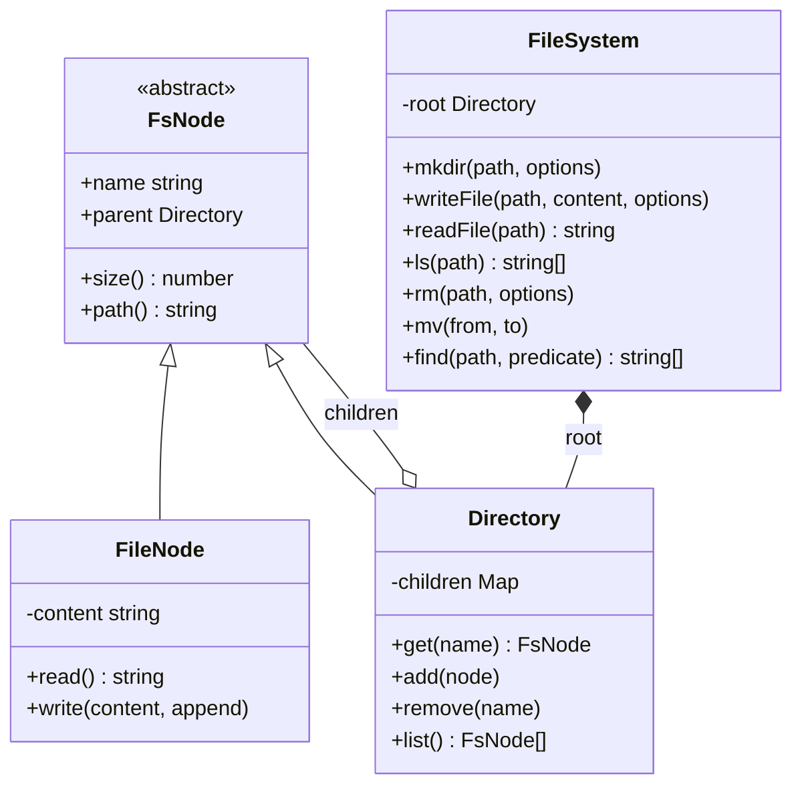
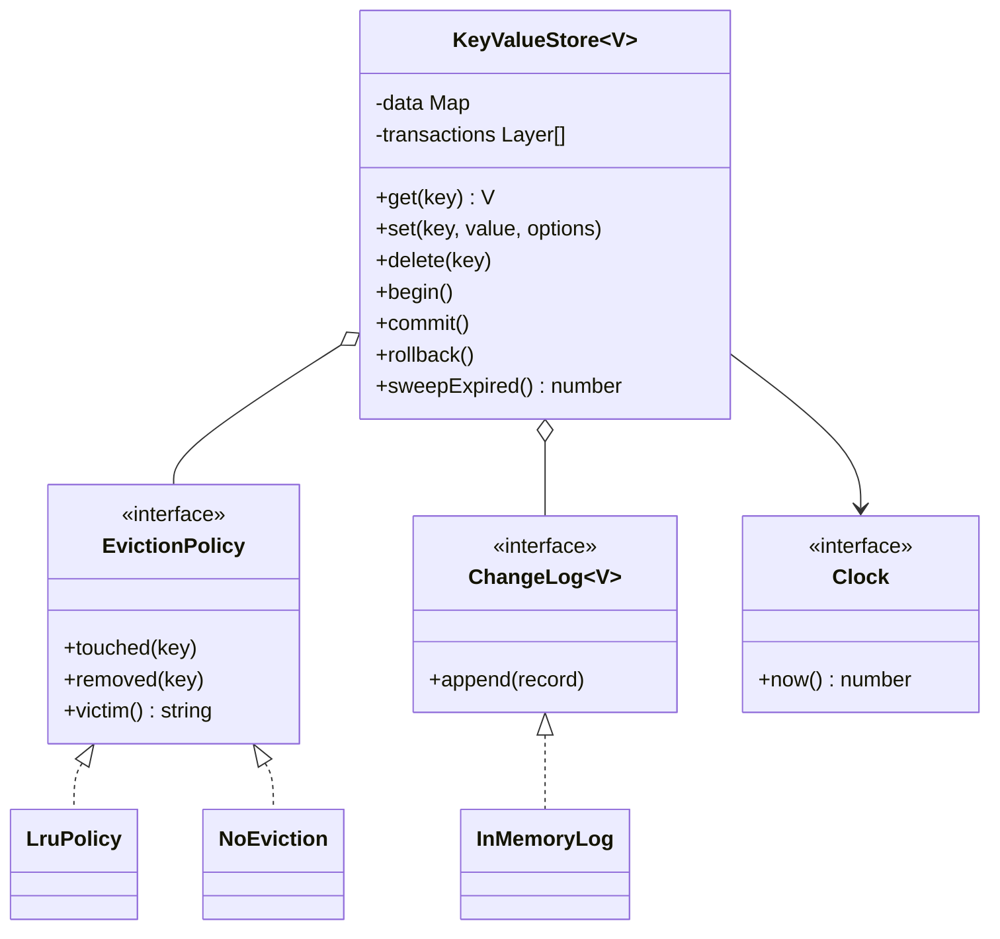
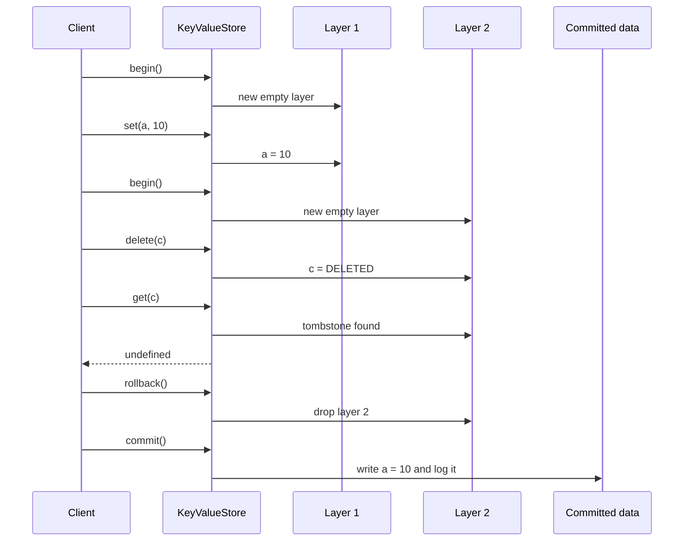

# In-Memory File System and Key-Value Store

> In this document you will design two "storage" LLD problems: an in-memory file system (directories, files, paths, `mkdir`, `ls`, `mv`, `rm`, `find`) and an in-memory key-value store (get/set/delete, expiry with TTL, nested transactions, eviction and a change log for durability). Both test the same skills: a clean data model, precise error handling, and knowing exactly where concurrency and durability problems start.

**Before this:** [How to approach LLD interviews](01-how-to-approach-lld-interviews.md) · [Structural patterns (Composite)](../04-oop-solid-design-patterns/07-structural-patterns.md) · [LRU cache implementations](../11-coding-interviews/04-javascript-polyfills-and-implementations.md) · **Interview questions:** [jump to the interview section](#interview-questions)

## Table of contents

1. [Problem](#problem)
2. [Clarifying questions](#clarifying-questions)
3. [Requirements](#requirements)
4. [Core entities and relationships](#core-entities-and-relationships)
5. [Design decisions and patterns](#design-decisions-and-patterns)
6. [Implementation](#implementation)
7. [Walkthrough](#walkthrough)
8. [Handling concurrency and edge cases](#handling-concurrency-and-edge-cases)
9. [Extensions](#extensions)
10. [How to present this in the interview](#how-to-present-this-in-the-interview)
11. [Interview questions](#interview-questions)
12. [Summary](#summary)
13. [References](#references)

---

## Problem

These are two separate prompts. They are in one document because the thinking is very similar: both are "a data structure with an API", and both grow toward persistence and concurrency.

> **File system:** "Design an in-memory file system. Support `mkdir` (with an option to create parent directories), `writeFile` (create or overwrite, with an append option), `readFile`, `ls`, `rm` (with a recursive option), `mv`, and a way to find files by name. Paths are Unix-style, like `/home/asha/notes.txt`, and may contain `.` and `..`."

> **Key-value store:** "Design an in-memory key-value store like a tiny Redis. Support `get`, `set` and `delete`. Keys can have a time-to-live (TTL). Support transactions with `begin`, `commit` and `rollback`, and transactions can be nested. The store has a maximum size and must evict keys when full. Bonus: the data should survive a restart."

The file system tests **tree modelling** (Composite pattern), **path handling** and **error design**. The key-value store tests **layered state** (transactions), **time** (TTL), **policies** (eviction as a Strategy) and **durability** (a log). This is an LLD round: we write the classes and code, not a distributed database. For the distributed version, see [system design](../09-system-design/01-system-design-interview-approach.md).

---

## Clarifying questions

### File system

| Question | Why it matters | Assumed answer |
|---|---|---|
| Absolute paths only, or also relative paths with a current directory? | Path parsing and state. | Absolute only. A current directory (`cd`) is an extension. |
| Do we handle `.` and `..`? | Path normalization. | Yes. `..` at the root stays at the root, like Unix. |
| What happens when writing to an existing file? | Overwrite vs error. | Overwrite by default; `append: true` appends. |
| Does `writeFile` create missing parent directories? | Behavior of a common call. | No, the parent must exist (like Node's `fs.writeFile`). |
| `rm` on a non-empty directory? | Safety. | Error unless `recursive: true`. |
| `mv` onto an existing name? | Overwrite vs error. | Error. Overwrite is an extension. |
| Do we need permissions, timestamps, symbolic links? | Scope. | Not now. Mentioned as extensions. |
| File content: text or binary? | Data type and size. | Text strings. Size = number of characters. |
| How are errors reported? | API design. | Exceptions with Unix-style codes (`ENOENT`, `EEXIST`, `ENOTDIR`, `EISDIR`, `ENOTEMPTY`, `EINVAL`). |

### Key-value store

| Question | Why it matters | Assumed answer |
|---|---|---|
| Value type? | Generics and serialization. | Generic `V`; demo with strings. |
| TTL precision and how expired keys disappear? | Lazy vs active expiry. | Milliseconds. Expired keys are invisible immediately; they are removed on read (lazy) and by a sweep (active). |
| Transaction semantics: nested? What does `get` see inside? | The core of the problem. | Nested. Inside a transaction you see your own uncommitted changes. Commit of an inner transaction merges into the outer one. Rollback discards only the innermost. |
| Is it multi-client? Isolation between clients? | Huge scope difference. | One client (one transaction stack). Multi-client isolation is discussed as an extension. |
| What happens when full? | Eviction policy. | Configurable: LRU (least recently used), or no eviction (reject new keys). |
| Durability? | Persistence design. | Every committed change goes to an append-only log; the store can be rebuilt from it. |
| Time source? | Testability. | An injected clock, so TTL tests do not sleep. |

---

## Requirements

### Functional requirements

**File system**

1. `mkdir(path, { recursive })`: create a directory; with `recursive`, create missing parents and ignore an existing directory.
2. `writeFile(path, content, { append })`, `readFile(path)`.
3. `ls(path)`: sorted names of a directory's children (directories end with `/`); for a file, its own name.
4. `rm(path, { recursive })`; the root cannot be removed.
5. `mv(from, to)`: move or rename; a directory cannot move into itself.
6. `size(path)`: file length, or the total for a directory.
7. `find(path, predicate)`: all paths below `path` that match.
8. Clear error codes for every invalid operation.

**Key-value store**

1. `get`, `set(key, value, { ttlMs })`, `delete`.
2. Expired keys behave as if they do not exist.
3. `begin`, `commit`, `rollback`, nested.
4. A capacity limit with a pluggable eviction policy.
5. A change log of committed writes and removals; `fromLog` rebuilds the store.

### Non-functional requirements

- **Performance:** path lookups O(depth of the path); key-value operations O(1) on average (LRU included).
- **Correctness:** invalid operations change nothing (validate first, then write).
- **Extensibility:** new node types (symbolic link), new eviction policies, new log targets (file, network) without changing the core.
- **Testability:** time is injected; no `sleep` in tests.
- **Concurrency:** safe under concurrent callers; we explain what "safe" means in Node.js and in multi-threaded languages.

---

## Core entities and relationships

### File system

| Entity | Responsibility |
|---|---|
| `FsNode` (abstract) | Common to files and directories: `name`, `parent`, `size()`, `path()`. |
| `FileNode` | Holds content; `read`, `write(content, append)`. |
| `Directory` | Holds children in a `Map<string, FsNode>`; `add`, `remove`, `list`, `isEmpty`; size is the sum of children. |
| `FileSystem` | The public API. Parses paths, finds nodes, enforces rules, throws `FsError`. |
| `FsError` | An error with a code (`ENOENT`, ...). |



The arrow `Directory o-- FsNode` is the heart of the **Composite pattern**: a directory contains nodes, and a node can be a file **or another directory**. That one relationship gives you a tree of any depth.

### Key-value store

| Entity | Responsibility |
|---|---|
| `KeyValueStore<V>` | The public API and the committed data (`Map<string, Entry<V>>`). |
| `Entry<V>` | `value` + `expiresAt` (or `null` for no expiry). |
| Transaction layer | A `Map` of uncommitted changes per open transaction; a `DELETED` tombstone marks deletes. |
| `EvictionPolicy` (interface) | `touched`, `removed`, `victim`. `LruPolicy` and `NoEviction` implement it. |
| `ChangeLog<V>` (interface) | `append(record)`. `InMemoryLog` here; a file-based log in production. |
| `LogRecord<V>` | `SET` (key, value, expiresAt) or `DELETE` (key). |
| `Clock` | `now()` in milliseconds; injected. |



---

## Design decisions and patterns

### Decision 1: Composite for files and directories

Many file system operations must work the same way on a file and on a directory: get the size, get the path, move it, remove it. The **Composite pattern** says: give the leaf (`FileNode`) and the container (`Directory`) a common type (`FsNode`), and let the container hold children of that common type. Then `size()` on a directory is simply "sum of `size()` of my children", and it works for any depth without special cases. See [Composite](../04-oop-solid-design-patterns/07-structural-patterns.md).

Here inheritance (`extends FsNode`) is a good fit, because files and directories really **are** kinds of node and share real state (`name`, `parent`) and behavior (`path()`). This is different from the games document, where a shared base class would have been forced.

### Decision 2: children in a Map, parent pointer on each node

`Directory` stores children in a `Map<string, FsNode>`: lookup by name is O(1), so resolving `/a/b/c` costs O(number of segments). Each node also keeps a `parent` pointer, which makes `path()`, `rm` and `mv` easy (no searching from the root). The cost is that `mv` must update both sides: remove from the old parent, rename, add to the new parent (which sets `parent`).

`ls` sorts names when asked. If listings were very frequent and directories huge, a sorted structure would be better; for an interview, sort on read.

### Decision 3: path parsing is a separate, pure function

`parsePath("/a/./b/../c/")` returns `["a", "c"]`. It does not touch the tree, so it is trivial to test, and every operation uses it. Keeping parsing separate from lookup also prevents a classic bug: handling `..` differently in different methods.

### Decision 4: one facade with Unix-like errors

`FileSystem` is a **facade**: callers never touch `Directory` or `FileNode` directly. All rules live in one place: "parent must exist", "cannot remove root", "cannot move into itself". Errors carry stable codes (`ENOENT`, `EEXIST`, ...) like Node's `fs` module, so callers can branch on `error.code` instead of parsing messages.

### Decision 5: the key-value store keeps transactions as layers

A transaction is a `Map` of changes **on top of** the committed data. Nested transactions are a **stack** of these maps. Reading a key checks the layers from the newest down to the committed data; the first layer that knows the key wins. A delete inside a transaction writes a **tombstone** (`DELETED`), because "key removed in this transaction" is different from "this transaction does not know the key". Commit merges the top layer into the next one down (or into the real data); rollback just drops the top layer. This is cheap: a transaction costs memory only for the keys it changes.

### Decision 6: TTL with lazy and active expiry

Each entry stores an absolute `expiresAt` timestamp from an injected clock. Two mechanisms together:

- **Lazy expiry:** `get` checks the timestamp and removes an expired key when it sees one. Cheap, but keys that are never read stay in memory.
- **Active expiry:** `sweepExpired()` scans and removes expired keys; a timer calls it periodically.

Redis uses this same combination (it samples keys instead of scanning all of them). See [caching strategies](../09-system-design/03-caching-strategies-and-invalidation.md).

### Decision 7: eviction is a Strategy

When the store is full, **which** key to remove is a policy: LRU (least recently used), LFU (least frequently used), "reject new writes", and so on. The store calls `touched(key)` on every read and write, `removed(key)` on every removal, and `victim()` when it needs space. `LruPolicy` uses the fact that a JavaScript `Map` remembers insertion order: delete and re-insert a key to move it to the end; the first key is the least recently used. All three operations are O(1). For the classic hash map + doubly linked list version, see [LRU cache](../11-coding-interviews/04-javascript-polyfills-and-implementations.md) and [linked lists](../12-dsa/07-linked-lists.md).

### Decision 8: durability through an append-only log

Every committed change (set, delete, eviction, expiry removal) is appended to a `ChangeLog`. After a crash, replaying the log in order rebuilds the same state. This is the idea behind a **write-ahead log** (WAL) in databases and Redis's **append-only file** (AOF). Two important details:

- The log records **removals caused by eviction and expiry** too. If it did not, replay would rebuild a store with keys that the live store had already removed, and could exceed the capacity.
- Replay applies records **exactly**; it does not re-run eviction decisions, because the live store's decisions depended on reads that are not in the log.

Uncommitted transaction changes are **not** logged. Only commit makes them durable.

| Problem | Pattern / principle | Benefit |
|---|---|---|
| Files and directories treated the same | Composite | `size`, `path`, `rm`, `mv` work at any depth. |
| Many rules on one tree | Facade (`FileSystem`) | One place for validation and errors. |
| Walking the tree | Iterator (generator `walk`) | Lazy traversal; `find`, `tree`, `du` built on top. |
| Nested transactions | Stack of change layers + tombstones | Cheap begin, O(changes) commit, O(1) rollback. |
| Which key to evict | Strategy (`EvictionPolicy`) | LRU, LFU, no-eviction swappable. |
| Survive restarts | Append-only log (WAL / AOF) | Replay rebuilds state. |
| Time-based expiry in tests | Injected `Clock` | No sleeping in tests. |

---

## Implementation

Both designs are in one runnable TypeScript file: the file system (nodes → path parsing → service), then the key-value store (building blocks → store), then a demo. It runs with Node.js 22 (`node fskv.ts`) and passes `tsc --strict`. We use `as const` objects instead of `enum`, and normal fields instead of constructor parameter properties, so that Node's type stripping can run the file. (`abstract` classes are fine: Node simply removes the keyword.)

### Step 1: errors and nodes

```ts
// ---------- Step 1: file system errors and nodes (Composite) ----------
const FsErrorCode = {
  NOT_FOUND: "ENOENT",
  ALREADY_EXISTS: "EEXIST",
  NOT_A_DIRECTORY: "ENOTDIR",
  IS_A_DIRECTORY: "EISDIR",
  NOT_EMPTY: "ENOTEMPTY",
  INVALID: "EINVAL",
} as const;
type FsErrorCode = (typeof FsErrorCode)[keyof typeof FsErrorCode];

class FsError extends Error {
  readonly code: FsErrorCode;
  constructor(code: FsErrorCode, message: string) {
    super(`${code}: ${message}`);
    this.name = "FsError";
    this.code = code;
  }
}

abstract class FsNode {
  name: string;
  parent: Directory | null;

  constructor(name: string, parent: Directory | null) {
    this.name = name;
    this.parent = parent;
  }

  abstract size(): number;

  path(): string {
    if (!this.parent) return "/";
    const parentPath = this.parent.path();
    return parentPath === "/" ? `/${this.name}` : `${parentPath}/${this.name}`;
  }
}

class FileNode extends FsNode {
  private content = "";

  read(): string {
    return this.content;
  }

  write(content: string, append: boolean): void {
    this.content = append ? this.content + content : content;
  }

  size(): number {
    return this.content.length;
  }
}

class Directory extends FsNode {
  private readonly children = new Map<string, FsNode>();

  get(name: string): FsNode | undefined {
    return this.children.get(name);
  }

  add(node: FsNode): void {
    if (this.children.has(node.name)) throw new FsError(FsErrorCode.ALREADY_EXISTS, node.path());
    this.children.set(node.name, node);
    node.parent = this;
  }

  remove(name: string): void {
    this.children.delete(name);
  }

  list(): FsNode[] {
    return [...this.children.values()].sort((a, b) => a.name.localeCompare(b.name));
  }

  isEmpty(): boolean {
    return this.children.size === 0;
  }

  // Composite: a directory's size is the sum of its children's sizes.
  size(): number {
    let total = 0;
    for (const child of this.children.values()) total += child.size();
    return total;
  }
}
```

Notes:

- `FsErrorCode` uses the same codes as Unix and Node's `fs` module. A caller can write `if (error.code === "ENOENT")`, which is stable even if the message text changes.
- `name` and `parent` are not `readonly`, because `mv` renames and re-parents a node. Everything else is private.
- `path()` walks up through parents. It is O(depth). If paths were needed very often, you could cache them, but then every `mv` of a directory must invalidate the cache for the whole subtree. Computing on demand is simpler and always correct.
- `Directory.add` sets the child's `parent`, so the two sides of the relationship can never disagree.

### Step 2: path parsing

```ts
// ---------- Step 2: path parsing ----------
// "/a/./b/../c/" -> ["a", "c"]. Only absolute paths are accepted.
function parsePath(path: string): string[] {
  if (!path.startsWith("/")) throw new FsError(FsErrorCode.INVALID, `Path must be absolute: ${path}`);
  const parts: string[] = [];
  for (const segment of path.split("/")) {
    if (segment === "" || segment === ".") continue;
    if (segment === "..") parts.pop(); // ".." at the root stays at the root, like Unix
    else parts.push(segment);
  }
  return parts;
}
```

One pure function handles `.`, `..`, double slashes and a trailing slash. Every method of the file system calls it, so normalization is consistent everywhere.

### Step 3: the file system service

```ts
// ---------- Step 3: the file system service ----------
class FileSystem {
  private readonly root = new Directory("", null);

  mkdir(path: string, options: { recursive?: boolean } = {}): void {
    const parts = parsePath(path);
    let dir = this.root;
    parts.forEach((name, i) => {
      const existing = dir.get(name);
      const isLast = i === parts.length - 1;
      if (existing instanceof Directory) {
        if (isLast && !options.recursive) throw new FsError(FsErrorCode.ALREADY_EXISTS, existing.path());
        dir = existing;
      } else if (existing) {
        throw new FsError(FsErrorCode.NOT_A_DIRECTORY, existing.path());
      } else {
        if (!isLast && !options.recursive) {
          throw new FsError(FsErrorCode.NOT_FOUND, `${dir.path()} has no ${name}`);
        }
        const created = new Directory(name, dir);
        dir.add(created);
        dir = created;
      }
    });
  }

  writeFile(path: string, content: string, options: { append?: boolean } = {}): void {
    const { parent, name } = this.parentOf(path);
    const existing = parent.get(name);
    if (existing instanceof Directory) throw new FsError(FsErrorCode.IS_A_DIRECTORY, existing.path());
    const file = existing instanceof FileNode ? existing : new FileNode(name, parent);
    if (!existing) parent.add(file);
    file.write(content, options.append ?? false);
  }

  readFile(path: string): string {
    const node = this.nodeAt(path);
    if (node instanceof Directory) throw new FsError(FsErrorCode.IS_A_DIRECTORY, node.path());
    return (node as FileNode).read();
  }

  // Like `ls`: a directory lists its children; a file lists itself.
  ls(path: string): string[] {
    const node = this.nodeAt(path);
    if (node instanceof Directory) return node.list().map((c) => (c instanceof Directory ? `${c.name}/` : c.name));
    return [node.name];
  }

  rm(path: string, options: { recursive?: boolean } = {}): void {
    const node = this.nodeAt(path);
    if (!node.parent) throw new FsError(FsErrorCode.INVALID, "Cannot remove the root");
    if (node instanceof Directory && !node.isEmpty() && !options.recursive) {
      throw new FsError(FsErrorCode.NOT_EMPTY, node.path());
    }
    node.parent.remove(node.name);
    node.parent = null;
  }

  mv(from: string, to: string): void {
    const node = this.nodeAt(from);
    if (!node.parent) throw new FsError(FsErrorCode.INVALID, "Cannot move the root");
    const { parent: target, name } = this.parentOf(to);
    // A directory cannot be moved inside itself: walk up from the target.
    for (let d: Directory | null = target; d; d = d.parent) {
      if (d === node) throw new FsError(FsErrorCode.INVALID, `Cannot move ${node.path()} into itself`);
    }
    if (target.get(name)) throw new FsError(FsErrorCode.ALREADY_EXISTS, `${target.path()}/${name}`);
    node.parent.remove(node.name);
    node.name = name;
    target.add(node);
  }

  size(path: string): number {
    return this.nodeAt(path).size();
  }

  // Iterator over every node below a path (depth-first), so callers can filter lazily.
  *walk(path = "/"): Generator<FsNode> {
    const start = this.nodeAt(path);
    const stack: FsNode[] = [start];
    while (stack.length > 0) {
      const node = stack.pop() as FsNode;
      yield node;
      if (node instanceof Directory) stack.push(...node.list().reverse());
    }
  }

  find(path: string, predicate: (node: FsNode) => boolean): string[] {
    const result: string[] = [];
    for (const node of this.walk(path)) if (predicate(node)) result.push(node.path());
    return result;
  }

  private nodeAt(path: string): FsNode {
    let node: FsNode = this.root;
    for (const name of parsePath(path)) {
      if (!(node instanceof Directory)) throw new FsError(FsErrorCode.NOT_A_DIRECTORY, node.path());
      const child = node.get(name);
      if (!child) throw new FsError(FsErrorCode.NOT_FOUND, path);
      node = child;
    }
    return node;
  }

  private parentOf(path: string): { parent: Directory; name: string } {
    const parts = parsePath(path);
    const name = parts.pop();
    if (!name) throw new FsError(FsErrorCode.INVALID, "Path points to the root");
    const parent = this.nodeAt("/" + parts.join("/"));
    if (!(parent instanceof Directory)) throw new FsError(FsErrorCode.NOT_A_DIRECTORY, parent.path());
    return { parent, name };
  }
}
```

How to read this class:

- Two private helpers do all the lookups. `nodeAt(path)` walks the segments and fails with `ENOENT` (missing) or `ENOTDIR` (walking "through" a file). `parentOf(path)` returns the directory that should contain the last segment, plus that segment's name; `writeFile` and `mv` need exactly this.
- `mkdir` walks the segments once. Existing directories are reused; a missing **parent** is an error unless `recursive`; an existing **last** directory is an error unless `recursive` (like `mkdir -p`).
- `writeFile` creates the file if it is missing, overwrites or appends if it exists, and refuses to overwrite a directory.
- `rm` refuses the root and non-empty directories unless `recursive`. Removing a directory removes its whole subtree in O(1): we unlink it from its parent and the garbage collector frees the rest.
- `mv` walks **up** from the target directory. If it meets the node being moved, the move would put a directory inside itself (and disconnect it from the tree), so it is rejected.
- `walk` is a **generator**: it yields nodes one at a time using an explicit stack (no recursion, so very deep trees cannot overflow the call stack). `find` is built on it. Because it is lazy, a caller can stop early, for example "find the first match".

### Step 4: key-value store building blocks

```ts
// ---------- Step 4: key-value store building blocks ----------
interface Clock {
  now(): number; // milliseconds
}

interface Entry<V> {
  readonly value: V;
  readonly expiresAt: number | null;
}

// Strategy: which key to throw out when the store is full.
interface EvictionPolicy {
  touched(key: string): void; // read or written
  removed(key: string): void;
  victim(): string | undefined;
}

// Least recently used. A Map remembers insertion order, so delete + set moves a key to the end.
class LruPolicy implements EvictionPolicy {
  private readonly order = new Map<string, true>();
  touched(key: string): void {
    this.order.delete(key);
    this.order.set(key, true);
  }
  removed(key: string): void {
    this.order.delete(key);
  }
  victim(): string | undefined {
    return this.order.keys().next().value;
  }
}

// Never evict. A full store rejects new keys instead.
class NoEviction implements EvictionPolicy {
  touched(): void {}
  removed(): void {}
  victim(): string | undefined {
    return undefined;
  }
}

// Every committed change, in order. Replaying the log rebuilds the store.
type LogRecord<V> =
  | { readonly op: "SET"; readonly key: string; readonly value: V; readonly expiresAt: number | null }
  | { readonly op: "DELETE"; readonly key: string };

interface ChangeLog<V> {
  append(record: LogRecord<V>): void;
}

class InMemoryLog<V> implements ChangeLog<V> {
  readonly records: LogRecord<V>[] = [];
  append(record: LogRecord<V>): void {
    this.records.push(record);
  }
}
```

`LruPolicy` relies on a guarantee of JavaScript's `Map`: iteration follows insertion order. `touched` deletes and re-inserts the key, moving it to the end; `victim` returns the first key, which is the least recently used. Every method is O(1).

`LogRecord<V>` is a discriminated union on `op`. A `SET` record carries the **absolute** expiry time, not the TTL, so replaying it later gives the same expiry moment instead of a fresh TTL.

### Step 5: the key-value store

```ts
// ---------- Step 5: the key-value store with TTL, transactions and eviction ----------
const DELETED = Symbol("deleted"); // tombstone inside a transaction
type Layer<V> = Map<string, Entry<V> | typeof DELETED>;

interface StoreOptions<V> {
  readonly clock: Clock;
  readonly capacity?: number;
  readonly eviction?: EvictionPolicy;
  readonly log?: ChangeLog<V>;
}

class KeyValueStore<V> {
  private readonly data = new Map<string, Entry<V>>();
  private readonly transactions: Layer<V>[] = [];
  private readonly clock: Clock;
  private readonly capacity: number;
  private readonly eviction: EvictionPolicy;
  private readonly log: ChangeLog<V> | null;

  constructor(options: StoreOptions<V>) {
    this.clock = options.clock;
    this.capacity = options.capacity ?? Infinity;
    this.eviction = options.eviction ?? new NoEviction();
    this.log = options.log ?? null;
  }

  get(key: string): V | undefined {
    // Newest transaction first, then the committed data.
    for (let i = this.transactions.length - 1; i >= 0; i--) {
      const entry = this.transactions[i].get(key);
      if (entry === DELETED) return undefined;
      if (entry) return this.isExpired(entry) ? undefined : entry.value;
    }
    const entry = this.data.get(key);
    if (!entry) return undefined;
    if (this.isExpired(entry)) {
      this.removeCommitted(key); // lazy expiry: clean up on read
      return undefined;
    }
    this.eviction.touched(key);
    return entry.value;
  }

  set(key: string, value: V, options: { ttlMs?: number } = {}): void {
    const expiresAt = options.ttlMs === undefined ? null : this.clock.now() + options.ttlMs;
    this.write(key, { value, expiresAt });
  }

  delete(key: string): void {
    this.write(key, DELETED);
  }

  begin(): void {
    this.transactions.push(new Map());
  }

  commit(): void {
    const top = this.transactions.pop();
    if (!top) throw new Error("No transaction to commit");
    // Nested: merge into the parent transaction. Outermost: apply to the real data.
    for (const [key, entry] of top) this.write(key, entry);
  }

  rollback(): void {
    if (!this.transactions.pop()) throw new Error("No transaction to roll back");
  }

  // Active cleanup, e.g. called by a timer every second.
  sweepExpired(): number {
    let removed = 0;
    for (const [key, entry] of this.data) {
      if (this.isExpired(entry)) {
        this.removeCommitted(key);
        removed += 1;
      }
    }
    return removed;
  }

  committedSize(): number {
    return this.data.size;
  }

  // Rebuild a store from a change log (for example after a restart).
  // Replay applies records exactly. It does not re-run eviction: evictions are in the log as DELETEs.
  static fromLog<V>(records: readonly LogRecord<V>[], options: StoreOptions<V>): KeyValueStore<V> {
    const store = new KeyValueStore<V>(options);
    for (const r of records) {
      if (r.op === "SET") {
        store.data.set(r.key, { value: r.value, expiresAt: r.expiresAt });
        store.eviction.touched(r.key);
      } else {
        store.data.delete(r.key);
        store.eviction.removed(r.key);
      }
    }
    return store;
  }

  private write(key: string, entry: Entry<V> | typeof DELETED): void {
    const top = this.transactions[this.transactions.length - 1];
    if (top) {
      top.set(key, entry);
      return;
    }
    if (entry === DELETED) {
      if (this.data.has(key)) this.removeCommitted(key);
      return;
    }
    if (!this.data.has(key) && this.data.size >= this.capacity) this.makeRoom();
    this.data.set(key, entry);
    this.eviction.touched(key);
    this.log?.append({ op: "SET", key, value: entry.value, expiresAt: entry.expiresAt });
  }

  private makeRoom(): void {
    const victim = this.eviction.victim();
    if (victim === undefined) throw new Error("Store is full");
    this.removeCommitted(victim);
  }

  // Every removal is logged (delete, eviction, expiry), so a replay ends in the same state.
  private removeCommitted(key: string): void {
    this.data.delete(key);
    this.eviction.removed(key);
    this.log?.append({ op: "DELETE", key });
  }

  private isExpired(entry: Entry<V>): boolean {
    return entry.expiresAt !== null && entry.expiresAt <= this.clock.now();
  }
}
```

The important paths:

- **`get`** checks transaction layers from the newest to the oldest. A tombstone means "deleted in this transaction". If no layer knows the key, it reads committed data, applies lazy expiry, and tells the eviction policy that the key was used.
- **`write`** is the single place that changes state. Inside a transaction it only records the change in the top layer. Outside, it either removes the key or stores it, making room first if the store is full and the key is new (updating an existing key does not need room). Every committed change goes to the log.
- **`commit`** pops the top layer and replays its changes through `write`. If another transaction is still open, `write` puts them into **that** layer; otherwise they reach the committed data. This one line makes nested commit work.
- **`rollback`** just drops the top layer. O(1).
- **`fromLog`** applies records directly to the map. It does not call `write`, so it does not re-run eviction; the log already contains the evictions as `DELETE` records.

### Step 6: the demo

```ts
// ---------- Step 6: demo ----------
function attempt(label: string, action: () => void): void {
  try {
    action();
    console.log(`${label}: ok`);
  } catch (error) {
    console.log(`${label}: ${(error as Error).message}`);
  }
}

function main(): void {
  console.log("=== File system ===");
  const fs = new FileSystem();
  fs.mkdir("/home/asha/docs", { recursive: true });
  fs.writeFile("/home/asha/docs/notes.txt", "hello");
  fs.writeFile("/home/asha/docs/notes.txt", " world", { append: true });
  fs.writeFile("/home/asha/todo.md", "- buy milk");
  fs.mkdir("/tmp");
  console.log(fs.readFile("/home/asha/./docs/../docs/notes.txt"));
  console.log(fs.ls("/home/asha"));
  console.log("size of /home:", fs.size("/home"));

  attempt("mkdir /tmp again", () => fs.mkdir("/tmp"));
  attempt("mkdir /a/b without recursive", () => fs.mkdir("/a/b"));
  attempt("read a directory", () => fs.readFile("/home"));
  attempt("write under a file", () => fs.writeFile("/home/asha/todo.md/x", "?"));
  attempt("rm non-empty dir", () => fs.rm("/home/asha"));
  attempt("move dir into itself", () => fs.mv("/home", "/home/asha/home"));

  fs.mv("/home/asha/todo.md", "/tmp/todo-old.md");
  console.log("after mv:", fs.ls("/tmp"), fs.ls("/home/asha"));
  console.log("find *.txt and *.md:", fs.find("/", (n) => /\.(txt|md)$/.test(n.name)));
  fs.rm("/home", { recursive: true });
  console.log("after rm -r /home:", fs.ls("/"));

  console.log("=== Key-value store ===");
  let time = 1_000;
  const clock: Clock = { now: () => time };
  const log = new InMemoryLog<string>();
  const kv = new KeyValueStore<string>({ clock, capacity: 3, eviction: new LruPolicy(), log });

  kv.set("a", "1");
  kv.set("b", "2");
  kv.set("session", "xyz", { ttlMs: 500 });
  console.log("session now:", kv.get("session"));
  time += 600;
  console.log("session after 600 ms:", kv.get("session"), "| size:", kv.committedSize());

  kv.get("a"); // a is now the most recently used
  kv.set("c", "3");
  kv.set("d", "4"); // full: evicts the least recently used, which is b
  console.log("after eviction: a =", kv.get("a"), "b =", kv.get("b"), "d =", kv.get("d"));

  kv.begin();
  kv.set("a", "10");
  kv.begin();
  kv.delete("c");
  console.log("inner txn: a =", kv.get("a"), "c =", kv.get("c"));
  kv.rollback();
  console.log("after inner rollback: c =", kv.get("c"));
  kv.commit();
  console.log("after commit: a =", kv.get("a"));

  kv.begin();
  kv.set("d", "40");
  kv.rollback();
  console.log("after rollback: d =", kv.get("d"));

  const restored = KeyValueStore.fromLog(log.records, { clock, capacity: 3, eviction: new LruPolicy() });
  console.log("log records:", log.records.length, "| restored size:", restored.committedSize(), "| a, c, d =", restored.get("a"), restored.get("c"), restored.get("d"));

  const strict = new KeyValueStore<number>({ clock, capacity: 1 });
  strict.set("x", 1);
  attempt("set y in a full store with no eviction", () => strict.set("y", 2));
}

main();

// Output:
// === File system ===
// hello world
// [ 'docs/', 'todo.md' ]
// size of /home: 21
// mkdir /tmp again: EEXIST: /tmp
// mkdir /a/b without recursive: ENOENT: / has no a
// read a directory: EISDIR: /home
// write under a file: ENOTDIR: /home/asha/todo.md
// rm non-empty dir: ENOTEMPTY: /home/asha
// move dir into itself: EINVAL: Cannot move /home into itself
// after mv: [ 'todo-old.md' ] [ 'docs/' ]
// find *.txt and *.md: [ '/home/asha/docs/notes.txt', '/tmp/todo-old.md' ]
// after rm -r /home: [ 'tmp/' ]
// === Key-value store ===
// session now: xyz
// session after 600 ms: undefined | size: 2
// after eviction: a = 1 b = undefined d = 4
// inner txn: a = 10 c = undefined
// after inner rollback: c = 3
// after commit: a = 10
// after rollback: d = 4
// log records: 8 | restored size: 3 | a, c, d = 10 3 4
// set y in a full store with no eviction: Store is full
```

What the output shows:

- Path normalization: `/home/asha/./docs/../docs/notes.txt` resolves to the same file. Append works (`hello world`). Directory size is the sum of files (11 + 10 = 21).
- Each invalid operation fails with the right code and changes nothing.
- `mv` renames and re-parents in one step; `find` walks the whole tree lazily; `rm -r` removes a subtree.
- TTL: the session key disappears after 600 ms of **fake** time. No sleeping.
- LRU: reading `a` makes it recent, so adding `d` to a full store evicts `b`.
- Nested transactions: the inner delete is visible inside, disappears after the inner rollback; the outer commit makes `a = 10` permanent; a rolled-back change to `d` never happens.
- The log has 8 records (including the expiry of `session` and the eviction of `b`), and replaying it gives the same 3 keys.
- With `NoEviction`, a full store rejects new keys instead of silently dropping old ones.

---

## Walkthrough

### Nested transactions in the key-value store

This is a good flow to trace on the board, so practise it. Start state: committed data has `a = 1`, `c = 3`.



Step by step:

1. `begin()` pushes layer 1. `set(a, 10)` goes into layer 1 only; committed `a` is still 1.
2. `begin()` pushes layer 2. `delete(c)` writes a tombstone into layer 2.
3. `get(c)` checks layer 2 first, finds the tombstone, returns `undefined`.
4. `rollback()` drops layer 2. Now `get(c)` checks layer 1 (does not know `c`), then committed data: `3`.
5. `commit()` pops layer 1 and writes `a = 10` through `write`. No transaction is open, so it reaches the committed data, the eviction policy and the log.

### Moving a directory in the file system

`mv("/home/asha/todo.md", "/tmp/todo-old.md")`:

1. `nodeAt("/home/asha/todo.md")` walks `home` → `asha` → `todo.md`. Found.
2. `parentOf("/tmp/todo-old.md")` returns the `/tmp` directory and the new name `todo-old.md`.
3. Walk up from `/tmp` to the root: the moved node is not an ancestor, so the move is legal.
4. `/tmp` has no `todo-old.md`, so there is no conflict.
5. Remove from `/home/asha`, rename the node, add to `/tmp` (which sets `parent`).

All checks happen before step 5, so a failed `mv` changes nothing.

---

## Handling concurrency and edge cases

### What "thread-safe" means here

In Java or C#, many threads could call `set` at the same moment, and a `HashMap` could be corrupted. You would use a `ConcurrentHashMap`, a read-write lock (many readers or one writer), or **lock striping** (one lock per group of keys) to reduce contention.

In Node.js, our methods are **synchronous**, and JavaScript runs one piece of synchronous code at a time. So every `get`, `set`, `mkdir` or `mv` runs completely before any other request starts. There are no torn writes and no half-moved directories. Say this clearly; it is a real advantage of the design.

The problem starts the moment an operation becomes **asynchronous**, for example "write the change to disk, then reply". Now a read-modify-write like `incr` has an `await` in the middle, and other calls run there:

```ts
// When each operation awaits I/O (for example "write to disk, then reply"), read-modify-write can lose updates.
const values = new Map<string, number>([["visits", 0]]);
const persist = (): Promise<void> => new Promise((resolve) => setTimeout(resolve, 5));

// ❌ Read, await, write: concurrent calls read the same old value.
async function incrBroken(key: string): Promise<void> {
  const current = values.get(key) ?? 0;
  await persist();
  values.set(key, current + 1);
}

// ✅ A tiny async mutex: each operation waits for the previous one to finish.
class AsyncMutex {
  private tail: Promise<void> = Promise.resolve();

  run<T>(task: () => Promise<T>): Promise<T> {
    const result = this.tail.then(task);
    this.tail = result.then(() => undefined, () => undefined); // keep the chain alive after errors
    return result;
  }
}

const mutex = new AsyncMutex();
function incrSafe(key: string): Promise<void> {
  return mutex.run(async () => {
    const current = values.get(key) ?? 0;
    await persist();
    values.set(key, current + 1);
  });
}

async function demo(): Promise<void> {
  await Promise.all(Array.from({ length: 10 }, () => incrBroken("visits")));
  console.log("broken, after 10 increments:", values.get("visits"));
  values.set("visits", 0);
  await Promise.all(Array.from({ length: 10 }, () => incrSafe("visits")));
  console.log("with mutex, after 10 increments:", values.get("visits"));
}

demo().catch((error: unknown) => console.error(error));

// Output:
// broken, after 10 increments: 1
// with mutex, after 10 increments: 10
```

Ten concurrent increments produced **1** in the broken version: all ten read 0 before any wrote. The mutex serializes the operations, which is correct but means one slow disk write delays everyone. Better options in practice:

- **Change memory first, synchronously, then persist in the background** (append to the log buffer, flush in batches). The in-memory operation stays atomic. Redis does this with its AOF and an `fsync` policy (always, every second, or never).
- **One mutex per key** (or per shard) instead of one global mutex, so unrelated keys do not wait for each other.
- **Compare-and-set (CAS):** `set(key, newValue, { ifVersion: 7 })` fails if someone else changed the key since version 7; the caller retries. This is optimistic locking, like Redis `WATCH` + `MULTI`.

See [Concurrency in Node.js](../07-nodejs-backend/12-concurrency-worker-threads-and-cluster.md) for worker threads and shared memory, where real parallel access appears in JavaScript too.

### Transactions with many clients

Our store has **one** transaction stack, so it assumes one client. With many clients, each client needs its **own** stack, and you must decide the **isolation** level: can client B see client A's uncommitted changes (no, never), and what if both change the same key? Common answers:

- **Optimistic:** each transaction remembers the version of every key it read; at commit, if any version changed, the commit fails and the client retries (Redis `WATCH` works like this).
- **Pessimistic:** lock keys when first written, release at commit or rollback. Simpler to reason about, but risks deadlocks (A locks x then wants y; B locks y then wants x), so you need lock ordering or timeouts.

### Edge cases

| Area | Edge case | Handling |
|---|---|---|
| Paths | Relative path `docs/a.txt` | `EINVAL`: absolute paths only. |
| Paths | `/../..` | Stays at the root. |
| Paths | Trailing slash, double slash | Ignored by `parsePath`. |
| mkdir | Directory exists | `EEXIST`, unless `recursive`. |
| mkdir | A file is in the way (`/a/file/b`) | `ENOTDIR`. |
| writeFile | Parent missing | `ENOENT`. |
| writeFile | Target is a directory | `EISDIR`. |
| readFile | Target is a directory | `EISDIR`. |
| rm | Root | `EINVAL`. |
| rm | Non-empty directory | `ENOTEMPTY`, unless `recursive`. |
| mv | Into itself or its own subdirectory | `EINVAL`. |
| mv | Target name exists | `EEXIST`. |
| mv | Same parent, new name | Works: it is a rename. |
| KV | Get an expired key | `undefined`, and the key is removed and logged. |
| KV | Update an existing key in a full store | No eviction needed; it is not a new key. |
| KV | Full store with `NoEviction` | Error "Store is full". |
| KV | `commit` or `rollback` with no transaction | Error. |
| KV | `set` with TTL inside a transaction, commit later | The absolute `expiresAt` is kept, so the TTL counts from the `set`, not the commit. |
| KV | A commit fails halfway (store becomes full) | Our simple version may apply part of the layer. A robust version checks capacity for the whole layer first, or applies all writes to a copy and swaps. Mention it. |
| KV | Log replay after crash in the middle of a write | Each record must be complete; use a length or checksum per record and ignore a torn last record. |

---

## Extensions

### A new operation on the tree, without touching the node classes

Because `walk` exposes the tree as an iterator, new read-only operations (`tree`, `du`, search by size) are just functions on top. Here is a `tree` printer:

```ts
// Add to the implementation: a new operation (print a tree) built on walk(), with no change to the node classes.
function printTree(fileSystem: FileSystem, path: string): void {
  for (const node of fileSystem.walk(path)) {
    const depth = node.path() === "/" ? 0 : node.path().split("/").length - 1;
    const label = !node.parent ? "/" : node instanceof Directory ? `${node.name}/` : `${node.name} (${node.size()} bytes)`;
    console.log(`${"  ".repeat(depth)}${label}`);
  }
}

const disk = new FileSystem();
disk.mkdir("/src/utils", { recursive: true });
disk.writeFile("/src/index.ts", "main();");
disk.writeFile("/src/utils/math.ts", "export {}");
disk.writeFile("/README.md", "# Demo");
printTree(disk, "/");

// Output:
// /
//   README.md (6 bytes)
//   src/
//     index.ts (7 bytes)
//     utils/
//       math.ts (9 bytes)
```

If there were many such operations that need different code per node type, the **Visitor** pattern would be the formal answer: each node gets `accept(visitor)`, each operation is a visitor class. For two node types, `instanceof` inside one function is simpler and easier to read.

### A different eviction policy

Eviction is a Strategy, so LFU (least **frequently** used) plugs in without any change to the store:

```ts
// Add to the implementation: a different eviction strategy, plugged in without touching the store.
class LfuPolicy implements EvictionPolicy {
  private readonly uses = new Map<string, number>();
  touched(key: string): void {
    this.uses.set(key, (this.uses.get(key) ?? 0) + 1);
  }
  removed(key: string): void {
    this.uses.delete(key);
  }
  // O(n) scan for clarity. A production LFU keeps buckets per frequency for O(1).
  victim(): string | undefined {
    let victim: string | undefined;
    let fewest = Infinity;
    for (const [key, count] of this.uses) {
      if (count < fewest) {
        fewest = count;
        victim = key;
      }
    }
    return victim;
  }
}

const cache = new KeyValueStore<string>({ clock: { now: () => 0 }, capacity: 2, eviction: new LfuPolicy() });
cache.set("logo", "png");
cache.set("banner", "jpg");
for (let i = 0; i < 3; i++) cache.get("logo");
cache.get("banner");
cache.set("icon", "svg"); // full: evicts the least frequently used key, banner
console.log("logo:", cache.get("logo"), "| banner:", cache.get("banner"), "| icon:", cache.get("icon"));

// Output:
// logo: png | banner: undefined | icon: svg
```

LRU is a good default for "recent things are likely to be used again". LFU is better when a few keys are popular for a long time and a burst of one-time keys (for example a crawler) should not push them out.

### Other follow-ups

| Follow-up | Change to the design |
|---|---|
| Relative paths and `cd` | Keep a `cwd` (a `Directory` reference) per session; resolve relative paths from it. `parsePath` takes the base path. |
| Permissions | Add `owner`, `mode` to `FsNode`; check in the facade before each operation. A `PermissionChecker` strategy keeps rules out of the nodes. |
| Timestamps (`createdAt`, `modifiedAt`) | Inject a clock into `FileSystem`; set times in `writeFile`, `mkdir`, `mv`. |
| Symbolic links | A new node type `SymlinkNode` with a target path; `nodeAt` follows links, with a hop limit to stop loops (`ELOOP`). Composite makes this a new subclass. |
| Hard links | A file's content becomes a separate object shared by several directory entries, with a link count. |
| Very large files | Store content in fixed-size chunks; `read(offset, length)` reads only needed chunks. |
| Watch for changes | Observer: the facade emits `created`, `deleted`, `moved` events; subscribers register per path. |
| Fast search by name | Keep an index `Map<name, Set<FsNode>>` updated on create/rename/delete; or a trie for prefix search. |
| KV: data types (lists, counters) | Make `V` a union of types, and add type-specific commands (`incr`, `lpush`) that check the stored type (Redis returns `WRONGTYPE`). |
| KV: snapshots | Periodically write the whole map to disk; on restart load the snapshot, then replay only the log written after it. This keeps the log short (log compaction). |
| KV: pub/sub on key changes | Observer on `write`; see [pub/sub](13-pub-sub-and-task-scheduler.md). |
| KV: many machines | Shard keys by hash (consistent hashing) and replicate each shard. This is system design, not LLD; see [system design](../09-system-design/02-scalability-and-core-building-blocks.md). |

---

## How to present this in the interview

### A 45-minute plan for the file system

| Minutes | What you do |
|---|---|
| 0–4 | Clarify: absolute or relative paths, `.` and `..`, overwrite rules, recursive `rm` and `mkdir`, error style. |
| 4–7 | Requirements and the error codes you will use. |
| 7–12 | Class diagram: `FsNode`, `FileNode`, `Directory`, `FileSystem`. Name the Composite pattern and why it fits. |
| 12–15 | `parsePath` and the two lookup helpers, `nodeAt` and `parentOf`. |
| 15–33 | Code: `mkdir`, `writeFile`, `readFile`, `ls`, `rm`, `mv` (with the "into itself" check), `walk`/`find`. |
| 33–38 | Walk through one `mv` and one failing case. |
| 38–45 | Concurrency (sync is atomic in Node; what changes with async persistence) and extensions (symlinks, permissions). |

### A 45-minute plan for the key-value store

| Minutes | What you do |
|---|---|
| 0–4 | Clarify: value types, TTL, nested transaction semantics, eviction, durability, single or multiple clients. |
| 4–10 | Entities: store, entry with `expiresAt`, transaction layers with tombstones, eviction policy, change log, clock. |
| 10–30 | Code: `get` through layers, `write`, `begin`/`commit`/`rollback`, TTL check, LRU policy. |
| 30–36 | Trace the nested transaction example on the board. |
| 36–45 | Durability (log, replay, what must be logged), concurrency (async persistence, CAS, many clients). |

### A short spoken walkthrough (file system)

> "Files and directories share a lot: a name, a parent, a size, a path. So I use the Composite pattern: an abstract `FsNode`, with `FileNode` as the leaf and `Directory` as the container holding a map of child nodes. A directory's size is just the sum of its children's sizes, at any depth.
>
> The public API is a `FileSystem` facade. Every method first normalizes the path with one pure function that handles dot, dot-dot and extra slashes. Two helpers do all lookups: `nodeAt` for the node itself and `parentOf` for the directory that should contain it. All validation happens before any change, and errors use Unix codes like ENOENT and EEXIST, so callers can branch on the code.
>
> The interesting case is `mv`: I walk up from the target directory, and if I meet the node I'm moving, it's an attempt to move a directory into itself, so I reject it. Search is a lazy generator over the tree, so `find` and `tree` are just functions on top."

### A short spoken walkthrough (key-value store)

> "Committed data is a map from key to an entry with a value and an absolute expiry time from an injected clock. Transactions are a stack of change layers on top of it. A read checks layers from newest to oldest, then committed data; a delete inside a transaction writes a tombstone. Commit pops the top layer and writes its changes through the same `write` method, which puts them into the parent layer if one is open, or into committed data. Rollback just drops the layer.
>
> Expiry is lazy on read plus an active sweep. Eviction is a strategy; my LRU uses the insertion order of a JavaScript Map, so everything is O(1). For durability, every committed change, including evictions and expiries, goes to an append-only log, and replaying it rebuilds the same state. In Node each operation is synchronous and therefore atomic; the moment persistence becomes async, I'd change memory first and flush the log in the background, or use per-key locks or compare-and-set."

---

## Interview questions

### Q1. Why did you use the Composite pattern for the file system?

**What the interviewer is checking:** that you know Composite and can explain the concrete benefit, not just name it.

**What to say (30–60 seconds):**
> "A file system is a tree where a directory can contain files and other directories, and many operations must treat both the same way: size, path, move, remove. Composite gives files and directories a common type, `FsNode`, and lets a directory hold children of that type. Then a directory's size is simply the sum of its children's sizes, and that works at any depth without special cases. Adding a new node type, like a symbolic link, is a new subclass. Here inheritance is a good fit because a file and a directory really are kinds of node and share real state, the name and the parent."

**Deeper explanation:** Without Composite, you would write `if (node.type === "dir") ... else ...` in every operation, and recursion would be spread across the code. With Composite, recursive behavior lives inside the container (`Directory.size()` calls `child.size()`), and callers do not care what they hold. The trade-off: the common interface can tempt you to put directory-only methods (like `add`) on the base class. Keep them on `Directory` and check the type in the facade. See [Composite](../04-oop-solid-design-patterns/07-structural-patterns.md).

**Follow-up questions and how to answer them:**
- *"Where else do you see Composite?"* — The DOM (elements contain elements and text nodes), React component trees, UI menus with sub-menus, organization charts, and expression trees in compilers.
- *"Why is `size()` computed on demand and not stored?"* — Storing it means every write must update all ancestors. On-demand is O(subtree) but always correct; cache it only if profiling says so.

**Common mistakes:** a single `Node` class with `isDirectory`, `content` and `children` fields where half are always empty; putting `children` on files.

**Real-project example:** Node's `fs.Dirent` and the browser's `FileSystemHandle` API (`FileSystemFileHandle` and `FileSystemDirectoryHandle`) model the same file/directory split.

### Q2. How do you parse paths with `.` and `..`?

**What the interviewer is checking:** careful string handling and edge cases.

**What to say (30–60 seconds):**
> "I split the path on slashes and walk the segments with a stack. Empty segments and a single dot are skipped. Two dots pop the last segment, and at the root it does nothing, like Unix. Everything else is pushed. So `/a/./b/../c/` becomes `a`, `c`. It's a pure function, separate from the tree, so every operation normalizes paths the same way and I can test it alone. I accept only absolute paths; for relative paths I'd keep a current directory per session and prepend it."

**Deeper explanation:** One subtle point: normalizing `..` **textually** (as we do) and **physically** (by following the real parent) give different results when symbolic links exist. `/link/..` textually is `/`, but physically it is the parent of the link's **target**. Shells and `path.resolve` use the textual rule; the kernel uses the physical one. With no symlinks they agree.

**Follow-up questions and how to answer them:**
- *"What about names with a slash?"* — A slash cannot be part of a name in Unix; `writeFile` would treat it as a path separator. You can validate names in `mkdir` and reject empty names.
- *"Case sensitivity?"* — Linux is case-sensitive; Windows and macOS default file systems are not. A case-insensitive design would store a lowercase key in the map and keep the original name for display.

**Common mistakes:** using regex replacements like `replace("/..", "")`, which break on names like `..hidden`; forgetting the trailing slash; letting `..` go above the root and crash.

**Real-project example:** Node's `path.posix.normalize` and `path.resolve` implement these rules; web servers normalize paths to block `../../etc/passwd` path traversal attacks.

### Q3. What are the tricky cases in `mv` and `rm`?

**What the interviewer is checking:** thinking about tree invariants.

**What to say (30–60 seconds):**
> "For `mv`, the dangerous case is moving a directory into its own subtree, like `/home` into `/home/asha/home`. That would create a cycle and disconnect the subtree from the root. I walk up from the target directory to the root, and if I meet the node I'm moving, I reject it. Other cases: the target name already exists, the source is the root, and a rename in the same directory, which is just a move with a new name. For `rm`, I refuse the root and non-empty directories unless recursive. Recursive removal is O(1) here: I unlink the subtree and the garbage collector frees it."

**Deeper explanation:** The "walk up from the target" check costs O(depth). An alternative is checking if the target path starts with the source path plus `/`, which is a string check but must be done on normalized paths and is easy to get wrong (`/home2` starts with `/home`). In a real disk file system, recursive delete is not O(1): every block must be freed, which is why `rm -rf` on a huge directory takes time.

**Follow-up questions and how to answer them:**
- *"What if `mv` should overwrite?"* — With an `overwrite` flag: if the target is a file, replace it; if it is a non-empty directory, fail (like Unix `rename`).
- *"Is `mv` atomic?"* — In our code, yes: all checks run first and the change is three synchronous steps. In real file systems, `rename` within one disk is atomic; across disks it is a copy plus delete.

**Common mistakes:** forgetting to update `parent`; changing state before all checks pass; allowing removal of the root.

**Real-project example:** POSIX `rename()` returns `EINVAL` when the new path contains the old directory as a prefix, which is the same rule.

### Q4. How do TTLs work, and why both lazy and active expiry?

**What the interviewer is checking:** time handling and memory trade-offs.

**What to say (30–60 seconds):**
> "Each entry stores an absolute `expiresAt` time from an injected clock. Lazy expiry means `get` checks the time and treats an expired key as missing, removing it on the spot. That's cheap and always correct for readers, but a key that's never read again stays in memory forever. So I add active expiry: a periodic sweep removes expired keys. Together, readers never see stale data and memory is reclaimed. Redis does the same, but its active cycle samples random keys with a TTL instead of scanning everything, to keep each cycle short."

**Deeper explanation:** A full scan is O(n), which is fine for a small store but would pause a big one. Options: sample keys (Redis), keep a min-heap ordered by `expiresAt` (pop while the top is expired: O(log n) per key), or a timing wheel (buckets per time slot). Storing absolute times (not "TTL remaining") means replaying the log gives the same expiry moment.

**Follow-up questions and how to answer them:**
- *"Why inject the clock?"* — So tests can move time forward instantly (`time += 600`) instead of sleeping, and so tests are deterministic.
- *"What if the system clock jumps backwards?"* — Use a monotonic clock (`performance.now()`) for TTLs inside one process; wall-clock time only for absolute deadlines that must survive restarts.

**Common mistakes:** a `setTimeout` per key (thousands of timers, and they are lost on restart); forgetting expiry inside transactions; only lazy expiry.

**Real-project example:** Session stores and caches set TTLs on every entry; Redis `EXPIRE` and `SET key value PX 500` are the same feature.

### Q5. Explain how your nested transactions work.

**What the interviewer is checking:** whether you can design layered state cleanly. This is the core of the key-value problem.

**What to say (30–60 seconds):**
> "Each open transaction is a map of changes on top of the committed data, and nested transactions are a stack of those maps. A read checks the newest layer first and goes down until some layer knows the key. A delete inside a transaction writes a tombstone, because 'deleted here' is different from 'not touched here'. Commit pops the top layer and writes its changes through the normal write path: if there's still a parent transaction, they land in the parent; otherwise they become committed and logged. Rollback just drops the top layer, which is O(1). Begin is O(1) too, and memory grows only with the keys a transaction changes."

**Deeper explanation:** Alternatives: (1) **copy the whole store on begin**, simple but O(n) per begin; (2) an **undo log**: write directly to the data and record the old value of each changed key, then on rollback restore old values in reverse order; commit is O(1) and rollback is O(changes). Undo logs are what many databases use internally. The layered approach makes "uncommitted changes are invisible to the committed data" natural, which matters if other readers exist.

**Follow-up questions and how to answer them:**
- *"What does `get` return inside a transaction for a key that expired?"* — `undefined`; the layer's entry keeps its absolute `expiresAt` and is checked on read like committed entries.
- *"How would you count keys inside a transaction?"* — Start from the committed count and apply each layer: +1 for a new key, -1 for a tombstone on an existing key. Or keep a per-layer delta.
- *"Commit fails halfway because the store is full?"* — Check capacity for the whole layer before applying, or apply to a copy and swap, so commit is all-or-nothing.

**Common mistakes:** using `undefined` as a tombstone (then you cannot store `undefined` values and cannot tell "deleted" from "unknown"); applying inner commits directly to committed data; logging uncommitted changes.

**Real-project example:** Databases support nested transactions through savepoints (`SAVEPOINT` / `ROLLBACK TO SAVEPOINT`), which behave like our inner layers.

### Q6. How do you implement LRU eviction in O(1)?

**What the interviewer is checking:** the classic data-structure answer, and its link to the design.

**What to say (30–60 seconds):**
> "The textbook answer is a hash map from key to a node in a doubly linked list. The list is ordered by recent use: on every access I move the node to the front, and to evict I remove from the back. All operations are O(1). In JavaScript there's a shortcut: a `Map` keeps insertion order, so deleting and re-inserting a key moves it to the end, and the first key from `keys()` is the least recently used. In my design, eviction is a strategy behind an interface, so LRU, LFU or no eviction can be swapped without touching the store."

**Deeper explanation:** The store tells the policy about events (`touched`, `removed`) and asks for a `victim()` when full; it never knows how the policy decides. This separation also means the policy can be tested alone. Implementations of the linked-list version are in [LRU cache](../11-coding-interviews/04-javascript-polyfills-and-implementations.md) and [linked lists](../12-dsa/07-linked-lists.md).

**Follow-up questions and how to answer them:**
- *"LRU vs LFU?"* — LRU favors recency and is easily polluted by a one-time scan of many keys; LFU favors long-term popularity but adapts slowly. Redis offers approximated versions of both.
- *"Should reads inside a transaction count as use?"* — It is a choice; in our code only committed reads and writes touch the policy, which is simpler and predictable.

**Common mistakes:** sorting by timestamp on every eviction (O(n log n)); forgetting to remove the key from the policy when it is deleted or expires (the policy then returns a victim that no longer exists).

**Real-project example:** Browser caches, CDN edge caches and Redis with `maxmemory-policy allkeys-lru` all use LRU-style eviction.

### Q7. How would you make the key-value store survive a restart?

**What the interviewer is checking:** durability basics: logs, snapshots, what to record, fsync.

**What to say (30–60 seconds):**
> "I append every committed change to a log: sets with value and absolute expiry, and deletes, including deletes caused by eviction and expiry. On restart I replay the log in order. Replay applies records exactly and doesn't re-run eviction, because the live store's choices depended on reads that aren't logged. The log grows forever, so periodically I write a snapshot of the whole map and start a new log after it; on restart, load the snapshot and replay only the newer log. The last choice is how often to `fsync` to disk: every write is safest but slowest, every second loses at most a second of data."

**Deeper explanation:** This is the write-ahead log idea: the log is the source of truth, and the in-memory map is a cache of the log's result. Redis offers both RDB snapshots and the AOF log, with `appendfsync always`, `everysec` or `no`. A torn last record after a crash must be detected (length prefix or checksum) and ignored. Our demo proves the replay: 8 records rebuild the same 3 keys.

**Follow-up questions and how to answer them:**
- *"Why log evictions? They're not user actions."* — Without them, replay would bring back keys the live store had removed, and might exceed capacity. The goal is "replay gives the same state", so every state change is logged.
- *"Log before or after changing memory?"* — Strictly, a WAL writes the log first, then applies. If memory is changed first and the process dies before logging, the change is lost; that is acceptable only if you reply to the client after logging.

**Common mistakes:** logging uncommitted transaction changes; logging TTL instead of absolute expiry; never compacting the log.

**Real-project example:** Redis AOF, PostgreSQL WAL and Kafka's commit log all follow "append changes, replay to rebuild".

### Q8. Is your store thread-safe? What changes in a multi-threaded language?

**What the interviewer is checking:** whether you know what really protects you in Node.js and what you would do in Java or C#.

**What to say (30–60 seconds):**
> "In Node.js, every operation is synchronous, and JavaScript runs one synchronous block at a time, so each `get`, `set`, `commit` or `mv` is atomic with respect to other requests. The risk appears when an operation awaits, for example persisting before replying: a read-modify-write like increment can then lose updates. My demo loses nine of ten increments that way. Fixes are an async mutex, per-key locks, or changing memory synchronously and persisting in the background. In Java or C#, real threads share the map, so I'd use `ConcurrentHashMap`, a read-write lock, or lock striping, and compare-and-set for read-modify-write."

**Deeper explanation:** "Single-threaded" protects the inside of synchronous code only. The rule to say out loud: **no `await` between reading a value and writing a value derived from it**, or protect that section. For the file system, the same applies: `mv` is safe because all checks and writes are synchronous. See [Concurrency in Node.js](../07-nodejs-backend/12-concurrency-worker-threads-and-cluster.md).

**Follow-up questions and how to answer them:**
- *"What is compare-and-set?"* — An atomic "set X to new value only if it is still the old value (or version)"; if not, the caller re-reads and retries. It avoids locks for single-key updates.
- *"What about worker threads in Node?"* — They do not share normal objects; they share only `SharedArrayBuffer`, protected with `Atomics`. A store shared across workers would live in one worker and receive messages, which serializes access again.

**Common mistakes:** "Node is single-threaded, so no race conditions" without the `await` caveat; one global lock in Java that kills throughput.

**Real-project example:** Redis executes commands on a single main thread for the same reason: every command is atomic without locks.

### Q9. How would you add a fast "find by name" to the file system?

**What the interviewer is checking:** trade-offs between computing on demand and maintaining an index.

**What to say (30–60 seconds):**
> "Right now `find` walks the subtree, which is O(number of nodes below the path); fine for occasional searches. If search is frequent, I'd keep an index from name to the set of nodes with that name, updated on every create, rename, move and delete. Lookups become O(1) plus the number of results, but every write costs a little more and there's one more thing to keep consistent. For prefix search, like autocomplete, a trie on names works. Because all writes go through the `FileSystem` facade, there's exactly one place to update the index."

**Deeper explanation:** This is the classic read/write trade-off: an index speeds reads and slows writes. Note that a `mv` of a directory changes the **paths** of everything below it but not their **names**, so an index by name survives moves cheaply, while an index by full path would need updates for the whole subtree. That is a nice detail to mention. For tries see [tries](../12-dsa/14-tries-bit-manipulation-and-math.md).

**Follow-up questions and how to answer them:**
- *"Search file contents?"* — An inverted index from words to files, updated on write. That is what search engines and code search tools do.

**Common mistakes:** indexing full paths without handling directory moves; scanning from the root for every search in a design that claims to be fast.

**Real-project example:** Desktop search tools such as Spotlight and Windows Search keep an index updated through file-change notifications instead of scanning disks.

### Q10. How would this key-value store scale beyond one machine?

**What the interviewer is checking:** that you can name the next step without turning an LLD round into a full system design.

**What to say (30–60 seconds):**
> "One machine's memory and CPU will run out, so I'd shard: hash each key to one of many nodes, using consistent hashing so adding a node moves only a small part of the keys. Each shard would be replicated, a leader taking writes and followers copying its log, which is the same change log I already have. Transactions across shards become much harder, so I'd restrict transactions to keys on the same shard, like Redis Cluster does with hash tags. The classes I wrote stay the same; they become the engine inside each node."

**Deeper explanation:** The log-based design pays off here: replication is "ship the log to followers and replay it", exactly `fromLog`. For the distributed details (consistent hashing, replication lag, failover), see [scalability building blocks](../09-system-design/02-scalability-and-core-building-blocks.md).

**Follow-up questions and how to answer them:**
- *"What happens if the leader dies?"* — A follower is promoted; writes not yet copied may be lost unless writes wait for at least one follower (synchronous replication), which costs latency.

**Common mistakes:** jumping into distributed consensus details in an LLD round; forgetting that multi-key transactions break with sharding.

**Real-project example:** Redis Cluster splits keys into 16,384 hash slots spread across nodes, and multi-key commands require all keys in the same slot.

---

## Summary

- **File system:** Composite (`FsNode` → `FileNode`, `Directory`), children in a `Map`, parent pointers, and a `FileSystem` facade that owns all rules.
- One pure **`parsePath`** for `.`, `..` and slashes; two helpers, **`nodeAt`** and **`parentOf`**, do all lookups.
- **Validate before changing**, use Unix-style **error codes**, reject moving a directory **into itself** by walking up from the target.
- `walk` is a lazy **generator**; `find`, `tree` and similar operations are built on top without touching the node classes.
- **Key-value store:** committed map of entries with absolute `expiresAt`; **transactions are a stack of change layers** with **tombstones**; commit merges down, rollback drops a layer.
- **TTL** = lazy expiry on read + active sweep, with an injected clock.
- **Eviction is a Strategy**; LRU in O(1) with a `Map`'s insertion order (or hash map + doubly linked list).
- **Durability** = append-only log of every committed change, including evictions and expiries; snapshots + compaction keep it short.
- Node.js makes synchronous operations atomic; **an `await` between read and write** breaks that. Use a mutex, per-key locks, CAS, or synchronous memory updates with background persistence.

---

## References

- [Refactoring Guru: Composite](https://refactoring.guru/design-patterns/composite)
- [Refactoring Guru: Facade](https://refactoring.guru/design-patterns/facade)
- [Node.js docs: File system (fs)](https://nodejs.org/api/fs.html)
- [Node.js docs: path.normalize()](https://nodejs.org/api/path.html#pathnormalizepath)
- [Linux man page: rename(2)](https://man7.org/linux/man-pages/man2/rename.2.html)
- [Redis docs: EXPIRE and how keys expire](https://redis.io/docs/latest/commands/expire/)
- [Redis docs: Key eviction](https://redis.io/docs/latest/develop/reference/eviction/)
- [Redis docs: Persistence (RDB and AOF)](https://redis.io/docs/latest/operate/oss_and_stack/management/persistence/)
- [Redis docs: Transactions (MULTI, WATCH)](https://redis.io/docs/latest/develop/interact/transactions/)
- [PostgreSQL docs: Write-Ahead Logging](https://www.postgresql.org/docs/current/wal-intro.html)
- [MDN: Map (insertion order)](https://developer.mozilla.org/en-US/docs/Web/JavaScript/Reference/Global_Objects/Map)
