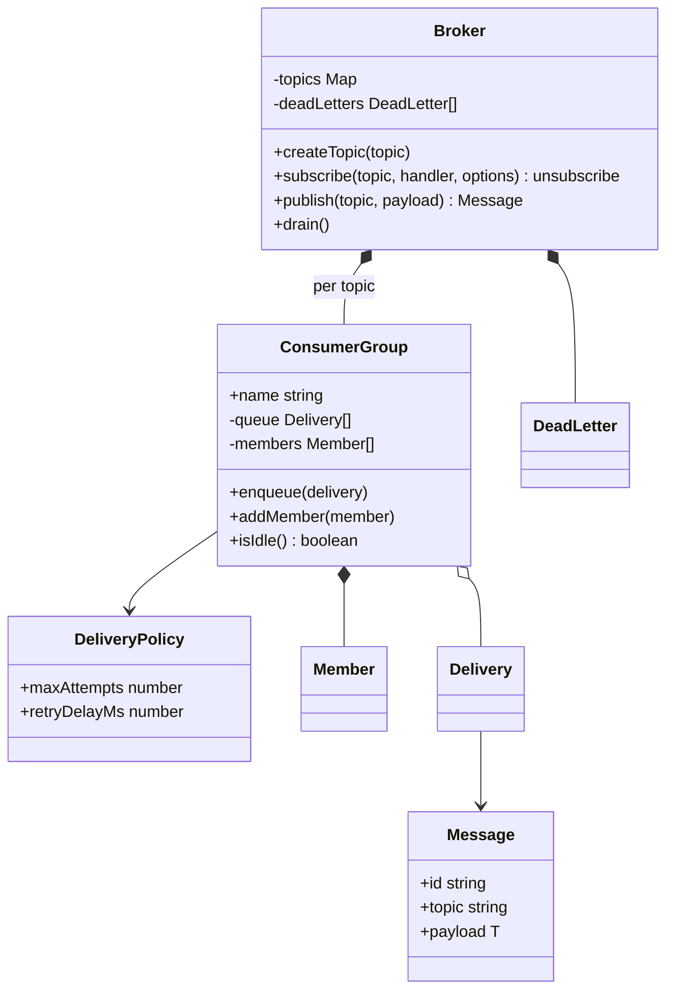
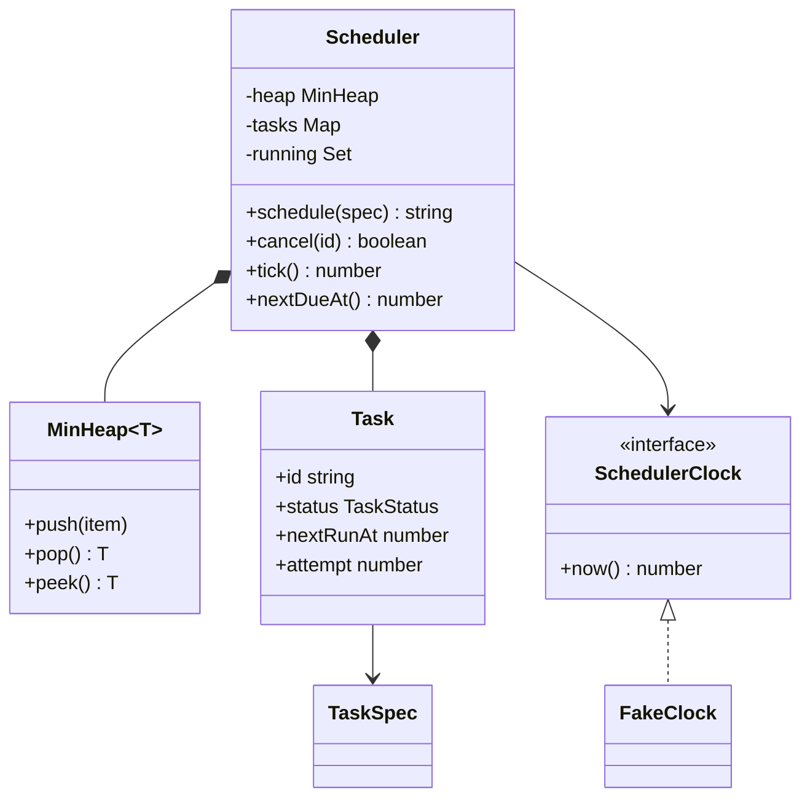
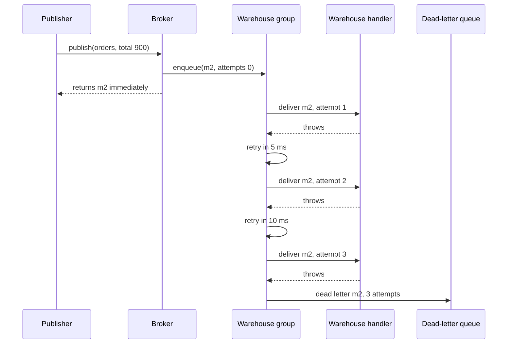

# Pub/Sub and Task Scheduler

> In this document you will design two asynchronous building blocks: an in-memory publish/subscribe broker (topics, fan-out, consumer groups, filters, retries and a dead-letter queue) and a task scheduler (one-time and recurring tasks, priorities, a concurrency limit, retries with backoff and cancellation). Both are about **work that happens later**, so the interview focuses on delivery guarantees, failure handling, time and testability.

**Before this:** [How to approach LLD interviews](01-how-to-approach-lld-interviews.md) · [Observer vs Pub/Sub](../04-oop-solid-design-patterns/08-behavioral-patterns.md#observer-vs-pubsub) · [Heaps](../12-dsa/09-heaps-and-top-k.md) · [Event loop and promises](../02-javascript/17-callbacks-and-promises.md) · **Interview questions:** [jump to the interview section](#interview-questions)

## Table of contents

1. [Problem](#problem)
2. [Clarifying questions](#clarifying-questions)
3. [Requirements](#requirements)
4. [Core entities and relationships](#core-entities-and-relationships)
5. [Design decisions and patterns](#design-decisions-and-patterns)
6. [Implementation](#implementation)
7. [Walkthrough](#walkthrough)
8. [Handling concurrency and edge cases](#handling-concurrency-and-edge-cases)
9. [Extensions](#extensions)
10. [How to present this in the interview](#how-to-present-this-in-the-interview)
11. [Interview questions](#interview-questions)
12. [Summary](#summary)
13. [References](#references)

---

## Problem

> **Pub/Sub:** "Design an in-memory publish/subscribe system. Publishers send messages to named topics. Subscribers subscribe to topics and receive messages asynchronously. A slow or failing subscriber must not affect others. Support retries for failed deliveries and a dead-letter queue. Bonus: let several instances of a service share the work of one subscription."

> **Task scheduler:** "Design a task scheduler like a mini cron. Users can schedule a task to run once at a given time, or repeatedly every N milliseconds. Tasks have priorities. At most K tasks run at the same time. Failed tasks are retried with backoff. Tasks can be cancelled."

They fit together: a scheduler often publishes messages ("run the nightly report"), and a pub/sub consumer often schedules retries. Both need the same habits: never block the caller, isolate failures, make time injectable, and be honest about **at-least-once** delivery.

This is an LLD round: one process, in memory, real classes and code. For the distributed versions (Kafka, SQS, distributed cron), see [real-time communication](../09-system-design/04-api-styles-and-real-time-communication.md) and the [system design approach](../09-system-design/01-system-design-interview-approach.md).

---

## Clarifying questions

### Pub/Sub

| Question | Why it matters | Assumed answer |
|---|---|---|
| Does the publisher wait for subscribers? | Coupling and latency. | No. `publish` returns immediately; delivery is asynchronous. |
| Does every subscriber get every message? | Fan-out vs work sharing. | Every **group** gets every message. Subscribers in the same group share messages (each message to one member). A subscriber without a group is its own group. |
| Delivery guarantee? | The most important question. | At-least-once: a message is retried until the handler succeeds or attempts run out. Handlers must be idempotent. |
| What counts as success? | Acknowledgement. | The handler returns (or its promise resolves) without throwing. |
| Retries? | Failure handling. | Up to 3 attempts with exponential backoff; then the message goes to a dead-letter queue (DLQ). |
| Ordering? | Changes the design a lot. | Best effort. A retried message may be delivered after newer ones. Strict ordering is discussed as an extension. |
| Filters? | Subscriber convenience. | Optional predicate per subscription. |
| Persistence and replay? | Scope. | In memory, no replay. Discussed as an extension (log-based topics). |
| Topic creation? | API. | Explicit `createTopic`; publishing to an unknown topic is an error. |

### Task scheduler

| Question | Why it matters | Assumed answer |
|---|---|---|
| Schedule types? | Data model. | One-time at a timestamp; recurring every N ms from a start time. Cron expressions are an extension. |
| Recurring: fixed rate or fixed delay? | Overlap behavior. | Fixed delay: the next run is N ms after the previous run **finishes**, so runs never overlap. |
| Priority meaning? | Ordering. | When several tasks are due, higher priority starts first. Ties: first scheduled, first run. |
| Concurrency limit? | Resource protection. | K tasks at most; extra due tasks wait. |
| Retries? | Failure handling. | Per task `maxRetries` and `retryDelayMs`, exponential backoff. |
| Cancel a running task? | Semantics. | Cancel stops future runs; a run already in progress finishes. |
| What if the process restarts? | Durability. | In memory for now; persistence and missed runs are extensions. |
| How is time handled? | Testability. | An injected clock. Tests use a fake clock; production uses real timers. |

---

## Requirements

### Functional requirements

**Pub/Sub**

1. `createTopic(name)`, `publish(topic, payload)` returning the message with an ID.
2. `subscribe(topic, handler, { group, filter })` returning an `unsubscribe` function.
3. Fan-out across groups; load sharing (competing consumers) inside a group.
4. Retries with exponential backoff; a dead-letter queue after the last attempt.
5. A failing or slow subscriber does not delay the publisher or other groups.
6. `drain()` waits until all deliveries are finished (for tests and graceful shutdown).

**Task scheduler**

1. `schedule(spec)` returns a task ID; `cancel(id)`; `statusOf(id)`.
2. One-time and recurring schedules.
3. Priority among due tasks; a concurrency limit.
4. Retries with backoff; a task that keeps failing ends as `FAILED`.
5. Status lifecycle: `SCHEDULED → RUNNING → SUCCEEDED / FAILED`, or `CANCELLED`.

### Non-functional requirements

- **Isolation:** one bad handler or task never breaks the broker, the scheduler or other consumers.
- **Non-blocking:** `publish` and `schedule` return immediately.
- **Efficiency:** finding the next due task is O(log n) (a heap), not a scan.
- **Testability:** time and randomness are injected; tests do not sleep for real minutes.
- **Observability:** each attempt and failure is logged; dead letters keep the error.
- **Extensibility:** new schedule types, new retry policies, persistence, multiple instances.

---

## Core entities and relationships

### Pub/Sub

| Entity | Responsibility |
|---|---|
| `Message<T>` | ID, topic, payload, publish time. Immutable. |
| `Broker` | Topics, subscribe/unsubscribe, publish, dead-letter queue, drain. |
| `ConsumerGroup` | One queue per group; its members; dispatches each message to one idle member; retries; dead letters. |
| `Member` | One subscriber's ID and handler. |
| `Delivery` | A message plus the number of attempts so far. |
| `DeadLetter` | A message that failed all attempts, with group, attempts and last error. |
| `DeliveryPolicy` | `maxAttempts`, `retryDelayMs`. |



### Task scheduler

| Entity | Responsibility |
|---|---|
| `TaskSpec` | What the user gives: name, schedule, `run` function, priority, retry settings. |
| `Schedule` | `once` at a time, or `every` N ms from a start time (a discriminated union). |
| `Task` | Runtime state: ID, status, `nextRunAt`, attempt count, run count. |
| `MinHeap<T>` | Generic priority queue ordered by `nextRunAt`, then priority, then sequence. |
| `Scheduler` | Holds the heap and tasks, starts due tasks within the concurrency limit, handles success, failure, retry and cancel. |
| `SchedulerClock` / `FakeClock` | Time source; the fake one is moved by tests. |



---

## Design decisions and patterns

### Decision 1: Pub/Sub, not plain Observer

In the **Observer** pattern, the subject keeps a list of observers and calls them directly, usually synchronously. If one observer is slow, the subject waits; if it throws, the subject may crash. In **Pub/Sub**, a **broker** sits in the middle: publishers and subscribers do not know each other, and delivery is asynchronous through queues. That decoupling is exactly what the requirements ask for ("a slow subscriber must not affect others"). See [Observer vs Pub/Sub](../04-oop-solid-design-patterns/08-behavioral-patterns.md#observer-vs-pubsub).

### Decision 2: one queue per consumer group

Every group has its **own** queue. Publishing a message copies a reference into each matching group's queue. Consequences:

- A slow group only grows **its own** queue. Other groups keep their speed.
- Inside a group, members are **competing consumers**: each idle member takes the next message. Two billing workers process twice as fast, and each order is billed once.
- A subscriber without a group gets a private group, which gives plain fan-out.

This is the same model as Kafka consumer groups and as SNS topics fanning out to several SQS queues.

### Decision 3: acknowledgement by return value, retries with backoff, then a DLQ

A delivery **succeeds** when the handler returns without throwing (or its promise resolves). If it throws, the group waits `retryDelayMs × 2^(attempt-1)` and puts the delivery back in the queue. After `maxAttempts`, the message goes to the **dead-letter queue** with the last error. Why each piece:

- **Retries** handle temporary failures (network blip, database restart).
- **Exponential backoff** stops a struggling dependency from being hammered.
- **A DLQ** stops a "poison message" (one that can never succeed) from being retried forever and blocking resources. A human or a tool inspects the DLQ later.

The result is **at-least-once** delivery: a handler that did its work but failed to acknowledge (for example it threw after writing to the database) will see the message again. So handlers must be **idempotent**; see [Q2](#q2-what-delivery-guarantee-does-your-broker-give-and-what-does-that-mean-for-subscribers).

### Decision 4: publish never runs handler code

`publish` only enqueues. The first line of `deliver` is `await Promise.resolve()`, which guarantees that even a synchronous handler runs **after** `publish` returns. Without it, a synchronous handler would run inside the publisher's call stack, and a slow one would block the publisher. This small line is the difference between "asynchronous in theory" and "asynchronous for real".

### Decision 5: a min-heap for the scheduler

The scheduler's main question is "which task is due next?". Options:

| Structure | Next due | Insert | Note |
|---|---|---|---|
| Unsorted array | O(n) scan | O(1) | Fine for 10 tasks, bad for 100,000. |
| Sorted array | O(1) | O(n) | Inserts shift elements. |
| **Min-heap** | **O(1) peek, O(log n) pop** | **O(log n)** | The standard choice. |
| Timing wheel | O(1) | O(1) | Great for huge numbers of timers with coarse precision (used in network stacks). |

The heap compares by `nextRunAt`, then by **priority** (higher first), then by **sequence number** (first scheduled first). The last tie-breaker makes the order deterministic, which matters for tests. See [Heaps](../12-dsa/09-heaps-and-top-k.md).

### Decision 6: lazy cancellation

Removing an arbitrary element from a binary heap is O(n) to find it. Instead, `cancel` only marks the task `CANCELLED`, and the scheduler drops cancelled tasks when they reach the top of the heap. Cancel is O(1); the cost is a little extra memory until the entry surfaces. A task that is cancelled while **running** finishes its current run but is not rescheduled.

### Decision 7: time is injected, and the scheduler does not own a timer

`Scheduler` reads time from a `SchedulerClock` and does its work in `tick()`: "start everything that is due, up to the concurrency limit". Something else decides **when** to call `tick()`:

- In tests, `runUntil(fakeClock, target)` jumps the fake clock from one due time to the next. A 200 ms scenario runs in a few milliseconds and gives the same output every time.
- In production, a small `TimerDriver` calls `tick()` with `setTimeout`, sleeping until the next due time (see [Extensions](#extensions)).

Separating "what to run" (scheduler) from "when to wake up" (driver) is the **Single Responsibility Principle** applied to time, and it makes the scheduler fully testable. The same idea appears as the `Clock` in the [shopping cart](10-shopping-cart-pricing-and-discounts.md) design.

### Decision 8: tasks and schedules as data, behavior as a function

A task's work is just `run: () => Promise<void> | void`. We do not create `abstract class Task` with subclasses per job type. A function is the simplest form of the **Command** pattern: an action stored as a value, executed later. The schedule is a discriminated union (`once` or `every`), so adding `cron` later is a new union member plus one `case` that computes the next run time.

| Problem | Pattern / principle | Benefit |
|---|---|---|
| Decouple publishers from subscribers | Pub/Sub with a broker | Publisher never waits; subscribers isolated. |
| Several instances share work | Competing consumers (consumer group) | Horizontal scaling, each message once per group. |
| Temporary failures | Retry with exponential backoff | Recovers without hammering dependencies. |
| Permanent failures | Dead-letter queue | No infinite retries; failures visible. |
| Next due task | Min-heap (priority queue) | O(log n) scheduling. |
| Cancel | Lazy deletion | O(1) cancel. |
| Work to run later | Command (a function value) | Any job, no class hierarchy. |
| Time in tests | Injected clock + external driver | Deterministic, fast tests. |

---

## Implementation

Both designs are in one runnable TypeScript file: pub/sub (types → consumer group → broker), then the scheduler (heap → task types → scheduler), then a demo. It runs with Node.js 22 (`node pubsub.ts`) and passes `tsc --strict`. The output is deterministic: we ran it several times and got the same output every time.

### Step 1: pub/sub types

```ts
// ---------- Step 1: pub/sub messages and subscriber types ----------
interface Message<T = unknown> {
  readonly id: string;
  readonly topic: string;
  readonly payload: T;
  readonly publishedAt: number;
}

type Handler<T = unknown> = (message: Message<T>) => Promise<void> | void;

interface SubscribeOptions<T> {
  // Subscribers with the same group share the work: each message goes to ONE of them.
  // Different groups each get EVERY message. Default: a private group (plain fan-out).
  readonly group?: string;
  readonly filter?: (message: Message<T>) => boolean;
}

interface DeadLetter {
  readonly message: Message;
  readonly group: string;
  readonly attempts: number;
  readonly error: string;
}

interface Delivery {
  readonly message: Message;
  attempts: number;
}

interface Member {
  readonly id: string;
  readonly handler: Handler;
}

const sleep = (ms: number): Promise<void> => new Promise((resolve) => setTimeout(resolve, ms));
```

`Message<T>` is generic, so a subscriber to `orders` can declare `Handler<{ total: number }>` and get typed payloads. `Handler` may return a promise or nothing, so both `async` and plain functions work as subscribers.

### Step 2: the consumer group

```ts
// ---------- Step 2: a consumer group with its own queue, retries and dead letters ----------
interface DeliveryPolicy {
  readonly maxAttempts: number;
  readonly retryDelayMs: number; // doubled after each failure (exponential backoff)
}

class ConsumerGroup {
  readonly name: string;
  readonly filter: ((message: Message) => boolean) | undefined;
  private readonly queue: Delivery[] = [];
  private readonly members: Member[] = [];
  private readonly busy = new Set<Member>();
  private readonly policy: DeliveryPolicy;
  private readonly onDeadLetter: (letter: DeadLetter) => void;
  private nextMember = 0;
  private waitingRetries = 0;

  constructor(
    name: string,
    filter: ((message: Message) => boolean) | undefined,
    policy: DeliveryPolicy,
    onDeadLetter: (letter: DeadLetter) => void,
  ) {
    this.name = name;
    this.filter = filter;
    this.policy = policy;
    this.onDeadLetter = onDeadLetter;
  }

  addMember(member: Member): void {
    this.members.push(member);
    this.dispatch();
  }

  removeMember(memberId: string): void {
    const index = this.members.findIndex((m) => m.id === memberId);
    if (index >= 0) this.members.splice(index, 1);
  }

  hasMembers(): boolean {
    return this.members.length > 0;
  }

  enqueue(delivery: Delivery): void {
    this.queue.push(delivery);
    this.dispatch();
  }

  isIdle(): boolean {
    return this.queue.length === 0 && this.busy.size === 0 && this.waitingRetries === 0;
  }

  // Give queued messages to idle members, round-robin. Each member handles one message at a time.
  private dispatch(): void {
    for (let i = 0; i < this.members.length && this.queue.length > 0; i++) {
      const member = this.members[(this.nextMember + i) % this.members.length];
      if (this.busy.has(member)) continue;
      const delivery = this.queue.shift() as Delivery;
      this.busy.add(member);
      this.nextMember = (this.members.indexOf(member) + 1) % this.members.length;
      void this.deliver(member, delivery);
    }
  }

  private async deliver(member: Member, delivery: Delivery): Promise<void> {
    await Promise.resolve(); // never run a handler inside publish(): the publisher must not wait
    delivery.attempts += 1;
    try {
      await member.handler(delivery.message); // success = acknowledgement
    } catch (error) {
      this.handleFailure(delivery, (error as Error).message);
    } finally {
      this.busy.delete(member);
      this.dispatch();
    }
  }

  private handleFailure(delivery: Delivery, error: string): void {
    if (delivery.attempts >= this.policy.maxAttempts) {
      this.onDeadLetter({ message: delivery.message, group: this.name, attempts: delivery.attempts, error });
      return;
    }
    const delay = this.policy.retryDelayMs * 2 ** (delivery.attempts - 1);
    this.waitingRetries += 1;
    setTimeout(() => {
      this.waitingRetries -= 1;
      this.enqueue(delivery);
    }, delay);
  }
}
```

How a message moves through a group:

1. `enqueue` adds a `Delivery` to the group's queue and calls `dispatch`.
2. `dispatch` walks the members round-robin, starting after the last member that got work. Each **idle** member takes the next delivery. A member handles one message at a time, so a group with two members processes two messages in parallel.
3. `deliver` yields once (so the publisher never runs handler code), increments `attempts` and calls the handler.
4. Success: nothing else to do. That is the acknowledgement.
5. Failure: if attempts are left, a timer re-enqueues the delivery after an exponential backoff (`waitingRetries` counts these, so `isIdle` knows work is still pending). Otherwise the delivery becomes a dead letter.
6. In both cases, `finally` frees the member and dispatches again.

Notice that a retried message goes to the **back** of the queue. Newer messages may be processed before it. This keeps one bad message from blocking the group (no **head-of-line blocking**), at the price of ordering. [Q5](#q5-does-your-broker-keep-messages-in-order) discusses the trade-off.

### Step 3: the broker

```ts
// ---------- Step 3: the broker ----------
class Broker {
  private readonly topics = new Map<string, Map<string, ConsumerGroup>>();
  private readonly deadLetters: DeadLetter[] = [];
  private readonly policy: DeliveryPolicy;
  private readonly now: () => number;
  private messageCounter = 0;
  private memberCounter = 0;

  constructor(policy: DeliveryPolicy, now: () => number = Date.now) {
    this.policy = policy;
    this.now = now;
  }

  createTopic(topic: string): void {
    if (!this.topics.has(topic)) this.topics.set(topic, new Map());
  }

  // Returns an unsubscribe function.
  subscribe<T>(topic: string, handler: Handler<T>, options: SubscribeOptions<T> = {}): () => void {
    const groups = this.groupsOf(topic);
    this.memberCounter += 1;
    const memberId = `sub-${this.memberCounter}`;
    const groupName = options.group ?? memberId;
    let group = groups.get(groupName);
    if (!group) {
      group = new ConsumerGroup(
        groupName,
        options.filter as ((message: Message) => boolean) | undefined,
        this.policy,
        (letter) => this.deadLetters.push(letter),
      );
      groups.set(groupName, group);
    }
    group.addMember({ id: memberId, handler: handler as Handler });
    const owner = group;
    return () => {
      owner.removeMember(memberId);
      if (!owner.hasMembers()) groups.delete(groupName);
    };
  }

  publish<T>(topic: string, payload: T): Message<T> {
    this.messageCounter += 1;
    const message: Message<T> = { id: `m${this.messageCounter}`, topic, payload, publishedAt: this.now() };
    // The publisher never waits for subscribers: delivery happens asynchronously, per group.
    for (const group of this.groupsOf(topic).values()) {
      if (group.filter && !group.filter(message)) continue;
      group.enqueue({ message, attempts: 0 });
    }
    return message;
  }

  deadLetterQueue(): readonly DeadLetter[] {
    return this.deadLetters;
  }

  // For tests and graceful shutdown: wait until every group is idle.
  async drain(): Promise<void> {
    const allIdle = () => [...this.topics.values()].every((groups) => [...groups.values()].every((g) => g.isIdle()));
    while (!allIdle()) await sleep(1);
  }

  private groupsOf(topic: string): Map<string, ConsumerGroup> {
    const groups = this.topics.get(topic);
    if (!groups) throw new Error(`Unknown topic: ${topic}`);
    return groups;
  }
}
```

Design notes:

- The broker stores, per topic, a map from group name to `ConsumerGroup`. `subscribe` either joins an existing group or creates one. Without a `group` option the group name is the member ID, so the subscriber is alone in its group (fan-out). That is why the dead letter in the demo says "group sub-6".
- `subscribe` returns an **unsubscribe function**, the same style as `addEventListener`/RxJS teardown. When the last member leaves, the group is deleted with its queue. This is a **non-durable** subscription: messages published while nobody is subscribed are not kept for that group.
- The filter runs at publish time, so filtered-out messages never enter the group's queue.
- `drain()` polls until all groups are idle. It is for tests and graceful shutdown ("stop accepting new messages, then wait for in-flight ones").
- The `as Handler` and filter casts are where the generic `T` meets the untyped broker storage. A topic registry with a type per topic name could remove them; for an interview, a short comment is enough.

### Step 4: a generic min-heap

```ts
// ---------- Step 4: a generic min-heap for the scheduler ----------
class MinHeap<T> {
  private readonly items: T[] = [];
  private readonly less: (a: T, b: T) => boolean;

  constructor(less: (a: T, b: T) => boolean) {
    this.less = less;
  }

  get size(): number {
    return this.items.length;
  }

  peek(): T | undefined {
    return this.items[0];
  }

  push(item: T): void {
    this.items.push(item);
    let i = this.items.length - 1;
    while (i > 0) {
      const parent = (i - 1) >> 1;
      if (!this.less(this.items[i], this.items[parent])) break;
      [this.items[i], this.items[parent]] = [this.items[parent], this.items[i]];
      i = parent;
    }
  }

  pop(): T | undefined {
    const top = this.items[0];
    const last = this.items.pop();
    if (this.items.length > 0 && last !== undefined) {
      this.items[0] = last;
      let i = 0;
      for (;;) {
        const left = 2 * i + 1;
        const right = left + 1;
        let smallest = i;
        if (left < this.items.length && this.less(this.items[left], this.items[smallest])) smallest = left;
        if (right < this.items.length && this.less(this.items[right], this.items[smallest])) smallest = right;
        if (smallest === i) break;
        [this.items[i], this.items[smallest]] = [this.items[smallest], this.items[i]];
        i = smallest;
      }
    }
    return top;
  }
}
```

A binary heap stored in an array: the parent of index `i` is `(i - 1) >> 1`, the children are `2i + 1` and `2i + 2`. `push` adds at the end and moves the item **up** while it is smaller than its parent; `pop` moves the last item to the top and moves it **down** while a child is smaller. Both are O(log n). The heap is generic and takes a `less` function, so the scheduler decides what "earlier" means. See [Generics](../03-typescript/05-generics.md).

### Step 5: tasks and schedules

```ts
// ---------- Step 5: tasks and schedules ----------
const TaskStatus = {
  SCHEDULED: "SCHEDULED",
  RUNNING: "RUNNING",
  SUCCEEDED: "SUCCEEDED",
  FAILED: "FAILED",
  CANCELLED: "CANCELLED",
} as const;
type TaskStatus = (typeof TaskStatus)[keyof typeof TaskStatus];

type Schedule =
  | { readonly kind: "once"; readonly at: number }
  | { readonly kind: "every"; readonly intervalMs: number; readonly startAt: number };

interface TaskSpec {
  readonly name: string;
  readonly schedule: Schedule;
  readonly run: () => Promise<void> | void;
  readonly priority?: number; // higher runs first when several tasks are due
  readonly maxRetries?: number;
  readonly retryDelayMs?: number;
}

interface Task {
  readonly id: string;
  readonly spec: TaskSpec;
  status: TaskStatus;
  nextRunAt: number;
  attempt: number; // failed attempts of the current run
  runs: number;
  readonly seq: number; // tie-breaker: first scheduled, first run
}

interface SchedulerClock {
  now(): number;
}

class FakeClock implements SchedulerClock {
  private time: number;
  constructor(start = 0) {
    this.time = start;
  }
  now(): number {
    return this.time;
  }
  set(time: number): void {
    this.time = time;
  }
}
```

`TaskSpec` is what the user provides; `Task` is the scheduler's runtime record. Keeping them separate means the user cannot accidentally change `status` or `nextRunAt`. `Schedule` is a discriminated union, so `schedule.kind === "every"` narrows the type and gives access to `intervalMs`.

`FakeClock` has a `set` method that only tests use. The scheduler only sees the `SchedulerClock` interface, which has no `set`, so production code cannot move time.

### Step 6: the scheduler

```ts
// ---------- Step 6: the scheduler ----------
class Scheduler {
  private readonly clock: SchedulerClock;
  private readonly concurrency: number;
  private readonly log: (line: string) => void;
  private readonly heap = new MinHeap<Task>((a, b) => {
    if (a.nextRunAt !== b.nextRunAt) return a.nextRunAt < b.nextRunAt;
    const pa = a.spec.priority ?? 0;
    const pb = b.spec.priority ?? 0;
    if (pa !== pb) return pa > pb;
    return a.seq < b.seq;
  });
  private readonly tasks = new Map<string, Task>();
  private readonly running = new Set<Promise<void>>();
  private counter = 0;

  constructor(clock: SchedulerClock, concurrency: number, log: (line: string) => void) {
    this.clock = clock;
    this.concurrency = concurrency;
    this.log = log;
  }

  schedule(spec: TaskSpec): string {
    this.counter += 1;
    const firstRun = spec.schedule.kind === "once" ? spec.schedule.at : spec.schedule.startAt;
    const task: Task = {
      id: `t${this.counter}`,
      spec,
      status: TaskStatus.SCHEDULED,
      nextRunAt: firstRun,
      attempt: 0,
      runs: 0,
      seq: this.counter,
    };
    this.tasks.set(task.id, task);
    this.heap.push(task);
    return task.id;
  }

  // Lazy cancel: mark it; the heap entry is skipped when it comes out.
  cancel(taskId: string): boolean {
    const task = this.tasks.get(taskId);
    if (!task || task.status === TaskStatus.SUCCEEDED || task.status === TaskStatus.FAILED) return false;
    task.status = TaskStatus.CANCELLED;
    return true;
  }

  statusOf(taskId: string): TaskStatus | undefined {
    return this.tasks.get(taskId)?.status;
  }

  nextDueAt(): number | undefined {
    this.dropCancelled();
    return this.heap.peek()?.nextRunAt;
  }

  // Start every due task, up to the concurrency limit. Returns how many started.
  tick(): number {
    let started = 0;
    this.dropCancelled();
    while (this.running.size < this.concurrency) {
      const next = this.heap.peek();
      if (!next || next.nextRunAt > this.clock.now()) break;
      this.heap.pop();
      this.start(next);
      started += 1;
      this.dropCancelled();
    }
    return started;
  }

  // Test driver: move the fake clock forward, running everything that becomes due.
  async runUntil(clock: FakeClock, target: number): Promise<void> {
    for (;;) {
      this.tick();
      if (this.running.size > 0) {
        await Promise.race(this.running);
        continue;
      }
      const next = this.nextDueAt();
      if (next === undefined || next > target) break;
      clock.set(Math.max(clock.now(), next));
    }
    clock.set(target);
  }

  private start(task: Task): void {
    task.status = TaskStatus.RUNNING;
    const label = `${task.spec.name}${task.attempt > 0 ? ` (retry ${task.attempt})` : ""}`;
    this.log(`[t=${this.clock.now()}] start ${label}`);
    const execution = (async () => {
      try {
        await task.spec.run();
        this.onSuccess(task);
      } catch (error) {
        this.onFailure(task, (error as Error).message);
      }
    })();
    this.running.add(execution);
    void execution.finally(() => this.running.delete(execution));
  }

  private onSuccess(task: Task): void {
    task.runs += 1;
    task.attempt = 0;
    if (task.status === TaskStatus.CANCELLED) return; // cancelled while running: do not reschedule
    if (task.spec.schedule.kind === "every") {
      // Fixed delay: the next run is counted from when this run finished, so runs never overlap.
      task.status = TaskStatus.SCHEDULED;
      task.nextRunAt = this.clock.now() + task.spec.schedule.intervalMs;
      this.heap.push(task);
    } else {
      task.status = TaskStatus.SUCCEEDED;
      this.log(`[t=${this.clock.now()}] ${task.spec.name} succeeded`);
    }
  }

  private onFailure(task: Task, error: string): void {
    task.attempt += 1;
    const maxRetries = task.spec.maxRetries ?? 0;
    if (task.status !== TaskStatus.CANCELLED && task.attempt <= maxRetries) {
      const delay = (task.spec.retryDelayMs ?? 1000) * 2 ** (task.attempt - 1);
      this.log(`[t=${this.clock.now()}] ${task.spec.name} failed (${error}), retry in ${delay} ms`);
      task.status = TaskStatus.SCHEDULED;
      task.nextRunAt = this.clock.now() + delay;
      this.heap.push(task);
      return;
    }
    if (task.status !== TaskStatus.CANCELLED) task.status = TaskStatus.FAILED;
    this.log(`[t=${this.clock.now()}] ${task.spec.name} gave up after ${task.attempt} attempts: ${error}`);
  }

  private dropCancelled(): void {
    while (this.heap.peek()?.status === TaskStatus.CANCELLED) this.heap.pop();
  }
}
```

The important paths:

- **Heap order:** earliest `nextRunAt` first; for equal times, higher priority first; for equal priority, lower sequence number first.
- **`tick()`** pops due tasks while there is a free slot (`running.size < concurrency`). Tasks that are due but have no slot stay in the heap and start on a later tick.
- **`start()`** runs the task inside an async wrapper that **catches every error**. A throwing task can never crash the scheduler. The promise is kept in `running` until it settles.
- **`onSuccess()`**: a recurring task is pushed back with `nextRunAt = now + interval` (fixed delay); a one-time task becomes `SUCCEEDED`. A task cancelled during its run is not rescheduled.
- **`onFailure()`**: retry with exponential backoff while `attempt <= maxRetries`, then `FAILED`. With `maxRetries: 1`, a task gets 2 attempts in total.
- **`runUntil()`** is the test driver: tick; if something is running, wait for the first one to finish and tick again (a slot may be free); otherwise jump the fake clock to the next due time. It never jumps past `target`.

### Step 7: the demo

```ts
// ---------- Step 7: demo ----------
async function pubSubDemo(): Promise<void> {
  console.log("=== Pub/Sub ===");
  const broker = new Broker({ maxAttempts: 3, retryDelayMs: 5 });
  broker.createTopic("orders");

  // Fan-out: email and analytics each get every order.
  broker.subscribe<{ total: number }>("orders", async (m) => {
    await sleep(5);
    console.log(`email     got ${m.id} total=${m.payload.total}`);
  });
  const stopAnalytics = broker.subscribe<{ total: number }>("orders", (m) => {
    console.log(`analytics got ${m.id}`);
  });

  // Filter: only big orders reach the fraud check.
  broker.subscribe<{ total: number }>("orders", (m) => console.log(`fraud     checks ${m.id}`), {
    filter: (m) => m.payload.total > 500,
  });

  // Consumer group: two workers share the "billing" work; each order is billed once.
  for (const worker of ["billing-A", "billing-B"]) {
    broker.subscribe<{ total: number }>(
      "orders",
      async (m) => {
        await sleep(10);
        console.log(`${worker} bills  ${m.id}`);
      },
      { group: "billing" },
    );
  }

  // A flaky subscriber: fails on m2 every time, so m2 ends in the dead-letter queue.
  let failures = 0;
  broker.subscribe<{ total: number }>("orders", (m) => {
    if (m.id === "m2") {
      failures += 1;
      throw new Error(`warehouse down (attempt ${failures})`);
    }
    console.log(`warehouse reserves ${m.id}`);
  });

  broker.publish("orders", { total: 120 });
  broker.publish("orders", { total: 900 });
  console.log("publish returned immediately");
  await broker.drain();

  stopAnalytics();
  broker.publish("orders", { total: 50 });
  await broker.drain();

  for (const letter of broker.deadLetterQueue()) {
    console.log(`DLQ: ${letter.message.id} in group ${letter.group} after ${letter.attempts} attempts: ${letter.error}`);
  }
}

async function schedulerDemo(): Promise<void> {
  console.log("=== Task scheduler ===");
  const clock = new FakeClock(0);
  const scheduler = new Scheduler(clock, 2, (line) => console.log(line));

  const cleanup = scheduler.schedule({
    name: "cleanup",
    schedule: { kind: "every", intervalMs: 50, startAt: 0 },
    run: () => {},
  });

  let emailTries = 0;
  scheduler.schedule({
    name: "send-email",
    schedule: { kind: "once", at: 20 },
    maxRetries: 3,
    retryDelayMs: 10,
    run: () => {
      emailTries += 1;
      if (emailTries < 3) throw new Error("SMTP timeout");
    },
  });

  const broken = scheduler.schedule({
    name: "broken-import",
    schedule: { kind: "once", at: 30 },
    maxRetries: 1,
    retryDelayMs: 5,
    run: () => {
      throw new Error("file missing");
    },
  });

  // Three tasks due at the same moment, but only 2 can run at once: highest priority first.
  for (const [name, priority] of [["low", 1], ["high", 10], ["medium", 5]] as const) {
    scheduler.schedule({ name: `report-${name}`, schedule: { kind: "once", at: 120 }, priority, run: () => {} });
  }

  await scheduler.runUntil(clock, 110);
  scheduler.cancel(cleanup);
  console.log(`[t=${clock.now()}] cancelled cleanup`);
  await scheduler.runUntil(clock, 200);

  console.log(`cleanup: ${scheduler.statusOf(cleanup)}, broken-import: ${scheduler.statusOf(broken)}`);
}

async function main(): Promise<void> {
  await pubSubDemo();
  await schedulerDemo();
}

main().catch((error: unknown) => console.error(error));

// Output:
// === Pub/Sub ===
// publish returned immediately
// analytics got m1
// warehouse reserves m1
// fraud     checks m2
// analytics got m2
// email     got m1 total=120
// billing-A bills  m1
// billing-B bills  m2
// email     got m2 total=900
// warehouse reserves m3
// email     got m3 total=50
// billing-A bills  m3
// DLQ: m2 in group sub-6 after 3 attempts: warehouse down (attempt 3)
// === Task scheduler ===
// [t=0] start cleanup
// [t=20] start send-email
// [t=20] send-email failed (SMTP timeout), retry in 10 ms
// [t=30] start send-email (retry 1)
// [t=30] send-email failed (SMTP timeout), retry in 20 ms
// [t=30] start broken-import
// [t=30] broken-import failed (file missing), retry in 5 ms
// [t=35] start broken-import (retry 1)
// [t=35] broken-import gave up after 2 attempts: file missing
// [t=50] start cleanup
// [t=50] start send-email (retry 2)
// [t=50] send-email succeeded
// [t=100] start cleanup
// [t=110] cancelled cleanup
// [t=120] start report-high
// [t=120] start report-medium
// [t=120] report-high succeeded
// [t=120] report-medium succeeded
// [t=120] start report-low
// [t=120] report-low succeeded
// cleanup: CANCELLED, broken-import: FAILED
```

What the output shows:

**Pub/Sub**

- `publish returned immediately` is printed **first**: no handler runs inside `publish`, not even the synchronous ones.
- **Fan-out:** email, analytics and warehouse each receive every message they did not filter out.
- **Filter:** fraud only sees `m2` (total 900 > 500).
- **Consumer group:** `billing-A` bills `m1`, `billing-B` bills `m2` in parallel, and later `billing-A` bills `m3`. Each order is billed exactly once by the group.
- **Isolation:** the warehouse fails on `m2` three times, but `m3` is still reserved, and the email subscriber (which is slower, with a 5 ms delay) is unaffected.
- **Unsubscribe:** analytics does not receive `m3`.
- **DLQ:** after 3 attempts, `m2` is in the dead-letter queue with the last error.

**Scheduler**

- `cleanup` runs at t=0, 50 and 100 (every 50 ms) and is cancelled at t=110, so it does not run at t=150.
- `send-email` fails at t=20 and t=30 and succeeds at t=50. The retry delays double: 10 ms, then 20 ms.
- `broken-import` has `maxRetries: 1`: it fails at t=30, retries at t=35, fails again and gives up as `FAILED`.
- At t=120, three reports are due together but only 2 can run. `report-high` and `report-medium` start first; `report-low` starts when a slot frees.

---

## Walkthrough

### A message with a failing subscriber

Message `m2` (total 900) is published to `orders`. The warehouse subscriber fails every time.



1. `publish` creates `m2` and enqueues it into every matching group: email, analytics, fraud (the filter matches), billing and warehouse. It returns at once.
2. Each group delivers independently. In the warehouse group, attempt 1 throws.
3. The group schedules a retry after 5 ms and frees the member, so other messages (like `m3` later) can still be processed.
4. Attempt 2 throws; the next delay doubles to 10 ms.
5. Attempt 3 throws; attempts are used up, so `m2` goes to the dead-letter queue with the error.
6. Meanwhile, every other group processed `m2` normally.

### A task with retries in the scheduler

`send-email` is scheduled at t=20 with `maxRetries: 3` and `retryDelayMs: 10`:

1. `runUntil` jumps the fake clock to t=20 (the next due time in the heap) and calls `tick`.
2. `tick` pops `send-email` (a slot is free) and starts it. It throws `SMTP timeout`.
3. `onFailure`: attempt 1 ≤ 3, so `nextRunAt = 20 + 10 = 30`; push back into the heap.
4. At t=30 it fails again: attempt 2, delay doubles to 20, `nextRunAt = 50`.
5. At t=50 it succeeds: status `SUCCEEDED`, attempt counter reset.

---

## Handling concurrency and edge cases

### Concurrency inside one Node.js process

Handlers and tasks are asynchronous, so many of them are "in flight" at the same time, even on one thread. The design keeps shared state safe because every change to the broker's or scheduler's own state (queues, `busy`, heap, status) happens in **synchronous** code between `await`s. For example, `dispatch` marks a member busy and removes the delivery from the queue in the same synchronous step, so two dispatch calls can never give the same delivery to two members.

What the design does **not** protect is the subscribers' and tasks' **own** state. If two billing workers update the same account, they need their own protection (database transactions, idempotency keys).

### At-least-once means duplicates: make consumers idempotent

A handler can do its work and then fail before acknowledging (it throws after writing, or the process crashes). The broker then redelivers. Exactly-once delivery across a network is not possible in general; what you can build is **at-least-once delivery plus idempotent processing**, which gives an exactly-once **effect**:

```ts
// At-least-once delivery means duplicates. An idempotent consumer remembers what it already processed.
interface OrderEvent {
  readonly messageId: string;
  readonly orderId: string;
  readonly amount: number;
}

class IdempotentBilling {
  private readonly processed = new Set<string>(); // in production: a table with a unique key
  private totalCharged = 0;

  handle(event: OrderEvent): void {
    if (this.processed.has(event.messageId)) {
      console.log(`skip duplicate ${event.messageId}`);
      return;
    }
    this.totalCharged += event.amount; // the side effect
    this.processed.add(event.messageId); // record it together with the side effect
    console.log(`charged ${event.amount} for ${event.orderId}`);
  }

  total(): number {
    return this.totalCharged;
  }
}

const billing = new IdempotentBilling();
const event: OrderEvent = { messageId: "m7", orderId: "o-42", amount: 900 };
billing.handle(event);
billing.handle(event); // redelivered after a lost acknowledgement
console.log("total charged:", billing.total());

// Output:
// charged 900 for o-42
// skip duplicate m7
// total charged: 900
```

In a real system, "record the message ID" and "do the side effect" must be in the **same database transaction** (or the side effect itself must be naturally idempotent, like "set status to PAID"). Otherwise a crash between the two reintroduces the problem.

### Running the scheduler on several machines

With one scheduler process, a task runs once. With two instances for high availability, both see the task as due and both run it. The standard fix is a **lease** (a lock with an expiry): before running, an instance atomically claims the task for a short time. If the instance dies, the lease expires and another instance takes over.

```ts
// Many scheduler instances, one task: whoever holds the lease runs it. A lease expires if its owner dies.
interface Lease {
  readonly owner: string;
  readonly expiresAt: number;
}

class LeaseStore {
  private readonly leases = new Map<string, Lease>();

  // In a database this is one atomic statement:
  // UPDATE leases SET owner = ?, expires_at = ? WHERE task_id = ? AND (owner IS NULL OR expires_at <= now)
  tryAcquire(taskId: string, owner: string, now: number, ttlMs: number): boolean {
    const current = this.leases.get(taskId);
    if (current && current.expiresAt > now && current.owner !== owner) return false;
    this.leases.set(taskId, { owner, expiresAt: now + ttlMs });
    return true;
  }

  release(taskId: string, owner: string): void {
    if (this.leases.get(taskId)?.owner === owner) this.leases.delete(taskId);
  }
}

const leases = new LeaseStore();
console.log("t=0  A acquires:", leases.tryAcquire("nightly-report", "A", 0, 30));
console.log("t=0  B acquires:", leases.tryAcquire("nightly-report", "B", 0, 30));
console.log("t=10 A renews:  ", leases.tryAcquire("nightly-report", "A", 10, 30));
// A crashes and stops renewing. Its lease runs out at t=40.
console.log("t=35 B acquires:", leases.tryAcquire("nightly-report", "B", 35, 30));
console.log("t=41 B acquires:", leases.tryAcquire("nightly-report", "B", 41, 30));

// Output:
// t=0  A acquires: true
// t=0  B acquires: false
// t=10 A renews:   true
// t=35 B acquires: false
// t=41 B acquires: true
```

Leases have one more trap: an owner that pauses for a long time (a long garbage-collection pause, a frozen VM) may **think** it still holds the lease after it expired. Two instances then run the task. That is why tasks must still be idempotent, and why systems that need strict safety use a **fencing token** (an increasing number given with each lease, checked by the resource being written).

In Java or C#, inside one process, the same "only one runner" rule is a `ConcurrentHashMap.putIfAbsent` or a lock per task ID. See [Concurrency in Node.js](../07-nodejs-backend/12-concurrency-worker-threads-and-cluster.md) for when Node code really runs in parallel.

### Edge cases

| Area | Edge case | Handling |
|---|---|---|
| Pub/Sub | Publish to an unknown topic | Error "Unknown topic". |
| Pub/Sub | Topic with no subscribers | The message is dropped (non-durable). Say this explicitly. |
| Pub/Sub | Handler throws synchronously | Caught like a rejected promise; counts as a failed attempt. |
| Pub/Sub | Handler never resolves (hangs) | Not handled here. Add a timeout per delivery that counts as a failure. |
| Pub/Sub | Poison message | Ends in the DLQ after `maxAttempts`. |
| Pub/Sub | Unsubscribe while a delivery is running | The running delivery finishes; no new deliveries to that member. |
| Pub/Sub | A slow group's queue grows without limit | Needs **backpressure**: a maximum queue size, then drop, reject publish, or spill to disk. |
| Pub/Sub | A subscriber publishes from its handler | Allowed; the new message is enqueued normally. Watch out for infinite loops (A publishes to B, B to A). |
| Scheduler | Task scheduled in the past | Due immediately on the next tick. |
| Scheduler | Interval of 0 or negative | Should be rejected when scheduling (validation). |
| Scheduler | Cancel a running task | The current run finishes; no reschedule, no retry. |
| Scheduler | Cancel a finished task | Returns `false`. |
| Scheduler | Task throws a non-Error value | `(error as Error).message` is `undefined`; production code should convert with `String(error)`. |
| Scheduler | Task runs longer than its interval | Fixed delay never overlaps. With fixed rate, decide: skip, queue, or allow overlap. |
| Scheduler | Process restarts | All in-memory tasks are lost. Persist tasks and decide what to do with missed runs ([Q7](#q7-how-do-recurring-tasks-work-and-what-happens-when-a-run-is-slow-or-missed)). |
| Scheduler | Clock jumps (NTP adjustment, daylight saving) | Use a monotonic clock for intervals; compute calendar times (cron) in a fixed time zone. |

---

## Extensions

### Real timers instead of the fake clock

The scheduler does not own a timer, so production code adds a tiny driver. It sleeps until the next due task, but wakes up at least every `maxSleepMs`, because a new, earlier task may have been scheduled or a running task may have freed a slot:

```ts
// Add to the implementation: drive the scheduler with real timers instead of the fake clock.
class TimerDriver {
  private readonly scheduler: Scheduler;
  private readonly maxSleepMs: number;
  private timer: ReturnType<typeof setTimeout> | undefined;
  private stopped = false;

  constructor(scheduler: Scheduler, maxSleepMs = 50) {
    this.scheduler = scheduler;
    this.maxSleepMs = maxSleepMs;
  }

  start(): void {
    this.stopped = false;
    this.loop();
  }

  stop(): void {
    this.stopped = true;
    clearTimeout(this.timer);
  }

  private loop(): void {
    if (this.stopped) return;
    this.scheduler.tick();
    const next = this.scheduler.nextDueAt();
    // Sleep until the next task is due, but wake up at least every maxSleepMs
    // (new tasks may be scheduled earlier, and running tasks may free a slot).
    const delay = next === undefined ? this.maxSleepMs : Math.max(0, Math.min(next - Date.now(), this.maxSleepMs));
    this.timer = setTimeout(() => this.loop(), delay);
  }
}

const realScheduler = new Scheduler({ now: () => Date.now() }, 4, () => {});
const driver = new TimerDriver(realScheduler);
let beats = 0;
const heartbeat = realScheduler.schedule({
  name: "heartbeat",
  schedule: { kind: "every", intervalMs: 10, startAt: Date.now() },
  run: () => {
    beats += 1;
    console.log(`heartbeat ${beats}`);
    if (beats === 3) {
      realScheduler.cancel(heartbeat);
      driver.stop();
      console.log(`stopped, status: ${realScheduler.statusOf(heartbeat)}`);
    }
  },
});
driver.start();

// Output:
// heartbeat 1
// heartbeat 2
// heartbeat 3
// stopped, status: CANCELLED
```

A cleaner version exposes a `wake()` method that the scheduler calls when a task is scheduled earlier than the current sleep, so the driver does not need to poll. Either way, the scheduler class itself did not change.

### Other follow-ups

| Follow-up | Change to the design |
|---|---|
| Wildcard topics (`orders.*`) | Match subscriptions by pattern at publish time; for many patterns, store them in a trie by topic segments. |
| Durable subscriptions and replay | Make each topic an **append-only log**; each group stores its **offset** (position in the log). A new group can start from the beginning; a crashed consumer resumes from its offset. This is Kafka's model. |
| Strict ordering per key | Partition the topic by key (for example `orderId`); one member owns a partition and processes it in order; a failing message blocks its partition (head-of-line blocking) or goes to a DLQ. |
| Delivery timeout | Wrap the handler in `Promise.race` with a timeout; a timeout counts as a failure. |
| Backpressure | A `maxQueueSize` per group with a policy: reject publish, drop oldest, or block the publisher. |
| Message TTL | Drop messages older than N seconds at delivery time (stale prices are worse than none). |
| Cron expressions | A new `Schedule` kind `cron`; a `nextRunAfter(time)` function computes the next run. The scheduler only needs a timestamp. |
| Persistent tasks | Store task specs and state in a database; on startup, load them and push them into the heap. Run functions are looked up by **name** in a registry, because functions cannot be stored. |
| Missed runs after downtime | A per-task policy: run once now ("catch up once"), run every missed occurrence, or skip to the next future time. |
| Task dependencies (B after A) | A DAG of tasks; a task becomes due when all its parents succeeded (topological order). See [Graphs](../12-dsa/10-graphs-bfs-dfs-and-topological-sort.md). |
| Rate-limited tasks | Combine with a token bucket per task type. |
| Retry jitter | Multiply the backoff delay by a random factor (for example 0.5–1.5) so many failed tasks do not retry at the same moment. |

---

## How to present this in the interview

### A 45-minute plan for pub/sub

| Minutes | What you do |
|---|---|
| 0–5 | Clarify: async or sync, fan-out vs work sharing, **delivery guarantee**, ordering, retries and DLQ, persistence. |
| 5–8 | Requirements, with isolation and at-least-once stated clearly. |
| 8–13 | Entities and diagram: broker, topic → groups, group queue, members, DLQ. Say "Pub/Sub, not Observer" and why. |
| 13–30 | Code: `publish`, `subscribe` (returns unsubscribe), `ConsumerGroup.dispatch` and `deliver` with retry and DLQ. |
| 30–36 | Walk through a failing message to the DLQ. |
| 36–45 | Idempotent consumers, ordering trade-off, backpressure, durable log-based topics. |

### A 45-minute plan for the scheduler

| Minutes | What you do |
|---|---|
| 0–5 | Clarify: one-time and recurring, fixed rate vs fixed delay, priority, concurrency limit, retries, cancel semantics, restarts. |
| 5–10 | Entities: `TaskSpec` vs `Task`, `Schedule` union, heap, clock. Justify the min-heap with a complexity table. |
| 10–30 | Code: heap (or say "assume a priority queue" if time is short), `schedule`, `tick`, `onSuccess`, `onFailure`, lazy `cancel`. |
| 30–36 | Walk through a retry with backoff using a fake clock. |
| 36–45 | Real timer driver, multiple instances with leases, persistence and missed runs. |

If the interviewer lets you assume a priority queue exists, do it and spend the time on retries, cancellation and multi-instance safety.

### A short spoken walkthrough (pub/sub)

> "Publishers and subscribers only know the broker. Each topic has consumer groups, and each group has its own queue, so a slow or failing group only affects itself. Groups give me both models: different groups each get every message, which is fan-out, and members of the same group compete for messages, so two billing workers share the load and each order is billed once.
>
> `publish` only enqueues and returns; delivery always starts on a later microtask, so even a synchronous handler can't block the publisher. A handler succeeds by returning. If it throws, I retry with exponential backoff, and after the last attempt the message goes to a dead-letter queue with the error. That gives at-least-once delivery, so I'd require idempotent handlers, for example by recording processed message IDs in the same transaction as the side effect. Retries go to the back of the queue, so I trade strict ordering for no head-of-line blocking; if ordering matters, I'd partition by key."

### A short spoken walkthrough (scheduler)

> "A task spec has a name, a schedule, which is either once at a time or every N milliseconds, a run function, a priority and retry settings. The scheduler keeps tasks in a min-heap ordered by next run time, then priority, then insertion order, so finding the next task is O(log n). `tick` starts every due task up to the concurrency limit. Every run is wrapped so an exception can never crash the scheduler. On success, a recurring task is pushed back with next run equal to now plus the interval, so runs never overlap; on failure, I retry with exponential backoff until max retries, then mark it failed. Cancel is lazy: mark it and skip it when it reaches the top.
>
> Time is injected, and the scheduler doesn't own a timer. Tests drive it with a fake clock, so a scenario of minutes runs instantly; production uses a small timer driver. For multiple instances, each run first takes a lease with an expiry, and tasks stay idempotent because leases can't be perfect."

---

## Interview questions

### Q1. What is the difference between the Observer pattern and Pub/Sub, and which did you build?

**What the interviewer is checking:** that you know the two are related but not the same, and that your choice follows the requirements.

**What to say (30–60 seconds):**
> "In Observer, the subject holds a list of observers and calls them directly, usually synchronously, so the subject knows its observers and waits for them. In Pub/Sub there's a broker in the middle: publishers send to a topic, subscribers listen to a topic, and neither knows the other. Delivery is usually asynchronous through queues. I built Pub/Sub, because the requirement said a slow or failing subscriber must not affect the publisher or other subscribers. Each consumer group has its own queue, and publish only enqueues."

**Deeper explanation:** `EventEmitter.emit` in Node is Observer: listeners run synchronously inside `emit`, and a listener that throws breaks the emitter's caller. A message broker like RabbitMQ or Kafka is Pub/Sub across processes. Our in-memory broker sits in between: Pub/Sub semantics inside one process. See [Observer vs Pub/Sub](../04-oop-solid-design-patterns/08-behavioral-patterns.md#observer-vs-pubsub).

**Follow-up questions and how to answer them:**
- *"When is plain Observer the better choice?"* — Inside one component, when you want synchronous, ordered notifications and the observers are trusted and fast, for example UI state change listeners.
- *"What does the broker cost you?"* — Indirection (harder to trace who reacts to what), eventual delivery instead of immediate, and new failure modes (lost or duplicated messages).

**Common mistakes:** saying they are identical; building Pub/Sub that calls handlers synchronously inside `publish`.

**Real-project example:** Microservices often publish domain events like `OrderPlaced` to a broker; email, analytics and warehouse services each consume them without the order service knowing they exist.

### Q2. What delivery guarantee does your broker give, and what does that mean for subscribers?

**What the interviewer is checking:** understanding of at-most-once, at-least-once and "exactly-once", and of idempotency.

**What to say (30–60 seconds):**
> "There are three levels. At-most-once: deliver once and never retry, so messages can be lost. At-least-once: retry until acknowledged, so messages are not lost but can be duplicated. Exactly-once delivery isn't achievable in general over unreliable networks; what systems offer is an exactly-once effect. My broker is at-least-once: a message is retried until the handler succeeds, up to a limit, and then it goes to a dead-letter queue. So subscribers must be idempotent: processing the same message twice must have the same effect as once. The usual way is to store processed message IDs in the same transaction as the side effect."

**Deeper explanation:** Why duplicates happen even without bugs: the handler writes to the database, then the process crashes before acknowledging; the broker cannot know the work was done, so it redelivers. The snippet in this document shows a consumer that charges once and skips the duplicate. Some operations are naturally idempotent ("set status to SHIPPED"); others need a dedupe table ("add 900 to balance").

**Follow-up questions and how to answer them:**
- *"How long do you keep processed IDs?"* — At least as long as the broker might redeliver (the retry window plus a margin), then expire them.
- *"What does Kafka mean by exactly-once?"* — Within Kafka (read from a topic, write to a topic), transactions make the read offset and the writes commit together. Side effects outside Kafka still need idempotency.

**Common mistakes:** claiming exactly-once delivery; acknowledging before doing the work (which silently turns at-least-once into at-most-once).

**Real-project example:** Payment webhooks are typically delivered at least once; receivers store the event ID and ignore repeats.

### Q3. How do consumer groups work in your design?

**What the interviewer is checking:** fan-out vs competing consumers, and scaling.

**What to say (30–60 seconds):**
> "Every group gets every message, and inside a group each message goes to exactly one member. So different services use different groups and each receives all orders, which is fan-out. Several instances of the same service join the same group and share the work, which is the competing consumers pattern. In my code each group has one queue, members take messages round-robin when idle, and each member handles one message at a time, so two members process two messages in parallel. A subscriber without a group gets a private group."

**Deeper explanation:** This one concept covers both classic messaging models: "topic" semantics across groups and "queue" semantics within a group. Scaling a slow consumer means adding members to its group. The cost: messages within a group are processed in parallel, so their completion order is not the publish order.

**Follow-up questions and how to answer them:**
- *"What if a member crashes in the middle of a message?"* — In-process, its promise rejects or never settles; with a delivery timeout, the message is retried by another member. Across processes, brokers use a visibility timeout (SQS) or uncommitted offsets (Kafka) for the same effect.
- *"How does Kafka limit parallelism?"* — By partitions: one partition is consumed by one member of a group at a time, so a group cannot have more active members than partitions.

**Common mistakes:** each instance subscribing separately, so every instance processes every message (orders billed three times).

**Real-project example:** Background job workers (for example email senders) run as several instances reading from one queue, so adding instances increases throughput.

### Q4. What happens when a subscriber is slow or keeps failing?

**What the interviewer is checking:** isolation, retries, DLQ and backpressure.

**What to say (30–60 seconds):**
> "Because each group has its own queue, a slow subscriber only grows its own queue; the publisher and other groups don't notice. A failing delivery is retried with exponential backoff, so a struggling dependency gets breathing room, and after the maximum attempts the message goes to a dead-letter queue with the error, so a poison message can't loop forever. What my in-memory version doesn't have yet is backpressure: if a group is permanently slower than the publish rate, its queue grows without limit. I'd add a maximum queue size with a policy: reject the publish, drop the oldest, or spill to disk."

**Deeper explanation:** Backoff should also have **jitter** (a random factor), otherwise many messages that failed together retry together and cause another spike. A DLQ needs tooling: alerting when it is non-empty, a way to inspect messages, and a way to **redrive** them (re-publish after the bug is fixed).

**Follow-up questions and how to answer them:**
- *"Which errors should be retried?"* — Temporary ones (timeouts, 503, connection reset). Permanent ones (validation error, 400) should go to the DLQ immediately; retrying cannot fix them.
- *"How do you notice a slow consumer?"* — Monitor queue length and **consumer lag** (age of the oldest unprocessed message).

**Common mistakes:** infinite retries; retrying immediately in a tight loop; one shared queue for all subscribers.

**Real-project example:** Cloud queues such as Amazon SQS support a redrive policy that moves a message to a DLQ after a maximum receive count.

### Q5. Does your broker keep messages in order?

**What the interviewer is checking:** that you understand the ordering vs throughput vs failure trade-off.

**What to say (30–60 seconds):**
> "Not strictly. Within a group, members process in parallel, so completion order can differ from publish order, and a retried message goes to the back of the queue, so newer messages can overtake it. I chose that so one bad message doesn't block everything behind it. If ordering matters, it usually matters per entity, like per order ID, not globally. Then I'd partition by key: all messages for one order go to the same partition, one member processes a partition in order, and a failing message blocks only its partition until it succeeds or goes to the DLQ."

**Deeper explanation:** Global ordering forces one consumer at a time, which kills throughput. Per-key ordering keeps most of the parallelism. Head-of-line blocking is the price: a stuck message blocks later messages **for the same key**. A common compromise: retry a few times in place, then move it to the DLQ and continue, accepting that later messages for that key may now be processed without it, or park the whole key.

**Follow-up questions and how to answer them:**
- *"How does the consumer handle out-of-order events anyway?"* — Include a version or sequence number per entity in each event and ignore events older than what is already applied.

**Common mistakes:** promising global ordering with parallel consumers; forgetting that retries reorder.

**Real-project example:** Kafka guarantees order only within a partition, and producers choose the partition by message key.

### Q6. Why did you use a min-heap in the scheduler? How does cancel work?

**What the interviewer is checking:** data-structure choice with complexity, and a practical cancel strategy.

**What to say (30–60 seconds):**
> "The scheduler keeps asking 'which task is due next?'. A min-heap ordered by next run time answers that in O(1) for a peek and O(log n) for pop and insert, compared with O(n) for scanning an unsorted list or inserting into a sorted array. Ties are broken by priority, then by insertion order, so the order is deterministic. Removing an arbitrary task from a binary heap is O(n), so cancel is lazy: I mark the task cancelled and drop it when it reaches the top. That makes cancel O(1)."

**Deeper explanation:** Lazy deletion leaves "garbage" entries in the heap. If many tasks are cancelled, periodically rebuild the heap from live tasks (O(n)). An alternative is an **indexed heap** that tracks each task's position, so removal is O(log n). For millions of timers, a **hierarchical timing wheel** gives O(1) insert and expiry. See [Heaps](../12-dsa/09-heaps-and-top-k.md).

**Follow-up questions and how to answer them:**
- *"How do you reschedule (change the time of) a task?"* — Same trick: mark the old entry stale (for example with a version number) and push a new entry.
- *"Why not one `setTimeout` per task?"* — See Q11: fine for a few tasks, but no priorities, no concurrency limit, no persistence, and hard to test.

**Common mistakes:** sorting the whole list on every insert; scanning all tasks on every tick; forgetting the tie-breaker and getting flaky tests.

**Real-project example:** Java's `ScheduledThreadPoolExecutor` keeps tasks in a heap-based delay queue; the Linux kernel and Netty use timing wheels for large numbers of timers.

### Q7. How do recurring tasks work, and what happens when a run is slow or missed?

**What the interviewer is checking:** fixed rate vs fixed delay, overlap, and downtime.

**What to say (30–60 seconds):**
> "There are two styles. Fixed rate means runs start at fixed times, every 50 ms from the start; if one run takes longer than the interval, the next one is late or overlaps. Fixed delay means the next run starts a fixed time after the previous one finishes, so runs never overlap but drift. I used fixed delay, and a recurring task is only pushed back into the heap after its run finishes, so the same task never runs twice at once. For missed runs, for example after the process was down for an hour, you need a policy per task: run once to catch up, run every missed occurrence, or skip to the next future time."

**Deeper explanation:** For a cleanup job, "catch up once" is right; for billing every hour, each missed run may matter; for a heartbeat, skip. Calendar-based schedules (cron, "every day at 02:00") also raise time-zone and daylight-saving questions: on the day clocks jump forward, 02:30 may not exist. Compute calendar times in a defined zone and document the behavior.

**Follow-up questions and how to answer them:**
- *"Can a recurring task overlap with itself in your design?"* — No; it is not in the heap while it runs.
- *"What does cron do with a long job?"* — Classic cron starts a new process every time regardless, so overlap is possible; people add lock files to prevent it.

**Common mistakes:** `setInterval` with async work, which overlaps runs; computing the next run from "now" in a fixed-rate design, which drifts.

**Real-project example:** Java's `ScheduledExecutorService` offers both `scheduleAtFixedRate` and `scheduleWithFixedDelay`, exactly this distinction.

### Q8. How do you design retries for failed tasks?

**What the interviewer is checking:** backoff, limits, idempotency, and error classification.

**What to say (30–60 seconds):**
> "Each task has a maximum number of retries and a base delay. After each failure the delay doubles, which is exponential backoff, and in production I add jitter so many failing tasks don't retry at the same instant. When retries run out, the task is marked failed and logged, and ideally alerted. Only temporary errors should be retried; a permanent error like 'file missing' should fail fast. And because a task may run more than once, after a partial failure or with multiple instances, tasks must be idempotent."

**Deeper explanation:** In the demo, `send-email` fails at t=20 and t=30, then succeeds at t=50 (delays 10 ms, 20 ms). `broken-import` has `maxRetries: 1`, so it gets two attempts in total and ends as `FAILED`. A **retry budget** (a limit on retries per minute across all tasks) protects shared dependencies during an outage. A **circuit breaker** stops calling a dependency that keeps failing.

**Follow-up questions and how to answer them:**
- *"Retry at the task level or inside the task?"* — Inside for quick, low-level retries (one HTTP call); at the scheduler level for the whole job, with visibility in task status.
- *"Why exponential and not fixed delay?"* — A fixed short delay hammers a dependency that is down; exponential backs off quickly while still recovering fast from short blips.

**Common mistakes:** unlimited retries; retrying non-idempotent work (sending an email twice) without a dedupe key.

**Real-project example:** Cloud SDKs (for example the AWS SDKs) retry throttling and server errors with exponential backoff and jitter by default.

### Q9. How would you run the scheduler on several machines without running a task twice?

**What the interviewer is checking:** distributed coordination basics at an LLD level.

**What to say (30–60 seconds):**
> "Every instance sees the same due tasks, so before running a task an instance must claim it atomically. I'd use a lease: a row per task with an owner and an expiry time, claimed with one conditional update, 'set owner to me if nobody owns it or the lease expired'. The owner renews the lease while working. If it crashes, the lease expires and another instance takes over. Leases aren't perfect, because a paused process can wake up and think it still owns the task, so tasks stay idempotent, and for strict cases I'd use a fencing token that the target resource checks."

**Deeper explanation:** The snippet in this document shows A holding the lease, B being refused, A renewing, and B taking over only after A's lease expires. Alternatives: elect one leader instance that runs the scheduler (others are hot standbys), or put due tasks on a queue and let workers compete (the scheduler only enqueues; at-least-once workers do the work).

**Follow-up questions and how to answer them:**
- *"How long should a lease be?"* — Longer than a normal renewal interval with margin (for example renew every 10 s, lease 30 s). Too short causes false takeovers; too long delays recovery.
- *"Where do you store leases?"* — In the database you already have (a conditional `UPDATE`), or in Redis with `SET key value NX PX 30000`.

**Common mistakes:** a lock without an expiry (a crashed owner blocks the task forever); assuming leases make duplicates impossible.

**Real-project example:** Distributed job schedulers commonly coordinate through database row locks or leader election so that a scheduled job fires on one node only.

### Q10. How do you test time-based code like a scheduler?

**What the interviewer is checking:** testability as a design property.

**What to say (30–60 seconds):**
> "I inject the clock and keep the scheduler free of timers. The scheduler only reads `clock.now()` and does work in `tick()`. In tests I use a fake clock and a `runUntil` helper that jumps from one due time to the next, so a scenario that spans minutes runs in milliseconds and gives the same output every time. The real timer driver is a few lines and tested separately. The alternative, fake timers from a test framework, also works, but injecting the clock makes the dependency explicit in the design."

**Deeper explanation:** The demo runs a 200 ms scenario (recurring cleanup, retries with backoff, a permanent failure, priority under a concurrency limit) with a fake clock, and the output is identical on every run. Deterministic tie-breaking in the heap (sequence numbers) is part of what makes this possible.

**Follow-up questions and how to answer them:**
- *"What about the pub/sub retries, which use `setTimeout`?"* — The broker could take a timer function too (`schedule(fn, ms)`), so tests can run retries instantly. In our demo the delays are a few milliseconds, which is acceptable.
- *"How do you test 'task never runs twice at the same time'?"* — Make a task that awaits a promise you control, tick past its interval, and assert it was started once.

**Common mistakes:** tests that `sleep` for real seconds; tests that pass or fail depending on machine speed.

**Real-project example:** Testing libraries such as Jest and Sinon provide fake timers for the same reason; RxJS has a `TestScheduler` for time-based streams.

### Q11. Why not just call `setTimeout` for each task?

**What the interviewer is checking:** whether you know what the platform gives you and what it does not.

**What to say (30–60 seconds):**
> "For a handful of in-process timers, `setTimeout` is fine. But it gives no priorities, no concurrency limit, no retries, no status or cancellation by task ID beyond `clearTimeout`, and nothing survives a restart. It's also hard to test and to observe: you can't list what's scheduled. A scheduler adds those features with one place to look. Under the hood, my driver still uses a single `setTimeout` to wake up for the next due task, so it uses one timer instead of thousands."

**Deeper explanation:** Node's timers are efficient, but each pending timer is held in memory with its closure, and very long delays have a limit (delays above about 24.8 days overflow and fire immediately). For anything that must survive restarts, the schedule must be **stored**, and then you need a scheduler that loads it.

**Follow-up questions and how to answer them:**
- *"And `setInterval`?"* — It does not wait for async work to finish, so slow runs overlap. Prefer fixed-delay scheduling for async jobs.

**Common mistakes:** `setInterval(async () => ...)` for jobs that can take longer than the interval; assuming timers survive a deploy.

**Real-project example:** Libraries such as `node-cron` and queue-based job systems such as BullMQ exist exactly to add cron syntax, persistence and retries on top of the basic timers.

---

## Summary

- **Pub/Sub** decouples publishers from subscribers through a broker; **Observer** calls listeners directly. The requirements (isolation, non-blocking publish) call for Pub/Sub.
- **One queue per consumer group:** groups each get every message (fan-out); members of a group compete for messages (work sharing).
- `publish` only enqueues; delivery always starts later, so even synchronous handlers cannot block the publisher.
- Failures: **retries with exponential backoff** (plus jitter in production), then a **dead-letter queue**. This is **at-least-once**, so consumers must be **idempotent**.
- Retries to the back of the queue avoid head-of-line blocking but break ordering; for ordering, **partition by key**.
- **Scheduler:** a **min-heap** by next run time → priority → sequence; `tick` starts due tasks within a **concurrency limit**; every run is wrapped so it cannot crash the scheduler.
- **Fixed delay** for recurring tasks avoids overlap; **lazy cancellation** makes cancel O(1); retries back off exponentially until `FAILED`.
- **Time is injected** and the scheduler does not own a timer, so tests use a fake clock and run instantly; a small driver uses real timers in production.
- Several instances: **leases** with expiry (and idempotent tasks, or fencing tokens) so a task runs once.

---

## References

- [Refactoring Guru: Observer](https://refactoring.guru/design-patterns/observer)
- [Refactoring Guru: Command](https://refactoring.guru/design-patterns/command)
- [Enterprise Integration Patterns: Publish-Subscribe Channel](https://www.enterpriseintegrationpatterns.com/patterns/messaging/PublishSubscribeChannel.html)
- [Enterprise Integration Patterns: Competing Consumers](https://www.enterpriseintegrationpatterns.com/patterns/messaging/CompetingConsumers.html)
- [Enterprise Integration Patterns: Dead Letter Channel](https://www.enterpriseintegrationpatterns.com/patterns/messaging/DeadLetterChannel.html)
- [Apache Kafka docs: Introduction (topics, partitions, consumer groups)](https://kafka.apache.org/documentation/#introduction)
- [Amazon SQS docs: Dead-letter queues](https://docs.aws.amazon.com/AWSSimpleQueueService/latest/SQSDeveloperGuide/sqs-dead-letter-queues.html)
- [AWS Architecture Blog: Exponential backoff and jitter](https://aws.amazon.com/blogs/architecture/exponential-backoff-and-jitter/)
- [Martin Kleppmann: How to do distributed locking (fencing tokens)](https://martin.kleppmann.com/2016/02/08/how-to-do-distributed-locking.html)
- [Node.js docs: Timers](https://nodejs.org/api/timers.html)
- [Java docs: ScheduledExecutorService](https://docs.oracle.com/en/java/javase/21/docs/api/java.base/java/util/concurrent/ScheduledExecutorService.html)
