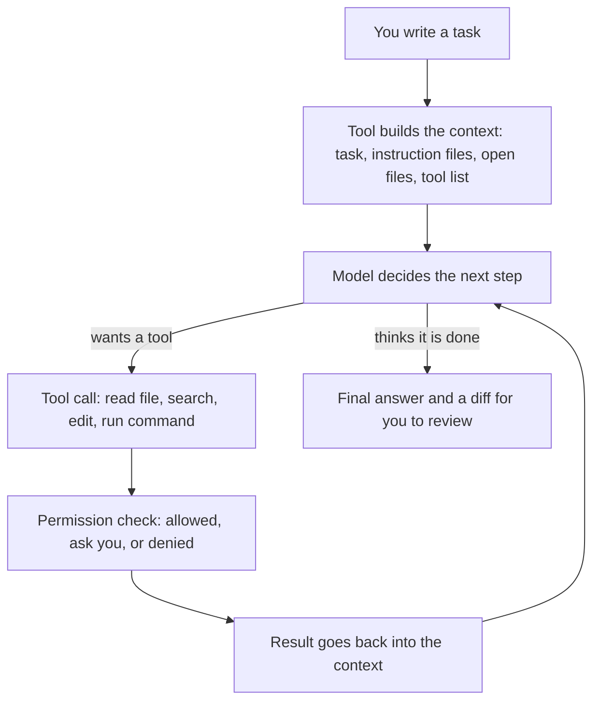
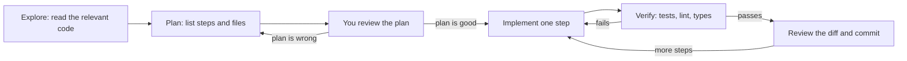

# Using AI coding tools effectively

> This document explains how AI coding tools work, how to give them good context, how to work with them step by step (plan, small diffs, tests, review), where they help and where they hurt, and how teams use them well. It ends with interview questions such as "How do you use AI daily?" and "Did AI ever give you a wrong answer?". Product details are checked against the official docs as of October 2026. These tools change every few months, so learn the ideas first and the product names second.

**Before this:** nothing special · [How to explain technical answers](../11-coding-interviews/01-how-to-explain-technical-answers.md) · [Debugging and code review](../11-coding-interviews/06-debugging-and-code-review.md) · **Interview questions:** [jump to the interview section](#interview-questions)

## Table of contents

1. [Concepts](#concepts)
   1. [Why this topic comes up in interviews](#why-this-topic-comes-up-in-interviews)
   2. [The landscape: three kinds of AI coding tools](#the-landscape-three-kinds-of-ai-coding-tools)
   3. [How an AI coding agent works](#how-an-ai-coding-agent-works)
   4. [What the model knows and what it does not know](#what-the-model-knows-and-what-it-does-not-know)
   5. [Giving good context: the five parts of a good task](#giving-good-context-the-five-parts-of-a-good-task)
   6. [Project instruction files](#project-instruction-files)
   7. [A working loop: explore, plan, implement, verify, review](#a-working-loop-explore-plan-implement-verify-review)
   8. [Small diffs and save points](#small-diffs-and-save-points)
   9. [Test-driven prompting](#test-driven-prompting)
   10. [Letting the agent run commands](#letting-the-agent-run-commands)
   11. [Reviewing AI-generated code](#reviewing-ai-generated-code)
   12. [When the agent is stuck](#when-the-agent-is-stuck)
   13. [Good and poor use cases](#good-and-poor-use-cases)
   14. [Prompt examples: before and after](#prompt-examples-before-and-after)
   15. [Measuring productivity honestly](#measuring-productivity-honestly)
   16. [Team practices](#team-practices)
2. [Interview questions](#interview-questions)
3. [Quick revision](#quick-revision)
4. [Summary](#summary)
5. [References](#references)

---

## Concepts

### Why this topic comes up in interviews

Most teams now use some AI coding tool. So interviewers want to know three things:

1. **Do you use AI with judgment?** Can you say where it helps and where it is risky?
2. **Do you still own the result?** If the AI writes a bug, it is still your bug. Can you review, test and explain the code?
3. **Are you specific?** "I use Copilot sometimes" is weak. "I ask the agent to write a plan first, I review the plan, then it implements in small steps and runs the tests" is strong.

The good news: the skills that make you good with AI tools are the same skills that make you a good engineer. You need to explain a task clearly, break it into steps, define "done", test it, and review code. AI makes these skills **more** important, not less.

A note on words used in this document:

- **LLM (large language model):** the AI model that reads text and writes text. It is explained in [LLM fundamentals for developers](03-llm-fundamentals-for-developers.md).
- **Prompt:** the text you send to the model.
- **Context:** everything the model can see when it answers: your prompt, files the tool added, earlier messages, tool results.
- **Agent:** a program where the model can call tools (read files, run commands, edit code) in a loop until the task is done. Agents are explained deeply in [Building basic AI agents](05-building-basic-ai-agents.md).
- **Diff:** the set of line changes between the old and new code.

---

### The landscape: three kinds of AI coding tools

There are three styles of AI help. Most products now offer all three, so think in styles, not brands.

| Style | What it does | You stay in control by | Good for |
| --- | --- | --- | --- |
| **Inline completion** | Suggests the next line or block as you type. You press Tab to accept. | Accepting or ignoring each suggestion | Boilerplate, repetitive code, obvious next lines |
| **Chat** | You ask a question in a side panel. It answers, maybe with code you copy or apply. | Reading the answer and applying it yourself | Explaining code, small snippets, "how do I…" questions |
| **Agentic (agent mode)** | You give a task. The tool reads files, edits many files, runs commands and tests, and repeats until done. | Approving actions, reviewing the diff | Multi-file changes, refactors, test writing, bug fixes with a clear check |

Some agents also run **in the cloud**: you assign a task (for example a GitHub issue) and the agent works in a remote environment and opens a pull request for you to review.

**Common tools as of October 2026** (this is not a ranking, and features change often):

| Tool | Where it runs | Styles it offers |
| --- | --- | --- |
| **GitHub Copilot** | VS Code, Visual Studio, JetBrains and other IDEs; GitHub.com; Copilot CLI | Inline suggestions, chat, agent mode in the IDE, a cloud agent that works on GitHub (GitHub renamed "Copilot coding agent" to "Copilot cloud agent"), and Copilot code review on pull requests |
| **Cursor** | Its own editor (based on VS Code) | Tab completion, chat, agent; rules files for project instructions |
| **Claude Code** | Terminal, VS Code and JetBrains extensions, desktop app, web | Mainly agentic: reads the codebase, edits files, runs commands, with permission rules |
| **Others** | For example OpenAI Codex, and many tools listed on agents.md | Mostly agentic tools that also read an `AGENTS.md` file |

In an interview, do not argue which tool is "best". Say which one you used, what you used it for, and how you controlled quality. If the company uses a different tool, the same skills transfer.

---

### How an AI coding agent works

An agent is not magic. It is a loop around a model. Here is a simplified picture of what happens when you type "add a `status` filter to the orders endpoint":



Step by step:

1. **Context assembly.** The tool collects text for the model: your message, a system prompt from the tool vendor, your project instruction files (like `CLAUDE.md`), maybe the open file, and a list of **tools** the model may call (read file, search, edit file, run a terminal command).
2. **The model decides.** The model does not "run" anything. It only writes text. When it wants to act, it writes a structured **tool call**, for example "read `src/orders/orders.service.ts`".
3. **The tool executes it.** The agent program (Copilot, Cursor, Claude Code…) checks permissions, runs the action on your machine, and adds the result to the context.
4. **Repeat.** The model sees the result and decides the next step: read another file, edit, run tests, read the error, fix it.
5. **Stop.** When the model thinks the task is done (or a limit is hit), it writes a summary. You review the diff.

Three practical lessons come from this picture:

- **The model only knows what is in the context.** If the agent did not read a file, it does not know what is inside. It may guess, and a guess can look very confident.
- **Running tests is a tool too.** If the agent can run `npm test`, it gets real feedback and can fix its own mistakes. Without a check, it can only guess that the code works.
- **The context window is limited.** The context window is the maximum amount of text the model can see at once (measured in tokens, see [doc 03](03-llm-fundamentals-for-developers.md)). Long sessions fill it with old tool results. Tools then summarize or drop old content, and quality can drop. Starting a fresh session for a new task often helps.

> **Interview tip:** If you can draw this loop and explain "the model proposes, the tool executes, the result goes back", you show you understand agents, not just use them. The same loop is built from scratch in [Building basic AI agents](05-building-basic-ai-agents.md), and connecting extra tools (Jira, GitHub) through MCP is in [MCP setup and integrations](06-mcp-model-context-protocol-setup-and-integrations.md).

---

### What the model knows and what it does not know

| The model usually knows | The model does not know (unless you give it) |
| --- | --- |
| Common languages, frameworks and patterns from its training data | Your business rules ("orders over 10,000 need manager approval") |
| Popular library APIs, up to its training cutoff | Library versions in **your** `package.json`, and API changes after its cutoff |
| General best practices | Your team conventions (folder structure, naming, error format) |
| How to read a stack trace | What happened in production yesterday |
| | Which files are important, which are legacy, which are generated |

Two consequences:

- **Version drift.** The model may write Angular code in an older style (for example `NgModule`-based) when your project uses standalone components and signals. Or it may use an Express 4 pattern in an Express 5 project. Fix: say the versions in your prompt or instruction file, and ask it to read `package.json` first.
- **Hallucination.** Hallucination means the model writes something that sounds right but is false: a function that does not exist, a config option that was never real, an npm package that does not exist. The risk is highest for rare libraries and new versions. Treat every unfamiliar API name as "unverified until I check the docs or the type definitions". The security side of this (fake packages that attackers register) is in [AI security and responsible use](02-ai-security-and-responsible-use.md).

---

### Giving good context: the five parts of a good task

A good prompt for a coding task looks like a good ticket written for a new team member. It has five parts:

| Part | Question it answers | Example |
| --- | --- | --- |
| **Goal** | What should change, and why? | "Add a `status` filter to `GET /api/orders` so support staff can see only `pending` orders." |
| **Context** | Where in the code? What already exists? | "Routes are in `src/orders/orders.routes.ts`, logic in `orders.service.ts`. We validate input with Zod (see `src/users/users.schema.ts` as an example)." |
| **Constraints** | What must not change? Which style? | "Do not change the response shape. No new dependencies. Keep the existing pagination." |
| **Examples** | What does good output look like? | "Follow the same pattern as the `role` filter in `users.routes.ts`." |
| **Acceptance criteria** | How do we know it is done? | "Invalid status returns 400 with our standard error body. Add tests in `orders.routes.test.ts`. `npm test` passes." |

You do not need all five every time. A one-line rename needs none. But for anything that touches more than one file, the five parts save time, because a wrong first attempt costs more than a longer prompt.

Some extra habits that help:

- **Point to files instead of pasting them.** Agents can read files. Say "read `orders.service.ts` and `users.schema.ts` first". Most tools also let you attach a file with `@` or `#` mentions.
- **Give an existing example from your codebase.** "Do it like X" is the strongest instruction. The model copies patterns very well.
- **Say what you do NOT want.** "Do not add a new library", "do not touch the migration files", "do not change public method names".
- **Ask it to ask.** "If anything is unclear, ask me before writing code." This avoids a big wrong diff.
- **Paste the real error.** For bugs, paste the full stack trace and the command that produced it, not "it doesn't work".

---

### Project instruction files

You will repeat some things in every prompt: "we use pnpm", "tests use Vitest", "never edit generated files". Instead, write them once in a **project instruction file**. The tool loads it at the start of every session. Think of it as a README for the AI.

Each tool has its own file name (verified in each tool's docs, October 2026):

| Tool | Project file(s) | Notes |
| --- | --- | --- |
| **Claude Code** | `CLAUDE.md` or `.claude/CLAUDE.md` at the project root; `.claude/rules/*.md` for topic files | `CLAUDE.local.md` for personal notes (add it to `.gitignore`); `~/.claude/CLAUDE.md` for your personal defaults; `/init` generates a first draft. It can also read `AGENTS.md` when there is no `CLAUDE.md`. |
| **GitHub Copilot** | `.github/copilot-instructions.md` | Also `.github/instructions/*.instructions.md` with an `applyTo` glob (for example only for `**/*.ts`), and `AGENTS.md` |
| **Cursor** | `.cursor/rules/*.mdc` | Front matter fields `description`, `globs`, `alwaysApply` decide when a rule is used. Cursor also reads `AGENTS.md`. |
| **Many tools** | `AGENTS.md` | An open, plain Markdown format now stewarded by the Agentic AI Foundation (Linux Foundation). Read by OpenAI Codex, Cursor, VS Code Copilot and many others. |

If your team uses several tools, a common pattern is: keep the real content in `AGENTS.md`, and make the other files short. For example Claude Code supports `@path` imports, so a `CLAUDE.md` can contain the line `@AGENTS.md` to include it.

**What to put in it.** Things the AI cannot easily discover, and that matter on almost every task:

```markdown
# Project notes for AI assistants

## Stack
- Angular 20 (standalone components, signals), TypeScript strict mode
- Node 22 + Express 5 API in /server, PostgreSQL via Prisma
- Package manager: pnpm (never npm or yarn)

## Commands
- Install: pnpm install
- Unit tests: pnpm test (Vitest). Run a single file: pnpm test -- src/app/orders
- Lint and types: pnpm lint && pnpm typecheck
- Run these before saying a task is done.

## Conventions
- API errors use the shape { error: { code, message } } (see server/src/errors.ts)
- Validate every request body and query with Zod schemas in *.schema.ts
- Angular: use the inject() function, OnPush change detection, no NgModules
- Do not edit files in /generated or /prisma/migrations by hand

## Gotchas
- Dates are stored in UTC; format them only in the UI (DatePipe)
- The legacy /billing folder has no tests; ask before changing it
```

**Tips for a good instruction file** (these follow the Claude Code memory docs, and they apply to every tool):

- **Short and concrete.** Claude Code's docs suggest keeping each `CLAUDE.md` under about 200 lines, because long files use context and the model follows them less reliably. "Use 2-space indentation" works better than "format code nicely".
- **Verifiable.** Write rules that you could check in a review. "Run `pnpm lint` before finishing" is checkable. "Write clean code" is not.
- **No secrets.** The file is committed to Git and sent to the model on every request. Never put tokens, passwords or customer data in it.
- **Keep it current.** An outdated instruction ("we use Jest") is worse than none. Review it like code.
- **It is guidance, not enforcement.** The model usually follows it, but not always. For hard rules (for example "never read `.env`"), use the tool's permission settings or hooks. Claude Code's docs say this directly: `CLAUDE.md` is context, not enforced configuration. See [Letting the agent run commands](#letting-the-agent-run-commands) and [doc 02](02-ai-security-and-responsible-use.md).

**Path-specific rules.** Large repositories have different rules for frontend and backend. Copilot `.instructions.md` files use `applyTo`, Cursor rules use `globs`, and Claude Code rules in `.claude/rules/` use a `paths` field. Example Copilot file `.github/instructions/angular.instructions.md`:

```markdown
---
applyTo: "src/app/**/*.ts"
---
- Use standalone components and signals.
- Use inject() instead of constructor injection.
- Every component gets a *.spec.ts file using TestBed.
```

---

### A working loop: explore, plan, implement, verify, review

The single most useful habit with agents is: **plan first, then implement.** Here is the loop that works for non-trivial tasks:



1. **Explore.** "Read the orders module and explain how filtering works today. Do not change anything yet." You check that the agent understood the code. If its explanation is wrong, its code will be wrong too.
2. **Plan.** "Write a short plan: which files you will change, what you will add, which tests you will write." Many tools have a mode for this. In Claude Code, **plan mode** lets the agent read files and run read-only commands but not edit your source files (`claude --permission-mode plan`, or press `Shift+Tab` during a session to cycle modes).
3. **Review the plan.** This is the cheapest moment to catch mistakes. A wrong plan costs one minute to fix. A wrong 400-line diff costs an hour.
4. **Implement in steps.** "Do step 1 only. Run the tests." Then step 2.
5. **Verify.** Tests, lint, type check, and for UI work, open the page and look at it.
6. **Review and commit.** Read the diff as if a colleague wrote it. Commit when a step works (see the next section).

For a tiny change (fix a typo, rename a variable), skip the plan. Plan-first is for tasks where you could not describe the full diff in one sentence.

---

### Small diffs and save points

Agents can change 20 files in a minute. That is the danger. A huge diff is hard to review, and when something breaks, you cannot tell which change broke it.

Rules that keep you safe:

- **One task, one session, one small diff.** "Add the filter" is one task. "Add the filter and refactor the service and upgrade Zod" is three tasks.
- **Commit working steps.** A Git commit is your save point. If the next step goes wrong, you can go back with `git restore` or `git reset` (see [Git for interviews](../11-coding-interviews/08-git-for-interviews.md)). Some tools also have their own checkpoints or "undo" for agent edits, but Git is the one your whole team understands.
- **Use a branch.** Let the agent work on a feature branch, never directly on `main`.
- **Read `git diff` before every commit.** Do not commit what you did not read.
- **Watch for "drive-by" changes.** Agents sometimes reformat files, rename things or "improve" code you did not ask about. Reject those changes or ask the agent to revert them. They make review harder and can hide bugs.

---

### Test-driven prompting

Tests are the best way to tell an agent what "correct" means, because tests are precise and the agent can run them itself.

**Pattern 1: tests first, then code.**

```markdown
Task: add a function `calculateDiscount(cart)` in src/pricing/discount.ts.

Step 1 only: write unit tests in src/pricing/discount.test.ts (Vitest) for these rules.
Do not write the implementation yet.
- Orders below 1000 get no discount.
- Orders from 1000 to 4999.99 get 5%.
- Orders of 5000 or more get 10%, but the discount is capped at 750.
- A cart with no items returns 0.
- Negative prices throw a RangeError.

Show me the tests. I will review them before you implement.
```

After you approve the tests: "Now implement `calculateDiscount` so the tests pass. Do not change the tests." That last sentence matters. A common agent failure is **changing the test to match buggy code**, or weakening an assertion so it passes.

**Pattern 2: reproduce a bug with a failing test first.**

```markdown
Bug: GET /api/orders?page=2 returns the same items as page 1.
1. Write a test that reproduces this bug. Run it and show me that it fails.
2. Then find the cause and fix it. Run the test again.
```

A failing test proves the agent understood the bug. A passing test after the fix proves the fix. Without step 1, the agent may "fix" something else.

**Watch out for AI-written tests that only mirror the code.** If you ask "write tests for this function", the AI reads the function and writes tests that check what the code does now, including its bugs. Those tests pass and prove nothing. Better: give the rules (from the ticket), not only the code, and review the test cases yourself. Ask: "Which edge cases are missing?"

Here is a small example. The function and tests below were type-checked in a scratch project. The rules come from the prompt above, not from reading the code:

```ts
// src/pricing/discount.ts
export interface CartItem {
  price: number;
  quantity: number;
}

export function calculateDiscount(items: CartItem[]): number {
  if (items.length === 0) return 0;
  if (items.some((i) => i.price < 0)) throw new RangeError("Price cannot be negative");

  const total = items.reduce((sum, i) => sum + i.price * i.quantity, 0);
  if (total < 1000) return 0;
  if (total < 5000) return round2(total * 0.05);
  return Math.min(round2(total * 0.1), 750);
}

function round2(n: number): number {
  return Math.round(n * 100) / 100;
}
```

When you review AI-written tests for this, check the **boundaries** the rules define: 999.99, 1000, 4999.99, 5000, and a large total where the cap of 750 applies (7500 gives exactly 750, 10000 would give 1000 without the cap). If the AI wrote only "1500 gives 75", the tests are too weak.

---

### Letting the agent run commands

An agent that can run `npm test` is much more useful than one that only edits files. But "run any command" is also how accidents happen (deleting files, pushing to `main`, reading `.env`). Tools give you three levers:

1. **Approval prompts.** By default, most agents ask before running a command or editing a file.
2. **Allowlists and denylists.** You pre-approve safe commands and block dangerous ones.
3. **Modes.** For example Claude Code has `default` (asks on first use), `acceptEdits` (accepts file edits automatically), `plan` (read-only exploration), `auto` (a classifier reviews actions), `dontAsk` and `bypassPermissions` (skips prompts; the docs say to use it only in isolated environments like containers or VMs).

Example: a team-shared Claude Code project file `.claude/settings.json` that allows tests and lint, blocks pushes, and protects secrets (rule syntax from the Claude Code permissions docs):

```json
{
  "permissions": {
    "allow": ["Bash(pnpm test *)", "Bash(pnpm lint)", "Bash(git diff *)"],
    "deny": ["Bash(git push *)", "Read(./.env)", "Read(./.env.*)", "Read(./secrets/**)"]
  }
}
```

Rules are checked in the order **deny, then ask, then allow**, so a deny always wins.

In VS Code with Copilot agent mode, a similar idea is the `chat.tools.terminal.autoApprove` setting, where `true` auto-approves a command pattern and `false` requires approval. VS Code's docs warn that terminal auto-approval is a convenience, **not a security boundary**: commands can be written in ways that the pattern does not match.

That warning is true for every tool. Allow and deny lists reduce mistakes, but they are not a real wall. The real wall is a **sandbox or container**, and least-privilege credentials. That is the subject of [AI security and responsible use](02-ai-security-and-responsible-use.md#permission-modes-allowlists-and-sandboxes).

**Hooks** are a related feature: your own script that runs automatically before or after an agent action. For example, Claude Code's hooks guide shows a `PostToolUse` hook that runs Prettier on every file the agent edits:

```json
{
  "hooks": {
    "PostToolUse": [
      {
        "matcher": "Edit|Write",
        "hooks": [{ "type": "command", "command": "jq -r '.tool_input.file_path' | xargs npx prettier --write" }]
      }
    ]
  }
}
```

The difference from an instruction file: an instruction ("please format code") is a request the model may forget. A hook always runs.

---

### Reviewing AI-generated code

AI code often **looks** clean: good names, comments, consistent style. That makes it easy to approve without reading. Review it with more care than human code, not less, because the mistakes are different. A human who writes nice code usually also understands it. A model can write nice code with a wrong assumption inside.

A review checklist for AI diffs (use it together with the general checklist in [Debugging and code review](../11-coding-interviews/06-debugging-and-code-review.md#code-review-what-to-check)):

| Check | What to look for |
| --- | --- |
| **Does it do what I asked?** | Read the diff against the acceptance criteria. Agents sometimes solve a slightly different problem. |
| **Invented APIs** | Function names, config options or packages you have never seen. Check the type definitions or the docs. |
| **Version mismatch** | Old patterns (for example `NgModule` in a standalone Angular app, callback style in a promise codebase). |
| **Edge cases** | Empty arrays, `null`, zero, very large input, time zones, concurrency, errors from the network. |
| **Error handling** | Swallowed errors (`catch {}`), errors logged but not returned, missing `await`. |
| **Security** | Input validation, SQL built with string concatenation, `innerHTML`, secrets in code, missing authorization checks. Full list in [doc 02](02-ai-security-and-responsible-use.md#insecure-patterns-in-generated-code). |
| **Tests** | Do the tests check the rules, or only mirror the code? Did the agent weaken or delete a test? |
| **Scope creep** | Unrelated reformatting, renamed files, new dependencies you did not ask for. |
| **Duplication** | A new helper that already exists elsewhere in the codebase. Models do not always search before writing. |
| **Can I explain it?** | If you cannot explain a line to a colleague, do not merge it. Ask the AI to explain it, then verify the explanation. |

A good trick: ask a **fresh** session (or a different model) to review the diff: "Review this diff for bugs, security problems and missing tests. Be critical." It finds different problems than the session that wrote the code, because it does not share the same assumptions. But this is an extra filter, not a replacement for your own review.

---

### When the agent is stuck

Sometimes the agent goes in circles: it fixes one test and breaks another, or it tries the same idea three times. What to do:

1. **Stop it early.** Do not let it try ten times. After two failed attempts, step in.
2. **Read the error yourself.** Often you see the real cause in 30 seconds (a wrong import path, a missing env variable, a mocked module).
3. **Give a hint, not a new task.** "The test fails because `Date.now()` is not mocked. Use `vi.useFakeTimers()`."
4. **Shrink the task.** "Only make the first test pass."
5. **Start a fresh session.** A long session is full of failed attempts, and the model keeps being influenced by them. Start again with a short summary: what you want, what you learned, what did not work.
6. **Revert and do it yourself.** Some tasks are faster by hand. That is fine. Using AI is a choice per task, not a rule.

---

### Good and poor use cases

| Usually a good fit | Why |
| --- | --- |
| Boilerplate (DTOs, interfaces, form controls, CRUD routes) | Repetitive and easy to check |
| Unit tests from clear rules | Rules are precise; you review the cases |
| Mechanical refactors (rename, extract function, convert callbacks to async/await) | Clear goal; tests and types catch mistakes |
| Migrations with a pattern (RxJS operators, Angular control flow syntax, Jest to Vitest) | Same change many times; do a few by hand first, then let the agent follow the pattern |
| Explaining legacy code | Fast first understanding; you verify by reading the important parts |
| Documentation, README, JSDoc, PR descriptions | Easy to review; you fix the facts |
| Regular expressions | Ask for the regex **and** a list of test strings that should and should not match, then run them |
| SQL drafts | Good first draft; you check indexes, joins, `NULL` handling and run `EXPLAIN` |
| Debugging with a full stack trace | Good at reading traces and suggesting where to look |
| Scripts and one-off tools (data cleanup, log parsing) | Low risk, quick to test |

| Usually a poor fit (or needs extra care) | Why |
| --- | --- |
| Security-critical code (auth, crypto, payments, permissions) | Small mistakes are expensive; needs expert review anyway |
| Unclear requirements | The AI will fill gaps with guesses; clarify with people first |
| Big architecture decisions | Needs context about the team, budget, and future plans that the AI does not have. AI can list options; you decide. |
| Very new or rare libraries | High chance of invented APIs |
| Performance tuning without measurements | The AI guesses; you need a profiler and numbers |
| Code you are not allowed to share | Company policy comes first (see [doc 02](02-ai-security-and-responsible-use.md#data-protection-what-you-may-share-with-ai-tools)) |
| Learning a new concept from zero | If it writes everything, you learn nothing. Ask it to explain and quiz you instead. |

---

### Prompt examples: before and after

The "before" prompts below are realistic first attempts. The "after" prompts use the five parts. You do not need to memorize them; the pattern is what matters.

#### Example 1: an Angular component

**Before:**

```markdown
Make an Angular component for showing orders.
```

What goes wrong: the AI picks its own data shape, maybe uses `NgModule`, fetches data inside the component with `HttpClient` directly, has no loading or error state, and no tests.

**After:**

```markdown
Create a standalone Angular component `OrderListComponent` in
src/app/orders/order-list/.

Context:
- Read src/app/orders/order.model.ts (the Order type) and
  src/app/orders/orders.service.ts (getOrders(status?) returns Observable<Order[]>).
- Follow the style of src/app/users/user-list/ (signals, OnPush, inject()).

Requirements:
- Show a table: id, customer name, total (CurrencyPipe, EUR), status, createdAt (DatePipe).
- A select box to filter by status (all, pending, paid, cancelled).
- Show a loading text while loading, and an error message with a Retry button on error.
- Empty state: "No orders found".

Constraints:
- No new dependencies. No NgModules. Do not change OrdersService.

Done when:
- order-list.component.spec.ts covers: renders rows, filter calls getOrders with the
  status, loading state, error state with retry, empty state.
- pnpm test and pnpm lint pass.

First, reply with a short plan (files and test cases). Wait for my OK before coding.
```

#### Example 2: an Express endpoint

**Before:**

```markdown
Write an endpoint to update an order's status.
```

What goes wrong: no validation, no authorization check (any logged-in user can change any order), no rule for allowed status changes, a different error format than the rest of the API.

**After:**

```markdown
Add PATCH /api/orders/:id/status in server/src/orders/.

Read first: orders.routes.ts, orders.service.ts, server/src/errors.ts,
server/src/auth/requireRole.ts, and users.routes.ts (example of a validated route).

Rules:
- Body: { status: "paid" | "shipped" | "cancelled" }. Validate with a Zod schema
  in orders.schema.ts. Invalid body -> 400 in our standard error shape.
- Only users with role "admin" or "support" may call it (use requireRole).
- Allowed transitions: pending -> paid | cancelled, paid -> shipped | cancelled.
  Anything else -> 409 with code "INVALID_TRANSITION".
- Unknown order id -> 404.
- Do the read and update in one transaction (see how createOrder does it).

Do not change other endpoints. No new dependencies.

Tests (supertest, in orders.routes.test.ts): one test per rule above, including
403 for a "customer" user. Run pnpm test and fix failures.
```

Notice that the "after" prompt contains **decisions only you can make**: who may call it, which transitions are allowed, which error code. If you do not write them, the AI decides for you, silently.

Part of the result you would review is the validation and the transition rule. A version of it, type-checked in a scratch project with Zod 4:

```ts
import { z } from "zod";

export const UpdateStatusBody = z.object({
  status: z.enum(["paid", "shipped", "cancelled"]),
});
export type UpdateStatusBody = z.infer<typeof UpdateStatusBody>;

type OrderStatus = "pending" | "paid" | "shipped" | "cancelled";

const allowed: Record<OrderStatus, readonly OrderStatus[]> = {
  pending: ["paid", "cancelled"],
  paid: ["shipped", "cancelled"],
  shipped: [],
  cancelled: [],
};

export function canTransition(from: OrderStatus, to: OrderStatus): boolean {
  return allowed[from].includes(to);
}
```

In review you check: is the transition table exactly the business rule? Is the role check on the route? Does the 409 use the team's error shape? Runtime validation with Zod is explained in [Runtime validation and type-safe APIs](../03-typescript/11-runtime-validation-and-type-safe-apis.md).

#### Example 3: unit tests for existing code

**Before:**

```markdown
Write tests for utils/date.ts.
```

What goes wrong: tests that mirror the current code, no time zone cases, flaky tests that depend on the real current date.

**After:**

```markdown
Write Vitest tests for formatRelativeTime() in src/utils/date.ts.

Expected behavior (from the product spec, not from the code):
- < 60 seconds ago -> "just now"
- < 60 minutes -> "5 min ago"
- < 24 hours -> "3 h ago"
- yesterday (calendar day in the user's time zone) -> "yesterday"
- otherwise -> "12 Mar 2026"

Rules:
- Freeze time with vi.useFakeTimers() and vi.setSystemTime().
- Include boundaries: 59 s, 60 s, 59 min, 60 min, 23:59 h, and a case around midnight
  in the Asia/Kolkata time zone.
- If the current code disagrees with the spec, do NOT change the test to match.
  List the disagreements for me instead.
```

The last rule turns the AI into a bug finder instead of a bug confirmer.

#### Example 4: debugging with a stack trace

**Before:**

```markdown
My app crashes, fix it.
```

**After:**

```markdown
`pnpm start` crashes on startup after I upgraded to Node 22. Full output:

<paste the complete error and stack trace here>

What I know:
- It worked on Node 20.
- The crash is in server/src/config/load.ts line 14.

Please explain the cause first, with the line that triggers it.
Do not change code until I confirm the cause.
```

Asking for the cause **before** the fix stops the agent from making random changes until the error disappears (which can hide the real problem).

#### Example 5: regex and SQL drafts

```markdown
Write a JavaScript regex that matches Indian PIN codes (6 digits, first digit 1-9).
Also give me 5 strings that must match and 5 that must not, then write a small
Vitest test with them.
```

```markdown
Draft a PostgreSQL query: top 10 customers by total paid order value in the last 90 days.
Tables: orders(id, customer_id, status, total, created_at), customers(id, name).
Only status = 'paid'. Explain which index would help, and show the EXPLAIN command
I should run to check it.
```

For both, you run the result. A regex or query is only "done" when you have seen it work on real examples.

#### Example 6: explaining legacy code

```markdown
Explain what server/legacy/invoice-builder.js does. I need to change how taxes are rounded.
1. Summarize the main flow in 5-10 bullets.
2. List every place where tax is calculated or rounded, with line numbers.
3. List side effects (database writes, emails, files).
4. What could break if rounding changes? Which callers depend on it?
Do not change any code.
```

Then **verify** the important claims by opening the lines it points to. The explanation is a map, and maps can be wrong.

---

### Measuring productivity honestly

"AI makes me 10x faster" is not a credible interview answer. Productivity with AI is hard to measure, and published studies have reached different conclusions depending on the task, the codebase and the developer's experience. So be honest and specific.

What you can measure or observe in your own work:

- **Cycle time** for similar tasks: time from starting a ticket to merging the PR.
- **Review effort:** do AI-assisted PRs need more review rounds or fewer?
- **Rework and bugs:** do AI-assisted changes cause more follow-up fixes or production bugs?
- **Where time actually goes:** writing code may be faster, but reviewing, debugging and correcting AI output also take time. Count both.
- **Test coverage and quality** over time.

Things that look like productivity but are not:

- More lines of code. More code is more to maintain.
- More PRs, if each PR needs more fixes later.
- Accepting many suggestions, if you later delete or fix them.

A good honest answer sounds like: "It clearly saves me time on tests, boilerplate and understanding unfamiliar code. On complex business logic it saves little, because I spend the time on review anyway. I watch whether AI-assisted PRs cause more rework, and I do not merge code I cannot explain."

---

### Team practices

AI tools work best when the team agrees on how to use them. Typical practices:

- **Shared instruction files in the repo.** `AGENTS.md`, `CLAUDE.md`, `.github/copilot-instructions.md` or Cursor rules are reviewed in pull requests like code. When someone notices the AI keeps making the same mistake, they add one line to the file.
- **Shared permission settings.** Commit the safe allowlist (for example `.claude/settings.json`) so everyone gets the same guardrails. Personal settings stay in local, ignored files.
- **The author owns the code.** "The AI wrote it" is never an excuse in a review or an incident review. If you open the PR, you understand it and you answer for it.
- **AI in code review.** Tools like Copilot code review can comment on pull requests. On GitHub, Copilot's reviews are comments by default and do not count as a required approval. Good use: an extra first pass that catches simple problems. Bad use: replacing human review. A human still approves.
- **PR descriptions.** AI can draft a PR description from the diff. You correct it: the AI knows **what** changed, but often not **why** (the business reason, the ticket, the trade-off you chose). Add those yourself.
- **Commit hygiene.** Small commits with clear messages (see [Conventional Commits](../11-coding-interviews/08-git-for-interviews.md#conventional-commits-and-good-messages)). Some teams want AI-assisted commits marked, for example with a `Co-authored-by:` trailer, and some tools add one automatically. Follow your team's policy.
- **Pairing with AI, and with people.** A useful pattern for juniors: write the code yourself first, then ask the AI to review it. Or let the AI write, then explain every line to a senior. Either way, the human must understand the result.
- **Do not paste what you may not share.** Use only approved tools and accounts for company code (see [doc 02](02-ai-security-and-responsible-use.md)).
- **Agree on what not to delegate.** For example: database migrations, auth code and infrastructure changes always get a senior review, whoever (or whatever) wrote them.

---

## Interview questions

These questions are about **your** habits, so prepare one or two real stories from your own work. The sample answers use an Angular + Node.js project; replace the details with yours. For how to structure spoken answers, see [How to explain technical answers](../11-coding-interviews/01-how-to-explain-technical-answers.md).

### Q1. How do you use AI tools in your daily work?

**What the interviewer is checking:** Real, specific use; judgment about where it helps; ownership of the result.

**What to say (30–60 seconds):**
> "I use it in three ways. Inline completion for boilerplate while I type. Chat to understand unfamiliar code or an error message quickly. And an agent for well-defined multi-file tasks, like adding an endpoint with tests or migrating components to a new pattern. For agent tasks I give it the files to read, the constraints and the acceptance criteria, I ask for a plan first, and I let it run the tests. Then I review the diff like any colleague's code. I don't use it to make design decisions or for security-critical logic without careful review. And I only use the tools my company approved for our code."

**Deeper explanation:** The strong parts of this answer are the **three styles**, a **process** (context, plan, tests, review), **limits**, and **policy**. Weak answers are either "I don't use AI" (sounds out of date for most roles) or "I use it for everything" (sounds careless).

**Follow-up questions and how to answer them:**
- **"Which tool?"** — Name the one you really used and one feature you like, for example "Claude Code, mainly plan mode and running tests", or "Copilot agent mode in VS Code with our `copilot-instructions.md`". Then add: "The habits transfer to any tool."
- **"How much of your code is AI-written?"** — Do not invent a percentage. "It varies by task. For tests and boilerplate, a lot of the first draft. For business logic, much less. Every line is reviewed by me either way."
- **"What is your best example?"** — Have one story ready: task, how you prompted, what it got wrong, how you caught it, the result.

**Common mistakes:** Vague answers. Claiming big speed-ups without evidence. Not mentioning review or testing.

**Real-project example:** "Last month I migrated about 40 Angular templates from `*ngIf`/`*ngFor` to the new `@if`/`@for` control flow. I did three by hand, put them in the prompt as examples, let the agent do the rest in batches of ten with the tests running after each batch, and reviewed each batch's diff."

### Q2. What is the difference between inline completion, chat and an agent?

**What the interviewer is checking:** That you understand the tools, not just their names.

**What to say (30–60 seconds):**
> "Inline completion predicts the next lines while I type; I accept or ignore each suggestion, so I'm fully in control but it only sees a little context. Chat is a conversation; it can explain and generate snippets, and I decide what to apply. An agent gets a task and works in a loop: it reads files, edits them, runs commands like tests, reads the results and continues until it's done. Agents can do much more, but they also need more guardrails: permissions, small tasks, and careful review of the final diff."

**Follow-up questions and how to answer them:**
- **"Which do you use most?"** — Answer honestly, and explain why for your type of work.
- **"What is a cloud agent?"** — An agent that runs on a remote machine instead of your laptop, often started from an issue, and it opens a pull request for review. Example: GitHub's Copilot cloud agent. Its pull requests still need human review; on GitHub it cannot approve or merge its own PR.

**Common mistakes:** Saying an agent "understands the whole codebase". It only knows what it has read into its context.

**Real-project example:** "I use inline completion all day, chat for 'what does this RxJS chain do', and the agent maybe once or twice a day for a bounded task."

### Q3. How does an AI coding agent work under the hood?

**What the interviewer is checking:** A correct mental model: model + tools + loop + permissions.

**What to say (30–60 seconds):**
> "The tool builds a context: my task, a system prompt, project instruction files, and a list of tools like read file, edit file and run command. The model can't run anything itself; it replies with a tool call. The agent program checks permissions, executes the call on my machine, and puts the result back into the context. The model reads the result and decides the next step. This loop repeats until the model says it's done or a limit is hit. So the quality depends on what's in the context and on the feedback it gets, which is why letting it run tests helps so much."

**Deeper explanation:** See [How an AI coding agent works](#how-an-ai-coding-agent-works). The same loop is built in code in [doc 05](05-building-basic-ai-agents.md). Extra tools such as Jira or GitHub can be plugged in through MCP ([doc 06](06-mcp-model-context-protocol-setup-and-integrations.md)).

**Follow-up questions and how to answer them:**
- **"Why does the agent get worse in long sessions?"** — The context window fills with old file contents and failed attempts. Tools then compact or drop older content, and important details can be lost. A fresh session with a short summary often works better.
- **"Who actually runs `npm test`?"** — The agent program on your machine (or in its sandbox), not the model. The model only asks for it.

**Common mistakes:** Thinking the model has live access to your disk or the internet by itself.

**Real-project example:** "When an agent kept using an old API, I checked what it had read and saw it never opened our `package.json`. I told it to read it first, and the problem went away."

### Q4. Show me how you would prompt an AI to build an Angular component.

**What the interviewer is checking:** Whether you give context, constraints and acceptance criteria, and plan before code.

**What to say (30–60 seconds):**
> "I'd treat the prompt like a ticket for a new team member. I name the component and folder, point it to the model and service files and to an existing component that has the style we want. I list the requirements, including loading, error and empty states. I add constraints like 'standalone, signals, OnPush, no new dependencies, don't change the service'. I define done: which test cases must exist, and that tests and lint pass. And I ask for a plan first, so I can correct it before it writes code."

**Deeper explanation:** The full prompt is in [Example 1](#example-1-an-angular-component). Being specific about versions matters for Angular, because the model may otherwise use older patterns.

**Follow-up questions and how to answer them:**
- **"What if it still uses NgModules?"** — Add it to the project instruction file once ("standalone components only"), so it applies to every future task.
- **"Would you let it write the tests too?"** — Yes, but I list the test cases myself, and I check that they test behavior, not implementation details.

**Common mistakes:** A one-line prompt. Not mentioning the existing code style. No definition of done.

**Real-project example:** "Pointing to an existing component as the example was the single biggest improvement; the output matched our code style from the first try."

### Q5. How would you prompt for a new Express endpoint?

**What the interviewer is checking:** That you include the decisions only a human can make: auth, validation, error format, business rules.

**What to say (30–60 seconds):**
> "Besides the route and files, I write down the decisions: the request schema and how it's validated, who is allowed to call it, the business rules, like which status transitions are allowed, and the error codes in our standard error format. Then I ask for one test per rule, including the unauthorized case. If I don't write those decisions, the AI will make them for me, and I might not notice in the diff. Authorization especially: AI-generated endpoints often forget the permission check."

**Deeper explanation:** See [Example 2](#example-2-an-express-endpoint). Authorization is explained in [Authentication and authorization](../07-nodejs-backend/09-authentication-and-authorization.md).

**Follow-up questions and how to answer them:**
- **"How do you check it did not forget the auth check?"** — A test that calls the route as a user without the role and expects 403. Tests make the rule visible.

**Common mistakes:** Letting the AI choose the error format or permissions.

**Real-project example:** "In one review I found that an AI-generated `DELETE` route checked that the user was logged in, but not that the record belonged to them. Since then, 'add a test for another user's record' is in my endpoint prompt."

### Q6. How do you use AI to write unit tests without getting useless tests?

**What the interviewer is checking:** Awareness that AI tests can mirror bugs, and a method to avoid that.

**What to say (30–60 seconds):**
> "If you just say 'write tests for this function', the AI reads the code and writes tests that confirm what the code does today, including its bugs. So I give it the expected behavior from the spec, list the boundary cases, and tell it: if the code disagrees with the spec, don't change the test, tell me. I also check that tests are deterministic, for example time is frozen, and that it didn't weaken assertions to make them pass. For a bug, I ask for a failing test first, then the fix."

**Follow-up questions and how to answer them:**
- **"How do you know the tests are good?"** — I review the case list against the rules, check boundaries, and sometimes break the code on purpose to see if a test fails (a quick manual mutation test).
- **"What about snapshot tests?"** — Careful. AI can generate huge snapshots that nobody reads. I prefer specific assertions.

**Common mistakes:** Accepting coverage numbers as proof of quality.

**Real-project example:** "An AI wrote tests for a date formatter that all passed. When I gave it the spec instead, two tests failed, and they showed a real time zone bug around midnight."

### Q7. How do you keep code quality high when using AI?

**What the interviewer is checking:** A system, not just "I am careful".

**What to say (30–60 seconds):**
> "Several layers. Before: good context and a project instruction file with our conventions, and a plan I review. During: small tasks, and the agent runs tests, lint and type checks. After: I read every line of the diff with a checklist: invented APIs, edge cases, error handling, security, and scope creep. Then normal team code review and CI. And one rule: I don't merge code I can't explain."

**Deeper explanation:** See [Reviewing AI-generated code](#reviewing-ai-generated-code). Automated checks (types, lint, tests, CI) matter more with AI, because they catch mistakes at the speed the AI produces code.

**Follow-up questions and how to answer them:**
- **"Doesn't reviewing everything remove the speed-up?"** — Partly. That's why I use AI where review is cheap: tests, boilerplate, mechanical changes. For complex logic, the gain is smaller, and that's fine.
- **"Would you use an AI reviewer?"** — As a first pass, yes. It catches some issues early. A human still approves.

**Common mistakes:** Saying "the AI is usually right, so I just skim".

**Real-project example:** "We added `pnpm typecheck` and `pnpm lint` to our instruction file as the 'done' condition. The number of broken AI-assisted PRs in CI dropped noticeably."

### Q8. What is a project instruction file, and what do you put in it?

**What the interviewer is checking:** Practical setup knowledge.

**What to say (30–60 seconds):**
> "It's a Markdown file in the repo that the AI tool loads at the start of every session, like a README for the AI. Claude Code uses `CLAUDE.md`, Copilot uses `.github/copilot-instructions.md`, Cursor uses rule files in `.cursor/rules`, and many tools read `AGENTS.md`. I put things the AI can't easily discover: the stack and versions, the exact commands for tests and lint, our conventions like the error format, and gotchas like 'don't edit generated files'. I keep it short and concrete, no secrets, and we review changes to it in PRs."

**Follow-up questions and how to answer them:**
- **"Does the AI always follow it?"** — No. It's guidance in the context, not enforcement. For hard rules, I use permission settings or hooks.
- **"How do you support several tools?"** — Keep one main file, often `AGENTS.md`, and have the others import or point to it.

**Common mistakes:** Very long files full of general advice ("write clean code"). Outdated content.

**Real-project example:** "Whenever the agent made the same mistake twice, we added one line. After a few weeks, the file was 60 lines and the repeated mistakes mostly stopped."

### Q9. When would you NOT use AI?

**What the interviewer is checking:** Judgment and risk awareness.

**What to say (30–60 seconds):**
> "When the requirements are unclear, because the AI will fill the gaps with guesses; I clarify with people first. For security-critical code like auth, crypto or payments, I may use it for ideas, but I write and review it very carefully. For code or data I'm not allowed to share with the tool. For architecture decisions that depend on team and business context. With very new libraries where it tends to invent APIs. And when I'm learning something new, I don't let it write the solution; I ask it to explain instead."

**Follow-up questions and how to answer them:**
- **"Would you use it during an incident?"** — Yes for reading logs or stack traces faster, but I verify before acting, and I don't let an agent run commands on production. Also, never paste production data into a tool that's not approved for it.

**Common mistakes:** "Never" or "always" answers.

**Real-project example:** "For a payment webhook signature check, I wrote the code myself from the provider's docs and only asked the AI to review it."

### Q10. Did AI ever give you a wrong answer? What happened?

**What the interviewer is checking:** Honesty, how you caught it, and what you changed afterwards.

**What to say (30–60 seconds):**
> "Yes, several times. One example: I asked for a Prisma query with a specific option, and the AI used an option that doesn't exist; it looked completely plausible. TypeScript caught it at compile time. Another time it 'fixed' a failing test by changing the expected value instead of the code. I caught that in the diff review. Since then, my prompts say 'don't modify tests unless I ask', I always check unfamiliar APIs against the type definitions or docs, and I read the test changes first in every diff."

**Deeper explanation:** Use the STAR structure (situation, task, action, result) from [Project discussion and behavioral](../11-coding-interviews/07-project-discussion-and-behavioral.md). The interviewer wants a real story with a lesson. Inventing a perfect record ("it never gave me a wrong answer") is a red flag.

**Follow-up questions and how to answer them:**
- **"How would a less careful developer have missed it?"** — If there were no types, or if they only looked at the green test result, the bug would have shipped.

**Common mistakes:** Blaming the tool. No lesson learned.

**Real-project example:** As above. Prepare your own; everyone who uses these tools has one.

### Q11. How do you review AI-generated code?

**What the interviewer is checking:** A concrete checklist.

**What to say (30–60 seconds):**
> "First, does it solve the task I asked, not a similar one. Then I look for invented APIs and wrong versions, edge cases like empty input and time zones, error handling, and security: validation, authorization, injection, secrets. I check the tests: do they test the rules, did it weaken any test. And scope: no unrelated reformatting or new dependencies. If a line is unclear, I ask the AI to explain it and then verify the explanation myself. Sometimes I also ask a fresh session to review the diff critically."

**Deeper explanation:** Full table in [Reviewing AI-generated code](#reviewing-ai-generated-code). Security patterns in [doc 02](02-ai-security-and-responsible-use.md#insecure-patterns-in-generated-code).

**Follow-up questions and how to answer them:**
- **"Why more careful than human code?"** — AI code looks polished, so mistakes hide better, and the author (the model) can't explain its intent the way a colleague can.

**Common mistakes:** Only reading the summary the agent writes, not the diff.

**Real-project example:** "I always read test file changes first. It's the fastest way to see if the agent 'cheated'."

### Q12. The agent keeps failing on a task. What do you do?

**What the interviewer is checking:** That you stay in control and do not burn hours.

**What to say (30–60 seconds):**
> "After two failed attempts I stop it and read the error myself; often the cause is simple, like a missing mock or env variable, and a one-line hint fixes it. If not, I shrink the task, or I start a fresh session with a short summary of what I learned, because a long session full of failed attempts tends to repeat them. And sometimes I just revert and do it by hand. The goal is the result, not using AI."

**Common mistakes:** Letting it loop for an hour, or giving up on the tool completely.

**Real-project example:** "An agent kept failing a test because of a time zone difference between my machine and CI. I spotted it in the error output, told it to set `TZ=UTC` in the test script, and it passed."

### Q13. How do you know AI actually makes you more productive?

**What the interviewer is checking:** Honesty and a measured view.

**What to say (30–60 seconds):**
> "I'm careful with big claims. Writing code is faster, but reviewing and fixing AI output also takes time, so I look at the full cycle: time from ticket to merged PR, review rounds, and whether the change needed follow-up fixes. For tests, boilerplate and understanding unfamiliar code, the gain is clear for me. For complex business logic, it's small. More lines of code or more PRs aren't proof of productivity."

**Follow-up questions and how to answer them:**
- **"What does research say?"** — "Results differ depending on the task and the developer's experience. I wouldn't quote one number; I'd measure in our own team."

**Common mistakes:** Quoting invented percentages.

**Real-project example:** "On our team we compared review rounds for AI-heavy PRs and normal ones for a sprint. It showed us that big AI PRs needed more rounds, so we started splitting them."

### Q14. How do you use AI to understand legacy code?

**What the interviewer is checking:** Using AI as a map, then verifying.

**What to say (30–60 seconds):**
> "I ask it to explain the flow, list side effects like database writes and emails, and point to the exact lines for the part I need to change, without editing anything. That gives me a map in minutes. Then I verify the important claims by reading those lines, and before changing anything, I ask it to help write characterization tests that capture the current behavior, so I can refactor safely."

**Deeper explanation:** A **characterization test** records what the code does today (even if it is strange) so you notice when a change alters behavior. This is the one case where "tests that mirror current behavior" are exactly what you want.

**Common mistakes:** Trusting the explanation without checking.

**Real-project example:** See [Example 6](#example-6-explaining-legacy-code).

### Q15. Should an agent be allowed to run terminal commands? How do you control it?

**What the interviewer is checking:** Balance between usefulness and safety.

**What to say (30–60 seconds):**
> "Yes, because running tests is what lets it check its own work. But with guardrails: I pre-approve safe commands like the test and lint scripts, I deny things like `git push` and reading `.env`, and everything else asks me first. Permission modes help too, like a read-only plan mode for exploring. For anything more autonomous, it should run in a container or sandbox with no production credentials, because allowlists aren't a real security boundary."

**Deeper explanation:** See [Letting the agent run commands](#letting-the-agent-run-commands) and the security side in [doc 02](02-ai-security-and-responsible-use.md#permission-modes-allowlists-and-sandboxes).

**Common mistakes:** Turning off all prompts on your main machine "because it's faster".

**Real-project example:** "Our repo commits a `.claude/settings.json` with the allowlist, so every developer gets the same safe defaults."

### Q16. How would you use AI for a large migration, for example 200 files?

**What the interviewer is checking:** Breaking work down and verification at scale.

**What to say (30–60 seconds):**
> "I wouldn't ask for all 200 at once. First I do a few files by hand to understand the edge cases. Then I write a clear instruction with those examples, and let the agent do small batches, maybe one folder at a time, with tests and type checks after each batch and a commit per batch. If the change is purely mechanical, I'd first check whether a codemod or the framework's own migration tool exists, because a deterministic tool is more reliable than an LLM. The AI handles the cases the codemod can't."

**Deeper explanation:** For example, Angular provides official migration schematics (run with `ng generate` or `ng update`) for some changes. A **codemod** is a script that rewrites code automatically using the syntax tree. Deterministic tools give the same result every time; an LLM may not.

**Common mistakes:** One giant PR that nobody can review.

**Real-project example:** "We migrated Jest to Vitest: a codemod handled the imports, and the agent fixed the remaining mocks folder by folder."

### Q17. Would you let an AI review or approve pull requests?

**What the interviewer is checking:** Understanding of accountability.

**What to say (30–60 seconds):**
> "Review, yes, as an extra first pass. It catches typos, missing null checks and simple bugs before a human looks. Approve, no. Approval means a person takes responsibility for the change. On GitHub, Copilot's code reviews are comments by default and don't count as required approvals, which I think is the right default. The human reviewer also checks things an AI reviewer usually can't judge well, like whether this is the right change for the product."

**Common mistakes:** "AI review replaces human review."

**Real-project example:** "We turned on an AI first-pass review. Human reviewers then spent less time on small comments and more on design."

### Q18. Who owns AI-written code? How do you handle commits and PRs?

**What the interviewer is checking:** Ownership and transparency.

**What to say (30–60 seconds):**
> "The person who opens the PR owns it, fully. In review or in an incident, 'the AI wrote it' doesn't count. I keep commits small with clear messages, I follow our team's policy on marking AI assistance, for example a co-author trailer, and I write the 'why' in the PR description myself, because the AI only sees the 'what'. I also check the license and attribution question: if a tool flags that a suggestion matches public code, I look at the source and license before keeping it."

**Deeper explanation:** Licensing and IP are covered in [doc 02](02-ai-security-and-responsible-use.md#licensing-ip-and-attribution).

**Common mistakes:** Hiding AI use when the team policy asks you to disclose it.

**Real-project example:** "Our PR template has a checkbox: 'AI-assisted: yes/no, and I have reviewed and tested every change.'"

### Q19. How does your team share AI conventions and settings?

**What the interviewer is checking:** Team thinking.

**What to say (30–60 seconds):**
> "Through the repo. We commit the instruction file with our conventions and commands, and the shared permission settings with the safe allowlist. Changes to them go through PRs like code. Personal preferences stay in local files that are git-ignored. We also agreed which areas always need senior review, like migrations, auth and infrastructure, no matter who or what wrote the code."

**Common mistakes:** Everyone using different, unapproved tools with different settings.

**Real-project example:** "When a new developer joined, the agent already knew our commands and conventions from day one, because they were in `AGENTS.md`."

### Q20. A junior developer on your team relies on AI for everything. What do you do?

**What the interviewer is checking:** Mentoring and long-term thinking.

**What to say (30–60 seconds):**
> "I wouldn't ban it, but I'd make sure they learn. In review, I ask them to explain their code; if they can't, that's the signal. I'd suggest they write a first version themselves for new topics and use AI to review it, or ask AI to explain concepts instead of writing the solution. Pairing sessions help too. The goal is that they can debug and reason without the tool, because that's what they'll need when the AI is wrong."

**Common mistakes:** Either banning AI or ignoring the problem.

**Real-project example:** "I paired with a junior on a bug where the AI's suggestion was wrong. Walking through the debugger together taught more than any fix."

### Q21. How do you use AI when debugging?

**What the interviewer is checking:** That AI supports, not replaces, a debugging method.

**What to say (30–60 seconds):**
> "I give it the full error, the stack trace, the command, and what changed recently, and I ask for the most likely causes and how to confirm each one, before any fix. Then I confirm the cause myself, with a log, a breakpoint or a failing test. Only then do we fix it, and the test proves the fix. That stops the 'change things until the error disappears' pattern, which often hides the real bug."

**Deeper explanation:** The general debugging method is in [Debugging and code review](../11-coding-interviews/06-debugging-and-code-review.md#a-debugging-method-that-works-under-pressure).

**Common mistakes:** Pasting "it doesn't work" without the error.

**Real-project example:** See [Example 4](#example-4-debugging-with-a-stack-trace).

---

## Quick revision

1. **Three styles of AI tools?** Inline completion, chat, agent (plus cloud agents that open PRs).
2. **How does an agent work?** Context → model proposes a tool call → tool runs it after a permission check → result goes back → repeat until done.
3. **What does the model know?** Only its training data plus what is in the context. Not your versions, rules or conventions unless you give them.
4. **Five parts of a good task?** Goal, context, constraints, examples, acceptance criteria.
5. **Instruction files?** `CLAUDE.md` (Claude Code), `.github/copilot-instructions.md` (Copilot), `.cursor/rules/*.mdc` (Cursor), `AGENTS.md` (many tools).
6. **Is the instruction file enforced?** No. It is guidance. Use permissions, hooks and sandboxes for hard rules.
7. **Best single habit?** Plan first, review the plan, then implement in small steps.
8. **Save points?** Small commits on a branch; read `git diff` before each commit.
9. **Test-driven prompting?** Tests from the spec first; for bugs, a failing test first; "do not change the tests".
10. **AI-written tests risk?** They mirror current behavior, including bugs.
11. **Review focus?** Invented APIs, versions, edge cases, errors, security, tests, scope creep.
12. **Agent stuck?** Stop after two tries, read the error, give a hint, shrink the task, fresh session, or do it by hand.
13. **Poor fits?** Unclear requirements, security-critical code, architecture decisions, rare libraries, data you may not share.
14. **Productivity?** Measure the whole cycle (review, rework), not lines of code. No invented numbers.
15. **Ownership?** The PR author owns AI-written code. AI may review; a human approves.

---

## Summary

- AI coding tools come in three styles: **inline completion, chat and agents**. Agents run a loop: the model proposes tool calls, the tool executes them with permission checks, and results go back into the context.
- The model knows only its training data and its **context**. Give it the right files, versions, conventions and a clear definition of done. Use **project instruction files** (`CLAUDE.md`, `.github/copilot-instructions.md`, `.cursor/rules`, `AGENTS.md`) for things you would otherwise repeat.
- Work in a loop: **explore, plan, implement in small steps, verify with tests, review the diff, commit**. Plan review is the cheapest place to catch mistakes.
- **Tests are the best specification.** Write them from the rules, not from the code, and do not let the agent change tests to make them pass.
- Let agents run safe commands, but control them with **allowlists, denylists, modes, hooks** and, for real safety, **sandboxes** (more in [doc 02](02-ai-security-and-responsible-use.md)).
- **Review AI code carefully:** invented APIs, old patterns, edge cases, security, weak tests, scope creep. Do not merge code you cannot explain.
- Use AI where review is cheap and checks exist. Be careful with unclear requirements, security-critical code and architecture.
- Measure productivity honestly, and remember: **the author owns the code**, whoever typed it.

---

## References

- Claude Code — How Claude remembers your project (CLAUDE.md, `.claude/rules`, AGENTS.md, `/init`): https://code.claude.com/docs/en/memory
- Claude Code — Configure permissions: https://code.claude.com/docs/en/permissions
- Claude Code — Permission modes (plan mode, `--permission-mode`, `Shift+Tab`): https://code.claude.com/docs/en/permission-modes
- Claude Code — Automate actions with hooks: https://code.claude.com/docs/en/hooks-guide
- VS Code — Custom instructions (`.github/copilot-instructions.md`, `.instructions.md`, `AGENTS.md`, `CLAUDE.md`): https://code.visualstudio.com/docs/copilot/customization/custom-instructions
- VS Code — Manage approvals and permissions (`chat.tools.terminal.autoApprove`): https://code.visualstudio.com/docs/agents/run/approvals
- Cursor — Rules: https://cursor.com/docs/context/rules
- AGENTS.md: https://agents.md/
- GitHub Docs — About GitHub Copilot code review: https://docs.github.com/en/copilot/concepts/agents/code-review
- GitHub Docs — Risks and mitigations for Copilot cloud agent: https://docs.github.com/en/copilot/concepts/agents/cloud-agent/risks-and-mitigations
- GitHub Docs — Code referencing in Copilot: https://docs.github.com/en/copilot/concepts/completions/code-referencing
- Anthropic — Models overview: https://platform.claude.com/docs/en/about-claude/models/overview

