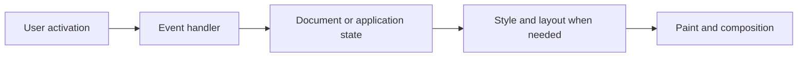

# F02 — Browser rendering, DOM, and accessible events

## Learning objective

Trace rendering and implement safe accessible DOM updates. JavaScript examples assume the root Node runtime unless labeled browser-only.

## Prerequisites

[F01](../../lessons/01-foundations/F01-programs.md)

## Explanation and mechanism

The browser provides APIs around the JavaScript language: document, events, navigation, storage, and network access. A Node process does not supply a browser DOM. Loading a page involves parsing HTML into a DOM, interpreting CSS, determining style and layout, painting pixels, and composing layers. This is a conceptual model; browsers can overlap and optimize work.

A DOM tree is like a document outline, not a picture. Updating a node changes document state; it does not guarantee an immediate paint. Repeated geometry reads after writes can force expensive layout. Batch reads and writes, measure before optimizing, and use CSS for layout.

Accessibility begins with semantics: a button supplies keyboard activation, focus behavior, and a role. A clickable div requires you to recreate those behaviors. ARIA supplies missing semantics, not all interaction behavior.

## Examples and execution trace

Browser-only example; assume these elements exist:

```html
<label for="title">Issue title</label>
<input id="title" maxlength="120">
<button id="add" type="button">Add issue</button>
<ul id="issues"></ul>
<p id="status" role="status"></p>
```

```javascript
const input = document.querySelector("#title");
const list = document.querySelector("#issues");
document.querySelector("#add").addEventListener("click", () => {
  const title = input.value.trim();
  if (!title) {
    document.querySelector("#status").textContent = "Enter a title";
    input.focus();
    return;
  }
  const row = document.createElement("li");
  row.textContent = title;
  list.append(row);
  input.value = "";
  document.querySelector("#status").textContent = "Issue added";
});
```

The event callback runs after activation. Validation occurs before mutation. textContent treats a title containing HTML as text. The status region announces an update without unexpectedly moving focus. In the project, a form submit supports Enter as well as a button click.



Events propagate through capture, target, and bubbling phases when that event bubbles. Delegation installs a listener on an ancestor and locates a matching descendant with closest. Verify that the matched node belongs to that ancestor. stopPropagation changes propagation; preventDefault cancels a cancelable default action. They solve different problems.

## Alternatives and common mistakes

innerHTML parses markup; using it for API or stored user strings can introduce XSS. Rich text requires a vetted sanitizer and policy, not a home-made replacement regex. querySelector can return null; scripts must wait for markup or handle absence. Removing a node is not enough if long-lived code still retains it. Use AbortController for listener teardown or keep the original callback reference for removeEventListener.

Virtual DOM is a library technique, not a universal browser speed guarantee. In Angular, use template bindings rather than unrelated direct DOM mutations. For large tables, first measure render cost; pagination may meet the requirement before virtualization is needed.

## Interview preparation

“The browser turns document and style state into pixels. I use semantic controls, safe text insertion, and explicit state. I investigate layout and long tasks with tools before choosing an optimization.” Follow-up: distinguish a DOM update from a rendered frame.

## Practice

Build a removable issue list with delegated events. Test keyboard-only use, empty input, nested button content, and a title containing an img tag. Explain a safe teardown strategy for a component that is repeatedly mounted.

## Revision

DOM ≠ pixels; propagation ≠ default action; semantics ≠ ARIA decoration. Draw the rendering flow from memory.

## Completion criteria

Demonstrate creation/removal by keyboard, no HTML execution from a title, meaningful labels and status, and cleanup of listeners. Record manual browser evidence separately from automated tests.

[Practice hints and solutions](../../practice/solutions.md#f02) · [Question Q02](../../interviews/answers.md#q02)

## References

[Primary sources and verification notes](../../references/README.md#wai); verified 2026-10-13.

