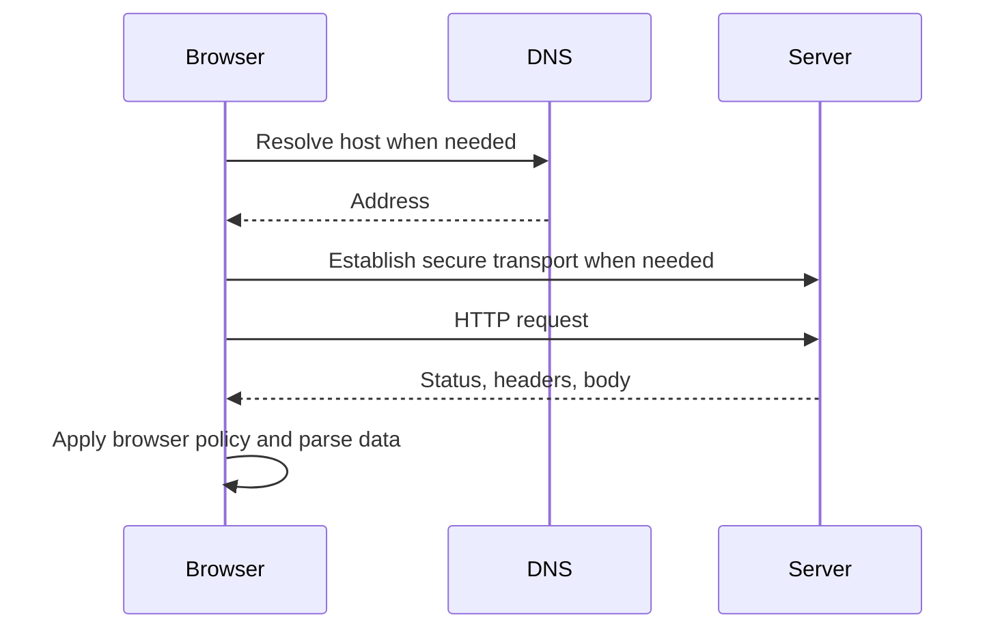

# F03 — HTTP, DNS, TLS, APIs, and browser storage

## Learning objective

Trace a request and distinguish transport, storage, and trust boundaries. JavaScript examples assume the root Node runtime unless labeled browser-only.

## Prerequisites

[F02](../../lessons/01-foundations/F02-browser.md)

## Explanation and mechanism

A URL identifies a scheme, host, port, path, and possibly a query. DNS resolves names to addresses. Establishing a secure connection includes transport setup and TLS negotiation; TLS encrypts transport and authenticates the server using certificates. HTTP then defines requests, responses, methods, status, and headers. HTTP/2 and HTTP/3 have different transport details, so do not claim every request opens a fresh TCP connection.

A useful analogy is mailing a request to an address with instructions and a return envelope. It breaks because connections are reused and protocols multiplex requests. Browser policy is also an extra layer beyond HTTP.



An API contract defines representation, validation, failure semantics, and authorization, not only an endpoint path. GET should retrieve data; POST commonly creates or initiates operations. PUT replaces a representation; PATCH applies a defined partial update. Successful transport does not imply a successful business operation.

## Examples and execution trace

Browser or root Node runtime; illustrative network call, not part of automated offline checks:

```javascript
async function loadIssues(signal) {
  const response = await fetch("/api/issues", { signal });
  if (!response.ok) throw new Error("HTTP " + response.status);
  const data = await response.json();
  if (!Array.isArray(data)) throw new TypeError("Expected issue list");
  return data; // Still validate each item before domain use.
}
```

fetch rejects for relevant network/cancellation failures; a 404 response normally fulfills. Check status before parsing the expected success schema. JSON may itself be invalid. Angular HttpClient generics also describe expectations without validating server bytes.

## Storage, trust, and caching

| Mechanism | Useful for | Important boundary |
| --- | --- | --- |
| In-memory state | Short-lived view state | Lost on reload; avoid unbounded retention |
| localStorage/sessionStorage | Small non-secret preferences | Synchronous; readable by same-origin scripts; XSS exposure |
| IndexedDB | Larger structured local/offline data | Still client-controlled; schema and quota handling required |
| Cookies | Browser-managed session transport | Secure, HttpOnly, SameSite and CSRF design; scope matters |

HttpOnly prevents JavaScript from reading a cookie; it does not stop an injected script from acting through the user's session. Client storage cannot establish authorization. The server checks identity, tenant, and operation on every relevant request.

HTTP freshness and revalidation are separate: max-age permits reuse while fresh; ETag/If-None-Match can validate stale data. no-cache means revalidate before reuse; no-store tells caches not to store. Sensitive responses need a deliberate policy.

## Alternatives and common mistakes

CORS is a browser rule governing access to cross-origin responses, not server authentication. A non-browser client can call an endpoint regardless of browser CORS policy. Do not retry arbitrary POST requests without a safe idempotency contract. Do not log tokens or send secrets in URLs that get recorded in history and logs.

## Interview preparation

“I trace the request through name resolution, secure transport, HTTP, browser policy, and runtime parsing. Then I locate authentication, authorization, validation, and cache controls at their actual boundaries.” Follow-up: can a frontend guard secure an API? Explain the server enforcement required.

## Practice

Inspect one request in DevTools: method, status, request/response headers, timing, and body. Compare a failed network request with a 404 and invalid JSON. Choose storage for a theme, an offline draft, and a session; describe the threat model.

## Revision

Transport success ≠ business success; CORS ≠ identity; type annotation ≠ validation; no-cache ≠ no-store.

## Completion criteria

Draw the flow, identify three failure layers, and justify a cache/storage policy without treating the browser as trusted.

[Practice hints and solutions](../../practice/solutions.md#f03) · [Question Q03](../../interviews/answers.md#q03)

## References

[Primary sources and verification notes](../../references/README.md#http); verified 2026-10-13.

