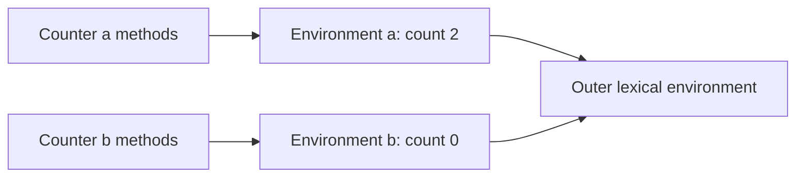

# JS02 — Scope, hoisting, TDZ, and closures

## Learning objective

Trace lexical bindings and implement a closure without leaks. JavaScript examples assume the root Node runtime unless labeled browser-only.

## Prerequisites

[JS01](../../lessons/02-javascript/JS01-values.md)

## Explanation and mechanism

Scope controls where names can be resolved. Lexical scope follows source nesting, not the location of the caller. A lexical environment models bindings and a link to an outer environment. A closure combines a function with access to the environment in which it was created. It retains bindings, not a frozen snapshot.

A useful analogy is a function carrying a notebook of names it may look up. The notebook is shared with related closures; the analogy must not suggest every binding value was copied.

Before executing statements, declaration processing creates bindings. var is initialized to undefined in its function or relevant script scope. let/const/class bindings cannot be read before initialization: the temporal dead zone. Hoisting describes observable declaration behavior; source lines are not physically rearranged. Module top-level scope differs from classic browser scripts and CommonJS wrappers.

## Examples and execution trace

<!-- runnable:node -->
```javascript
function createCounter() {
  let count = 0;
  return {
    increment: () => ++count,
    read: () => count
  };
}
const a = createCounter();
const b = createCounter();
a.increment();
a.increment();
console.log(a.read(), b.read()); // expect: 2 0

console.log(before); // expect: undefined
var before = 3;
try {
  console.log(typeof later);
} catch (error) {
  console.log(error.name); // expect: ReferenceError
}
let later = 4;
```

Each counter call creates its own environment. Within a, both functions share count. The outer call returns but the retained functions can still reach it. typeof on an undeclared identifier normally returns "undefined"; typeof on an uninitialized lexical binding throws.



## Alternatives and common mistakes

```javascript
const callbacks = [];
for (var i = 0; i < 3; i++) callbacks.push(() => i);
// All callbacks read the same binding after the loop: 3.
```

Use let in the loop to obtain per-iteration bindings, or pass a value into a function factory. Do not confuse fixing the closure with delaying when a callback executes.

An assignment to an unresolved name is not a declaration. In sloppy classic-script code it can create a global property; strict code and modules throw ReferenceError. Prefer explicit declarations and strict/module contexts.

Closures appear in browser listeners, Angular callbacks, and Node middleware factories. A closure is not inherently a leak. Long-lived roots can retain captured data beyond its useful lifecycle. Release subscriptions/listeners and bound cache sizes; setting captured state to null must also define behavior of future calls.

## Interview preparation

“A closure lets a function keep resolving outer lexical bindings after the outer call returns. Multiple closures can share one changing binding; separate factory calls have separate bindings.” Deeper follow-up: explain TDZ shadowing when an inner let hides an outer name before its initializer.

## Practice

Create two independent counters. Rewrite the var callback loop and predict both versions. Debug a listener retaining a large dataset after screen removal. Explain why deleting the DOM element alone may be insufficient.

## Revision

Where defined → lookup; binding shared → later value; call factory again → separate environment. Explain declaration creation versus initialization.

## Completion criteria

Reconstruct the environment diagram, implement counters without copying, and explain a delayed callback using var and let after a day.

[Practice hints and solutions](../../practice/solutions.md#js02) · [Question Q05](../../interviews/answers.md#q05)

## References

[Primary sources and verification notes](../../references/README.md#closures); verified 2026-10-13.

