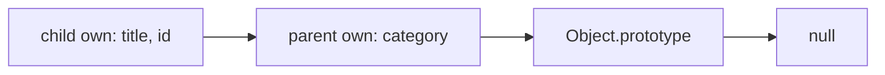

# JS04 — Objects, descriptors, prototypes, and memory

## Learning objective

Trace prototype lookup and explain shallow copying and reachability. JavaScript examples assume the root Node runtime unless labeled browser-only.

## Prerequisites

[JS03](../../lessons/02-javascript/JS03-this.md)

## Explanation and mechanism

Objects associate string or symbol keys with properties. A property may store a value or use getter/setter behavior. Descriptors control writable, enumerable, and configurable attributes; accessor descriptors use get/set instead of value/writable. Unspecified flags in defineProperty default to false.

Property lookup checks own properties, then walks the prototype chain until a match or null. Inheritance shares lookup behavior; it does not copy all parent properties into each child. Own properties can shadow inherited properties.

## Examples and execution trace

<!-- runnable:node -->
```javascript
"use strict";
const parent = { category: "issue" };
const child = Object.create(parent);
child.title = "Fix login";
Object.defineProperty(child, "id", { value: 7, enumerable: true });
console.log(child.category, Object.hasOwn(child, "category")); // expect: issue false
console.log(Object.keys(child).join(",")); // expect: title,id
try { child.id = 8; }
catch (error) { console.log(error.name); } // expect: TypeError

const symbol = Symbol("tag");
child[symbol] = "internal";
console.log(Object.keys(child).includes(String(symbol))); // expect: false
console.log(Object.getOwnPropertyDescriptor(child, symbol).enumerable); // expect: true
```

category resolves through parent. id is own, nonwritable, and nonconfigurable because those flags were omitted. Symbol properties can be enumerable, but Object.keys selects enumerable own string keys; Reflect.ownKeys includes own strings and symbols regardless of enumerability.



## Copying, immutability, and memory

Object spread and Object.assign copy enumerable own properties as values; they do not preserve all descriptors or prototypes, and reading values can invoke getters. Descriptor copying with getOwnPropertyDescriptors/defineProperties serves a different contract. Object.freeze is shallow: nested objects still mutate, and private fields are not ordinary properties frozen by it.

Memory leaks mean reachable data survives longer than intended. Garbage collection can reclaim unreachable objects even if they form cycles; exact timing and algorithms are engine-specific. WeakMap does not strongly retain its keys, but unrelated strong references can still keep them alive. Its entries cannot be enumerated to observe collection.

## Alternatives and common mistakes

Avoid adding application methods to Object.prototype. It changes shared behavior and can interfere with enumeration. Use your own prototype or composed functions. Use Object.hasOwn rather than trusting an object's overridden hasOwnProperty. For dynamic untrusted keys, Map or a null-prototype dictionary helps avoid accidental inherited-key behavior; still validate allowed keys.

A generic recursive deep-freeze must account for cycles and special objects. A targeted immutable update is often clearer for frontend state:
```javascript
const next = { ...user, address: { ...user.address, city: "Pune" } };
```

## Interview preparation

“Objects have own properties and a prototype lookup chain. Descriptors define property behavior. A shallow copy creates a new outer identity but shares nested references; garbage collection depends on reachability, not scope exit alone.” Follow-up: which keys will Object.keys omit, and why?

## Practice

Create a non-enumerable ID, inspect its descriptor, and attempt strict-mode mutation. Draw shadowing and delete an own property to expose the inherited one. Debug a detached-element leak with a retained callback.

## Revision

Own ≠ inherited; symbol ≠ non-enumerable; freeze ≠ deep freeze; inaccessible locally ≠ unreachable globally.

## Completion criteria

Predict lookup/enumeration for an unseen object, demonstrate shallow freezing, and propose a lifecycle-based leak fix.

[Practice hints and solutions](../../practice/solutions.md#js04) · [Question Q07](../../interviews/answers.md#q07)

## References

[Primary sources and verification notes](../../references/README.md#ecma); verified 2026-10-13.

