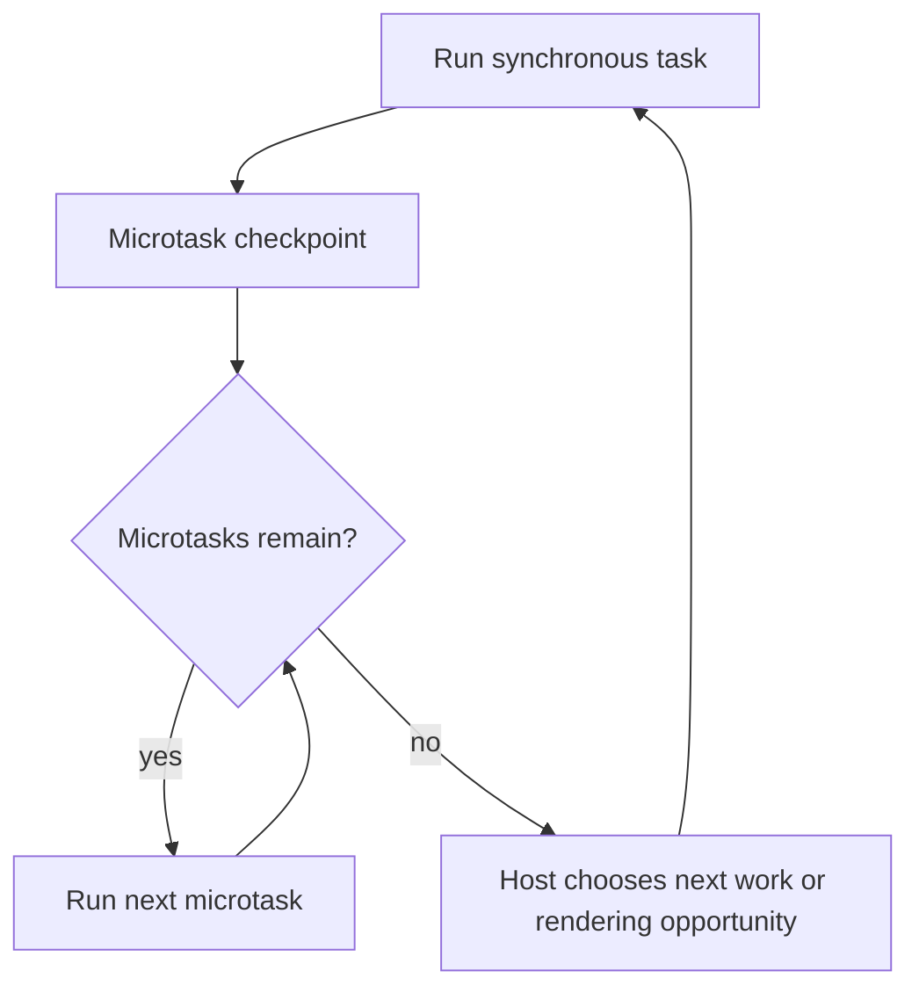

# AS01 — Execution contexts, tasks, and microtasks

## Learning objective

Predict scheduling while separating host behavior from language rules. Use the root runtime/compiler unless a framework-specific example says otherwise.

## Prerequisites

[JS02](../../lessons/02-javascript/JS02-scope.md)

## Explanation and mechanism

An execution context models the environment needed to execute code. The call stack tracks nested execution; returning removes a call from the stack. Objects are managed in engine memory; “stack versus heap” is an explanatory model, not a promise of one storage layout for every variable.

One JavaScript agent executes one piece of JavaScript at a time. The host can perform I/O and run other agents/workers concurrently. Concurrency means operations make progress over overlapping periods; parallelism means simultaneous execution.

In the browser model, a task runs, then a microtask checkpoint drains queued microtasks, including new microtasks added during the checkpoint. Rendering is an opportunity controlled by the browser, not a guaranteed event after every task. Timers schedule future eligible callbacks; zero delay does not interrupt running code.

## Examples and execution trace

The same simple result is demonstrated in the root Node lab. This example does not compare timer versus setImmediate or process.nextTick.

```javascript
console.log("A");
setTimeout(() => console.log("T"), 0);
Promise.resolve().then(() => console.log("P"));
queueMicrotask(() => console.log("M"));
console.log("B");
// Expected: A B P M T, each on its own line.
```

1. A prints during synchronous execution.
2. The host schedules timer eligibility.
3. Promise reaction P is queued; M follows it.
4. B prints before the current execution yields.
5. The queued microtasks run in insertion order here.
6. T runs after the synchronous work and microtasks.



This diagram models a browser checkpoint, not Node's phase diagram.

## Node-specific details

Node has libuv phases and a process.nextTick mechanism in addition to promise microtasks. Ordering also depends on where code executes, including top-level CommonJS versus ES modules. Starting with the libuv change included in Node 20, timers run after poll rather than both before and after. Do not infer a universal timer/setImmediate ordering from one top-level run. The root lab deliberately tests only specified/simple observable relationships.

## Alternatives and common mistakes

await does not move CPU-heavy code to a worker. A million-item loop in an async function still blocks its executing thread. Repeatedly adding microtasks can starve timers and rendering. Split work with host-appropriate scheduling or move computation to a worker when measurement justifies the transfer/setup cost.

A promise executor runs immediately, while its reactions run later. Setting a timer to 100ms gives a threshold, not an exact deadline. Use a monotonic clock for elapsed-duration measurements and test ordering without fragile wall-clock equality.

## Interview preparation

“I separate JavaScript execution from host scheduling. Current synchronous work finishes before queued promise reactions run. Microtasks can delay tasks and rendering. Node has its own phases and nextTick behavior, so I state the runtime before predicting output.” Follow-up: what happens if a microtask always enqueues another microtask?

## Practice

Predict the lab output before running npm run lab. Add a promise reaction inside another reaction and explain insertion order. Diagnose a UI freeze inside an async function. Explain what additional context is needed to compare setImmediate and setTimeout.

## Revision

Executor now; reaction later; delay threshold; one agent's stack; host-specific scheduling.

## Completion criteria

Trace queues and stack on paper for three unseen examples, reproduce the lab, and identify a starvation risk without claiming exact timer times.

[Hints and solutions](../../practice/solutions.md#as01) · [Question Q10](../../interviews/answers.md#q10)

## References

[Primary sources and version notes](../../references/README.md#nodeloop); verified 2026-10-13.

