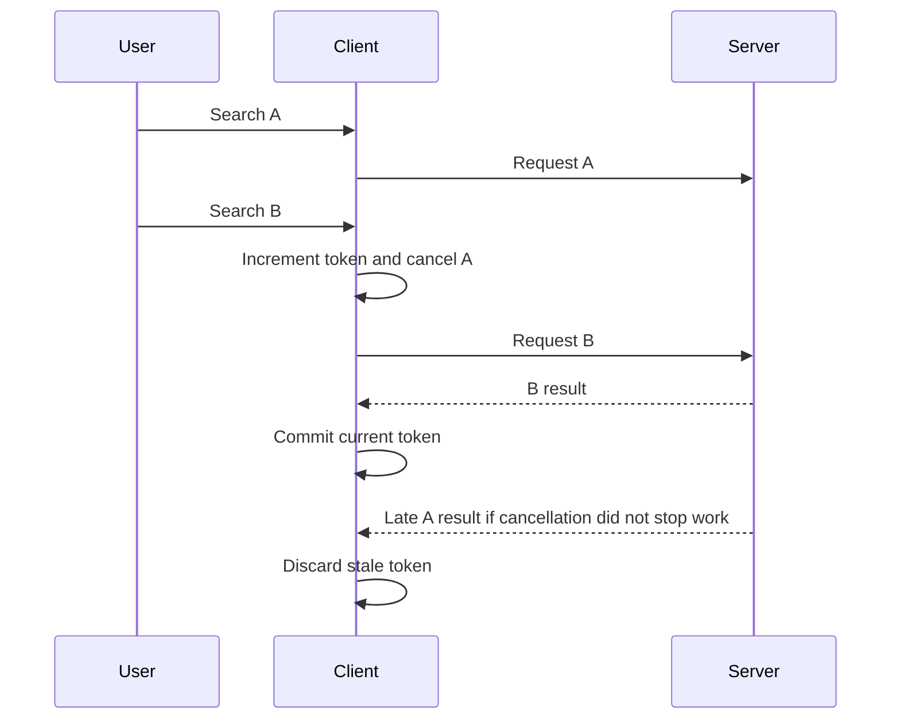

# AS03 — Cancellation, races, and bounded concurrency

## Learning objective

Prevent stale commits and bound active operations. Use the root runtime/compiler unless a framework-specific example says otherwise.

## Prerequisites

[AS02](../../lessons/03-async/AS02-promises.md), [F03](../../lessons/01-foundations/F03-http.md)

## Explanation and mechanism

A race condition occurs when outcome depends on the relative completion of operations. A single executing thread does not prevent races across awaits: another operation can read or change state while the first is suspended.

Cancellation is cooperative. AbortController supplies a signal; fetch and other cooperating APIs stop or reject when aborted. It does not rewind a completed server write. A request-generation token protects UI commitment even when a transport cannot cancel or completes at an inconvenient time.

Bounded concurrency limits active operations. It is different from rate limiting, which limits work started per time interval. Both may be needed for an API quota.

## Examples and execution trace

Browser pattern; loading and error states are abbreviated:
```javascript
let generation = 0;
let active;
async function search(query) {
  const current = ++generation;
  active?.abort();
  const controller = new AbortController();
  active = controller;
  try {
    const response = await fetch("/api/search?q=" + encodeURIComponent(query),
      { signal: controller.signal });
    if (!response.ok) throw new Error("HTTP " + response.status);
    const result = await response.json();
    if (current !== generation) return;
    render(result);
  } catch (error) {
    if (current === generation && !controller.signal.aborted) showError(error);
  }
}
```

Query A starts, then B increments generation and aborts A. If A still resolves, its token no longer matches and it cannot overwrite B. An old failure also cannot overwrite current UI state. Validate response data before render.



## Runnable concurrency exercise

The [async utilities](../../labs/async-tools.mjs) implement mapLimit, using a fixed number of workers and a shared next-index counter. Each worker claims an index synchronously, awaits its item, then claims another. Output positions preserve input order even when completions arrive out of order. Tests verify the maximum active count, failures, and invalid limits.

Its failure policy stops starting new work after a failure and waits for already-active workers before rejecting. It does not cancel their underlying operations. Passing signals to the work and defining cancellation ownership is a separate extension.

## Alternatives and common mistakes

Launching Promise.all over thousands of fetches does not bound pressure. Sequential execution is simple but may underuse available I/O concurrency. A worker pool improves overlap but adds scheduling and failure decisions.

Shared in-flight cache requests complicate cancellation: one caller aborting should not automatically cancel work needed by another. Either give each caller independent transport ownership, or define shared ownership/ref-counting explicitly.

Do not use switchMap for writes merely because it avoids old responses: server operations may already have committed. Use a suitable write-order/idempotency policy.

## Interview preparation

“I separate starting work, cancelling transport, and committing results. A generation token protects current UI state; a worker pool limits active work. Neither mechanism supplies server rollback or time-based rate limiting.” Follow-up: what happens to already-active tasks after the first error?

## Practice

Implement mapLimit before reading its solution. Test output order with deliberately reordered completions. Model a search race on paper and explain why abort alone is insufficient. Design shared request cancellation for two callers.

## Revision

Cancel ≠ rollback; concurrency ≠ request rate; completion order ≠ result order; one thread ≠ race-free state.

## Completion criteria

Write an independent bounded mapper, prove its active-count invariant, and demonstrate stale-result prevention.

[Hints and solutions](../../practice/solutions.md#as03) · [Question Q12](../../interviews/answers.md#q12)

## References

[Primary sources and version notes](../../references/README.md#promise); verified 2026-10-13.

