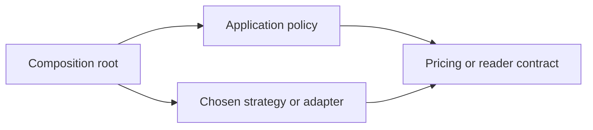

# DP01 — Choose patterns from concrete problems

## Learning objective

Implement strategies, observers, and adapters without forcing classes. Angular snippets target 16.2; standalone TypeScript labs use the root compiler.

## Prerequisites

[SD01](../../lessons/06-design/SD01-solid.md), [FP01](../../lessons/04-functional/FP01-functions.md)

## Explanation and mechanism

A design pattern names a recurring problem and solution structure. Its value is a shared vocabulary for trade-offs. It is not proof that a class-heavy implementation is correct. Begin with pressure: changing creation rules, incompatible interfaces, interchangeable policies, lifecycle notifications, or ordered processing.

Factory creates objects through a seam; abstract factory creates compatible families. Strategy substitutes behavior; adapter translates a contract; facade simplifies a subsystem; decorator wraps behavior; proxy mediates access. These distinctions matter more than the number of classes.

## Small implementations

Plain JavaScript strategy and adapter:
<!-- runnable:node -->
```javascript
const cost = (weight, pricing) => pricing(weight);
console.log(cost(2, kg => 100 + kg * 20)); // expect: 140
const legacy = { getName: () => ({ full_name: "Ada" }) };
const adapted = { read: () => ({ name: legacy.getName().full_name }) };
console.log(adapted.read().name); // expect: Ada
```

TypeScript version:
```typescript
type Pricing = (weightKg: number) => number;
interface NameReader { read(): { name: string }; }
const quote = (weight: number, pricing: Pricing): number => pricing(weight);
```

Both versions replace implementation details with contracts. The [design lab](../../labs/design.ts) compiles a strategy, adapter, and observer with unsubscribe. An observer has explicit listener ownership; a callback that remains registered can retain its owner.



## Selection guide

| Pattern | Concrete problem | Cost / simpler alternative |
| --- | --- | --- |
| Factory | Construction differs by validated input | A function or constructor may suffice |
| Abstract factory | Products must belong to compatible families | Too much machinery for one product |
| Builder | Staged construction and validation | Options object for simple cases |
| Singleton | One shared instance within a defined scope | Global state complicates tests/tenants; inject scoped instance |
| Adapter | External contract differs from domain | Mapping function for small translations |
| Facade | Callers repeat subsystem orchestration | One service function before a class layer |
| Decorator | Add behavior while preserving interface | Function wrapper; document order and errors |
| Proxy | Mediate caching/access/lazy lookup | Explicit API client when hidden behavior is surprising |
| Composite | Uniform operations on leaves/groups | Recursive data traversal for read-only trees |
| Strategy | Interchangeable policy | Pass a function; no hierarchy needed |
| Observer | Multiple listeners react to events | Direct callback when there is one owner |
| Command | Queue/audit/undo an operation | Closure for simple deferred work; undo needs compensating semantics |
| State | Behavior depends on allowed transitions | Discriminated union and transition function |
| Chain of responsibility | Ordered handlers pass or stop | Explicit pipeline; specify one termination/response |
| Template method | Stable algorithm with variant steps | Composition avoids rigid inheritance |
| Repository | Separate domain queries from persistence | Avoid generic CRUD promising nonexistent transactions |
| Dependency injection | Select/test collaborators | Constructor/function parameters before a container |
| Module | Encapsulated dependency boundary | ES modules by default |
| Middleware | Request processing with explicit next/error behavior | Chain semantics, not automatically a decorator |

These are selection primers. Full independently tested JS/TS implementations of every pattern are **planned** in DP02–DP04; the table is not a substitute for those lessons.

## Framework connections and mistakes

Angular provider scopes determine service instance lifetime; providedIn: root does not mean one universal instance across all applications, tabs, or processes. A frontend cache cannot enforce server authorization. Node middleware pipelines must avoid sending twice and must propagate errors according to the framework version. A database pool manages multiple connections; describing it as one singleton connection confuses lifecycle and throughput.

A decorator wrapper must decide whether calling twice repeats a side effect. The archived discount example formerly discounted the already-discounted total on each checkout; preserving the original total avoids that particular bug. Do not label every function returning an object “abstract factory.”

## Interview preparation

“I name the variation and the contract first, then choose the smallest structure that handles it. A strategy can be a function, an adapter can be a mapper, and singleton scope must be explicit.” Follow-up: distinguish adapter, facade, and proxy for an API client.

## Practice

Implement a pricing strategy in JS and TS. Add observer unsubscribe and test repeated unsubscribe. Draw a proxy's cache/trust boundary. Reject a builder for a two-field immutable options object, with reasoning.

## Revision

Factory creates; adapter translates; facade simplifies; decorator wraps; proxy mediates; strategy varies; observer notifies.

## Completion criteria

Build three patterns without looking, explain their error/lifecycle contracts, and defend a simpler alternative.

[Hints and solutions](../../practice/solutions.md#dp01) · [Question Q18](../../interviews/answers.md#q18)

## References

[Primary sources and version notes](../../references/README.md#ecma); verified 2026-10-13.

