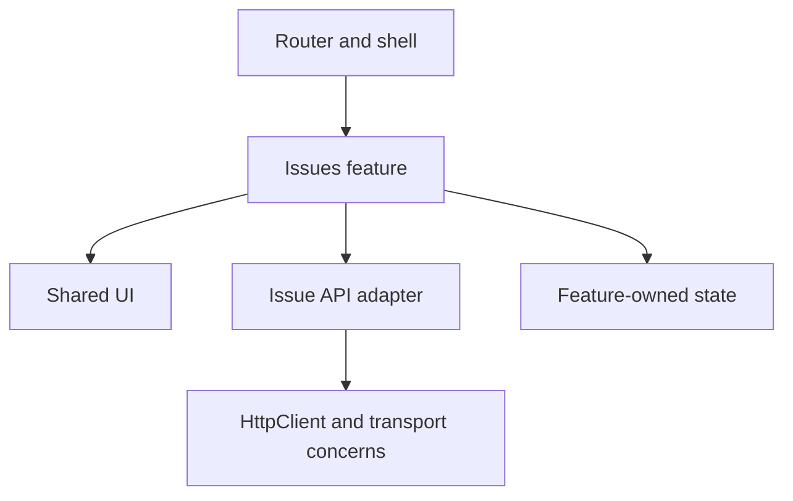

# AG01 — Angular 16 components, DI, routing, and boundaries

## Learning objective

Design component/provider scopes and trace OnPush rendering. Angular snippets target 16.2; standalone TypeScript labs use the root compiler.

## Prerequisites

[F02](../../lessons/01-foundations/F02-browser.md), [TS03](../../lessons/05-typescript/TS03-configuration.md), [SD01](../../lessons/06-design/SD01-solid.md)

## Explanation and mechanism

Angular coordinates templates, component instances, dependency injection, routing, and change detection. A component owns a view and interaction logic; a directive adds behavior; a pipe transforms a display value. Business rules do not belong in a large template expression.

For an Angular 16 maintenance application, both NgModule-based and standalone composition are valid. NgModules declare non-standalone components/directives/pipes, import dependencies, and export a public surface. Standalone components declare imports directly. Do not migrate everything simply to change syntax.

## Feature boundaries and provider scope

```text
app/
  core/       session, configuration, application-wide transport concerns
  shared/     reusable UI without feature-specific business rules
  issues/     routes, components, API mapping, feature state
  layout/     navigation and shell
```

These folders are a convention, not an Angular requirement. Dependencies should point toward reusable contracts; shared must not import issues. Lazy loading is a delivery boundary and often a feature ownership boundary.



A root provider is shared in that application's injector hierarchy. A component provider creates a closer scope tied to component lifetime. Lazy/module-level providers can create distinct instances. Choose scope from ownership; a feature-state service provided at root may unintentionally survive navigation or share across views.

Routing exercise:
```typescript
const routes: Routes = [
  { path: "issues", loadChildren: () =>
      import("./issues/issue.module").then(m => m.IssueModule) }
];
```

Guards improve navigation UX. They do not replace server authorization. Pass route IDs to a feature facade, map API DTOs at the boundary, and keep presentational components dependent on explicit inputs/outputs.

## Lifecycle and change detection

Initial input changes precede ngOnInit. View hooks occur after the view is initialized/checked. ngOnDestroy releases owned resources. Avoid mutating already-checked state during inappropriate hooks, or repeated expensive work in frequently called checked hooks.

OnPush permits Angular to skip eligible subtrees. New input bindings, relevant view events, explicit marking, and AsyncPipe updates are important triggers. Mutating an object while preserving its identity is not a reliable input-change signal. A click inside the subtree may still cause checks, which is why “OnPush means only inputs” is wrong. Zone.js helps schedule checks around asynchronous activity; it does not make all code fast.

## Version boundaries

Angular 16 introduced signals and hydration as developer previews; use [the version guide](../../references/versions.md) when evaluating them. The core maintenance path here uses components, conventional bindings, and RxJS. Examples use *ngIf/*ngFor, not later @if/@for/@defer syntax. Hydration requires matching server/client DOM and version-appropriate setup; it is not implemented by this fixture.

## Alternatives and common mistakes

One global store for all state loses local ownership. One service per trivial operation adds indirection. Start with local view state; promote only shared or persistent state. Use pure pipes for deterministic transformations, and avoid expensive getters called from templates.

Angular templates escape interpolated text; bypassSecurityTrust... explicitly changes the trust contract and is not an XSS fix. Library components need semantic HTML, keyboard behavior, and a documented API.

## Interview preparation

“I define feature ownership and injector lifetime first. Components coordinate views, adapters translate APIs, and state has an owner. OnPush changes when work is eligible; it does not replace understanding events, inputs, and observable updates.” Follow-up: why might two components receive different instances of the same service?

## Practice

Draw a lazy feature and mark providers by lifetime. Fix a mutated input passed to an OnPush child. Explain an initialization sequence. List the UI and server checks for a protected route.

## Revision

Folder ≠ enforced boundary; root ≠ universal singleton; guard ≠ authorization; OnPush ≠ inputs only.

## Completion criteria

Design and explain a feature dependency graph, diagnose a stale OnPush view, and choose provider scopes with lifecycle reasoning.

[Hints and solutions](../../practice/solutions.md#ag01) · [Question Q19](../../interviews/answers.md#q19)

## References

[Primary sources and version notes](../../references/README.md#angular16); verified 2026-10-13.

