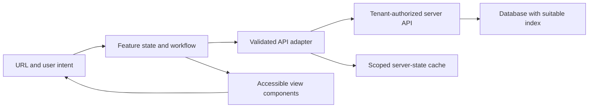

# FE01 — Design an enterprise frontend under constraints

## Learning objective

Gather requirements and design state, caching, failures, and accessibility. Examples distinguish implemented labs from design sketches and production extensions.

## Prerequisites

[AG03](../../lessons/08-angular/AG03-forms-http.md), [F03](../../lessons/01-foundations/F03-http.md), [DP01](../../lessons/07-patterns/DP01-selection.md)

## Explanation and mechanism

System design begins by discovering what users need and what constraints dominate. Do not begin by naming a framework or drawing ten services. Ask about roles, data volume, latency, consistency, tenancy, devices, accessibility, offline work, team ownership, and operational targets.

For an enterprise issue portal, suppose 200 support staff search up to a million issues; each page contains 50 rows; edits require tenant-scoped permission; search latency target is 500ms at the 95th percentile. These are exercise assumptions, not measured promises from the demo.

## Worked design and data flow

Use a feature route with a page component, reusable table/form controls, an API adapter, and a feature state owner. Store search/filter/page intent in the URL when it must be shareable. Keep drafts local. The server owns filtering and pagination at this volume; fetching all rows to filter in the browser violates the constraint.

The URL produces request intent; latest search replaces prior read work; the adapter parses DTOs into domain data. View state distinguishes initial load, refreshing existing data, success, empty, and failure. The display should tell the user when showing stale data.

Define an API contract such as GET /issues?q=...&cursor=...&limit=50 with an opaque cursor, stable ordering, applied filters, and a next cursor. Include tenant in authorization and cache scope. A cursor is not permission and should not allow arbitrary query injection. Avoid leaking total counts if they expose cross-tenant information.

For edit, use resource version/ETag with conditional writes to detect conflicts. A successful mutation invalidates or updates matching cached detail/list records according to an explicit policy. Optimistic updates need rollback/conflict behavior; use pessimistic confirmation where error cost is high.

## Failures, performance, and testing

When a page fetch fails, preserve prior data where useful and expose retry. A timeout is an uncertain outcome for a write; an idempotency contract may be necessary before retrying. WebSocket reconnection needs bounded backoff, deduplication/versioning, and an HTTP resync path after missed events.

Use pagination before virtualization if 50 rows meet needs. Virtualization helps large visible datasets but complicates focus, screen-reader navigation, dynamic row heights, and testing. Debounce user search, split large feature bundles, track stable row identity, and measure network, long tasks, rendering, and memory separately.

Test parsing and pure state transitions, component interactions, API failures, permission changes, tenant switches, and end-to-end user journeys. Check keyboard order, focus after dialogs, loading announcements, and non-color error cues. Instrument request latency/error rate with correlation IDs, without collecting secrets or unrestricted customer content.

## Alternatives and trade-offs

A monorepo can share tooling/contracts but needs enforceable boundaries and coordinated releases. Micro-frontends can support independently owned deployment, at the cost of routing/auth/style/observability coordination and duplicated bundles. Use them only when organizational independence creates enough value.

A design system owns accessible interaction contracts and tokens, not every business workflow. Backend permission models and frontend feature visibility must align while maintaining server authority.

Record key decisions in an ADR: context, constraints, options, selected decision, consequences, and revisit trigger. The [case workbook](../../practice/system-design.md) varies constraints across nine designs; learn to change a design when the assumptions change.

## Interview preparation

“I clarify users, scale, and consistency first; then define state ownership, API contracts, trust boundaries, failures, and measurable targets. I choose the smallest architecture that meets those constraints and name the trade-offs.” Follow-up: how does the design change for offline editing?

## Practice

Draw the portal in five minutes. Defend cursor pagination versus offset. Add offline edits and explain conflict resolution. Write an ADR deciding against micro-frontends for a four-person team.

## Revision

Requirements → constraints → contracts → owners → failures → measures → trade-offs. Cache invalidation follows mutations and scope changes.

## Completion criteria

Deliver a 30-minute design with explicit assumptions, three failures, tenant boundaries, test strategy, and a defensible alternative.

[Hints and solutions](../../practice/solutions.md#fe01) · [Question Q22](../../interviews/answers.md#q22)

## References

[Primary sources and version notes](../../references/README.md#wai); verified 2026-10-13.

