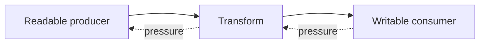

# ND01 — Node runtime, streams, workers, and shutdown

## Learning objective

Explain nonblocking I/O, backpressure, and service lifecycle. Examples distinguish implemented labs from design sketches and production extensions.

## Prerequisites

[AS03](../../lessons/03-async/AS03-concurrency.md), [JS06](../../lessons/02-javascript/JS06-modules.md), [TS03](../../lessons/05-typescript/TS03-configuration.md)

## Explanation and mechanism

Node hosts JavaScript outside the browser. Its runtime supplies modules, filesystem, networking, streams, buffers, events, and workers. Nonblocking I/O allows one executing JavaScript thread to serve other work while waiting; it does not mean CPU-heavy code is free.

Some asynchronous work uses OS facilities and some uses libuv's thread pool. Not every asynchronous API corresponds to a new thread. Worker threads execute JavaScript in other agents and can help CPU-intensive computation, with communication, serialization, and lifecycle costs. A cluster or multiple service processes is another scaling dimension.

## Streams, buffers, and backpressure

A Buffer represents bytes; decoding interprets them as text. A text character can span multiple chunks, so do not decode every arbitrary chunk independently without a streaming decoder.

A stream processes chunks instead of collecting an entire payload first. Backpressure lets a slower consumer constrain production. For a writable, write returning false asks the producer to wait for drain. pipeline connects streams with error/cleanup behavior; it is usually clearer than manually composing every event.

Runnable form exists in [the stream lab](../../labs/streams.mjs):
```javascript
import { Readable, Transform } from "node:stream";
import { pipeline } from "node:stream/promises";
const upper = new Transform({
  transform(chunk, encoding, done) {
    done(null, chunk.toString("utf8").toUpperCase());
  }
});
await pipeline(Readable.from(["hello", " world"]), upper, process.stdout);
// HELLO WORLD
```

The example intentionally uses ASCII; arbitrary split Unicode needs a decoder. Streaming limits buffering when each stage respects pressure; a transform accumulating all chunks defeats that purpose.



## Events, configuration, and lifecycle

EventEmitter invokes ordinary listeners synchronously in registration order for an emit. A listener's async function returns a promise the emitter does not inherently await; define rejection handling. The error event has special semantics and must be handled appropriately.

Load configuration at startup and validate missing or malformed values. Environment variables are strings, not typed booleans or numbers. Keep secrets out of source, URLs, logs, and client bundles. A local .env convenience is not a complete secrets-management strategy.

Graceful shutdown stops accepting new work, finishes/drains active operations within a deadline, closes pools/consumers, and handles remaining connections. Signal handlers must avoid starting new indefinite work. The issue-board server demonstrates a bounded HTTP shutdown, not a distributed drain protocol.

## Alternatives and common mistakes

Synchronous filesystem operations inside a request block the executing thread. Reading an entire upload into memory ignores body limits and pressure. Spawning workers per tiny operation may be slower than direct work; use a bounded pool for significant measured CPU workloads.

CommonJS require and ESM import follow different host rules. Pin dependencies, commit lockfiles, use npm scripts with local binaries, and define supported runtime versions. Root npm ci does not build Angular's separate package.

## Interview preparation

“Node overlaps I/O through host facilities while JavaScript execution can still block. I use streams to control buffering, define event error ownership, and give services a startup and shutdown contract.” Follow-up: when should a CPU task move to a worker rather than be awaited?

## Practice

Run the stream lab. Replace its transform with one that fails and verify pipeline rejection. Explain Unicode chunk boundaries. Design a shutdown deadline for requests and a queue consumer.

## Revision

Async ≠ another JS thread; stream ≠ zero memory; emit ≠ await listeners; shutdown ≠ immediate process.exit.

## Completion criteria

Demonstrate stream error cleanup, explain pressure flow, and diagnose one blocked-event-loop scenario.

[Hints and solutions](../../practice/solutions.md#nd01) · [Question Q23](../../interviews/answers.md#q23)

## References

[Primary sources and version notes](../../references/README.md#stream); verified 2026-10-13.

