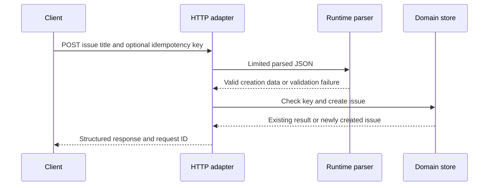

# ND02 — REST APIs, validation, persistence, and consistency

## Learning objective

Build a validated API and reason about transactional boundaries. Examples distinguish implemented labs from design sketches and production extensions.

## Prerequisites

[ND01](../../lessons/10-node/ND01-runtime.md), [F03](../../lessons/01-foundations/F03-http.md), [TS01](../../lessons/05-typescript/TS01-contracts.md)

## Explanation and mechanism

An API boundary accepts untrusted bytes, authenticates the caller, authorizes the operation, validates data, applies domain rules, coordinates persistence, and returns a defined representation. TypeScript interfaces describe intended shapes; runtime parsing supplies evidence.

A small service can separate HTTP adaptation from domain operations without a repository interface for every table. Introduce an abstraction when it isolates meaningful policy, supports testing, or expresses a real capability.

## Implemented vertical slice

The [issue board](../../projects/issue-board/README.md) is an in-memory TypeScript service with a same-origin browser client. It supports list/search and creation, validates inputs, bounds request bodies and row count, returns structured errors/request IDs, demonstrates bounded idempotency records, and implements HTTP shutdown. Tests use a real local HTTP server with an ephemeral port.

It has no user authentication, durable database, distributed limits, or production deployment. Those are explicit requirements in the next stage, not hidden guarantees of the demo.

## REST and error contracts

Use status meaningfully: 400 for malformed input, 401 for absent/invalid authentication, 403 for denied permission, 404 for absent resources or deliberate concealment, 409 for conflicting state/key reuse, 413 for excessive body, and 500 for unexpected failure. Applications may use 422 for semantic validation; document one coherent policy.

Do not expose internal stack traces in responses. A public code/message plus correlation ID can support diagnosis. Log enough context to investigate without recording passwords, tokens, or arbitrary request bodies.

## Persistence and consistency

A database transaction groups operations under the database's guarantees. Atomicity prevents a partial transfer; isolation controls interactions with concurrent transactions; constraints protect invariants. An in-memory sequence “withdraw then deposit” is not atomic if the second step fails.

For an issue update, define an optimistic version check in the update itself, not a separate read followed by an unguarded write. Use parameterized queries; dynamic sort/filter names need allowlists because parameters usually cannot substitute SQL identifiers.

A connection pool bounds concurrent database connections and reuses them. Set acquisition timeouts, always release connections, and measure wait time; a bigger pool can overload the database. Offset pagination is simple but can drift under writes and be expensive at large offsets. Cursor pagination needs stable ordering/tie-breaking and scoped tokens.

Queues add retry, duplicate-delivery, poison-message, and ordering concerns. Consumers must be idempotent when delivery can repeat. An outbox can coordinate a database change with later event publication; deeper executable integration is ND03/ND04.

## Alternatives and common mistakes

Express is useful for middleware/routing ergonomics; framework version affects async error handling. The learning slice uses node:http to expose the mechanics with few dependencies. It is a justified teaching choice, not a blanket framework recommendation.

A generic repository that promises save for immutable records or transactions over incompatible backends hides important behavior. A timeout does not prove a write failed; retries need an idempotency design.

## Interview preparation

“I define ingress validation and operation-specific authorization, then enforce invariants where writes happen. I distinguish in-memory sequencing from database atomicity and make errors, retries, and pool limits explicit.” Follow-up: how would you prevent lost updates?

## Practice

Run and test the slice. Add a proposed database schema with constraints. Describe an atomic issue/event change. Design a cursor with a stable secondary key and identify its tenant boundary.

## Revision

Validation ≠ authorization; sequence ≠ transaction; timeout ≠ no write; pool ≠ one connection; cursor ≠ permission.

## Completion criteria

Demonstrate invalid and duplicate HTTP requests, explain three database failure cases, and specify the controls required before deployment.

[Hints and solutions](../../practice/solutions.md#nd02) · [Question Q24](../../interviews/answers.md#q24)

## References

[Primary sources and version notes](../../references/README.md#nodehttp); verified 2026-10-13.

