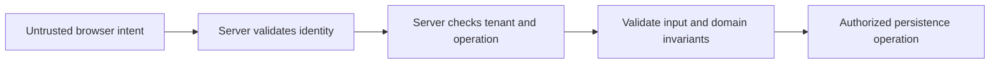

# PE01 — Authentication, authorization, and web security

## Learning objective

Locate XSS, CSRF, CORS, and tenant authorization controls. Examples distinguish implemented labs from design sketches and production extensions.

## Prerequisites

[F03](../../lessons/01-foundations/F03-http.md), [TS01](../../lessons/05-typescript/TS01-contracts.md)

## Explanation and mechanism

Authentication establishes identity. Authorization decides whether that identity may perform this operation on this resource, in this tenant, at this time. Frontend guards and hidden controls provide UX; the server enforces security independently.

Security design starts with assets and trust boundaries. Treat request bodies, query parameters, stored customer strings, filenames, and third-party responses as untrusted. A signed token proves only what its validated signature, claims, issuer, audience, and lifetime actually establish.

## Threat-to-control mapping

| Threat | Failure | Primary control location |
| --- | --- | --- |
| XSS | Untrusted content becomes executable page code | Safe rendering, correct context encoding, vetted rich-text sanitization, CSP as defense in depth |
| CSRF | Browser credentials accompany attacker-origin state change | Server-side CSRF/origin policy and appropriately scoped SameSite cookies |
| CORS confusion | Cross-origin response exposure treated as permission | Server auth remains required; explicit allowed origins/credentials policy |
| IDOR/tenant leak | Changing an ID exposes another user's resource | Authorize resource and tenant in the server query/operation |
| Injection | Input interpreted as a query/command | Parameterization, allowlisted identifiers, avoid shell-string composition |
| Secret disclosure | Credentials appear in bundle/log/URL | Server-side secrets management, redaction, limited access |
| Supply-chain compromise | Dependency/build code has unintended authority | Reviewed dependencies, reproducible builds, update/audit policy |

These controls complement each other. CSP is not permission logic; CORS is not login; HttpOnly does not stop a malicious same-origin script from issuing requests with the user's session.

## Example: permission boundary

```typescript
// Illustrative server query: tenant/user comes from verified identity, not the body.
const issue = await db.findIssue({
  id: parsedId,
  tenantId: session.tenantId
});
if (!issue || !policy.canEdit(session, issue)) {
  throw new ForbiddenError();
}
```

This is a boundary sketch, not the implemented demo authentication. A production implementation must verify session/token data before this point, enforce write constraints transactionally, and choose consistent concealment/error semantics.



The browser can help reject mistakes quickly, but an attacker can bypass that browser code.

## Session and rendering choices

Cookie sessions can keep credentials out of JavaScript with Secure/HttpOnly, but automatic browser sending requires a CSRF design. Bearer tokens accessible to JavaScript face XSS exfiltration risk. Choose from an explicit threat/deployment model; do not assert one storage mechanism is universally safe.

For ordinary user strings, use textContent or framework interpolation. A rich-text requirement needs a maintained sanitizer with an allowed-markup policy. Avoid bypassing Angular sanitization as a default escape hatch. Validate redirect destinations and file metadata; scan/process uploads according to their actual use.

## Alternatives and common mistakes

Decoding a JWT is not verification. Trusting an X-Tenant-ID request header is not isolation. Marking a form field readonly is not server validation. Hiding an admin route does not prevent HTTP calls. Logs are another data store with access and retention rules.

The loopback issue-board demo deliberately has no identity model and is not deployable as a multi-user service. Its host/origin checks reduce specific local browser misuse; they do not supply authentication.

## Interview preparation

“I locate identity, operation permission, tenant scope, and input rules at server boundaries. I use safe rendering on the client and match session/CSRF/CORS controls to the deployment model.” Follow-up: can HttpOnly alone make an XSS harmless?

## Practice

Threat-model the issue board before deployment. Demonstrate a malicious title staying text. Specify tests for a user changing a resource ID and a tenant switch. Compare cookie and bearer-session trade-offs without universal claims.

## Revision

Decode ≠ verify; client check ≠ enforcement; CORS ≠ authorization; HttpOnly ≠ immunity; ID ≠ permission.

## Completion criteria

Produce a trust-boundary diagram with five plausible attacks, exact server/client controls, and tests that would fail if authorization were removed.

[Hints and solutions](../../practice/solutions.md#pe01) · [Question Q25](../../interviews/answers.md#q25)

## References

[Primary sources and version notes](../../references/README.md#owasp); verified 2026-10-13.

