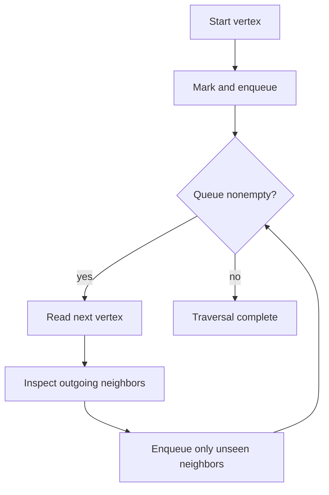

# AL02 — Hashing, windows, search, and traversal

## Learning objective

Derive core algorithms from invariants and test counterexamples. Examples distinguish implemented labs from design sketches and production extensions.

## Prerequisites

[AL01](../../lessons/12-algorithms/AL01-complexity.md), [JS06](../../lessons/02-javascript/JS06-modules.md)

## Explanation and mechanism

Algorithmic patterns follow constraints. Hashing remembers prior information; two pointers exploit order; a sliding window maintains a contiguous region; binary search eliminates a monotonic half; traversal visits connected structure; dynamic programming reuses subproblem results when overlap and state definitions justify it.

This lesson implements hashing, windows, binary search, and breadth-first traversal. Complete linked-list/heap/sorting/backtracking/greedy/DP implementations are later AL03/AL04. Learn the invariants here before collecting more problems.

## Hashing and windows

Two sum scans values while remembering prior positions. Check for the complement before adding the current index so one item cannot pair with itself. The [algorithm lab](../../labs/algorithms.mjs) returns two indices or null and tests duplicates/negative values.

For longest substring without repeated code points, expand the right boundary; if a value last appeared inside the window, move left just after it. Never move left backward.

```javascript
function longestUnique(text) {
  const last = new Map();
  let left = 0, best = 0, right = 0;
  for (const value of text) {
    if (last.has(value)) left = Math.max(left, last.get(value) + 1);
    last.set(value, right);
    best = Math.max(best, right - left + 1);
    right += 1;
  }
  return best;
}
// "abba" -> 2, "" -> 0; code points, not grapheme clusters.
```

The invariant is that the current window contains no repeated values. Each code point is visited once; expected map access gives O(n) time and O(u) retained distinct keys. For a fixed-size numeric window, add the new item and subtract the departing one.

## Binary search and traversal

Use a half-open interval [left, right). For lowerBound on sorted ascending numbers, values before left are less than target; values at/after right are at least target. Return the first candidate index, possibly length. Sorted order is a precondition, not something binary search establishes.

Breadth-first traversal uses a queue and visited set. Mark when enqueuing to prevent cycles from creating repeated work. Use a head index rather than repeated shift. O(V + E) counts vertices and edges examined for adjacency-list graphs, with O(V) queue/visited storage.



## Stacks, recursion, and later patterns

A stack is useful for nesting/undo/DFS; recursion uses the execution stack. An explicit stack can handle deep trees without relying on recursion limits. Linked lists make local pointer rewiring possible but lose array indexing locality. Heaps efficiently select an extremum; they do not fully sort data.

Greedy choice needs a proof that the local decision preserves a global optimum. DP needs state, transition, base case, evaluation order, and space accounting. Recognizing overlap is not enough if the state omits needed history.

## Alternatives and common mistakes

Sliding windows with negative values may invalidate monotonic sum-based shrinking arguments. Binary search with a wrong boundary update can fail to terminate. A visited set using object identity cannot deduplicate separately deserialized records by business ID. Choose the graph's identity model explicitly.

## Interview preparation

“I derive a pattern from input constraints and state its invariant. I test a small counterexample, then explain time, space, and mutation behavior.” Follow-up: why does the left boundary use Math.max for abba?

## Practice

Solve [P01–P06](../../practice/README.md) before reading solutions. Trace abba, search missing/end targets, and traverse a cycle/disconnected graph. Compare BFS and DFS when seeking the shortest unweighted path.

## Revision

Complement before insert; window never moves backward; binary-search interval shrinks; visited at enqueue; shortest weighted path needs more than BFS.

## Completion criteria

Implement the four lab algorithms from memory, pass edge tests, and explain when one pattern's precondition fails.

[Hints and solutions](../../practice/solutions.md#al02) · [Question Q28](../../interviews/answers.md#q28)

## References

[Primary sources and version notes](../../references/README.md#microsoft); verified 2026-10-13.

